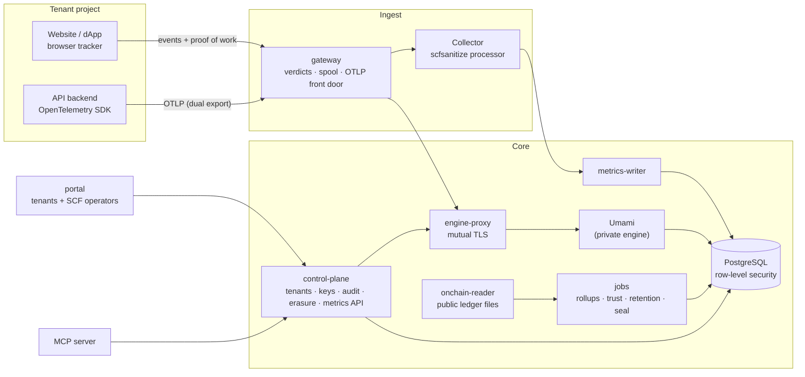

# UsageMap

**Privacy-first web, API and on-chain analytics for Stellar ecosystem projects.** Open source, multi-tenant and free
to use.

Projects see who uses their websites and APIs. Ecosystem operators see which projects are actually used, measured
with the same definitions for everyone. Every web figure is reported as **verified** (it passed the bot checks) next
to **raw**, with the reason codes that explain the gap.

- **Live:** <https://usagemap.dev> (overview) · <https://app.usagemap.dev> (portal)
- **Docs:** <https://docs.usagemap.dev>: install, integrations, dashboards, privacy, troubleshooting, with
  `llms.txt` and an agent skill
- **Licence:** Apache-2.0

## What it does

- **Web analytics.** A small, version-pinned browser tracker (`tracker/`, SRI-pinned, no cookies or stored
  identifiers, with a consent-gated mode for sites that need one) sends events to the ingest gateway
  (`services/gateway`). The gateway judges each event with proof of work, a signed challenge, and origin, header and
  transport checks before it reaches [Umami](https://umami.is), which runs unmodified and private as the engine.
- **API analytics.** Projects dual-export OpenTelemetry metrics or traces with an ingest token. The Collector
  distribution (`collector/`) strips anything sensitive, and the metrics writer (`services/metrics-writer`) stores
  standardised, route-normalised metrics in PostgreSQL. API figures are labelled "self-attested telemetry".
- **Stellar-aware counting.**
  - Wallet events (connect, connect failures, sign, WalletConnect funnel), never addresses.
  - Browser RPC aggregates, Stellar SDK client metrics, and partner, payment and anchor metrics.
  - App events from mobile apps and Telegram Mini Apps, always labelled self-attested.
  - On-chain counts from public ledger data (lower bounds): registered footprint contracts, the ecosystem usage map
    and DeFi protocol interactions.
- **Portal** (`apps/portal`).
  - Project dashboards and a set-up wizard.
  - An integrations catalogue: pick an integration, get a generated config, run a test command, see it arrive.
  - Ingest tokens, erasure, signed traction snapshots and share keys.
  - The SCF operator console for comparing projects.
  - Visibility: each project's dashboard is private and SCF operators have the global view. Public statistics and
    badges are optional and off by default.
- **Programme outputs.** Per-project metrics documents, Ed25519-signed traction snapshots, the SCF Evidence Link,
  "verify this number" backed by sealed audit anchors, and the operator metrics API.
- **Tools.** A hosted MCP server (OAuth for AI-assistant connectors) and a local MCP server, the `stellar scf` CLI
  plugin, a GitHub Action that pins the tracker, and the operator CLI `usagemap-op`.

| UsageMap does | UsageMap does not |
|---|---|
| Count page views, daily unique visitors, referrer hosts, countries, devices and browsers, session duration and bounce rate, **verified** next to **raw** | Set cookies or use browser storage (the only exception is a visitor's own opt-out flag) |
| Check every web event and keep the reason codes, so the gap between verified and raw is explained | Store IP addresses, raw User-Agent strings, query strings or page titles (an address exists in memory for one request only) |
| Turn API telemetry into request counts, error rates and p50/p95/p99 latency per normalised route, labelled self-attested | Keep traces, spans, logs, request or response bodies, headers or client addresses from APIs |
| Fold Stellar addresses and redact secret seeds in page paths, events and API routes before anything is stored | Collect a visitor's wallet address, transaction hash, signature or amount |
| Give operators per-project daily aggregates through audited functions (minimum count 10, rounded to 10) | Give anyone event-level data, or compute a cross-project de-duplicated "reach" |
| Honour Global Privacy Control, Do Not Track, opt-out and an opt-in consent-gated mode | Link a visitor across sites, projects or days (identifiers rotate with a daily key held only in memory) |

UsageMap charges no fees to anyone. There are no paid tiers, no billing or payment code, and nothing a project must
buy from a third party to use it.

## Architecture



The full design is in [`docs/architecture.md`](docs/architecture.md). Decisions are recorded as ADRs and in the
design-decision log ([`docs/adr/README.md`](docs/adr/README.md)). The capabilities, with the tests that prove each
one, are listed in [`docs/capabilities.md`](docs/capabilities.md).

## Quick start (local, Docker Compose)

```sh
mise install          # Node, Go, pnpm at the pinned versions (mise.toml)
make install          # dependencies (pnpm install --frozen-lockfile)
make up               # the whole platform on this machine; creates dev secrets and a dev PKI on first use
make smoke            # whole-stack check: every service, a web event and an OTLP request end to end
make down             # stop (docker compose … down -v deletes the data)
```

Then open the portal at <http://127.0.0.1:5173> (port `SCF_PORTAL_PORT`). The services, ports and settings are in
[`infra/compose/README.md`](infra/compose/README.md). `make test` runs the Go and TypeScript suites; the full list of
checks is in [`CONTRIBUTING.md`](CONTRIBUTING.md).

To check a running deployment from the outside (tracker hash, dashboards, forged traffic, isolation), follow
[`docs/guides/verify-yourself.md`](docs/guides/verify-yourself.md).

## Deploying

- **Single VM:** the same Compose stack on one VM ([`docs/guides/deploy-v1.md`](docs/guides/deploy-v1.md)), which is
  how <https://usagemap.dev> runs.
- **Self-hosting from a clean clone:** [`docs/guides/self-hosting.md`](docs/guides/self-hosting.md).
- **Larger profiles:** full-size and multi-node, with OpenTofu modules for Azure and Ansible playbooks:
  [`docs/guides/deploy-azure.md`](docs/guides/deploy-azure.md), [`docs/deployment-topology.md`](docs/deployment-topology.md),
  [`docs/scale-out-plan.md`](docs/scale-out-plan.md).
- **Service levels** and how they are measured: [`docs/sla.md`](docs/sla.md).

## Integrations

Every integration has a minimal runnable example in [`examples/`](examples/README.md) (three steps, the lines that
add UsageMap, a test command) and a card in the portal's integrations catalogue. The npm, PyPI and pub.dev packages
are not published yet: use the script tag, or build the package from this repository as each example's README says.
The design view is in [`docs/integrations.md`](docs/integrations.md).

| Area | Integrations |
|---|---|
| Websites | Script tag with SRI (plain HTML, Eleventy, Astro, VitePress, Docusaurus, CMS and site builders); tracker module for React SPA, Next.js, Nuxt, SvelteKit, React Router / Remix |
| Wallets and dApps | Stellar Wallets Kit (module wrapper), WalletConnect funnel, Freighter and other directly called wallets, passkey smart accounts, Privy embedded wallets, `wallet_connect_failed`; browser RPC / Horizon calls (aggregate only) |
| APIs and backends | OpenTelemetry from Node.js / Express, Python / FastAPI, Go, Java / Spring Boot, Rust / axum; Anchor Platform 5.x (configuration, and the Kafka event listener); edge middleware for Cloudflare Workers, Vercel Edge, Deno and Bun; Stellar SDK client metrics (`stellar-otel` for JS, `stellar-otel-py`); calls to SCF Integration List partners; agent payments (x402, MPP); wallet-side anchor (SEP) funnel |
| Mobile | React Native / Expo, Flutter, Telegram Mini Apps (app events, self-attested) |
| On-chain and tools | Footprint registration keys (`scfa_reg_…`), Scaffold Stellar template, `stellar scf` CLI, tracker pin Action, hosted and local MCP, badges, DeFi protocol counts |

## Repository map

| Path | What |
|---|---|
| `apps/portal` | Tenant and SCF-operator portal (Vite + React, served by Caddy under a strict CSP) |
| `apps/docs`, `apps/landing` | End-user docs (docs.usagemap.dev) and the landing page |
| `services/gateway` | Web ingest: tracker delivery, anti-inflation verdicts, fsync'd spool, OTLP front door |
| `services/control-plane` | Tenants, enrolment, keys, audit, erasure, programme outputs, operator metrics API |
| `services/metrics-writer` | OTLP → PostgreSQL |
| `services/jobs` | Rollups, trust scoring, retention, signing of snapshots, Umami reconciliation |
| `services/engine-proxy` | Mutual-TLS front of Umami with per-caller allow-lists |
| `services/health-controller` | Probes ingest nodes and maintains DNS record sets |
| `services/onchain-reader` | Optional reader of public Stellar ledger files (daily per-contract invocation counts) |
| `services/mcp` | Hosted MCP server |
| `collector/` | Custom OpenTelemetry Collector distribution with the `scfsanitize` processor |
| `tracker/` | Versioned browser tracker, npm package and Stellar Wallets Kit adapter |
| `packages/` | Path normaliser (Go), Umami adapter, generated API types; integration packages `stellar-otel`, `stellar-otel-py`, `edge-otel`, `partner-otel`, `payments-otel`, `anchor-otel`, `mobile-rn`, `mobile-flutter` |
| `examples/` | One minimal runnable app per integration (never shipped) |
| `templates/` | Scaffold Stellar template |
| `db/` | Plain-SQL migrations, roles, row-level-security gates |
| `vendor/umami` | Pinned upstream Umami: commit pin and hardened image build |
| `infra/` | Compose stack, OpenTofu (Azure) and Ansible |
| `ops/` | Runbooks, dashboards, alert rules, status page |
| `tests/` | End-to-end, isolation, load and chaos suites |
| `docs/` | Architecture, decisions, contracts, privacy, security, SLA, guides, handover |
| `spikes/` | Throwaway experiments that tested risky assumptions, each with its conclusion |
| `tools/` | SPDX header check, coverage, support reports; `stellar-scf` CLI, `pin-action`, `usagemap-op`, `ap-listener`, local MCP server |

Runtime identifiers keep the historical `scf` prefix (`scf.*` schema, `SCF_*` variables, `scf-*` Compose names); see
[`docs/architecture.md`](docs/architecture.md).

## Documentation

- [`docs/architecture.md`](docs/architecture.md): how the system works (start here)
- [`docs/capabilities.md`](docs/capabilities.md): every capability, where it lives and which test proves it
- [`docs/adr/README.md`](docs/adr/README.md): every design decision
- [`docs/guides/tenant-onboarding.md`](docs/guides/tenant-onboarding.md), [`docs/onboarding/`](docs/onboarding/) and [`docs/guides/quickstarts/`](docs/guides/quickstarts/): for projects
- [`docs/guides/self-hosting.md`](docs/guides/self-hosting.md), [`docs/guides/deploy-azure.md`](docs/guides/deploy-azure.md), [`ops/runbooks/`](ops/runbooks/): for operators
- [`docs/privacy/`](docs/privacy/), [`docs/threat-model.md`](docs/threat-model.md), [`docs/security/`](docs/security/), [`docs/sla.md`](docs/sla.md), [`docs/monitoring-plan.md`](docs/monitoring-plan.md)
- [`docs/handover-plan.md`](docs/handover-plan.md): transferring stewardship to another operator
- [`docs/roadmap.md`](docs/roadmap.md) and [`CHANGELOG.md`](CHANGELOG.md)

## Contributing and security

Contributions are welcome: see [`CONTRIBUTING.md`](CONTRIBUTING.md). Report vulnerabilities privately to
`security@usagemap.dev` (see [`SECURITY.md`](SECURITY.md)), never in a public issue.

## Licence

Apache-2.0 ([`LICENSE`](LICENSE), [`NOTICE`](NOTICE)). Every dependency is under an OSI-approved licence on the
allow-list in `docs/security/supply-chain.md`, and every source file carries an SPDX header.
