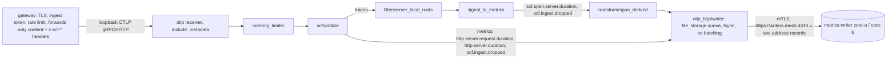

# scf-otelcol — the UsageMap Collector

A minimal OpenTelemetry Collector distribution that sits behind the gateway on every edge node, turns tenant OTLP
traces and metrics into sanitised request-duration metrics and delivers them, durably and exactly as received, to
the metrics writers. Decisions: ADR-0009, ADR-0012, register C-101, C-102, C-105, C-107, C-110, C-112(8), C-113, C-114.
Contracts: `docs/contracts/wire-formats.md` §f (OTLP ingest, sanitise step) and §g (Collector → writer).



No logs pipeline exists: `/v1/logs` answers `404`, gRPC `LogsService` answers `UNIMPLEMENTED`. Spans never leave
the process and never touch the disk.

## Layout

| Path | What |
|---|---|
| `builder-config.yaml` | ocb manifest: exactly the components of C-107 |
| `config/collector.yaml` | production configuration (environment variables below) |
| `processor/scfsanitizeprocessor/` | the sanitise step (Go module; links `packages/pathnorm`) |
| `scripts/build.sh` | checksum-verified `ocb` → `_build/scf-otelcol`; `--generate-only` → `_build/go.mod`/`go.sum` for licence and vulnerability scanners |
| `Dockerfile` (+ `Dockerfile.dockerignore`) | reproducible image, `FROM scratch`, uid 65532, read-only root filesystem |
| `tests/` | config lint, component golden file, end-to-end tests against the binary, Compose tests against the image |

## Components (`scf-otelcol components`, golden file `tests/testdata/components.golden.yaml`)

| Kind | Component | Module | Stability |
|---|---|---|---|
| receiver | `otlp` | core `receiver/otlpreceiver` v0.165.0 | stable |
| processor | `memory_limiter` | core `processor/memorylimiterprocessor` v0.165.0 | beta |
| processor | `scfsanitize` | this repository | beta (ours) |
| processor | `filter` | contrib `processor/filterprocessor` v0.165.1 | alpha |
| processor | `transform` | contrib `processor/transformprocessor` v0.165.1 | beta |
| connector | `signal_to_metrics` | contrib `connector/signaltometricsconnector` v0.165.1 | alpha |
| exporter | `otlp_http` | core `exporter/otlphttpexporter` v0.165.0 | stable |
| extension | `file_storage` | contrib `extension/storage/filestorage` v0.165.1 | beta |
| extension | `health_check` | contrib `extension/healthcheckextension` v0.165.1 | alpha |
| providers | `env`, `file` | core `confmap/provider/*` v1.71.0 | — |

All Apache-2.0. Not built in, by design: `batch`, `failover`, `loadbalancing`, `headers_setter`, any logs or
profiles component.

## Build

```sh
eval "$(mise env -s bash)"                 # repo root: Go 1.27.4
collector/scripts/build.sh                 # → collector/_build/scf-otelcol (~48 MiB, static; linux/amd64 or linux/arm64 host)
SCF_OCB_COSIGN=1 collector/scripts/build.sh   # also verify ocb's Sigstore bundle (cosign on PATH)
docker build -f collector/Dockerfile -t scf-otelcol:dev .   # from the repository root
```

- `ocb` v0.165.0, SHA-256 per architecture as published in the release's `ocb_0.165.0_linux_<arch>.sha256` files:
  linux/amd64 `6fd899cf8794803bb0d9ea0a055fdaabd2e7e8304de3872fd9aaec3f0cd7f18c`, linux/arm64
  `60796ab92c4becb5a2f54da5dff36e8127e69ea42daca4798b711d9b5c0f3002`. Sigstore identity
  `https://github.com/open-telemetry/opentelemetry-collector-releases/.github/workflows/base-binary-release.yaml@refs/tags/v0.165.0`,
  issuer `https://token.actions.githubusercontent.com` (both binaries `Verified OK` with cosign v3.1.4 on 2026-11-12).
  `build.sh` downloads the release's `.sha256` file, requires it to equal the pin and the binary to match, every
  time; the Dockerfile `ADD --checksum`s both binaries (so every image build verifies both pins) and installs the one
  for `TARGETARCH`. `ocb version` prints `v0.165.0+dirty` — an upstream stamping quirk (S-04).
- The Dockerfile frontend is pinned by digest: `docker/dockerfile:1.7.1@sha256:a57df69d0ea827fb7266491f2813635de6f17269be881f696fbfdf2d83dda33e`.
- Built with `GOWORK=off CGO_ENABLED=0 GOFLAGS="-buildvcs=false -trimpath"`. **Reproducible:** the binary built
  on the host (`build.sh`) and the one inside the image (different directory, different machine state) are
  byte-identical: SHA-256 `30de20a3f0d5408185e1581e2e18248e3f8dd73fd1d31830e5830b0894b546a3` for this tree
  (2026-11-12, after C-114). The image is 66.9 MB.
- Builder image `golang:1.27.4-trixie@sha256:b54b2639de8c1bfe538ec5ffc45f29b1932235ac5f6d63c059853646677112d9`.
- `ocb` is pinned for linux/amd64 and linux/arm64; on other hosts build through the Dockerfile.
- Upgrading: bump the versions in `builder-config.yaml` and `processor/scfsanitizeprocessor/go.mod` together,
  pin the new `ocb` hash (verify its signature), rebuild, run all tests, review
  `go test ./tests -run TestBinaryComponents -update`'s diff.

## Configuration (`config/collector.yaml`)

| Variable | Default | Meaning |
|---|---|---|
| `SCF_WRITER_ENDPOINT` | — (required) | `https://writers.<mesh>:4319`: **one** name with both writers' addresses (§g.1) |
| `SCF_MTLS_CA_FILE` / `SCF_MTLS_CERT_FILE` / `SCF_MTLS_KEY_FILE` | `/etc/scf-otelcol/tls/{ca.crt,node.crt,node.key}` | private CA and the node's client certificate (C-60); reloaded hourly; TLS ≥ 1.3 |
| `SCF_OTLP_GRPC_ENDPOINT` / `SCF_OTLP_HTTP_ENDPOINT` | `127.0.0.1:4317` / `127.0.0.1:4318` | loopback by default; Compose binds them to `otlp-collector:4317/4318`, the Collector's address on the private `otlp` network shared only with the gateway (C-130) |
| `SCF_HEALTH_ENDPOINT` | `127.0.0.1:13133` | `health_check` |
| `SCF_SELF_METRICS_HOST` / `SCF_SELF_METRICS_PORT` | `127.0.0.1` / `8888` | Prometheus self-metrics |
| `SCF_QUEUE_DIR` | `/var/lib/scf-otelcol/queue` | persistent queue — the only writable path |
| `SCF_QUEUE_BYTES` | `2147483648` (2 GiB) | the persistent queue's bound **in bytes** (C-114): the IaC sets 72 h × planned request rate × average request size, within the queue volume's free space. The v0.165 queue has one sizer, so the request count is bounded through the bytes (≥ ~150 bytes per queued request). Replaces `SCF_QUEUE_SIZE` |
| `SCF_MEMORY_LIMIT_MIB` / `SCF_MEMORY_SPIKE_MIB` | `400` / `80` | `memory_limiter` (refusals reach the gateway as `503`/`UNAVAILABLE`) |

Writer exporter (S-04 values): `encoding: proto`, `compression: gzip`, `timeout: 15s` (longer than the writer's
request budget `SCF_WRITER_WORK_TIMEOUT`, 12 s, at most 14 s, so a request still being applied is never retried in
parallel; S-04 used 5 s),
`retry_on_failure {1s, 5s, max_elapsed_time 72h}`, `sending_queue {storage: file_storage/queue, sizer: bytes,
queue_size: SCF_QUEUE_BYTES, num_consumers: 4}` and **no `batch`** — one queued request is one incoming request, so retries and crash replays
are byte-identical and the writer's SHA-256 batch key works (§g.3). `file_storage`: `fsync: true`, compaction on
start and on rebound inside the queue directory. A full queue makes the receiver answer `503`/`UNAVAILABLE`, which
the gateway passes on with `Retry-After`. The Collector has no age-based eviction (C-107): the 72-hour cap is the
writer's (`scf.received_at_unix_nano`, `undeliverable_72h`, C-112(8)) with the queue size as the second bound.

**Writer failover** happens at connection level inside Go's dialer (S-04 5B, repeated here with mTLS): measured
in `tests` on 2026-11-12, ~15 s when the writer's host vanished (pooled connections waited for the then 5 s timeout;
with 15 s expect ~25 s), < 1 s
when it refused connections; nothing lost, no duplicates. Both writer certificates must carry the shared name in
their SAN, and a writer that cannot reach PostgreSQL must close its listener (an HTTP `503` from a live writer is
retried against that writer, never failed over).

## The sanitise step (`scfsanitize`)

Runs right after `memory_limiter` in both pipelines fed by the receiver, before any queue (wire-formats §f.5):

1. **Tenant** from `x-scf-tenant-id` (must be a UUID; case-folded) → resource `scf.tenant.id`, overwriting
   anything in the payload; payload `tenant.id` and every `scf.*` are deleted. No valid tenant → the request is
   dropped whole (the client still gets `200`) and counted in `otelcol_processor_scfsanitize_dropped{reason="no_tenant"}`.
   **Receipt time** from `x-scf-received-at` → resource `scf.received_at_unix_nano` (int); missing or invalid →
   the Collector's clock, counted in `otelcol_processor_scfsanitize_received_at_fallback`.
   **Tenant level** from `x-scf-tenant-level` (exactly one of `L0`…`L3`, sent by the gateway from the edge snapshot,
   C-116) → resource `scf.tenant.level` as an **int** 0…3, which the writer uses for the L0 caps; anything else
   (missing, repeated, lower-case, out of range) leaves it absent and is counted in
   `otelcol_processor_scfsanitize_tenant_level_absent{reason="missing"|"invalid"}`. A value in the payload never passes.
2. **Services**: a resource whose `service.name` is not in `x-scf-allowed-services` (`*` or a comma list of
   percent-encoded names; a missing header allows none) is dropped — `service_not_allowed`. A missing
   `service.name` becomes `unknown_service`.
3. **Allow-lists**: resource → `service.name`, `service.namespace`, `service.instance.id`,
   `deployment.environment.name` (legacy `deployment.environment` renamed), plus `scf.tenant.id`,
   `scf.received_at_unix_nano`, `scf.tenant.level` (when valid) and `scf.stream.instance` (= `service.instance.id`,
   else `"_"`, §g.2). Scope → name
   and version. Points/spans → `scf.route`, `scf.rules_version`, `http.request.method` (legacy `http.method`
   renamed; known methods upper-cased, else `_OTHER`), `http.response.status_code` (legacy renamed; int 100–599),
   `rpc.method`, `rpc.system`, `rpc.system.name` (charset `[A-Za-z0-9_./-]`, ≤ 128 bytes), `otel.metric.overflow`
   (metrics, `true` only). **The output is built from scratch (C-114)**: new resources, scopes, metrics, points and
   spans receive only these fields, so entity references, schema URLs, dropped counts, descriptions, metadata,
   exemplars, span names, events, links and status messages cannot pass. Tracestate keeps only `ot=th:…` (for
   `AdjustedCount()`), capped at `ffc` (a span counts at most 1,024 times); point flags keep only
   no-recorded-value, span flags `0x303`. Strings with control characters are dropped (PostgreSQL rejects NUL).
   **Free text is classified (C-114, `classify.go`)**: every kept service name, namespace, instance, environment,
   scope name/version and `rpc.*` value goes through `pathnorm`'s classifier (whole value as one segment, as a path,
   and per token) plus local checks for IPs with ports, e-mail shapes, 56+ base32 runs and queries, and becomes
   `{redacted}` when it matches (`…_redactions{kind="free_text",location="attribute"}`). A non-allowed service's
   drops are reported under `service.name = "{not_allowed}"`.
4. **Metrics**: only `http.server.request.duration` and `http.server.duration` (histogram or exponential
   histogram; unit `s`, or `ms` → ×0.001 on bounds, sum, min, max; the name is kept so the stream group stays
   `sdk_legacy`). Client metrics (`http.client.*`, `rpc.client.*`) → `client_metric_ignored`; others →
   `metric_not_allowed`; wrong type, unit or layout (bucket counts vs bounds, counts not adding up, non-finite
   values, unspecified temporality; exponential histograms with > 320 buckets per side or indexes outside
   ±1075·2^scale, counts overflowing 64 bits) → `malformed_point`. A request whose processing panics is dropped, its
   items counted `malformed_point` under `unknown_service`; the process keeps running.
   **4a. Stellar client metrics** (`stellar_client_metrics: true`; processor default off, on in our config; `stellar.go`, wire-formats §f.5
   step 4a): the outbound-dependency metrics of `packages/stellar-otel` (js-stellar-sdk RPC/Horizon) —
   `rpc.client.call.duration` (only `rpc.system.name = jsonrpc` with `stellar.network`), `http.client.request.duration`
   (only with `url.template` and `stellar.network`), and the monotonic counters `stellar.tx.submissions`,
   `stellar.tx.polls`, `stellar.tx.simulations` (int, or integral double ≤ 2^53). Every output attribute is a closed
   set (13 RPC methods, 50 Horizon templates including `/`, 28 HTTP statuses, 5 JSON-RPC codes, 5 networks, the status and
   result classes); other values become `_OTHER` / `unknown` / `other`, other keys (`url.full`, `server.address`, …)
   are never copied, `rpc.status_code` and the HTTP `error.type` are derived, never copied. The closed sets bound the
   series per resource and scope (1,960 / 24,480 / 555 / 95 / 65; `TestStellarCardinalityBound`). Client metrics
   without the Stellar marker stay `client_metric_ignored`. Default off in the processor; **on** in
   `config/collector.yaml` since the writer has its `stellar_client` stream (wire-formats §g.7, migration `0080`,
   C-153). Deploy the writer and migration `0080` first: an older writer counts the names as `metric_not_allowed`.
   **4b–4d. Further client-metric steps** (`client_metric_sets: [partner, payments, anchors]`; all **off** by
   default in the processor, **on** in `config/collector.yaml` since the writer stores them — "integration" stream,
   wire-formats §g.8, migration `0085`, C-170; `clientrules.go`). The framework is one compiled-in rule
   per metric name. The output name, unit and shape are constants. A point is kept only with the rule's marker
   attribute; each output attribute is rebuilt from a closed set, and any other key is never copied. Unmarked
   points and names of a disabled set are counted `metric_not_allowed`; a wrong shape is `malformed_point`.
   - **4b partner** (`partner.go`): `stellar.partner.call.duration` from `packages/partner-otel`. It carries
     `stellar.partner` (14 ids), `stellar.partner.operation` (that partner's route templates), `stellar.partner.outcome`
     (8 classes) and `stellar.network`. Bound: 7,650 series per resource and scope.
   - **4c payments** (`payments.go`): `payment.server.events` from `packages/payments-otel`. Keys are per protocol:
     scheme for x402; method and intent for MPP. Reason class and `error.type` appear only on failed or canceled
     events, and the amount bucket only on the other stages. The worst case is about 1.34 M attribute sets, because
     reason class and error type are independent here while the package derives one from the other. Storage needs a
     per-tenant series cap.
   - **4d anchors** (`anchors.go`): `stellar.anchor.request.duration` and `stellar.anchor.events` from
     `packages/anchor-otel`, plus the six `stellar.anchor.transfer.*` / `customer.updates` / `quotes.created` metrics
     of `tools/ap-listener`. Marker: `stellar.network`. `stellar.anchor.home_domain` and `stellar.anchor.client` are
     kept only when they are a public DNS name that passes the sensitive-value classifier, or (client only) a short
     configured name; otherwise `_OTHER`.

   Tests: per-step allow-list and hostile-input tests, a golden of the real `partner-otel` export, cardinality
   bounds, and set-equality tests against the emitting packages' sources. **Not accepted at all:** the Prometheus
   metrics of the Stellar Disbursement Platform and the OpenZeppelin Relayer
   (`TestPlatformPrometheusMetricsNotAccepted`; reasons in `docs/onboarding/api-sdp.md` and `api-oz-relayer.md`).

   **Storage (on).** One sibling writer stream, "integration", in its own tables (migration `0085`,
   `scf.integration_metrics_1h`/`_1d`, `scf.integration_stream_state`), never in `api_*` and never in
   `stellar_client_*`. Deploy migration `0085` and the writer before this Collector configuration: an older writer
   counts the names as `metric_not_allowed`. Its network column takes either value set
   (`mainnet|testnet|…`, `stellar:pubnet|…`), and there are up to seven ordered dimension columns `d1`…`d7`
   per metric:
   - partner: partner, operation, outcome;
   - payments: protocol, stage, scheme or method, intent, asset, then amount_bucket or reason_class in one column (the two
     never appear together), then error.type: seven columns in all, plus network;
   - anchor request: sep, step, outcome, home_domain;
   - anchor events: event, sep, home_domain;
   - transfers: sep, kind, status_from, status, client.

   Caps (settings): 5,000 new series per tenant and UTC day, 2,000 per service and day (the payments worst case),
   20,000 streams per tenant; beyond them points are dropped and counted `stellar_series_overflow`.
5. **Spans**: SERVER and local root only — `span_not_server`, and `span_not_local_root` when the span has a parent,
   flag `0x100` set and `0x200` clear (SDKs without `0x100` count as roots). Span end before start, or longer than
   24 h → `malformed_point`.
6. **Routes** through `pathnorm.NormalizeSpan`: spans `http.route` → `url.path` → `http.target` → path of
   `url.full`/`http.url`; metric points `http.route` → `http.target` (the route template of old-convention SDKs).
   `http.route` `""` and `/**` are absent (C-105); bracket routes become `{param}` and queries are stripped by
   pathnorm's route mode; `{unknown}` only when no input exists. A point whose route had a value redacted is kept
   and counted `route_redacted`. All raw path inputs, including `http.route`, are deleted.
7. **Time bounds** against the receipt time: timestamp (span: end time) > receipt + 5 min → `future`; < receipt −
   48 h → `too_old` (`max_future`, `max_age`; `max_age` ≤ 72 h).
8. **Merging**: points whose attribute sets became identical (e.g. Go's points that differed only in
   `server.address`) are merged **only when their original attribute sets differed and their timestamps are equal**
   (C-114: two snapshots of one stream are never added up) — explicit histograms with equal bounds, exponential
   histograms down-scaled to the common scale (refused above 640 buckets per side); cumulative points of a stream
   without `service.instance.id` only when their start times match (the writer's stream identity, §g.4). The bucket
   layout is in the merge key, a key has at most 4 merge targets and a metric with more than 10,000 points in one
   request passes unmerged — linear time. Counted in `otelcol_processor_scfsanitize_merged_points`.
9. **Drop counters for tenants** — `scf.ingest.dropped` (Sum, delta, monotonic, int, unit `{point}`), points
   `{scf.reason, service.name}`, own resource with `scf.tenant.id`, `scf.received_at_unix_nano`,
   `scf.stream.instance = "_"`, scope `scf/scfsanitize` 1.2.0. In the metrics pipeline the step appends it to the
   request; in the traces pipeline it appends **marker spans** (`scf.marker = "ingest.dropped"`,
   `scf.dropped_count`) that `signal_to_metrics` turns into the same metric (a tenant cannot forge one: every
   tenant attribute outside the allow-list, `scf.marker` included, is deleted first).

Output is deterministic (same request → same bytes), which the batch key needs. Attribute values are never logged.

**Self-metrics** (Prometheus names): `otelcol_processor_scfsanitize_dropped{signal,reason}`,
`…_redactions{kind,location}` (`kind="free_text"` for classified free text), `…_merged_points`,
`…_received_at_fallback`, `…_tenant_level_absent{reason}`; alert on
`otelcol_exporter_queue_size` ÷ `otelcol_exporter_queue_capacity` (bytes), `otelcol_exporter_send_failed_metric_points`,
`otelcol_exporter_enqueue_failed_metric_points`, and on `otelcol_processor_filter_spans_filtered > 0` (the
defensive filter must never drop anything — `scfsanitize` already did, per tenant).

## Tests

```sh
eval "$(mise env -s bash)"
cd collector/processor/scfsanitizeprocessor && go vet ./... && go test -count=1 ./...   # unit, fixtures, 50k leak test
go test -run='^$' -fuzz=FuzzSanitizeNoLeak -fuzztime=5m .                                # fuzz (canaries on)
cd ../../ && scripts/build.sh
cd tests && GOWORK=off SCF_COLLECTOR_IT=1 go test ./...                           # lint + golden + end-to-end (binary)
GOWORK=off SCF_COLLECTOR_IT=1 SCF_COLLECTOR_DOCKER=1 go test ./...                 # + image + Compose failover
```

`make collector-it` runs all of it. Without `SCF_COLLECTOR_IT=1` the binary tests
skip when `_build/scf-otelcol` is missing; without
`SCF_COLLECTOR_DOCKER=1` the Docker tests skip. Binary tests use host ports 56160–56164, Compose (project
`scf-wsc`) 56170–56175, all on 127.0.0.1; Compose removes its containers, network and volume at the end.

| Test | Proves |
|---|---|
| `scfsanitizeprocessor` — `TestSanitizePointAttrsRoutes`, `TestCanonicalMethodAndStatus`, `TestSanitizeResource`, `TestParseMeta`, `TestSampledTraceState` | table tests of every rule above |
| `TestMetrics*`, `TestTraces*` (incl. `TestTracesS04Canary`, `TestTracesLocalRootRule`) | reasons and counts, ms → s, merging, drop counters, determinism, S-04's eight spans |
| `TestSDKFixtures{Metrics,Traces}`, `TestSDKFixtureSpecifics` | 20 real SDK payloads (S-06a/b) → reviewed golden output; proto-level field allow-list, only allow-listed keys, no canary |
| `TestNoSecretSurvives50k`, `FuzzSanitizeNoLeak` | hostile values (seeds, StrKeys, muxed addresses, JWTs, e-mails, IPv4/IPv6 with ports, URLs with queries, API keys) in **every** string field and string-carrying value type — resource attributes and entity refs, schema URLs, scope name/version/attributes, metric name/description/unit/metadata, point attributes, exemplars, span name, status, trace state, events, links — until 50,000 hostile paths went through the route inputs; the marshalled protobuf passes the field-path allow-list (`protoallow_test.go`) and no leak shape or canary survives. The fuzz target checks canaries too |
| `TestG1*`, `TestSensitiveValueClassifier`, `TestCombineBuckets` | the G1 review findings (C-114): entity refs, free-text classification and fixed not-allowed name, hostile exponential layouts (no huge allocation, no panic), panic recovery, merge rule (originals differ, equal time), 20,000-point merge < 1 s, capped sampling, span duration, masked flags |
| `tests` — `TestConfigLint`, `TestConfigLintCatchesViolations` | no logs pipeline, traces only to `signal_to_metrics`, no batching, fsync, mTLS, loopback, metadata, order |
| `TestBinaryComponents`, `TestImageComponents`, `TestBinaryValidatesConfig` | exactly the declared components; non-root image; shipped config valid |
| `TestCanaryTraceLeavesOnlyDerivedMetrics` | canary trace (HTTP proto, HTTP JSON, gRPC) → only derived metrics; nothing on disk, in logs or the work dir |
| `TestLogsRefused`, `TestPayloadTenantOverwritten`, `TestSDKMetricsThroughCollector`, `TestRequestWithoutTenantIsDropped` | §f behaviour end to end |
| `TestQueueSurvivesKill9` | 300 queued requests survive `kill -9` exactly once; in-flight replays are byte-identical |
| `TestHostileExpHistogramsOverGRPCAndHTTP` | the review's ~200-byte hostile exponential histograms over HTTP and gRPC: no crash, peak RSS ≈ 50 MiB, 10 `malformed_point`, normal traffic afterwards |
| `TestQueueBoundedInBytes` | with `SCF_QUEUE_BYTES` = 16 KiB and no writer, requests are refused with 503 once the queue holds 16 KiB |
| `TestComposeWriterFailoverQueueAndReadOnly` | image under mTLS with two writers behind one name: failover both ways, queue across `SIGKILL`, no canary in the queue volume, nothing written outside it |

## Known limits

- `signal_to_metrics` is alpha and processes per request; a batching SDK yields one point per attribute set per
  batch. Its points carry the Collector's processing time (no start time).
- Exponential histograms in `ms` are shifted by the nearest whole bucket (error ≤ half a bucket); no SDK observed
  sends them.
- `kill -9` leaves the page cache intact; fsync under power loss is asserted by configuration and S-04's timing
  evidence, not by a power-cut test.
- The receiver turns every forwarded header into queued metadata; that the gateway forwards only content and
  `x-scf-*` headers is checked by the gateway's tests (§f.4).
