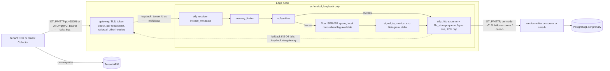

# ADR-0009: OpenTelemetry pipeline topology

- **Status:** Accepted
- **Date:** 2026-11-12
- **Capability IDs:** api.otlp-to-postgres-metrics, api.dual-export, api.drop-traces, api.drop-logs, api.attribute-allowlist, api.attr-tenant-service, api.attr-status-code, api.attr-latency, capacity.1m-requests-day, slo.ingest-availability; design trade-off DV-01

## Context
Tenants dual-export standard OpenTelemetry data to both their own APM backends and the UsageMap collector endpoint;
the collector drops traces, spans and deep logs, retaining only the information needed to produce standardised
metrics (counters and histograms) that are written to PostgreSQL. Attribution is by `tenant.id` / `service.name`;
latency is `http.client.duration` or an equivalent. Design target ≈ 1,000,000 requests/day.

What research established (primary sources read at named tags; nothing below has been executed yet):
- **Protocol.** OTLP proto v1.11.1 (2026-09-25), semantic conventions v1.45.0, Collector core v0.165.0 / contrib
  v0.165.1. OTLP/HTTP on `/v1/{traces,metrics,logs}` with protobuf or JSON; servers SHOULD accept both. Retryable
  HTTP codes are 429/502/503/504 with optional `Retry-After`; gRPC `RESOURCE_EXHAUSTED` is retryable only with
  `RetryInfo`. Duplicates are expected by design ("a deliberate choice", spec §Known Limitations), so ingest must be
  idempotent. `partial_success` lets a server report dropped items without failing the exporter.
- **The stable server metric carries no path.** `http.server.request.duration` (unit `s`) has `http.route` only "if
  and only if it's available", and "the URI path can NOT substitute it" (semconv v1.45.0 `http-metrics.md` note
  [4]). Without `http.route`, only SERVER spans carry a path (`url.path`, Required on server spans).
- **SDK reality (2026-11-12).** Node `instrumentation-http` emits stable-only since 0.221.0 (2026-07-21); Go
  `otelhttp` stable-only since v0.63.0; Java agent since 2.0.0; .NET stable. Python 0.66b2 still defaults to old
  names (`http.server.duration`, ms). Next.js 16.4.6 and Cloudflare Workers produce **spans only** (Workers: JSON,
  traces/logs only). 1 of 10 sampled API backends of SCF-awarded projects runs OpenTelemetry at all.
- **The Collector cannot attribute tenants or rate-limit per tenant.** `bearertokenauth` returns the context unchanged
  (`bearertokenauth.go` L251–271), so it cannot say *which* tenant; no rate-limit component exists in core or contrib
  v0.165.1. Auth context is **not** carried through the persistent queue (exporterhelper README L106), so the tenant
  must be written into the data before the queue. No PostgreSQL exporter exists (donation issue #46501 unsponsored).
- **`file_storage` defaults to `fsync: false`**; acknowledged data in the page cache can be lost on power failure.
- **Volume.** 1 M req/day ≈ 11.6 req/s, but load scales with series × export interval (metrics) and with spans per
  request (5–50 typical) for span senders — an estimated 10–50 M spans/day at peak, nearly all discarded.

## Options considered
1. **Stock contrib Collector exposed to tenants, `bearertokenauth`, `span_metrics`.** Pros: no custom code. Cons:
   cannot attribute tenants; no per-tenant rate limit; 256-module image (114.9 MB) with a wide CVE surface;
   `span_metrics` is stateful (single-writer per instance) and defaults to ms.
2. **Collector with a custom auth extension and middleware (token → tenant inside `ocb` build).** Pros: one process;
   `extensionauth.Server` is in the stable v1.71 module set. Cons: our Go code bound to biweekly Collector releases;
   a second TLS/rate-limit implementation next to the web gateway that already exists on every edge node.
3. **Auth-terminating gateway in front of a loopback-only minimal Collector (chosen).** Pros: reuses the gateway's TLS,
   token snapshot and limits (ADR-0005, ADR-0016); the Collector never faces the internet; tenant id cannot be forged
   because the Collector listens on loopback only. Cons: one more hop; the gateway must proxy gRPC (HTTP/2).
4. **Metrics only (refuse spans).** Pros: smallest volume, simplest correctness. Cons: excludes Next.js, Workers,
   tracing-only Rust, Ruby/PHP, and every tenant without `http.route` — no endpoint analytics for them.
5. **Kafka (or another broker) between Collector and writer.** Pros: strong buffering. Cons: a stateful cluster for
   ~12 req/s; rejected in favour of the fsync'd persistent queue plus an idempotent writer.

## Decision
`tenant SDK or Collector → gateway (TLS, ingest-token auth, per-tenant rate limit, 429/503 + Retry-After) → loopback
→ scf-otelcol → per-node mTLS → metrics-writer (core-a or core-b) → PostgreSQL`.

**Collector → writer (C-77).** The Collector's `otlp_http` exporter sends **directly to the writers**, using the
Collector's own failover between `core-a` and `core-b`, **if S-04 confirms** that the pinned Collector version can
fail over between two endpoints while keeping the persistent queue. If it cannot, the fallback is the earlier design
(C-07): the exporter sends to the gateway on loopback and the gateway forwards to a healthy writer. The direct hop is
the default because it removes a second proxying pass through the gateway; the gateway keeps only token
authentication and rate limiting in front. Writers are active-active; the batch ledger's unique key prevents double
application and per-stream state rows are locked for update inside the batch transaction (ADR-0010). The Collector →
writer hop authenticates both ends with the per-node mutual-TLS certificates from the private CA managed in the IaC,
the same certificates used for the Umami forwarder and the snapshot pull (C-60).

> **Superseded by C-107 (2026-11-12, spike S-04):** not the Collector's `failover` connector (alpha; it dropped data
> or stalled). One `otlp_http` exporter sends to **one DNS name that resolves to both writers**
> (`writers.<mesh>`, in both writer certificates' SAN), so failover happens at connection level; a writer that cannot
> reach PostgreSQL closes its listener; **no exporter-side batching** (retries and crash replays stay byte-identical);
> `file_storage` with `fsync: true`. The loopback relay stays only as the fallback for an mTLS/SAN problem. The
> 72-hour cap is the queue size limit plus the sanitise step's 48-hour late bound (C-110), and the writer drops points
> received more than 72 h earlier (`undeliverable_72h`, C-112). The gateway forwards to the Collector only content
> headers and its own `x-scf-*` headers.

**Signal handling.**

| Signal | Handling |
|---|---|
| Metrics | Accepted (HTTP protobuf, HTTP JSON, gRPC). Only `http.server.request.duration` (s) and legacy `http.server.duration` (ms, converted ×0.001) are kept; every other metric name, including all `http.client.*`, is dropped. Each (source kind, metric name, instrumentation scope) is its own stream group (see "One count per request"). |
| Traces | Accepted. Only SERVER-kind spans pass the filter, restricted to local roots (no parent, or parent flagged remote) when the Collector exposes the remote-parent flag (S-04, C-22). `signal_to_metrics` derives request duration as base-2 exponential histograms, delta temporality, source kind `span_derived`. The traces pipeline has no exporter other than the connector; spans are discarded in memory after derivation and nothing from a span is persisted. |
| Logs | No logs pipeline. `/v1/logs` answers 404; gRPC `LogsService` answers `UNIMPLEMENTED` (receiver registers routes only for signals with a pipeline — `otlpreceiver/otlp.go` L110–190 at v0.165.0). Both codes are non-retryable, so tenant SDKs drop and log. |
| Profiles | Not accepted. |

**`scfsanitize` (our processor) runs first in every pipeline**, so nothing unsanitised reaches the on-disk queue:
(a) sets `scf.tenant.id` from gateway metadata, overwriting any `tenant.id`/`scf.*` in the payload; (a′) when the
ingest token is restricted to a list of service names, the gateway passes the allowed names with the tenant and
`scfsanitize` drops and counts resources whose `service.name` is not on it (C-70); (b) keeps an allow-list of
resource and data-point attributes and deletes everything else; (c) strips exemplars, span events and links;
(d) normalises paths (ADR-0012) — assigning `{unknown}` when neither a route nor a path exists (C-16, C-89) — and
then deletes `url.path`, `http.target`, `url.full`, `url.query`. `{overflow}` is not assigned here; the writer's
cardinality guard assigns it (C-89).

**Allow-list principle.** Keep only what a stored dimension or a correctness rule needs; unknown means dropped. The
candidate set (final list in `docs/contracts/`): resource `service.name`, `service.namespace`,
`deployment.environment.name`, `service.instance.id` (used only to identify cumulative streams for cumulative→delta,
never stored as a dimension — C-22);
points `http.route`, `http.request.method` (closed set + `_OTHER`), `http.response.status_code` and legacy
`http.method`/`http.status_code`, optional closed-set `rpc.method`. Standard attributes that may carry personal data
and are **always dropped**: `client.address`, `client.port`, `client.prefix` (old `http.client_ip`,
`net.sock.peer.addr`, non-standard `http.client.address`); `network.peer.address`/`.port`, `network.local.address`;
`user_agent.original` and `user_agent.*` (old `http.user_agent`); `url.full`, `url.query`, `url.original`,
`url.fragment`, `url.path` (normaliser input only); `http.request.header.*`, `http.response.header.*`;
`http.request.body.content`, `http.response.body.content` (new in v1.45); `enduser.*`, `user.*`, `session.id`;
`server.address`/`server.port` (header-derived cardinality and host leak), `url.domain`; `exception.*` and all span
events and links; exemplars (their `filtered_attributes` can carry attributes a tenant removed with a View);
resource `host.name`, `host.ip`, `k8s.pod.ip`, `process.command_line`, `process.owner`, `container.*`.

**One count per request (C-22).** Every distinct (source kind, metric name, instrumentation scope) reporting for a
service is a *stream group*, stored separately. Reads use **one preferred group per service per UTC day**: SDK
stable-name metrics (`http.server.request.duration`), else SDK legacy-name metrics (`http.server.duration`), else
span-derived; ties between instrumentation scopes are broken by a fixed priority list, then by name. The choice is
shown to the tenant, with a warning when more than one group exists for the service. This covers `http/dup` (old and
new names from one service) and two scopes reporting the same requests. CLIENT/INTERNAL spans add nothing; client
metrics are never usage. Where the remote-parent flag is available, nested SERVER spans inside one service are not
counted either. Span-derived counts use the sampling-adjusted count when the tenant's tracestate carries a
threshold, otherwise they are labelled "sampled, lower bound".

**Time bounds.** Points more than 5 min in the future are rejected; up to 48 h late are accepted; nothing earlier
than the service's registration is accepted (no backfill). Services are auto-registered on first sight up to the
tenant's quota (default 20, C-21). Rejections are reported through `partial_success`.

**Undeliverable data (C-18).** The Collector's persistent queue has the same 72-hour cap as the web spool: a metric
batch that cannot be delivered to a writer for 72 hours is discarded and counted. The writer's de-duplication ledger
keeps 7 days, which covers the 48 h late-arrival window and the queue cap.

**Tenant APM-key leak hazard.** In-SDK dual export leaks: JS (`otlp-http-configuration.ts` L20–46 `mergeHeaders`,
commit `f523a20`) and Python (`_common/__init__.py` L137–149 at v1.45.2) attach `OTEL_EXPORTER_OTLP_HEADERS` to every
exporter, including one configured in code; Rust (`exporter/http/mod.rs` L278–298) lets env headers **override**
code headers, so a vendor `Authorization` can replace our bearer token. Go replaces rather than merges. Our response:
the gateway reads only `Authorization`, never logs, stores or forwards any other request header, and forwards to the
Collector only the tenant id it derived; a credential without the `scfa_ing_` prefix or with a bad CRC (ADR-0016) is
rejected offline with 401 and a message pointing to the docs, and its value is never logged; onboarding recommends
the tenant-side Collector fan-out and, for in-SDK setups in JS/Python/Rust, code-configured headers with the OTLP
header env vars unset.

**Design trade-off DV-01.** The commonly requested `http.client.duration` is the legacy (≤ v1.20) *outbound client* metric in ms; its
stable successor `http.client.request.duration` has no `http.route` and describes calls the tenant makes (for
example to Horizon). We map "or equivalent" to server-side duration: `http.server.request.duration`, legacy
`http.server.duration`, or SERVER-span duration.

`signal_to_metrics` is alpha: version pinned, covered by canary tests; a ~200-line in-house connector is the
fallback. *Depends on S-04.*

## Consequences
- Positive: one public edge process for web and API; the gateway proxies each OTLP request once, not twice (C-77);
  tenant id is unforgeable; spans and logs never touch disk;
  every stack that can emit either server metrics or server spans is supported.
- Positive: the "nothing persisted" claim is testable — canary attribute values sent in spans and logs must not
  appear in the queue directory, the database or logs; a lint test asserts the traces pipeline has only connector
  exporters and no logs pipeline exists.
- Negative: we decode and discard large span volumes; span senders cost far more CPU and bandwidth than metric
  senders. Onboarding must push tenants to send metrics, or SERVER spans only.
- Negative: preference by day means a service switching stream group mid-day loses that day's data from the group
  not chosen.
- Negative: if S-04 shows the remote-parent flag is not exposed, every SERVER span counts, so a service whose
  requests pass through nested SERVER spans is over-counted in span-derived data; the tenant is told to send
  metrics or set the span kind correctly.
- Negative: raw spans and `url.path` exist briefly in gateway and Collector memory; this is stated, not hidden.
- Negative: API metrics that cannot reach any writer for more than 72 hours are discarded (counted); the durability
  objective is worded accordingly (C-18, ADR-0031).
- Must do: the writer never answers 429/503 to the Collector for one tenant's quota (a shared queue would stall all
  tenants); size the queue for the full 72-hour cap and alert on queue depth and age.
- Must do: track Collector releases (biweekly) through the 24 h patch process
 (ADR-0023).
- Revisit if: `signal_to_metrics` changes incompatibly or is removed; an upstream per-tenant auth/limit component
  appears; span volume makes edge nodes CPU-bound; SDKs gain per-reader filtering that removes the header hazard.
- **Unproven (S-04):** the `ocb` build, the OTTL duration and local-root expressions (including whether the
  remote-parent flag is exposed at all), attribute `optional` semantics, `AdjustedCount()` without a threshold,
  fsync behaviour of the queue, the exporter's failover between the two writers (C-77; the loopback hop through the
  gateway is the fallback), the service-name restriction in `scfsanitize` (C-70), and the 404/`UNIMPLEMENTED`
  responses with real SDKs. **S-06:** every dual-export recipe.

## Research basis
Source-level research behind this decision (notes kept outside the repository):
- OTel semconv SDK dual export: §3.1 OTLP protocol; §3.2 server metric attributes and
  migration; §3.3 per-language table; §3.4 header-merge hazard; §3.5 signal policy and double-counting hazards;
  §3.6 personal-data attribute table; §3.7 time bounds; §4 H-OTEL-2.
- OTel dual export recipes: §0 pattern ranking; §B.1/B.2/B.4 header-leak warnings; §D.
- OTel collector pipeline: §3.1 versions and renames; §3.2 component table; §3.3 token
  mapping options; §3.4 logs refusal and proof artefacts; §3.5 rate limiting split; §3.6 no PostgreSQL exporter.
- Stellar path normalization: §3.2 item 4 (normalise before any persistence); §3.7.
- SLA availability engineering: OTLP spool and `file_storage` fsync discussion.
- Research synthesis: findings 4–6, conflicts X-1 and X-3, spikes S-04, S-06.

## Open points
1. Open: the attribute allow-list above is the research candidate set, not a final list. Closed when S-04 and S-06
   show which attributes real SDKs send and the list is fixed in `docs/contracts/`.
2. Open: whether the Collector's exporter can fail over between two writer endpoints with the persistent queue intact
   (C-77). Closed by S-04; if not, the loopback hop through the gateway is used.

(Enforcement of an ingest token's service restriction is settled by C-70.)
