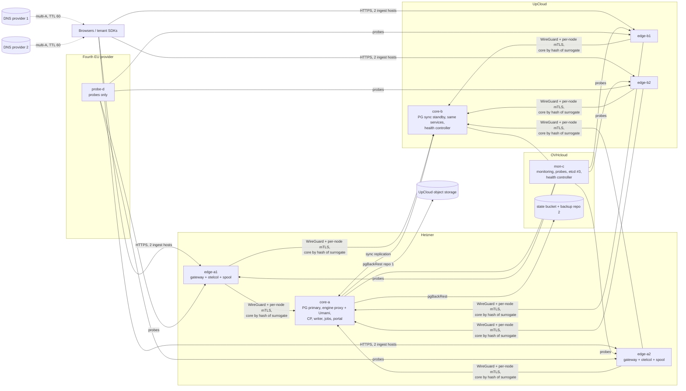

# ADR-0018: Hosting and topology

- **Status:** Accepted
- **Date:** 2026-11-12
- **Capabilities:** ops.hosted-service-window, ops.hosting, slo.ingest-availability, slo.dashboard-availability, support.public-issue-tracker, ops.rebuild-from-repo, capacity.1m-requests-day

## Context
The hosted service (ops.hosting) targets 99.99 % ingest and 99.9 % dashboard availability
(slo.ingest-availability, slo.dashboard-availability), with no on-call (support.public-issue-tracker). 99.99 % is 4.38 minutes per average month; 99.9 % is 43.8 minutes
. No provider offers 99.99 % on one VM in a meaningful form: Hetzner Cloud
promises 99.9 % on a "commercially reasonable efforts" basis with credits only (§3.2). Region- and provider-wide
failures are real: Hetzner leaf-switch faults of ~10–16 h in July 2026 (LIKELY, status mirrors), Hetzner's
"Limited availability of cloud instances" notice open since 2026-06-26 (VERIFIED), and Hetzner FSN1 Object Storage
degraded three times in November 2026 (VERIFIED) (§3.2). Hence: at least two independent providers, spare
capacity already running, a witness at a third, and a probe-only vantage point at a fourth.

Price environment (all prices 2026-11-12, excl. VAT): Hetzner raised CPX prices by ≈144–175 % and CCX by
≈113–173 % on 2026-06-15; CX/CAX lines cannot be ordered; existing servers keep their price but a rescale counts
as a new order. **UpCloud prices come from a Wayback snapshot dated
2026-11-02** because the live page blocks automated fetches; UpCloud block-storage price is unknown (§2 P18, §7).

Load is small: ~1 M API requests/day reach us as ~2 OTLP exports/s; web growth (35–70 GB/year) dominates the
database; research sizes volumes at 150 GB.

**The provider-pair disagreement.** Stream 12a recommended Hetzner + UpCloud with an OVHcloud prober; a helper
survey recommended **Scaleway + UpCloud** (two EU legal entities, near-free egress, cheap multi-AZ and Glacier
object storage). Research found that OpenTofu's native S3 lock does not work on Hetzner Object Storage, which
pulled Scaleway or OVH in for the state bucket.

## Options considered
1. **Hetzner + UpCloud, OVHcloud as witness (chosen).** Pros: best price/performance for the database node
   (CPX42 8 vCPU/16 GB/320 GB NVMe at €69.99 NBG1); 20 TB traffic included; mature `hcloud` provider (MPL-2.0);
   UpCloud Starter carries a 99.99 % credit SLA and includes IPv4 and egress. Cons: Hetzner capacity notice (new
   orders may fail); best-effort SLA; Hetzner object storage cannot hold the OpenTofu state.
2. **Scaleway + UpCloud.** Pros: two EU legal entities; conditional writes for state; cheap object storage
   (multi-AZ €0.01606/GB-month). Cons: the cheap DEV1/PLAY2/PRO2 lines carry **"No SLO"** (VERIFIED); lines with
   an SLA cost about twice Hetzner (BASIC3-X4C-16G €86.46, 99 %; POP2-4C-16G €107.31, 99.5 %); IPv4 €3.65/month.
3. **UpCloud primary, Hetzner secondary.** Pros: avoids depending on Hetzner new orders. Cons: loses Hetzner's
   NVMe price advantage for the DB; the cost model itself calls it "reasonable" — the IaC must allow it anyway.
4. **Single provider, several locations (≈ €80–90/month).** Cons: one provider unable to provision or a
   provider-wide fault breaks the 99.99 % claim; the cost model says this must be stated as giving it up.
5. **Kubernetes or managed PostgreSQL.** Cons: managed PG gives no superuser and no WAL access, so no
   cross-provider physical standby and no restore of our backups elsewhere; Kubernetes adds an operated layer
   (ADR-0019

**Why the register chose option 1 over option 2:** Scaleway's SLA-carrying instances cost about twice Hetzner's
for the same size, and its cheap lines have no SLO, which we may not cite. The state-bucket problem is solved
by putting state on OVHcloud (which documents `If-None-Match` writes; S-08), so Scaleway is not needed for it.
The Hetzner capacity risk is accepted because UpCloud already carries running capacity (two edges and a full
core), and Scaleway is kept as a ready provider module.

## Decision
"Recommended" tier (C-25), Debian 13, private traffic over a static WireGuard mesh. Sizes are indicative from the
November 2026 price list; sites are proposed and fixed at first order.

| Node | Provider | Proposed site | Role | What runs there |
|---|---|---|---|---|
| `edge-a1` | Hetzner | HEL1, Helsinki (FI) | Ingest edge | gateway (TLS, tracker files, challenge, collect, OTLP front door, spool, forwarder), `scf-otelcol`, range-list updater (C-38) |
| `edge-a2` | Hetzner | NBG1, Nuremberg (DE) or FSN1 | Ingest edge | same as `edge-a1` |
| `edge-b1` | UpCloud | FI-HEL or DE-FRA | Ingest edge | same as `edge-a1` |
| `edge-b2` | UpCloud | second UpCloud location (e.g. NL-AMS) | Ingest edge | same as `edge-a1` |
| `core-a` | Hetzner | NBG1, Nuremberg (DE) | Core, normal primary | PostgreSQL 18 + Patroni + etcd + PgBouncer, Umami behind the **engine proxy** (`/services/engine-proxy`, Go: per-node mTLS, per-caller path allow-lists, cache-token memory — C-60, C-74), control plane, metrics-writer, jobs, portal behind Caddy |
| `core-b` | UpCloud | DE-FRA | Core, sync standby | same as `core-a`, plus the second health-controller instance (C-27) |
| `mon-c` | OVHcloud | EU (France) | Witness and monitoring | Prometheus, Alertmanager, Grafana, VictoriaLogs, Gatus probes, health-controller instance (holds the DNS write credential), third etcd member. OVHcloud object storage (a provider service, not on this node) holds the OpenTofu state bucket and backup repository 2; the state credentials are stored on no server (C-79). Compromise of `mon-c` is rated **High impact**; no inbound except the mesh and the status endpoints (C-79) |
| `probe-d` | a fourth EU provider (chosen at ordering) | EU | Probes only | external probe source for the availability SLI (C-30); no production service, no visitor data |

Losing a whole provider still leaves two edges. Both core nodes run the full application stack (C-07): portal and
API hostnames resolve to both cores through the same health-controlled DNS as the edge; each core's control plane
and writer reach the current PostgreSQL primary through a local proxy that follows Patroni; scheduled jobs take a
PostgreSQL advisory lock so one instance runs each; writers are active-active. Edge forwarders pick the core by a
consistent hash of the surrogate, so the engine proxy on that core holds the visitor's cache token, and fall back to
the other core on failure (C-74). Each edge Collector exports to the writers directly with failover between the two
cores if S-04 confirms it, otherwise through its gateway (C-77). Umami and the control plane never listen on public
interfaces (ADR-0003). The public names are the two ingest hosts on two domains (ADR-0004) and
the portal/API host.

**Cost.** The recommended tier costs **about €300/month, to be re-priced when ordering** (re-priced range
€225–320 from the November 2026 price list; the research's €288 priced a different layout) (C-25). The range
depends mainly on core sizing. We quote no more precise figure for this layout.

**Other tiers** (research figures: prices of 2026-11-12, excl. VAT; FX ECB
reference 2026-11-11, 1 EUR = 1.1127 USD; every UpCloud line is from the **Wayback snapshot of 2026-11-02**):

| Tier | Shape (as costed in research) | €/month | €/12 months | US$/12 months | Source and date |
|---|---|---|---|---|---|
| Lean | 3 edges (2 Hetzner CPX12, 1 UpCloud Starter 2/4), 1 Hetzner core all-in-one incl. monitoring, UpCloud standby, OVH prober, 15 % contingency | 123.53 | 1 482 | 1 649 | research cost model, prices 2026-11-12 |
| **Recommended** (this ADR) | 4 edges, 2 full cores, `mon-c`, `probe-d` (C-25) | **about 300, to be re-priced** | about 3 600 | about 4 000 | C-25 re-pricing, November 2026 price list (range 225–320) |
| Hardened | 5 edges on 3 providers (incl. Scaleway BASIC3), 3 app nodes, dedicated-vCPU PG pair + UpCloud Premium replica, 2 probers, 20 % contingency | 622.34 | 7 468 | 8 310 | research cost model, prices 2026-11-12 |

Not included: staging hosting before production (≈ €300–1 750, research, 2026-11-12), drill VMs (€10–30
each, research, 2026-11-12), staff time, and VAT (reverse charge assumed). The Lean tier is the documented
post-handover cost for a community service operator (≈ €1.3–1.5k/year, research, 2026-11-12); it keeps the
multi-provider ingest but puts monitoring inside the core failure domain.

**Provider swap path.** Each provider is an OpenTofu module behind one node interface (ADR-0019). If Hetzner
cannot provision (or must be replaced), `core-a`, `edge-a1` and `edge-a2` are recreated in the Scaleway module
(provider 2.91.0, MPL-2.0) using only SLA-carrying lines (BASIC3 or POP2): the new node joins the WireGuard mesh,
the database replica is built from the pgBackRest repository, a Patroni switchover moves the primary, the new edge
is added to DNS and the old one drained by closing its listener. UpCloud-primary is the same procedure in the
other direction.

## Consequences
Positive: no single node, site or provider is in the ingest path, and losing a provider still leaves two edges;
spare capacity already runs at the second provider; hosting costs about €300/month; a
community service operator can run the same code at the Lean tier.

Negative: we operate PostgreSQL HA ourselves; cross-provider synchronous replication adds one RTT per commit;
`core-b` is smaller than `core-a` and runs the whole core after a failover at reduced headroom; a core failover
splits the visits in flight once, because the cache-token memory of the lost core is gone (C-74); `mon-c` is a
high-impact host (DNS write credential, etcd member, mesh access — C-79) and must be hardened and monitored as such;
prices may rise again during the window (contingency 15–20 %); eight hosts to patch.

Must do: re-price this layout when ordering (C-25); test-order Hetzner capacity now and lock servers in early at
generous sizes (rescales are repriced); confirm UpCloud prices and block storage live; quote only SLA-carrying
instance lines.

Revisit if: Hetzner orders keep failing; UpCloud live prices differ materially from the snapshot; measured load
exceeds 10× the design target; or a provider changes ownership or SLA terms.

Unproven: state locking and pgBackRest against the chosen buckets (S-08); every capacity figure is an estimate
until the load test at 10× (ADR-0026).

## Open points
1. Open: sizing of `core-a`, `core-b` and `mon-c`, the line items for object storage, and the provider for
   `probe-d`; together they fix where inside €225–320/month the tier lands — closes with account
   ordering and the re-pricing at order time.
