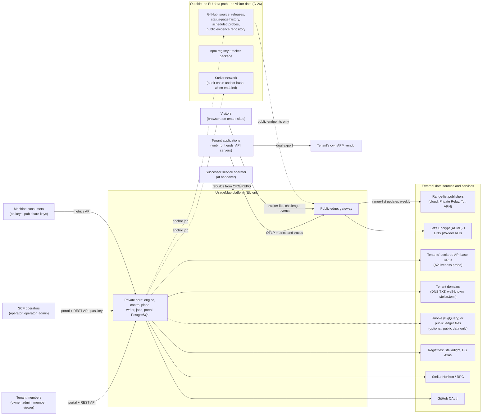
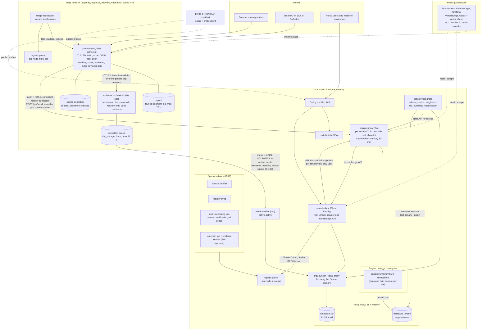
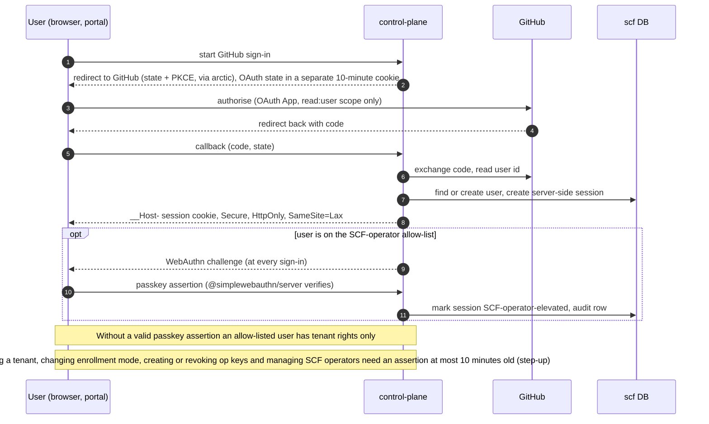
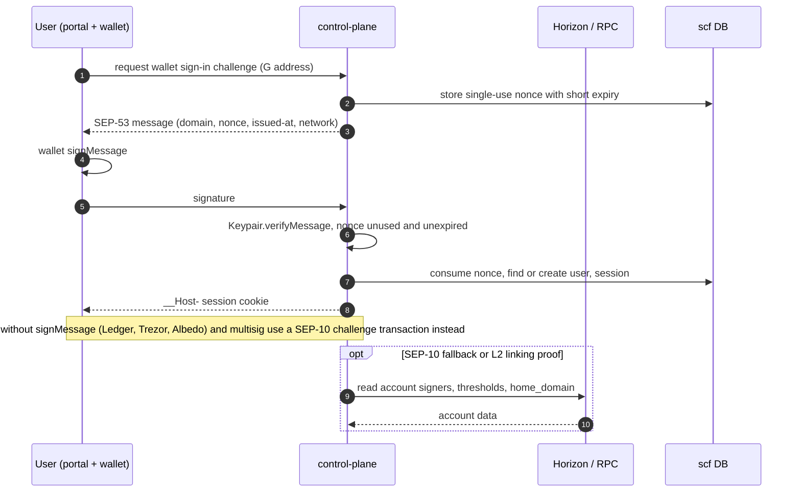
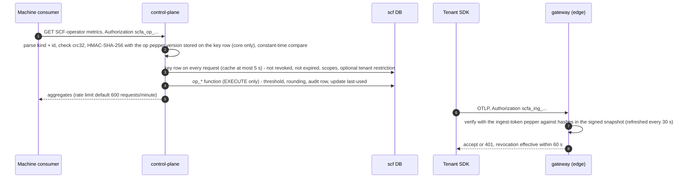
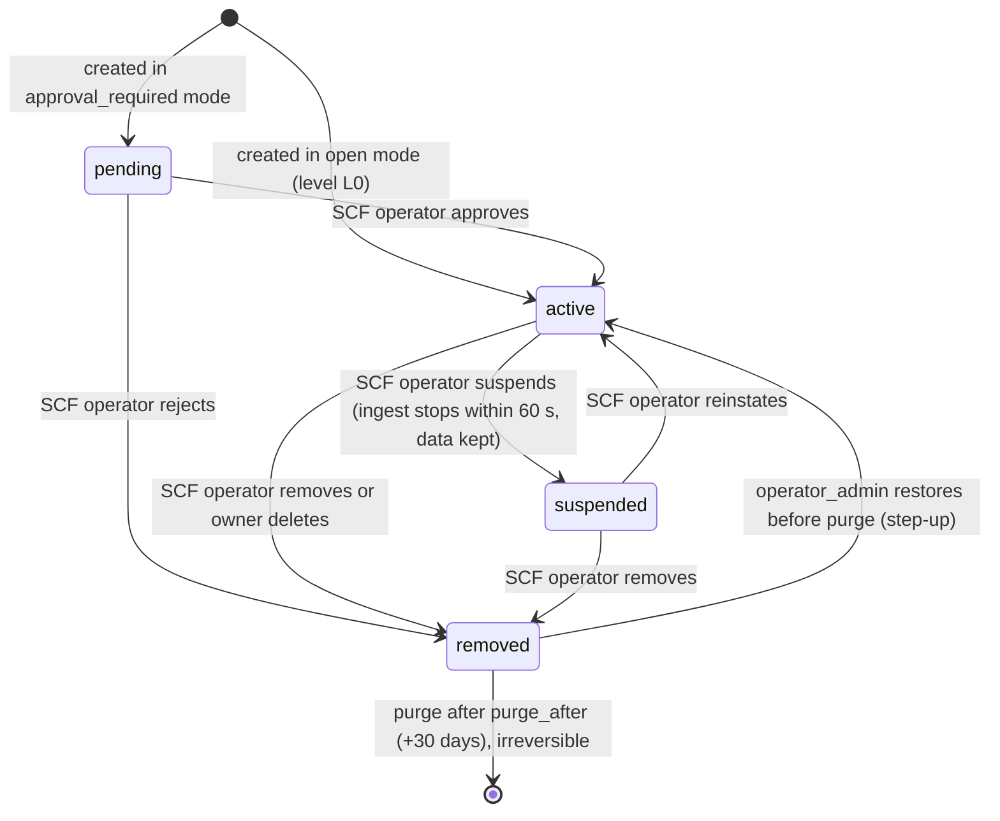
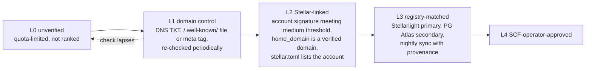
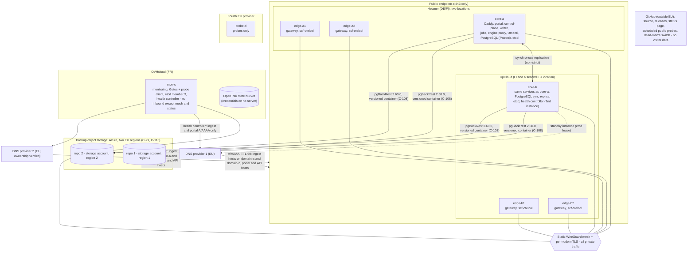
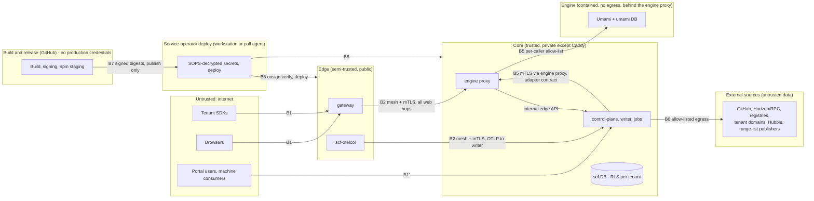

# Architecture

**Status:** design, 2026-11-12; status line revised 2026-11-19. The software described here has been built
([`capabilities.md`](capabilities.md) lists each capability and its tests), and the reference deployment runs every
service of the lean profile on one small VM in an EU region ([`deployment-topology.md`](deployment-topology.md) §0).
The multi-node topology in this document (edge and core nodes, `mon-c`, `probe-d`, two DNS providers) is the
**scale-out design, not what the reference deployment runs today**. The decision register
[`docs/adr/README.md`](adr/README.md) is binding, and its Clarifications C-01 … C-112 are binding too; where a
clarification and a register entry differ, the clarification wins, and a later clarification wins over an earlier
one (C-73…C-95 answer the design reviews of 2026-11-12; C-99…C-109 record what the day-0 spikes measured). Where this document and the register disagree,
the register wins and this document is wrong. Schemas, wire formats and endpoint definitions live in
[`docs/data-model.md`](data-model.md), [`docs/contracts/wire-formats.md`](contracts/wire-formats.md) and
`docs/api/*.openapi.yaml`; this document does not repeat them. Field-level privacy detail is in
[`docs/privacy/data-inventory.md`](privacy/data-inventory.md). Capability IDs (`tenancy.…`, `web.…`, `api.…`,
`ops.…`) refer to [`docs/capabilities.md`](capabilities.md).

Runtime identifiers carry **the historical `scf` prefix** — the PostgreSQL schema `scf.*` and roles `scf_*`, the
environment variables `SCF_*`, the Compose project, container and volume names `scf-*` — and keep it for
compatibility with existing deployments; the product is UsageMap.

Placeholders in the design sections: domains `<domain-a>`, `<domain-b>`; repository `ORG/REPO`; npm
package `@SCOPE/tracker`.

---

## 1. Overview in plain English

**What it is.** UsageMap, a shared, free analytics service for projects building on Stellar, run for an ecosystem
programme such as SCF. It answers two questions for each project: *how many people use the website* (web analytics) and
*how much is the API used, and how well does it perform* (API analytics). Each project sees only its own numbers. A
small group of designated SCF operators sees anonymous per-project totals side by side, so funding programmes can
compare projects on the same definitions instead of reading self-reported figures.

**Who uses it** (terms as defined in the glossary below, register C-59).

- *Tenants* — the project teams. They sign in with GitHub or a Stellar wallet, register their websites and APIs, add
  a script tag or an OpenTelemetry exporter, and read their dashboards.
- *Visitors* — people browsing a tenant's website. They never sign in and are never identified; the system is built
  so that nobody, including us, can link a visitor across days or to an IP address. (Pseudonymous per-day sessions,
  with the pages viewed, are kept for the event-level window — 90 days by default, C-54.)
- *SCF operators* — portal users with the `operator` or `operator_admin` role. They read the global view, remove
  projects that are not part of the ecosystem, and issue API keys.
- *Machine consumers* — programs that an ecosystem programme (such as SCF or the PG programme) runs, which read aggregate metrics with an SCF-operator
  API key (`op` key), or a tenant's `metrics_endpoint` with a tenant-created share key (`pub`, C-14).
- *The service operator* — the entity that hosts and runs the service; after a handover, the *successor service
  operator* (a community operator), which rebuilds the service from this repository.

**The parts.** The platform has a *public edge* and a *private core*. The edge is four small servers, two at each of
two EU cloud providers (`edge-a1`, `edge-a2` at Hetzner; `edge-b1`, `edge-b2` at UpCloud; C-25), so losing a whole
provider still leaves two. Each runs one program we write in Go, the **gateway**, which is the only thing the internet
talks to for data collection. The core is two servers (again at two providers) running the database, the **Umami**
analytics engine (an existing open-source project we run unmodified and never expose), a small **engine proxy** we
write in Go that is the only way to reach Umami, our **control plane** (the API
behind the portal), the **metrics writer**, scheduled **jobs**, and the **portal** web app. A monitoring server
(`mon-c`) at a third provider watches the others, and a small probe-only server (`probe-d`) at a fourth provider
measures availability from outside our own infrastructure.

**The path of a pageview.**

1. A visitor opens a tenant's page. The page contains a script tag that names an exact tracker version and its
   cryptographic hash (or the tenant bundles the tracker from npm). The browser downloads the tracker from our gateway
   and refuses to run it if even one byte differs from the hash. We cannot change the script a tenant has installed;
   the tenant upgrades on purpose. The script tag carries `data-site` and, if the tenant's site requires consent,
   `data-consent="required"`; the tracker then sends nothing until the tenant's consent tool calls `grantConsent()`
   (directly or through the `window.scf` command queue) and stops on `revokeConsent()`; calls made before consent are
   dropped, not queued (C-55, C-100).
2. Before it sends the first event, the tracker asks the gateway for a short-lived signed challenge and solves a small
   computational puzzle with WebCrypto `deriveBits`, which runs off the main thread, so no Web Worker is needed
   (C-110; target ≤ 500 ms; S-07 measured a median of ≈ 0.3 s for
   the default difficulty on an emulated slow CPU, not yet on a real phone — C-100, C-106). This costs a real browser
   a fraction of a second and makes
   mass-producing fake pageviews cost money and leave traces. Both profiles do this, including `strict` (C-33, C-35).
3. The tracker sends the pageview. It sends the **path only, never a query string or fragment** (C-65). The `standard`
   profile adds referrer host (on the first page view of a page load only, C-100), screen-width class and primary
   language; `strict` adds nothing. Each event carries a
   random per-event ID held in memory only, so the gateway can drop retries (C-37). No cookies and no browser storage
   are used. If the browser sends "Do Not Track" or "Global Privacy Control", or the visitor opted out, nothing is
   sent.
4. The gateway checks the event: right format, right website, challenge and proof valid, browser signals consistent,
   not a known bot (the same `isbot` list Umami uses, applied to the raw browser string; C-36). It derives a one-day
   pseudonym from the **full** IP address and the **raw** browser string with a key that exists only in gateway memory
   and is replaced at midnight UTC (C-34) — unless the site has visitor identifiers switched off, in which case a fresh
   random value is used per event (C-02, C-53). It then turns the truncated IP address into a country (one database,
   DB-IP Lite Country, C-106) and a network type, drops the event (counting it) if the country is on the site's exclusion list (C-58), reduces the browser
   string to "browser family, major version, OS, device class", and replaces identifier-shaped parts of the page path
   (wallet addresses, hashes, long numbers) with placeholders and secrets or e-mail addresses with `{redacted}`
   (C-52). Then it **throws the IP address and the raw browser string away**.
5. It labels the event `verified`, `suspect` or `rejected`. Accepted events are written to its local disk, and only
   then does it answer "accepted" (`202`). It answers `202` to every well-formed event whatever the verdict, so a
   script cannot use the answer to learn how it was classified (C-39). Rejected events are only counted, never stored.
6. A forwarder inside the gateway passes the record over the private encrypted network to the **engine proxy** on a
   core node. It always picks the same core for the same pseudonym (a consistent hash), and the other core only if
   that one is down (C-74). The engine proxy checks the edge node's own certificate and lets it call only Umami's
   event endpoint and the control plane's two internal edge endpoints (C-60). The record carries a short tag: `v`
   (verified) or `s` (suspect) (C-73). Events without a visitor identifier go to a separate "twin" Umami website of
   the same site, so they can never be mistaken for visits (C-73). To keep one visit together across clock hours,
   the engine proxy remembers, in memory only, the visit token Umami handed back for that visitor's previous event and
   the time of that event, and adds the token to the next event only if it is at most 30 minutes later — Umami
   itself would keep a replayed visit open for ever, so this is our inactivity rule (C-74, C-99). Umami computes the
   standard web metrics; how each of the seven is reported, and what "verified" means for each, is defined in §2.8.
7. The tenant opens the portal and sees its numbers, with "verified" and "raw" side by side where that distinction
   is defined (§2.8). Only each site's *live window* — the current UTC day plus as many earlier days as keep one
   Umami query under about 250,000 events (1 day for the largest site, up to 90 for small ones; any range starting in
   the last 24 hours) — is answered live by Umami, because Umami cannot serve long ranges fast enough at the design
   load (S-11). Everything older comes from hourly and daily per-site rollups that a job computes from Umami's tables
   through a read-only view and keeps in our own database (daily rows indefinitely) (C-109). The window is sized from
   the larger of the 28-day average and today's count projected to a full day; each Umami call has a 5 s timeout and
   falls back to the rollups (today's hourly rows, labelled `source: rollup` with `partial_today`); `umami_app` has a
   30 s `statement_timeout`. Visits, bounces and duration are charted per day or month only; comparison ranges follow
   the same rules or come back empty with `comparison_unavailable` (C-112). By default, small breakdown rows are merged into "Other" and counts are
   rounded to 10 (`anonymous_reports`, C-51). SCF operators see those daily totals across all projects, with small
   numbers suppressed and rounded, through database functions that also write an audit row (C-17).

**The path of an API request.**

1. The tenant's API server already runs (or adds) the standard OpenTelemetry SDK and sends a copy of its telemetry to
   us in addition to its own monitoring vendor ("dual export"), using a write-only ingest token.
2. The gateway checks the token, applies a per-tenant rate limit, and hands the data to a local collector program.
3. The collector stamps the tenant identity from the token (ignoring whatever the payload claims), keeps only a short
   list of allowed fields, and replaces variable parts of URL paths (account addresses, contract IDs, numbers, UUIDs,
   hashes) with placeholders such as `{account}`. From request traces it derives request counts and latency
   histograms, then **discards the traces**. Nothing unsanitised is ever written to disk; the gateway passes the
   collector only content headers and its own tenant headers, because the collector's queue stores request headers
   on disk (C-107).
4. The collector sends its output over the private network directly to a metrics writer on a core node, using the
   node's own certificate, through one host name that resolves to both writers; if one writer is unreachable the
   connection goes to the other (C-107, measured in S-04). The writer removes duplicates, converts running totals
   into increments, and adds them into per-minute, per-hour and per-day tables in PostgreSQL.
5. The tenant sees request volume, status codes and latency percentiles per endpoint; SCF operators see the same
   metrics across projects. API numbers are labelled **"self-attested telemetry"**: the tenant's server produces them,
   and we cannot prove they are genuine.

**What we can and cannot prove.** We cannot prove that a web event came from a human; we can make cheap inflation
fail, make expensive inflation cost money, and make it visible (ADR-0008). We cannot prove API telemetry is genuine;
we label it and offer plausibility, liveness and on-chain consistency indicators (ADR-0028).

### Glossary

| Term | Meaning |
|---|---|
| **SCF operator** | A portal user holding the `operator` or `operator_admin` role (C-59). Never the hosting entity. |
| **`operator_admin`** | The SCF-operator role that manages SCF operators, `op` keys and the enrollment mode, and restores removed tenants (ADR-0014, C-08, C-09). |
| **Service operator** | The entity that hosts and runs the service: processor for tenant analytics, **controller** for portal account data and audit logs (C-59). |
| **Successor service operator** | The service operator after handover (a community operator). |
| **Tenant** | A project team with its sites and API services; controller for its own site's analytics (ADR-0027). |
| **Visitor** | A person browsing a tenant's website. |
| **`op` key / `ing` token / `pub` key** | SCF-operator metrics API key / tenant OTLP ingest token / tenant-created read-only share key for `metrics_endpoint` (ADR-0016, C-14). |
| **Surrogate** | The per-site, per-UTC-day pseudonymous address the gateway sends to Umami in place of an IP (ADR-0007). |
| **`K_day`** | The daily HMAC key from which surrogates are derived; memory-only on edge nodes (ADR-0007, C-04). |
| **Verdict tag** | Umami's event `tag`: `v` (verified) or `s` (suspect) (C-73; the earlier `vn`/`sn` tags of C-03 are withdrawn). |
| **Twin website** | A second Umami website per site, created on demand, that receives only events without a visitor identifier; it contributes page views, country and device/browser counts only (C-73). |
| **Engine proxy** | Our small Go service in front of Umami on each core node: mutual TLS, per-caller path allow-lists, cache-token memory (C-74). |
| **Pepper** | A server-side HMAC key used to hash stored API keys; three peppers `ing`, `op`, `pub`, with the pepper version stored with each hash (C-81). |
| **Snapshot** | The signed, sequence-numbered bundle of site registry, token hashes and limits that edge nodes pull from the control plane (ADR-0005, C-62). |
| **Stream group** | One (source kind, metric name, instrumentation scope) reporting for a service; reads use one preferred group per service per day (C-22). |

---

## 2. Diagrams

### 2.1 System context



The arrows to external services are the egress the register allows (C-10), each through the per-node egress proxy
(§3.13). Not drawn: health-controller calls to the DNS-provider APIs, backup uploads, probes from edge nodes,
`mon-c` and `probe-d` to our own public endpoints, alert notifications from `mon-c`, and operating-system and image
updates — all on the C-10 list.

### 2.2 Containers and networks

Every runtime component, the two databases, and the network each sits on. "Mesh" is the static WireGuard network
between all nodes (ADR-0018). Every hop between nodes on the mesh additionally uses per-node mutual TLS from a private
CA managed in the IaC (C-60). "Engine network" is a container network with no egress (ADR-0003). Outbound internet
connections leave a node only through its egress proxy, to a per-node allow-list (C-10); on core nodes the components
that need egress sit on the "egress network", which is the only network routed to that proxy.

Which edge → core hops pass through the engine proxy (AR-19): **all web hops** — events to Umami and the two internal
edge endpoints of the control plane (snapshot pull and counter upload). The OTLP hop goes from the Collector straight
to a writer, which checks the node certificate itself (C-60, C-77, C-107).



`infra` (`/infra`: OpenTofu, Ansible, Compose) is not a runtime box: it produces every node above, including the
private CA and node certificates and the per-node egress-proxy allow-lists. `tracker` runs in the visitor's browser;
`pathnorm` is a library linked into both the gateway (web page paths, C-52) and `scf-otelcol` (API routes). The second
health-controller instance runs on `core-b` (C-27). Edge nodes also run cross-provider probes against the other
provider's edges (C-30). The Collector reaches the writers through one name, `writers.<mesh>`, that resolves to both;
the dialer falls back to the other address at connection level (S-04: no loss, ≈ 15–17 s). The relay hop through
the gateway (C-07; over the private `otlp` network since C-130) is kept only as the fallback for an mTLS/SAN problem (C-107). Job `web_rollup` reads Umami's event
and session tables through the read-only view `scf_ro` as role `scf_umami_ro` (C-109). Backups go from the database
nodes to two object-storage repositories (C-29, C-108); they are drawn in §2.7.

### 2.3 Web data flow

```mermaid
sequenceDiagram
    autonumber
    participant B as Browser (tracker)
    participant G as gateway (edge)
    participant S as spool (edge disk)
    participant F as forwarder (in gateway)
    participant X as engine proxy (core)
    participant U as Umami (core)
    participant UD as umami DB
    participant J as jobs
    participant SD as scf DB
    participant C as control-plane
    participant P as portal

    B->>G: GET /lib/VERSION/PROFILE.js
    G-->>B: 200 immutable bytes compiled into binary (410 if the version is withdrawn)
    Note over B: Browser checks SRI hash, runs nothing on mismatch
    B->>G: POST /v1/c (public site key)
    G-->>B: signed token (site, time window, subnet, UA digest) + PoW parameters
    Note over B: Solve proof-of-work before the first event (both profiles)
    B->>G: POST /v1/e (event with random event ID, path only, token, proof - standard adds client booleans)
    Note over G: 1 strict v1 schema, unknown fields rejected, sizes capped, query string and fragment discarded
    Note over G: 2 site from key, profile enforced, Origin/Referer vs verified domains, Sec-Fetch, client hints
    Note over G: 3 token + proof check, isbot on raw UA, event-ID retry drop (10 min), multiplicity counters, rate limit and quota share
    Note over G: 4 surrogate from K_day over full IP + raw UA, or random per event if visitor_id is off
    Note over G: 5 truncate IP, country + ASN class, exclude_countries, reduce UA, pathnorm on page path, discard IP and raw UA
    Note over G: 6 verdict verified / suspect / rejected + reason codes
    alt malformed, unknown site key, withdrawn version, rate limit or overload
        G-->>B: 400 / 404 / 410 / 429 or 503 + Retry-After
    else rejected
        G->>S: per-site, per-reason counter record only
        G-->>B: 202 Accepted (no oracle)
    else verified or suspect
        G->>S: append record (node ID, segment, offset) + counter record, fsync (group commit)
        G-->>B: 202 Accepted
    end
    F->>S: read next records
    Note over F: pick core by consistent hash of the surrogate, the other core only on failure
    F->>X: mTLS node certificate, POST /api/send
    Note over X: deny-list and path allow-list for edge certificates; look up {token, last_event_ts} for (site, surrogate)
    X->>U: x-scf-surrogate-ip, cf-ipcountry (XX if unknown), synthetic UA, timestamp = receipt, tag v or s, x-umami-cache only if the last event is at most 30 min away, main or twin website
    U->>UD: session + event rows (Umami bot check still runs)
    U-->>X: 200 + cache token, sessionId, visitId
    Note over X: keep {token, last_event_ts} in memory only; strip cache, sessionId, visitId (C-99)
    X-->>F: 200 (no token or Umami identifier leaves the engine proxy)
    F->>S: acknowledge, delete entry (discarded and counted if undeliverable for 72 h)
    F->>X: counter records, POST to the internal edge API
    X->>C: allow-listed internal edge endpoint
    C->>SD: store verdict and reason counters per site and day
    P->>C: tenant dashboard request (session cookie)
    opt part of the range in the site's live window (C-109)
        C->>X: stats API with the tenant's key (role view-only), endAt = end − 1 ms, per section 2.8
        X->>U: allow-listed adapter endpoint and parameters
        U-->>C: metrics
    end
    opt part of the range before the live window
        C->>SD: hourly / daily per-site rollups (RLS), whole UTC days
    end
    C-->>P: JSON with range.source live / rollup / mixed (+ partial_today) (anonymous_reports applied unless switched off)
    J->>UD: hourly and per closed day, as scf_umami_ro through the read-only view scf_ro: totals, top-N
    J->>SD: upsert hourly / daily per-site rollups under each tenant's context
    P->>C: SCF-operator web view (session with passkey)
    C->>SD: op_* function (min count 10, rounding, audit row in same transaction)
    SD-->>C: thresholded aggregates
    C-->>P: JSON
```

Notes on the flow:

- **Tags** (C-73): `v` (verified) or `s` (suspect); there are no other tags. Rejected events never reach Umami. How
  each metric uses the tags is in §2.8.
- **Events without a visitor identifier** (C-02, C-53, C-73): a per-site setting `visitor_id` = `on` | `off` |
  `off_in: [countries]`; sites on `strict` default to `off`. Such events carry a fresh random surrogate and are sent to
  the site's **twin Umami website**, created on demand. They contribute page views, country and device/browser counts
  only; unique visitors, visits, bounce rate and session duration come from the main website alone, and the
  dashboard says so.
- **Visit continuity** (C-74, C-99): the cache-token memory lives in the engine proxy on the core, not on the edge.
  Every edge sends a given surrogate to the same core, so it does not matter which edge node received the event. S-01
  measured that a replayed token keeps Umami's visit open for ever, so the engine proxy stores `{token,
  last_event_ts}` and replays the token only when the new event's timestamp is within 1,800 s of the last one;
  spool delay alone does not change visits because `timestamp` is the receipt time. A visit can split once when a core
  fails and the edges switch to the other one, or when an engine proxy restarts and loses its memory. When a website
  is deleted, the engine proxies on every core drop its tokens, because a token would otherwise let events into the
  deleted website (S-01).
- **Rate limits and quotas** (C-90): the snapshot carries each site's per-minute rate limit and daily quota; each edge
  node enforces its share (limit ÷ number of live edge nodes). The control plane adds up the counter records and marks
  a site `over_quota` in the next snapshot, so enforcement is exact within about a minute. Quotas count verified events
  only (C-80); `429` answers caused by a site's quota are reported per site.
- **Proof timing** (C-35): if the page is hidden before the proof is ready, the event is sent with the token but no
  proof and is `suspect` (`proof_missing`). Later events in the same page load reuse the proof up to a per-token
  event cap. The gateway keeps no pending-proof state, so any node can verify any event.
- **`strict`** (C-33) runs the challenge and proof, so strict traffic can be `verified`; it does not read the client
  signal booleans, and their absence is never a reason for `suspect`.
- **Counters** (C-39, C-60): verdict and reason counters per site and day travel through the spool as counter
  records; the forwarder uploads them through the engine proxy to the control plane's internal edge endpoint, which
  stores them in `scf`; tenants see them on an installation-check page. The same path reports Wallets Kit presence
  (C-75).
- **Wallet events** (C-75): no event fires on page load. Tier 0 sends events only for user actions (modal opened or
  closed, wallet selected); kit presence is a counter, not an event. A visit with any custom or wallet event is not a
  bounce (§2.8).
- **Page titles** are not collected (C-89).

### 2.4 API data flow

```mermaid
sequenceDiagram
    autonumber
    participant A as Tenant SDK or Collector
    participant APM as Tenant APM vendor
    participant G as gateway (edge)
    participant O as scf-otelcol (otlp network)
    participant Q as persistent queue
    participant W as metrics-writer (core)
    participant SD as scf DB
    participant C as control-plane
    participant P as portal

    A->>APM: OTLP (tenant's own backend)
    A->>G: OTLP/HTTP or gRPC, metrics + traces, Authorization ingest token
    Note over G: TLS, token checked against signed snapshot (ingest-token pepper), per-tenant rate limit
    alt bad token, over limit, or logs signal
        G-->>A: 401 / 429 or 503 + Retry-After / 404 UNIMPLEMENTED for logs
    else accepted
        G->>O: OTLP over the otlp network, token stripped, tenant id as metadata
        Note over O: memory_limiter
        Note over O: scfsanitize - set scf.tenant.id from metadata, attribute allow-list, strip exemplars, span events and links, normalise paths (pathnorm)
        Note over O: SERVER spans that are local roots (span flags 0x100/0x200, C-107)
        Note over O: signal_to_metrics - spans to exp3 delta duration histograms, spans then discarded
        O->>Q: sanitised metrics only, fsync
        O-->>G: success
        G-->>A: 200
    end
    Q->>W: otlp_http export, mesh + mTLS node certificate, to writers.mesh (resolves to core-a and core-b)
    Note over Q,W: no exporter batching; connection-level fallback to the other writer; a writer without its database closes its listener; 72-h cap = writer drops points received > 72 h earlier (scf.received_at_unix_nano) + queue size limit (C-107, C-112)
    Note over W: accept only edge node certificates, split batch by tenant, ledger de-duplication on (batch, tenant), kept 7 days
    Note over W: cumulative to delta (reset-aware, per-stream rows locked for update in the batch transaction)
    Note over W: stream groups, route dictionary + rule-set version, cardinality guard to overflow, time bounds
    W->>SD: one transaction per tenant under that tenant's context (scf_writer) - additive upserts to 1m, 1h, 1d
    SD-->>W: commit
    W-->>Q: acknowledged, entry removed
    P->>C: tenant API dashboard
    C->>SD: RLS-scoped query (one preferred stream group per service per day)
    SD-->>C: counts, status classes, histograms with accuracy class
    C-->>P: p50 / p95 / p99 with accuracy label, "self-attested telemetry"
```

Stream groups (C-22): every distinct (source kind, metric name, instrumentation scope) reporting for a service is
stored separately. Reads use one preferred group per service per day — SDK stable-name metrics, else SDK legacy-name
metrics, else span-derived — with ties broken by a fixed priority list, then by name; the tenant sees which group was
chosen and a warning when more than one exists. `service.instance.id` identifies cumulative streams only and is not a
stored dimension; when it is missing (Go, Rust, Next.js by default) the point's start time takes its place, so a new
start time is a new stream, never a reset to subtract (C-105). Histograms (C-23): tenant exponential histograms at scale ≥ 3 are down-scaled to `exp3`; at scale < 3
they are mapped into `explicit15` with accuracy class "coarse"; `exp3` has underflow and overflow buckets. Writers on
both core nodes are active-active (C-07): the ledger's unique key prevents double application.

Export path (C-77, C-107): the Collector exports to the writers directly through one `otlp_http` exporter whose
endpoint name `writers.<mesh>` resolves to both writers; both writer certificates carry that name, and a writer that
cannot reach PostgreSQL closes its listener so the dialer moves on. S-04 rejected the alpha `failover` connector (it
dropped data or stalled). Exporter-side batching is off, so retries and crash replays are byte-identical and the
ledger de-duplicates them. The C-07 relay hop through the gateway (over the `otlp` network, C-130) remains only for an mTLS/SAN problem. Nothing
unsanitised reaches the queue. `{unknown}` is assigned by the Collector's sanitise step when neither a route nor a
path exists, and `{overflow}` by the writer's cardinality guard (C-16, C-89).

### 2.5 Authentication flows

**GitHub OAuth sign-in, with passkey assertion for SCF operators.**



Tenant step-up (C-87): confirming an erasure, transferring ownership, removing the tenant and deleting an account need
a fresh sign-in, at most 10 minutes old, by the member's own method — a passkey assertion if the member has registered
one, otherwise a GitHub or wallet re-authentication.

Session rules (C-20): `SameSite=Lax` is required for the OAuth return; every state-changing request also needs a
matching `Origin` and a custom header. Timeouts: tenants idle 12 h / absolute 14 days; SCF operators idle 30 min /
absolute 12 h. SCF operators register at least two passkeys; recovery is by another `operator_admin` (audited) or the
documented break-glass procedure on a core node. GitHub organisation membership is not used for authorisation.

**Stellar wallet sign-in (SEP-53, SEP-10 fallback).**



The SEP-10 server signing key and the `stellar.toml` that publishes it belong to the service domain and are on the
handover rotation list (C-15).

**SCF-operator API key and OTLP ingest token use.**



Peppers (C-05, C-81): there are three — `ing` (ingest tokens; also on edge nodes), `op` and `pub` (core only). Every
stored hash records the pepper version that produced it, so a pepper can be rotated with overlap. The snapshot-signing
key is separate from all three. Revocation (C-06): `op` keys are checked against the database on every
request (cache ≤ 5 s), so revocation is effectively immediate; ingest tokens, site state and tenant suspension reach the
edge through the snapshot within 60 s — except on an edge node that cannot fetch a fresh snapshot (§3.2, C-62).
Ingest tokens (C-21): tenant-scoped, optionally restricted to named services, up to 5 active per tenant, no expiry by
default.

### 2.6 Enrollment state machine and verification ladder



Lifecycle rules (C-08): a `pending` tenant can configure sites and complete verification, but ingest is refused
(counted as `tenant_pending`). `suspended` stops ingest and keeps data. `removed` stops ingest, hides data and sets
`purge_after` = +30 days. Switching to `approval_required` affects new enrollments only (C-19). Removing a tenant leaves
tombstones for its domains, GitHub identity and Stellar accounts that block re-enrollment until an `operator_admin`
lifts them; sign-up and site/service creation are rate-limited per identity and per source subnet (C-64). Which
SCF-operator role may approve, suspend and reinstate is set in ADR-0014/0015; the arrows above follow the register's
wording.

The verification ladder is independent of the lifecycle state. It is evidence shown to SCF operators, not a gate
(except that L0 tenants are quota-limited — by default 2 sites, 1 API service, 50,000 web events/day, 100 routes
(C-19) — and excluded from SCF-operator rankings by default).



Declared contract IDs are marked "verified" only when the ledger shows a verified account of the tenant as the
contract's deployer or current admin, otherwise "declared"; SEP-45 stays behind a flag; appeals go through the issue
tracker or the private channel and are decided by an `operator_admin` (C-19).

### 2.7 Deployment topology



Public: the gateway on each edge node (tracker files, challenge, events, OTLP, `/healthz`), Caddy on each core
node (portal and control-plane API), and on `mon-c` only the status endpoints (C-79). Not public: Umami and the
engine proxy, PostgreSQL, PgBouncer, the writer, jobs, the Collector, the egress proxies, monitoring, etcd, the health
controller. There are no spool copies in object storage (C-77); the only buckets are the backup repositories and the
OpenTofu state bucket.

- **Backups** (C-29, C-96, C-108): pgBackRest 2.60.0 from the PGDG packages (Debian's own 2.55.1 is below the floor),
  writing every WAL segment to both repositories — **two Azure storage accounts in two EU regions** (C-110; Azurite
  locally; the second repository may move to another provider later without a design change). Database nodes hold credentials that may delete **current** blobs but not previous
  versions; blob versioning is on, pgBackRest's own `expire` enforces retention, and a lifecycle rule deletes previous
  versions after **14 days** (C-110; erased or expired data leaves all backups within 56 days: 35-day retention + up to 7 days until the next full + 14 days as a previous version, data-model §14, C-112) — so a compromised node cannot destroy history (Azure-only, not testable with Azurite).
  Lifecycle rules never touch current blobs (deleting a backup behind pgBackRest's back is silent until a restore).
  PostgreSQL containers run with `init: true`, a `CHECKPOINT` follows every start and promotion so WAL archiving
  starts at once, and an old primary is fenced (stopped, restarted as a standby, `pg_rewind`) before it rejoins —
  unfenced, it accepts diverging writes (S-08). The weekly restore drill uses a read-and-list-only credential.
- **Database disk** (C-109): the database host needs at least 250 GB — Umami's tables grow by ≈ 1.05 GB per day at
  1M page views/day (77 % indexes; ≈ 94 GB for the 90-day window), plus WAL, rollups and headroom.

- **Traffic steering** (ADR-0020, C-07, C-27): portal and API hostnames resolve to both core nodes through the same
  health-controlled DNS as the edge. The health controller runs on `mon-c` and `core-b` coordinated by an etcd lease,
  owns only the ingest and portal A/AAAA record sets, and keeps at least one record per hostname (§3.12). All other records are
  kept in git and applied to both DNS providers by one multi-provider tool (DNSControl or octoDNS, chosen at
  implementation).
- **Edge DNS credential** (C-61): edge nodes hold a DNS credential that can only write a delegated `_acme-challenge`
  zone for their DNS-01 certificates. They cannot change service records.
- **DNSSEC** (C-31): not enabled on the ingest zones at launch; registry lock, CAA and certificate-transparency
  monitoring are in place from day one. Revisit after six months of operation.
- **Cost** (C-25): about €300/month for this layout, to be re-priced when ordering.

### 2.8 Metric definitions (web)

The reporting rules of C-73 for the seven required web metrics. They apply to the tenant dashboard, the SCF-operator
view, the daily aggregates in `scf` and every API that returns web figures. Two Umami websites exist per site: the
**main website** receives every event that has a visitor identifier; the **twin website** (created on demand)
receives every event without one (`visitor_id` off or off in the visitor's country, C-02, C-53). Both carry the tag
`v` (verified) or `s` (suspect); rejected events reach neither. Multi-day unique visitors are **the exact sum of
daily unique visitors**: the surrogate key rotates at 00:00 UTC, so no visitor is ever recognised across days, in Umami
or in our rollups, and the sum is the figure by definition (ADR-0007, C-110). S-01 confirmed that
Umami returns every figure below with these semantics (C-99); live-window figures come from Umami's API, older ones
from our rollups, which reproduce the same definitions over the read-only view (C-109).

| Metric | How it is computed | "Verified" | "Raw" | Known biases |
|---|---|---|---|---|
| **Page views** | Count of page-view events | Events tagged `v`, in the main and the twin website | All events, main website plus twin | Pages viewed while the page was hidden before the proof was ready are `s` (C-35); browsers that block the ingest hosts, honour DNT/GPC, opt out or wait for consent send nothing |
| **Unique visitors** | Distinct Umami sessions per site per UTC day; a session is one surrogate, i.e. one (full IP, raw User-Agent) pair per site per day (ADR-0007, C-34) | Sessions with at least one `v` event | All sessions of the main website | Identified events only (the twin has no visitors). One person on two browsers or networks counts twice; several people behind one IP with the same browser build count once. If every gateway restarts at once, or two daily keys coexist after a partition, that day is over-counted (ADR-0007, C-04) |
| **Visits** | Umami's visit: one session's events without a 30-minute gap, the gap enforced by the engine proxy on event timestamps (C-74, C-99); a visit needs at least one page view — visits of custom events only are neither visits nor visitors | — (one figure only) | One figure over **all identified, non-rejected events** (`v` and `s`) of the main website, computed per UTC day, never a sum of filtered results | A visit can split once at a core failover or an engine-proxy restart, or when interleaved with a long out-of-order backlog. Shown next to the share of page views that are suspect |
| **Bounce rate** | Visits with exactly one page view and no custom or wallet event ÷ visits (Umami does not count a visit with a custom event as a bounce, C-75) | — | Same single figure as visits | Sites that use custom events or Tier 1 wallet capture report lower bounce rates than sites that do not; no event fires automatically on page load, so embedding the Wallets Kit alone does not lower it (C-75). Suspect events are included. Shown next to the suspect share |
| **Session duration** | Per visit, time from its first to its last **page view** (custom events do not extend it, S-01); averaged over visits (single-page visits contribute zero) | — | Same single figure as visits | Time spent on the last page of a visit is not counted; a split visit shortens durations. Suspect events are included. Shown next to the suspect share |
| **Referrers** | Page views per external referrer host, `standard` profile only; no paths, no query strings, no campaign parameters (C-65) | Page views tagged `v` per host, main website | All page views per host, main website | `strict` sends no referrer; browsers' own referrer policies strip it on many links; the twin website contributes no referrer figures (C-73), so sites with `visitor_id` off show none |
| **Country** | Country of the truncated address (IPv4 /24, IPv6 /48) from DB-IP Lite Country, one database for all lookups; `user-country` only as a whole-database switch, never per lookup (ADR-0006, C-106); unknown → `XX` | Page views tagged `v` per country, main and twin | All page views per country, main and twin | Truncation changes the country for 0.10–0.27 % of addresses; country databases disagree with each other for 4–12 % (S-12); VPN, Tor and Private Relay users appear in the egress country; sites excluding countries (C-58) show no data for them |
| **Device / browser** | From the reduced User-Agent: browser family and major version, OS, device class (ADR-0005), as Umami parses our synthetic template (iOS Safari is reported as browser `ios`; the "unknown" template as Firefox on Linux, S-01) | Page views tagged `v` per value, main and twin | All page views per value, main and twin | Browsers that freeze or spoof their User-Agent string are reported as what they claim; screen-width class (`standard` only) refines device class where available |

There is deliberately **no "verified-only" figure for visits, bounce rate or session duration**: removing suspect
events from inside a visit would split visits and distort all three (C-73). Referrers, countries, devices and
browsers are breakdowns of page views and follow the page-view rule (referrers from the main website only). Reading
"verified" page views to include the twin website's `v` events is this document's reading of C-73 — without it, a
`strict` site with no identifier could never show verified traffic, which C-33 intends. Page titles are not collected
(C-89). Every figure is labelled with its definition in the
portal's metric glossary.

---

## 3. Component responsibilities

Every component is described by what it owns, what it must never do, its inputs and outputs, its failure behaviour,
and the ADRs and clarifications that govern it.

### 3.1 tracker — `/tracker`

- **Owns:** browser-side measurement: pageviews (History API aware, hydration-safe), `track(name, props)` custom
  events with a client-side guard against e-mail-, StrKey- and JWT-shaped values, `optOut()`/`optIn()`, GPC/DNT,
  consent-gated mode (`consent: "required"` with `grantConsent()` / `revokeConsent()`, C-55), the challenge solver
  (solved before the first event, C-35), a random per-event ID held in memory (C-37), Wallets Kit capture (Tier 0 DOM
  signals in `standard` only, Tier 1 in either profile when the tenant attaches the adapter, C-13; fields per C-45;
  Tier 0 sends events only for user actions — modal opened or closed, wallet selected — and never on page load, kit
  presence travels as a counter, C-75),
  sending with `fetch(keepalive)` + 3 s timeout + bounded retries across two ingest hosts on two domains, also on page
  hide (never `sendBeacon`, C-116). Two profiles per version: `standard` and `strict` (C-33). As built (C-100): configuration only by
  `data-site` and `data-consent`, a `window.scf` command queue, calls before consent dropped, at most 30 events waiting
  for the challenge, the referrer on the first page view of a page load only, the proof-of-work in WebCrypto `deriveBits`, which
  browsers run off the main thread, so a Web Worker would add bytes without unblocking anything (C-100, C-110); the gateway image builds the tracker from source and serves `tracker/dist/<semver>/` with a manifest of
  sizes and hashes.
- **Never:** `eval`, dynamic import, remote configuration, cookies, web storage (except the opt-out flag), access to
  wallet objects, sending addresses, XDR, signatures, memos or error text; sending a query string or fragment (C-65);
  sending the page title (C-89); firing any automatic event on page load (C-75); a `latest` alias.
- **In/out:** in — page and History API state, Wallets Kit events; out — `v1` wire-protocol requests to the gateway
  (format in `docs/contracts/wire-formats.md`).
- **Failure:** if both ingest hosts fail after retries the event is lost (no client-side persistence by design). SRI
  mismatch: the browser does not run the script — the tenant's page is unaffected. A released version is withdrawn
  only for a security defect: its URL then returns `410 Gone`, pages that pin it stop sending analytics and are
  otherwise unaffected, and an advisory is published (C-37).
- **Size:** `strict` ≤ 2.5 kB gzip, `standard` ≤ 3.5 kB gzip, both including the challenge solver, enforced by the tracker's tests
  (C-32). As built (1.1.0), `strict` is 2,493 B of its 2,500 B and `standard` 2,854 B of 3,500 B (1.0.0: 2,408 B and 2,778 B), so any shared-core growth must be
  paid for first (C-100, C-116).
- **ADRs:** 0004, 0008, 0023, 0027, 0029; C-13, C-32, C-33, C-35, C-37, C-45, C-55, C-65, C-75, C-89, C-100, C-106.

### 3.2 gateway — `/services/gateway`

- **Owns:** TLS termination (ACME DNS-01 through the scoped `_acme-challenge` credential, one certificate per node,
  C-61); serving tracker files and the signed manifest (compiled into the binary); the challenge endpoint; web collect
  steps 1–6 (§2.3), including enforcement of the site's configured profile by discarding fields that profile does not
  allow and the 10-minute event-ID retry window (C-37); `isbot` at the version pinned by our Umami release, applied to
  the raw User-Agent, with a parity test against Umami's function (C-36); `pathnorm` over web page paths before
  anything is spooled — redaction of secrets and personal identifiers cannot be switched off, generic identifier
  folding can be relaxed per site, and custom-event names and property values pass the same server-side guard (C-52);
  per-site `visitor_id` and `exclude_countries` (C-02, C-58); routing events without a visitor identifier to the
  site's twin Umami website (C-73); the three memory-only edge keys and their exchange with peers (below, C-68);
  in-memory multiplicity counters — distinct surrogates per truncated subnet for identified events, events per
  truncated subnet for sites with `visitor_id` off, which is weaker (C-80, C-89); the per-node share of each site's
  rate limit and daily quota, counting verified events only (C-80, C-90); the fsync'd spool with node ID, segment and
  offset on every record (C-76), verdict and reason counter records (C-39); the forwarder, which picks the core by a
  consistent hash of the surrogate and fails over to the other core (C-74); the OTLP front door (token check with the
  `ing` pepper only, C-05, C-81; per-tenant rate limit; `429/503 + Retry-After`; `/v1/logs` refused; passing the
  token's allowed service names to the Collector, C-70; forwarding to the Collector **only** content headers and the
  `x-scf-*` headers it sets itself, because the Collector's persistent queue writes every forwarded header to disk,
  C-107); the relay hop from the Collector (over the `otlp` network, C-130) to a healthy writer, **only as the fallback** for an mTLS/SAN problem
  (C-07, C-107); the local copy of the signed snapshot (site registry, token hashes, limits, quotas, `over_quota`
  flags); the same server-side value guard as the tracker plus the API-key prefixes of `pathnorm` (C-100); country by
  DB-IP Lite Country through `maxminddb-golang/v2` (C-106).
- **Responses** (C-39): `202` for every well-formed event whatever the verdict; `400` malformed; `404` unknown site
  key; `410` withdrawn tracker version; `429`/`503` with `Retry-After`, exposed to the tracker by
  `Access-Control-Expose-Headers: Retry-After` (C-100). Requests with header combinations a browser cannot produce
  are `rejected`. Every forwarded event carries `x-scf-surrogate-ip` and a non-empty `cf-ipcountry` (`XX` when
  unknown): our Umami image has no geo database and answers `500` without it (C-99, C-104).
- **Edge key exchange** (C-04, C-68): three independent random keys, all memory-only — the visitor key `K_day`
  (daily), the multiplicity key (daily) and the challenge-token key `K_chal` (hourly, previous epoch still accepted; a
  token from an unknown epoch makes the event `suspect`). They travel over a dedicated, mutually authenticated port on
  the mesh; layouts are in `docs/contracts/wire-formats.md`. For the daily keys: on start a node asks its
  peers; if none answers and none is known alive it generates a key. At 23:50 UTC the live node with the lowest node ID
  generates the next day's key and pushes it; nodes missing it pull at 23:55; all switch at 00:00 by time of receipt.
  If two keys exist after a partition, nodes keep the one with the smaller SHA-256 fingerprint; the divergence is
  counted and alerted, and that day's uniques are over-counted. Keys live in locked memory; core dumps are disabled.
- **Snapshot** (C-62): carries a sequence number and issue time; a node never accepts an older sequence. With no
  fresh snapshot for 15 minutes an alert fires and the node keeps serving from the last good snapshot (availability
  first) — so revocations and suspensions do not reach that node until it reconnects.
- **Never:** write an IP, raw User-Agent, request header or token to any log, spool, queue or database; pass
  client-supplied `ip`, `userAgent`, `timestamp`, `id` or `hostname` to Umami; see or hold Umami's cache token
  (C-74); spool `rejected` events (only their counters); spool a query string (C-65) or a page title (C-89); answer
  `202` for an accepted event before fsync; write any edge key to disk; hold the `op` or `pub` pepper or the
  snapshot-signing key (C-05, C-81); change DNS service records (C-61); compute a JA4 fingerprint (not in the first
  release, C-77); copy spool segments off the node (C-77).
- **In/out:** in — browser requests, OTLP from tenants, snapshot from the control plane every 30 s (through the
  engine proxy), edge keys from peers, range lists from the local volume the range-list updater fills (C-38); out —
  records to Umami `POST /api/send` and counter records to the internal edge API, both through the engine proxy with
  the node's mTLS certificate (C-60, C-74); Prometheus counters (per-site, per-reason, spool accounting).
- **Failure:** core down → ingest continues on the last snapshot, the spool grows, freshness degrades. One core down →
  the forwarder sends that core's share of surrogates to the other core; those visitors' visits may split once (C-74).
  A record that cannot be delivered for 72 hours is discarded and counted (C-18); spool-age alerts fire at 1 h, 6 h and
  24 h and a person on the daily watch looks once per calendar day (C-49). Node dies → DNS removes it, the tracker
  rotates hosts. **An edge node that is permanently lost before it forwards loses its undrained backlog** — normally
  seconds of that node's traffic, more if the core was unreachable at the time; there are no copies elsewhere (C-77),
  and the loss is visible in the durability accounting (C-76). Drain is by closing the listener (RST), never by
  firewall drop. Range lists missing → the gateway starts with empty lists (C-38).
- **ADRs:** 0005, 0006, 0007, 0008, 0009, 0012, 0016, 0020, 0031; C-02–C-05, C-07, C-18, C-34–C-39, C-52,
  C-58, C-60–C-62, C-65, C-68, C-70, C-73, C-74, C-76, C-77, C-80, C-81, C-90, C-99, C-100, C-106, C-107.

### 3.3 collector (`scf-otelcol`) — `/collector`

- **Owns:** the OTLP pipeline on each edge node, an `ocb` v0.165.0 build (C-107): `otlp` receiver bound only to its address on the edge node's
  private `otlp` network, which only the gateway joins (C-130; formerly loopback in a shared network namespace), with
  `include_metadata`, `memory_limiter`, `scfsanitize` (tenant stamping, attribute allow-list, stripping exemplars /
  span events / links, path normalisation via `pathnorm`, SERVER spans restricted to local roots by the span flags —
  the remote-parent flag is available, S-04), `signal_to_metrics` (alpha; spans → delta exponential histograms that
  the writer down-scales to `exp3`), one `otlp_http` exporter with a `file_storage` persistent queue (`fsync: true`)
  that exports **directly to the writers** through the name `writers.<mesh>`, which resolves to both, with the node's
  mTLS certificate (C-60, C-107). No exporter batching (`sending_queue.batch` off), so retries are byte-identical. The
  sanitise step also drops and counts resources whose `service.name` the ingest token does not allow (C-70), treats
  `http.route` values `""` and `/**` as absent (C-105), and assigns `{unknown}` when neither a route nor a path exists
  (C-89).
- **Never:** listen on any address other than its `otlp`-network address (self-metrics: its monitoring address only); persist spans, logs or any unsanitised attribute; trust a
  `tenant.id` / `scf.tenant.id` from the payload; keep client metrics; reach the internet (C-10); reach any mesh
  destination other than the two writers.
- **In/out:** in — OTLP from the gateway with tenant metadata and allowed service names; out — sanitised OTLP metrics
  to a writer over the mesh (or, in the mTLS/SAN fallback, to the gateway over the `otlp` network).
- **Failure:** writer or core down → the dialer moves to the other writer (S-04: no loss, ≈ 15–17 s when a host
  vanishes); both down → the persistent queue grows on disk and drains later (at-least-once; the writer
  de-duplicates). The Collector has no age-based eviction (S-04), so the 72-hour cap (C-18) is enforced end to end:
  `scfsanitize` stamps the receipt time as resource attribute `scf.received_at_unix_nano`, and the writer drops points received more than 72 h earlier, counted `undeliverable_72h` (C-112); the queue size limit stays as the second bound (C-107). The sanitise step's 48-hour late-data bound against `x-scf-received-at` remains a
  data-quality rule (`too_old`).
  Memory pressure → `memory_limiter` refuses data, the gateway answers `503 + Retry-After`. `signal_to_metrics` is
  alpha: pinned and canary-tested; S-04 found it working at v0.165.1, so the in-house connector is not needed today.
- **ADRs:** 0009, 0012, 0020, 0025; C-07, C-18, C-22, C-60, C-70, C-77, C-89, C-105, C-107.

### 3.4 pathnorm — `/packages/pathnorm`

- **Owns:** the deterministic, ordered, idempotent rule set `scf-path-rules/x.y.z`: input precedence (`http.route` →
  `url.path` / `http.target`), stripping query and fragment, slash canonicalisation, depth/length caps, the closed set
  of 23 typed placeholders used by the 451-vector corpus (including `{signer}`, `{hex}`, `{date}`, `{static}` and
  typed placeholders for T, X and P StrKeys; C-16), recognition of all ten SEP-23 StrKey types, redaction of seeds,
  JWTs, API-key-shaped strings and e-mails into `{redacted}` with a per-tenant counter that records neither value nor
  hash. Used for API routes in the Collector and for web page paths in the gateway (C-52). Page-path folding has two
  settings only: `full` and `relaxed` (numbers, dates and slugs kept); StrKeys, hashes, tokens and e-mail addresses are
  always folded or redacted (C-70, C-89).
- **Never:** accept tenant-defined rules; rewrite history (a rule change is a new version); log input paths.
- **In/out:** a library call: raw route/path in, normalised route + rule-set version out. The 451-vector corpus is
  its conformance suite.
- **Failure:** an identifier-shaped segment that matches no typed placeholder becomes `{id}` rather than passing
  through. `{unknown}` and `{overflow}` are not produced by `pathnorm`: the Collector's sanitise step and the writer
  assign them (C-16, C-89).
- **ADRs:** 0012; C-16, C-24, C-52, C-70, C-89.

### 3.5 metrics-writer — `/services/metrics-writer`

- **Owns:** OTLP/HTTP intake from the edge nodes' Collectors (or, in the C-07 fallback, their gateways),
  authenticated by mTLS node certificates whose SAN also carries `writers.<mesh>` (C-60, C-77, C-107); splitting each batch by tenant and
  committing one transaction per tenant under that tenant's context, with the ledger keyed by (batch, tenant) and kept
  7 days (C-18, C-23); cumulative-to-delta conversion with per-stream state in PostgreSQL (reset-aware), with the
  per-stream rows locked for update inside the batch transaction so the writers on both core nodes can run
  active-active (C-07); stream groups (C-22); down-scaling or mapping tenant exponential histograms (C-23); the route
  dictionary; the write-time cardinality guard — 1,000 routes per service per day and 5,000 per tenant per day, 200
  siblings per prefix, excess to `{overflow}` and counted (C-24); additive upserts into `api_metrics_1m`, `_1h`, `_1d`
  as `scf_writer`, histograms stored as `int4[]` (C-103); stream identity with `start_time_unix_nano` when
  `service.instance.id` is absent, no reliance on arrival order (C-105, C-107); mapping the span-derived scope name
  to `scf/signal_to_metrics` and ignoring `signal_to_metrics.service.instance.id` (C-107). S-05 measured the pattern
  at 10× the design target: 1,500 points/s, p99 181 ms (C-103).
- **Never:** run with `BYPASSRLS`; write without a tenant context; accept data from anything but an edge node's
  certificate; store anything not on the allow-list; open internet connections (C-10).
- **In/out:** in — sanitised OTLP metrics; out — rows in `scf` (schema in `docs/data-model.md`).
- **Failure:** only the loss of the database connection is retryable: the writer closes its OTLP listener (not
  `503`) so the Collectors move to the other writer; with both down the Collector queue holds the data and retries; a
  retried batch is dropped by the ledger (C-107). Nothing else is ever retried (C-112): a histogram point whose bucket
  count, or the accumulated row, would exceed int4 is rejected before the upsert (`count_overflow`); any other
  non-transient SQL error inside a tenant transaction rolls that tenant's part back, is counted (`tenant_write_error`)
  and the request is answered `200`, so one tenant's bad data cannot block a Collector queue. Points received more
  than 72 h earlier (`scf.received_at_unix_nano`) are dropped as `undeliverable_72h` (C-112). Points more than 5 min in
  the future or more than 48 h older than `x-scf-received-at` were already dropped by the Collector's sanitise step
  (data quality, `too_old`); nothing before the service's registration.
- **ADRs:** 0009, 0010, 0011, 0012, 0013; C-07, C-18, C-22, C-23, C-24, C-103, C-105, C-107, C-112.

### 3.6 engine (Umami) — `/vendor/umami`

- **Owns:** web event storage and the web metric definitions (sessions, visits, bounce, duration, breakdowns) in the
  `umami` database for the event-level window — 90 days by default, settable 30–395 days by an `operator_admin`
  (395 days is the hard maximum, C-54); live answers only for each site's live window (C-109); a main and, on demand, a twin website per site (C-73); its own `isbot` check,
  left enabled as a backstop (it sees only the reduced string, C-36; events it silently drops are counted by the
  forwarder as `engine_bot_drop`, C-69).
- **Never:** be reachable from the internet or from any network with egress; be reached except through the engine
  proxy (C-60, C-74); receive a real IP; create shares; run MCP, telemetry or update checks; run its own migrations at start
  (`SKIP_DB_MIGRATION=1`; migrations are an explicit one-shot deploy step, C-40); be modified (the patch queue
  `vendor/umami/patches/` stays empty unless a fix must ship within 24 h without upstream).
- **In/out:** in — through the engine proxy only: `POST /api/send` from edge forwarders; the endpoints and
  parameters listed in the adapter contract from the control plane, each with a per-tenant view-only user's key
  (global role `view-only`, team role `team-view-only`; role `user` could create websites and teams, C-99); admin
  endpoints from the provisioning admin (one team + one view-only user + one API key per tenant). At bootstrap the
  seeded `admin`/`umami` account's password is changed, a provisioning admin is created and the seed admin deleted
  (C-99, C-104); the sequence is restartable — both passwords come from SOPS and the worker tries the provisioning
  login first, then resumes from the first incomplete step — and the engine proxy admits no other caller until it is
  complete (C-112). `APP_SECRET` is identical on every Umami instance; rotating it is a planned event that changes
  every session id and cache token (C-112). The
  per-tenant view-only user's password and API key are both kept in `scf`, encrypted with a key held outside the
  database; the password is used only by the provisioning worker to rotate the key, because Umami needs that user's
  own login to create a key (C-40, C-85).
- **Database roles** (C-12, C-109): `umami_app` (the engine's own role, owner of its schema), `scf_umami_maint`
  (DELETE on the event, session and their data tables only; used by the retention and erasure jobs) and
  `scf_umami_ro` (SELECT on the read-only view schema `scf_ro` only; used by the rollup job — this replaces C-93's
  "only if S-01 fails"). The views are dropped and recreated around every Umami migration.
- **Failure:** engine down or slow → spools grow on the edge, freshness degrades; a live call that takes longer than
  5 s falls back to the rollups — today's hourly rows, labelled `source: rollup` with `partial_today` — and older days
  still come from `scf` (C-112); `umami_app` has `statement_timeout = 30s` (C-112); ingest availability is not affected.
- **Capacity** (S-11, C-109): one container ingests ≈ 400 events/s (Node's event loop is the limit); plan ≤ 300
  events/s per container and scale out beyond. Long ranges are not served live: the largest site's `/stats` p95 is
  0.4 s for 24 h, 3.8 s for 7 d and 24–43 s for 30–90 d.
- **Configuration:** v3.5.0 (`d3c62a8`), built by us as two images from `vendor/umami/` — `umami` (`node server.js`)
  and `umami-migrate` (one-shot `prisma migrate deploy` as `umami_app`), no geo database; read-only root filesystem,
  `cap_drop: [ALL]`, `no-new-privileges`, uid 1001, internal network with no egress (C-104); `DISABLE_TELEMETRY`,
  `DISABLE_UPDATES`, `PRIVATE_MODE`, `SALT_ROTATION=day`, `TZ=UTC`, `CLIENT_IP_HEADER=x-scf-surrogate-ip`,
  `SKIP_DB_MIGRATION=1`.
- **ADRs:** 0002, 0003, 0008, 0011; C-12, C-36, C-40, C-54, C-60, C-69, C-73, C-74, C-85, C-99, C-104, C-109.

### 3.7 control-plane — `/services/control-plane`

- **Owns:** the REST API (OpenAPI 3.1, `docs/api/*.openapi.yaml`): sign-in (GitHub OAuth App with `read:user`,
  SEP-53, SEP-10 fallback, passkeys), server-side sessions and cookies (C-20), SCF-operator step-up (C-09), tenants,
  members and roles, sites (including `visitor_id`, `exclude_countries`, `anonymous_reports`, profile and retention
  settings), services, enrollment and `enrollment_mode`, tenant lifecycle and tombstones (C-08, C-64), `op` keys
  (checked against the database on every request, C-06), ingest tokens and `pub` share keys, the hash-chained audit
  log and its daily anchor (C-63), erasure requests, tenant and SCF-operator metrics APIs, the internal edge API
  (§3.15), Umami provisioning (main and twin websites, C-73) and reads through `packages/umami-adapter` (`endAt`
  inclusive, so it sends end − 1 ms; numbers that may arrive as strings, C-99), the dashboard read path that joins a
  live part from Umami and a rollup part from `scf` at a UTC midnight and labels the result (C-109; live window sized
  from max(28-day average, today's count projected to a full day), 5 s per Umami call with fallback to the rollups,
  visit metrics for `unit=day|month` only, comparison ranges composed by the same rules or `previous: null` with
  `comparison_unavailable`; C-112),
  `metrics_endpoint` / `health_endpoint` and signed traction snapshots (ADR-0032, C-14,
  C-47).
- **Request rules:** every identifier a request carries, in the path or the body, is resolved under the caller's
  tenant context, so an ID of another tenant is simply not found, and tenant-owned tables reference each other with
  composite keys that include `tenant_id` (C-87); sensitive tenant actions need a fresh sign-in at
  most 10 minutes old (§2.5, C-87); every time range is `start` inclusive / `end` exclusive, RFC 3339 in UTC, with
  midnight UTC for daily resources (C-86); each operation states its required role in a machine-readable field, and
  audit action names come from one enumerated list shared with the database (C-89); the literal selector of an
  erasure request is kept only until the job has finished plus 56 days, then replaced by its type and length, and the
  audit log records selector type and counts only (C-88, C-111, C-112).
- **Never:** run with `BYPASSRLS`; read tenant data without setting its context through `scf.set_tenant_ctx()` at
  the start of the transaction (never `set_config` or `SET app.` directly — a session-level setting leaked to another
  client through PgBouncer in S-03, C-103); serve
  cross-tenant data except through the `op_*` functions (C-17), which add unrounded values and round once (C-89);
  store member passwords or send e-mail; show a secret twice; include the trust score in a `metrics_endpoint` response
  (C-47).
- **In/out:** in — portal and machine-consumer requests through Caddy; edge snapshot pulls and counter uploads through
  the engine proxy; out — `scf` database (as `scf_app` and, for the SCF-operator metrics API, `scf_metrics_ro`; both
  with EXECUTE on `op_*` and no cross-tenant SELECT on base tables), Umami through the engine proxy, and — through the
  egress proxy — GitHub OAuth and the configured Stellar RPC/Horizon hosts (C-10).
- **Failure:** reaches the current PostgreSQL primary through a local proxy that follows Patroni (C-07); primary lost
  → Patroni fails over (target 30–60 s, unmeasured); dashboards fall back to read-only from the replica. Control plane
  down on one core → DNS steers the portal and API hostnames to the other core. Both down → ingest continues on the
  last snapshot; dashboards are down.
- **ADRs:** 0003, 0013, 0014, 0015, 0016, 0027, 0030, 0032; C-05, C-06, C-08, C-09, C-14, C-17, C-20, C-47, C-54,
  C-63, C-64, C-73, C-81, C-85…C-90, C-99, C-103, C-109.

### 3.8 jobs — `/services/jobs` and `/services/onchain-reader`

- **Owns:** partition management, retention (dropping API partitions; scheduled deletes in Umami tables through
  `scf_umami_maint`), web rollups into `scf` — hourly for the current day and once per closed day, read from Umami's
  tables through the read-only view `scf_ro` as `scf_umami_ro`: verified and raw page views and visitors, visits,
  bounce rate and duration (C-73 semantics, per UTC day), top-N breakdowns (§2.8, C-109;
  S-11 measured ≈ 35 s per closed day for 300 sites), trust scoring and
  anomaly detection (L7; inputs and weights versioned and published, C-44), registry sync, domain verification (a
  separate worker: no private addresses, no redirects), optional on-chain correlation, snapshots, erasure execution
  (including our daily aggregates and API routes, C-46), the tenant purge after `purge_after` (C-08), the
  contract-verification job (C-19), the audit-anchoring job (§3.16) and the durability reconciliation job (§3.17).
  Jobs that act for a tenant — erasure and purge — run under that tenant's context and
  look sites up by (tenant, site) (C-87). Jobs that work across tenants find their work with a cross-tenant read and
  then write and **delete** one tenant at a time under that tenant's context: a restrictive delete policy refuses any
  delete without it (fix F1 of S-03, C-103). Every scheduled job takes a PostgreSQL advisory lock — a transaction-level
  lock, or one held on a direct, non-pooled connection, since session locks do not work through PgBouncer's
  transaction mode (S-03) — so one instance runs it across both core nodes (C-07).
- **onchain-reader:** the fallback reader of public ledger files is a small Go command (`/services/onchain-reader`)
  run by the jobs scheduler, because ledger decoding uses the Go Stellar SDK (C-42).
- **Egress** (C-10): only the domain verifier, registry sync, the API liveness probe (A2), the contract-verification
  job (Stellar RPC), the audit-anchoring job (Stellar network and the public evidence repository) and the optional
  on-chain job run in the egress network, each to its named destinations through the egress proxy; all other jobs
  have no internet egress.
- **Never:** compute cross-tenant visitor de-duplication or reach; use direct SQL against `umami` except for
  retention and erasure through `scf_umami_maint` and reads of the `scf_ro` view through `scf_umami_ro` (C-109); run
  cross-tenant queries outside the explicit `scf_jobs` policies.
- **In/out:** in — the `scf_ro` view in `umami`, Umami's stats API through the engine proxy (canary counts), `scf`, Stellarlight, PG Atlas,
  tenant domains, optionally Hubble or the ledger files; out — aggregates, trust scores, ladder evidence, erasure
  reports in `scf`; the daily audit anchor in the public evidence repository and, when enabled, on the Stellar ledger.
- **Failure:** a missed run is re-run idempotently; the SCF-operator view is at most one day stale when rollups lag.
- **ADRs:** 0008, 0011, 0013, 0015, 0025, 0028, 0030; C-07, C-08, C-10, C-12, C-42, C-44, C-46, C-63, C-73,
  C-76, C-87, C-88, C-103, C-109.

### 3.9 portal — `/apps/portal`

- **Owns:** the static Vite + React SPA: tenant web and API dashboards (each site's live Umami window plus hourly and
  daily rollups for older days, with the read path labelled, C-109; `anonymous_reports`, C-51; installation-check page with verdict and reason counters, C-39),
  SCF-operator web and API dashboards (aggregate, filter, sort, side-by-side, verified vs raw, trust and assurance
  indicators — A0–A2 cumulative, A3 a separate badge, ecosystem percentiles only with at least 20 active tenants,
  C-44), enrollment and verification, keys, audit, erasure, onboarding wizard (SRI snippets, consent-gated snippet,
  OpenTelemetry configuration per framework).
- **Never:** talk to anything but the control-plane API; load third-party scripts; contain authorisation logic that
  the API does not also enforce.
- **Failure:** served by Caddy on both core nodes; it has no state of its own.
- **ADRs:** 0024, 0014, 0028; C-39, C-44, C-51, C-54, C-109.

### 3.10 infra — `/infra`

- **Owns:** OpenTofu provisioning (state in an OVHcloud bucket with locking and encryption), Ansible configuration,
  Docker Compose on Debian 13, SOPS + age secrets, the WireGuard mesh, the private CA and per-node certificates for
  mutual TLS (C-60), Patroni/etcd (fencing and `pg_rewind` before an old primary rejoins, a `CHECKPOINT` after every
  start and promotion, PostgreSQL containers with `init: true`; C-108), PgBouncer (≥ 1.26.1, transaction mode,
  `max_prepared_statements = 200`; C-103) and the Patroni-following local proxy, Caddy, pgBackRest (2.60.0 from PGDG,
  two repositories in two Azure storage accounts in two EU regions with blob versioning and a 14-day lifecycle on
  previous versions (C-110),
  replacing C-66's no-delete credential; C-29, C-96, C-108), DNS as code (C-27), the Umami one-shot migration image
  `umami-migrate` (`SKIP_DB_MIGRATION=1` on the engine, C-40, C-104), the one-shot Compose step that applies the
  `scf_ro` views and the `scf_umami_ro` role in `umami` after `umami-migrate` (C-109, C-112), monitoring (Prometheus, Alertmanager, Grafana, VictoriaLogs, Gatus)
  on `mon-c` and probes on `probe-d`, deployment of the health controller, engine proxy, egress proxy and range-list
  updater (§3.11–§3.14), edge host hardening (core dumps disabled, no unencrypted swap, C-66) and `mon-c` hardening (no
  inbound except the mesh and the status endpoints, C-79). The same Compose files run locally, in tests and in production.
- **Deploy path** (C-79): build automation builds, tests, signs and publishes only and **never holds production credentials**.
  Deployments run from a service-operator workstation (or a pull-based agent on the nodes) with SOPS-decrypted
  secrets; the OpenTofu state credentials are not stored on any server.
- **Never:** Kubernetes, Terraform, Consul/Vault/Nomad; an image referenced by tag rather than digest; a deploy
  without `cosign` verification; production credentials in build automation.
- **Failure:** a provider is a swappable IaC module (Scaleway documented as the alternative to Hetzner). Rebuild from
  zero is estimated at ≈ 4 h (unmeasured).
- **ADRs:** 0017, 0018, 0019, 0020, 0021, 0022; C-10, C-25, C-27, C-29, C-40, C-60, C-61, C-66 (edge-host half),
  C-79, C-96, C-103, C-104, C-108, C-109.

### Supporting components (C-83)

Every component below is named elsewhere in this document. C-83 gives each an owner and a directory; the directories
shown here are the ones in the repository. Only the engine proxy's directory and language are fixed by the register
(C-74).

### 3.11 engine proxy — `/services/engine-proxy` (Go)

- **Owns:** the only entrance to Umami and to the control plane's internal edge API, one instance on each core node
  (C-74). Terminates the per-node mutual TLS from the private CA and applies the per-caller path allow-lists of C-60:
  edge certificates may call `POST /api/send` and the internal edge endpoints (snapshot pull, counter upload); the
  control plane and jobs only the Umami endpoints and parameters listed in the adapter contract; the provisioning
  identity the admin endpoints. The single deny-list of Umami routes
  (`docs/contracts/wire-formats.md` §c.5) is checked first for every caller (C-104, C-112). Until the provisioning
  worker has confirmed bootstrap step B5 (seed admin refused), it refuses every non-provisioning caller, and it
  re-checks this at every start (C-112). Keeps `{token, last_event_ts}` per (site, surrogate) in memory and adds
  `x-umami-cache` to that visitor's next event only if its timestamp is within 1,800 s of the last one — this is the
  30-minute inactivity rule, which Umami does not apply to replayed tokens (C-99); it always stores the `cache` Umami
  returns and sets `last_event_ts := max(previous, event)` (C-112). Strips `cache`, `sessionId` and `visitId` from
  Umami's answers; on website deletion the provisioning worker purges the website's tokens on every core **before**
  P9, and each proxy keeps a 72-hour in-memory list of deleted websites (C-99, C-110, C-112).
- **Never:** write a cache token to disk or return it, or a session or visit id, to the edge or a browser; let a
  caller reach a path outside its allow-list; have internet egress.
- **In/out:** in — mTLS requests from edge nodes, the control plane and jobs; out — Umami on the engine network, the
  control plane's internal edge API; metrics to Prometheus.
- **Failure:** proxy down on one core → edge forwarders fail over to the other core (visits of the affected
  surrogates may split once); restart → cache-token memory is lost and the next event of each open visit starts a new
  visit under Umami's clock-hour rule.
- **ADRs:** 0003, 0005, 0020; C-60, C-74, C-99, C-104.

### 3.12 health controller — `/services/health-controller` (expected)

- **Owns:** the ingest and portal A/AAAA record sets at both DNS providers, nothing else (C-27, C-61). Two instances,
  on `mon-c` and `core-b`, of which one holds an etcd lease and acts. Removes a node whose health checks fail and
  re-adds it when it recovers; always keeps at least one record per hostname.
- **Never:** change any other record; act without holding the lease.
- **In/out:** in — node health results from the monitoring stack; out — DNS-provider API calls through the egress
  proxy (C-10).
- **Failure (expected, to be confirmed):** both instances down → the records stay as they are, so a node that fails
  meanwhile is not removed and the tracker's host rotation is the remaining protection; one DNS provider's API down →
  that provider's records go stale while the other's are still updated. **Open:** the decision rule, inputs, failure
  behaviour and language are not yet specified; closes with the health-controller specification (C-83).
- **ADRs:** 0020, 0022; C-27, C-61, C-79.

### 3.13 egress proxy — `/infra/ansible` (configuration, expected)

- **Owns:** the per-node allow-list of outbound internet destinations of C-10, together with each node's firewall.
  On core nodes only the egress network is routed to it.
- **Never:** allow a destination that is not on the C-10 list for that node; give the engine, the writer, the
  Collector or other jobs any route out.
- **Failure:** proxy down → the components that need egress fail (sign-in, verification, registry sync, anchoring,
  range-list updates); ingest is not affected.
- **ADRs:** 0003, 0019; C-10.

### 3.14 range-list updater — on edge nodes, `/services/gateway/cmd/rangelist-updater`

- **Owns:** fetching the cloud-provider, Private Relay, Tor-exit and VPN range lists weekly from the publishers' URLs
  (through the egress proxy), logging their checksums and keeping them in a local volume that the gateway reads
  (C-38). The lists are never baked into published images and never committed, because they carry no clear
  redistribution licence.
- **Failure:** no lists present → the gateway starts with empty lists (fewer `datacenter`, `tor`, `vpn`
  classifications, so fewer `suspect` verdicts); a failed fetch keeps the previous lists.
- **ADRs:** 0006, 0008; C-10, C-38.

### 3.15 internal edge API — part of `/services/control-plane`

- **Owns:** the two endpoints edge nodes call through the engine proxy (C-39, C-60): the snapshot pull (signed,
  sequence-numbered, every 30 s, with per-site rate limits, quotas and `over_quota` flags, C-62, C-90) and the counter
  upload (verdict, reason and quota counters per site and day; Wallets Kit presence, C-75). Adds up the counter records
  across edge nodes and marks a site `over_quota` in the next snapshot (C-90).
- **Never:** accept a call that did not come through the engine proxy with an edge certificate.
- **Failure:** down on both cores → edges keep serving the last snapshot (C-62) and keep counter records in the spool.
- **ADRs:** 0005, 0016; C-39, C-60, C-62, C-90.

### 3.16 audit-anchoring job — `/services/jobs`

- **Owns:** publishing the head hash of the audit chain daily in the public evidence repository and, when enabled,
  writing it to the Stellar ledger from the platform account (C-63). Its egress is on the C-10 list.
- **Failure:** a missed day is published on the next run; anyone can see the gap.
- **ADRs:** 0014; C-10, C-63.

### 3.17 durability reconciliation job — `/services/jobs`

- **Owns:** the daily durability figure (C-76). Every spooled record carries a node ID, segment and offset; per edge
  node, the job checks that records fsync'd = records acknowledged + records expired under the 72-hour rule + records
  still queued, from the spool accounting each node reports. It cross-checks end to end with the canary site: canary
  events of a known hourly count must all be counted in Umami. Umami's silent bot drops are counted as
  `engine_bot_drop`, not as losses (C-69).
- **Failure:** a mismatch raises an alert and is published in the monthly report.
- **ADRs:** 0020, 0031; C-18, C-69, C-76.

### 3.18 probe client — `/ops/internal/probes`

- **Owns:** the protocol-level client that the availability probes use (C-78): it fetches a challenge, solves the
  proof-of-work like the pinned tracker, and sends a canary event to the canary site — to one ingest hostname, then
  once more to the other if the first attempt fails, within 2 s. It also sends a small OTLP export. Runs from `mon-c`,
  `probe-d` and the cross-provider probes on the edge nodes (C-30).
- **ADRs:** 0022, 0031; C-30, C-43, C-78.

### 3.19 SLO report generator — `/ops/internal/slo`

- **Owns:** the monthly report: availability by 2-of-3 quorum over 30-second rounds, with availability per ingest
  hostname and per edge node next to it (C-78), the server-side ratio (C-43), durability (C-76), freshness, dashboard
  availability, error budget used, site-quota `429` counts per site (C-80), and the raw per-probe data. The SLO
  specifications for burn-rate alerts are generated with Sloth (ADR-0022). Definitions are in `docs/sla.md` and
  `docs/monitoring-plan.md`.
- **ADRs:** 0022, 0031; C-43, C-76, C-78, C-80.

---

## 4. Trust boundaries



| # | Boundary | What crosses it | What authenticates it | What is validated |
|---|---|---|---|---|
| B1 | Internet ↔ edge | Tracker downloads, challenges, web events, OTLP metrics/traces | Web: nothing secret — the site key is public; a signed challenge token + PoW proves JS execution cost, not humanity. OTLP: `scfa_ing_` token (ingest-token pepper only). TLS on every connection | Strict `v1` schema, size caps, query strings discarded, profile enforced, Origin/Referer vs verified domains, `Sec-Fetch-*`, client hints vs UA, `isbot`, event-ID retry window, multiplicity, per-node share of site rate limits and quotas (C-90); web paths through `pathnorm`; OTLP signal type (logs refused), body size. `202` for every well-formed event (no oracle) |
| B1′ | Internet ↔ core (Caddy) | Portal assets, REST API calls | Session cookie (`__Host-`, `Secure`, `HttpOnly`, `SameSite=Lax`, matching `Origin` and a custom header on every state-changing request, timeouts per C-20); passkey at every SCF-operator sign-in and step-up ≤ 10 min for privileged actions (C-09); fresh sign-in ≤ 10 min for sensitive tenant actions (C-87); `scfa_op_` keys checked against the database on every request (C-06); `pub` share keys for `metrics_endpoint` (C-14) | OpenAPI request validation, role and scope checks, every path and body ID resolved under the caller's tenant (C-87), rate limits (`op` keys default 600 requests/minute; sign-up and site/service creation per identity and subnet, C-64) |
| B2 | Edge ↔ core | Spool records to Umami, counter records and snapshot pulls (all through the engine proxy), sanitised OTLP to the writer, metrics scrapes, the three edge keys between gateways | WireGuard peer keys (static mesh) **and** per-node mutual TLS from the private CA, terminated by the engine proxy for web hops and by the writer for OTLP (C-60, C-74, C-77); snapshot signature with a key separate from all three peppers (C-05, C-81); dedicated mutually authenticated port for the edge keys (C-04, C-68) | Snapshot signature, sequence number never older, issue time; alert after 15 min without a fresh one (C-62). Writer accepts only edge node certificates; Umami and the internal edge API reached only through the engine proxy's per-caller path allow-list |
| B3 | Tenant ↔ tenant | Nothing should cross | Session → tenant membership; ingest token → tenant (server-side); per-tenant Umami view-only user (global role `view-only`, C-99) | RLS forced on every table and partition, RESTRICTIVE backstop plus a RESTRICTIVE delete policy (F1, C-103), context set only through `set_tenant_ctx()` (C-103), HTTP isolation matrix in the test suite, canary tenants in production. Verified on PostgreSQL 18.6 behind PgBouncer in S-03 for 68 relations. RLS protects against application bugs, not a compromised application |
| B4 | Tenant ↔ SCF operator | Thresholded per-tenant aggregates, moderation actions, enrollment decisions | SCF-operator allow-list + passkey; `operator` vs `operator_admin` | Cross-tenant reads only through allow-listed `SECURITY DEFINER` `op_*` functions (fixed `search_path`, owned by a dedicated non-login role) that apply the minimum count and rounding and insert the audit row in the same transaction; `scf_app` and `scf_metrics_ro` have EXECUTE on them and no cross-tenant SELECT on base tables (C-17). No event-level web data ever reaches SCF operators |
| B5 | Platform ↔ engine | Rebuilt event records (write), stats queries for the live window (read), provisioning, retention/erasure SQL, rollup reads of the `scf_ro` view | Engine proxy authenticating callers by per-node mTLS: edge forwarders `POST /api/send` (plus the internal edge API); control plane and jobs only the adapter-contract endpoints and parameters; provisioning identity the admin endpoints; a deny-list for every caller (C-60, C-74, C-104). Per-tenant view-only Umami passwords and API keys, encrypted at rest in `scf` (C-40, C-85). `scf_umami_maint` for retention/erasure (C-12); `scf_umami_ro` for the read-only view (C-109) | Only allow-listed fields reach `/api/send` (never `payload.ip`; `x-scf-surrogate-ip` and `cf-ipcountry` always present, C-99); `timestamp` set server-side; adapter and view contract tests against the pinned image |
| B6 | Platform ↔ external sources | OAuth codes, account signers, registry records, domain proofs, `stellar.toml`, on-chain counts | TLS; OAuth state + PKCE; SEP-53/SEP-10 signatures | Data treated as untrusted input; only allow-listed components open outbound connections (C-10); domain verifier refuses private addresses and redirects; registry data stored with provenance; on-chain counts are an indicator, not proof |
| B7 | Build/release ↔ registries | Images, tracker bytes, npm package | Sigstore-signed hash manifest, SLSA L3 provenance, cosign signatures, two-person approval, npm staged publish with human 2FA. Build automation holds no production credentials (C-79) | Reproducible tracker build verified by an independent job; tenants' SRI hashes pin the tracker bytes |
| B8 | Service-operator deploy ↔ runtime | Images by digest, configuration, secrets | Service-operator workstation (or a pull-based agent on the nodes) with SOPS-decrypted secrets; OpenTofu state credentials stored on no server (C-79) | Images deployed by digest after `cosign verify` |

---

## 5. What data exists where

| Data | Where it exists | How long | Governing ADR / clarification |
|---|---|---|---|
| Raw IP address | Gateway memory, one request (surrogate computed from it before truncation) | Request duration | 0006, 0007; C-34 |
| Truncated IP (/24, /48), ASN class | Gateway memory (country lookup, multiplicity counters) | Counter window | 0006, 0008; C-38 |
| Raw User-Agent string | Gateway memory, one request (surrogate input, `isbot`, then reduced) | Request duration | 0005; C-34, C-36 |
| Query strings and fragments | Discarded at the gateway; never sent by the tracker | Never stored | C-65 |
| Raw web page path | Gateway memory before `pathnorm` | Request duration | C-52 |
| `K_day`, multiplicity key, `K_chal` | Locked gateway memory on edge nodes only (core dumps disabled, no unencrypted swap) | `K_day` and multiplicity key until 00:00 UTC rotation; `K_chal` hourly, previous epoch still accepted | 0007, 0008; C-04, C-66 (edge-host half), C-68 |
| Per-event IDs | Gateway memory (retry drop) | 10-minute window | C-37 |
| Umami cache tokens with the last event's timestamp | Engine-proxy memory on the core node, keyed by (site, surrogate); never sent to the edge or the browser (Umami's `sessionId`/`visitId` are stripped too), never written to disk | 30-minute idle bound, emptied at 00:00 UTC, dropped when the website is deleted | C-74, C-99 |
| Page titles | Not collected (C-89) | — | C-89 |
| Raw URL path (API) | Gateway and `scf-otelcol` memory, before `scfsanitize` | Request duration | 0009, 0012 |
| Spans / traces | `scf-otelcol` memory | Until metric derivation | 0009 |
| Rebuilt web records (no IP, reduced UA, scrubbed path, verdict, node ID, segment, offset) and counter records | Gateway spool on edge disk only — no copies elsewhere (C-77) | Deleted on ack; discarded and counted after 72 h | 0011, 0020; C-18, C-39, C-76, C-77 |
| Sanitised OTLP metrics (with only the gateway's content and `x-scf-*` headers as queue metadata, C-107) | Collector persistent queue on edge disk | Until the writer acknowledges; 72-hour cap: the writer drops points received more than 72 h earlier (`scf.received_at_unix_nano`, `undeliverable_72h`), plus the queue size limit (no age eviction exists; C-107, C-112) | 0009, 0020; C-18, C-107 |
| Writer de-duplication ledger | `scf` database | 7 days | C-18, C-23 |
| Event-level web data (sessions, events, verdict `tag`; main and twin website per site) | `umami` database | **90 days** by default (30–395 days, set by an `operator_admin`; a tenant may choose shorter per site) | 0003, 0011; C-54, C-73 |
| Per-site web rollups: daily totals and top-N breakdowns; hourly totals (§2.8) | `scf` database | Daily rows indefinitely; hourly rows 25 months (serve every dashboard range before the site's live window) | 0011; C-54, C-109 |
| API metrics 1 m / 1 h / 1 d | `scf` database | 35 days / 25 months / indefinitely | 0010, 0011 |
| Verdict, reason and rejected-event counters | `scf` database | 25 months | 0011; C-39 |
| Accounts, sessions, roles, keys (HMAC only, three peppers `ing`/`op`/`pub` with the pepper version per hash), per-tenant Umami view-only passwords and API keys (encrypted with a key outside the database) | `scf` database | Accounts: until deleted by the member, then removed within 30 days (a tombstone keeps the ID, C-57, C-71) | 0013, 0014, 0016; C-05, C-40, C-57, C-71, C-81, C-85 |
| Erasure requests | `scf` database | Literal selector until the job has finished plus 56 days (C-111, C-112), then only its type and length; the audit log records selector type and counts, never the literal value | 0030; C-88 |
| Tombstones of removed tenants (domains, GitHub identity, Stellar accounts) | `scf` database | Until an `operator_admin` lifts them | C-64 |
| Audit log (hash-chained) | `scf` database; head hash published daily in the public evidence repository and, when enabled, on the Stellar ledger | Life of the service | 0011, 0014; C-57, C-63 |
| Backups (both databases) | pgBackRest 2.60.0, two repositories in two Azure storage accounts in two EU regions (C-96, C-110), versioned containers; weekly `pg_dump` | 35-day point-in-time window by pgBackRest `expire`; previous blob versions deleted by a lifecycle rule after 14 more days (C-108, C-110, replacing C-66's no-delete credential), so erased or expired data leaves all backups within 56 days (35-day retention + up to 7 days until the next full + 14 days as a previous version, data-model §14); logical dumps 5 weeks | 0021; C-29, C-108, C-110, C-112 |
| Server logs | VictoriaLogs on `mon-c` — never IPs, UAs, headers or tokens | 30 days (C-71) | 0022; C-71 |
| Monitoring metrics, including per-hostname and per-node probe results | Prometheus on `mon-c`; raw probe data in the monthly report | 13 months (C-71); published reports kept | 0022; C-71, C-78 |

Field-level detail, legal basis and retention per field: [`docs/privacy/data-inventory.md`](privacy/data-inventory.md).

---

## 6. Decentralisation

This is **not a decentralised system, by design**. UsageMap is a shared service that one operator runs for the ecosystem,
with one set of definitions so that projects can be compared fairly. That requires one service operator, one rule set
and one place where the anti-inflation checks run. A peer-to-peer or on-chain design would put visitor-derived data on
infrastructure no one controls and would make erasure and data-residency statements impossible. The one place we
write to a public ledger is optional and carries no visitor data: the daily audit-chain head hash (C-63).

What keeps the service from being captive to us:

- **Open source.** All code, IaC and documentation are Apache-2.0 in one monorepo (`ORG/REPO`); Umami is MIT and
  unmodified. No dependency is under a non-OSI licence (allow-list in `docs/security/supply-chain.md`, applied on review, ADR-0001,
  C-40).
- **Rebuildable.** Every node is produced by OpenTofu + Ansible + Compose from the repository; a clean-environment
  rebuild and a restore drill are recorded as evidence (ADR-0019, ADR-0021, ops.rebuild-from-repo). Restore drills run on our own EU
  infrastructure and only their results are published (C-56).
- **Handover.** Repository, npm package, the service domains (transferred, not redirected, for ingest — C-50) and
  signing identities are transferable; the weekly logical dump is the data-migration format (ADR-0021,
  `docs/handover-plan.md`).
- **No proprietary dependencies.** Commodity VMs at four EU providers, swappable as IaC modules; no CDN, managed
  database or SaaS in the data path. Outside the EU data path, and with no visitor-derived data: GitHub (source,
  releases, status-page history, scheduled probes of public endpoints), Let's Encrypt (certificate requests with our
  hostnames), the npm registry, and the optional on-chain correlation over public ledger data (C-26).
- **Tenants are not locked in.** Tenants can self-host the pinned tracker file or bundle the npm package; the
  OpenTelemetry side is standard OTLP that they already send to their own vendor. Signed traction snapshots (Ed25519
  platform key under `/.well-known/`, C-47) let a tenant show its numbers without anyone trusting a live dashboard
  (ADR-0032).

---

## 7. Known limits and unproven parts

Inherent limits, stated plainly:

- We cannot prove a web event came from a human. A real headless browser on residential proxies passes L0–L5 and is
  only detectable by L6–L7 (ADR-0008).
- API telemetry is self-attested. Probes prove liveness only; on-chain activity can be bought cheaply (ADR-0028).
- Unique visitors are per site per UTC day. Multi-day figures are the exact sums of daily uniques, because the
  visitor key rotates daily and no visitor is recognised across days (ADR-0007, C-110). After a mesh partition two daily keys can exist for a while; that day's uniques are over-counted and
  the divergence is alerted (C-04).
- Visits stay together across clock hours only while the engine proxy holds the visitor's cache token, and the
  30-minute inactivity rule exists only because the engine proxy applies it to event timestamps (S-01, C-99); a core
  failover, an engine-proxy restart or a long out-of-order backlog can split a visit once (C-74). Visits, bounce rate and
  session duration exist as one figure each, including suspect events; there is no verified-only variant (C-73,
  §2.8).
- A visit with any custom or wallet event is not a bounce, so sites that send custom events report lower bounce rates
  than sites that do not (C-75, §2.8).
- Events without a visitor identifier (`visitor_id` off, default on `strict`) go to the twin website and count toward
  page views, countries and devices but not toward uniques, visits, bounce rate, duration or referrers (C-02, C-53,
  C-73).
- No campaign-parameter (UTM) reporting: query strings are never collected; referrers are reported by host (C-65).
  Page titles are not collected (C-89).
- Multiplicity counting and the per-token event cap are per edge node, so an attacker spread across nodes is
  under-counted (ADR-0008, C-35). For sites with `visitor_id` off the multiplicity layer counts events per truncated
  subnet instead of distinct surrogates, which is weaker (C-80). There is no JA4 fingerprint in the first release
  (C-77).
- Anyone can send events with another tenant's public site key. Origin binding, the challenge and per-subnet rate
  limits bound it; what remains shows up as reason codes and a sudden suspect share, which tenants and SCF operators
  can annotate. Quotas count verified events only, so such traffic cannot use up a site's quota, but it can trigger
  rate-limit `429`s, which are reported per site (C-80).
- Per-site rate limits and quotas are enforced per edge node as a share of the site's limit, so they are exact only
  within about a minute (C-90).
- **An edge node permanently lost before it forwards loses its undrained backlog** — normally seconds of that node's
  traffic, more if the core was unreachable at the time; there are no spool copies elsewhere (C-77). An event or
  metric batch that cannot be delivered for 72 hours is discarded and counted. Durability is stated with both
  exceptions and measured from spool accounting (C-18, C-76).
- An edge node that cannot fetch a fresh snapshot keeps serving from the last good one, so revocations and
  suspensions do not reach it until it reconnects; an alert fires after 15 minutes (C-62).
- RLS protects against application bugs, not a compromised application (ADR-0013).
- Failover, rebuild and data-loss targets are estimates until measured (ADR-0021). S-08 measured promotion at
  ≈ 0.5–1 s and a small-database point-in-time restore at ≈ 9 s, but not failure detection by Patroni or production
  volumes (C-108).
- Tenant dashboards are live only for each site's live window (as little as the current UTC day plus a range that
  starts in the last 24 hours, for the largest sites); older days are at most about an hour behind until the day is
  final (C-109). Even live, ten concurrent dashboard loads of the largest site raised the 24-hour p95 to ≈ 4.6 s in
  S-11.
- The protection of backup history relies on Azure blob versioning and a credential without version-delete rights,
  which Azurite cannot emulate; it is unverified until tested on a real Azure account (C-108).
- Collector failover between writers works at connection level only; a writer that is up but failing must close its
  listener to be skipped (C-107).
- 99.99 % ingest and 99.9 % dashboard availability are **objectives of the multi-node design**, measured and
  reported against with an error-budget policy, not guarantees (C-78); the small single-VM profile has a 99.5 % objective
  and never claims 99.99 % (`docs/sla.md` §1.1–§1.2).

Day-0 spikes (results in `spikes/README.md`, decisions C-99 … C-109). S-13, JA4 parity, was dropped with JA4 — C-77; S-10 has not run. The "If it fails" column is the planned
fallback; the "Outcome" column what was measured.

| Spike | What it tests | If it fails | Outcome |
|---|---|---|---|
| S-01 | Umami v3.5.0 accepts the surrogate in `x-scf-surrogate-ip`, the country in `cf-ipcountry`, a gateway-set `timestamp` and `tag`, stores no IP, filters stats by `tag`, keeps one visit across clock hours when the engine proxy replays its cache token (C-74), and how spool delay affects visit logic | **Tag filter missing:** verified and raw page views and visitors are computed hourly by our rollup job from Umami's event table through a read-only, contract-tested SQL view; live dashboards show Umami's unfiltered figures plus our verified counts. **Cache-token replay not working:** visits follow Umami's clock-hour rule in live views, and our daily aggregates compute visits, bounce rate and duration by 30-minute-gap sessionisation over the event table. Either fallback is recorded as a deviation with its effect on the numbers (C-82). If the surrogate itself fails, revisit ADR-0003 with the patch queue | PARTIAL → resolved: everything works through Umami's API; the 30-minute visit rule moves into the engine proxy; role `view-only`; `endAt` inclusive; C-82's fallbacks not needed (C-99) |
| S-02 | Our own Umami image with a read-only root filesystem, no egress and all hardening flags; the UI makes no external calls | Relax to the minimal writable paths; block egress at the network | PASS: two images `umami`/`umami-migrate`, read-only, no egress, blocked-route list (C-104) |
| S-03 | The 23 RLS behaviour tests on real PostgreSQL 18 | Adjust the policy pattern in `docs/data-model.md` before any table is created | PARTIAL → fixed: migrations apply on 18.6 + PgBouncer; one hole (cross-tenant DELETE by jobs) closed; gate blind spots fixed; `set_tenant_ctx()` (C-103) |
| S-04 | Minimal `ocb` build with `signal_to_metrics` produces exponential-histogram request-duration metrics from SERVER spans only (and exposes the remote-parent flag, C-22); persistent queue durable with fsync on; the exporter fails over between the two writers (C-77) | Replace `signal_to_metrics` with the in-house connector; if fsync does not hold, the OTLP durability claim is narrowed; if the exporter cannot fail over, export through the gateway on loopback (C-07) | PARTIAL → resolved: build, pipelines, metadata and durable queue pass; failover by one DNS name, not the alpha connector; no exporter batching (C-107) |
| S-05 | Histogram SQL (element-wise add, percentile interpolation) on PostgreSQL 18 within the stated error, sustaining 10× the target write rate | Move merging into the writer (Go) and store pre-merged arrays | PARTIAL → resolved: `exp3` ≤ 4.28 %; writer 1,500 points/s at p99 181 ms; `int4[]` storage, merge-first reads (C-103) |
| S-06 | Every dual-export recipe compiled and run (Node/Express, Next.js, Python/FastAPI, Go, Rust/axum, Java, .NET; Lambda, Vercel) | Correct the recipe; document a platform as unsupported with the reason | S-06a PARTIAL → resolved, S-06b PASS: all stacks deliver; quickstarts taken from the spike READMEs; stream identity without `service.instance.id` (C-102, C-105) |
| S-07 | PoW timing on a low-end Android phone and iOS Safari at candidate difficulties (target median ≤ 500 ms, C-35) | Lower the default difficulty; keep adaptive increase | PARTIAL: default 512 × 1024 ≈ 0.3 s median in emulation; real-device measurement still open (C-106) |
| S-08 | OpenTofu native state locking and pgBackRest against the chosen buckets | Use the alternative bucket provider named in ADR-0018/0019 | PARTIAL → resolved: PITR, two repositories, promotion, drill pass on Azure Blob (Azurite); no-delete credential impossible, replaced by versioning (C-108). State locking not tested |
| S-09 | Which dependency scanners read pnpm's two-document lockfile correctly | Choose a scanner that passes; keep the known-vulnerable fixture as a check | PASS: osv-scanner + `pnpm audit` read it correctly (C-106) |
| S-10 | BigQuery dry run of the daily on-chain job | Use the public ledger reader (`/services/onchain-reader`) as primary | not run |
| S-11 | Umami stats API latency with a `tag` filter at ~1M events/day | Serve tenant dashboards beyond 7 days from our daily aggregates | FAIL → design changed: only a per-site live window is served by Umami; rollups from a read-only view (C-109; no visitor sketches, C-110) |
| S-12 | How often country lookup on a truncated address differs from the full address (C-38) | State the error; consider /25 truncation if large | PASS: truncation changes < 0.3 %; DB-IP Lite Country (C-106) |

---

## 8. Capability map

Each capability, with the tests that prove it, is listed in [`capabilities.md`](capabilities.md); this table shows
where each group is implemented.

| Area | Capabilities | Components | ADRs |
|---|---|---|---|
| Multi-tenant, register sites/APIs | tenancy.multi-tenant-model, tenancy.sites-and-services | control-plane, portal, writer | 0013, 0015 |
| Strict isolation, SCF-operator global view | isolation.tenant-rls, operator.global-view-credentials | control-plane (`op_*` functions), portal, engine (per-tenant users), engine proxy | 0003, 0013, 0014 |
| Self-service enrollment, removal, approval mode | enrol.self-service-open, enrol.operator-removal, enrol.approval-mode | control-plane, portal, jobs (verifier, purge), gateway (suspension via snapshot) | 0015 |
| OSI licence, single monorepo | licence.osi-only, repo.single-monorepo | all, infra | 0001, 0019, 0023 |
| Zero fees | cost.zero-fees | — (no billing code exists) | — (this document, §6) |
| SCF-operator API keys, generate and revoke | keys.operator-api-keys, keys.revocation | control-plane, portal | 0016 |
| Frontend-only events, bot and inflation strategy, base bot detection | web.frontend-origin-only, bot.anti-inflation-strategy, bot.js-execution-proof, bot.ip-multiplicity, bot.engine-bot-detection | tracker, gateway, engine, jobs | 0004, 0005, 0008, 0028 |
| Low-friction integration (static, SPA, SSR) | tracker.static-html, tracker.spa, tracker.ssr-frameworks | tracker, portal (wizard) | 0004, 0024 |
| Pinned tracker, no remote updates, intentional upgrade | tracker.version-pinned, tracker.no-remote-updates, tracker.intentional-upgrade | tracker, gateway | 0004, 0023 |
| Supply-chain defence | security.supply-chain | tracker, infra | 0003, 0023 |
| Required metrics | metric.pageviews, metric.unique-visitors, metric.referrers, metric.session-duration, metric.bounce-rate, metric.country, metric.device, metric.browser | gateway, engine proxy, engine, jobs (definitions in §2.8) | 0002, 0005, 0006, 0007; C-73…C-75, C-99, C-109 |
| Ad-blocker-neutral names | web.adblock-safe-script-name, web.adblock-safe-endpoints | tracker, gateway | 0004, 0005 |
| GDPR without opt-in, jurisdictions, residency, erasure, strategy | privacy.gdpr-no-consent, privacy.jurisdictions, privacy.data-residency, privacy.minimal-erasure-scope, privacy.tenant-erasure, privacy.strategy-docs | tracker (profiles, consent-gated mode), gateway (`visitor_id`, `exclude_countries`, `pathnorm`), engine, control-plane, jobs | 0006, 0007, 0017, 0027, 0030 |
| Tenant dashboard | dashboard.web-tenant, dashboard.web-pageviews, dashboard.web-visitors, dashboard.web-referrers, dashboard.web-session-duration, dashboard.web-bounce-rate, dashboard.web-country, dashboard.web-device-browser, dashboard.time-ranges, isolation.web-dashboard | portal, control-plane, engine, jobs (daily aggregates) | 0003, 0013, 0024 |
| Global dashboard | operator.web-global-view, operator.web-compare, operator.web-filter, operator.web-sort, operator.web-side-by-side | portal, control-plane, jobs | 0011, 0013, 0024, 0027 |
| Custom events and Wallets Kit capture | feature.custom-events, feature.wallets-kit-autocapture | tracker, engine, portal | 0004, 0029 |
| Dual export, drop traces/spans/logs, metrics to PostgreSQL | api.dual-export, api.drop-traces, api.drop-logs, api.attribute-allowlist, api.postgres-metrics | gateway, collector, writer | 0009, 0010 |
| Attributes: tenant/service, route, status, latency | api.attr-tenant-service, api.attr-route, api.attr-status-code, api.attr-latency | gateway, collector, writer | 0009, 0010, 0016 (DV-01) |
| Hard-coded path normalisation | pathnorm.default-ruleset, pathnorm.numeric-ids, pathnorm.stellar-strkeys, pathnorm.uuids, pathnorm.hex-hashes, pathnorm.trailing-slashes, pathnorm.other-patterns, pathnorm.tenant-http-route | pathnorm, collector, writer | 0012 |
| Design target 1M requests/day | capacity.1m-requests-day | collector, writer, infra | 0010, 0018, 0026 |
| Retention ≥ 24 months, raw retention | retention.aggregates-24m, retention.raw-metrics | writer, jobs | 0011 |
| Isolation, SCF-operator view | isolation.api-metrics, operator.api-global-access, isolation.api-dashboard | writer, control-plane | 0013, 0014 |
| Tenant and global API dashboards | dashboard.api-tenant, dashboard.api-volume, dashboard.api-status-codes, dashboard.api-latency-percentiles, dashboard.api-time-ranges, operator.api-global-view, operator.api-compare, operator.api-usage-ranking, operator.api-fair-comparison | portal, control-plane, jobs | 0010, 0024, 0028 |
| Hosting and support | ops.service-window-start, ops.hosting, support.user-support | infra, team | 0018, 0031 |
| 99.99 % ingest, 99.9 % dashboard (objectives, C-78) | slo.ingest-availability, slo.dashboard-availability, support.public-issue-tracker, slo.concrete-commitments | gateway, collector, engine proxy, health controller, probe client, durability reconciliation job, SLO report generator, infra, portal, control-plane | 0018, 0020, 0021, 0022, 0031; C-76, C-78 |
| 24 h patching, support times | security.patch-24h, support.first-response, support.resolution | team (two named responders, daily watch duty — C-49, C-67) | 0023, 0031 |
| Handover: repo, data migration, domain, rebuild | handover.window, handover.independent-operator, handover.repo-transfer, handover.data-migration, handover.domain-transfer, ops.rebuild-from-repo | infra, docs, team | 0019, 0021 (`docs/handover-plan.md`) |

---

## 9. Open points

The two points of the previous draft are closed: the egress list by the revised C-10 (control plane to GitHub and
Stellar, probes, the A2 probe, alert notifications, the anchoring and contract-verification jobs), and the counter
path by C-39/C-60 (upload through the engine proxy to the internal edge API, §3.15). What remains open:

1. **Closed (S-01, C-99): Umami behaviour behind the design.** The stats API filters by `tag`; cache-token replay
   works through the engine proxy but keeps a visit open for ever, so the engine proxy applies the 30-minute rule on
   event timestamps; spool delay alone does not change visits. C-82's fallbacks are not needed; its read-only view
   became the main rollup path for another reason (S-11, C-109).
2. **Open: health-controller specification** — decision rule, inputs, failure behaviour and language (§3.12). Closes
   with the specification (C-83); the implementation is in `services/health-controller`.
3. **Closed: directories of the supporting components** (§3.12–§3.19, except the engine proxy): as in the
   repository map of the README (C-83).
4. **Closed (S-04, C-107): Collector failover between writers.** One `otlp_http` exporter whose name resolves to both
   writers; not the alpha `failover` connector. Still to verify in the build: the same with mTLS and the mesh DNS, and
   the writer closing its listener without a database (S-04 open issues).
5. **Closed (C-110): multi-day unique visitors.** No visitor sketches; multi-day unique visitors are the exact sum
   of daily uniques (identifiers rotate every UTC day, ADR-0007).
