# Data model — database `scf` (PostgreSQL 18)

Status: **interface contract for implementation** (2026-11-12, revised after the contract and architecture reviews and with every later migration).
Binding sources: `docs/adr/README.md` — the register **and the Clarifications C-01 … C-112** (all tables, including
the day-0 spike decisions C-99 … C-109 and the resolutions C-110 … C-112; the contracts of C-136 are §12.1), which win where they differ from a register entry; a later clarification wins
over an earlier one. Wire formats that fill these
tables are in [`docs/contracts/wire-formats.md`](contracts/wire-formats.md); the REST APIs that read them are in
[`docs/api/control-plane.openapi.yaml`](api/control-plane.openapi.yaml) and
[`docs/api/operator-metrics.openapi.yaml`](api/operator-metrics.openapi.yaml).

Terminology (C-59): **SCF operator** = a portal user with platform role `operator` or `operator_admin`;
**service operator** = the entity that hosts the service. Identifiers such as `op_*`, `operator_api_keys` or
`actor_kind = 'operator'` always refer to SCF operators.

**Validation status.** Every `sql` block whose first line is `-- migration:` was executed in document order on
PostgreSQL 18.6 (PGlite 0.5.16, single-user, with the bootstrap roles created), followed by a smoke test that switches
to each runtime role with `SET ROLE`, sets the GUCs of §4, and **calls every PL/pgSQL function and trigger at least
once**, plus the database gate queries G1–G9 of §15 (§20 lists exactly what ran). That proves syntax, object dependencies,
the bodies of the functions on the paths exercised, and basic RLS behaviour inside one PGlite process. **Spike S-03**
then applied all 23 migration blocks on a real PostgreSQL 18.6 server behind PgBouncer 1.26.1 (transaction mode) with
the real login roles: zero errors, isolation held for 68 relations except one hole (cross-tenant `DELETE` by named
jobs) that fix F1 closes; F1 and the gate and audit-head changes of C-103 are applied below. **Spike S-05** confirmed
the §9 histogram SQL (exp3 ≤ 4.28 % measured against the 4.33 % bound; exact merges; exact down-scaling) and writer
throughput at 10× (1,500 points/s, p99 181 ms); its storage and read-path changes (C-103) are applied below. Blocks
changed after the spikes are marked with the clarification that changed them and are re-run by the migration and
gate tests (`spikes/s03-rls-real-postgres/run.sh` is the reference harness). Blocks that do not start with
`-- migration:` are illustrative.

**Range convention (C-86).** Every time range crossing an API or an `op_*` function is a pair `start` (inclusive) and
`end` (exclusive), RFC 3339 / `timestamptz` in UTC. Ranges over daily data require both bounds to be midnight UTC
(`scf.utc_day_range()`, §11). Stored ranges use the same rule (`range_start`/`range_end`, `period_start`/`period_end`,
criteria keys `start`/`end`). The API's `start`/`end` parameters map to these columns and to the `p_start`/`p_end`
arguments of §11 one to one. There are no inclusive end dates anywhere in this document.

## Contents

1. Conventions · 2. Entity overview · 3. Roles, schemas, bootstrap · 4. Tenant context · 5. Audit log ·
6. The RLS pattern · 7. Types and settings · 8. Tables (8.1 identity · 8.2 SCF operators · 8.3 tenants ·
8.4 sites and domains · 8.5 verification and registry · 8.6 services and contracts · 8.7 keys ·
8.8 erasure · 8.9 web aggregates, live window and rollups · 8.10 trust · 8.11 API metrics · 8.12 on-chain · 8.13 edge and public) ·
9. Histograms (S-05) · 10. Partitions · 11. Operator functions `op_*` · 12. Other SECURITY DEFINER functions ·
13. Grants matrix · 14. Retention · 15. Database gates · 16. The `umami` database · 17. Clarifications applied ·
18. Design choices made in this document · 19. Open points · 20. Validation

---

## 1. Conventions

- One database `scf`. Objects live in schema **`scf`**; partitions in **`scf_part`** (no `USAGE` for any runtime
  role); migration helpers in **`scf_admin`** (no grants).
- IDs exposed by APIs are UUIDv7 (`uuidv7()`) or random base62 strings. The only identity columns
  (`api_routes.route_id`, `api_stream_groups.group_id`) never leave the database.
- Every tenant-owned table has a non-null `tenant_id uuid` as **first column of its primary key** and of every index
  used by tenant-scoped queries (ADR-0013, C-72). Maintenance indexes read by named jobs (by time or status) and the
  global-uniqueness table `host_claims` (primary key `host`) are the listed exceptions (§15 G9). Global tables
  (identity, settings, audit-action list, registry, operator keys, tombstones, edge plumbing, durability reports) have
  no `tenant_id`; they are listed in §15 G2's allow-list with their own policies (C-72).
- **Tenant-owned tables reference each other only through composite foreign keys that include `tenant_id`**
  (`(tenant_id, site_id) REFERENCES sites`, `(tenant_id, service_id) REFERENCES api_services`, …), so a row can never
  point at another tenant's row (C-87). The one exception is `api_ingest_counters.service_id`, whose all-zero UUID
  means "not attributable to a service" and therefore has no foreign key.
- Times are `timestamptz` UTC; a "day" is a **UTC calendar day** (`date`), matching `K_day` (ADR-0007, C-04).
- Nothing in `scf` stores an IP address, a raw User-Agent, a query string, a raw page path, or a visitor's wallet
  address. Stellar accounts present are those of tenant members (sign-in) or of the tenant's project (ladder
  evidence, declared contracts, the Registered Footprint of §12.1 — **project-owned identifiers only, never an end
  user's address**, C-136), and the platform's own sealing account (`seal_days`).

## 2. Entity overview

```mermaid
erDiagram
  users ||--o{ external_identities : "signs in with"
  users ||--o{ passkey_credentials : owns
  users ||--o{ auth_sessions : has
  users ||--o| platform_operators : "may be SCF operator"
  users ||--o{ memberships : "member of"
  tenants ||--o{ memberships : has
  tenants ||--o{ tenant_invitations : issues
  tenants ||--o{ sites : owns
  sites ||--o{ site_domains : "served on"
  site_domains ||--o{ domain_verifications : "proved by"
  site_domains ||--o| host_claims : "claims host"
  tenants ||--o{ verification_evidence : "ladder evidence"
  tenants ||--o{ tenant_registry_links : "matched to"
  registry_projects ||--o{ tenant_registry_links : ""
  tenants ||--o{ api_services : registers
  tenants ||--o{ declared_contracts : declares
  tenants ||--o{ ingest_tokens : "ing keys"
  tenants ||--o{ share_keys : "pub keys"
  tenants ||--|| umami_credentials : "engine identity"
  tenants ||--o{ erasure_requests : requests
  tenants ||--o{ audit_log : "tenant chain"
  sites ||--o{ web_daily_totals : "daily totals"
  sites ||--o{ web_daily_breakdowns : "daily top-N"
  sites ||--o{ web_hourly_totals : "hourly totals (C-109)"
  sites ||--o{ web_edge_counters : "verdict counters"
  sites ||--o{ web_trust_scores : scored
  api_services ||--o{ api_stream_groups : "stream groups"
  api_services ||--o{ api_routes : "route dictionary"
  api_routes ||--o{ api_metrics_1d : "1m/1h/1d"
  api_stream_groups ||--o{ api_metrics_1d : ""
  api_services ||--o{ api_service_assurance : assured
  declared_contracts ||--o{ onchain_daily : counted
  tenants ||--o{ footprint_items : "declares (C-136)"
  sites ||--o{ web_dev_events : "dev buffer (C-136)"
  sites ||--o{ web_event_property_daily : "Stellar events (C-136)"
  tenants ||--o{ traction_snapshots : signs
  traction_snapshots ||--o{ seal_leaves : "sealed in (C-136)"
  seal_days ||--o{ seal_leaves : "root of"
  enrollment_tombstones }o--|| tenants : "left by removal"
  audit_actions ||--o{ audit_log : "closed list"
  edge_spool_accounting }o--o{ durability_reports : "reconciled into"
```



A site maps to **one Umami website for identified events** (`sites.umami_website_id`) and, once the site first needs
it, **a twin Umami website for events without a visitor identifier** (`sites.umami_twin_website_id`, C-73, §8.4).
Both live in the tenant's Umami team.

## 3. Roles, schemas, bootstrap

| Role | LOGIN | BYPASSRLS | Used by | Purpose |
|---|---|---|---|---|
| `scf_migrator` | yes (tests/deploy) | no | `db/migrate.sh` (ledger + advisory lock; replaces dbmate of C-48) | Owns every object. DDL only. Subject to FORCE RLS; its only policies are `migrator_seed` on the constant global tables `audit_actions`, `settings`, `hist_exp3_map` (C-114). Holds the three definer roles `WITH INHERIT FALSE, SET TRUE` (C-114): it can hand functions to them, never use their policies. |
| `scf_definer` | no | no | — | Owns the non-operator `SECURITY DEFINER` functions of §12. |
| `scf_op_definer` | no | no | — | Owns the **operator functions `op_*`** (§11, C-17); the only role with unconditional policies on tenant tables. |
| `scf_audit_definer` | no | no | — | Owns the `SECURITY DEFINER` trigger function `scf.audit_chain_append()` (§5); the **only** role that may write `audit_chain_heads` (C-103). |
| `scf_app` | yes | no | control-plane | Tenant API under a tenant context; identity/session tables; SCF-operator console via `op_*` functions only. |
| `scf_writer` | yes | no | metrics-writer | API metrics under a tenant context (one transaction per tenant, C-23). |
| `scf_jobs` | yes | no | jobs | Explicit per-job policies (`app.job`, §6.3). |
| `scf_metrics_ro` | yes | no | control-plane, operator metrics API pool | `EXECUTE` on read-only `op_*` functions; no table access to tenant data. |
| `scf_maintenance` | no | **yes** | backups only (ADR-0013 "non-login maintenance role") | Assumed with `pg_dump --role=scf_maintenance` by `scf_dump_login`. |
| `scf_dump_login` | yes (backup host only, `pg_hba`) | no | weekly logical dump (ADR-0021) | Member of `scf_maintenance`; nothing else. |
| `scf_monitor` | yes | no | PostgreSQL exporter (monitoring overlay) | Member of the predefined `pg_monitor` only; connects to the maintenance database `postgres` (no `CONNECT` on `scf`, no table privilege), so it reads server statistics and settings, never tenant data. `statement_timeout` 10 s. |

```sql
-- bootstrap (superuser, once, by Ansible; not a migration)
CREATE ROLE scf_migrator   LOGIN NOBYPASSRLS NOCREATEDB NOCREATEROLE;
CREATE ROLE scf_definer    NOLOGIN NOBYPASSRLS;
CREATE ROLE scf_op_definer NOLOGIN NOBYPASSRLS;
CREATE ROLE scf_audit_definer NOLOGIN NOBYPASSRLS;               -- C-103: owns audit_chain_append() only
CREATE ROLE scf_app        LOGIN NOBYPASSRLS;
CREATE ROLE scf_writer     LOGIN NOBYPASSRLS;
CREATE ROLE scf_jobs       LOGIN NOBYPASSRLS;
CREATE ROLE scf_metrics_ro LOGIN NOBYPASSRLS;
CREATE ROLE scf_maintenance NOLOGIN BYPASSRLS;
CREATE ROLE scf_dump_login LOGIN NOBYPASSRLS NOINHERIT IN ROLE scf_maintenance;
GRANT pg_read_all_data TO scf_maintenance;
ALTER ROLE scf_metrics_ro SET statement_timeout = '30s';   -- cross-tenant op_* reads are budgeted (S-05, C-103)
CREATE ROLE scf_monitor LOGIN NOBYPASSRLS IN ROLE pg_monitor;   -- PostgreSQL exporter; database postgres only
ALTER ROLE scf_monitor SET statement_timeout = '10s';
-- C-114: SET lets the migrator ALTER FUNCTION … OWNER TO …; no INHERIT, so it never reads or writes tenant data through
-- the definer roles' unconditional policies (a migration grants on a function BEFORE handing it to its owner).
GRANT scf_definer, scf_op_definer, scf_audit_definer TO scf_migrator WITH INHERIT FALSE, SET TRUE;
GRANT pg_read_all_stats TO scf_migrator;   -- the G8 runtime gate reads every role's statements
CREATE DATABASE scf OWNER scf_migrator;
-- \c scf
REVOKE ALL ON DATABASE scf FROM PUBLIC;
GRANT CONNECT ON DATABASE scf TO scf_app, scf_writer, scf_jobs, scf_metrics_ro, scf_dump_login;
REVOKE ALL ON SCHEMA public FROM PUBLIC;
```

**Passwords (C-114).** No password is ever written into SQL. `db/migrate.sh` sets each login role's password after the
bootstrap with psql's `\password`: libpq computes the SCRAM-SHA-256 verifier client-side and sends only the verifier,
in a session with `pg_stat_statements.track_utility`, `log_statement`, `log_min_duration_statement` and
`log_min_error_statement` switched off — so clear text reaches neither the server, nor its logs, nor
`pg_stat_statements` (the same for `scf_umami_ro` / `scf_umami_maint`, §16). Tested: after the bootstrap and the umami
step no `pg_stat_statements` row contains `PASSWORD '`.

```sql
-- migration: 0001_schemas
CREATE SCHEMA scf       AUTHORIZATION scf_migrator;
CREATE SCHEMA scf_part  AUTHORIZATION scf_migrator;
CREATE SCHEMA scf_admin AUTHORIZATION scf_migrator;
GRANT USAGE ON SCHEMA scf TO scf_app, scf_writer, scf_jobs, scf_metrics_ro, scf_definer, scf_op_definer, scf_audit_definer;
ALTER DEFAULT PRIVILEGES FOR ROLE scf_migrator REVOKE EXECUTE ON FUNCTIONS FROM PUBLIC;
ALTER DEFAULT PRIVILEGES FOR ROLE scf_migrator REVOKE ALL ON TABLES FROM PUBLIC;
```

Never grant `TRUNCATE`, `REFERENCES` or `TRIGGER` to a runtime role; never grant anything on a partition (§15).

## 4. Tenant context

### 4.1 GUC contract

Each request or job unit runs in **exactly one transaction** and sets its context **only through
`scf.set_tenant_ctx()`** (§4.2), whose body always uses `set_config(…, true)` (transaction-local; safe under PgBouncer
transaction pooling). S-03 observed a session-level `SET app.tenant_id` leaking **to a different client** through
PgBouncer 1.26.1 in transaction mode (test T5), and a driver's `set_config(…, false)` is invisible to
`pg_stat_statements` (it is recorded as `SELECT set_config($2, $1, $3)`). Therefore (C-103):
- application code never calls `set_config(` and never issues `SET app.` / `SET LOCAL app.` / `RESET app.`; a lint test
  rule fails the build on any of these strings outside `db/` (migrations and gate tests);
- the runtime half of gate G8 (§15) flags any top-level `set_config(` or `SET app.` statement of a runtime role in
  `pg_stat_statements`;
- SQL `PREPARE`, session `SET`/`RESET` and session advisory locks are not used (PgBouncer transaction mode); protocol-level
  prepared statements are fine (`max_prepared_statements = 200`, S-03 X2).

| GUC | Values | Set by |
|---|---|---|
| `app.tenant_id` | tenant UUID or unset/`''` | control plane (tenant routes), writer (per tenant), jobs (per tenant when writing) |
| `app.actor_kind` | `user` · `operator` · `op_key` · `pub_key` · `job` · `writer` · `system` · `anonymous` | always. Tenant routes set `user` even when the user is also an SCF operator; SCF-operator routes set `operator`. |
| `app.actor_id` | user UUID · `key_id` · job name · `writer` | always (except `anonymous`) |
| `app.platform_role` | `''` · `operator` · `operator_admin` | control plane, only with `actor_kind = operator`, after checking `platform_operators` and the passkey |
| `app.step_up_at` | ISO-8601 time of the session's last passkey assertion | control plane, SCF-operator routes (C-09) |
| `app.reauthenticated_at` | ISO-8601 time of the session's last fresh sign-in by the member's own method (`auth_sessions.reauthenticated_at`) | control plane, tenant routes (C-87) |
| `app.key_scopes` | comma list ⊆ `web:read,api:read,registry:read` | control plane, `actor_kind = op_key` |
| `app.key_tenants` | `{uuid,…}` array literal or `''` (= unrestricted) | control plane, `actor_kind = op_key` |
| `app.job` | job name (§6.3) | jobs |
| `app.request_id` | opaque id copied into audit rows | control plane |

```sql
-- illustrative: first statement of every transaction (C-103: the wrapper is the only way to set context)
BEGIN;
SELECT scf.set_tenant_ctx(p_tenant => $1, p_actor_kind => $2, p_actor_id => $3,
                          p_platform_role => $4, p_request_id => $5);
-- … repositories ALSO add an explicit WHERE tenant_id = $tenant (double filter) …
COMMIT;
```

### 4.2 Helper functions

Plain `STABLE` SQL (inlinable, not definer). Policies call them wrapped in `(SELECT …)` so they are evaluated once
(InitPlan) and `tenant_id = …` becomes an index condition. Unset or empty GUC → `NULL` → no row (fails closed); an
invalid UUID raises an error (fails closed, loudly).

```sql
-- migration: 0002_context_functions
CREATE FUNCTION scf.current_tenant() RETURNS uuid LANGUAGE sql STABLE PARALLEL SAFE
  AS $$ SELECT NULLIF(pg_catalog.current_setting('app.tenant_id', true), '')::uuid $$;
CREATE FUNCTION scf.actor_kind() RETURNS text LANGUAGE sql STABLE PARALLEL SAFE
  AS $$ SELECT COALESCE(NULLIF(pg_catalog.current_setting('app.actor_kind', true), ''), 'anonymous') $$;
CREATE FUNCTION scf.current_actor() RETURNS text LANGUAGE sql STABLE PARALLEL SAFE
  AS $$ SELECT NULLIF(pg_catalog.current_setting('app.actor_id', true), '') $$;
CREATE FUNCTION scf.current_actor_user() RETURNS uuid LANGUAGE sql STABLE PARALLEL SAFE
  AS $$ SELECT CASE WHEN scf.actor_kind() IN ('user', 'operator') THEN scf.current_actor()::uuid END $$;
CREATE FUNCTION scf.platform_role() RETURNS text LANGUAGE sql STABLE PARALLEL SAFE
  AS $$ SELECT CASE WHEN scf.actor_kind() = 'operator'
                    THEN NULLIF(pg_catalog.current_setting('app.platform_role', true), '') END $$;
CREATE FUNCTION scf.current_job() RETURNS text LANGUAGE sql STABLE PARALLEL SAFE
  AS $$ SELECT CASE WHEN pg_catalog.current_user() = 'scf_jobs'
                    THEN NULLIF(pg_catalog.current_setting('app.job', true), '') END $$;
-- A tenant context that is not an SCF-operator or machine-key context (C-17: those use op_* functions only).
CREATE FUNCTION scf.tenant_ctx_ok() RETURNS boolean LANGUAGE sql STABLE PARALLEL SAFE
  AS $$ SELECT scf.actor_kind() NOT IN ('operator', 'op_key', 'pub_key', 'anonymous') $$;
-- Cross-tenant reads: named jobs only (C-17). Jobs that act FOR a tenant (erasure, tenant_purge) never read across
-- tenants: they find their work through scf.job_queue() (§12) and then run under that tenant's context (C-87).
CREATE FUNCTION scf.cross_tenant_read_ok() RETURNS boolean LANGUAGE sql STABLE PARALLEL SAFE
  AS $$ SELECT scf.current_tenant() IS NULL AND scf.current_job() IS NOT NULL
               AND scf.current_job() NOT IN ('erasure', 'tenant_purge') $$;
-- C-87: sensitive tenant actions need a fresh sign-in (≤ 10 minutes) by the member's own method.
CREATE FUNCTION scf.reauth_fresh() RETURNS boolean LANGUAGE sql STABLE PARALLEL SAFE
  AS $$ SELECT COALESCE(NULLIF(pg_catalog.current_setting('app.reauthenticated_at', true), '')::timestamptz
                        >= pg_catalog.now() - interval '10 minutes', false) $$;

GRANT EXECUTE ON FUNCTION scf.current_tenant(), scf.actor_kind(), scf.current_actor(), scf.current_actor_user(),
  scf.platform_role(), scf.current_job(), scf.tenant_ctx_ok(), scf.cross_tenant_read_ok(), scf.reauth_fresh()
  TO scf_app, scf_writer, scf_jobs, scf_metrics_ro, scf_definer, scf_op_definer;

-- C-103: the ONLY way application code sets its context. Always transaction-local (is_local = true); unset
-- arguments are written as '' so nothing from an earlier transaction on the same pooled backend survives (S-03 X1).
-- Invoker function without a SET clause, so the set_config(…, true) effects last until COMMIT/ROLLBACK.
CREATE FUNCTION scf.set_tenant_ctx(
  p_tenant             uuid,
  p_actor_kind         text,
  p_actor_id           text        DEFAULT NULL,
  p_platform_role      text        DEFAULT NULL,
  p_step_up_at         timestamptz DEFAULT NULL,
  p_reauthenticated_at timestamptz DEFAULT NULL,
  p_key_scopes         text        DEFAULT NULL,
  p_key_tenants        uuid[]      DEFAULT NULL,
  p_job                text        DEFAULT NULL,
  p_request_id         text        DEFAULT NULL) RETURNS void
  LANGUAGE plpgsql VOLATILE
  AS $$
  BEGIN
    IF p_actor_kind IS NULL OR p_actor_kind NOT IN ('user','operator','op_key','pub_key','job','writer','system','anonymous')
       OR COALESCE(p_platform_role, '') NOT IN ('', 'operator', 'operator_admin') THEN
      RAISE EXCEPTION 'invalid context' USING ERRCODE = '22023';
    END IF;
    PERFORM pg_catalog.set_config('app.tenant_id',          COALESCE(p_tenant::text, ''), true),
            pg_catalog.set_config('app.actor_kind',         p_actor_kind, true),
            pg_catalog.set_config('app.actor_id',           COALESCE(p_actor_id, ''), true),
            pg_catalog.set_config('app.platform_role',      COALESCE(p_platform_role, ''), true),
            pg_catalog.set_config('app.step_up_at',         COALESCE(p_step_up_at::text, ''), true),
            pg_catalog.set_config('app.reauthenticated_at', COALESCE(p_reauthenticated_at::text, ''), true),
            pg_catalog.set_config('app.key_scopes',         COALESCE(p_key_scopes, ''), true),
            pg_catalog.set_config('app.key_tenants',        COALESCE(p_key_tenants::text, ''), true),
            pg_catalog.set_config('app.job',                COALESCE(p_job, ''), true),
            pg_catalog.set_config('app.request_id',         COALESCE(p_request_id, ''), true);
  END $$;
REVOKE ALL ON FUNCTION scf.set_tenant_ctx(uuid, text, text, text, timestamptz, timestamptz, text, uuid[], text, text) FROM PUBLIC;
GRANT EXECUTE ON FUNCTION scf.set_tenant_ctx(uuid, text, text, text, timestamptz, timestamptz, text, uuid[], text, text)
  TO scf_app, scf_writer, scf_jobs, scf_metrics_ro;
```

`set_tenant_ctx` is the first statement of every unit of work. It does not authorise anything by itself — the policies
and `op_*` functions do; it only guarantees that context is transaction-local and complete. A job that needs to act for
several tenants (§6.3) opens one transaction per tenant and calls it once in each.

`scf.current_job()` tests `current_user`, so it is `NULL` inside a `SECURITY DEFINER` function (whose `current_user`
is the owner). Definer functions that must know the job therefore read the GUC `app.job` directly; that is safe
because `EXECUTE` on them is granted to `scf_jobs` only (§12).

## 5. Audit log

Append-only and **hash-chained** (ADR-0014): one chain per tenant (`chain_id = tenant_id`) and one platform chain
(`chain_id = 00000000-0000-0000-0000-000000000000`). SCF-operator actions on one tenant (moderation, a read of one
tenant) go into **that tenant's chain**, so the tenant sees them; multi-tenant reads go to the platform chain with
`subject_tenant_ids`. Every `op_*` function inserts its audit row itself, in the same transaction (C-17). Rows
reference user IDs; deleting an account tombstones the user row (§8.1) so chains stay valid and no longer name the
person (C-57). Job `audit_anchor` publishes every chain head daily (C-63, wire-formats §m).

```sql
-- migration: 0003_audit
-- C-89: the ONE enumerated list of audit action names, shared by the database and both OpenAPI documents
-- (x-audit-action values must be members). Extended only by a reviewed migration.
-- C-114: `writers` lists the roles that may insert the action (policy audit_insert); set below, per role.
CREATE TABLE scf.audit_actions (
  action       text PRIMARY KEY CHECK (action ~ '^[a-z][a-z0-9_]*(\.[a-z0-9_]+)+$' AND char_length(action) <= 96),
  description  text NOT NULL CHECK (char_length(description) <= 200),
  writers      text[] NOT NULL DEFAULT '{}'
               CHECK (writers <@ ARRAY['scf_app','scf_writer','scf_jobs','scf_metrics_ro','scf_op_definer'])
);
INSERT INTO scf.audit_actions (action, description) VALUES
 ('account.deleted',                  'member deleted own account (C-57 tombstone)'),
 ('account.updated',                  'member changed own profile'),
 ('api_key.created',                  'operator API key created'),
 ('api_key.revoked',                  'operator API key revoked'),
 ('api_key.expired',                  'operator API key passed expires_at'),
 ('api_key.rate_limited',             'operator API key hit its rate limit (aggregated per minute)'),
 ('api_key.rejected_bad_checksum',    'operator key with a wrong CRC presented'),
 ('audit.anchored',                   'job audit_anchor published chain heads (C-63)'),
 ('audit.verified',                   'job audit_verify re-checked the chains'),
 ('auth.identity_linked',             'GitHub or Stellar identity linked'),
 ('auth.identity_unlinked',           'identity unlinked'),
 ('auth.passkey_added',               'passkey registered'),
 ('auth.passkey_removed',             'passkey deleted'),
 ('auth.reauthenticated',             'fresh sign-in for a sensitive tenant action (C-87)'),
 ('auth.session_revoked',             'session revoked by the member or an operator_admin'),
 ('auth.signed_in',                   'sign-in'),
 ('auth.signed_out',                  'sign-out'),
 ('auth.step_up',                     'SCF-operator passkey step-up (C-09)'),
 ('domain.added',                     'domain declared for a site'),
 ('domain.disputed',                  'host verified by a second tenant'),
 ('domain.dispute_resolved',          'SCF operator resolved a dispute'),
 ('domain.lapsed',                    'verification lapsed after grace'),
 ('domain.removed',                   'domain removed'),
 ('domain.verification_checked',      'manual re-check requested'),
 ('domain.verification_started',      'verification token issued'),
 ('domain.verified',                  'domain verified'),
 ('erasure.cancelled',                'erasure request cancelled'),
 ('erasure.completed',                'erasure job finished (counts only)'),
 ('erasure.confirmed',                'erasure confirmed (fresh sign-in, C-87)'),
 ('erasure.failed',                   'erasure job failed'),
 ('erasure.requested',                'erasure requested (selector type only, C-88)'),
 ('erasure.selector_redacted',        'literal selector replaced by type and length (C-88)'),
 ('ingest_token.created',             'ingest token created'),
 ('ingest_token.revoked',             'ingest token revoked'),
 ('invitation.accepted',              'invitation accepted'),
 ('invitation.created',               'invitation created'),
 ('invitation.revoked',               'invitation revoked'),
 ('member.ownership_transferred',     'ownership transferred (fresh sign-in, C-87)'),
 ('member.removed',                   'member removed'),
 ('member.role_changed',              'member role changed'),
 ('operator.grant.added',             'SCF operator role granted'),
 ('operator.grant.revoked',           'SCF operator role revoked'),
 ('operator.read.op_api_assurance',   'op_* read'),
 ('operator.read.op_api_metrics',     'op_* read'),
 ('operator.read.op_audit_list',      'op_* read'),
 ('operator.read.op_metrics_document','op_* read'),
 ('operator.read.op_onchain',         'op_* read'),
 ('operator.read.op_projects',        'op_* read'),
 ('operator.read.op_tenant_detail',   'op_* read'),
 ('operator.read.op_trust',           'op_* read'),
 ('operator.read.op_web_breakdown',   'op_* read'),
 ('operator.read.op_web_metrics',     'op_* read'),
 ('operator.read.op_web_verdicts',    'op_* read'),
 ('operator.read.registry',           'registry read through the machine API (control plane)'),
 ('operator.read.tombstones',         'tombstone list read (control plane)'),
 ('operator.tombstone_lifted',        'operator_admin lifted a tombstone (C-70)'),
 ('registry.link_confirmed',          'registry link confirmed'),
 ('registry.link_rejected',           'registry link rejected'),
 ('registry.sync_requested',          'on-demand registry sync'),
 ('registry.synced',                  'registry sync run finished'),
 ('retention.umami_pruned',           'Umami event-level retention run (counts only)'),
 ('service.archived',                 'API service archived'),
 ('service.auto_registered',          'writer auto-registered a service (C-21)'),
 ('service.created',                  'API service created'),
 ('service.updated',                  'API service updated'),
 ('settings.updated',                 'platform setting changed (old and new value)'),
 ('share_key.created',                'pub key created'),
 ('share_key.revoked',                'pub key revoked'),
 ('site.archived',                    'site archived'),
 ('site.created',                     'site created'),
 ('site.updated',                     'site settings changed'),
 ('snapshot.created',                 'traction snapshot signed'),
 ('snapshot.revoked',                 'traction snapshot revoked'),
 ('tenant.approved',                  'pending tenant approved'),
 ('tenant.created',                   'tenant created'),
 ('tenant.purge_requested',           'operator_admin requested immediate purge'),
 ('tenant.purged',                    'tenant data purged'),
 ('tenant.reapproval_required',       'operator_admin moved active tenants back to pending in bulk (C-91, C-94)'),
 ('tenant.reinstated',                'suspended tenant reinstated'),
 ('tenant.removed',                   'tenant removed (owner with fresh sign-in, or operator_admin)'),
 ('tenant.restored',                  'removed tenant restored'),
 ('tenant.suspended',                 'tenant suspended'),
 ('tenant.updated',                   'tenant settings changed'),
 ('trust.annotation.created',         'trust annotation by tenant or SCF operator'),
 ('umami.key_rotated',                'per-tenant Umami API key rotated (C-85)'),
 ('verification.contract_declared',   'contract declared'),
 ('verification.contract_removed',    'contract removed'),
 ('verification.contract_verified',   'contract verified on the ledger (C-19)'),
 ('verification.evidence_lapsed',     'ladder evidence lapsed'),
 ('verification.operator_approved',   'operator approval evidence (L4)'),
 ('verification.stellar_account_linked', 'Stellar account evidence (L2)');

-- Per-role action allow-lists (C-114). scf_app: the control plane's own transactions (every x-audit-action of an
-- operation that is not an op_* function); scf_metrics_ro: the operator metrics API pool (registry reads, key
-- events); scf_jobs: the named jobs of §6.3; scf_writer: auto-registration only (CR-20); scf_op_definer: op_begin()
-- inside the op_* functions of §11. scf_definer writes no audit rows.
UPDATE scf.audit_actions SET writers = writers || 'scf_app'::text WHERE action IN (
  'account.deleted', 'account.updated', 'api_key.created', 'api_key.revoked', 'api_key.expired', 'api_key.rate_limited',
  'api_key.rejected_bad_checksum', 'auth.identity_linked', 'auth.identity_unlinked', 'auth.passkey_added',
  'auth.passkey_removed', 'auth.reauthenticated', 'auth.session_revoked', 'auth.signed_in', 'auth.signed_out',
  'auth.step_up', 'domain.added', 'domain.removed', 'domain.verification_checked', 'domain.verification_started',
  'erasure.cancelled', 'erasure.confirmed', 'erasure.requested', 'ingest_token.created', 'ingest_token.revoked',
  'invitation.accepted', 'invitation.created', 'invitation.revoked', 'member.ownership_transferred', 'member.removed',
  'member.role_changed', 'operator.grant.added', 'operator.grant.revoked', 'operator.read.registry',
  'operator.read.tombstones', 'registry.sync_requested', 'service.archived', 'service.created', 'service.updated',
  'settings.updated', 'share_key.created', 'share_key.revoked', 'site.archived', 'site.created', 'site.updated',
  'snapshot.created', 'snapshot.revoked', 'tenant.created', 'tenant.removed', 'tenant.updated',
  'trust.annotation.created', 'verification.contract_declared', 'verification.contract_removed',
  'verification.stellar_account_linked');
UPDATE scf.audit_actions SET writers = writers || 'scf_metrics_ro'::text WHERE action IN (
  'api_key.expired', 'api_key.rate_limited', 'api_key.rejected_bad_checksum', 'operator.read.registry');
UPDATE scf.audit_actions SET writers = writers || 'scf_jobs'::text WHERE action IN (
  'audit.anchored', 'audit.verified', 'domain.disputed', 'domain.lapsed', 'domain.verified', 'erasure.completed',
  'erasure.failed', 'erasure.selector_redacted', 'registry.synced', 'retention.umami_pruned', 'tenant.purged',
  'umami.key_rotated', 'verification.contract_verified', 'verification.evidence_lapsed');
UPDATE scf.audit_actions SET writers = writers || 'scf_writer'::text WHERE action = 'service.auto_registered';
UPDATE scf.audit_actions SET writers = writers || 'scf_op_definer'::text WHERE action LIKE 'operator.read.op\_%' OR action IN (
  'domain.dispute_resolved', 'operator.tombstone_lifted', 'registry.link_confirmed', 'registry.link_rejected',
  'tenant.approved', 'tenant.purge_requested', 'tenant.reapproval_required', 'tenant.reinstated', 'tenant.removed',
  'tenant.restored', 'tenant.suspended', 'trust.annotation.created', 'verification.operator_approved');
ALTER TABLE scf.audit_actions ADD CHECK (cardinality(writers) > 0);    -- a new action must name its writers

CREATE TABLE scf.audit_chain_heads (
  chain_id   uuid   PRIMARY KEY,
  last_seq   bigint NOT NULL,
  last_hash  bytea  NOT NULL CHECK (octet_length(last_hash) = 32)
);

CREATE TABLE scf.audit_log (
  chain_id            uuid        NOT NULL,
  seq                 bigint      NOT NULL,
  occurred_at         timestamptz NOT NULL DEFAULT clock_timestamp(),
  tx_id               xid8        NOT NULL DEFAULT pg_current_xact_id(),
  tenant_id           uuid,
  actor_kind          text        NOT NULL CHECK (actor_kind IN ('user','operator','op_key','pub_key','job','writer','system','anonymous')),
  actor_id            text        CHECK (char_length(actor_id) <= 64),
  action              text        NOT NULL REFERENCES scf.audit_actions,
  target_type         text        CHECK (char_length(target_type) <= 48),
  target_id           text        CHECK (char_length(target_id) <= 128),
  subject_tenant_ids  uuid[],
  outcome             text        NOT NULL DEFAULT 'success' CHECK (outcome IN ('success','denied','failure')),
  details             jsonb       NOT NULL DEFAULT '{}'::jsonb CHECK (pg_column_size(details) <= 8192),
  request_id          text        CHECK (char_length(request_id) <= 64),
  prev_hash           bytea       NOT NULL,
  row_hash            bytea       NOT NULL,
  PRIMARY KEY (chain_id, seq),
  CHECK ((tenant_id IS NULL AND chain_id = '00000000-0000-0000-0000-000000000000'::uuid) OR tenant_id = chain_id)
);
CREATE INDEX audit_log_tenant_time ON scf.audit_log (tenant_id, occurred_at);
CREATE INDEX audit_log_tx          ON scf.audit_log (tx_id);
CREATE INDEX audit_log_time        ON scf.audit_log (occurred_at);

-- Canonical text v2 (C-114): 'v2:' followed by a JSON array of the fields in a fixed order — injective, because JSON
-- quotes and escapes every string and keeps NULL distinct from ''. details is embedded as its jsonb text form.
-- row_hash = sha256(prev_hash || utf8(audit_canonical(row))).
CREATE FUNCTION scf.audit_canonical(r scf.audit_log) RETURNS text LANGUAGE sql IMMUTABLE PARALLEL SAFE
  AS $$
  SELECT 'v2:' || json_build_array(r.chain_id::text, r.seq::text,
           to_char(r.occurred_at AT TIME ZONE 'UTC', 'YYYY-MM-DD"T"HH24:MI:SS.US"Z"'),
           r.actor_kind, r.actor_id, r.action, r.tenant_id::text, r.target_type, r.target_id,
           r.subject_tenant_ids::text[], r.outcome, r.details, r.request_id)::text
  $$;

-- C-103 (S-03 §5): SECURITY DEFINER under its own owner, so runtime roles need no write access to audit_chain_heads
-- and cannot rewrite a chain head outside this trigger. A trigger function cannot be called directly.
CREATE FUNCTION scf.audit_chain_append() RETURNS trigger
  LANGUAGE plpgsql SECURITY DEFINER SET search_path = pg_catalog, pg_temp
  AS $$
  DECLARE v_seq bigint; v_hash bytea;
  BEGIN
    NEW.chain_id    := COALESCE(NEW.tenant_id, '00000000-0000-0000-0000-000000000000'::uuid);
    NEW.occurred_at := clock_timestamp();
    NEW.tx_id       := pg_current_xact_id();
    INSERT INTO scf.audit_chain_heads (chain_id, last_seq, last_hash)
         VALUES (NEW.chain_id, 0, decode(repeat('00', 32), 'hex'))
    ON CONFLICT (chain_id) DO NOTHING;
    SELECT h.last_seq, h.last_hash INTO v_seq, v_hash
      FROM scf.audit_chain_heads h WHERE h.chain_id = NEW.chain_id FOR UPDATE;   -- serialises the chain
    NEW.seq       := v_seq + 1;
    NEW.prev_hash := v_hash;
    NEW.row_hash  := sha256(v_hash || convert_to(scf.audit_canonical(NEW), 'UTF8'));
    UPDATE scf.audit_chain_heads SET last_seq = NEW.seq, last_hash = NEW.row_hash WHERE chain_id = NEW.chain_id;
    RETURN NEW;
  END $$;

CREATE FUNCTION scf.audit_immutable() RETURNS trigger LANGUAGE plpgsql SET search_path = pg_catalog, pg_temp
  AS $$ BEGIN RAISE EXCEPTION 'audit_log is append-only' USING ERRCODE = '42501'; END $$;

CREATE TRIGGER audit_chain_append BEFORE INSERT ON scf.audit_log FOR EACH ROW EXECUTE FUNCTION scf.audit_chain_append();
CREATE TRIGGER audit_no_update BEFORE UPDATE OR DELETE ON scf.audit_log FOR EACH ROW EXECUTE FUNCTION scf.audit_immutable();
CREATE TRIGGER audit_no_truncate BEFORE TRUNCATE ON scf.audit_log FOR EACH STATEMENT EXECUTE FUNCTION scf.audit_immutable();

-- True when the current transaction already wrote an audit row for the current actor (privileged global writes).
CREATE FUNCTION scf.audited_in_tx() RETURNS boolean LANGUAGE sql STABLE
  AS $$ SELECT EXISTS (SELECT 1 FROM scf.audit_log a WHERE a.tx_id = pg_current_xact_id()
                        AND a.actor_kind = scf.actor_kind() AND a.actor_id = scf.current_actor()) $$;
GRANT EXECUTE ON FUNCTION scf.audited_in_tx(), scf.audit_canonical(scf.audit_log)
  TO scf_app, scf_writer, scf_jobs, scf_metrics_ro, scf_definer, scf_op_definer, scf_audit_definer;

REVOKE ALL ON FUNCTION scf.audit_chain_append() FROM PUBLIC;   -- before the owner change (C-114: no INHERIT)
GRANT CREATE ON SCHEMA scf TO scf_audit_definer;          -- ALTER … OWNER needs it; revoked below
ALTER FUNCTION scf.audit_chain_append() OWNER TO scf_audit_definer;
REVOKE CREATE ON SCHEMA scf FROM scf_audit_definer;

ALTER TABLE scf.audit_actions ENABLE ROW LEVEL SECURITY;      ALTER TABLE scf.audit_actions FORCE ROW LEVEL SECURITY;
GRANT SELECT ON scf.audit_actions TO scf_app, scf_writer, scf_jobs, scf_metrics_ro, scf_definer, scf_op_definer;
CREATE POLICY read_all ON scf.audit_actions FOR SELECT
  TO scf_app, scf_writer, scf_jobs, scf_metrics_ro, scf_definer, scf_op_definer USING (true);
-- C-114: FORCE applies to the owner too; later migrations seed and correct actions as scf_migrator.
CREATE POLICY migrator_seed ON scf.audit_actions FOR ALL TO scf_migrator USING (true) WITH CHECK (true);

ALTER TABLE scf.audit_log ENABLE ROW LEVEL SECURITY;          ALTER TABLE scf.audit_log FORCE ROW LEVEL SECURITY;
ALTER TABLE scf.audit_chain_heads ENABLE ROW LEVEL SECURITY;  ALTER TABLE scf.audit_chain_heads FORCE ROW LEVEL SECURITY;
GRANT SELECT, INSERT ON scf.audit_log TO scf_app, scf_writer, scf_jobs, scf_metrics_ro, scf_op_definer;
GRANT SELECT ON scf.audit_log TO scf_definer;
-- C-103: only the trigger's owner writes chain heads; job audit_anchor reads them. No runtime role has INSERT/UPDATE.
GRANT SELECT, INSERT, UPDATE ON scf.audit_chain_heads TO scf_audit_definer;
GRANT SELECT ON scf.audit_chain_heads TO scf_jobs;

-- Runtime roles write their own tenant chain or the platform chain. (No audit_log policy may call a function
-- that reads audit_log through RLS-dependent logic of this table other than tx-local rows.)
-- scf_writer writes only service.auto_registered under its tenant context (CR-20).
CREATE POLICY tenant_backstop ON scf.audit_log AS RESTRICTIVE FOR ALL TO scf_app, scf_writer, scf_jobs, scf_metrics_ro
  USING (tenant_id = (SELECT scf.current_tenant()) OR tx_id = pg_current_xact_id()
         OR (SELECT scf.current_job()) = ANY (ARRAY['audit_verify','audit_anchor']))
  WITH CHECK (tenant_id IS NULL OR tenant_id = (SELECT scf.current_tenant()));
-- C-114: each role appends only the actions whose `writers` name it (inside op_* functions current_user is
-- scf_op_definer).
CREATE POLICY audit_insert ON scf.audit_log FOR INSERT TO scf_app, scf_jobs, scf_metrics_ro, scf_op_definer
  WITH CHECK (actor_kind = (SELECT scf.actor_kind())
              AND action IN (SELECT x.action FROM scf.audit_actions x WHERE current_user::text = ANY (x.writers)));
CREATE POLICY writer_insert ON scf.audit_log FOR INSERT TO scf_writer
  WITH CHECK (actor_kind = 'writer' AND action = 'service.auto_registered' AND tenant_id = (SELECT scf.current_tenant())
              AND action IN (SELECT x.action FROM scf.audit_actions x WHERE 'scf_writer' = ANY (x.writers)));
CREATE POLICY audit_read_own_tx ON scf.audit_log FOR SELECT TO scf_app, scf_writer, scf_jobs, scf_metrics_ro, scf_definer
  USING (tx_id = pg_current_xact_id());
CREATE POLICY audit_read_tenant ON scf.audit_log FOR SELECT TO scf_app
  USING (tenant_id = (SELECT scf.current_tenant()) AND (SELECT scf.tenant_ctx_ok()));
CREATE POLICY audit_read_jobs ON scf.audit_log FOR SELECT TO scf_jobs
  USING ((SELECT scf.current_job()) = ANY (ARRAY['audit_verify','audit_anchor']));
CREATE POLICY op_definer_all ON scf.audit_log FOR SELECT TO scf_op_definer USING (true);

-- C-103: the former FOR ALL policy for runtime roles (chain_heads_rw) is gone — S-03 showed scf_app could
-- UPDATE the platform chain head directly. The trigger runs as scf_audit_definer; RLS on audit_log still decides
-- which chain a role may append to (its WITH CHECK runs after the BEFORE trigger and rolls the head update back).
CREATE POLICY audit_definer_all ON scf.audit_chain_heads FOR ALL TO scf_audit_definer USING (true) WITH CHECK (true);
CREATE POLICY jobs_anchor_read ON scf.audit_chain_heads FOR SELECT TO scf_jobs
  USING ((SELECT scf.current_job()) = 'audit_anchor');
```

Rules for audit rows:
- `details` never contains IP addresses, User-Agents, headers, tokens, secrets or visitor data; for SCF-operator reads
  it holds the function's arguments.
- **Erasure rows never hold the literal selector** (C-88): `erasure.*` details are `{"request_id", "scope",
  "selector_type": "path_pattern"|"event_name"|"property_key"|null, "counts": {…}}`.
- Action names are the rows of `scf.audit_actions` above — **one enumerated list** (C-89), enforced by a foreign key;
  every `x-audit-action` in `docs/api/*.openapi.yaml` must be one of them (checked by a test). Past-tense names are used for
  state changes (`tenant.removed`, `tenant.purge_requested`, …).
- **Per-role action allow-lists (C-114).** `audit_actions.writers` names the roles that may append each action, and
  the insert policies check it (`current_user` is `scf_op_definer` inside `op_*` functions): `scf_app` — the control
  plane's own transactions (every `x-audit-action` of an operation that is not an `op_*` function, plus the key events
  and registry/tombstone reads of the console); `scf_metrics_ro` — `operator.read.registry` and the `api_key.*` events
  of the operator metrics API; `scf_jobs` — the job actions of §6.3 (`audit.*`, `domain.verified|lapsed|disputed`,
  `erasure.completed|failed|selector_redacted`, `registry.synced`, `retention.umami_pruned`, `tenant.purged`,
  `umami.key_rotated`, `verification.contract_verified|evidence_lapsed`); `scf_writer` — `service.auto_registered`
  only; `scf_op_definer` — `operator.read.op_*` and the actions of the `op_*` write functions (§11).
  `scf_definer` writes no audit rows. A new action names its writers (`CHECK (cardinality(writers) > 0)`). The
  db/tests suite checks the lists against both OpenAPI documents and the control plane's source.
- **Canonical text v2 (C-114).** `scf.audit_canonical(row)` is `'v2:'` followed by a JSON array of chain_id, seq,
  occurred_at (UTC, microseconds), actor_kind, actor_id, action, tenant_id, target_type, target_id,
  subject_tenant_ids, outcome, details (as jsonb), request_id — JSON quoting keeps it injective (v1's `|`-joined text
  let `a|b`+`c` and `a`+`b|c`, or NULL and `''`, collide). The chain rule is unchanged:
  `row_hash = sha256(prev_hash || utf8(canonical))`. Nothing was deployed under v1, so there is no mixed chain.
- Volume: every machine-key (`op_key`) call writes one row. Expected use is a few hundred rows per key per day;
  the worst case at the default 600 requests/minute is 864,000 rows (< 1 GB) per key per day, which the
  `api_key.rate_limited` alert and the per-key rate limit bound. Reads are not aggregated, so each one stays provable.

## 6. The RLS pattern

### 6.1 Policy families (tenant tables and each of their partitions)

1. `ENABLE` + `FORCE ROW LEVEL SECURITY`.
2. **`tenant_backstop`** `AS RESTRICTIVE FOR ALL TO scf_app, scf_writer, scf_jobs, scf_metrics_ro`:
   `USING ((tenant_id = (SELECT scf.current_tenant()) AND (SELECT scf.tenant_ctx_ok())) OR (SELECT scf.cross_tenant_read_ok()))`
   `WITH CHECK (tenant_id = (SELECT scf.current_tenant()) AND (SELECT scf.tenant_ctx_ok()))`.
   So: every write is under the row's tenant context; cross-tenant **reads** only for named jobs; **an SCF-operator or
   machine-key transaction sees no tenant row at all** — it must use `op_*` functions (C-17).
3. **`tenant_backstop_delete`** (fix F1, C-103) `AS RESTRICTIVE FOR DELETE TO scf_app, scf_writer, scf_jobs,
   scf_metrics_ro`: `USING (tenant_id = (SELECT scf.current_tenant()) AND (SELECT scf.tenant_ctx_ok()))`. A `DELETE`
   has no `WITH CHECK`, so without this policy the backstop's `cross_tenant_read_ok()` branch let a named job running
   with no tenant context delete other tenants' rows (S-03 matrix M13: `retention`, `web_rollup`, `trust_scoring`,
   `public_metrics`, `stream_gc`). **DELETE also requires the row's tenant context.**
4. Permissive policies per role (only those in the grants matrix §13):
   `app_<cmd>` / `writer_<cmd>` (`tenant_id = (SELECT scf.current_tenant())`), `jobs_<cmd>`
   (`(SELECT scf.current_job()) = ANY ('{…}')`), and `op_definer_<cmd>` (`USING (true)`) for `scf_op_definer`, which
   is not in the backstop's role list and owns only allow-listed functions.

### 6.2 Migration helper

Each tenant table is secured by one `CALL`, shown under the table. It also issues the matching `GRANT`s.

```sql
-- migration: 0004_rls_helpers
CREATE FUNCTION scf_admin.pred_clause(p_cmd text, p_using text, p_check text) RETURNS text LANGUAGE sql IMMUTABLE
  AS $$
  SELECT CASE upper(p_cmd)
           WHEN 'SELECT' THEN format('USING (%s)', p_using)
           WHEN 'DELETE' THEN format('USING (%s)', p_using)
           WHEN 'INSERT' THEN format('WITH CHECK (%s)', p_check)
           WHEN 'UPDATE' THEN format('USING (%s) WITH CHECK (%s)', p_using, p_check) END
  $$;

CREATE PROCEDURE scf_admin.apply_tenant_rls(
  p_table      regclass,
  p_app        text[] DEFAULT '{}',   -- scf_app commands under a tenant context
  p_writer     text[] DEFAULT '{}',   -- scf_writer commands under a tenant context
  p_op_definer text[] DEFAULT '{}',   -- commands available to op_* functions (owner scf_op_definer)
  p_jobs       jsonb  DEFAULT '{}'    -- {"SELECT":["job",…],"INSERT":[…],"UPDATE":[…],"DELETE":[…]}
) LANGUAGE plpgsql
  AS $$
  DECLARE
    t  text := p_table::text;
    tp constant text := 'tenant_id = (SELECT scf.current_tenant())';
    c  text; jp text; jobs text[];
  BEGIN
    IF (p_app && ARRAY['UPDATE','DELETE'] AND NOT 'SELECT' = ANY (p_app))
       OR (p_writer && ARRAY['UPDATE','DELETE'] AND NOT 'SELECT' = ANY (p_writer))
       OR ((p_jobs ? 'UPDATE' OR p_jobs ? 'DELETE') AND NOT p_jobs ? 'SELECT') THEN
      RAISE EXCEPTION '%: UPDATE/DELETE without SELECT', t;
    END IF;
    EXECUTE format('ALTER TABLE %s ENABLE ROW LEVEL SECURITY', t);
    EXECUTE format('ALTER TABLE %s FORCE ROW LEVEL SECURITY', t);
    EXECUTE format('REVOKE ALL ON %s FROM PUBLIC, scf_app, scf_writer, scf_jobs, scf_metrics_ro, scf_op_definer', t);
    EXECUTE format('CREATE POLICY tenant_backstop ON %s AS RESTRICTIVE FOR ALL '
                   'TO scf_app, scf_writer, scf_jobs, scf_metrics_ro '
                   'USING ((%s AND (SELECT scf.tenant_ctx_ok())) OR (SELECT scf.cross_tenant_read_ok())) '
                   'WITH CHECK (%s AND (SELECT scf.tenant_ctx_ok()))', t, tp, tp);
    -- F1 (C-103, S-03): DELETE has no WITH CHECK, so it needs its own restrictive policy without the cross-tenant branch.
    EXECUTE format('CREATE POLICY tenant_backstop_delete ON %s AS RESTRICTIVE FOR DELETE '
                   'TO scf_app, scf_writer, scf_jobs, scf_metrics_ro '
                   'USING (%s AND (SELECT scf.tenant_ctx_ok()))', t, tp);
    FOREACH c IN ARRAY p_app LOOP
      EXECUTE format('GRANT %s ON %s TO scf_app', c, t);
      EXECUTE format('CREATE POLICY %I ON %s FOR %s TO scf_app %s', 'app_' || lower(c), t, c,
                     scf_admin.pred_clause(c, tp, tp));
    END LOOP;
    FOREACH c IN ARRAY p_writer LOOP
      EXECUTE format('GRANT %s ON %s TO scf_writer', c, t);
      EXECUTE format('CREATE POLICY %I ON %s FOR %s TO scf_writer %s', 'writer_' || lower(c), t, c,
                     scf_admin.pred_clause(c, tp, tp));
    END LOOP;
    FOREACH c IN ARRAY p_op_definer LOOP
      EXECUTE format('GRANT %s ON %s TO scf_op_definer', c, t);
      EXECUTE format('CREATE POLICY %I ON %s FOR %s TO scf_op_definer %s', 'op_definer_' || lower(c), t, c,
                     scf_admin.pred_clause(c, 'true', 'true'));
    END LOOP;
    FOR c IN SELECT jsonb_object_keys(p_jobs) LOOP
      SELECT array_agg(quote_literal(x)) INTO jobs FROM jsonb_array_elements_text(p_jobs -> c) AS x;
      jp := format('(SELECT scf.current_job()) = ANY (ARRAY[%s]::text[])', array_to_string(jobs, ','));
      EXECUTE format('GRANT %s ON %s TO scf_jobs', c, t);
      EXECUTE format('CREATE POLICY %I ON %s FOR %s TO scf_jobs %s', 'jobs_' || lower(c), t, c,
                     scf_admin.pred_clause(c, jp, jp));
    END LOOP;
  END $$;
```

Example expansion of `CALL scf_admin.apply_tenant_rls('scf.sites', '{SELECT,INSERT,UPDATE}', '{}', '{SELECT,UPDATE}',
'{"SELECT":["edge_snapshot"]}')`:

```sql
-- illustrative expansion
ALTER TABLE scf.sites ENABLE ROW LEVEL SECURITY;  ALTER TABLE scf.sites FORCE ROW LEVEL SECURITY;
REVOKE ALL ON scf.sites FROM PUBLIC, scf_app, scf_writer, scf_jobs, scf_metrics_ro, scf_op_definer;
CREATE POLICY tenant_backstop ON scf.sites AS RESTRICTIVE FOR ALL TO scf_app, scf_writer, scf_jobs, scf_metrics_ro
  USING ((tenant_id = (SELECT scf.current_tenant()) AND (SELECT scf.tenant_ctx_ok())) OR (SELECT scf.cross_tenant_read_ok()))
  WITH CHECK (tenant_id = (SELECT scf.current_tenant()) AND (SELECT scf.tenant_ctx_ok()));
CREATE POLICY tenant_backstop_delete ON scf.sites AS RESTRICTIVE FOR DELETE
  TO scf_app, scf_writer, scf_jobs, scf_metrics_ro
  USING (tenant_id = (SELECT scf.current_tenant()) AND (SELECT scf.tenant_ctx_ok()));
GRANT SELECT ON scf.sites TO scf_app;
CREATE POLICY app_select ON scf.sites FOR SELECT TO scf_app USING (tenant_id = (SELECT scf.current_tenant()));
GRANT INSERT ON scf.sites TO scf_app;
CREATE POLICY app_insert ON scf.sites FOR INSERT TO scf_app WITH CHECK (tenant_id = (SELECT scf.current_tenant()));
GRANT UPDATE ON scf.sites TO scf_app;
CREATE POLICY app_update ON scf.sites FOR UPDATE TO scf_app
  USING (tenant_id = (SELECT scf.current_tenant())) WITH CHECK (tenant_id = (SELECT scf.current_tenant()));
GRANT SELECT ON scf.sites TO scf_op_definer;
CREATE POLICY op_definer_select ON scf.sites FOR SELECT TO scf_op_definer USING (true);
GRANT UPDATE ON scf.sites TO scf_op_definer;
CREATE POLICY op_definer_update ON scf.sites FOR UPDATE TO scf_op_definer USING (true) WITH CHECK (true);
GRANT SELECT ON scf.sites TO scf_jobs;
CREATE POLICY jobs_select ON scf.sites FOR SELECT TO scf_jobs
  USING ((SELECT scf.current_job()) = ANY (ARRAY['edge_snapshot']::text[]));
```

### 6.3 Named jobs (`app.job`)

Every job takes a PostgreSQL advisory lock named after itself, so one instance runs it across both cores (C-07); the
lock is a **transaction-level** lock (`pg_try_advisory_xact_lock`) or is held by the scheduler on a direct, non-pooled
connection, because session advisory locks do not work through PgBouncer in transaction mode (S-03).
**Writes and deletes are always under the target tenant's context**: the backstop's `WITH CHECK` requires it for
`INSERT`/`UPDATE`, and `tenant_backstop_delete` for `DELETE` (F1, C-103). A job that works across tenants
(`retention`, `stream_gc`, `web_rollup`, `trust_scoring`, `public_metrics`) finds its work with a cross-tenant read
(tenant unset, `app.job` set), then opens **one transaction per tenant** with `scf.set_tenant_ctx(<tenant>, 'job',
p_job => <job>)` for every write and delete — the way `tenant_purge` already works. Jobs that act
**for** a tenant — `erasure` and `tenant_purge` — also **read** only under that tenant's context: they have no
cross-tenant read at all (`scf.cross_tenant_read_ok()` excludes them) and discover their work through the definer
function `scf.job_queue(job)` (§12), which returns only `(tenant_id, item_id)` pairs (C-87). Internet egress
per job follows C-10 (named in the last column; "—" = none).

| Job | Schedule | Cross-tenant reads | Writes (under the target tenant's context) | Egress (C-10) |
|---|---|---|---|---|
| `partitions` | hourly | — | DDL via `scf.ensure_partitions()` / `scf.drop_expired_partitions()` | — |
| `retention` | hourly | expiring rows | deletes per §14 (incl. `web_dev_events` after 24 h, C-136; unproven `footprint_items` after 30 days, C-137, rejected or removed account items at the next run; Umami `revenue` rows with their events, §16); erasure-selector redaction (C-88); Umami pruning (§16) | — |
| `edge_snapshot` | every 10 s + `NOTIFY scf_edge` | tenants, sites, site_domains, ingest_tokens, api_services, settings, today's `web_edge_counters` (quota, C-90) | `edge_snapshots` | — |
| `web_rollup` | hourly (today; the previous day until 02:00), 01:30 UTC (D-1…D-4, D-4 final), catch-up of unrolled or unfinalised days of the last 7 on every run (§8.9) | sites, web_daily_totals (live-window input); **Umami's event and session tables through the read-only view `scf_ro` as `scf_umami_ro`** (§16.3, C-109) | web_hourly_totals, web_daily_totals, web_daily_breakdowns (§8.9) | — |
| `trust_scoring` | 03:00 UTC (scores D-1 and D-4) | web, API, on-chain aggregates | web_trust_scores, api_service_assurance | — |
| `registry_sync` | nightly + on demand | tenants, site_domains, declared_contracts, footprint_items | registry tables (incl. `scf_categories`, `award_round`, `award_stage`, C-136), tenant_registry_links, verification_evidence | registry sources |
| `domain_verification` | every 5 min | site_domains, domain_verifications | those + verification_evidence; claims via `scf.claim_host` | tenant domains (private ranges blocked) |
| `contract_verification` | daily; items with `next_check_at` ≤ now every 5 min (C-136) | declared_contracts, footprint_items, verification_evidence, site_domains | declared_contracts and footprint_items status, method, reason, `conflict_since` (C-19; Registered Footprint §12.1; conflicts read across tenants with the tenant unset, written under each tenant's context, C-137) | Stellar RPC/Horizon; `https://<verified domain>/.well-known/stellar.toml` of the tenant (SEP-1 `ACCOUNTS`; verifier rules of §8.4) |
| `onchain_correlation` | 06:00 UTC (`SCF_ONCHAIN_DAILY_AT`), opt-in tenants | **verified** declared contracts on `SCF_STELLAR_NETWORK` of tenants with `onchain_correlation_enabled` that are not removed | onchain_daily, `data_source = 'ledger_files'`, **complete days only**; a complete `ledger_files` row replaces a `hubble` row, a `hubble` row never replaces a `ledger_files` row (C-136, decision D3: ledger files primary, Hubble secondary; input: wire-formats §p; C-132) | public ledger-data store (`SCF_ONCHAIN_LEDGER_SOURCE_URL`) fetched into the local mirror `SCF_ONCHAIN_LEDGER_DIR` by `onchain-reader fetch` (C-136, plan A1); without the mirror the job is disabled and the A3 badge reports `unavailable`; Hubble secondary, not built |
| `erasure` | on confirmation | **none** — `scf.job_queue('erasure')` | erasure_requests, web_daily_*, api routes/metrics (C-46); Umami main and twin website (§16) | — |
| `tenant_purge` | hourly | **none** — `scf.job_queue('tenant_purge')` | deletes the tenant's rows (keeps tenant row, tombstones, audit chain); Umami through the adapter (P9, P11) | — |
| `public_metrics` | hourly; pending traction snapshots within seconds | tenants; `registry_projects`, `tenant_registry_links` (SCF cohort position of schema v3, `0078`) | public_metrics_documents; signs traction snapshots (v1, v2 and v3, wire-formats §i.3; reads web, API, on-chain, trust and annotation rows of the tenant) | — |
| `umami_reconcile` | every 5 min + `NOTIFY scf_umami` | tenants, sites, umami_credentials | umami_credentials, sites twin columns; Umami via adapter (provisioning, twin websites, key rotation — wire-formats §j.2) | — |
| `durability_reconcile` | daily 02:00 UTC (D-1) | edge_spool_accounting; canary tenant's sites and Umami counts | durability_reports (C-76, wire-formats §d.4, §o) | — |
| `audit_verify` | daily | audit_log; `seal_days` and `sealed_audit_anchors` (the anchor the ledger fixed, `0077`) | `audit.verified` row | — |
| `audit_anchor` | daily 00:15 UTC and hourly retry; writes every day missing since the first published one (≤ 400 days back); files created with link(2), never replaced | audit_chain_heads | `audit.anchored` row (C-63); the anchor document is the audit leaf of the day's seal | public evidence repository (GitHub); its per-day `manage_data` publisher is **superseded** by `daily_seal` (C-136; earlier entries stay verifiable) |
| `daily_seal` | daily 00:30 UTC: every missing day up to D−1 in ascending order, after `audit_anchor`; confirmation and testnet-reset check hourly (C-137) | signed `traction_snapshots` of tenants with `seal_enabled` without a final leaf, the day's anchor document, the previous `seal_days` row | `seal_days` and `sealed_audit_anchors` (global; the day's anchor document, `0077`), `seal_leaves` under each snapshot's tenant context (deletes the day's provisional leaves first, C-137); `seal.published` (C-136, wire-formats §m.2) | Stellar network of `SCF_SEAL_NETWORK` (testnet by default, C-135): Horizon `SCF_SEAL_HORIZON_URL` (RPC `SCF_SEAL_RPC_URL` optional); testnet friendbot `SCF_SEAL_FRIENDBOT_URL` after a reset (C-137) |
| `stream_gc` | daily | — | stale api_stream_state, api_route_day, stellar_client_stream_state (`0080`), integration_stream_state (`0085`) | — |
| `usage_map` | daily 07:30 UTC, after `onchain_correlation`; the last 1…7 UTC days not yet stored | `registry_projects` (contract ids; global, public third-party data) | `usage_map_*` (global, not tenant rows; one transaction per day; retention 25 months by the job, `0075`, C-154) | — (local ledger mirror, as `onchain_correlation`) |
| `protocol_usage` | daily 07:45 UTC, after `usage_map`; the last 1…7 UTC days not yet stored | `registry_projects` (contract ids), `declared_contracts` and `tenants` (verified, opted-in contracts, cross-tenant read with the tenant unset, as `onchain_correlation`) | `protocol_usage_days`, `_network_daily`, `_project_daily` (global); `protocol_usage_tenant_daily` under each tenant's context; retention 25 months by the job (`0082`, C-167) | — (local ledger mirror, `onchain-reader protocols`) |

## 7. Types and settings

```sql
-- migration: 0005_types
CREATE TYPE scf.tenant_status   AS ENUM ('pending', 'active', 'suspended', 'removed');
CREATE TYPE scf.tenant_role     AS ENUM ('owner', 'admin', 'member', 'viewer');
CREATE TYPE scf.platform_role   AS ENUM ('operator', 'operator_admin');
CREATE TYPE scf.identity_provider AS ENUM ('github', 'stellar');
CREATE TYPE scf.tracker_profile AS ENUM ('standard', 'strict');
CREATE TYPE scf.domain_method   AS ENUM ('dns_txt', 'well_known', 'meta_tag');
CREATE TYPE scf.domain_verification_status AS ENUM ('pending', 'verified', 'failed', 'expired', 'lapsed');
CREATE TYPE scf.evidence_kind   AS ENUM ('domain', 'stellar_account', 'registry_match', 'operator_approval');
CREATE TYPE scf.evidence_status AS ENUM ('valid', 'lapsed', 'revoked');
CREATE TYPE scf.metric_source   AS ENUM ('sdk_metric', 'span_derived');
CREATE TYPE scf.stream_kind     AS ENUM ('sdk_stable', 'sdk_legacy', 'span_derived');
CREATE TYPE scf.hist_kind       AS ENUM ('explicit15', 'exp3');
CREATE TYPE scf.web_variant     AS ENUM ('verified', 'raw');
CREATE TYPE scf.web_dimension   AS ENUM ('referrer', 'country', 'device', 'browser', 'os', 'path', 'event');
CREATE TYPE scf.erasure_status  AS ENUM ('previewing', 'previewed', 'confirmed', 'running', 'completed', 'failed', 'cancelled');

-- C-86: validate a range over daily data (start inclusive, end exclusive, both midnight UTC) and return the dates.
CREATE FUNCTION scf.utc_day_range(p_start timestamptz, p_end timestamptz, p_max_days integer DEFAULT 3660)
  RETURNS TABLE (first_day date, end_day date) LANGUAGE plpgsql STABLE SET search_path = pg_catalog, pg_temp
  AS $$
  BEGIN
    IF p_start IS NULL OR p_end IS NULL OR p_end <= p_start
       OR date_trunc('day', p_start, 'UTC') <> p_start OR date_trunc('day', p_end, 'UTC') <> p_end
       OR p_end - p_start > make_interval(days => p_max_days) THEN
      RAISE EXCEPTION 'invalid range: start/end must be midnight UTC, end > start, at most % days', p_max_days
        USING ERRCODE = '22023';
    END IF;
    RETURN QUERY SELECT (p_start AT TIME ZONE 'UTC')::date, (p_end AT TIME ZONE 'UTC')::date;
  END $$;
GRANT EXECUTE ON FUNCTION scf.utc_day_range(timestamptz, timestamptz, integer) TO scf_app, scf_jobs, scf_op_definer;
```

`first_day` is included and `end_day` is excluded: daily rows are selected with `day >= first_day AND day < end_day`.

HTTP method codes (`method smallint`): `0 _OTHER`, `1 GET`, `2 HEAD`, `3 POST`, `4 PUT`, `5 DELETE`, `6 CONNECT`,
`7 OPTIONS`, `8 TRACE`, `9 PATCH`, `10 QUERY`. `status_code smallint`: `0` = absent/invalid, else 100–599.

### 7.1 `settings` (global)

Platform switches and **published thresholds** (ADR-0008). Readable by every runtime role; writable only by an
`operator_admin` in a transaction that already wrote its audit row. **`public` defaults to `false`**: only rows
explicitly marked public are served at `GET /public/v1/thresholds`. Every row seeded below is public (all are
thresholds or limits the service publishes); a future operational switch is private unless its migration says
otherwise.

```sql
-- migration: 0006_settings
CREATE TABLE scf.settings (
  key         text  PRIMARY KEY CHECK (key ~ '^[a-z][a-z0-9_]{2,63}$'),
  value       jsonb NOT NULL,
  public      boolean NOT NULL DEFAULT false,
  description text  NOT NULL CHECK (char_length(description) <= 500),
  updated_at  timestamptz NOT NULL DEFAULT now(),
  updated_by  uuid,
  CHECK (key <> 'enrollment_mode' OR value IN ('"open"'::jsonb, '"approval_required"'::jsonb)),
  CHECK (key <> 'web_event_retention_days' OR ((value #>> '{}')::int BETWEEN 30 AND 395)),
  CHECK (key <> 'web_live_events_budget' OR ((value #>> '{}')::int BETWEEN 10000 AND 1000000)),
  CHECK (key <> 'web_live_window_max_days' OR ((value #>> '{}')::int BETWEEN 1 AND 90)),
  CHECK (key <> 'pow_cost' OR ((value #>> '{}')::int BETWEEN 256 AND 65535))
);

INSERT INTO scf.settings (key, value, public, description) VALUES
 ('enrollment_mode',            '"open"',   true, 'open | approval_required; affects new enrollments only (ADR-0015, C-08, C-19)'),
 ('op_min_count',               '10',       true, 'Minimum count k for anything SCF operators or programme outputs see (ADR-0027, Q-21)'),
 ('op_round_to',                '10',       true, 'Rounding step for those counts (ADR-0027, Q-21)'),
 ('tenant_min_count',           '10',       true, 'Minimum count for anonymous_reports in tenant dashboards (C-51)'),
 ('tenant_round_to',            '10',       true, 'Rounding step for anonymous_reports (C-51)'),
 ('ecosystem_percentile_min_tenants', '20', true, 'Ecosystem percentiles shown only with at least this many active tenants (C-44)'),
 ('web_breakdown_top_n',        '50',       true, 'Rows kept per site/day/variant/dimension in web_daily_breakdowns'),
 ('web_event_retention_days',   '90',       true, 'Umami event-level retention, platform-wide (C-54: 30–395 days; 395 is the hard maximum)'),
 ('web_live_events_budget',     '250000',   true, 'Engine events one live dashboard query may cover; sets each site''s live window (C-109, S-11: p95 ≈ 1 s warm at 250k events)'),
 ('web_live_window_max_days',   '90',       true, 'Upper bound of a site''s live window in days, never above the site''s event-level retention (C-109)'),
 ('l0_max_sites',               '2',        true, 'Sites per tenant at L0 (C-19)'),
 ('l0_max_services',            '1',        true, 'API services per tenant at L0 (C-19)'),
 ('l0_events_per_day',          '50000',    true, 'Daily web quota per tenant at L0, shared by its sites; counts verified events only (C-19, C-80, C-90)'),
 ('l0_routes_per_day',          '100',      true, 'Distinct routes/day per tenant at L0 (C-19)'),
 ('l1_events_per_day',          '1000000',  true, 'Daily web quota per tenant at L1+, shared by its sites; counts verified events only (C-90)'),
 ('l0_web_requests_per_min_site', '600',    true, 'Per-site web request rate limit at L0, platform-wide figure; each edge enforces limit ÷ live edges (C-90)'),
 ('web_requests_per_min_site',  '6000',     true, 'Per-site web request rate limit at L1+, as above (C-90)'),
 ('web_requests_per_min_subnet', '600',     true, 'Per-site, per-truncated-subnet web request rate limit, per edge node (ADR-0005, C-80)'),
 ('max_services_per_tenant',    '20',       true, 'Auto-registration quota for services (C-21)'),
 ('max_active_ingest_tokens',   '5',        true, 'Active ingest tokens per tenant (C-21)'),
 ('max_tenants_per_user',       '3',        true, 'Tenants a user may create'),
 ('route_cap_per_service_day',  '1000',     true, 'Cardinality guard (C-24)'),
 ('route_cap_per_tenant_day',   '5000',     true, 'Cardinality guard (C-24)'),
 ('route_sibling_cap',          '200',      true, 'Distinct literal children per prefix (C-24)'),
 ('otlp_requests_per_s',        '50',       true, 'Per-tenant OTLP request rate'),
 ('otlp_burst',                 '200',      true, 'Per-tenant OTLP burst'),
 ('otlp_bytes_per_s',           '1048576',  true, 'Per-tenant OTLP compressed bytes/s'),
 ('op_key_requests_per_min',    '600',      true, 'Default operator API key rate (C-21)'),
 ('web_events_per_token',       '300',      true, 'Events per challenge token before token_flood'),
 ('pow_cost',                   '512',      true, 'PBKDF2 iterations per proof-of-work attempt; ≥ 256 (below that call overhead dominates, S-07); default confirmed by S-07, C-106'),
 ('pow_max',                    '1024',     true, 'Counter space at base difficulty (512 × 1024 ≈ 2^18 expected iterations: median ≈ 0.3 s emulated, C-106)'),
 ('pow_max_multiplier',         '8',        true, 'Upper bound of the adaptive difficulty multiplier'),
 ('multiplicity_thresholds',    '{"exact_ip":{"datacenter":3,"vpn":4,"tor":3,"eyeball_fixed":6,"eyeball_mobile":40,"unknown":6},"subnet":{"datacenter":6,"vpn":8,"tor":6,"eyeball_fixed":24,"eyeball_mobile":160,"unknown":24}}',
                                            true, 'Distinct surrogates per 10-min window before the high bucket (ADR-0008 L6, C-38, wire-formats §b.4); relay exempt'),
 ('multiplicity_event_thresholds', '{"exact_ip":{"datacenter":30,"vpn":40,"tor":30,"eyeball_fixed":60,"eyeball_mobile":400,"unknown":60},"subnet":{"datacenter":60,"vpn":80,"tor":60,"eyeball_fixed":240,"eyeball_mobile":1600,"unknown":240}}',
                                            true, 'Page loads per 10-min window before the high bucket on sites with visitor_id = off (C-80b, wire-formats §b.4); initial values, calibrated in the load tests'),
 ('trust_weights',              '{"proof_coverage":25,"network_quality":15,"multiplicity":15,"engagement":15,"mix":10,"temporal":10,"pow_latency":5,"cross_signal":5}',
                                            true, 'Trust score component weights (ADR-0028, C-44)'),
 ('trust_algorithm_version',    '"trust/1.0.0"', true, 'Version stamped on web_trust_scores rows'),
 ('public_metrics_window_days', '30',       true, 'metrics_endpoint window (ADR-0032)');

CREATE FUNCTION scf.setting_int(p_key text) RETURNS integer LANGUAGE sql STABLE
  AS $$ SELECT (s.value #>> '{}')::integer FROM scf.settings s WHERE s.key = p_key $$;

-- k-threshold + rounding for web breakdown rows (ADR-0027, C-95: the only counts it applies to).
CREATE FUNCTION scf.op_count(x bigint) RETURNS bigint LANGUAGE sql STABLE
  AS $$
  SELECT CASE WHEN x IS NULL OR x < scf.setting_int('op_min_count') THEN NULL
              ELSE (round(x::numeric / scf.setting_int('op_round_to')) * scf.setting_int('op_round_to'))::bigint END
  $$;

ALTER TABLE scf.settings ENABLE ROW LEVEL SECURITY;  ALTER TABLE scf.settings FORCE ROW LEVEL SECURITY;
GRANT SELECT ON scf.settings TO scf_app, scf_writer, scf_jobs, scf_metrics_ro, scf_definer, scf_op_definer;
GRANT UPDATE (value, updated_at, updated_by) ON scf.settings TO scf_app;
CREATE POLICY settings_read ON scf.settings FOR SELECT
  TO scf_app, scf_writer, scf_jobs, scf_metrics_ro, scf_definer, scf_op_definer USING (true);
-- C-114: FORCE applies to the owner too; later migrations add and correct settings as scf_migrator.
CREATE POLICY migrator_seed ON scf.settings FOR ALL TO scf_migrator USING (true) WITH CHECK (true);
CREATE POLICY settings_write ON scf.settings FOR UPDATE TO scf_app
  USING ((SELECT scf.platform_role()) = 'operator_admin' AND (SELECT scf.audited_in_tx()))
  WITH CHECK ((SELECT scf.platform_role()) = 'operator_admin' AND (SELECT scf.audited_in_tx()));
GRANT EXECUTE ON FUNCTION scf.setting_int(text), scf.op_count(bigint)
  TO scf_app, scf_writer, scf_jobs, scf_metrics_ro, scf_definer, scf_op_definer;
```

Changing `enrollment_mode` (fresh step-up, C-09) is one `UPDATE`, audited as `settings.updated` with old and new
value; existing tenants are unaffected (C-19).

Settings added by the hardening migrations (`0070`, §12.2):

| Key | Default | Meaning |
|---|---|---|
| `read_only_mode` | `{"enabled": false, "ingest": "accept"}` | ops.end-of-window-read-only: `enabled` refuses writes except data-subject rights, removals and revocations; `ingest` `accept` \| `pause`; CHECK `settings_read_only_mode` |
| `stream_state_cap_per_tenant` | `250000` | api_stream_state rows per tenant at L1+ (metrics writer) |
| `l0_stream_state_cap` | `10000` | the same at L0 |

Every integer setting must hold a JSON integer of at most nine digits (CHECK `settings_integer`,
`0070`); `op_min_count` and `tenant_min_count` are 5–1000, `op_round_to` and `tenant_round_to` 1–100
(`settings_privacy_floor`).

## 8. Tables

### 8.1 Identity and sessions (global)

Sign-in with GitHub (OAuth App, `read:user` scope only; organisation membership never used for authorisation, C-20)
or a Stellar wallet signature (SEP-53; SEP-10 fallback); passkeys as added factor, **mandatory for SCF operators at
every sign-in, at least two registered** (ADR-0014, C-09, C-20).

```sql
-- migration: 0010_identity
CREATE TABLE scf.users (
  user_id         uuid PRIMARY KEY DEFAULT uuidv7(),
  display_name    text CHECK (char_length(display_name) BETWEEN 1 AND 80),
  contact_email   text CHECK (char_length(contact_email) <= 254 AND contact_email ~ '^[^@[:space:]]+@[^@[:space:]]+$'),
  created_at      timestamptz NOT NULL DEFAULT now(),
  disabled_at     timestamptz,
  disabled_reason text CHECK (char_length(disabled_reason) <= 500),
  deleted_at      timestamptz,                     -- C-57 tombstone: profile fields cleared, user_id kept
  CHECK (deleted_at IS NOT NULL OR display_name IS NOT NULL),
  CHECK (deleted_at IS NULL OR (display_name IS NULL AND contact_email IS NULL))
);

CREATE TABLE scf.external_identities (
  identity_id         uuid PRIMARY KEY DEFAULT uuidv7(),
  user_id             uuid NOT NULL REFERENCES scf.users ON DELETE CASCADE,
  provider            scf.identity_provider NOT NULL,
  subject             text NOT NULL,       -- github: numeric user id; stellar: the member's own G-account
  display_handle      text CHECK (char_length(display_handle) <= 39),     -- github login; NULL for stellar
  provider_created_at timestamptz,         -- GitHub account creation time (abuse scoring)
  created_at          timestamptz NOT NULL DEFAULT now(),
  last_used_at        timestamptz,
  UNIQUE (provider, subject),
  CHECK ((provider = 'github'  AND subject ~ '^[1-9][0-9]{0,19}$')
      OR (provider = 'stellar' AND subject ~ '^G[A-Z2-7]{55}$' AND display_handle IS NULL))
);
CREATE INDEX external_identities_user ON scf.external_identities (user_id);

CREATE TABLE scf.passkey_credentials (
  credential_id   bytea PRIMARY KEY CHECK (octet_length(credential_id) BETWEEN 16 AND 1023),
  user_id         uuid  NOT NULL REFERENCES scf.users ON DELETE CASCADE,
  public_key      bytea NOT NULL,                     -- COSE_Key
  sign_count      bigint NOT NULL DEFAULT 0 CHECK (sign_count >= 0),
  aaguid          uuid,
  transports      text[] NOT NULL DEFAULT '{}',
  backup_eligible boolean NOT NULL,
  backup_state    boolean NOT NULL,
  label           text CHECK (char_length(label) <= 64),
  created_at      timestamptz NOT NULL DEFAULT now(),
  last_used_at    timestamptz,
  revoked_at      timestamptz
);
CREATE INDEX passkey_credentials_user ON scf.passkey_credentials (user_id);

-- Opaque server-side sessions: cookie value 256-bit CSPRNG (base64url), only SHA-256(value) stored.
-- No IP and no User-Agent are stored.
CREATE TABLE scf.auth_sessions (
  session_hash        bytea PRIMARY KEY CHECK (octet_length(session_hash) = 32),
  user_id             uuid  NOT NULL REFERENCES scf.users ON DELETE CASCADE,
  kind                text  NOT NULL CHECK (kind IN ('tenant_user', 'operator')),
  first_factor        text  NOT NULL CHECK (first_factor IN ('github', 'stellar_sep53', 'stellar_sep10')),
  passkey_verified_at timestamptz,
  step_up_at          timestamptz,                    -- last passkey assertion; SCF-operator step-up valid 10 min (C-09)
  reauthenticated_at  timestamptz NOT NULL DEFAULT now(),  -- last fresh sign-in by the member's own method (C-87)
  reauth_method       text NOT NULL CHECK (reauth_method IN ('passkey', 'github', 'stellar_sep53', 'stellar_sep10')),
  created_at          timestamptz NOT NULL DEFAULT now(),
  last_seen_at        timestamptz NOT NULL DEFAULT now(),
  idle_expires_at     timestamptz NOT NULL,
  absolute_expires_at timestamptz NOT NULL,
  revoked_at          timestamptz,
  revoke_reason       text CHECK (revoke_reason IN ('logout', 'rotated', 'user_disabled', 'operator_revoked', 'expired', 'account_deleted'))
);
CREATE INDEX auth_sessions_user ON scf.auth_sessions (user_id);
CREATE INDEX auth_sessions_expiry ON scf.auth_sessions (absolute_expires_at);

-- Single-use challenges (OAuth state + PKCE, SEP-53 nonce, SEP-10 tx, WebAuthn, project-account proofs).
CREATE TABLE scf.auth_challenges (
  challenge_id  uuid PRIMARY KEY DEFAULT uuidv7(),
  kind          text NOT NULL CHECK (kind IN ('github_oauth', 'stellar_sep53', 'stellar_sep10',
                     'webauthn_registration', 'webauthn_assertion', 'stellar_link_sep53', 'stellar_link_sep10')),
  secret_hash   bytea NOT NULL CHECK (octet_length(secret_hash) = 32),
  user_id       uuid REFERENCES scf.users ON DELETE CASCADE,
  tenant_id     uuid,                                -- only for stellar_link_*
  subject       text CHECK (subject ~ '^G[A-Z2-7]{55}$'),
  payload       jsonb NOT NULL DEFAULT '{}'::jsonb,  -- PKCE verifier, return_to, SEP-10 tx hash …
  created_at    timestamptz NOT NULL DEFAULT now(),
  expires_at    timestamptz NOT NULL,
  consumed_at   timestamptz,
  CHECK (expires_at <= created_at + interval '15 minutes'),
  CHECK ((kind LIKE 'stellar_link%') = (tenant_id IS NOT NULL))
);
CREATE UNIQUE INDEX auth_challenges_secret ON scf.auth_challenges (secret_hash);
CREATE INDEX auth_challenges_expiry ON scf.auth_challenges (expires_at);

DO $$
DECLARE t text;
BEGIN
  FOREACH t IN ARRAY ARRAY['scf.users', 'scf.external_identities', 'scf.passkey_credentials',
                           'scf.auth_sessions', 'scf.auth_challenges'] LOOP
    EXECUTE format('ALTER TABLE %s ENABLE ROW LEVEL SECURITY', t);
    EXECUTE format('ALTER TABLE %s FORCE ROW LEVEL SECURITY', t);
    EXECUTE format('GRANT SELECT, INSERT, UPDATE ON %s TO scf_app', t);
    EXECUTE format('CREATE POLICY app_global ON %s FOR ALL TO scf_app USING (true) WITH CHECK (true)', t);
    EXECUTE format('GRANT SELECT, DELETE ON %s TO scf_jobs', t);
    EXECUTE format('CREATE POLICY jobs_retention ON %s FOR ALL TO scf_jobs USING ((SELECT scf.current_job()) = ''retention'')', t);
    EXECUTE format('GRANT SELECT ON %s TO scf_op_definer', t);
    EXECUTE format('CREATE POLICY op_definer_select ON %s FOR SELECT TO scf_op_definer USING (true)', t);
  END LOOP;
END $$;
GRANT DELETE ON scf.external_identities, scf.passkey_credentials, scf.auth_sessions TO scf_app;

-- C-87: database backstop for sensitive tenant actions. Applies to the control plane acting for a member
-- (current_user scf_app, actor_kind user); jobs and definer functions are not members and are not affected.
CREATE FUNCTION scf.require_reauth() RETURNS trigger LANGUAGE plpgsql SET search_path = pg_catalog, pg_temp
  AS $$
  BEGIN
    IF current_user = 'scf_app' AND scf.actor_kind() = 'user' AND NOT scf.reauth_fresh() THEN
      RAISE EXCEPTION 'fresh sign-in required (%.%)', TG_TABLE_NAME, TG_OP USING ERRCODE = '42501';
    END IF;
    RETURN NEW;
  END $$;
CREATE TRIGGER users_delete_reauth BEFORE UPDATE ON scf.users FOR EACH ROW
  WHEN (OLD.deleted_at IS NULL AND NEW.deleted_at IS NOT NULL) EXECUTE FUNCTION scf.require_reauth();
```

Session rules (C-20): cookie `__Host-scf_session; Secure; HttpOnly; SameSite=Lax; Path=/`; OAuth state in a
separate 10-minute cookie `__Host-scf_oauth`; tenant users idle 12 h / absolute 14 d; SCF operators (any user with an
active `platform_operators` row at sign-in) idle 30 min / absolute 12 h. Sessions rotate on sign-in, step-up and
re-authentication.

**Fresh sign-in for sensitive tenant actions (C-87).** Confirming an erasure, transferring ownership, removing
the tenant and deleting an account need `auth_sessions.reauthenticated_at` ≤ 10 minutes old. A member re-authenticates
with their own method: a passkey assertion if they have registered one, otherwise the first factor they signed in
with (GitHub OAuth round-trip or a new Stellar SEP-53/SEP-10 signature). Sign-in itself sets `reauthenticated_at`.
The control plane copies the value into `app.reauthenticated_at`; triggers enforce it in the database
(`users_delete_reauth` above, `memberships_owner_reauth` §8.3, `tenants_guard` owner removal §8.3,
`erasure_confirm_reauth` §8.8). SCF-operator actions keep the stricter passkey step-up of C-09 (`step_up_at`).
The API exposes this as `Session.recent_auth_valid_until` = `reauthenticated_at + 10 minutes`.

Account deletion (C-57): only when the user owns no tenant; identities, passkeys and sessions are deleted, the
`users` row keeps `user_id` with profile fields cleared and `deleted_at` set; audit `account.deleted`.

**Retention:** sessions 7 days after expiry/revocation; challenges 1 day after expiry; users, identities and passkeys
until the member deletes the account, then removed within 30 days — in practice at once — leaving the `user_id`
tombstone (C-57, C-71).

### 8.2 SCF operators and enrollment tombstones (global)

```sql
-- migration: 0011_platform
CREATE TABLE scf.platform_operators (
  user_id     uuid PRIMARY KEY REFERENCES scf.users,
  role        scf.platform_role NOT NULL,
  granted_by  uuid REFERENCES scf.users,      -- NULL only for bootstrap seeds
  granted_at  timestamptz NOT NULL DEFAULT now(),
  revoked_by  uuid REFERENCES scf.users,
  revoked_at  timestamptz,
  note        text CHECK (char_length(note) <= 500)
);

-- C-64: removal leaves tombstones for domains, GitHub identities and Stellar accounts that block re-enrollment
-- until an operator_admin lifts them.
CREATE TABLE scf.enrollment_tombstones (
  tombstone_id  uuid PRIMARY KEY DEFAULT uuidv7(),
  kind          text NOT NULL CHECK (kind IN ('host', 'github_user', 'stellar_account')),
  subject       text NOT NULL,                -- host (A-label) | GitHub numeric id | G-account
  tenant_id     uuid NOT NULL,                -- the removed tenant
  reason        text CHECK (char_length(reason) <= 500),
  created_at    timestamptz NOT NULL DEFAULT now(),
  lifted_at     timestamptz,
  lifted_by     uuid REFERENCES scf.users
);
CREATE UNIQUE INDEX enrollment_tombstones_active ON scf.enrollment_tombstones (kind, subject) WHERE lifted_at IS NULL;

ALTER TABLE scf.platform_operators ENABLE ROW LEVEL SECURITY;    ALTER TABLE scf.platform_operators FORCE ROW LEVEL SECURITY;
ALTER TABLE scf.enrollment_tombstones ENABLE ROW LEVEL SECURITY; ALTER TABLE scf.enrollment_tombstones FORCE ROW LEVEL SECURITY;
GRANT SELECT, INSERT, UPDATE ON scf.platform_operators TO scf_app;
CREATE POLICY app_read ON scf.platform_operators FOR SELECT TO scf_app USING (true);   -- read at sign-in
CREATE POLICY app_admin_insert ON scf.platform_operators FOR INSERT TO scf_app
  WITH CHECK ((SELECT scf.platform_role()) = 'operator_admin' AND (SELECT scf.audited_in_tx()));
CREATE POLICY app_admin_update ON scf.platform_operators FOR UPDATE TO scf_app
  USING ((SELECT scf.platform_role()) = 'operator_admin' AND (SELECT scf.audited_in_tx()))
  WITH CHECK ((SELECT scf.platform_role()) = 'operator_admin' AND (SELECT scf.audited_in_tx()));
-- Tombstones: checked at sign-up / domain claim through scf.is_tombstoned() (§12); written by tenant_purge
-- and op_tenant_transition('remove'); lifted by op_lift_tombstone().
GRANT SELECT, INSERT, UPDATE ON scf.enrollment_tombstones TO scf_definer, scf_op_definer;
GRANT SELECT, INSERT ON scf.enrollment_tombstones TO scf_jobs;
CREATE POLICY definer_all ON scf.enrollment_tombstones FOR ALL TO scf_definer, scf_op_definer USING (true) WITH CHECK (true);
CREATE POLICY jobs_purge ON scf.enrollment_tombstones FOR ALL TO scf_jobs
  USING ((SELECT scf.current_job()) = 'tenant_purge') WITH CHECK ((SELECT scf.current_job()) = 'tenant_purge');
```

**Retention:** life of the service. A tombstone blocks re-enrollment until an `operator_admin` lifts it (C-70); the
lifted row is kept as the record of that decision.

**Operator read (C-117).** The console's tombstone list (`GET /v1/operator/tombstones`) reads the table as `scf_app`;
only an `operator_admin` sees rows (the role that lifts them). Added by its own migration because `0011_platform` was
already applied (`db/migrate.sh` stops on a migration edited after it ran, C-113); it runs after `0051_edge_boot_id`.

```sql
-- migration: 0052_tombstone_admin_read
-- C-117: the operator console lists tombstones (`GET /v1/operator/tombstones`, C-64, C-70) as scf_app; only an
-- operator_admin may read them (the same role that lifts them through op_lift_tombstone).
GRANT SELECT ON scf.enrollment_tombstones TO scf_app;
CREATE POLICY app_admin_read ON scf.enrollment_tombstones FOR SELECT TO scf_app
  USING ((SELECT scf.platform_role()) = 'operator_admin');
```

### 8.3 Tenants, memberships, invitations

Lifecycle (ADR-0015, C-08): in `open` mode a new tenant is **`active` at L0**; in `approval_required` mode it is
**`pending`** — it can configure sites and complete verification but ingest is refused (`tenant_pending`).
`suspended` stops ingest and keeps data. `removed` stops ingest, hides data from every view and sets `purge_after =
removed + 30 days`; an `operator_admin` can restore until `tenant_purge` runs; after `purged_at` it is irreversible.
**A restored tenant returns to `suspended`** and an SCF operator then reinstates it (C-94).
An `operator_admin` can also **require re-approval in bulk** (C-91, C-94): the control plane selects the `active`
tenants by verification level and calls `scf.op_tenant_transition(…, 'require_reapproval', …)` for each, moving it to
`pending` (one audit row `tenant.reapproval_required` per tenant); the mode switch by itself still leaves existing
tenants untouched (C-19). Status changes by SCF operators go only through
`scf.op_tenant_transition()` (§11) with a fresh step-up (C-09). Owners may remove their own tenant (same 30-day path)
with a fresh sign-in (C-87). Edge enforcement within 60 s (snapshot, C-06).

**Lifecycle columns are not writable by runtime roles (C-114).** `tenants` has column-level grants: `scf_app` may
INSERT only `tenant_id, slug, name, description, status, created_by` and the two toggles, and UPDATE only `name,
description, status, status_reason` and the toggles (status itself is guarded by `tenants_guard`); `scf_jobs` may
UPDATE only `purged_at` (job `tenant_purge`, and `tenants_guard` refuses it before `purge_after` has passed);
`scf_op_definer` updates `status, status_reason, status_changed_by, removed_at, purge_after` inside
`op_tenant_transition`. `removed_at`, `purge_after`, `purged_at`, `status_changed_*`, `created_*`, `is_canary`,
`tenant_id` and `slug` are therefore set only by the guard trigger, the operator function or the bootstrap; gate G3
checks the column grants. **Invitations** are accepted only into a tenant that is `active` or `pending`
(`scf.accept_invitation`, §12): a suspended, removed or purged tenant takes no new members (C-114).

**Canary tenants** (`is_canary`, ADR-0013, C-43, C-76, C-78) are the synthetic tenants that probes and isolation
checks use. They are created by the bootstrap playbook (never through the API), are excluded from every SCF-operator
aggregate and ranking unless a call names them explicitly (§11), and their volume is published (sla.md §3.2).

```sql
-- migration: 0012_tenants
CREATE TABLE scf.tenants (
  tenant_id                    uuid PRIMARY KEY,         -- uuidv7 chosen by the control plane before INSERT
  slug                         text NOT NULL UNIQUE CHECK (slug ~ '^[a-z0-9][a-z0-9-]{1,38}[a-z0-9]$'),
  name                         text NOT NULL CHECK (char_length(name) BETWEEN 1 AND 100),
  description                  text CHECK (char_length(description) <= 1000),
  status                       scf.tenant_status NOT NULL,
  status_reason                text CHECK (char_length(status_reason) <= 1000),
  status_changed_at            timestamptz NOT NULL DEFAULT now(),
  status_changed_by            uuid,
  created_by                   uuid NOT NULL REFERENCES scf.users,
  created_at                   timestamptz NOT NULL DEFAULT now(),
  removed_at                   timestamptz,
  purge_after                  timestamptz,
  purged_at                    timestamptz,
  onchain_correlation_enabled  boolean NOT NULL DEFAULT false,
  public_stats_enabled         boolean NOT NULL DEFAULT false,      -- metrics_endpoint readable without a key (C-14)
  is_canary                    boolean NOT NULL DEFAULT false,      -- synthetic probe/isolation tenant (C-78)
  CHECK ((status = 'removed') = (purge_after IS NOT NULL)),
  CHECK (purged_at IS NULL OR status = 'removed')
);
CREATE INDEX tenants_status ON scf.tenants (status, created_at);

CREATE TABLE scf.memberships (
  tenant_id  uuid NOT NULL REFERENCES scf.tenants ON DELETE CASCADE,
  user_id    uuid NOT NULL REFERENCES scf.users  ON DELETE CASCADE,
  role       scf.tenant_role NOT NULL,
  added_by   uuid REFERENCES scf.users,
  added_at   timestamptz NOT NULL DEFAULT now(),
  PRIMARY KEY (tenant_id, user_id)
);
CREATE UNIQUE INDEX memberships_one_owner ON scf.memberships (tenant_id) WHERE role = 'owner';
CREATE INDEX memberships_user ON scf.memberships (user_id, tenant_id);

CREATE TABLE scf.tenant_invitations (           -- no e-mail: one-time 128-bit code shown once
  tenant_id     uuid NOT NULL REFERENCES scf.tenants ON DELETE CASCADE,
  invitation_id uuid NOT NULL DEFAULT uuidv7(),
  role          scf.tenant_role NOT NULL CHECK (role <> 'owner'),
  code_hash     bytea NOT NULL UNIQUE CHECK (octet_length(code_hash) = 32),
  note          text CHECK (char_length(note) <= 200),
  created_by    uuid NOT NULL REFERENCES scf.users,
  created_at    timestamptz NOT NULL DEFAULT now(),
  expires_at    timestamptz NOT NULL,
  accepted_by   uuid REFERENCES scf.users,
  accepted_at   timestamptz,
  revoked_at    timestamptz,
  PRIMARY KEY (tenant_id, invitation_id),
  CHECK (expires_at <= created_at + interval '7 days')
);

-- Status guard: tenant members cannot change status except the owner's own removal (fresh sign-in, C-87); the
-- INSERT status must match enrollment_mode; SCF-operator transitions run inside scf.op_tenant_transition (owner
-- scf_op_definer); is_canary is set only by the bootstrap playbook (superuser / migrator).
CREATE FUNCTION scf.tenants_guard() RETURNS trigger LANGUAGE plpgsql SET search_path = pg_catalog, pg_temp
  AS $$
  DECLARE v_mode jsonb := (SELECT s.value FROM scf.settings s WHERE s.key = 'enrollment_mode');
  BEGIN
    IF TG_OP = 'INSERT' THEN
      IF NEW.status <> (CASE WHEN v_mode = '"open"'::jsonb THEN 'active' ELSE 'pending' END)::scf.tenant_status THEN
        RAISE EXCEPTION 'initial status must follow enrollment_mode' USING ERRCODE = '23514';
      END IF;
      IF NEW.is_canary AND current_user IN ('scf_app', 'scf_writer', 'scf_jobs', 'scf_metrics_ro') THEN
        RAISE EXCEPTION 'canary tenants are created by the bootstrap playbook' USING ERRCODE = '42501';
      END IF;
      RETURN NEW;
    END IF;
    IF OLD.purged_at IS NOT NULL THEN
      RAISE EXCEPTION 'tenant purged' USING ERRCODE = '42501';
    END IF;
    IF NEW.is_canary IS DISTINCT FROM OLD.is_canary AND current_user IN ('scf_app', 'scf_writer', 'scf_jobs', 'scf_metrics_ro') THEN
      RAISE EXCEPTION 'is_canary is read-only' USING ERRCODE = '42501';
    END IF;
    -- tenant_purge marks a tenant purged only once its purge_after has passed (C-114; the column grants allow it
    -- nothing else).
    IF NEW.purged_at IS DISTINCT FROM OLD.purged_at AND current_user IN ('scf_app', 'scf_writer', 'scf_jobs', 'scf_metrics_ro')
       AND (OLD.purge_after IS NULL OR OLD.purge_after > now()) THEN
      RAISE EXCEPTION 'tenant not due for purge' USING ERRCODE = '42501';
    END IF;
    IF NEW.status IS DISTINCT FROM OLD.status THEN
      IF current_user = 'scf_op_definer' THEN
        NULL;                                             -- validated inside op_tenant_transition
      ELSIF current_user = 'scf_app' AND OLD.status IN ('active', 'pending', 'suspended') AND NEW.status = 'removed'
            AND EXISTS (SELECT 1 FROM scf.memberships m WHERE m.tenant_id = NEW.tenant_id
                         AND m.user_id = scf.current_actor_user() AND m.role = 'owner') THEN
        IF NOT scf.reauth_fresh() THEN                    -- owner self-removal needs a fresh sign-in (C-87)
          RAISE EXCEPTION 'fresh sign-in required' USING ERRCODE = '42501';
        END IF;
      ELSE
        RAISE EXCEPTION 'tenant status change not permitted' USING ERRCODE = '42501';
      END IF;
      NEW.status_changed_at := now();
      NEW.removed_at  := CASE WHEN NEW.status = 'removed' THEN COALESCE(OLD.removed_at, now()) END;
      NEW.purge_after := CASE WHEN NEW.status = 'removed' THEN COALESCE(OLD.purge_after, now() + interval '30 days') END;
    END IF;
    RETURN NEW;
  END $$;
CREATE TRIGGER tenants_guard BEFORE INSERT OR UPDATE ON scf.tenants FOR EACH ROW EXECUTE FUNCTION scf.tenants_guard();
-- Ownership transfer = an UPDATE that gives or takes the owner role; needs a fresh sign-in (C-87).
CREATE TRIGGER memberships_owner_reauth BEFORE UPDATE ON scf.memberships FOR EACH ROW
  WHEN ((OLD.role = 'owner') IS DISTINCT FROM (NEW.role = 'owner')) EXECUTE FUNCTION scf.require_reauth();

-- tenants / memberships: users also read the tenants and memberships they belong to without a tenant context.
ALTER TABLE scf.tenants ENABLE ROW LEVEL SECURITY;      ALTER TABLE scf.tenants FORCE ROW LEVEL SECURITY;
ALTER TABLE scf.memberships ENABLE ROW LEVEL SECURITY;  ALTER TABLE scf.memberships FORCE ROW LEVEL SECURITY;
-- C-114: column-level INSERT/UPDATE — the lifecycle columns (removed_at, purge_after, purged_at, status_changed_*,
-- created_*, is_canary, tenant_id, slug) are not writable by runtime roles; status itself is guarded by tenants_guard.
GRANT SELECT ON scf.tenants TO scf_app, scf_jobs, scf_op_definer, scf_definer;
GRANT INSERT (tenant_id, slug, name, description, status, created_by, onchain_correlation_enabled, public_stats_enabled)
  ON scf.tenants TO scf_app;
GRANT UPDATE (name, description, status, status_reason, onchain_correlation_enabled, public_stats_enabled)
  ON scf.tenants TO scf_app;
GRANT UPDATE (purged_at) ON scf.tenants TO scf_jobs;                                  -- job tenant_purge (§6.3)
GRANT UPDATE (status, status_reason, status_changed_by, removed_at, purge_after) ON scf.tenants TO scf_op_definer;
GRANT SELECT, INSERT, UPDATE, DELETE ON scf.memberships TO scf_app;
GRANT SELECT, DELETE ON scf.memberships TO scf_jobs;
GRANT SELECT, INSERT ON scf.memberships TO scf_definer;
GRANT SELECT ON scf.memberships TO scf_op_definer;

CREATE POLICY tenant_backstop ON scf.tenants AS RESTRICTIVE FOR ALL TO scf_app, scf_writer, scf_jobs, scf_metrics_ro
  USING ((tenant_id = (SELECT scf.current_tenant()) AND (SELECT scf.tenant_ctx_ok()))
         OR (SELECT scf.cross_tenant_read_ok())
         OR ((SELECT scf.tenant_ctx_ok()) AND EXISTS (SELECT 1 FROM scf.memberships m
              WHERE m.tenant_id = tenants.tenant_id AND m.user_id = (SELECT scf.current_actor_user()))))
  WITH CHECK (tenant_id = (SELECT scf.current_tenant()) AND (SELECT scf.tenant_ctx_ok()));
-- F1 (C-103): every tenant-owned table carries the restrictive DELETE backstop, also those not secured by apply_tenant_rls
-- (no role has DELETE on tenants today; the policy keeps it that way under G2).
CREATE POLICY tenant_backstop_delete ON scf.tenants AS RESTRICTIVE FOR DELETE TO scf_app, scf_writer, scf_jobs, scf_metrics_ro
  USING (tenant_id = (SELECT scf.current_tenant()) AND (SELECT scf.tenant_ctx_ok()));
CREATE POLICY app_select ON scf.tenants FOR SELECT TO scf_app
  USING (tenant_id = (SELECT scf.current_tenant())
         OR EXISTS (SELECT 1 FROM scf.memberships m
                     WHERE m.tenant_id = tenants.tenant_id AND m.user_id = (SELECT scf.current_actor_user())));
CREATE POLICY app_insert ON scf.tenants FOR INSERT TO scf_app WITH CHECK (tenant_id = (SELECT scf.current_tenant()));
CREATE POLICY app_update ON scf.tenants FOR UPDATE TO scf_app
  USING (tenant_id = (SELECT scf.current_tenant())) WITH CHECK (tenant_id = (SELECT scf.current_tenant()));
CREATE POLICY jobs_select ON scf.tenants FOR SELECT TO scf_jobs USING ((SELECT scf.current_job()) IS NOT NULL);
-- (tenant_purge reaches its tenant row only under that tenant's context: the backstop excludes it from cross-tenant reads.)
CREATE POLICY jobs_update ON scf.tenants FOR UPDATE TO scf_jobs
  USING ((SELECT scf.current_job()) = 'tenant_purge') WITH CHECK ((SELECT scf.current_job()) = 'tenant_purge');
CREATE POLICY op_definer_select ON scf.tenants FOR SELECT TO scf_op_definer USING (true);
CREATE POLICY op_definer_update ON scf.tenants FOR UPDATE TO scf_op_definer USING (true) WITH CHECK (true);
CREATE POLICY definer_select ON scf.tenants FOR SELECT TO scf_definer USING (true);

CREATE POLICY tenant_backstop ON scf.memberships AS RESTRICTIVE FOR ALL TO scf_app, scf_writer, scf_jobs, scf_metrics_ro
  USING ((tenant_id = (SELECT scf.current_tenant()) AND (SELECT scf.tenant_ctx_ok()))
         OR (SELECT scf.cross_tenant_read_ok())
         OR ((SELECT scf.tenant_ctx_ok()) AND user_id = (SELECT scf.current_actor_user())))
  WITH CHECK (tenant_id = (SELECT scf.current_tenant()) AND (SELECT scf.tenant_ctx_ok()));
CREATE POLICY tenant_backstop_delete ON scf.memberships AS RESTRICTIVE FOR DELETE   -- F1 (C-103)
  TO scf_app, scf_writer, scf_jobs, scf_metrics_ro
  USING (tenant_id = (SELECT scf.current_tenant()) AND (SELECT scf.tenant_ctx_ok()));
CREATE POLICY app_select ON scf.memberships FOR SELECT TO scf_app
  USING (tenant_id = (SELECT scf.current_tenant()) OR user_id = (SELECT scf.current_actor_user()));
CREATE POLICY app_insert ON scf.memberships FOR INSERT TO scf_app WITH CHECK (tenant_id = (SELECT scf.current_tenant()));
CREATE POLICY app_update ON scf.memberships FOR UPDATE TO scf_app
  USING (tenant_id = (SELECT scf.current_tenant())) WITH CHECK (tenant_id = (SELECT scf.current_tenant()));
CREATE POLICY app_delete ON scf.memberships FOR DELETE TO scf_app USING (tenant_id = (SELECT scf.current_tenant()));
CREATE POLICY jobs_select ON scf.memberships FOR SELECT TO scf_jobs USING ((SELECT scf.current_job()) = 'tenant_purge');
CREATE POLICY jobs_delete ON scf.memberships FOR DELETE TO scf_jobs USING ((SELECT scf.current_job()) = 'tenant_purge');
CREATE POLICY definer_accept ON scf.memberships FOR ALL TO scf_definer USING (true) WITH CHECK (true);
CREATE POLICY op_definer_select ON scf.memberships FOR SELECT TO scf_op_definer USING (true);

CALL scf_admin.apply_tenant_rls('scf.tenant_invitations', '{SELECT,INSERT,UPDATE}', '{}', '{}',
  '{"SELECT":["retention","tenant_purge"],"DELETE":["retention","tenant_purge"]}');
GRANT SELECT, UPDATE ON scf.tenant_invitations TO scf_definer;
CREATE POLICY definer_accept ON scf.tenant_invitations FOR ALL TO scf_definer USING (true) WITH CHECK (true);
```

Tenant roles (enforced in the control plane; `x-required-role` in the OpenAPI): `viewer` reads dashboards and
configuration; `member` + manages sites, domains, services, declared contracts, annotations; `admin` + members (not
the owner), invitations, ingest tokens, share keys, erasure, tenant settings, traction snapshots; `owner` + ownership
transfer and tenant removal. Exactly one owner. Ownership transfer, tenant removal, erasure confirmation and account
deletion need a fresh sign-in (C-87, §8.1).

**Retention:** tenants for the life of the service (purged tenants keep the row: id, slug, name, status, dates);
memberships for the life of the tenant; invitations 30 days after closing.

**Secret-seed warning acknowledgement (`0072`, C-148).** `tenants` gains `seed_warning_ack_at timestamptz` and
`seed_warning_ack_baseline jsonb` (per service, the count of `route_seed_redacted` on the acknowledgement's UTC day,
`{"<service_id>": n}`; `{}` until acknowledged); `scf_app` may `UPDATE` both (a tenant admin's acknowledgement,
audited `tenant.updated`). §12.3.

### 8.4 Sites, domains, domain verification, host claims

A **site** is one web property = one Umami website for identified events, plus a **twin Umami website** for events
without a visitor identifier once the site needs one (C-73). The **site key** is public (ADR-0016). Per-site
settings: tracker profile; `visitor_id` (C-02, C-53: `on` | `off` | `off_in`, default `off` when the profile is
`strict`, `on` for `standard`, set by the control plane at creation and on profile change unless the tenant set it
explicitly); `exclude_countries` (C-58); `anonymous_reports` (C-51, default on); `path_folding` (C-52, C-70, C-89:
`full` default, or `relaxed` = numbers, dates and slugs kept; StrKeys, hashes, UUIDs, tokens and e-mail addresses are
folded or redacted in both); per-site retention shorter than the platform's (C-18); opt-out page. **Page titles are
not collected** (C-89): there is no title setting and no title column anywhere.

**`over_quota` is derived, not stored** (C-90): the API's site status `over_quota` and the snapshot's are computed
from today's `verdict/verified` counters (§8.9) against the tenant's daily quota; `sites.status` keeps only
`active` / `archived` / `purging`. `anonymous_reports` is changed only by `owner`/`admin` (own API operation).

**Twin website, provisioned on demand (C-73).** `umami_twin_website_id` is `NULL` until the site first has
`visitor_id` = `off` or `off_in` (at creation or on a later change). At that moment the control plane, in the same
transaction, assigns a new UUID to `umami_twin_website_id` and sends `NOTIFY scf_umami`; job `umami_reconcile`
creates the Umami website with exactly that id in the tenant's Umami team (wire-formats §j.2 P7t) and sets
`twin_provisioned_at`. The edge snapshot carries the twin id only once `twin_provisioned_at` is set; until then the
gateway spools unidentified events with the twin id unresolved and the forwarder resolves it at send time (wire-formats
§d.2), so nothing is lost while provisioning runs. Once assigned, the twin is kept for the life of the site (switching
`visitor_id` back to `on` stops new twin events; history stays readable). Retention, erasure and purge treat the twin
like the main website.

```sql
-- migration: 0013_sites
CREATE TABLE scf.sites (
  tenant_id                 uuid NOT NULL REFERENCES scf.tenants ON DELETE CASCADE,
  site_id                   uuid NOT NULL DEFAULT uuidv7(),
  name                      text NOT NULL CHECK (char_length(name) BETWEEN 1 AND 100),
  site_key                  text NOT NULL UNIQUE CHECK (site_key ~ '^[0-9A-Za-z]{22}$'),
  umami_website_id          uuid NOT NULL UNIQUE,                    -- never exposed; identified events
  umami_twin_website_id     uuid UNIQUE,                             -- never exposed; unidentified events (C-73)
  twin_provisioned_at       timestamptz,                             -- set by umami_reconcile once Umami has it
  tracker_profile           scf.tracker_profile NOT NULL DEFAULT 'standard',
  visitor_id                text NOT NULL CHECK (visitor_id IN ('on', 'off', 'off_in')),
  visitor_id_off_countries  char(2)[] NOT NULL DEFAULT '{}',
  visitor_id_explicit       boolean NOT NULL DEFAULT false,          -- tenant chose it (not the profile default)
  exclude_countries         char(2)[] NOT NULL DEFAULT '{}',
  anonymous_reports         boolean NOT NULL DEFAULT true,
  path_folding              text NOT NULL DEFAULT 'full' CHECK (path_folding IN ('full', 'relaxed')),
  event_retention_days      smallint CHECK (event_retention_days BETWEEN 30 AND 395),   -- NULL = platform setting
  opt_out_page_url          text CHECK (char_length(opt_out_page_url) <= 2048 AND opt_out_page_url ~ '^https://[^[:space:]]+$'),
  status                    text NOT NULL DEFAULT 'active' CHECK (status IN ('active', 'archived', 'purging')),
  created_by                uuid NOT NULL REFERENCES scf.users,
  created_at                timestamptz NOT NULL DEFAULT now(),
  archived_at               timestamptz,
  PRIMARY KEY (tenant_id, site_id),
  UNIQUE (site_id),
  CHECK (umami_twin_website_id IS DISTINCT FROM umami_website_id),
  CHECK (twin_provisioned_at IS NULL OR umami_twin_website_id IS NOT NULL),
  CHECK (visitor_id = 'on' OR umami_twin_website_id IS NOT NULL),       -- assigned in the same transaction
  CHECK ((visitor_id = 'off_in') = (cardinality(visitor_id_off_countries) > 0)),
  CHECK (array_to_string(visitor_id_off_countries, ',') ~ '^([A-Z]{2}(,[A-Z]{2})*)?$'),
  CHECK (array_to_string(exclude_countries, ',') ~ '^([A-Z]{2}(,[A-Z]{2})*)?$')
);
-- Effective retention = LEAST(site.event_retention_days, settings.web_event_retention_days) (C-18, C-54).

CREATE TABLE scf.site_domains (       -- hosts are lower-case A-labels, no port, no trailing dot
  tenant_id           uuid NOT NULL,
  domain_id           uuid NOT NULL DEFAULT uuidv7(),
  site_id             uuid NOT NULL,
  host                text NOT NULL CHECK (char_length(host) <= 253
                        AND host ~ '^([a-z0-9]([a-z0-9-]{0,61}[a-z0-9])?\.)+[a-z0-9]([a-z0-9-]{0,61}[a-z0-9])?$'),
  include_subdomains  boolean NOT NULL DEFAULT false,    -- honoured only with a dns_txt proof at this host
  state               text NOT NULL DEFAULT 'unverified' CHECK (state IN ('unverified', 'verified', 'lapsed', 'disputed')),
  verified_at         timestamptz,
  lapsed_at           timestamptz,
  grace_until         timestamptz,
  created_at          timestamptz NOT NULL DEFAULT now(),
  PRIMARY KEY (tenant_id, domain_id),
  UNIQUE (tenant_id, site_id, host),
  FOREIGN KEY (tenant_id, site_id) REFERENCES scf.sites (tenant_id, site_id) ON DELETE CASCADE
);
CREATE INDEX site_domains_site ON scf.site_domains (tenant_id, site_id);

-- dns_txt: TXT at _scf-verify.<host> = "scf-verify=<token>"; well_known: https://<host>/.well-known/scf-verify.txt
-- body = <token>; meta_tag: <meta name="scf-site-verification" content="<token>"> in the HTML served at https://<host>/
CREATE TABLE scf.domain_verifications (
  tenant_id            uuid NOT NULL,
  verification_id      uuid NOT NULL DEFAULT uuidv7(),
  domain_id            uuid NOT NULL,
  method               scf.domain_method NOT NULL,
  token                text NOT NULL CHECK (token ~ '^[0-9A-Za-z_-]{22}$'),      -- 128-bit base64url
  status               scf.domain_verification_status NOT NULL DEFAULT 'pending',
  created_at           timestamptz NOT NULL DEFAULT now(),
  expires_at           timestamptz NOT NULL,                                       -- +7 days while pending
  verified_at          timestamptz,
  last_checked_at      timestamptz,
  next_check_at        timestamptz,
  consecutive_failures smallint NOT NULL DEFAULT 0,
  last_result_code     text CHECK (last_result_code IN ('OK', 'DNS_NXDOMAIN', 'DNS_NO_TXT', 'DNS_SERVFAIL',
                         'TOKEN_MISMATCH', 'HTTP_STATUS', 'HTTP_REDIRECT_REFUSED', 'PRIVATE_ADDRESS_REFUSED',
                         'TIMEOUT', 'TOO_LARGE', 'TLS_ERROR', 'META_NOT_FOUND', 'HOST_CLAIMED_ELSEWHERE', 'HOST_TOMBSTONED')),
  PRIMARY KEY (tenant_id, verification_id),
  FOREIGN KEY (tenant_id, domain_id) REFERENCES scf.site_domains (tenant_id, domain_id) ON DELETE CASCADE
);
CREATE INDEX domain_verifications_due ON scf.domain_verifications (next_check_at) WHERE status IN ('pending', 'verified');

-- Global uniqueness of verified hosts, written only by scf.claim_host()/scf.release_host() (§12).
-- Primary key host (not tenant_id first): the table exists to make a host unique across tenants (§15 G9 allow-list).
CREATE TABLE scf.host_claims (
  host        text PRIMARY KEY,
  tenant_id   uuid NOT NULL REFERENCES scf.tenants ON DELETE CASCADE,
  domain_id   uuid NOT NULL,
  claimed_at  timestamptz NOT NULL DEFAULT now(),
  FOREIGN KEY (tenant_id, domain_id) REFERENCES scf.site_domains (tenant_id, domain_id) ON DELETE CASCADE
);
CREATE INDEX host_claims_tenant ON scf.host_claims (tenant_id);

CALL scf_admin.apply_tenant_rls('scf.sites', '{SELECT,INSERT,UPDATE}', '{}', '{SELECT,UPDATE}',
  '{"SELECT":["edge_snapshot","web_rollup","trust_scoring","erasure","tenant_purge","public_metrics","umami_reconcile","retention","durability_reconcile"],
    "UPDATE":["tenant_purge","umami_reconcile"],"DELETE":["tenant_purge"]}');
CALL scf_admin.apply_tenant_rls('scf.site_domains', '{SELECT,INSERT,UPDATE,DELETE}', '{}', '{SELECT,UPDATE}',
  '{"SELECT":["edge_snapshot","domain_verification","registry_sync","tenant_purge"],"UPDATE":["domain_verification"],"DELETE":["tenant_purge"]}');
CALL scf_admin.apply_tenant_rls('scf.domain_verifications', '{SELECT,INSERT,UPDATE}', '{}', '{SELECT}',
  '{"SELECT":["domain_verification","retention","tenant_purge"],"UPDATE":["domain_verification"],"DELETE":["retention","tenant_purge"]}');
CALL scf_admin.apply_tenant_rls('scf.host_claims', '{SELECT}', '{}', '{SELECT}',
  '{"SELECT":["edge_snapshot","tenant_purge"]}');
GRANT SELECT, INSERT, UPDATE, DELETE ON scf.host_claims TO scf_definer;
CREATE POLICY definer_claims ON scf.host_claims FOR ALL TO scf_definer USING (true) WITH CHECK (true);
```

Verifier rules: egress-allow-listed worker (C-10), HTTPS only, no redirects, no private/loopback/link-local/CGNAT/
multicast/own ranges, connect to the resolved address, ≤ 64 KiB, 5 s timeout, bodies never echoed. Pending tokens
valid 7 days; re-check daily the first week, then weekly; on failure 14-day grace (`grace_until`), then `lapsed` and
the `domain` evidence lapses. A second tenant verifying a claimed host → both `disputed` (SCF-operator review); a
tombstoned host → `HOST_TOMBSTONED`. Public-suffix private suffixes are their own registrable domain.

**Host-claim invariants (`0069`).** A declaration that becomes `lapsed` or `unverified` releases the claim it holds (to
the tenant's other verified declaration of the host, else deleted); a deleted declaration lapses the tenant's valid
`domain` evidence for the host unless another declaration of it is still verified; at commit every `verified`
declaration's tenant holds the host's claim (an unclaimed host is claimed for it; a host claimed by another tenant
fails with `23514`), so a host never has two verified owners. A second tenant proving a held host makes **both**
sides `disputed` (`claim_host` marks the holder's); a claim whose holder no longer has the host verified or disputed is
taken over. Only an SCF operator ends a dispute (`op_resolve_domain_dispute`: `keep` moves the host, `release` gives
the holder its `verified` state back once no other tenant disputes the host).

**Retention:** sites and domains for the life of the site; `domain_verifications` rows that failed or expired 90
days after they closed (§14), the current row for the life of the domain.

**Dev/preview origins and debug mode (`0063`, C-136, decision D8 amends ADR-0008).** `sites.dev_origins` and
`sites.debug_until`; events from a dev origin are the never-counted class `dev` and go only to the buffer
`web_dev_events` — §12.1, wire-formats §a.8.

### 8.5 Verification ladder and registry

Levels derive from evidence records (ADR-0015, C-19): **L0** unverified · **L1** ≥ 1 valid `domain` evidence ·
**L2** L1 + `stellar_account` evidence — an **account signature only** (SEP-53, or SEP-10 for hardware wallets and
multisig) by a signer meeting the account's medium threshold, the account's `home_domain` is a verified domain of the
tenant, and that domain's `stellar.toml` lists the account · **L3** L1 + `registry_match` · **L4**
`operator_approval`. As written, the ladder is cumulative only through L1: L3 does not require L2 and L4 requires
nothing else — open point 2 in §19.

```sql
-- migration: 0014_verification
CREATE TABLE scf.verification_evidence (
  tenant_id        uuid NOT NULL REFERENCES scf.tenants ON DELETE CASCADE,
  evidence_id      uuid NOT NULL DEFAULT uuidv7(),
  kind             scf.evidence_kind NOT NULL,
  subject          text NOT NULL CHECK (char_length(subject) <= 253),
      -- domain: host · stellar_account: G… · registry_match: registry_project_id · operator_approval: 'operator'
  details          jsonb NOT NULL DEFAULT '{}'::jsonb,
      -- {"method":"sep53","signer_weight":2,"medium_threshold":2,"home_domain":"example.org","toml_url":"…"}
      -- {"source":"stellarlight","source_as_of":"2026-08-12","basis":["registrable_domain"]}
      -- {"note":"…","operator_user_id":"…"}
  status           scf.evidence_status NOT NULL DEFAULT 'valid',
  verified_at      timestamptz NOT NULL DEFAULT now(),
  last_checked_at  timestamptz,
  lapsed_at        timestamptz,
  revoked_at       timestamptz,
  revoked_by       uuid,
  created_by       uuid,
  PRIMARY KEY (tenant_id, evidence_id),
  UNIQUE (tenant_id, kind, subject),
  CHECK (kind <> 'stellar_account'   OR subject ~ '^G[A-Z2-7]{55}$'),
  CHECK (kind <> 'operator_approval' OR subject = 'operator')
);

CREATE FUNCTION scf.verification_level(p_tenant uuid) RETURNS smallint LANGUAGE sql STABLE
  AS $$
  WITH e AS (SELECT v.kind FROM scf.verification_evidence v WHERE v.tenant_id = p_tenant AND v.status = 'valid')
  SELECT (CASE
    WHEN EXISTS (SELECT 1 FROM e WHERE kind = 'operator_approval') THEN 4
    WHEN EXISTS (SELECT 1 FROM e WHERE kind = 'domain') AND EXISTS (SELECT 1 FROM e WHERE kind = 'registry_match') THEN 3
    WHEN EXISTS (SELECT 1 FROM e WHERE kind = 'domain') AND EXISTS (SELECT 1 FROM e WHERE kind = 'stellar_account') THEN 2
    WHEN EXISTS (SELECT 1 FROM e WHERE kind = 'domain') THEN 1
    ELSE 0 END)::smallint
  $$;
GRANT EXECUTE ON FUNCTION scf.verification_level(uuid) TO scf_app, scf_jobs, scf_definer, scf_op_definer;

CREATE TABLE scf.registry_projects (
  registry_project_id uuid PRIMARY KEY DEFAULT uuidv7(),
  source              text NOT NULL CHECK (source IN ('stellarlight', 'pg_atlas', 'scf_site', 'operator')),
  source_id           text NOT NULL CHECK (char_length(source_id) <= 200),
  canonical_daoip5_id text CHECK (char_length(canonical_daoip5_id) <= 200),
  name                text NOT NULL CHECK (char_length(name) <= 200),
  slug                text CHECK (char_length(slug) <= 200),
  websites            text[] NOT NULL DEFAULT '{}',
  registrable_domains text[] NOT NULL DEFAULT '{}',   -- eTLD+1 per the Public Suffix List
  github_orgs         text[] NOT NULL DEFAULT '{}',   -- informational only (C-20)
  contract_ids        text[] NOT NULL DEFAULT '{}',
  scf_awarded         boolean,
  scf_awards          jsonb NOT NULL DEFAULT '[]'::jsonb,  -- [{"round":29,"award_type":"Build","amount_usd":…,"status":"Awarded"}]
  source_url          text,
  source_basis        text,
  source_confidence   numeric(4,3),
  source_as_of        date,
  fetched_at          timestamptz NOT NULL,
  content_sha256      bytea NOT NULL CHECK (octet_length(content_sha256) = 32),
  raw                 jsonb NOT NULL,
  first_seen_at       timestamptz NOT NULL DEFAULT now(),
  last_seen_at        timestamptz NOT NULL DEFAULT now(),
  missing_since       timestamptz,
  UNIQUE (source, source_id)
);
CREATE INDEX registry_projects_domains ON scf.registry_projects USING gin (registrable_domains);

CREATE TABLE scf.registry_sync_runs (
  run_id           uuid PRIMARY KEY DEFAULT uuidv7(),
  source           text NOT NULL,
  started_at       timestamptz NOT NULL DEFAULT now(),
  finished_at      timestamptz,
  status           text NOT NULL DEFAULT 'running' CHECK (status IN ('running', 'succeeded', 'failed', 'suspicious')),
  rows_seen        integer, rows_changed integer, rows_missing integer,
  per_round_counts jsonb,
  error_code       text CHECK (char_length(error_code) <= 64)
);

CREATE TABLE scf.tenant_registry_links (
  tenant_id            uuid NOT NULL REFERENCES scf.tenants ON DELETE CASCADE,
  registry_project_id  uuid NOT NULL REFERENCES scf.registry_projects,
  match_basis          text[] NOT NULL CHECK (match_basis <@ ARRAY['registrable_domain','daoip5','verified_contract','operator']),
  status               text NOT NULL DEFAULT 'candidate' CHECK (status IN ('candidate', 'confirmed', 'rejected')),
  decided_by           uuid,
  decided_at           timestamptz,
  created_at           timestamptz NOT NULL DEFAULT now(),
  PRIMARY KEY (tenant_id, registry_project_id)
);

CALL scf_admin.apply_tenant_rls('scf.verification_evidence', '{SELECT,INSERT,UPDATE}', '{}', '{SELECT,INSERT,UPDATE}',
  '{"SELECT":["domain_verification","registry_sync","contract_verification","trust_scoring","edge_snapshot","public_metrics","tenant_purge"],
    "INSERT":["domain_verification","registry_sync"],"UPDATE":["domain_verification","registry_sync"],"DELETE":["tenant_purge"]}');
CALL scf_admin.apply_tenant_rls('scf.tenant_registry_links', '{SELECT}', '{}', '{SELECT,INSERT,UPDATE}',
  '{"SELECT":["registry_sync","tenant_purge","retention"],"INSERT":["registry_sync"],"UPDATE":["registry_sync"],"DELETE":["tenant_purge"]}');

ALTER TABLE scf.registry_projects ENABLE ROW LEVEL SECURITY;   ALTER TABLE scf.registry_projects FORCE ROW LEVEL SECURITY;
ALTER TABLE scf.registry_sync_runs ENABLE ROW LEVEL SECURITY;  ALTER TABLE scf.registry_sync_runs FORCE ROW LEVEL SECURITY;
-- Registry rows are public third-party data, not tenant data: readable by the app (candidate display, SCF-operator console)
-- and the machine API (registry:read). Machine reads are still audited by the control plane.
GRANT SELECT ON scf.registry_projects, scf.registry_sync_runs TO scf_app, scf_metrics_ro, scf_op_definer;
GRANT SELECT, INSERT, UPDATE, DELETE ON scf.registry_projects, scf.registry_sync_runs TO scf_jobs;
CREATE POLICY read_all ON scf.registry_projects FOR SELECT TO scf_app, scf_metrics_ro, scf_op_definer USING (true);
CREATE POLICY read_all ON scf.registry_sync_runs FOR SELECT TO scf_app, scf_metrics_ro, scf_op_definer USING (true);
CREATE POLICY jobs_sync ON scf.registry_projects FOR ALL TO scf_jobs
  USING ((SELECT scf.current_job()) IN ('registry_sync', 'trust_scoring', 'retention'))
  WITH CHECK ((SELECT scf.current_job()) = 'registry_sync');
CREATE POLICY jobs_sync ON scf.registry_sync_runs FOR ALL TO scf_jobs
  USING ((SELECT scf.current_job()) IN ('registry_sync', 'retention'))
  WITH CHECK ((SELECT scf.current_job()) = 'registry_sync');
```

Matching (`registry_sync`): a `candidate` link when a verified host's registrable domain, the DAOIP-5 id, or a
**verified** declared contract equals a registry value — never on name alone, never on GitHub org (C-20). A link is
`confirmed` automatically when the basis includes `registrable_domain` of a verified domain, otherwise by an SCF
operator (`op_registry_link_decide`). A confirmed link to a row with `scf_awarded = true` from `stellarlight` or
`pg_atlas` creates `registry_match` evidence; it lapses when the row is `missing_since` > 14 days. SCF-operator
decisions are audited and take precedence over sync.

**Retention:** evidence and links for the life of the tenant; registry rows indefinitely (rows missing from every
source for 365 days deleted); sync runs 25 months.

**SCF categories, award round and award stage (`0064`, C-136)** on `registry_projects`, and the SCF-operator cohort
read model `scf.op_cohorts()` (minimum 5 tenants per cohort shown) — §12.1.

### 8.6 API services and declared contracts

A service is one OpenTelemetry `service.name` within a tenant (the "service registry" of ADR-0010). Services are
registered in the portal or **auto-registered by the writer on first sight** up to `max_services_per_tenant` (20;
L0: 1) (C-21). Attribution comes from the ingest token; `service.name` is unique per tenant only. No data with a
point time before `registered_at − 10 min` or before the tenant's `created_at` is accepted (ADR-0009 "no backfill").

```sql
-- migration: 0015_services
CREATE TABLE scf.api_services (
  tenant_id             uuid NOT NULL REFERENCES scf.tenants ON DELETE CASCADE,
  service_id            uuid NOT NULL DEFAULT uuidv7(),
  service_name          text NOT NULL CHECK (service_name ~ '^[!-~]{1,128}$'),    -- printable ASCII
  display_name          text CHECK (char_length(display_name) <= 100),
  declared_base_url     text CHECK (char_length(declared_base_url) <= 2048
                                    AND declared_base_url ~ '^https://[^/?#[:space:]]+(/[^?#[:space:]]*)?$'),
  read_only_api         boolean NOT NULL DEFAULT false,     -- A3 "not applicable" (C-44)
  rpc_method_dimension  boolean NOT NULL DEFAULT false,     -- closed-set rpc.method dimension (ADR-0012)
  registration          text NOT NULL DEFAULT 'portal' CHECK (registration IN ('portal', 'auto')),
  status                text NOT NULL DEFAULT 'active' CHECK (status IN ('active', 'archived')),
  registered_at         timestamptz NOT NULL DEFAULT now(),
  archived_at           timestamptz,
  created_by            uuid REFERENCES scf.users,          -- NULL for auto-registered
  PRIMARY KEY (tenant_id, service_id),
  UNIQUE (tenant_id, service_name),
  CHECK ((registration = 'auto') = (created_by IS NULL))
);

-- C-19: 'verified' only when the ledger shows a verified account of the tenant (stellar_account evidence) as the
-- contract's deployer or current admin; otherwise 'declared'.
CREATE TABLE scf.declared_contracts (
  tenant_id     uuid NOT NULL REFERENCES scf.tenants ON DELETE CASCADE,
  contract_ref  uuid NOT NULL DEFAULT uuidv7(),
  contract_id   text NOT NULL CHECK (contract_id ~ '^C[A-Z2-7]{55}$'),
  network       text NOT NULL CHECK (network IN ('public', 'testnet')),
  label         text CHECK (char_length(label) <= 100),
  service_id    uuid,                                -- optional: the API service it belongs to (A3)
  status        text NOT NULL DEFAULT 'declared' CHECK (status IN ('declared', 'verified')),
  verified_role text CHECK (verified_role IN ('deployer', 'admin')),
  verified_by_evidence uuid,                         -- the stellar_account evidence used
  verified_at   timestamptz,
  last_checked_at timestamptz,
  created_by    uuid NOT NULL REFERENCES scf.users,
  created_at    timestamptz NOT NULL DEFAULT now(),
  removed_at    timestamptz,
  PRIMARY KEY (tenant_id, contract_ref),
  UNIQUE (tenant_id, contract_id, network),
  FOREIGN KEY (tenant_id, service_id) REFERENCES scf.api_services (tenant_id, service_id) ON DELETE SET NULL (service_id),
  FOREIGN KEY (tenant_id, verified_by_evidence) REFERENCES scf.verification_evidence (tenant_id, evidence_id),
  CHECK ((status = 'verified') = (verified_role IS NOT NULL AND verified_by_evidence IS NOT NULL))
);

CALL scf_admin.apply_tenant_rls('scf.api_services', '{SELECT,INSERT,UPDATE}', '{SELECT,INSERT}', '{SELECT}',
  '{"SELECT":["edge_snapshot","trust_scoring","public_metrics","erasure","tenant_purge","stream_gc"],"DELETE":["tenant_purge"]}');
CALL scf_admin.apply_tenant_rls('scf.declared_contracts', '{SELECT,INSERT,UPDATE}', '{}', '{SELECT}',
  '{"SELECT":["contract_verification","onchain_correlation","registry_sync","trust_scoring","tenant_purge"],
    "UPDATE":["contract_verification"],"DELETE":["tenant_purge"]}');
```

**Retention:** life of the tenant (archived services keep their metrics).

**Registered Footprint (`0066`, C-136, C-135).** Declared contracts are one kind of the tenant's Registered
Footprint; `declared_contracts` gains `rejected`, `rejected_reason`, `verification_method` and `next_check_at`, and
issuing accounts, app/treasury accounts and WASM hashes go to `footprint_items` — project-owned identifiers only,
never end-user addresses. §12.1.

**Per-service availability objective (`0072`, C-148).** `api_services.slo_target_pct numeric(6,3) NOT NULL DEFAULT
99.5`, `CHECK (slo_target_pct BETWEEN 90 AND 99.999)`: the target of the tenant API dashboard's SLO / error-budget
card (share of requests without a 5xx answer; self-attested telemetry). `scf_app` writes it with its existing
`UPDATE` on the table. §12.3.

### 8.7 Keys: ingest tokens, share keys, operator API keys, Umami credentials

Format `scfa_<kind>_<id>_<secret><crc32>` (ADR-0016; grammar in wire-formats §k). Only
`HMAC-SHA-256(pepper_<kind>[pepper_version], secret)` is stored; the full key is shown once. **Three peppers, one per
kind** (C-05, C-81): `pepper_ing` (core + edge nodes), `pepper_pub` and `pepper_op` (core only). The snapshot-signing
key is separate. **Every stored hash records its `pepper_version`** (C-81, AR-12), so a pepper can be rotated with
overlap: new keys are hashed with the new version, verification uses the version stored on the row, both versions
are held until the last key under the old one is revoked or re-issued, then the old pepper is destroyed. The key
string itself does not carry the version. All three peppers and the snapshot-signing key are handover items.

- `ing` — tenant ingest tokens (OTLP, write-only), tenant-scoped, optional allow-list of **service names**, up to
  **5 active** per tenant, no expiry by default (optional `expires_at`), reminder after 12 months (C-21).
- `pub` — tenant read-only **share keys** for the tenant's `metrics_endpoint` only (C-14).
- `op` — SCF operator API keys (machine consumers): scopes ⊆ {`web:read`, `api:read`, `registry:read`}, optional
  tenant restriction, default expiry 90 days (max 365), default 600 requests/min (C-21), checked against the database
  on every request with a cache ≤ 5 s (C-06).

```sql
-- migration: 0016_keys
CREATE TABLE scf.ingest_tokens (
  tenant_id             uuid NOT NULL REFERENCES scf.tenants ON DELETE CASCADE,
  token_id              text NOT NULL UNIQUE CHECK (token_id ~ '^[0-9A-Za-z]{12}$'),
  secret_hash           bytea NOT NULL CHECK (octet_length(secret_hash) = 32),     -- HMAC(pepper_ing[v], secret)
  pepper_version        smallint NOT NULL DEFAULT 1 CHECK (pepper_version >= 1),  -- C-81
  last4                 text NOT NULL CHECK (last4 ~ '^[0-9A-Za-z]{4}$'),
  label                 text NOT NULL CHECK (char_length(label) BETWEEN 1 AND 100),
  allowed_service_names text[],                       -- NULL = any service.name (auto-registration applies)
  created_by            uuid NOT NULL REFERENCES scf.users,
  created_at            timestamptz NOT NULL DEFAULT now(),
  expires_at            timestamptz,
  last_used_at          timestamptz,                  -- from edge counter records, ≤ 1/min
  revoked_at            timestamptz,
  revoked_by            uuid,
  revoke_reason         text CHECK (char_length(revoke_reason) <= 200),
  PRIMARY KEY (tenant_id, token_id),
  CHECK (expires_at IS NULL OR expires_at > created_at)
);

CREATE TABLE scf.share_keys (
  tenant_id     uuid NOT NULL REFERENCES scf.tenants ON DELETE CASCADE,
  key_id        text NOT NULL UNIQUE CHECK (key_id ~ '^[0-9A-Za-z]{12}$'),
  secret_hash   bytea NOT NULL CHECK (octet_length(secret_hash) = 32),             -- HMAC(pepper_pub[v], secret)
  pepper_version smallint NOT NULL DEFAULT 1 CHECK (pepper_version >= 1),          -- C-81
  last4         text NOT NULL CHECK (last4 ~ '^[0-9A-Za-z]{4}$'),
  label         text NOT NULL CHECK (char_length(label) BETWEEN 1 AND 100),
  created_by    uuid NOT NULL REFERENCES scf.users,
  created_at    timestamptz NOT NULL DEFAULT now(),
  expires_at    timestamptz,
  last_used_at  timestamptz,
  revoked_at    timestamptz,
  revoked_by    uuid,
  PRIMARY KEY (tenant_id, key_id)
);

CREATE FUNCTION scf.key_limits() RETURNS trigger LANGUAGE plpgsql SET search_path = pg_catalog, pg_temp
  AS $$
  BEGIN
    PERFORM 1 FROM scf.tenants t WHERE t.tenant_id = NEW.tenant_id FOR UPDATE;   -- serialise per tenant
    IF (SELECT count(*) FROM scf.ingest_tokens i WHERE i.tenant_id = NEW.tenant_id AND i.revoked_at IS NULL
          AND (i.expires_at IS NULL OR i.expires_at > now())) >= scf.setting_int('max_active_ingest_tokens') THEN
      RAISE EXCEPTION 'too many active ingest tokens' USING ERRCODE = '23514';
    END IF;
    RETURN NEW;
  END $$;
CREATE TRIGGER ingest_tokens_limit BEFORE INSERT ON scf.ingest_tokens FOR EACH ROW EXECUTE FUNCTION scf.key_limits();

CREATE TABLE scf.operator_api_keys (
  key_id               text PRIMARY KEY CHECK (key_id ~ '^[0-9A-Za-z]{12}$'),
  secret_hash          bytea NOT NULL CHECK (octet_length(secret_hash) = 32),      -- HMAC(pepper_op[v], secret)
  pepper_version       smallint NOT NULL DEFAULT 1 CHECK (pepper_version >= 1),   -- C-81
  last4                text NOT NULL CHECK (last4 ~ '^[0-9A-Za-z]{4}$'),
  label                text NOT NULL CHECK (char_length(label) BETWEEN 1 AND 100),
  scopes               text[] NOT NULL CHECK (cardinality(scopes) >= 1 AND scopes <@ ARRAY['web:read', 'api:read', 'registry:read']),
  tenant_restriction   uuid[],
  rate_limit_per_min   integer NOT NULL DEFAULT 600 CHECK (rate_limit_per_min BETWEEN 1 AND 6000),
  created_by           uuid NOT NULL REFERENCES scf.users,
  created_at           timestamptz NOT NULL DEFAULT now(),
  expires_at           timestamptz NOT NULL,
  last_used_at         timestamptz,
  revoked_at           timestamptz,
  revoked_by           uuid REFERENCES scf.users,
  revoke_reason        text CHECK (char_length(revoke_reason) <= 200),
  flagged_for_review_at timestamptz,
  CHECK (expires_at > created_at AND expires_at <= created_at + interval '365 days')
);

-- One Umami team + one view-only user (global role `view-only`, team role `team-view-only`; role `user` could create
-- websites and teams, S-01, C-99) + one API key per tenant (ADR-0003). The API key AND the user's password are
-- kept (C-85: minting a key needs the user's own login), both AES-256-GCM under K_umami_creds[key_version], held
-- outside the database (C-40): nonce(12) ‖ ciphertext ‖ tag(16); AAD = tenant_id bytes ‖ ASCII field name
-- ("api_key" | "password"), so the two ciphertexts cannot be swapped. Only the control plane's adapter decrypts the key;
-- only the provisioning worker (job umami_reconcile) decrypts the password, to rotate the key (wire-formats §j.2).
CREATE TABLE scf.umami_credentials (
  tenant_id            uuid PRIMARY KEY REFERENCES scf.tenants ON DELETE CASCADE,
  umami_team_id        uuid NOT NULL UNIQUE,
  umami_user_id        uuid NOT NULL UNIQUE,
  umami_username       text NOT NULL UNIQUE CHECK (umami_username ~ '^scf-t-[0-9a-f]{32}$'),
  umami_api_key_id     uuid NOT NULL,                  -- needed to delete the old key at rotation (P10)
  api_key_ciphertext   bytea NOT NULL,
  password_ciphertext  bytea NOT NULL,                 -- C-85
  key_version          smallint NOT NULL,
  provisioned_at       timestamptz NOT NULL DEFAULT now(),
  rotated_at           timestamptz
);

CALL scf_admin.apply_tenant_rls('scf.ingest_tokens', '{SELECT,INSERT,UPDATE}', '{}', '{SELECT}',
  '{"SELECT":["edge_snapshot","tenant_purge"],"DELETE":["tenant_purge"]}');
CALL scf_admin.apply_tenant_rls('scf.share_keys', '{SELECT,INSERT,UPDATE}', '{}', '{}',
  '{"SELECT":["tenant_purge"],"DELETE":["tenant_purge"]}');
GRANT SELECT, UPDATE ON scf.share_keys TO scf_definer;
CREATE POLICY definer_lookup ON scf.share_keys FOR ALL TO scf_definer USING (true) WITH CHECK (true);
CALL scf_admin.apply_tenant_rls('scf.umami_credentials', '{SELECT}', '{}', '{}',
  '{"SELECT":["umami_reconcile","erasure","tenant_purge","durability_reconcile"],"INSERT":["umami_reconcile"],
    "UPDATE":["umami_reconcile"],"DELETE":["tenant_purge"]}');   -- web_rollup reads the scf_ro view, not the API (C-109)

ALTER TABLE scf.operator_api_keys ENABLE ROW LEVEL SECURITY;  ALTER TABLE scf.operator_api_keys FORCE ROW LEVEL SECURITY;
GRANT SELECT, INSERT, UPDATE ON scf.operator_api_keys TO scf_app;
GRANT SELECT ON scf.operator_api_keys TO scf_metrics_ro;
GRANT UPDATE (last_used_at) ON scf.operator_api_keys TO scf_metrics_ro;
CREATE POLICY app_read ON scf.operator_api_keys FOR SELECT TO scf_app USING ((SELECT scf.platform_role()) IS NOT NULL);
CREATE POLICY app_admin_insert ON scf.operator_api_keys FOR INSERT TO scf_app
  WITH CHECK ((SELECT scf.platform_role()) = 'operator_admin' AND (SELECT scf.audited_in_tx()));
CREATE POLICY app_admin_update ON scf.operator_api_keys FOR UPDATE TO scf_app
  USING ((SELECT scf.platform_role()) = 'operator_admin' AND (SELECT scf.audited_in_tx()))
  WITH CHECK ((SELECT scf.platform_role()) = 'operator_admin' AND (SELECT scf.audited_in_tx()));
CREATE POLICY metrics_ro_verify ON scf.operator_api_keys FOR SELECT TO scf_metrics_ro USING (true);
CREATE POLICY metrics_ro_touch ON scf.operator_api_keys FOR UPDATE TO scf_metrics_ro USING (true) WITH CHECK (true);
```

**Retention:** operator keys keep their hash row for the life of the service once revoked or expired (audit
references resolve); ingest tokens and share keys for the life of the tenant; `umami_credentials` until purge.

### 8.8 Erasure requests

`owner`/`admin` request deletion by site or API service and time range, optionally narrowed by path pattern, event
name or property key (ADR-0030). Preview → confirm (fresh sign-in, C-87) → job `erasure`: deletes matching Umami rows
in the site's main **and twin** website (§16), deletes matching `web_daily_breakdowns` rows (path/event; site totals
remain) and recomputes affected days (C-46); for an API service, deletes matching routes' rows in `api_metrics_*` and
the `api_routes` entries (C-46). Backups leave the erased data within **56 days** (§14 backups row; C-112), which the completion report
states.

**Isolation (C-87).** `site_id` and `service_id` are composite foreign keys with `tenant_id`, so a request can
only name the caller's own site or service. The job never reads across tenants: it takes `(tenant_id, request_id)`
from `scf.job_queue('erasure')`, sets `app.tenant_id` to that tenant, and from then on reads the request, the site
(`(tenant_id, site_id)`), its Umami website ids and the tenant's credentials under RLS. The Umami website ids it
deletes from therefore always belong to the requesting tenant.

**One selector per request**: at most one of `path_pattern`, `event_name`, `property_key` (the API's
`ErasureRequest.selector` shows its type and length; `selector_redacted_at` is the column of the same name).

**Selector retention (C-88).** The literal selector (`path_pattern`, `event_name`, `property_key`) is kept
only until the job has finished (`finished_at`: completed, failed or cancelled) **plus 56 days** (C-88 as changed by
C-111/C-112: as long as erased data can remain in any backup, §14, so a restore from any backup or previous blob version
can still re-apply every erasure); then job
`retention`, under the tenant's context, replaces it by its type and length
(`"selector": {"type": "path_pattern", "length": 17}`) and sets `selector_redacted_at` (audit
`erasure.selector_redacted`). Audit rows never contain the literal (§5).

```sql
-- migration: 0017_erasure
CREATE TABLE scf.erasure_requests (
  tenant_id      uuid NOT NULL REFERENCES scf.tenants ON DELETE CASCADE,
  request_id     uuid NOT NULL DEFAULT uuidv7(),
  site_id        uuid,
  service_id     uuid,
  scope          text NOT NULL DEFAULT 'filtered' CHECK (scope IN ('filtered', 'site', 'service', 'tenant')),
  criteria       jsonb NOT NULL,
      -- C-86 range: {"start":"2026-01-01T00:00:00Z","end":"2026-02-01T00:00:00Z",   (start inclusive, end exclusive)
      --  "path_pattern":"/users/*"|null,"event_name":"signup"|null,"property_key":"email"|null}
      -- after redaction (C-88): {"start":…,"end":…,"selector":{"type":"path_pattern","length":8}|null}
  status         scf.erasure_status NOT NULL DEFAULT 'previewing',
  preview        jsonb,      -- {"website_events":…,"event_data_rows":…,"sessions_orphaned":…,"breakdown_rows":…,
                             --  "api_routes":…,"api_metric_rows":…,"aggregate_days":["2026-01-03",…]}
  requested_by   uuid NOT NULL REFERENCES scf.users,
  created_at     timestamptz NOT NULL DEFAULT now(),
  previewed_at   timestamptz,
  confirmed_by   uuid REFERENCES scf.users,
  confirmed_at   timestamptz,
  started_at     timestamptz,
  completed_at   timestamptz,
  finished_at    timestamptz,                       -- completed, failed or cancelled (C-88 clock)
  selector_redacted_at timestamptz,                 -- C-88
  result         jsonb,
  failure_code   text CHECK (failure_code IN ('UMAMI_UNAVAILABLE', 'TIMEOUT', 'CRITERIA_INVALID', 'INTERNAL')),
  PRIMARY KEY (tenant_id, request_id),
  FOREIGN KEY (tenant_id, site_id) REFERENCES scf.sites (tenant_id, site_id) ON DELETE CASCADE,
  FOREIGN KEY (tenant_id, service_id) REFERENCES scf.api_services (tenant_id, service_id) ON DELETE CASCADE,
  CHECK (criteria ? 'start' AND criteria ? 'end'),
  CHECK ((scope = 'tenant') OR (site_id IS NULL) <> (service_id IS NULL)),
  CHECK (service_id IS NULL OR NOT (criteria ? 'property_key' AND criteria ->> 'property_key' IS NOT NULL)),
  CHECK (num_nonnulls(criteria ->> 'path_pattern', criteria ->> 'event_name', criteria ->> 'property_key') <= 1),  -- one selector
  CHECK ((status IN ('completed', 'failed', 'cancelled')) = (finished_at IS NOT NULL)),
  CHECK (selector_redacted_at IS NULL
         OR (finished_at IS NOT NULL AND NOT (criteria ?| ARRAY['path_pattern', 'event_name', 'property_key'])))
);
CREATE INDEX erasure_requests_status ON scf.erasure_requests (status) WHERE status IN ('previewing', 'confirmed', 'running');
CREATE INDEX erasure_requests_redact ON scf.erasure_requests (finished_at) WHERE selector_redacted_at IS NULL;
CREATE TRIGGER erasure_confirm_reauth BEFORE UPDATE ON scf.erasure_requests FOR EACH ROW
  WHEN (NEW.status = 'confirmed' AND OLD.status IS DISTINCT FROM 'confirmed') EXECUTE FUNCTION scf.require_reauth();

CALL scf_admin.apply_tenant_rls('scf.erasure_requests', '{SELECT,INSERT,UPDATE}', '{}', '{SELECT}',
  '{"SELECT":["erasure","retention","tenant_purge"],"UPDATE":["erasure","retention"],"DELETE":["tenant_purge"]}');
GRANT SELECT ON scf.erasure_requests TO scf_definer;            -- scf.job_queue('erasure') only (§12)
CREATE POLICY definer_queue ON scf.erasure_requests FOR SELECT TO scf_definer USING (true);
```

`path_pattern`: absolute path; `*` matches any run of characters including `/`; no other metacharacters; ≤ 500
chars; matched against stored (already normalised) paths/routes. **Retention:** rows for the life of the tenant;
literal selectors until `finished_at` + 56 days (C-88, C-112).

### 8.9 Web: verdict counters, live window and rollups

**`web_edge_counters`** — the rejected-event counters (ADR-0005/0011) and per-site daily counters that travel through
the spool as counter records (C-39, wire-formats §d, §l). Tenants see them on the installation-check page.

| `counter` | `label` (closed; the same list is the enum of wire-formats §d.3) |
|---|---|
| `verdict` | `verified`, `suspect`, `rejected` |
| `reason` | reason codes of wire-formats §h.2 |
| `asn_class` | `eyeball_fixed`, `eyeball_mobile`, `relay`, `vpn`, `datacenter`, `tor`, `unknown` |
| `client_signal` | `webdriver`, `hidden`, `prerender`, `no_activation`, `not_collected` |
| `pow_latency` | `lt100ms`, `100_300ms`, `300ms_1s`, `1_3s`, `3_10s`, `gt10s`, `none` |
| `multiplicity` | `one`, `low`, `mid`, `high`, `high_shadow` (events that met `multiplicity_high` while the site's multiplicity mode was `shadow`: the reason was not added, the verdict is unchanged; C-124, `0061`) |
| `identifier` | `identified`, `unidentified` |
| `kit_present_pageviews` | `all` — page views whose page-view event carried the Wallets Kit presence boolean (`standard` profile only; C-75, C-93: counted here, never forwarded to Umami, never an event; the API's `InstallationCheck.kit_present_pageviews`) |
| `tracker_version` | `v<major>_<minor>_<patch>` of the payload's `tv` (e.g. `v1_0_0`), for every event not rejected (verified + suspect); the installation check's `tracker_version_seen` / `outdated_tracker` (C-129, `0062`) |
| `drop` | `country_excluded`, `gpc_dnt`, `profile_field_stripped`, `prop_redacted`, `path_redacted`, `duplicate_event_id`, `rate_limited`, `quota_exceeded`, `engine_bot_drop`, `engine_rejected`, `undeliverable_72h` |

`drop/rate_limited` and `drop/quota_exceeded` count events answered `429` by the per-site/per-subnet rate limit and by
the site's daily quota (C-80, C-90); `engine_bot_drop` counts events Umami answered `200` but silently dropped as bots
(C-69); `engine_rejected` events Umami answered `400` (wire-formats §c.6). The `verdict/verified` counter is also the
quota counter: quotas count verified events only (C-80, C-90; job `edge_snapshot` sums it per tenant for the current
UTC day).

**Read path: live window plus rollups (C-109, replacing C-54's "live through Umami for the whole retention
window").** Spike S-11 measured Umami 3.5.0 on PostgreSQL 18.6 at 1M page views/day (300 sites, 94.6M events over 90
days): p95 of `/stats` for the largest site is 0.4 s for 24 h, 3.8 s for 7 d and 24–43 s for 30–90 d; only queries
covering ≤ ~250,000 events stay near 1 s. Therefore:

- Each site has a **live window** of `live_window_days` = `clamp(floor(web_live_events_budget ÷ daily_events), 1,
  LEAST(web_live_window_max_days, effective event retention))` UTC days, computed by `scf.web_live_window_days()`
  (below), where `daily_events` = **max(the average `events_raw` of the site's last 28 complete UTC days in
  `web_daily_totals`, today's `events_raw` so far in `web_hourly_totals` projected to a full day)** (C-112(6)), so a
  sudden surge shrinks the window the same day (no history and no events today → 1; a rate of 0 → the upper bound).
  With the defaults (budget 250,000, max 90) a site with 180k events/day gets 1 day, 19k/day 13 days, ≤ 2.8k/day 90
  days. The window bounds the expected size of a live query; it is not a hard guarantee, so every live call also has a
  5 s timeout with a rollup fallback (wire-formats §j.3) and Umami's own role has a 30 s `statement_timeout` (§16.1).
- The live window is always **day-aligned and always contains the current UTC day**: it is `[today 00:00 UTC −
  (live_window_days − 1) days, now)`; in addition a range that starts within the last 24 hours (the `24h` preset) is
  answered by Umami entirely, so the last 24 hours are always live (C-109's minimum). Only the live part of a requested
  range is answered by Umami (wire-formats §j.3); every earlier part is answered from the tables below, in whole UTC
  days (wire-formats §j.6 gives the composition, the alignment rule and the labels). Splitting at a UTC midnight keeps
  every figure additive across the split: sessions and visits never cross 00:00 UTC (the daily salt and the daily
  surrogate start new ones, S-01 case F, ADR-0007).
- The rollup tables are filled by job `web_rollup` from Umami's event and session tables through the read-only,
  contract-tested view `scf_ro` (§16.3; this replaces C-93's "only if S-01 fails"): **hourly** for the current UTC day
  (and, until 02:00 UTC, for the previous day), at 01:30 UTC for D-1, and re-run daily for D-2…D-4 (late spool drains,
  ≤ 72 h); then `is_final = true` from D-4. S-11 measured the daily job at ~35 s for all 300 sites (totals 2.5 s, top-N 31 s).
- Umami's event-level retention stays 90 days by default (C-54): the raw events are still needed for the live window,
  erasure, rebuilding rollups and drill-down.

**Reporting rules (C-73, C-99)** — tags are `v` and `s` only; events without a visitor identifier are in the site's
twin website. The rollup SQL reproduces Umami's own definitions (S-01 §4, `getWebsiteStats.ts`), computed **per site
and UTC day** (visit metrics) or per hour (page views and visitors), over the `scf_ro` view:

| Metric | Verified | Raw |
|---|---|---|
| Page views | events with `event_type = 1` and `tag = 'v'` on the main website **plus** on the twin | all `event_type = 1` events on the main website **plus** on the twin |
| Unique visitors | sessions of the main website with at least one page view tagged `v` | sessions of the main website with at least one page view |
| Visits, bounce rate, visit duration | — (no verified variant) | **one figure each** over **all** identified, non-rejected events of the main website (tags `v` and `s`), never a sum of filtered results: a visit = one `(session_id, visit_id)` with ≥ 1 page view; bounce = exactly one page view and no custom event; duration = Σ over visits of (last − first page-view `created_at`) |

The twin never contributes visitors, visits, bounces or duration. Visits made only of custom events are neither
visits nor visitors (C-99). Visit metrics are shown next to the **share of page views that are suspect** = `1 −
pageviews_verified / pageviews_raw`. `visitors_*` = distinct sessions of that site and UTC day (or hour). **Multi-day
unique visitors are the exact sum of daily unique visitors** (C-110): the surrogate key and Umami's salt rotate at
00:00 UTC (ADR-0007, S-01 case F), so no visitor is ever recognised across days, in Umami or in these rollups, and
the sum over days is the figure by definition — also when it comes from a live Umami range. The metric definitions
say so plainly. A visit that contains any custom or wallet event is
not a bounce (Umami's definition, C-75). The tables never store an "Other" row: rows merged into "Other" (top-N
cut-off, or `anonymous_reports` below the minimum count, C-51) are computed at read time and flagged `is_other: true`
by the API.

```sql
-- migration: 0018_web
CREATE TABLE scf.web_edge_counters (
  tenant_id  uuid   NOT NULL,
  site_id    uuid   NOT NULL,
  day        date   NOT NULL,
  counter    text   NOT NULL CHECK (counter IN ('verdict','reason','asn_class','client_signal','pow_latency','multiplicity','identifier','kit_present_pageviews','drop')),
  label      text   NOT NULL CHECK (label ~ '^[a-z0-9_]{1,40}$'),
  count      bigint NOT NULL CHECK (count >= 0),
  PRIMARY KEY (tenant_id, site_id, day, counter, label),
  FOREIGN KEY (tenant_id, site_id) REFERENCES scf.sites (tenant_id, site_id) ON DELETE CASCADE
);

-- One row per site and UTC day (C-73): verified and raw page views and visitors side by side; visit metrics once.
-- Source: the scf_ro view over Umami's tables (C-109, §16.3); semantics of the reporting-rules table above.
CREATE TABLE scf.web_daily_totals (
  tenant_id                        uuid   NOT NULL,
  site_id                          uuid   NOT NULL,
  day                              date   NOT NULL,
  pageviews_verified               bigint NOT NULL CHECK (pageviews_verified >= 0),   -- v on main + v on twin
  pageviews_raw                    bigint NOT NULL CHECK (pageviews_raw >= 0),        -- all on main + all on twin
  pageviews_unidentified_verified  bigint NOT NULL CHECK (pageviews_unidentified_verified >= 0),  -- v on twin
  pageviews_unidentified_raw       bigint NOT NULL CHECK (pageviews_unidentified_raw >= 0),       -- all on twin
  visitors_verified                bigint NOT NULL CHECK (visitors_verified >= 0),    -- main, tag=v
  visitors_raw                     bigint NOT NULL CHECK (visitors_raw >= 0),         -- main, unfiltered
  visits                           bigint NOT NULL CHECK (visits >= 0),               -- main, unfiltered (only figure)
  bounces                          bigint NOT NULL CHECK (bounces >= 0),              -- main, unfiltered
  total_duration_s                 bigint NOT NULL CHECK (total_duration_s >= 0),     -- main, unfiltered; avg = total / visits
  events_raw                       bigint NOT NULL CHECK (events_raw >= 0),           -- C-109: all engine events (page views + custom/wallet) of main + twin; live-window input
  is_final                         boolean NOT NULL,
  engine_version                   text NOT NULL,                                     -- e.g. 'umami/3.5.0'
  computed_at                      timestamptz NOT NULL DEFAULT now(),
  PRIMARY KEY (tenant_id, site_id, day),
  FOREIGN KEY (tenant_id, site_id) REFERENCES scf.sites (tenant_id, site_id) ON DELETE CASCADE,
  CHECK (pageviews_verified <= pageviews_raw),
  CHECK (pageviews_unidentified_verified <= pageviews_unidentified_raw),
  CHECK (pageviews_unidentified_verified <= pageviews_verified AND pageviews_unidentified_raw <= pageviews_raw),
  CHECK (visitors_verified <= visitors_raw),
  CHECK (bounces <= visits),
  CHECK (events_raw >= pageviews_raw)
);
CREATE INDEX web_daily_totals_day ON scf.web_daily_totals (day);

-- C-109: hourly page views and visitors per site (the 7-day hourly chart and the previous day before it is final).
-- Visitors per hour = distinct sessions of the main website with ≥ 1 page view in that hour (verified: tagged v) —
-- what Umami's /pageviews returns as `sessions` per hour bucket. Visit metrics are daily only (C-73, C-109): time
-- series of visits, bounces, bounce rate and duration exist for unit=day|month only (C-112(4)).
-- Monthly partitions, kept 25 months like api_metrics_1h (§10, §14).
CREATE TABLE scf.web_hourly_totals (
  tenant_id                        uuid        NOT NULL,
  site_id                          uuid        NOT NULL,
  hour_start                       timestamptz NOT NULL,
  pageviews_verified               bigint      NOT NULL CHECK (pageviews_verified >= 0),
  pageviews_raw                    bigint      NOT NULL CHECK (pageviews_raw >= 0),
  pageviews_unidentified_verified  bigint      NOT NULL CHECK (pageviews_unidentified_verified >= 0),
  pageviews_unidentified_raw       bigint      NOT NULL CHECK (pageviews_unidentified_raw >= 0),
  visitors_verified                bigint      NOT NULL CHECK (visitors_verified >= 0),
  visitors_raw                     bigint      NOT NULL CHECK (visitors_raw >= 0),
  events_raw                       bigint      NOT NULL CHECK (events_raw >= 0),
  computed_at                      timestamptz NOT NULL DEFAULT now(),
  PRIMARY KEY (tenant_id, site_id, hour_start),
  FOREIGN KEY (tenant_id, site_id) REFERENCES scf.sites (tenant_id, site_id) ON DELETE CASCADE,
  CHECK (hour_start = date_trunc('hour', hour_start, 'UTC')),
  CHECK (pageviews_verified <= pageviews_raw AND pageviews_unidentified_verified <= pageviews_unidentified_raw),
  CHECK (pageviews_unidentified_raw <= pageviews_raw AND visitors_verified <= visitors_raw),
  CHECK (events_raw >= pageviews_raw)
) PARTITION BY RANGE (hour_start);
CREATE INDEX web_hourly_totals_time ON scf.web_hourly_totals (hour_start);

-- Top-N per dimension and variant (web_breakdown_top_n rows, ranked by visitors — events for 'event' — then value).
-- Values reduced at ingest: referrer host (Umami referrer_domain; direct visits have none and make no row); ISO
-- country or 'XX'; engine device/browser/os labels (session attributes); normalised path (pathnorm, C-52); event
-- name (custom and wallet events, event_type = 2).
-- verified rows: pageviews/events tag=v (main + twin), visitors tag=v (main); visits NULL (no verified variant, C-73).
-- raw rows: pageviews/events unfiltered (main + twin), visitors and visits unfiltered (main only).
-- visitors per value = distinct sessions with ≥ 1 matching page view (Umami's breakdown `y`, S-01); visits per value
-- = (session_id, visit_id) groups with ≥ 1 matching page view.
CREATE TABLE scf.web_daily_breakdowns (
  tenant_id   uuid   NOT NULL,
  site_id     uuid   NOT NULL,
  day         date   NOT NULL,
  variant     scf.web_variant NOT NULL,
  dimension   scf.web_dimension NOT NULL,
  value       text   NOT NULL CHECK (char_length(value) BETWEEN 1 AND 500),
  rank        smallint NOT NULL CHECK (rank >= 1),
  visitors    bigint CHECK (visitors >= 0),
  pageviews   bigint CHECK (pageviews >= 0),
  visits      bigint CHECK (visits >= 0),
  events      bigint CHECK (events >= 0),
  PRIMARY KEY (tenant_id, site_id, day, variant, dimension, value),
  FOREIGN KEY (tenant_id, site_id) REFERENCES scf.sites (tenant_id, site_id) ON DELETE CASCADE,
  CHECK ((dimension = 'event') = (events IS NOT NULL)),
  CHECK (variant = 'raw' OR visits IS NULL)
);
CREATE INDEX web_daily_breakdowns_day ON scf.web_daily_breakdowns (day, dimension);

CALL scf_admin.apply_tenant_rls('scf.web_edge_counters', '{SELECT,INSERT,UPDATE}', '{}', '{SELECT}',
  '{"SELECT":["trust_scoring","edge_snapshot","retention","tenant_purge"],"DELETE":["retention","tenant_purge"]}');
CALL scf_admin.apply_tenant_rls('scf.web_daily_totals', '{SELECT}', '{}', '{SELECT}',
  '{"SELECT":["web_rollup","trust_scoring","erasure","public_metrics","tenant_purge"],"INSERT":["web_rollup","erasure"],
    "UPDATE":["web_rollup","erasure"],"DELETE":["web_rollup","erasure","tenant_purge"]}');
CALL scf_admin.apply_tenant_rls('scf.web_daily_breakdowns', '{SELECT}', '{}', '{SELECT}',
  '{"SELECT":["web_rollup","trust_scoring","erasure","tenant_purge"],"INSERT":["web_rollup","erasure"],
    "UPDATE":["web_rollup","erasure"],"DELETE":["web_rollup","erasure","tenant_purge"]}');
CALL scf_admin.apply_tenant_rls('scf.web_hourly_totals', '{SELECT}', '{}', '{}',
  '{"SELECT":["web_rollup","tenant_purge"],"INSERT":["web_rollup"],"UPDATE":["web_rollup"],"DELETE":["web_rollup","tenant_purge"]}');

-- C-109: the site's live window in UTC days (≥ 1, ≤ LEAST(web_live_window_max_days, effective event retention)).
-- Invoker function: called by the control plane under the tenant's context, so RLS applies.
CREATE FUNCTION scf.web_live_window_days(p_tenant uuid, p_site uuid) RETURNS integer LANGUAGE sql STABLE
  AS $$
  WITH h AS (
    SELECT count(*) AS n, avg(d.events_raw) AS avg_events
      FROM (SELECT x.events_raw FROM scf.web_daily_totals x
             WHERE x.tenant_id = p_tenant AND x.site_id = p_site
               AND x.day < (pg_catalog.now() AT TIME ZONE 'UTC')::date
             ORDER BY x.day DESC LIMIT 28) d),
  -- C-112(6): today's events so far, projected to a full day (elapsed time at least one hour)
  t AS (
    SELECT count(*) AS n, COALESCE(sum(y.events_raw), 0) * 86400.0
             / GREATEST(extract(epoch FROM pg_catalog.now() - date_trunc('day', pg_catalog.now(), 'UTC')), 3600) AS projected
      FROM scf.web_hourly_totals y
     WHERE y.tenant_id = p_tenant AND y.site_id = p_site
       AND y.hour_start >= date_trunc('day', pg_catalog.now(), 'UTC')),
  r AS (
    SELECT h.n + t.n AS n, GREATEST(COALESCE(h.avg_events, 0), t.projected) AS rate FROM h, t),
  cap AS (
    SELECT LEAST(scf.setting_int('web_live_window_max_days'),
                 LEAST(COALESCE(s.event_retention_days, 395), scf.setting_int('web_event_retention_days'))) AS max_days
      FROM scf.sites s WHERE s.tenant_id = p_tenant AND s.site_id = p_site)
  SELECT GREATEST(1, LEAST(cap.max_days,
           CASE WHEN r.n = 0 THEN 1
                WHEN r.rate = 0 THEN cap.max_days
                ELSE floor(scf.setting_int('web_live_events_budget') / r.rate)::integer END))
    FROM r, cap
  $$;
GRANT EXECUTE ON FUNCTION scf.web_live_window_days(uuid, uuid) TO scf_app, scf_jobs;
```

`0072` (C-148, §12.3) recreates the jobs `SELECT` policy of `web_edge_counters` to admit job `public_metrics` as
well (filtered traffic on the public card, wire-formats §i.1).

Counter writes come from the control plane's internal counter endpoint (`scf_app`, `actor_kind = system`, one
transaction per tenant, ledger `edge_report_ledger`) as `INSERT … ON CONFLICT DO UPDATE SET count = count +
EXCLUDED.count`.

**Rollup (C-109).** Job `web_rollup` reads the `scf_ro` view in the `umami` database as `scf_umami_ro` (§16.3) — never
through the stats API — and writes **per site and UTC day, under that site's tenant context, in one transaction**:
the totals row, the hourly rows of that day and the breakdown rows of both variants, replacing what was there. As
built: a **totals row is written for every UTC day from the site's creation, also for days without events**
(all figures 0), so "no data" and "not rolled up yet" differ; **hourly rows exist only for hours with events**.
Schedule: hourly for the current day (`is_final = false`) and, until 02:00 UTC, for the previous day; the daily run at
01:30 UTC rolls D-1…D-4 and marks **D-4 final** (`is_final = true`): the edge spool delivers an event up to 72 h after
its receipt (ADR-0005), so day D's last event can reach Umami until D+3 23:59:59 UTC; D-4 at 01:30 is 25.5 h past
that. Every run also
**catches up**: days of the last 7 that were never rolled or never finalised are rolled again (and finalised when they
are D-4 or older); older days are never touched again automatically. The SQL follows the reporting rules above; `spikes/s11-umami-performance/sql/rollup.sql` is the measured shape
(its visit count must additionally drop `(session_id, visit_id)` groups without a page view, S-01 §4). Measured
cost: ~35 s per closed day for 300 sites at 1M page views/day (S-11). Tenant dashboards read these tables for every
part of a range before the site's live window (wire-formats §j.6); SCF-operator functions, programme outputs and the
trust score read only these tables, never Umami.

**Retention:** `web_edge_counters` 25 months; `web_hourly_totals` 25 months (monthly partitions, §10);
`web_daily_totals` and `web_daily_breakdowns` indefinitely.

**Stellar event property rollup and the dev-event buffer (`0063`, C-136).** `web_event_property_daily` counts accepted
Stellar schema v1 events per site, day, event, network, property value and verdict (wallet funnel);
`web_dev_events` keeps the newest 100 `dev` events per site for 24 hours (first-event panel). Neither is filled from
Umami: both come from the gateway's counter records (wire-formats §d.3). §12.1.

### 8.10 Trust scores, API assurance, annotations

Advisory web trust score (0–100) with reason codes; API assurance A0–A2 cumulative, A3 a separate badge only for
services with verified contracts or accounts, "not applicable" for read-only APIs (ADR-0028, C-44). Inputs and
weights are versioned and published; ecosystem percentiles appear only with ≥ 20 active tenants.

**Minimum count.** `trust_scoring` writes `score = NULL` with the single reason code `insufficient_data`
whenever the site's raw page views in the window are below `op_min_count` (the algorithm version may require more).
`op_trust` (§11) returns `components` and `decision_rate` as `NULL` for such rows, so no ratio computed from fewer
than k events reaches an SCF operator or a machine key.

```sql
-- migration: 0019_trust
CREATE TABLE scf.web_trust_scores (
  tenant_id          uuid NOT NULL,
  site_id            uuid NOT NULL,
  day                date NOT NULL,
  window_days        smallint NOT NULL CHECK (window_days IN (1, 28)),
  score              smallint CHECK (score BETWEEN 0 AND 100),   -- NULL = not enough data
  components         jsonb NOT NULL,     -- {"proof_coverage":{"p":0.12,"value":0.88,"eco_percentile":41|null}, …}
  reason_codes       text[] NOT NULL DEFAULT '{}',
  decision_rate      numeric(5,4) CHECK (decision_rate BETWEEN 0 AND 1),
  algorithm_version  text NOT NULL,
  computed_at        timestamptz NOT NULL DEFAULT now(),
  PRIMARY KEY (tenant_id, site_id, day, window_days),
  FOREIGN KEY (tenant_id, site_id) REFERENCES scf.sites (tenant_id, site_id) ON DELETE CASCADE
);

CREATE TABLE scf.api_service_assurance (
  tenant_id     uuid NOT NULL,
  service_id    uuid NOT NULL,
  day           date NOT NULL,
  level         smallint NOT NULL CHECK (level BETWEEN 0 AND 2),       -- A0..A2, cumulative
  onchain_badge text NOT NULL CHECK (onchain_badge IN ('consistent', 'inconsistent', 'not_applicable', 'unavailable')),
  checks        jsonb NOT NULL,     -- {"A1":{"pass":true,"codes":[]},"A2":{"pass":false,"codes":["PROBE_FAILED"]},"A3":{…}}
  reason_codes  text[] NOT NULL DEFAULT '{}',
  computed_at   timestamptz NOT NULL DEFAULT now(),
  PRIMARY KEY (tenant_id, service_id, day),
  FOREIGN KEY (tenant_id, service_id) REFERENCES scf.api_services (tenant_id, service_id) ON DELETE CASCADE
);

CREATE TABLE scf.trust_annotations (
  tenant_id             uuid NOT NULL REFERENCES scf.tenants ON DELETE CASCADE,
  annotation_id         uuid NOT NULL DEFAULT uuidv7(),
  site_id               uuid,
  service_id            uuid,
  range_start           timestamptz NOT NULL,          -- C-86: inclusive, midnight UTC
  range_end             timestamptz NOT NULL,          -- C-86: exclusive, midnight UTC
  author_kind           text NOT NULL CHECK (author_kind IN ('tenant', 'scf_operator')),
  author_user_id        uuid NOT NULL REFERENCES scf.users,
  body                  text NOT NULL CHECK (char_length(body) BETWEEN 1 AND 1000),
  explains_reason_codes text[] NOT NULL DEFAULT '{}',
  marks_explained       boolean NOT NULL DEFAULT false,
  created_at            timestamptz NOT NULL DEFAULT now(),
  PRIMARY KEY (tenant_id, annotation_id),
  FOREIGN KEY (tenant_id, site_id) REFERENCES scf.sites (tenant_id, site_id) ON DELETE CASCADE,
  FOREIGN KEY (tenant_id, service_id) REFERENCES scf.api_services (tenant_id, service_id) ON DELETE CASCADE,
  CHECK (date_trunc('day', range_start, 'UTC') = range_start AND date_trunc('day', range_end, 'UTC') = range_end),
  CHECK (range_end > range_start AND range_end <= range_start + interval '367 days'),
  CHECK (author_kind = 'scf_operator' OR NOT marks_explained)
);

CALL scf_admin.apply_tenant_rls('scf.web_trust_scores', '{SELECT}', '{}', '{SELECT}',
  '{"SELECT":["trust_scoring","public_metrics","tenant_purge"],"INSERT":["trust_scoring"],"UPDATE":["trust_scoring"],"DELETE":["trust_scoring","tenant_purge"]}');
CALL scf_admin.apply_tenant_rls('scf.api_service_assurance', '{SELECT}', '{}', '{SELECT}',
  '{"SELECT":["trust_scoring","public_metrics","tenant_purge"],"INSERT":["trust_scoring"],"UPDATE":["trust_scoring"],"DELETE":["trust_scoring","tenant_purge"]}');
CALL scf_admin.apply_tenant_rls('scf.trust_annotations', '{SELECT,INSERT}', '{}', '{SELECT,INSERT}',
  '{"SELECT":["trust_scoring","tenant_purge"],"DELETE":["tenant_purge"]}');
```

**Retention:** indefinitely (trust scores and assurance levels are kept with the aggregates and are not personal
data, C-71; annotations likewise).

### 8.11 API metrics

Written only by `metrics-writer` (ADR-0010). The writer splits each incoming batch by tenant and commits **one
transaction per tenant** under that tenant's context; the **ledger key is (batch, tenant)** (C-23), unique, so
active-active writers on both cores never apply a batch twice (C-07). In the transaction: ledger → cumulative-to-
delta (stream state locked `FOR UPDATE`) → stream groups → routes and cardinality guard → additive upserts into
`_1m`, `_1h`, `_1d` → day-group presence → data-quality counters.

**Stream groups** (C-22): each distinct (source kind, metric name, instrumentation scope name) reporting for a service
is a group and is stored separately (part of the metric key). Reads use **one preferred group per service per UTC
day**: `sdk_stable` before `sdk_legacy` before `span_derived`; ties by the fixed scope-priority list
(wire-formats §g.5), then by scope name. `service.instance.id` identifies cumulative streams only and is not stored.
Span-derived points arrive with the connector's scope name
`github.com/open-telemetry/opentelemetry-collector-contrib/connector/signaltometricsconnector` and an extra resource
attribute `signal_to_metrics.service.instance.id` (the Collector's instance UUID, new on every restart); the writer
stores the scope as `scf/signal_to_metrics` and ignores that attribute (C-107, wire-formats §g.2).

**Stream identity (C-105).** A cumulative stream is (tenant, service, metric, scope, attribute set,
`service.instance.id` if present, else the point's `start_time_unix_nano`) — Go, Rust and Next.js send no
`service.instance.id` by default (S-06a/b). A new start time is then a new stream, never a counter reset to subtract.
The writer never relies on arrival order: requests replayed from a Collector queue after a crash arrive after newer
ones (S-04); see §9.4. A `service.instance.id` that the Collector redacted (an IP-style id, wire-formats §f.5 step 3)
arrives as `"_"` and is keyed by start time like an absent one, so replicas with redacted ids stay distinct streams.

**Tenant status first (`0071`).** Each tenant transaction starts with
`scf.writer_tenant_gone()` (§12); a `removed` (purged or awaiting the purge) or unknown tenant gets nothing written —
no ledger row, service, route, stream state, metric or counter — and is counted only in the writer's own metrics
(`scf_writer_points_total{outcome="tenant_gone"}`). Suspended and pending tenants keep their data.

**Stream-state bound.** A new cumulative stream gets an `api_stream_state` row only
if its route is already known (in `api_routes` or a placeholder) or fits today's remaining tenant route capacity
(`route_cap_per_tenant_day`, `l0_routes_per_day` at L0), and the tenant stays below `stream_state_cap_per_tenant`
(250 000; `l0_stream_state_cap` 10 000 at L0) rows (§7.1); known routes first, then by key. Refused streams keep no
state and their points are counted `route_overflow`.

```sql
-- migration: 0020_api_metrics
CREATE TABLE scf.api_stream_groups (
  tenant_id     uuid   NOT NULL,
  group_id      bigint GENERATED ALWAYS AS IDENTITY,
  service_id    uuid   NOT NULL,
  kind          scf.stream_kind NOT NULL,
  metric_name   text   NOT NULL CHECK (metric_name IN ('http.server.request.duration', 'http.server.duration', 'scf.span.server.duration')),
  scope_name    text   NOT NULL CHECK (char_length(scope_name) <= 256),
  rank_key      text   NOT NULL,     -- kind rank (1|2|3) ‖ '|' ‖ lpad(scope priority, 3, '0') ‖ '|' ‖ scope_name
  first_seen_at timestamptz NOT NULL DEFAULT now(),
  PRIMARY KEY (tenant_id, group_id),
  UNIQUE (tenant_id, service_id, kind, metric_name, scope_name),
  FOREIGN KEY (tenant_id, service_id) REFERENCES scf.api_services (tenant_id, service_id) ON DELETE CASCADE
);

-- Route dictionary. route = pathnorm output (ADR-0012) using the closed placeholder set of the vector corpus
-- (C-16), or exactly '{unknown}' (assigned by the Collector's sanitise step when neither a route nor a path exists)
-- or '{overflow}' (assigned by the writer's cardinality guard) (C-16, C-89). rpc_method only for services with
-- rpc_method_dimension.
CREATE TABLE scf.api_routes (
  tenant_id      uuid   NOT NULL,
  route_id       bigint GENERATED ALWAYS AS IDENTITY,
  service_id     uuid   NOT NULL,
  route          text   NOT NULL CHECK (char_length(route) <= 1024 AND (route ~ '^/' OR route IN ('{unknown}', '{overflow}'))),
  parent_prefix  text   NOT NULL,
  rpc_method     text   CHECK (rpc_method ~ '^[A-Za-z_]{1,64}$'),
  rules_version  text   NOT NULL CHECK (rules_version ~ '^scf-path-rules/[0-9]+\.[0-9]+\.[0-9]+$'),
  first_seen_at  timestamptz NOT NULL DEFAULT now(),
  last_seen_at   timestamptz NOT NULL DEFAULT now(),
  PRIMARY KEY (tenant_id, route_id),
  UNIQUE NULLS NOT DISTINCT (tenant_id, service_id, route, rpc_method, rules_version),
  FOREIGN KEY (tenant_id, service_id) REFERENCES scf.api_services (tenant_id, service_id) ON DELETE CASCADE
);
CREATE INDEX api_routes_prefix ON scf.api_routes (tenant_id, service_id, parent_prefix);

-- Cardinality guard state (C-24: 1,000/service/day, 5,000/tenant/day, 200 siblings/prefix; L0: 100/tenant/day).
CREATE TABLE scf.api_route_day (
  tenant_id   uuid   NOT NULL,
  day         date   NOT NULL,
  service_id  uuid   NOT NULL,
  route_id    bigint NOT NULL,
  PRIMARY KEY (tenant_id, day, service_id, route_id),
  FOREIGN KEY (tenant_id, service_id) REFERENCES scf.api_services (tenant_id, service_id) ON DELETE CASCADE,
  FOREIGN KEY (tenant_id, route_id) REFERENCES scf.api_routes (tenant_id, route_id) ON DELETE CASCADE
);

CREATE TABLE scf.api_metrics_1m (
  tenant_id        uuid        NOT NULL,
  service_id       uuid        NOT NULL,
  route_id         bigint      NOT NULL,
  method           smallint    NOT NULL CHECK (method BETWEEN 0 AND 10),
  status_code      smallint    NOT NULL CHECK (status_code = 0 OR status_code BETWEEN 100 AND 599),
  source           scf.metric_source NOT NULL,
  stream_group_id  bigint      NOT NULL,
  bucket_start     timestamptz NOT NULL,
  request_count    bigint      NOT NULL CHECK (request_count >= 0),
  duration_sum     float8      NOT NULL CHECK (duration_sum >= 0),      -- seconds
  duration_min     float8,                                               -- NULL = unknown
  duration_max     float8,
  hist_kind        scf.hist_kind NOT NULL,
  hist             int4[]      NOT NULL,     -- C-103: int4 per bucket (2^31 is ample for a 1d row at 10× load); halves exp3 rows vs bigint[194] (1.7 kB, S-05)
  hist_quality     smallint    NOT NULL DEFAULT 0 CHECK (hist_quality BETWEEN 0 AND 2),   -- 0 exact · 1 approx · 2 coarse
  PRIMARY KEY (tenant_id, service_id, bucket_start, route_id, method, status_code, source, stream_group_id),
  FOREIGN KEY (tenant_id, service_id) REFERENCES scf.api_services (tenant_id, service_id) ON DELETE CASCADE,
  FOREIGN KEY (tenant_id, route_id) REFERENCES scf.api_routes (tenant_id, route_id) ON DELETE CASCADE,
  FOREIGN KEY (tenant_id, stream_group_id) REFERENCES scf.api_stream_groups (tenant_id, group_id) ON DELETE CASCADE,
  CHECK ((hist_kind = 'explicit15' AND cardinality(hist) = 15) OR (hist_kind = 'exp3' AND cardinality(hist) = 194)),
  CHECK (hist_kind = 'explicit15' OR hist_quality = 0),
  CHECK (bucket_start = date_trunc('minute', bucket_start))
) PARTITION BY RANGE (bucket_start);

-- LIKE does not copy foreign keys: they are repeated (C-87).
CREATE TABLE scf.api_metrics_1h (LIKE scf.api_metrics_1m INCLUDING DEFAULTS INCLUDING CONSTRAINTS,
  PRIMARY KEY (tenant_id, service_id, bucket_start, route_id, method, status_code, source, stream_group_id),
  FOREIGN KEY (tenant_id, service_id) REFERENCES scf.api_services (tenant_id, service_id) ON DELETE CASCADE,
  FOREIGN KEY (tenant_id, route_id) REFERENCES scf.api_routes (tenant_id, route_id) ON DELETE CASCADE,
  FOREIGN KEY (tenant_id, stream_group_id) REFERENCES scf.api_stream_groups (tenant_id, group_id) ON DELETE CASCADE,
  CHECK (bucket_start = date_trunc('hour', bucket_start, 'UTC'))
) PARTITION BY RANGE (bucket_start);
CREATE TABLE scf.api_metrics_1d (LIKE scf.api_metrics_1m INCLUDING DEFAULTS INCLUDING CONSTRAINTS,
  PRIMARY KEY (tenant_id, service_id, bucket_start, route_id, method, status_code, source, stream_group_id),
  FOREIGN KEY (tenant_id, service_id) REFERENCES scf.api_services (tenant_id, service_id) ON DELETE CASCADE,
  FOREIGN KEY (tenant_id, route_id) REFERENCES scf.api_routes (tenant_id, route_id) ON DELETE CASCADE,
  FOREIGN KEY (tenant_id, stream_group_id) REFERENCES scf.api_stream_groups (tenant_id, group_id) ON DELETE CASCADE,
  CHECK (bucket_start = date_trunc('day', bucket_start, 'UTC'))
) PARTITION BY RANGE (bucket_start);
CREATE INDEX api_metrics_1m_tenant_time ON scf.api_metrics_1m (tenant_id, bucket_start);
CREATE INDEX api_metrics_1h_tenant_time ON scf.api_metrics_1h (tenant_id, bucket_start);
CREATE INDEX api_metrics_1d_tenant_time ON scf.api_metrics_1d (tenant_id, bucket_start);

-- Batch ledger (C-23): batch_key = SHA-256 of the decompressed request body (wire-formats §g.3). Not partitioned
-- so the key is globally unique; kept 7 days (C-18).
CREATE TABLE scf.api_ingest_ledger (
  tenant_id    uuid  NOT NULL,
  batch_key    bytea NOT NULL CHECK (octet_length(batch_key) = 32),
  points       integer NOT NULL,
  received_at  timestamptz NOT NULL DEFAULT now(),
  PRIMARY KEY (tenant_id, batch_key)
);
CREATE INDEX api_ingest_ledger_age ON scf.api_ingest_ledger (received_at);

CREATE TABLE scf.api_stream_state (
  tenant_id          uuid   NOT NULL,
  stream_key         bytea  NOT NULL CHECK (octet_length(stream_key) = 32),
  start_time_unix_ns bigint NOT NULL,
  last_time_unix_ns  bigint NOT NULL,
  last_count         bigint NOT NULL,
  last_sum           float8 NOT NULL,
  last_layout        jsonb  NOT NULL,     -- {"kind":"explicit","bounds":[…]} | {"kind":"exponential","scale":s} | {"kind":"source"} (C-122)
  last_buckets       bigint[] NOT NULL,   -- source layout (explicit: N+1 counts; exponential: positive counts)
  last_zero_count    bigint NOT NULL DEFAULT 0,
  last_exp_offset    integer,
  updated_at         timestamptz NOT NULL DEFAULT now(),
  PRIMARY KEY (tenant_id, stream_key)
);

-- Which stream groups delivered data per service and UTC day (drives the preferred group, C-22).
CREATE TABLE scf.api_service_day_groups (
  tenant_id        uuid   NOT NULL,
  service_id       uuid   NOT NULL,
  day              date   NOT NULL,
  stream_group_id  bigint NOT NULL,
  PRIMARY KEY (tenant_id, service_id, day, stream_group_id),
  FOREIGN KEY (tenant_id, service_id) REFERENCES scf.api_services (tenant_id, service_id) ON DELETE CASCADE,
  FOREIGN KEY (tenant_id, stream_group_id) REFERENCES scf.api_stream_groups (tenant_id, group_id) ON DELETE CASCADE
);

-- reasons: wire-formats §h.3; service_id all-zero = not attributable, hence no foreign key (the one exception, §1)
CREATE TABLE scf.api_ingest_counters (
  tenant_id   uuid   NOT NULL,
  day         date   NOT NULL,
  service_id  uuid   NOT NULL,
  reason      text   NOT NULL CHECK (reason ~ '^[a-z][a-z0-9_]{1,47}$'),
  count       bigint NOT NULL CHECK (count >= 0),
  PRIMARY KEY (tenant_id, day, service_id, reason)
);

CALL scf_admin.apply_tenant_rls('scf.api_stream_groups', '{SELECT}', '{SELECT,INSERT}', '{SELECT}',
  '{"SELECT":["trust_scoring","tenant_purge"],"DELETE":["tenant_purge"]}');
CALL scf_admin.apply_tenant_rls('scf.api_routes', '{SELECT}', '{SELECT,INSERT,UPDATE}', '{SELECT}',
  '{"SELECT":["trust_scoring","erasure","tenant_purge"],"DELETE":["erasure","tenant_purge"]}');
CALL scf_admin.apply_tenant_rls('scf.api_route_day', '{}', '{SELECT,INSERT}', '{}',
  '{"SELECT":["stream_gc","tenant_purge"],"DELETE":["stream_gc","tenant_purge"]}');
CALL scf_admin.apply_tenant_rls('scf.api_metrics_1m', '{SELECT}', '{SELECT,INSERT,UPDATE}', '{SELECT}',
  '{"SELECT":["erasure","tenant_purge"],"DELETE":["erasure","tenant_purge"]}');
CALL scf_admin.apply_tenant_rls('scf.api_metrics_1h', '{SELECT}', '{SELECT,INSERT,UPDATE}', '{SELECT}',
  '{"SELECT":["trust_scoring","erasure","tenant_purge"],"DELETE":["erasure","tenant_purge"]}');
CALL scf_admin.apply_tenant_rls('scf.api_metrics_1d', '{SELECT}', '{SELECT,INSERT,UPDATE}', '{SELECT}',
  '{"SELECT":["trust_scoring","public_metrics","erasure","tenant_purge"],"DELETE":["erasure","tenant_purge"]}');
CALL scf_admin.apply_tenant_rls('scf.api_ingest_ledger', '{}', '{SELECT,INSERT}', '{}',
  '{"SELECT":["retention"],"DELETE":["retention"]}');
CALL scf_admin.apply_tenant_rls('scf.api_stream_state', '{}', '{SELECT,INSERT,UPDATE}', '{}',
  '{"SELECT":["stream_gc","tenant_purge"],"DELETE":["stream_gc","tenant_purge"]}');
CALL scf_admin.apply_tenant_rls('scf.api_service_day_groups', '{SELECT}', '{SELECT,INSERT}', '{SELECT}',
  '{"SELECT":["trust_scoring","tenant_purge"],"DELETE":["tenant_purge"]}');
CALL scf_admin.apply_tenant_rls('scf.api_ingest_counters', '{SELECT,INSERT,UPDATE}', '{SELECT,INSERT,UPDATE}', '{SELECT}',
  '{"SELECT":["trust_scoring","retention","tenant_purge"],"DELETE":["retention","tenant_purge"]}');

-- Preferred-group views (tenant-facing, security_invoker). A row counts only if its stream group is the best-ranked
-- group present for its service on that UTC day.
CREATE FUNCTION scf.is_preferred_group(p_tenant uuid, p_service uuid, p_day date, p_group bigint) RETURNS boolean
  LANGUAGE sql STABLE
  AS $$
  SELECT p_group = (SELECT d.stream_group_id
                      FROM scf.api_service_day_groups d
                      JOIN scf.api_stream_groups g ON g.tenant_id = d.tenant_id AND g.group_id = d.stream_group_id
                     WHERE d.tenant_id = p_tenant AND d.service_id = p_service AND d.day = p_day
                     ORDER BY g.rank_key, g.group_id LIMIT 1)
  $$;
GRANT EXECUTE ON FUNCTION scf.is_preferred_group(uuid, uuid, date, bigint) TO scf_app, scf_jobs, scf_op_definer;

CREATE VIEW scf.api_metrics_1m_pref WITH (security_invoker = true) AS
  SELECT m.* FROM scf.api_metrics_1m m
   WHERE scf.is_preferred_group(m.tenant_id, m.service_id, (m.bucket_start AT TIME ZONE 'UTC')::date, m.stream_group_id);
CREATE VIEW scf.api_metrics_1h_pref WITH (security_invoker = true) AS
  SELECT m.* FROM scf.api_metrics_1h m
   WHERE scf.is_preferred_group(m.tenant_id, m.service_id, (m.bucket_start AT TIME ZONE 'UTC')::date, m.stream_group_id);
CREATE VIEW scf.api_metrics_1d_pref WITH (security_invoker = true) AS
  SELECT m.* FROM scf.api_metrics_1d m
   WHERE scf.is_preferred_group(m.tenant_id, m.service_id, (m.bucket_start AT TIME ZONE 'UTC')::date, m.stream_group_id);
GRANT SELECT ON scf.api_metrics_1m_pref, scf.api_metrics_1h_pref, scf.api_metrics_1d_pref TO scf_app, scf_op_definer;
```

Writer transaction (illustrative; keys sorted to avoid deadlocks):

```sql
-- illustrative
BEGIN;
SELECT scf.set_tenant_ctx(p_tenant => $tenant, p_actor_kind => 'writer', p_actor_id => 'writer');   -- C-103
INSERT INTO scf.api_ingest_ledger (tenant_id, batch_key, points) VALUES ($tenant, $batch_key, $n)
ON CONFLICT DO NOTHING RETURNING batch_key;          -- no row returned ⇒ duplicate batch: ROLLBACK, answer 200
-- cumulative state: SELECT … FROM scf.api_stream_state WHERE tenant_id = $tenant AND stream_key = ANY($keys)
--   ORDER BY stream_key FOR UPDATE; compute deltas (§9.4); upsert state.
-- services: auto-register unknown service.name up to quota (INSERT … registration = 'auto') and write the
--   'service.auto_registered' audit row in the same transaction (policy writer_insert, §5).
-- groups/routes: INSERT … ON CONFLICT DO NOTHING; guard via api_route_day (caps from settings).
-- C-112(1): resolutions in the order _1d, _1h, _1m. The WHERE on DO UPDATE skips a merge that would exceed int4;
-- RETURNING tells the writer which keys were applied; a point skipped at _1d is counted count_overflow and left out of
-- the _1h and _1m statements (a _1h/_1m row never holds more than its _1d row).
INSERT INTO scf.api_metrics_1d AS t
  (tenant_id, service_id, route_id, method, status_code, source, stream_group_id, bucket_start,
   request_count, duration_sum, duration_min, duration_max, hist_kind, hist, hist_quality)
VALUES ($tenant, $service, $route, $method, $status, $source, $group, $bucket,
        $count, $sum, $min, $max, $kind, $hist, $quality)
ON CONFLICT (tenant_id, service_id, bucket_start, route_id, method, status_code, source, stream_group_id) DO UPDATE SET
  request_count = t.request_count + EXCLUDED.request_count,
  duration_sum  = t.duration_sum  + EXCLUDED.duration_sum,
  duration_min  = CASE WHEN t.duration_min IS NULL OR EXCLUDED.duration_min IS NULL THEN NULL
                       ELSE LEAST(t.duration_min, EXCLUDED.duration_min) END,
  duration_max  = CASE WHEN t.duration_max IS NULL OR EXCLUDED.duration_max IS NULL THEN NULL
                       ELSE GREATEST(t.duration_max, EXCLUDED.duration_max) END,
  hist          = CASE WHEN t.hist_kind = EXCLUDED.hist_kind THEN scf.hist_add(t.hist, EXCLUDED.hist)
                       ELSE scf.hist_add(scf.hist_to_explicit15(t.hist_kind, t.hist),
                                         scf.hist_to_explicit15(EXCLUDED.hist_kind, EXCLUDED.hist)) END,
  hist_kind     = CASE WHEN t.hist_kind = EXCLUDED.hist_kind THEN t.hist_kind ELSE 'explicit15'::scf.hist_kind END,
  hist_quality  = GREATEST(t.hist_quality, EXCLUDED.hist_quality,
                           CASE WHEN t.hist_kind <> EXCLUDED.hist_kind THEN 1 ELSE 0 END)
  WHERE scf.hist_merge_fits(t.hist_kind, t.hist, EXCLUDED.hist_kind, EXCLUDED.hist)
RETURNING service_id, route_id, method, status_code, source, stream_group_id, bucket_start;
-- repeated for _1h and _1m with the points that were applied at _1d; then api_service_day_groups (ON CONFLICT DO NOTHING) and api_ingest_counters (+=).
COMMIT;
```

As measured in S-05 (C-103), the writer sends the metric rows as **one multi-row `INSERT … SELECT FROM unnest(…)
ORDER BY <primary key> ON CONFLICT DO UPDATE` per (histogram kind × resolution)** — `explicit15` and `exp3` rows in
separate statements, because one 2-D array cannot hold rows of 15 and 194 elements — with the `SET` clause above. At
10× the design load (1,500 points/s, 30 tenant transactions/s) this ran at p99 181 ms and 43 % of one PostgreSQL core;
8–16 pooled server connections suffice (more workers add latency, not throughput). Composite foreign keys cost
nothing measurable (§19 point 5 closed).

**Failures are never retried for ever (C-112(1)).**
- Before any SQL, a point with a bucket count above 2³¹ − 1 is rejected and counted `count_overflow`; a merge that
  would push a stored row past int4 is skipped by the `WHERE` above and counted `count_overflow` (no `22003` is ever
  raised on purpose).
- A point whose resource attribute `scf.received_at_unix_nano` (stamped by `scfsanitize`, wire-formats §f.5) is more
  than 72 hours before the writer's clock is dropped and counted `undeliverable_72h` — this enforces the Collector
  queue's 72-hour cap (C-18) by age; the queue size limit stays as the second bound (C-112(8)).
- Any other **data** error inside a tenant transaction (SQLSTATE classes 22, 23, `XX000`, other 42: constraint
  violation, `22003` despite the checks, a bug) rolls that tenant's transaction back, is counted `tenant_write_error`
  (through the counter path, outside the failed transaction) and the request is answered `200`, so the Collector does
  not retry it for ever; other tenants' transactions of the same request are unaffected. A part that timed out at
  least 5 times over at least 10 minutes on one writer is dropped the same way (poison part).
- **Unavailable** database (connection lost; classes 08, 25, 53, 57 except `57014`, 58; `XX001`/`XX002`; `42501`; or
  the probe finds it in recovery or read-only): `503`, and the writer closes its listener until the probe succeeds
  (C-107). **Busy** (no pooled connection or no turn within the request budget; transaction deadline, `57014`,
  `55P03`, `40001`/`40P01` after 3 retries): `503`, the listener stays open. The request budget
  (`SCF_WRITER_WORK_TIMEOUT`, 12 s) is below the Collector exporter timeout (15 s), and a retry of a request still in
  flight on the same writer waits for it (wire-formats §g.3).
The writer never answers `429` for one tenant's quota: over-quota points are accepted, dropped and counted
(`quota_exceeded`).

**Retention:** `api_metrics_1m` 35 days (daily partitions); `_1h` 25 months (monthly); `_1d` indefinitely
(yearly); ledger 7 days (C-18); stream state idle 7 days and `api_route_day` > 7 days by `stream_gc`; dictionaries
indefinitely; counters 25 months.

### 8.12 On-chain daily aggregates

Optional per tenant (`onchain_correlation_enabled`, off by default; ADR-0017/0028); public ledger data only; counts
only, never account addresses. A3 uses only **verified** declared contracts (C-19, C-44). Rows are inserted by job
`onchain_correlation` from the output of the ledger-file reader (`/services/onchain-reader`, C-42; **primary source**,
C-135/C-136, reversing ADR-0028's order), whose format is wire-formats §p, or from Hubble query results
(secondary, not built). A complete `ledger_files` day replaces a `hubble` row of the same contract and day; a `hubble`
row never replaces a `ledger_files` row. No new columns for CAP-67 metrics yet (they come later). **Retention:**
indefinitely (C-71).

```sql
-- migration: 0021_onchain
CREATE TABLE scf.onchain_daily (
  tenant_id               uuid   NOT NULL,
  contract_ref            uuid   NOT NULL,
  day                     date   NOT NULL,
  invocations             bigint NOT NULL CHECK (invocations >= 0),
  successful_invocations  bigint NOT NULL CHECK (successful_invocations >= 0),
  distinct_invokers       bigint NOT NULL CHECK (distinct_invokers >= 0),
  data_source             text   NOT NULL CHECK (data_source IN ('hubble', 'ledger_files')),
  computed_at             timestamptz NOT NULL DEFAULT now(),
  PRIMARY KEY (tenant_id, contract_ref, day),
  FOREIGN KEY (tenant_id, contract_ref) REFERENCES scf.declared_contracts (tenant_id, contract_ref) ON DELETE CASCADE
);
CALL scf_admin.apply_tenant_rls('scf.onchain_daily', '{SELECT}', '{}', '{SELECT}',
  '{"SELECT":["onchain_correlation","trust_scoring","tenant_purge"],"INSERT":["onchain_correlation"],"UPDATE":["onchain_correlation"],"DELETE":["tenant_purge"]}');
```

### 8.13 Edge snapshots, edge counter ledger, spool accounting, durability, programme documents

**Durability (C-76, AR-09).** Every spooled event record carries `(node_id, segment, offset)` (wire-formats §d.2).
Each edge node keeps spool accounting per UTC day and reports it with every counter record (wire-formats §d.4); the
control plane adds the deltas into `edge_spool_accounting`. Job `durability_reconcile` checks, per node and day,
`queued at start of day + records fsync'd = records acknowledged + records expired under the 72-hour rule + records
still queued at end of day`, and cross-checks end to end with the canary events of C-78 (expected hourly count vs the
count Umami holds for the canary site, wire-formats §o). Results go to `durability_reports`, which the monthly SLA
report publishes.

```sql
-- migration: 0022_edge_public
CREATE TABLE scf.edge_snapshots (                   -- wire-formats §e (sequence number, anti-rollback: C-62)
  sequence        bigint PRIMARY KEY,
  issued_at       timestamptz NOT NULL DEFAULT now(),
  envelope        bytea NOT NULL,
  payload_sha256  bytea NOT NULL CHECK (octet_length(payload_sha256) = 32)
);
CREATE TABLE scf.edge_report_ledger (               -- idempotency for spool counter records (wire-formats §l)
  node_id      text NOT NULL CHECK (node_id ~ '^[a-z0-9][a-z0-9-]{1,31}$'),
  record_id    uuid NOT NULL,
  received_at  timestamptz NOT NULL DEFAULT now(),
  PRIMARY KEY (node_id, record_id)
);
-- Spool accounting per edge node and UTC day (C-76), summed from counter records (wire-formats §d.4).
CREATE TABLE scf.edge_spool_accounting (
  node_id               text   NOT NULL CHECK (node_id ~ '^[a-z0-9][a-z0-9-]{1,31}$'),
  day                   date   NOT NULL,
  queued_start          bigint,                         -- event records queued at 00:00 UTC (first report of the day)
  fsynced               bigint NOT NULL DEFAULT 0,      -- event records made durable (answered 202)
  acked_stored          bigint NOT NULL DEFAULT 0,      -- engine answered 200 with a cache token
  acked_engine_bot      bigint NOT NULL DEFAULT 0,      -- engine answered 200 'beep' (engine_bot_drop, C-69)
  acked_engine_rejected bigint NOT NULL DEFAULT 0,      -- engine answered 400 (engine_rejected)
  expired_72h           bigint NOT NULL DEFAULT 0,      -- discarded under the 72-hour rule (C-18)
  queued_end            bigint,                         -- gauge from the latest report of the day
  last_period_end       timestamptz,
  restarts              integer NOT NULL DEFAULT 0,     -- boot_id changes seen this day (unreported windows)
  PRIMARY KEY (node_id, day),
  CHECK (fsynced >= 0 AND acked_stored >= 0 AND acked_engine_bot >= 0 AND acked_engine_rejected >= 0 AND expired_72h >= 0)
);
-- Daily durability results (C-76): one row per node balance and one per canary probe source.
CREATE TABLE scf.durability_reports (
  day           date   NOT NULL,
  subject       text   NOT NULL CHECK (subject ~ '^(node|canary):[a-z0-9][a-z0-9-]{1,31}$'),
  expected      bigint NOT NULL,     -- node: queued_start + fsynced · canary: events the probes saw accepted
  observed      bigint NOT NULL,     -- node: acked + expired + queued_end · canary: events counted in Umami
  status        text   NOT NULL CHECK (status IN ('balanced', 'loss', 'unaccounted', 'pending')),
  details       jsonb  NOT NULL DEFAULT '{}'::jsonb,
  computed_at   timestamptz NOT NULL DEFAULT now(),
  PRIMARY KEY (day, subject)
);
CREATE TABLE scf.traction_snapshots (               -- wire-formats §i.3, Ed25519 (C-47)
  tenant_id         uuid  NOT NULL REFERENCES scf.tenants ON DELETE CASCADE,
  snapshot_id       uuid  NOT NULL UNIQUE DEFAULT uuidv7(),
  created_by        uuid  NOT NULL REFERENCES scf.users,
  created_at        timestamptz NOT NULL DEFAULT now(),
  period_start      timestamptz NOT NULL,             -- C-86: inclusive, midnight UTC
  period_end        timestamptz NOT NULL,             -- C-86: exclusive, midnight UTC, ≤ today 00:00 UTC
  document          jsonb NOT NULL,
  canonical_sha256  bytea NOT NULL CHECK (octet_length(canonical_sha256) = 32),
  signature         bytea NOT NULL CHECK (octet_length(signature) = 64),
  kid               text  NOT NULL,
  revoked_at        timestamptz,
  revoked_reason    text CHECK (char_length(revoked_reason) <= 200),
  PRIMARY KEY (tenant_id, snapshot_id),
  CHECK (date_trunc('day', period_start, 'UTC') = period_start AND date_trunc('day', period_end, 'UTC') = period_end),
  CHECK (period_end > period_start AND period_end <= period_start + interval '400 days')
);
CREATE TABLE scf.public_metrics_documents (         -- metrics_endpoint (wire-formats §i.1), rebuilt hourly
  tenant_id     uuid PRIMARY KEY REFERENCES scf.tenants ON DELETE CASCADE,
  document      jsonb NOT NULL,
  generated_at  timestamptz NOT NULL DEFAULT now()
);

ALTER TABLE scf.edge_snapshots ENABLE ROW LEVEL SECURITY;      ALTER TABLE scf.edge_snapshots FORCE ROW LEVEL SECURITY;
ALTER TABLE scf.edge_report_ledger ENABLE ROW LEVEL SECURITY;  ALTER TABLE scf.edge_report_ledger FORCE ROW LEVEL SECURITY;
GRANT SELECT ON scf.edge_snapshots TO scf_app;
GRANT SELECT, INSERT, DELETE ON scf.edge_snapshots TO scf_jobs;
CREATE POLICY app_read ON scf.edge_snapshots FOR SELECT TO scf_app USING (true);
CREATE POLICY jobs_build ON scf.edge_snapshots FOR ALL TO scf_jobs
  USING ((SELECT scf.current_job()) IN ('edge_snapshot', 'retention')) WITH CHECK ((SELECT scf.current_job()) = 'edge_snapshot');
GRANT SELECT, INSERT ON scf.edge_report_ledger TO scf_app;
GRANT SELECT, DELETE ON scf.edge_report_ledger TO scf_jobs;
CREATE POLICY app_rw ON scf.edge_report_ledger FOR ALL TO scf_app USING (true) WITH CHECK (true);
CREATE POLICY jobs_retention ON scf.edge_report_ledger FOR ALL TO scf_jobs USING ((SELECT scf.current_job()) = 'retention');

ALTER TABLE scf.edge_spool_accounting ENABLE ROW LEVEL SECURITY;  ALTER TABLE scf.edge_spool_accounting FORCE ROW LEVEL SECURITY;
ALTER TABLE scf.durability_reports ENABLE ROW LEVEL SECURITY;     ALTER TABLE scf.durability_reports FORCE ROW LEVEL SECURITY;
-- Written by the internal counter endpoint (scf_app, actor_kind system); no tenant data in either table.
GRANT SELECT, INSERT, UPDATE ON scf.edge_spool_accounting TO scf_app;
CREATE POLICY app_counters ON scf.edge_spool_accounting FOR ALL TO scf_app
  USING ((SELECT scf.actor_kind()) = 'system') WITH CHECK ((SELECT scf.actor_kind()) = 'system');
GRANT SELECT, DELETE ON scf.edge_spool_accounting TO scf_jobs;
CREATE POLICY jobs_read ON scf.edge_spool_accounting FOR ALL TO scf_jobs
  USING ((SELECT scf.current_job()) IN ('durability_reconcile', 'retention'));
GRANT SELECT, INSERT, UPDATE, DELETE ON scf.durability_reports TO scf_jobs;
CREATE POLICY jobs_write ON scf.durability_reports FOR ALL TO scf_jobs
  USING ((SELECT scf.current_job()) IN ('durability_reconcile', 'retention'))
  WITH CHECK ((SELECT scf.current_job()) = 'durability_reconcile');
GRANT SELECT ON scf.durability_reports TO scf_app;                 -- SCF-operator console and the SLA report
CREATE POLICY app_read ON scf.durability_reports FOR SELECT TO scf_app USING ((SELECT scf.platform_role()) IS NOT NULL);

CALL scf_admin.apply_tenant_rls('scf.traction_snapshots', '{SELECT,INSERT,UPDATE}', '{}', '{}',
  '{"SELECT":["tenant_purge"],"DELETE":["tenant_purge"]}');
CALL scf_admin.apply_tenant_rls('scf.public_metrics_documents', '{SELECT}', '{}', '{SELECT}',
  '{"SELECT":["public_metrics","tenant_purge"],"INSERT":["public_metrics"],"UPDATE":["public_metrics"],"DELETE":["public_metrics","tenant_purge"]}');
GRANT SELECT ON scf.traction_snapshots, scf.public_metrics_documents TO scf_definer;
CREATE POLICY definer_public ON scf.traction_snapshots FOR SELECT TO scf_definer USING (true);
CREATE POLICY definer_public ON scf.public_metrics_documents FOR SELECT TO scf_definer USING (true);
```

**Last boot id (C-113).** The restart count needs the `boot_id` of the previous counter record of the same node and
day; held only in a control-plane process's memory it is lost on a restart and differs between the two cores (either
core answers, C-07). Migration `0051_edge_boot_id` therefore adds `last_boot_id` to `edge_spool_accounting`: the
counter endpoint sets it from every applied record's `spool.boot_id` and increments `restarts` when the stored value is
non-null and differs. It is a new migration because `0022_edge_public` was already applied (`db/migrate.sh` stops on a migration
edited after it ran, C-113); it runs after `0050_retention`, in file order.

```sql
-- migration: 0051_edge_boot_id
ALTER TABLE scf.edge_spool_accounting
  ADD COLUMN last_boot_id uuid;                     -- spool.boot_id of the latest applied counter record (C-113)
```

**Retention:** edge snapshots last 100 sequences; edge ledger 7 days; spool accounting and durability reports
25 months (like the other counters); traction snapshots life of the tenant (revoked rows kept so verification reports
"revoked"); public documents replaced hourly.

**Traction snapshot v2, the public snapshot list and the daily seal (`0065`, C-136).** `traction_snapshots` gains
`schema_version`, `preset`, `methodology_version`, `signed_at` and becomes append-only after signing; new tables
`seal_days` (global) and `seal_leaves` (tenant). §12.1.

## 9. Histogram layouts and SQL (validated by spike S-05; storage and read path changed by C-103)

Both kinds are fixed-length arrays (1-based), **stored as `int4[]`** (C-103; `bigint[194]` made an exp3 row 1.7 kB
against 266 B for explicit15, S-05); merging is element-wise addition (ADR-0010). Sums over many rows on the read path
accumulate in `bigint[]` (`scf.hist_sum`), so only a single stored row is bounded by 2³¹ per bucket. Units: seconds.
S-05 confirmed on PostgreSQL 18.6: merges are exact across rows and across 1m → 1h → 1d; down-scaling from scales
4–20 is exact (0 mismatches on 10⁶ values); exp3's worst observed error is 4.28 % against the 4.33 % bound.

### 9.1 `explicit15`

OpenTelemetry default HTTP duration boundaries; the old ms SDK defaults ÷ 1000 map exactly. Upper bound inclusive.

| idx | bucket (s) | idx | bucket (s) | idx | bucket (s) |
|---|---|---|---|---|---|
| 1 | (−∞, 0.005] | 6 | (0.075, 0.1] | 11 | (1, 2.5] |
| 2 | (0.005, 0.01] | 7 | (0.1, 0.25] | 12 | (2.5, 5] |
| 3 | (0.01, 0.025] | 8 | (0.25, 0.5] | 13 | (5, 7.5] |
| 4 | (0.025, 0.05] | 9 | (0.5, 0.75] | 14 | (7.5, 10] |
| 5 | (0.05, 0.075] | 10 | (0.75, 1] | 15 | (10, +∞) |

`idx(v) = 1 + |{ b ∈ B : b < v }|`, `B = [0.005, 0.01, 0.025, 0.05, 0.075, 0.1, 0.25, 0.5, 0.75, 1, 2.5, 5, 7.5,
10]`. Other explicit layouts: a source bucket inside one target bucket is added exactly; a straddling one is split
linearly by width (`hist_quality = 1`). Accuracy: the bucket holding the percentile is exact; the value is within
that bucket's width. S-05 measured what that bound means in practice (C-103): +17–18 % at p50/p95 for ordinary
latency distributions, and several hundred percent for APIs faster than 5 ms, whose whole distribution sits in bucket
1. Showing `accuracy_class` next to every percentile is therefore **mandatory**, and when an `explicit15` quantile falls
in bucket 1 with `vmin` unknown the SQL returns the bucket's upper bound 0.005 s and interfaces display it as
"≤ 5 ms", never as an interpolated value.

**Open last bucket.** A source layout whose last bucket is open (`(lo, +∞)`) and
whose `max` is unknown is not put just above `lo`: its count is spread over `(lo, 2m − lo]`, `m` the bucket's mean
estimated from the point's sum (min/max are used when known).

**Millisecond bounds under unit `s` .** When the explicit bounds are the
OpenTelemetry **millisecond default layout** (`0, 5, 10, 25, …, 10000`) but the unit is `s`, the writer decides by mass:
if most requests fall above 5 "seconds", the values are milliseconds labelled `s` and are rescaled ÷ 1000 (exact
nesting into `explicit15`); otherwise they are seconds at a useless resolution and the ≤ 5 s mass is spread over
`(0, min(2m, 5)]` from the sum's mean `m`; without a sum the width split applies. Every case is stored with
`hist_quality = 2` ("coarse") and counted under the data-quality reason `hist_unit_suspect` (wire-formats §h.3).

### 9.2 `exp3`

Base-2 exponential, **scale 3** (`base = 2^(1/8)`), covering (2⁻¹⁴ s, 2¹⁰ s] (≈ 61.035 µs … 1024 s), 194 elements:

| element `k` | meaning |
|---|---|
| 1 | **underflow**: ≤ 2⁻¹⁴ s incl. the OTLP zero bucket (negative buckets are counted `negative_value` and go here) |
| 2 … 193 | OTLP index `i = k − 114` (`i ∈ [−112, 79]`), bucket `(2^(i/8), 2^((i+1)/8)]` |
| 194 | **overflow**: > 1024 s |

From an OTLP point at scale `s ≥ 3` (offset `o`, counts `c[j]`, `i_s = o + j`): `i3 = floor(i_s / 2^(s−3))`
(arithmetic shift), `k = i3 + 114`, clamped to 1 / 194. Exact ("perfect subsetting"). **Scale < 3** (C-23): mapped
into `explicit15` by log-uniform split, `hist_quality = 2`, accuracy class **`coarse`**, counted `exp_scale_coarse`.
At scale ≤ 0 one source bucket can straddle **several** explicit bounds (e.g. (0.0625, 0.125] contains 0.075 and 0.1,
S-05), so the writer splits a source bucket across **every** bound it straddles, each part in proportion to its share
of the bucket's log-width (C-103: "the writer splits a down-scaled bucket that straddles two bounds"); the single-bound
rule below is for exp3 only. An SDK at `MaxSize` 160 falls to scale ≤ 2 when max/min > 2²⁰ (≈ 20 octaves, e.g.
1 ms … 17 min), so such tenants land on this path (S-05).
Estimate inside `(lo, hi]`: `x̂ = 2·lo·hi/(lo + hi)`, worst-case relative error 4.33 %.

**exp3 → explicit15**: an exp3 bucket (ratio 1.0905) straddles at most one explicit bound `b` (adjacent bounds differ
by ≥ 4/3; confirmed by S-05); `n_low = round(n · ln(b/lo) / ln(hi/lo))`, `n_high = n − n_low`; element 1 → index 1;
element 194 → index 15. The split of each of the 194 elements is a constant, so it is precomputed once in
`scf.hist_exp3_map` (C-103, S-05: the former per-call CTE cost ~0.25 ms per sparse row and made a one-day,
302-tenant `op_api_metrics` read take 3.8 s). **Reads merge first, convert once**: rows of each kind are summed
separately and only the summed `exp3` histogram of a group is converted (`hist_add8(hist_sum(explicit15 rows),
hist_exp3_to_explicit15(hist_sum(exp3 rows)))`), never `hist_sum(hist_to_explicit15(…))` row by row.

**Accuracy class** of a result (`accuracy_class` in the APIs): `coarse` if any contributing row has quality 2;
else `exp3` if all rows are `exp3`; else `explicit15` if all rows are `explicit15` with quality 0; else
`explicit15_approx`.

### 9.3 SQL

```sql
-- migration: 0030_histograms   (validated by S-05; int4[] storage, merge-first reads and the precomputed exp3 map: C-103)
CREATE FUNCTION scf.explicit15_bounds() RETURNS float8[] LANGUAGE sql IMMUTABLE PARALLEL SAFE
  AS $$ SELECT '{0.005,0.01,0.025,0.05,0.075,0.1,0.25,0.5,0.75,1,2.5,5,7.5,10}'::float8[] $$;

-- Writer side: element-wise addition of two stored rows (int4[]). The writer never lets it overflow: the upsert's
-- WHERE uses hist_merge_fits() below and skips the merge (count_overflow, C-112(1)); a 1d row at 10× load stays far
-- below 2^31 per bucket (S-05).
CREATE FUNCTION scf.hist_add(a int4[], b int4[]) RETURNS int4[] LANGUAGE sql IMMUTABLE PARALLEL SAFE
  AS $$
  SELECT CASE WHEN a IS NULL THEN b WHEN b IS NULL THEN a
              ELSE ARRAY(SELECT a[i] + b[i] FROM generate_subscripts(a, 1) AS i ORDER BY i) END
  $$;
-- Read side: sums accumulate in bigint[].
CREATE FUNCTION scf.hist_add8(a bigint[], b bigint[]) RETURNS bigint[] LANGUAGE sql IMMUTABLE PARALLEL SAFE
  AS $$
  SELECT CASE WHEN a IS NULL THEN b WHEN b IS NULL THEN a
              ELSE ARRAY(SELECT a[i] + b[i] FROM generate_subscripts(a, 1) AS i ORDER BY i) END
  $$;
CREATE FUNCTION scf.hist_acc(s bigint[], h int4[]) RETURNS bigint[] LANGUAGE sql IMMUTABLE PARALLEL SAFE
  AS $$ SELECT scf.hist_add8(s, h::bigint[]) $$;
CREATE AGGREGATE scf.hist_sum(int4[]) (SFUNC = scf.hist_acc, STYPE = bigint[], COMBINEFUNC = scf.hist_add8, PARALLEL = SAFE);

-- C-103: the split of each exp3 element into explicit15 buckets is constant; precompute it once (194 rows).
-- frac_lo = share of the element's count that goes to j_lo (1 when j_lo = j_hi).
CREATE TABLE scf.hist_exp3_map (
  k        smallint PRIMARY KEY CHECK (k BETWEEN 1 AND 194),
  j_lo     smallint NOT NULL CHECK (j_lo BETWEEN 1 AND 15),
  j_hi     smallint NOT NULL CHECK (j_hi BETWEEN 1 AND 15 AND j_hi IN (j_lo, j_lo + 1)),
  frac_lo  float8   NOT NULL CHECK (frac_lo > 0 AND frac_lo <= 1 AND (j_hi <> j_lo OR frac_lo = 1))
);
INSERT INTO scf.hist_exp3_map (k, j_lo, j_hi, frac_lo)
SELECT s.k, s.j_lo, s.j_hi, CASE WHEN s.j_lo = s.j_hi THEN 1 ELSE ln(s.b[s.j_lo] / s.lo) / ln(s.hi / s.lo) END
  FROM (SELECT g.k, z.lo, z.hi, z.b,
               CASE WHEN g.k = 1 THEN 1 WHEN g.k = 194 THEN 15
                    ELSE 1 + (SELECT count(*) FROM unnest(z.b) x WHERE x <= z.lo)::int END AS j_lo,
               CASE WHEN g.k = 1 THEN 1 WHEN g.k = 194 THEN 15
                    ELSE 1 + (SELECT count(*) FROM unnest(z.b) x WHERE x <  z.hi)::int END AS j_hi
          FROM generate_series(1, 194) AS g(k),
               LATERAL (SELECT power(2::float8, (g.k - 114) / 8.0) AS lo, power(2::float8, (g.k - 113) / 8.0) AS hi,
                               scf.explicit15_bounds() AS b) z) s;
ALTER TABLE scf.hist_exp3_map ENABLE ROW LEVEL SECURITY;  ALTER TABLE scf.hist_exp3_map FORCE ROW LEVEL SECURITY;
GRANT SELECT ON scf.hist_exp3_map TO scf_app, scf_writer, scf_jobs, scf_op_definer;
CREATE POLICY read_all ON scf.hist_exp3_map FOR SELECT TO scf_app, scf_writer, scf_jobs, scf_op_definer USING (true);
CREATE POLICY migrator_seed ON scf.hist_exp3_map FOR ALL TO scf_migrator USING (true) WITH CHECK (true);   -- C-114

-- Same output as the S-05-validated per-call CTE (n_low = round(n·ln(b/lo)/ln(hi/lo)), n_high = n − n_low), at O(1)
-- per non-zero element. STRICT: a NULL input (no exp3 rows in the group) costs nothing.
CREATE FUNCTION scf.hist_exp3_to_explicit15(h bigint[]) RETURNS bigint[] LANGUAGE sql STABLE STRICT PARALLEL SAFE
  AS $$
  WITH p AS (
    SELECT m.j_lo, m.j_hi, h[m.k] AS n, round(h[m.k] * m.frac_lo)::bigint AS n_lo
      FROM scf.hist_exp3_map m WHERE h[m.k] <> 0)
  SELECT ARRAY(SELECT COALESCE(sum(q.c), 0)::bigint FROM generate_series(1, 15) AS g(j)
                 LEFT JOIN (SELECT p.j_lo AS j, p.n_lo AS c FROM p
                            UNION ALL SELECT p.j_hi, p.n - p.n_lo FROM p WHERE p.j_hi <> p.j_lo) q ON q.j = g.j
                GROUP BY g.j ORDER BY g.j)
  $$;

-- Writer only (a key that receives both kinds collapses to explicit15, §8.11 upsert).
CREATE FUNCTION scf.hist_to_explicit15(kind scf.hist_kind, h int4[]) RETURNS int4[] LANGUAGE sql STABLE PARALLEL SAFE
  AS $$ SELECT CASE kind WHEN 'explicit15' THEN h ELSE scf.hist_exp3_to_explicit15(h::bigint[])::int4[] END $$;

-- C-112(1): true when merging stored row a (kind ka) with incoming b (kind kb) stays within int4 in every bucket,
-- computed in bigint on the layout the merge would produce (same kind: as is; mixed: both converted to explicit15).
CREATE FUNCTION scf.hist_merge_fits(ka scf.hist_kind, a int4[], kb scf.hist_kind, b int4[]) RETURNS boolean
  LANGUAGE sql STABLE PARALLEL SAFE
  AS $$
  SELECT NOT EXISTS (
    SELECT 1
      FROM (SELECT CASE WHEN ka = kb OR ka = 'explicit15' THEN a::bigint[] ELSE scf.hist_exp3_to_explicit15(a::bigint[]) END AS x,
                   CASE WHEN ka = kb OR kb = 'explicit15' THEN b::bigint[] ELSE scf.hist_exp3_to_explicit15(b::bigint[]) END AS y) v,
           generate_subscripts(v.x, 1) AS i
     WHERE v.x[i] + v.y[i] > 2147483647)
  $$;

-- Linear interpolation in the bucket holding rank q·N; bucket 1 lower edge vmin; bucket 15 upper edge
-- COALESCE(vmax, 10) (an unbounded tail reports ≥ 10 s); result clamped to [vmin, vmax] when known.
-- C-103: a quantile in bucket 1 with vmin unknown returns the bound 0.005 (displayed "≤ 5 ms"), not an interpolation.
CREATE FUNCTION scf.hist_quantile_explicit15(counts bigint[], q float8, vmin float8 DEFAULT NULL, vmax float8 DEFAULT NULL)
  RETURNS float8 LANGUAGE sql IMMUTABLE PARALLEL SAFE
  AS $$
  WITH c AS (SELECT i, counts[i]::float8 AS n, sum(counts[i]) OVER (ORDER BY i)::float8 AS cum,
                    sum(counts[i]) OVER ()::float8 AS total FROM generate_subscripts(counts, 1) AS i),
  t AS (SELECT i, n, cum - n AS before, total FROM c WHERE n > 0 AND cum >= q * total ORDER BY i LIMIT 1),
  e AS (SELECT t.*, scf.explicit15_bounds() AS b FROM t)
  SELECT CASE WHEN i = 1 AND vmin IS NULL THEN LEAST(b[1], COALESCE(vmax, 'infinity'::float8))
              ELSE LEAST(GREATEST(lo + (hi - lo) * ((q * total - before) / n), COALESCE(vmin, '-infinity'::float8)),
                         COALESCE(vmax, 'infinity'::float8)) END
    FROM e, LATERAL (SELECT CASE WHEN i = 1 THEN COALESCE(vmin, 0) ELSE b[i - 1] END AS lo,
                            CASE WHEN i = 15 THEN GREATEST(COALESCE(vmax, b[14]), b[14]) ELSE b[i] END AS hi) x
  $$;

CREATE FUNCTION scf.hist_quantile_exp3(counts bigint[], q float8, vmin float8 DEFAULT NULL, vmax float8 DEFAULT NULL)
  RETURNS float8 LANGUAGE sql IMMUTABLE PARALLEL SAFE
  AS $$
  WITH c AS (SELECT i, counts[i]::float8 AS n, sum(counts[i]) OVER (ORDER BY i)::float8 AS cum,
                    sum(counts[i]) OVER ()::float8 AS total FROM generate_subscripts(counts, 1) AS i),
  t AS (SELECT i FROM c WHERE n > 0 AND cum >= q * total ORDER BY i LIMIT 1)
  SELECT LEAST(GREATEST(
           CASE WHEN i = 1   THEN COALESCE(vmin, power(2::float8, -14))
                WHEN i = 194 THEN COALESCE(vmax, 1024::float8)
                ELSE 2 * power(2::float8, (i - 114) / 8.0) * power(2::float8, (i - 113) / 8.0)
                       / (power(2::float8, (i - 114) / 8.0) + power(2::float8, (i - 113) / 8.0)) END,
           COALESCE(vmin, '-infinity'::float8)), COALESCE(vmax, 'infinity'::float8))
    FROM t
  $$;

CREATE FUNCTION scf.hist_quantile(kind scf.hist_kind, counts bigint[], q float8, vmin float8 DEFAULT NULL, vmax float8 DEFAULT NULL)
  RETURNS float8 LANGUAGE sql IMMUTABLE PARALLEL SAFE
  AS $$ SELECT CASE kind WHEN 'exp3' THEN scf.hist_quantile_exp3(counts, q, vmin, vmax)
                         ELSE scf.hist_quantile_explicit15(counts, q, vmin, vmax) END $$;

CREATE FUNCTION scf.accuracy_class(all_exp3 boolean, all_exp15 boolean, max_quality smallint) RETURNS text
  LANGUAGE sql IMMUTABLE PARALLEL SAFE
  AS $$ SELECT CASE WHEN max_quality = 2 THEN 'coarse' WHEN all_exp3 THEN 'exp3'
                    WHEN all_exp15 AND max_quality = 0 THEN 'explicit15' ELSE 'explicit15_approx' END $$;

GRANT EXECUTE ON FUNCTION scf.explicit15_bounds(), scf.hist_add(int4[], int4[]), scf.hist_add8(bigint[], bigint[]),
  scf.hist_acc(bigint[], int4[]), scf.hist_sum(int4[]),
  scf.hist_exp3_to_explicit15(bigint[]), scf.hist_to_explicit15(scf.hist_kind, int4[]),
  scf.hist_merge_fits(scf.hist_kind, int4[], scf.hist_kind, int4[]),
  scf.hist_quantile_explicit15(bigint[], float8, float8, float8), scf.hist_quantile_exp3(bigint[], float8, float8, float8),
  scf.hist_quantile(scf.hist_kind, bigint[], float8, float8, float8), scf.accuracy_class(boolean, boolean, smallint)
  TO scf_app, scf_writer, scf_jobs, scf_metrics_ro, scf_op_definer;
```

`scf.hist_exp3_map` is a global constant table (no `tenant_id`; on the G2 allow-list). The equality of the map-based
conversion with the S-05-validated CTE is a unit test in `db/tests` (S-05's `hist_accuracy.py` over the five distributions);
S-05 did not benchmark the map itself.

Tenant range query pattern (p50/p95/p99 per route over any range, from the 1h rollup):

```sql
-- illustrative
WITH r AS (
  SELECT route_id, sum(request_count) AS requests,
         bool_and(hist_kind = 'exp3') AS all_exp3, bool_and(hist_kind = 'explicit15') AS all_exp15,
         max(hist_quality)::smallint AS q,
         CASE WHEN bool_and(hist_kind = 'exp3') THEN scf.hist_sum(hist)            -- C-103: merge first, convert once
              ELSE scf.hist_add8(scf.hist_sum(hist) FILTER (WHERE hist_kind = 'explicit15'),
                                 scf.hist_exp3_to_explicit15(scf.hist_sum(hist) FILTER (WHERE hist_kind = 'exp3'))) END AS h,
         CASE WHEN bool_and(duration_min IS NOT NULL) THEN min(duration_min) END AS vmin,
         CASE WHEN bool_and(duration_max IS NOT NULL) THEN max(duration_max) END AS vmax
    FROM scf.api_metrics_1h_pref
   WHERE tenant_id = $tenant AND service_id = $service AND bucket_start >= $from AND bucket_start < $to
   GROUP BY route_id)
SELECT route_id, requests, scf.accuracy_class(all_exp3, all_exp15, q) AS accuracy_class,
       scf.hist_quantile(CASE WHEN all_exp3 THEN 'exp3'::scf.hist_kind ELSE 'explicit15' END, h, 0.50, vmin, vmax) AS p50_s,
       scf.hist_quantile(CASE WHEN all_exp3 THEN 'exp3'::scf.hist_kind ELSE 'explicit15' END, h, 0.95, vmin, vmax) AS p95_s,
       scf.hist_quantile(CASE WHEN all_exp3 THEN 'exp3'::scf.hist_kind ELSE 'explicit15' END, h, 0.99, vmin, vmax) AS p99_s
  FROM r;
```

Resolution for API reads (tenant and SCF operator): range ≤ 6 h → `1m` (within its 35 days); ≤ 31 days → `1h`;
otherwise `1d`. Cross-tenant reads are the expensive case (S-05: a one-day, 302-tenant read took 3.8 s with
row-by-row conversion); they always merge first (above) and run under the 30 s `statement_timeout` of the role that
calls them (§11).

### 9.4 Cumulative state

`last_buckets` keeps the previous cumulative point in its **source** layout so deltas are exact before conversion.
The stream key includes `service.instance.id`, or — when the resource has none — the point's `start_time_unix_nano`
(C-105, wire-formats §g.4), so a restart of an instance-less process starts a new stream instead of looking like a
reset. A point whose time is ≤ the stream's `last_time` with the same `start_time` is a **stale replay** (a Collector
queue re-delivers older requests after newer ones, S-04, C-107): it carries nothing the newer point does not, and is
dropped without changing state. An exponential-histogram **scale decrease** with the same `start_time` is a
**continuation** (C-116): SDKs lower the scale as the value range grows, so the stored point is down-scaled exactly to
the new scale and subtracted; a scale **increase** cannot be mapped back and is a reset. Otherwise an incompatible
layout, a changed `start_time` or any decreasing count is a **reset** (`cumulative_reset`): the delta is
the current point if its `start_time ≥ last_time`, else the point is dropped — never a subtraction across a reset.
**First point of a stream (C-122, replaces C-112(3)).** SDKs stamp every cumulative stream with the process (or
instrument) start time and export every stream they hold at every interval. A stream's *source* is its stream key
without the data-point dimensions and the layout — (tenant, service, instance, scope name and version, metric, path-rule
version), wire-formats §g.4. The writer keeps one **source row** per source in `api_stream_state`
(`last_layout = {"kind":"source"}`, created with the stream placeholders in the same sorted, locked insert, touched by
every request of the source, aged out by `stream_gc` together with its streams). A stream's first point is **counted in
full** when its source row existed before the transaction (the stream is new on a source we already receive — a new
route, the first 404 ever — so its whole cumulative value is new to us), or when the source is unseen and the stream
started at most 10 minutes before the point (a fresh process: a brand-new service, or a restart without
`service.instance.id` — a new stream under C-105 — loses nothing). Otherwise it only seeds state
(`cumulative_first_point`): the first export of a long-running process, or of one whose state aged out, never imports
history; a point without a start time only seeds. A new path-rule version is a new source, so it seeds rather than
re-counting history. Metrics-writer tests: "restart without instance id loses nothing", "new route / first 404 on a
known source is counted", "brand-new service: fresh process counted, long-running process seeded", "stale replay adds
nothing", "rules-version change does not re-count".
Deltas from cumulative points have `duration_min/max = NULL`.

## 10. Partition management

Partitions do not inherit RLS (verified on real PostgreSQL in spike S-03). `scf.ensure_partitions()` creates each partition in
`scf_part` with `ENABLE` + `FORCE`, a copy of every parent policy, `fillfactor = 80`, and **no grants**; retention is
`DETACH` + `DROP` in one transaction. Both functions are `SECURITY DEFINER` owned by `scf_migrator` (DDL needs
the owner) and executable by `scf_jobs` only.

```sql
-- migration: 0031_partitions
CREATE FUNCTION scf_admin.partition_specs()
  RETURNS TABLE (tbl text, unit text, ahead int, keep interval) LANGUAGE sql IMMUTABLE
  AS $$ VALUES ('api_metrics_1m', 'day',   7, interval '35 days'),
               ('api_metrics_1h', 'month', 2, interval '25 months'),
               ('api_metrics_1d', 'year',  1, NULL::interval),
               ('web_hourly_totals', 'month', 2, interval '25 months') $$;   -- C-109

CREATE FUNCTION scf_admin.secure_partition(p_part regclass, p_parent regclass) RETURNS void LANGUAGE plpgsql
  AS $$
  DECLARE pol record;
  BEGIN
    EXECUTE format('ALTER TABLE %s ENABLE ROW LEVEL SECURITY', p_part);
    EXECUTE format('ALTER TABLE %s FORCE ROW LEVEL SECURITY', p_part);
    EXECUTE format('REVOKE ALL ON %s FROM PUBLIC, scf_app, scf_writer, scf_jobs, scf_metrics_ro, scf_definer, scf_op_definer', p_part);
    FOR pol IN
      SELECT p.policyname, p.permissive, p.roles, p.cmd, p.qual, p.with_check
        FROM pg_catalog.pg_policies p
        JOIN pg_catalog.pg_class c ON c.relname = p.tablename
        JOIN pg_catalog.pg_namespace n ON n.oid = c.relnamespace AND n.nspname = p.schemaname
       WHERE c.oid = p_parent
    LOOP
      EXECUTE format('CREATE POLICY %I ON %s AS %s FOR %s TO %s%s%s', pol.policyname, p_part, pol.permissive, pol.cmd,
        (SELECT string_agg(quote_ident(r), ', ') FROM unnest(pol.roles) AS r),
        CASE WHEN pol.qual IS NOT NULL THEN ' USING (' || pol.qual || ')' ELSE '' END,
        CASE WHEN pol.with_check IS NOT NULL THEN ' WITH CHECK (' || pol.with_check || ')' ELSE '' END);
    END LOOP;
  END $$;

CREATE FUNCTION scf.ensure_partitions() RETURNS integer
  LANGUAGE plpgsql SECURITY DEFINER SET search_path = pg_catalog, pg_temp
  AS $$
  DECLARE s record; i int; v_from timestamp; v_to timestamp; v_name text; v_made int := 0; v_fmt text;
  BEGIN
    FOR s IN SELECT * FROM scf_admin.partition_specs() LOOP
      v_fmt := CASE s.unit WHEN 'day' THEN 'YYYYMMDD' WHEN 'month' THEN 'YYYYMM' ELSE 'YYYY' END;
      FOR i IN 0 .. s.ahead LOOP
        v_from := date_trunc(s.unit, now() AT TIME ZONE 'UTC') + (i || ' ' || s.unit)::interval;
        v_to   := v_from + ('1 ' || s.unit)::interval;
        v_name := s.tbl || '_' || to_char(v_from, v_fmt);
        IF to_regclass(format('scf_part.%I', v_name)) IS NULL THEN
          EXECUTE format('CREATE TABLE scf_part.%I PARTITION OF scf.%I FOR VALUES FROM (%L) TO (%L) WITH (fillfactor = 80)',
                         v_name, s.tbl, to_char(v_from, 'YYYY-MM-DD HH24:MI:SS') || '+00', to_char(v_to, 'YYYY-MM-DD HH24:MI:SS') || '+00');
          PERFORM scf_admin.secure_partition(format('scf_part.%I', v_name)::regclass, format('scf.%I', s.tbl)::regclass);
          v_made := v_made + 1;
        END IF;
      END LOOP;
    END LOOP;
    RETURN v_made;
  END $$;

CREATE FUNCTION scf.drop_expired_partitions() RETURNS integer
  LANGUAGE plpgsql SECURITY DEFINER SET search_path = pg_catalog, pg_temp
  AS $$
  DECLARE s record; p record; v_upper timestamp; v_drops int := 0;
  BEGIN
    FOR s IN SELECT * FROM scf_admin.partition_specs() WHERE keep IS NOT NULL LOOP
      FOR p IN SELECT c.relname, substring(c.relname FROM length(s.tbl) + 2) AS suffix
                 FROM pg_catalog.pg_inherits h JOIN pg_catalog.pg_class c ON c.oid = h.inhrelid
                WHERE h.inhparent = format('scf.%I', s.tbl)::regclass
      LOOP
        v_upper := CASE s.unit WHEN 'day'   THEN to_date(p.suffix, 'YYYYMMDD') + interval '1 day'
                               WHEN 'month' THEN to_date(p.suffix || '01', 'YYYYMMDD') + interval '1 month'
                               ELSE              to_date(p.suffix || '0101', 'YYYYMMDD') + interval '1 year' END;
        IF v_upper <= (now() AT TIME ZONE 'UTC') - s.keep THEN
          EXECUTE format('ALTER TABLE scf.%I DETACH PARTITION scf_part.%I', s.tbl, p.relname);
          EXECUTE format('DROP TABLE scf_part.%I', p.relname);
          v_drops := v_drops + 1;
        END IF;
      END LOOP;
    END LOOP;
    RETURN v_drops;
  END $$;

ALTER FUNCTION scf.ensure_partitions() OWNER TO scf_migrator;
ALTER FUNCTION scf.drop_expired_partitions() OWNER TO scf_migrator;
REVOKE ALL ON FUNCTION scf.ensure_partitions(), scf.drop_expired_partitions() FROM PUBLIC;
GRANT EXECUTE ON FUNCTION scf.ensure_partitions(), scf.drop_expired_partitions() TO scf_jobs;
SELECT scf.ensure_partitions();
```

The migration tool runs `SELECT scf.ensure_partitions()` after every migration; job `partitions` runs both functions
hourly. S-05 measured creating one day's partition with all parent policies (including `tenant_backstop_delete`,
which `secure_partition` copies like every other policy; G7 enforces it) at 13–32 ms idle and 70–191 ms under the 10×
writer load, and a drop at 20–129 ms, without moving the writer's p99. The writer never creates DDL: it reads the partition bounds (`pg_inherits`, refreshed hourly) and drops a point
whose bucket has no partition **before** inserting, counting it `too_old`/`future`, so one stray point never aborts a
tenant's transaction.

## 11. Operator functions `op_*` (C-17)

SCF-operator and machine-key reads of tenant data — and SCF-operator moderation writes — go **only** through these
`SECURITY DEFINER` functions, owned by `scf_op_definer` (non-login), `search_path` fixed. Each call:

1. checks the caller context (`actor_kind = operator` with a `platform_role`, or `actor_kind = op_key` with **all**
   required scopes in `app.key_scopes`, intersected with `app.key_tenants`; writes additionally require a step-up
   ≤ 10 minutes old via `app.step_up_at`, C-09, and `operator_admin` where marked). This check is
   `scf.op_authorize(scope, write, admin)` and runs **first** (C-114): a function that looks a tenant, site or
   service up, or locks a row (`op_tenant_transition`, `op_add_annotation`, `op_registry_link_decide`,
   `op_resolve_domain_dispute`, `op_metrics_document`), authorises before it reads or locks anything, so an
   unauthorised caller gets `42501` whether or not the object exists and holds no lock;
2. **inserts its audit row** (`operator.read.<function>` or the write's action, §5) with its `outcome` in the same
   transaction; checks that can deny the read (a key's tenant restriction) run **before** the row is written, so the
   row records what was returned;
3. applies the minimum count `op_min_count` and rounding `op_round_to` **only to web breakdown rows** (country,
   referrer, device, browser, OS, path, event name — `op_web_breakdown`). Web totals, API metrics, verdict and reason
   counters and on-chain counts are returned exactly (C-91, C-95). It excludes
   `pending` and
   `removed` tenants (and so removed tenants' soft-delete window), by default L0 (`p_min_level = 1`), and **canary
   tenants unless the call names them** (in `p_tenants` or through the key's tenant restriction, §8.3).

**Ranges (C-86).** Every function takes `p_start` (inclusive) and `p_end` (exclusive) as `timestamptz`. Functions
over daily tables require both to be midnight UTC (`scf.utc_day_range()`, `22023` otherwise); `op_api_metrics`
requires whole hours, and midnight UTC when `p_bucket = 'day'` or the range is longer than 31 days (daily rollup).

**Suppression convention (web breakdown rows only, C-95).** Rows whose count is below k are omitted; kept counts are
rounded. Every other function returns exact values: its `suppressed` column is always `false` (kept for a stable row
shape) and ratios or percentiles are `NULL` only when the denominator is 0. The same rule holds for the programme
outputs (`metrics_endpoint`, traction snapshots), which carry no breakdowns and are therefore exact (C-95 supersedes
the thresholding of C-47). Sums across sites, tenants or days are computed from **unrounded values** and, for
breakdown rows, rounded once; per-site daily uniques are summed
(never de-duplicated across sites or tenants) and labelled `visitors_sum`. Range percentiles are merged server-side;
no histogram leaves these functions.

**Cross-tenant totals (C-89).** `p_group = 'all'` (in `op_web_metrics`, `op_web_breakdown`,
`op_api_metrics`) returns one row per bucket for the whole selected set of tenants — `tenant_id`, `site_id`,
`service_id` and `verification_level` are `NULL` — computed by adding unrounded values and merging histograms across
tenants (and, for breakdown rows, rounding once). Callers never add rounded per-tenant rows.

**Web semantics (C-73).** `p_variant` selects which page views and unique visitors are returned (`verified` or
`raw`). Visits, bounces, bounce rate and average visit duration are the single figure of §8.9 and are **identical in
both variants** (the API's `visit_metrics`); `suspect_pageview_share` (fraction 0–1 of raw page views that are not
verified) accompanies them. Raw
unique visitors are exact per site and day (counted over the `scf_ro` view, §8.9), not an upper bound. These
functions read only `scf` tables — never Umami — so they are unaffected by the live window of C-109; the current
UTC day is the hourly-refreshed, not-yet-final rollup (`all_final = false`).

`scf_app` (SCF-operator console) and `scf_metrics_ro` (machine API) have `EXECUTE` on the read functions;
`scf_app` alone on the console and write functions. Neither has any cross-tenant `SELECT` on base tables (§6.1).
Calls run under a 30 s `statement_timeout` (role setting for `scf_metrics_ro`, §3; the console sets the same limit for
its `op_*` transactions). Arguments named `p_min_level` are `smallint`: callers pass a typed parameter or an explicit
cast — `scf.op_projects(1, '{active}')` fails with `42883` (S-03).

| Function | Callers | Scope (op_key) | Returns |
|---|---|---|---|
| `op_projects(p_min_level, p_statuses, p_q)` | app, metrics_ro | `registry:read` | one row per tenant: id, slug, name, status, created_at, verification_level, scf_awarded, registry_project_ids, site_count, service_count |
| `op_web_metrics(p_start, p_end, p_bucket, p_group, p_variant, p_tenants, p_min_level)` | app, metrics_ro | `web:read` | per tenant, site or `all`; per day or range: pageviews, pageviews_unidentified, visitors_sum, visits, bounces, bounce_rate_pct, avg_visit_duration_s, suspect_pageview_share, all_final, suppressed (always `false`: exact, C-95), slug (`0053`, C-119) |
| `op_web_breakdown(p_start, p_end, p_dimension, p_variant, p_tenants, p_min_level, p_limit, p_group)` | app, metrics_ro | `web:read` | per tenant (or `all`) and value over the range: visitors_sum, pageviews, events, suppressed (rows < k omitted, counts rounded — the only thresholded output, C-95), slug (`0053`). Since `0070` the floor applies per UTC day before summing: a value's day counts only when that day's visitors (events for the `event` dimension) reach `op_min_count`; the kept days are summed, then floored and rounded; plus `hidden_rows` (`0087`, K1): one summary row per group (value and figures NULL, `suppressed` true) with the count of withheld values, only when at least `cohort_min_tenants` were withheld |
| `op_web_verdicts(p_start, p_end, p_tenants, p_min_level)` | app, metrics_ro | `web:read` | per tenant, site, day, counter (`verdict`/`reason`), label: exact count, suppressed (`false`) |
| `op_api_metrics(p_start, p_end, p_bucket, p_group, p_tenants, p_services, p_min_level)` | app, metrics_ro | `api:read` | per tenant / service / route or `all`, per hour / day / range: requests, status classes, error_rate_5xx, mean/p50/p95/p99 (s), accuracy_class, suppressed (always `false`: exact, C-95), slug, service_name (grouped by service or route; `0053`) |
| `op_trust(p_start, p_end, p_tenants, p_min_level)` | app, metrics_ro | `web:read` | trust rows (score not rounded; components and decision_rate `NULL` when the score is `NULL`), slug (`0053`) |
| `op_api_assurance(p_start, p_end, p_tenants, p_min_level)` | app, metrics_ro | `api:read` | assurance rows |
| `op_onchain(p_start, p_end, p_tenants, p_min_level)` | app, metrics_ro | `api:read` | per tenant, contract, day: exact counts (public ledger data, C-95), suppressed (`false`) |
| `op_metrics_document(p_slug)` | metrics_ro | `web:read` **and** `api:read` (the document carries both blocks) | the tenant's `metrics_endpoint` document (C-14); **active tenants only** — `NULL` (→ `404`) for pending, suspended or removed tenants (C-94) |
| `op_tenant_detail(p_tenant)` | app | — | jsonb: tenant, members (ids, roles, display names), sites (incl. `effective_event_retention_days` and `verified_events_today`, `0054`), domains, services, evidence, registry links, tokens (metadata only), open erasure requests (no selectors), annotations |
| `op_audit_list(p_start, p_end, p_tenant, p_action_prefix, p_limit, p_after_time, p_after_chain, p_after_seq)` | app | — | audit rows; the cursor is all three `p_after_*` or none |
| `op_tenant_transition(p_tenant, p_action, p_reason, p_reason_code DEFAULT NULL)` | app | — | new status; actions `approve`, `suspend`, `reinstate` (operator), `remove`, `restore`, `purge_now`, `require_reapproval` (operator_admin; `active` → `pending`, called once per selected tenant for the bulk operation of C-91/C-94); all need step-up; `restore` returns the tenant to `suspended` (C-94); `p_reason_code` (`0087`, K1) only with `remove`: `not_ecosystem` · `duplicate` · `spam` · `other`, stored in `tenants.removal_reason_code`, audited, cleared on restore |
| `op_add_annotation(p_tenant, p_site, p_service, p_start, p_end, p_body, p_codes, p_marks_explained)` | app | — | annotation id; site/service must belong to `p_tenant` (C-87) |
| `op_registry_link_decide(p_tenant, p_registry_project, p_decision)` | app | — | void (`confirm`/`reject`) |
| `op_resolve_domain_dispute(p_tenant, p_domain, p_decision)` | app | — | void (`keep`/`release`); `P0002` when no disputed row matches (`0059`) |
| `op_approve_tenant_evidence(p_tenant, p_note)` | app | — | evidence id (`operator_approval`, L4) |
| `op_lift_tombstone(p_tombstone)` | app | — | void (operator_admin) |
| `op_key_url_exposed(p_key_id, p_secret_hash)` | metrics_ro | — (the caller is not authenticated: the key was presented in a URL) | `revoked` · `already_revoked` · `no_match`; revokes the operator key only when `p_secret_hash` equals the stored hash (`0055`, C-119) |
| `op_set_site_multiplicity_mode(p_tenant, p_site, p_mode)` | app | — | the site's effective mode; `p_mode` `enforce` · `shadow` · `NULL` (inherit the platform setting); operator_admin with step-up; `P0002` for no active site; audit `site.multiplicity_mode_set`; `NOTIFY scf_edge` (`0061`, C-124) |
| `op_cohorts(p_start, p_end, p_by, p_min_level)` | app, metrics_ro | `web:read` (the on-chain sums are public ledger data over ≥ `cohort_min_tenants` projects with on-chain data) | per cohort (`p_by` `round` · `category` · `award_stage`) of eligible tenants with a confirmed registry link: tenant_count, pageviews_verified, pageviews_raw, visitors_sum_verified, tenants_with_onchain, onchain_invocations, onchain_successful_invocations (sums), suppressed — `true` with every figure `NULL` below `cohort_min_tenants` (5) tenants (`0064`, C-136); in a shown cohort a figure below `op_min_count` is `NULL`, and the on-chain figures are `NULL` while `tenants_with_onchain` < `cohort_min_tenants`; contracts with an open footprint conflict are not summed (C-137). A statistical floor for comparisons, **not a privacy boundary**: the same scope reads exact per-tenant totals through `op_web_metrics` |
| `op_footprint(p_tenants, p_status)` | app, metrics_ro | `registry:read` | the Registered Footprint of eligible tenants (level ≥ 0, pending included; canary only when named): tenant, item id, kind, subject, network, label, status (`declared` shown as `claimed`), method, verified_at, rejected_reason, conflict_since (`0066`, C-136); a machine key gets an account item's subject only when it is verified, else `NULL` (C-137) |
| `op_footprint_reject(p_tenant, p_item)` | app | — | the item's kind; operator_admin with step-up; rejects one tenant's **conflicting** footprint item (contract or other kind) with reason `claimed_by_other_tenant` and schedules a re-check of the other tenants' twins; `P0002` for no such item, `22023` when it is not flagged; audit `footprint.conflict_resolved` (`0066`, C-137) |
| `op_erasure_requests(p_start, p_end, p_tenant, p_status)` | app | — (console only; machine keys refused) | erasure requests created in [`start`, `end`): tenant, slug, scope, range, **selector type only** (never the literal selector, C-88), status and timestamps, counts of the preview or result; one audit row `operator.read.op_erasure_requests` (`0058`, C-119) |
| `op_registry_coverage(p_measuring_days integer DEFAULT 7)` | app | `registry:read` | per registry project (not missing): tenants enrolled (a declared domain on one of its registrable domains, any state, on an active site, or a non-rejected link), verified (confirmed link or verified domain), measuring (verified, with web page views or API data in the last p_measuring_days UTC days, 1–90); canary, removed and purged tenants never counted; rows only for projects with an enrolled tenant; audited `operator.read.op_registry_coverage` (`0073`) |
| `op_usage_map(p_start timestamptz, p_end timestamptz, p_network text)` | app | `registry:read` | per registry project listing contract ids, over ≤ 92 UTC days on `mainnet`/`testnet`: invocations, successful, contract calls, peak daily invokers, the daily series, the latest ISO week's active accounts (both readings) and the previous week's, whether a tenant claims it (confirmed link) and how many of its contracts are verified footprint; invokers and active accounts below `op_min_count` are null (C-137); audited `operator.read.op_usage_map` (`0075`) |
| `op_usage_map_project(p_registry_project uuid, p_start timestamptz, p_end timestamptz, p_network text)` | app | `registry:read` | one registry project as a JSON document: per-day, per-week, per-contract and per-function/caller-kind figures (same floor); audited `operator.read.op_usage_map_project` (`0075`) |
| `op_protocol_usage(p_start timestamptz, p_end timestamptz, p_network text)` | app | `registry:read` | per subject (registry project listing contracts, tenant, and one `network` row per protocol) and protocol over ≤ 92 UTC days on `mainnet`/`testnet`: transactions, successful transactions, days active, days covered; `protocol = 'any'` is the subject's total (the share's denominator); public ledger counts, exact and lower bounds; audited `operator.read.op_protocol_usage` (`0082`, C-167) |
| `op_enrolment_summary()` | app | — (console only; machine keys refused) | one row (`0087`, K1): enrolled (active or suspended) and pending tenants now and at the start of the UTC month, tenants created this and the previous month, distinct tenants removed (`tenant.removed` audit rows) this and the previous month; canary tenants never count; audited `operator.read.op_enrolment_summary` |

Audit action per operation: the read functions write `operator.read.<function name>`; `op_tenant_transition`
writes `tenant.approved` · `tenant.suspended` · `tenant.reinstated` · `tenant.removed` · `tenant.restored` ·
`tenant.purge_requested`; the others write `trust.annotation.created`, `registry.link_confirmed` /
`registry.link_rejected`, `domain.dispute_resolved`, `verification.operator_approved`, `operator.tombstone_lifted`; `require_reapproval`
writes `tenant.reapproval_required` (one row per tenant, in that tenant's chain); `op_key_url_exposed` writes
`api_key.compromised_url` (platform chain) when it revokes a key.

```sql
-- migration: 0040_op_functions
-- C-114: the authorisation half of op_begin(), callable first — before an op_* function reads or locks anything, so
-- an unauthorised caller learns nothing (not even whether a tenant exists) and holds no lock.
CREATE FUNCTION scf.op_authorize(p_scope text, p_write boolean DEFAULT false, p_admin boolean DEFAULT false)
  RETURNS void LANGUAGE plpgsql STABLE SET search_path = pg_catalog, pg_temp
  AS $$
  DECLARE v_kind text := scf.actor_kind();
  BEGIN
    IF v_kind = 'operator' AND scf.platform_role() IS NOT NULL THEN
      IF p_admin AND scf.platform_role() <> 'operator_admin' THEN
        RAISE EXCEPTION 'operator_admin required' USING ERRCODE = '42501';
      END IF;
      IF p_write AND (NULLIF(current_setting('app.step_up_at', true), '') IS NULL
                      OR current_setting('app.step_up_at', true)::timestamptz < now() - interval '10 minutes') THEN
        RAISE EXCEPTION 'step-up required' USING ERRCODE = '42501';
      END IF;
    ELSIF v_kind = 'op_key' AND NOT p_write AND p_scope IS NOT NULL THEN
      -- p_scope lists one or more scopes separated by commas; the key must hold all of them.
      IF NOT (string_to_array(p_scope, ',')
              <@ string_to_array(COALESCE(current_setting('app.key_scopes', true), ''), ',')) THEN
        RAISE EXCEPTION 'scope % required', p_scope USING ERRCODE = '42501';
      END IF;
    ELSE
      RAISE EXCEPTION 'SCF operator context required' USING ERRCODE = '42501';
    END IF;
  END $$;

CREATE FUNCTION scf.op_begin(p_action text, p_scope text, p_tenants uuid[], p_details jsonb,
                             p_write boolean DEFAULT false, p_admin boolean DEFAULT false,
                             p_outcome text DEFAULT 'success') RETURNS uuid[]
  LANGUAGE plpgsql SET search_path = pg_catalog, pg_temp
  AS $$
  DECLARE v_kind text := scf.actor_kind(); v_allowed uuid[]; v_eff uuid[];
  BEGIN
    PERFORM scf.op_authorize(p_scope, p_write, p_admin);
    IF v_kind = 'op_key' THEN
      v_allowed := NULLIF(current_setting('app.key_tenants', true), '')::uuid[];
      v_eff := CASE WHEN v_allowed IS NULL THEN p_tenants
                    WHEN p_tenants IS NULL THEN v_allowed
                    ELSE ARRAY(SELECT unnest(p_tenants) INTERSECT SELECT unnest(v_allowed)) END;
    ELSE
      v_eff := p_tenants;
    END IF;
    INSERT INTO scf.audit_log (tenant_id, actor_kind, actor_id, action, subject_tenant_ids, outcome, details, request_id)
    VALUES (CASE WHEN cardinality(v_eff) = 1 THEN v_eff[1] END, v_kind, scf.current_actor(), p_action, v_eff,
            p_outcome, p_details, NULLIF(current_setting('app.request_id', true), ''));
    RETURN v_eff;
  END $$;

-- p_named: the tenants the call names (NULL = all). Canary tenants only when named (§8.3).
CREATE FUNCTION scf.op_eligible_tenants(p_min_level smallint, p_named uuid[] DEFAULT NULL,
                                        p_statuses scf.tenant_status[] DEFAULT '{active,suspended}')
  RETURNS TABLE (tenant_id uuid, verification_level smallint) LANGUAGE sql STABLE
  AS $$ SELECT t.tenant_id, scf.verification_level(t.tenant_id) FROM scf.tenants t
         WHERE t.status = ANY (p_statuses) AND t.purged_at IS NULL
           AND (p_named IS NULL OR t.tenant_id = ANY (p_named))
           AND (NOT t.is_canary OR t.tenant_id = ANY (COALESCE(p_named, '{}'::uuid[])))
           AND scf.verification_level(t.tenant_id) >= p_min_level $$;

CREATE FUNCTION scf.op_projects(p_min_level smallint DEFAULT 1,
                                p_statuses scf.tenant_status[] DEFAULT '{active,suspended}', p_q text DEFAULT NULL)
  RETURNS TABLE (tenant_id uuid, slug text, name text, status scf.tenant_status, created_at timestamptz,
                 verification_level smallint, scf_awarded boolean, registry_project_ids uuid[],
                 site_count bigint, service_count bigint)
  LANGUAGE plpgsql SECURITY DEFINER SET search_path = pg_catalog, pg_temp
  AS $$
  #variable_conflict use_column
  DECLARE v_t uuid[];
  BEGIN
    -- machine keys see active/suspended only; the console may list pending/removed tenants
    IF scf.actor_kind() = 'op_key' AND NOT (p_statuses <@ ARRAY['active','suspended']::scf.tenant_status[]) THEN
      RAISE EXCEPTION 'status filter not allowed' USING ERRCODE = '42501';
    END IF;
    v_t := scf.op_begin('operator.read.op_projects', 'registry:read', NULL,
                         jsonb_build_object('min_level', p_min_level, 'statuses', p_statuses, 'q', p_q));
    RETURN QUERY
      SELECT t.tenant_id, t.slug, t.name, t.status, t.created_at, e.verification_level,
             (SELECT bool_or(p.scf_awarded) FROM scf.tenant_registry_links r
                JOIN scf.registry_projects p ON p.registry_project_id = r.registry_project_id
               WHERE r.tenant_id = t.tenant_id AND r.status = 'confirmed'),
             (SELECT array_agg(r.registry_project_id ORDER BY r.registry_project_id) FROM scf.tenant_registry_links r
               WHERE r.tenant_id = t.tenant_id AND r.status = 'confirmed'),
             (SELECT count(*) FROM scf.sites s WHERE s.tenant_id = t.tenant_id AND s.status = 'active'),
             (SELECT count(*) FROM scf.api_services a WHERE a.tenant_id = t.tenant_id AND a.status = 'active')
        FROM scf.tenants t
        JOIN scf.op_eligible_tenants(p_min_level, v_t, p_statuses) e ON e.tenant_id = t.tenant_id
       WHERE p_q IS NULL OR t.slug ILIKE '%' || p_q || '%' OR t.name ILIKE '%' || p_q || '%';
  END $$;

CREATE FUNCTION scf.op_web_metrics(p_start timestamptz, p_end timestamptz, p_bucket text DEFAULT 'day',
                                   p_group text DEFAULT 'tenant', p_variant scf.web_variant DEFAULT 'verified',
                                   p_tenants uuid[] DEFAULT NULL, p_min_level smallint DEFAULT 1)
  RETURNS TABLE (tenant_id uuid, site_id uuid, day date, verification_level smallint,
                 pageviews bigint, pageviews_unidentified bigint, visitors_sum bigint, visits bigint, bounces bigint,
                 bounce_rate_pct numeric, avg_visit_duration_s numeric, suspect_pageview_share numeric,
                 all_final boolean, suppressed boolean)
  LANGUAGE plpgsql SECURITY DEFINER SET search_path = pg_catalog, pg_temp
  AS $$
  #variable_conflict use_column
  DECLARE v_t uuid[]; d0 date; d1 date;
  BEGIN
    IF p_bucket NOT IN ('day', 'range') OR p_group NOT IN ('tenant', 'site', 'all') THEN
      RAISE EXCEPTION 'invalid arguments' USING ERRCODE = '22023';
    END IF;
    SELECT r.first_day, r.end_day INTO d0, d1 FROM scf.utc_day_range(p_start, p_end) r;
    v_t := scf.op_begin('operator.read.op_web_metrics', 'web:read', p_tenants,
             jsonb_build_object('start', p_start, 'end', p_end, 'bucket', p_bucket, 'group', p_group,
                                'variant', p_variant, 'tenants', p_tenants, 'min_level', p_min_level));
    RETURN QUERY
      WITH b AS (
        SELECT CASE WHEN p_group <> 'all' THEN w.tenant_id END AS tenant_id,
               CASE WHEN p_group = 'site' THEN w.site_id END AS site_id,
               CASE WHEN p_bucket = 'day' THEN w.day END AS day,
               CASE WHEN p_group <> 'all' THEN e.verification_level END AS verification_level,
               sum(CASE WHEN p_variant = 'verified' THEN w.pageviews_verified ELSE w.pageviews_raw END)::bigint AS pv,
               sum(CASE WHEN p_variant = 'verified' THEN w.pageviews_unidentified_verified
                        ELSE w.pageviews_unidentified_raw END)::bigint AS pvu,
               sum(CASE WHEN p_variant = 'verified' THEN w.visitors_verified ELSE w.visitors_raw END)::bigint AS vis,
               sum(w.pageviews_verified)::bigint AS pv_v, sum(w.pageviews_raw)::bigint AS pv_r,
               sum(w.visits)::bigint AS vs, sum(w.bounces)::bigint AS bo,
               sum(w.total_duration_s)::bigint AS d, bool_and(w.is_final) AS f
          FROM scf.web_daily_totals w
          JOIN scf.op_eligible_tenants(p_min_level, v_t) e ON e.tenant_id = w.tenant_id
         WHERE w.day >= d0 AND w.day < d1
         GROUP BY 1, 2, 3, 4)
      -- C-91, C-95: web totals are returned exactly (no minimum count, no rounding); suppressed is always false.
      SELECT b.tenant_id, b.site_id, b.day, b.verification_level,
             b.pv, b.pvu, b.vis, b.vs, b.bo,
             CASE WHEN b.vs > 0 THEN round(100.0 * b.bo / b.vs, 1) END,
             CASE WHEN b.vs > 0 THEN round(b.d::numeric / b.vs, 1) END,
             CASE WHEN b.pv_r > 0 THEN round((b.pv_r - b.pv_v)::numeric / b.pv_r, 4) END,
             b.f, false
        FROM b;
  END $$;

CREATE FUNCTION scf.op_web_breakdown(p_start timestamptz, p_end timestamptz, p_dimension scf.web_dimension,
                                     p_variant scf.web_variant DEFAULT 'verified', p_tenants uuid[] DEFAULT NULL,
                                     p_min_level smallint DEFAULT 1, p_limit int DEFAULT 50, p_group text DEFAULT 'tenant')
  RETURNS TABLE (tenant_id uuid, value text, visitors_sum bigint, pageviews bigint, events bigint, suppressed boolean)
  LANGUAGE plpgsql SECURITY DEFINER SET search_path = pg_catalog, pg_temp
  AS $$
  #variable_conflict use_column
  DECLARE v_t uuid[]; k int := scf.setting_int('op_min_count'); d0 date; d1 date;
  BEGIN
    IF p_limit NOT BETWEEN 1 AND 200 OR p_group NOT IN ('tenant', 'all') THEN
      RAISE EXCEPTION 'invalid arguments' USING ERRCODE = '22023';
    END IF;
    SELECT r.first_day, r.end_day INTO d0, d1 FROM scf.utc_day_range(p_start, p_end) r;
    v_t := scf.op_begin('operator.read.op_web_breakdown', 'web:read', p_tenants,
             jsonb_build_object('start', p_start, 'end', p_end, 'dimension', p_dimension, 'variant', p_variant,
                                'group', p_group, 'tenants', p_tenants));
    RETURN QUERY
      WITH b AS (
        SELECT CASE WHEN p_group = 'tenant' THEN x.tenant_id END AS tenant_id, x.value AS value,
               sum(x.visitors)::bigint AS vis, sum(x.pageviews)::bigint AS pv, sum(x.events)::bigint AS ev
          FROM scf.web_daily_breakdowns x
          JOIN scf.op_eligible_tenants(p_min_level, v_t) e ON e.tenant_id = x.tenant_id
         WHERE x.variant = p_variant AND x.dimension = p_dimension AND x.day >= d0 AND x.day < d1
         GROUP BY 1, 2),
      r AS (
        SELECT b.*, row_number() OVER (PARTITION BY b.tenant_id
                                       ORDER BY COALESCE(b.vis, b.ev) DESC NULLS LAST, b.value) AS rn
          FROM b)
      SELECT r.tenant_id, r.value, scf.op_count(r.vis), scf.op_count(r.pv), scf.op_count(r.ev), false
        FROM r WHERE r.rn <= p_limit AND COALESCE(r.vis, r.ev) >= k
       ORDER BY r.tenant_id, r.rn;
  END $$;

CREATE FUNCTION scf.op_web_verdicts(p_start timestamptz, p_end timestamptz, p_tenants uuid[] DEFAULT NULL,
                                    p_min_level smallint DEFAULT 1)
  RETURNS TABLE (tenant_id uuid, site_id uuid, day date, counter text, label text, count bigint, suppressed boolean)
  LANGUAGE plpgsql SECURITY DEFINER SET search_path = pg_catalog, pg_temp
  AS $$
  #variable_conflict use_column
  DECLARE v_t uuid[]; d0 date; d1 date;     -- C-95: counters returned exactly
  BEGIN
    SELECT r.first_day, r.end_day INTO d0, d1 FROM scf.utc_day_range(p_start, p_end) r;
    v_t := scf.op_begin('operator.read.op_web_verdicts', 'web:read', p_tenants,
                        jsonb_build_object('start', p_start, 'end', p_end, 'tenants', p_tenants));
    RETURN QUERY
      SELECT c.tenant_id, c.site_id, c.day, c.counter, c.label, c.count, false
        FROM scf.web_edge_counters c JOIN scf.op_eligible_tenants(p_min_level, v_t) e ON e.tenant_id = c.tenant_id
       WHERE c.counter IN ('verdict', 'reason') AND c.day >= d0 AND c.day < d1;
  END $$;

CREATE FUNCTION scf.op_api_metrics(p_start timestamptz, p_end timestamptz, p_bucket text DEFAULT 'day',
                                   p_group text DEFAULT 'service', p_tenants uuid[] DEFAULT NULL,
                                   p_services uuid[] DEFAULT NULL, p_min_level smallint DEFAULT 1)
  RETURNS TABLE (tenant_id uuid, service_id uuid, route text, rpc_method text, bucket_start timestamptz,
                 verification_level smallint, requests bigint, status_2xx bigint, status_3xx bigint, status_4xx bigint,
                 status_5xx bigint, status_unknown bigint, error_rate_5xx numeric, mean_s float8,
                 p50_s float8, p95_s float8, p99_s float8, accuracy_class text, suppressed boolean)
  LANGUAGE plpgsql SECURITY DEFINER SET search_path = pg_catalog, pg_temp
  AS $$
  #variable_conflict use_column
  DECLARE v_t uuid[]; v_hourly boolean;   -- C-95: API metrics are returned exactly (no minimum count, no rounding)
  BEGIN
    IF p_bucket NOT IN ('hour', 'day', 'range') OR p_group NOT IN ('all', 'tenant', 'service', 'route')
       OR p_start IS NULL OR p_end IS NULL OR p_end <= p_start OR p_end - p_start > interval '3660 days'
       OR date_trunc('hour', p_start) <> p_start OR date_trunc('hour', p_end) <> p_end
       OR (p_bucket = 'hour' AND p_end - p_start > interval '31 days')
       OR ((p_bucket = 'day' OR p_end - p_start > interval '31 days')
           AND (date_trunc('day', p_start, 'UTC') <> p_start OR date_trunc('day', p_end, 'UTC') <> p_end)) THEN
      RAISE EXCEPTION 'invalid arguments' USING ERRCODE = '22023';
    END IF;
    v_t := scf.op_begin('operator.read.op_api_metrics', 'api:read', p_tenants,
             jsonb_build_object('start', p_start, 'end', p_end, 'bucket', p_bucket, 'group', p_group,
                                'tenants', p_tenants, 'services', p_services));
    v_hourly := p_bucket = 'hour' OR p_end - p_start <= interval '31 days';
    RETURN QUERY
      WITH m AS (
        SELECT * FROM scf.api_metrics_1h_pref h WHERE v_hourly AND h.bucket_start >= p_start AND h.bucket_start < p_end
        UNION ALL
        SELECT * FROM scf.api_metrics_1d_pref d WHERE NOT v_hourly AND d.bucket_start >= p_start AND d.bucket_start < p_end),
      g AS (
        SELECT CASE WHEN p_group <> 'all' THEN m.tenant_id END AS tenant_id,
               CASE WHEN p_group IN ('service', 'route') THEN m.service_id END AS service_id,
               CASE WHEN p_group = 'route' THEN m.route_id END AS route_id,
               CASE p_bucket WHEN 'hour' THEN m.bucket_start
                             WHEN 'day' THEN date_trunc('day', m.bucket_start, 'UTC') END AS bucket_start,
               CASE WHEN p_group <> 'all' THEN e.verification_level END AS verification_level,
               sum(m.request_count)::bigint AS n,
               (sum(m.request_count) FILTER (WHERE m.status_code BETWEEN 200 AND 299))::bigint AS n2,
               (sum(m.request_count) FILTER (WHERE m.status_code BETWEEN 300 AND 399))::bigint AS n3,
               (sum(m.request_count) FILTER (WHERE m.status_code BETWEEN 400 AND 499))::bigint AS n4,
               (sum(m.request_count) FILTER (WHERE m.status_code BETWEEN 500 AND 599))::bigint AS n5,
               (sum(m.request_count) FILTER (WHERE m.status_code = 0))::bigint AS n0,
               sum(m.duration_sum) AS dsum,
               bool_and(m.hist_kind = 'exp3') AS all_exp3, bool_and(m.hist_kind = 'explicit15') AS all_exp15,
               max(m.hist_quality)::smallint AS q,
               -- C-103: merge each kind first, convert the summed exp3 histogram once per group (S-05)
               CASE WHEN bool_and(m.hist_kind = 'exp3') THEN scf.hist_sum(m.hist)
                    ELSE scf.hist_add8(scf.hist_sum(m.hist) FILTER (WHERE m.hist_kind = 'explicit15'),
                                       scf.hist_exp3_to_explicit15(scf.hist_sum(m.hist) FILTER (WHERE m.hist_kind = 'exp3'))) END AS h,
               CASE WHEN bool_and(m.duration_min IS NOT NULL) THEN min(m.duration_min) END AS vmin,
               CASE WHEN bool_and(m.duration_max IS NOT NULL) THEN max(m.duration_max) END AS vmax
          FROM m JOIN scf.op_eligible_tenants(p_min_level, v_t) e ON e.tenant_id = m.tenant_id
         WHERE p_services IS NULL OR m.service_id = ANY (p_services)
         GROUP BY 1, 2, 3, 4, 5)
      SELECT g.tenant_id, g.service_id, r.route, r.rpc_method, g.bucket_start, g.verification_level,
             g.n, g.n2, g.n3, g.n4, g.n5, g.n0,
             CASE WHEN g.n > 0 THEN round(COALESCE(g.n5, 0)::numeric / g.n, 4) END,
             CASE WHEN g.n > 0 THEN g.dsum / g.n END,
             CASE WHEN g.n > 0 THEN scf.hist_quantile(CASE WHEN g.all_exp3 THEN 'exp3'::scf.hist_kind ELSE 'explicit15' END, g.h, 0.50, g.vmin, g.vmax) END,
             CASE WHEN g.n > 0 THEN scf.hist_quantile(CASE WHEN g.all_exp3 THEN 'exp3'::scf.hist_kind ELSE 'explicit15' END, g.h, 0.95, g.vmin, g.vmax) END,
             CASE WHEN g.n > 0 THEN scf.hist_quantile(CASE WHEN g.all_exp3 THEN 'exp3'::scf.hist_kind ELSE 'explicit15' END, g.h, 0.99, g.vmin, g.vmax) END,
             scf.accuracy_class(g.all_exp3, g.all_exp15, g.q),
             false
        FROM g LEFT JOIN scf.api_routes r ON r.tenant_id = g.tenant_id AND r.route_id = g.route_id;
  END $$;

CREATE FUNCTION scf.op_trust(p_start timestamptz, p_end timestamptz, p_tenants uuid[] DEFAULT NULL,
                             p_min_level smallint DEFAULT 1)
  RETURNS TABLE (tenant_id uuid, site_id uuid, day date, window_days smallint, score smallint, components jsonb,
                 reason_codes text[], decision_rate numeric, algorithm_version text)
  LANGUAGE plpgsql SECURITY DEFINER SET search_path = pg_catalog, pg_temp
  AS $$
  #variable_conflict use_column
  DECLARE v_t uuid[]; d0 date; d1 date;
  BEGIN
    SELECT r.first_day, r.end_day INTO d0, d1 FROM scf.utc_day_range(p_start, p_end) r;
    v_t := scf.op_begin('operator.read.op_trust', 'web:read', p_tenants,
                        jsonb_build_object('start', p_start, 'end', p_end, 'tenants', p_tenants));
    RETURN QUERY
      SELECT s.tenant_id, s.site_id, s.day, s.window_days, s.score,
             CASE WHEN s.score IS NULL THEN NULL ELSE s.components END,        -- CR-35: nothing below k
             s.reason_codes,
             CASE WHEN s.score IS NULL THEN NULL ELSE s.decision_rate END,
             s.algorithm_version
        FROM scf.web_trust_scores s JOIN scf.op_eligible_tenants(p_min_level, v_t) e ON e.tenant_id = s.tenant_id
       WHERE s.day >= d0 AND s.day < d1;
  END $$;

CREATE FUNCTION scf.op_api_assurance(p_start timestamptz, p_end timestamptz, p_tenants uuid[] DEFAULT NULL,
                                     p_min_level smallint DEFAULT 1)
  RETURNS TABLE (tenant_id uuid, service_id uuid, day date, level smallint, onchain_badge text, checks jsonb, reason_codes text[])
  LANGUAGE plpgsql SECURITY DEFINER SET search_path = pg_catalog, pg_temp
  AS $$
  #variable_conflict use_column
  DECLARE v_t uuid[]; d0 date; d1 date;
  BEGIN
    SELECT r.first_day, r.end_day INTO d0, d1 FROM scf.utc_day_range(p_start, p_end) r;
    v_t := scf.op_begin('operator.read.op_api_assurance', 'api:read', p_tenants,
                        jsonb_build_object('start', p_start, 'end', p_end, 'tenants', p_tenants));
    RETURN QUERY
      SELECT a.tenant_id, a.service_id, a.day, a.level, a.onchain_badge, a.checks, a.reason_codes
        FROM scf.api_service_assurance a JOIN scf.op_eligible_tenants(p_min_level, v_t) e ON e.tenant_id = a.tenant_id
       WHERE a.day >= d0 AND a.day < d1;
  END $$;

CREATE FUNCTION scf.op_onchain(p_start timestamptz, p_end timestamptz, p_tenants uuid[] DEFAULT NULL,
                               p_min_level smallint DEFAULT 1)
  RETURNS TABLE (tenant_id uuid, contract_id text, network text, contract_status text, day date,
                 invocations bigint, successful_invocations bigint, distinct_invokers bigint, suppressed boolean)
  LANGUAGE plpgsql SECURITY DEFINER SET search_path = pg_catalog, pg_temp
  AS $$
  #variable_conflict use_column
  DECLARE v_t uuid[]; d0 date; d1 date;     -- C-95: public ledger counts returned exactly
  BEGIN
    SELECT r.first_day, r.end_day INTO d0, d1 FROM scf.utc_day_range(p_start, p_end) r;
    v_t := scf.op_begin('operator.read.op_onchain', 'api:read', p_tenants,
                        jsonb_build_object('start', p_start, 'end', p_end, 'tenants', p_tenants));
    RETURN QUERY
      SELECT o.tenant_id, c.contract_id, c.network, c.status, o.day, o.invocations,
             o.successful_invocations, o.distinct_invokers, false
        FROM scf.onchain_daily o
        JOIN scf.declared_contracts c ON c.tenant_id = o.tenant_id AND c.contract_ref = o.contract_ref
        JOIN scf.op_eligible_tenants(p_min_level, v_t) e ON e.tenant_id = o.tenant_id
       WHERE o.day >= d0 AND o.day < d1;
  END $$;

CREATE FUNCTION scf.op_metrics_document(p_slug text) RETURNS jsonb
  LANGUAGE plpgsql SECURITY DEFINER SET search_path = pg_catalog, pg_temp
  AS $$
  DECLARE v_tenant uuid; v_allowed boolean;
  BEGIN
    PERFORM scf.op_authorize('web:read,api:read');         -- C-114: authorise before the lookup
    SELECT t.tenant_id INTO v_tenant FROM scf.tenants t
     WHERE t.slug = p_slug AND t.status = 'active' AND t.purged_at IS NULL;        -- C-94: 404 otherwise
    -- CR-22: apply the key's tenant restriction first, then audit what happened.
    v_allowed := v_tenant IS NOT NULL
                 AND (scf.actor_kind() <> 'op_key' OR NULLIF(current_setting('app.key_tenants', true), '') IS NULL
                      OR v_tenant = ANY (current_setting('app.key_tenants', true)::uuid[]));
    PERFORM scf.op_begin('operator.read.op_metrics_document', 'web:read,api:read',      -- CR-21: both scopes
                         CASE WHEN v_allowed THEN ARRAY[v_tenant] ELSE '{}'::uuid[] END,
                         jsonb_build_object('slug', p_slug),
                         p_outcome => CASE WHEN v_allowed THEN 'success' ELSE 'denied' END);
    IF NOT v_allowed THEN RETURN NULL; END IF;
    RETURN (SELECT d.document FROM scf.public_metrics_documents d WHERE d.tenant_id = v_tenant);
  END $$;

CREATE FUNCTION scf.op_tenant_detail(p_tenant uuid) RETURNS jsonb
  LANGUAGE plpgsql SECURITY DEFINER SET search_path = pg_catalog, pg_temp
  AS $$
  BEGIN
    IF scf.actor_kind() <> 'operator' THEN RAISE EXCEPTION 'SCF operator required' USING ERRCODE = '42501'; END IF;
    PERFORM scf.op_begin('operator.read.op_tenant_detail', NULL, ARRAY[p_tenant], '{}'::jsonb);
    RETURN (
      SELECT jsonb_build_object(
        'tenant', to_jsonb(t) - 'status_changed_by',
        'verification_level', scf.verification_level(t.tenant_id),
        'members', (SELECT COALESCE(jsonb_agg(jsonb_build_object('user_id', m.user_id, 'role', m.role,
                      'display_name', u.display_name, 'added_at', m.added_at) ORDER BY m.added_at), '[]')
                      FROM scf.memberships m JOIN scf.users u ON u.user_id = m.user_id WHERE m.tenant_id = t.tenant_id),
        'sites', (SELECT COALESCE(jsonb_agg((to_jsonb(s) - 'umami_website_id' - 'umami_twin_website_id')
                      || jsonb_build_object('effective_event_retention_days',
                           LEAST(COALESCE(s.event_retention_days, 395), scf.setting_int('web_event_retention_days')))
                    ORDER BY s.created_at), '[]')
                    FROM scf.sites s WHERE s.tenant_id = t.tenant_id),
        'domains', (SELECT COALESCE(jsonb_agg(to_jsonb(d) ORDER BY d.created_at), '[]')
                      FROM scf.site_domains d WHERE d.tenant_id = t.tenant_id),
        'services', (SELECT COALESCE(jsonb_agg(to_jsonb(a) ORDER BY a.registered_at), '[]')
                       FROM scf.api_services a WHERE a.tenant_id = t.tenant_id),
        'evidence', (SELECT COALESCE(jsonb_agg(to_jsonb(v) ORDER BY v.verified_at), '[]')
                       FROM scf.verification_evidence v WHERE v.tenant_id = t.tenant_id),
        'registry_links', (SELECT COALESCE(jsonb_agg(to_jsonb(r)), '[]')
                             FROM scf.tenant_registry_links r WHERE r.tenant_id = t.tenant_id),
        'ingest_tokens', (SELECT COALESCE(jsonb_agg(to_jsonb(i) - 'secret_hash' ORDER BY i.created_at), '[]')
                            FROM scf.ingest_tokens i WHERE i.tenant_id = t.tenant_id),
        'erasure_requests', (SELECT COALESCE(jsonb_agg(jsonb_build_object('request_id', x.request_id,
                                'scope', x.scope, 'status', x.status, 'created_at', x.created_at) ORDER BY x.created_at), '[]')
                               FROM scf.erasure_requests x
                              WHERE x.tenant_id = t.tenant_id AND x.status IN ('previewing', 'previewed', 'confirmed', 'running')),
        'annotations', (SELECT COALESCE(jsonb_agg(to_jsonb(n) ORDER BY n.created_at), '[]')
                          FROM scf.trust_annotations n WHERE n.tenant_id = t.tenant_id))
        FROM scf.tenants t WHERE t.tenant_id = p_tenant);
  END $$;

CREATE FUNCTION scf.op_audit_list(p_start timestamptz, p_end timestamptz, p_tenant uuid DEFAULT NULL,
                                  p_action_prefix text DEFAULT NULL, p_limit int DEFAULT 100,
                                  p_after_time timestamptz DEFAULT NULL, p_after_chain uuid DEFAULT NULL,
                                  p_after_seq bigint DEFAULT NULL)
  RETURNS SETOF scf.audit_log
  LANGUAGE plpgsql SECURITY DEFINER SET search_path = pg_catalog, pg_temp
  AS $$
  BEGIN
    IF scf.actor_kind() <> 'operator' OR p_limit NOT BETWEEN 1 AND 500 THEN
      RAISE EXCEPTION 'not permitted' USING ERRCODE = '42501';
    END IF;
    IF p_start IS NULL OR p_end IS NULL OR p_end <= p_start
       OR NOT ((p_after_time IS NULL AND p_after_chain IS NULL AND p_after_seq IS NULL)
               OR (p_after_time IS NOT NULL AND p_after_chain IS NOT NULL AND p_after_seq IS NOT NULL)) THEN
      RAISE EXCEPTION 'invalid range or cursor (after_time, after_chain, after_seq: all or none)' USING ERRCODE = '22023';
    END IF;
    PERFORM scf.op_begin('operator.read.op_audit_list', NULL, CASE WHEN p_tenant IS NOT NULL THEN ARRAY[p_tenant] END,
                         jsonb_build_object('start', p_start, 'end', p_end, 'action_prefix', p_action_prefix));
    RETURN QUERY
      SELECT a.* FROM scf.audit_log a
       WHERE a.occurred_at >= p_start AND a.occurred_at < p_end
         AND (p_tenant IS NULL OR a.tenant_id = p_tenant)
         AND (p_action_prefix IS NULL OR a.action LIKE p_action_prefix || '%')
         AND (p_after_time IS NULL OR (a.occurred_at, a.chain_id, a.seq) > (p_after_time, p_after_chain, p_after_seq))
       ORDER BY a.occurred_at, a.chain_id, a.seq
       LIMIT p_limit;
  END $$;

CREATE FUNCTION scf.op_tenant_transition(p_tenant uuid, p_action text, p_reason text) RETURNS scf.tenant_status
  LANGUAGE plpgsql SECURITY DEFINER SET search_path = pg_catalog, pg_temp
  AS $$
  DECLARE v_old scf.tenant_status; v_new scf.tenant_status; v_purged timestamptz;
  BEGIN
    PERFORM scf.op_authorize(NULL, true, p_action IN ('restore', 'purge_now', 'remove', 'require_reapproval'));   -- C-114
    SELECT t.status, t.purged_at INTO v_old, v_purged FROM scf.tenants t WHERE t.tenant_id = p_tenant FOR UPDATE;
    IF NOT FOUND OR v_purged IS NOT NULL THEN RAISE EXCEPTION 'not found' USING ERRCODE = 'P0002'; END IF;
    v_new := CASE
      WHEN p_action = 'approve'   AND v_old = 'pending'                   THEN 'active'
      WHEN p_action = 'suspend'   AND v_old IN ('active', 'pending')      THEN 'suspended'
      WHEN p_action = 'reinstate' AND v_old = 'suspended'                 THEN 'active'
      WHEN p_action = 'remove'    AND v_old IN ('active', 'pending', 'suspended') THEN 'removed'
      WHEN p_action = 'restore'   AND v_old = 'removed'                   THEN 'suspended'   -- C-94
      WHEN p_action = 'purge_now' AND v_old = 'removed'                   THEN 'removed'
      WHEN p_action = 'require_reapproval' AND v_old = 'active'           THEN 'pending' END;   -- C-91, C-94
    IF v_new IS NULL THEN RAISE EXCEPTION 'invalid transition % from %', p_action, v_old USING ERRCODE = '22023'; END IF;
    PERFORM scf.op_begin('tenant.' || CASE p_action WHEN 'approve' THEN 'approved' WHEN 'suspend' THEN 'suspended'
                           WHEN 'reinstate' THEN 'reinstated' WHEN 'remove' THEN 'removed' WHEN 'restore' THEN 'restored'
                           WHEN 'require_reapproval' THEN 'reapproval_required' ELSE 'purge_requested' END,
                         NULL, ARRAY[p_tenant], jsonb_build_object('from', v_old, 'to', v_new, 'reason', p_reason),
                         true, p_action IN ('restore', 'purge_now', 'remove', 'require_reapproval'));
    UPDATE scf.tenants SET status = v_new, status_reason = p_reason, status_changed_by = scf.current_actor_user(),
           removed_at  = CASE WHEN v_new = 'removed' THEN COALESCE(removed_at, now()) END,
           purge_after = CASE WHEN p_action = 'purge_now' THEN now()
                              WHEN v_new = 'removed' THEN COALESCE(purge_after, now() + interval '30 days') END
     WHERE tenant_id = p_tenant;
    IF p_action = 'remove' THEN     -- C-64 tombstones: verified hosts, owners' GitHub ids, verified Stellar accounts
      INSERT INTO scf.enrollment_tombstones (kind, subject, tenant_id, reason)
        SELECT 'host', d.host, p_tenant, p_reason FROM scf.site_domains d WHERE d.tenant_id = p_tenant AND d.state = 'verified'
        UNION SELECT 'github_user', x.subject, p_tenant, p_reason FROM scf.memberships m
                JOIN scf.external_identities x ON x.user_id = m.user_id AND x.provider = 'github'
               WHERE m.tenant_id = p_tenant AND m.role = 'owner'
        UNION SELECT 'stellar_account', v.subject, p_tenant, p_reason FROM scf.verification_evidence v
               WHERE v.tenant_id = p_tenant AND v.kind = 'stellar_account' AND v.status = 'valid'
      ON CONFLICT DO NOTHING;
    END IF;
    PERFORM pg_notify('scf_edge', p_tenant::text);       -- edge snapshot rebuild (≤ 60 s to every node)
    RETURN v_new;
  END $$;

CREATE FUNCTION scf.op_add_annotation(p_tenant uuid, p_site uuid, p_service uuid, p_start timestamptz,
                                      p_end timestamptz, p_body text, p_codes text[] DEFAULT '{}',
                                      p_marks_explained boolean DEFAULT false) RETURNS uuid
  LANGUAGE plpgsql SECURITY DEFINER SET search_path = pg_catalog, pg_temp
  AS $$
  DECLARE v_id uuid;
  BEGIN
    PERFORM scf.op_authorize(NULL, true);                   -- C-114: before the existence checks below
    -- C-87: a site or service named in the request must belong to p_tenant (the composite keys enforce it as well).
    IF (p_site IS NOT NULL AND NOT EXISTS (SELECT 1 FROM scf.sites s WHERE s.tenant_id = p_tenant AND s.site_id = p_site))
       OR (p_service IS NOT NULL AND NOT EXISTS (SELECT 1 FROM scf.api_services a
                                                  WHERE a.tenant_id = p_tenant AND a.service_id = p_service)) THEN
      RAISE EXCEPTION 'not found' USING ERRCODE = 'P0002';
    END IF;
    PERFORM scf.op_begin('trust.annotation.created', NULL, ARRAY[p_tenant],
                         jsonb_build_object('site', p_site, 'service', p_service, 'marks_explained', p_marks_explained), true);
    INSERT INTO scf.trust_annotations (tenant_id, site_id, service_id, range_start, range_end, author_kind, author_user_id,
                                       body, explains_reason_codes, marks_explained)
    VALUES (p_tenant, p_site, p_service, p_start, p_end, 'scf_operator', scf.current_actor_user(), p_body, p_codes,
            p_marks_explained)
    RETURNING annotation_id INTO v_id;
    RETURN v_id;
  END $$;

CREATE FUNCTION scf.op_registry_link_decide(p_tenant uuid, p_registry_project uuid, p_decision text) RETURNS void
  LANGUAGE plpgsql SECURITY DEFINER SET search_path = pg_catalog, pg_temp
  AS $$
  BEGIN
    PERFORM scf.op_authorize(NULL, true);                   -- C-114
    IF p_decision NOT IN ('confirm', 'reject') THEN RAISE EXCEPTION 'invalid decision' USING ERRCODE = '22023'; END IF;
    PERFORM scf.op_begin('registry.link_' || p_decision || 'ed', NULL, ARRAY[p_tenant],
                         jsonb_build_object('registry_project_id', p_registry_project), true);
    INSERT INTO scf.tenant_registry_links (tenant_id, registry_project_id, match_basis, status, decided_by, decided_at)
    VALUES (p_tenant, p_registry_project, ARRAY['operator'],
            CASE p_decision WHEN 'confirm' THEN 'confirmed' ELSE 'rejected' END, scf.current_actor_user(), now())
    ON CONFLICT (tenant_id, registry_project_id) DO UPDATE
      SET status = EXCLUDED.status, decided_by = EXCLUDED.decided_by, decided_at = EXCLUDED.decided_at;
    IF p_decision = 'confirm' AND EXISTS (SELECT 1 FROM scf.registry_projects p WHERE p.registry_project_id = p_registry_project
                                           AND p.scf_awarded AND p.source IN ('stellarlight', 'pg_atlas')) THEN
      INSERT INTO scf.verification_evidence (tenant_id, kind, subject, details, created_by)
      VALUES (p_tenant, 'registry_match', p_registry_project::text, jsonb_build_object('basis', ARRAY['operator']),
              scf.current_actor_user())
      ON CONFLICT (tenant_id, kind, subject) DO UPDATE SET status = 'valid', lapsed_at = NULL;
    ELSIF p_decision = 'reject' THEN
      UPDATE scf.verification_evidence SET status = 'revoked', revoked_at = now(), revoked_by = scf.current_actor_user()
       WHERE tenant_id = p_tenant AND kind = 'registry_match' AND subject = p_registry_project::text;
    END IF;
  END $$;

CREATE FUNCTION scf.op_resolve_domain_dispute(p_tenant uuid, p_domain uuid, p_decision text) RETURNS void
  LANGUAGE plpgsql SECURITY DEFINER SET search_path = pg_catalog, pg_temp
  AS $$
  BEGIN
    PERFORM scf.op_authorize(NULL, true);                   -- C-114
    IF p_decision NOT IN ('keep', 'release') THEN RAISE EXCEPTION 'invalid decision' USING ERRCODE = '22023'; END IF;
    PERFORM scf.op_begin('domain.dispute_resolved', NULL, ARRAY[p_tenant],
                         jsonb_build_object('domain_id', p_domain, 'decision', p_decision), true);
    UPDATE scf.site_domains SET state = CASE p_decision WHEN 'keep' THEN 'verified' ELSE 'unverified' END,
           verified_at = CASE p_decision WHEN 'keep' THEN verified_at END
     WHERE tenant_id = p_tenant AND domain_id = p_domain AND state = 'disputed';
  END $$;

CREATE FUNCTION scf.op_approve_tenant_evidence(p_tenant uuid, p_note text) RETURNS uuid
  LANGUAGE plpgsql SECURITY DEFINER SET search_path = pg_catalog, pg_temp
  AS $$
  DECLARE v_id uuid;
  BEGIN
    PERFORM scf.op_begin('verification.operator_approved', NULL, ARRAY[p_tenant], jsonb_build_object('note', p_note), true);
    INSERT INTO scf.verification_evidence (tenant_id, kind, subject, details, created_by)
    VALUES (p_tenant, 'operator_approval', 'operator',
            jsonb_build_object('note', p_note, 'operator_user_id', scf.current_actor_user()), scf.current_actor_user())
    ON CONFLICT (tenant_id, kind, subject) DO UPDATE SET status = 'valid', revoked_at = NULL, details = EXCLUDED.details
    RETURNING evidence_id INTO v_id;
    RETURN v_id;
  END $$;

CREATE FUNCTION scf.op_lift_tombstone(p_tombstone uuid) RETURNS void
  LANGUAGE plpgsql SECURITY DEFINER SET search_path = pg_catalog, pg_temp
  AS $$
  BEGIN
    PERFORM scf.op_begin('operator.tombstone_lifted', NULL, NULL, jsonb_build_object('tombstone_id', p_tombstone), true, true);
    UPDATE scf.enrollment_tombstones SET lifted_at = now(), lifted_by = scf.current_actor_user()
     WHERE tombstone_id = p_tombstone AND lifted_at IS NULL;
  END $$;

-- C-114: grants first — once a function belongs to scf_op_definer, the migrator (no INHERIT) can no longer grant on it.
GRANT EXECUTE ON FUNCTION scf.op_projects(smallint,scf.tenant_status[],text),
  scf.op_web_metrics(timestamptz,timestamptz,text,text,scf.web_variant,uuid[],smallint),
  scf.op_web_breakdown(timestamptz,timestamptz,scf.web_dimension,scf.web_variant,uuid[],smallint,integer,text),
  scf.op_web_verdicts(timestamptz,timestamptz,uuid[],smallint),
  scf.op_api_metrics(timestamptz,timestamptz,text,text,uuid[],uuid[],smallint),
  scf.op_trust(timestamptz,timestamptz,uuid[],smallint), scf.op_api_assurance(timestamptz,timestamptz,uuid[],smallint),
  scf.op_onchain(timestamptz,timestamptz,uuid[],smallint)
  TO scf_app, scf_metrics_ro;
GRANT EXECUTE ON FUNCTION scf.op_metrics_document(text) TO scf_metrics_ro;
GRANT EXECUTE ON FUNCTION scf.op_tenant_detail(uuid),
  scf.op_audit_list(timestamptz,timestamptz,uuid,text,integer,timestamptz,uuid,bigint),
  scf.op_tenant_transition(uuid,text,text),
  scf.op_add_annotation(uuid,uuid,uuid,timestamptz,timestamptz,text,text[],boolean),
  scf.op_registry_link_decide(uuid,uuid,text), scf.op_resolve_domain_dispute(uuid,uuid,text),
  scf.op_approve_tenant_evidence(uuid,text), scf.op_lift_tombstone(uuid)
  TO scf_app;
GRANT CREATE ON SCHEMA scf TO scf_op_definer;   -- ALTER … OWNER needs it; revoked below
DO $$
DECLARE f text;
BEGIN
  FOREACH f IN ARRAY ARRAY[
    'scf.op_authorize(text,boolean,boolean)', 'scf.op_begin(text,text,uuid[],jsonb,boolean,boolean,text)',
    'scf.op_eligible_tenants(smallint,uuid[],scf.tenant_status[])',
    'scf.op_projects(smallint,scf.tenant_status[],text)',
    'scf.op_web_metrics(timestamptz,timestamptz,text,text,scf.web_variant,uuid[],smallint)',
    'scf.op_web_breakdown(timestamptz,timestamptz,scf.web_dimension,scf.web_variant,uuid[],smallint,integer,text)',
    'scf.op_web_verdicts(timestamptz,timestamptz,uuid[],smallint)',
    'scf.op_api_metrics(timestamptz,timestamptz,text,text,uuid[],uuid[],smallint)',
    'scf.op_trust(timestamptz,timestamptz,uuid[],smallint)', 'scf.op_api_assurance(timestamptz,timestamptz,uuid[],smallint)',
    'scf.op_onchain(timestamptz,timestamptz,uuid[],smallint)', 'scf.op_metrics_document(text)', 'scf.op_tenant_detail(uuid)',
    'scf.op_audit_list(timestamptz,timestamptz,uuid,text,integer,timestamptz,uuid,bigint)',
    'scf.op_tenant_transition(uuid,text,text)',
    'scf.op_add_annotation(uuid,uuid,uuid,timestamptz,timestamptz,text,text[],boolean)',
    'scf.op_registry_link_decide(uuid,uuid,text)', 'scf.op_resolve_domain_dispute(uuid,uuid,text)',
    'scf.op_approve_tenant_evidence(uuid,text)', 'scf.op_lift_tombstone(uuid)'] LOOP
    EXECUTE format('REVOKE ALL ON FUNCTION %s FROM PUBLIC', f);
    EXECUTE format('ALTER FUNCTION %s OWNER TO scf_op_definer', f);
  END LOOP;
END $$;
-- op_authorize, op_begin and op_eligible_tenants are called only from inside op_* functions (as scf_op_definer); no grants.
REVOKE CREATE ON SCHEMA scf FROM scf_op_definer;
```

**Labels in the rows (`0053`, C-119).** `op_web_metrics`, `op_web_breakdown`, `op_trust` and `op_api_metrics` end
every row with the tenant's `slug` (`op_api_metrics` also with `service_name` when grouped by service or route), so the
console and the operator metrics API label rows without a second, separately audited read (`op_projects` needs
`registry:read`; `op_tenant_detail` is console-only). A label belongs to a row the caller may already read; with
`p_group = 'all'` it is `NULL`. The columns are appended, so positional readers of the earlier columns are unaffected.

```sql
-- migration: 0053_op_row_labels
-- C-119: op_web_metrics, op_web_breakdown, op_trust and op_api_metrics return the tenant's `slug` (and op_api_metrics
-- the `service_name`) in every row, as the last columns, so the console and the operator metrics API label rows
-- without a second audited read (op_projects needs registry:read, op_tenant_detail is console-only). A slug or
-- service name is a label of a row the caller may already read; the audit row (one per call) is unchanged. With
-- p_group = 'all' the labels are NULL; op_api_metrics' service_name is NULL unless grouped by service or route.
-- The return type changes, so each function is dropped by its owner and created again (grants, owner as in 0040).
SET LOCAL ROLE scf_op_definer;
DROP FUNCTION scf.op_web_metrics(timestamptz, timestamptz, text, text, scf.web_variant, uuid[], smallint);
DROP FUNCTION scf.op_web_breakdown(timestamptz, timestamptz, scf.web_dimension, scf.web_variant, uuid[], smallint, integer, text);
DROP FUNCTION scf.op_trust(timestamptz, timestamptz, uuid[], smallint);
DROP FUNCTION scf.op_api_metrics(timestamptz, timestamptz, text, text, uuid[], uuid[], smallint);
RESET ROLE;

CREATE FUNCTION scf.op_web_metrics(p_start timestamptz, p_end timestamptz, p_bucket text DEFAULT 'day',
                                   p_group text DEFAULT 'tenant', p_variant scf.web_variant DEFAULT 'verified',
                                   p_tenants uuid[] DEFAULT NULL, p_min_level smallint DEFAULT 1)
  RETURNS TABLE (tenant_id uuid, site_id uuid, day date, verification_level smallint,
                 pageviews bigint, pageviews_unidentified bigint, visitors_sum bigint, visits bigint, bounces bigint,
                 bounce_rate_pct numeric, avg_visit_duration_s numeric, suspect_pageview_share numeric,
                 all_final boolean, suppressed boolean, slug text)
  LANGUAGE plpgsql SECURITY DEFINER SET search_path = pg_catalog, pg_temp
  AS $$
  #variable_conflict use_column
  DECLARE v_t uuid[]; d0 date; d1 date;
  BEGIN
    IF p_bucket NOT IN ('day', 'range') OR p_group NOT IN ('tenant', 'site', 'all') THEN
      RAISE EXCEPTION 'invalid arguments' USING ERRCODE = '22023';
    END IF;
    SELECT r.first_day, r.end_day INTO d0, d1 FROM scf.utc_day_range(p_start, p_end) r;
    v_t := scf.op_begin('operator.read.op_web_metrics', 'web:read', p_tenants,
             jsonb_build_object('start', p_start, 'end', p_end, 'bucket', p_bucket, 'group', p_group,
                                'variant', p_variant, 'tenants', p_tenants, 'min_level', p_min_level));
    RETURN QUERY
      WITH b AS (
        SELECT CASE WHEN p_group <> 'all' THEN w.tenant_id END AS tenant_id,
               CASE WHEN p_group = 'site' THEN w.site_id END AS site_id,
               CASE WHEN p_bucket = 'day' THEN w.day END AS day,
               CASE WHEN p_group <> 'all' THEN e.verification_level END AS verification_level,
               sum(CASE WHEN p_variant = 'verified' THEN w.pageviews_verified ELSE w.pageviews_raw END)::bigint AS pv,
               sum(CASE WHEN p_variant = 'verified' THEN w.pageviews_unidentified_verified
                        ELSE w.pageviews_unidentified_raw END)::bigint AS pvu,
               sum(CASE WHEN p_variant = 'verified' THEN w.visitors_verified ELSE w.visitors_raw END)::bigint AS vis,
               sum(w.pageviews_verified)::bigint AS pv_v, sum(w.pageviews_raw)::bigint AS pv_r,
               sum(w.visits)::bigint AS vs, sum(w.bounces)::bigint AS bo,
               sum(w.total_duration_s)::bigint AS d, bool_and(w.is_final) AS f
          FROM scf.web_daily_totals w
          JOIN scf.op_eligible_tenants(p_min_level, v_t) e ON e.tenant_id = w.tenant_id
         WHERE w.day >= d0 AND w.day < d1
         GROUP BY 1, 2, 3, 4)
      -- C-91, C-95: web totals are returned exactly (no minimum count, no rounding); suppressed is always false.
      SELECT b.tenant_id, b.site_id, b.day, b.verification_level,
             b.pv, b.pvu, b.vis, b.vs, b.bo,
             CASE WHEN b.vs > 0 THEN round(100.0 * b.bo / b.vs, 1) END,
             CASE WHEN b.vs > 0 THEN round(b.d::numeric / b.vs, 1) END,
             CASE WHEN b.pv_r > 0 THEN round((b.pv_r - b.pv_v)::numeric / b.pv_r, 4) END,
             b.f, false,
             (SELECT t.slug FROM scf.tenants t WHERE t.tenant_id = b.tenant_id)
        FROM b;
  END $$;

CREATE FUNCTION scf.op_web_breakdown(p_start timestamptz, p_end timestamptz, p_dimension scf.web_dimension,
                                     p_variant scf.web_variant DEFAULT 'verified', p_tenants uuid[] DEFAULT NULL,
                                     p_min_level smallint DEFAULT 1, p_limit int DEFAULT 50, p_group text DEFAULT 'tenant')
  RETURNS TABLE (tenant_id uuid, value text, visitors_sum bigint, pageviews bigint, events bigint, suppressed boolean,
                 slug text)
  LANGUAGE plpgsql SECURITY DEFINER SET search_path = pg_catalog, pg_temp
  AS $$
  #variable_conflict use_column
  DECLARE v_t uuid[]; k int := scf.setting_int('op_min_count'); d0 date; d1 date;
  BEGIN
    IF p_limit NOT BETWEEN 1 AND 200 OR p_group NOT IN ('tenant', 'all') THEN
      RAISE EXCEPTION 'invalid arguments' USING ERRCODE = '22023';
    END IF;
    SELECT r.first_day, r.end_day INTO d0, d1 FROM scf.utc_day_range(p_start, p_end) r;
    v_t := scf.op_begin('operator.read.op_web_breakdown', 'web:read', p_tenants,
             jsonb_build_object('start', p_start, 'end', p_end, 'dimension', p_dimension, 'variant', p_variant,
                                'group', p_group, 'tenants', p_tenants));
    RETURN QUERY
      WITH b AS (
        SELECT CASE WHEN p_group = 'tenant' THEN x.tenant_id END AS tenant_id, x.value AS value,
               sum(x.visitors)::bigint AS vis, sum(x.pageviews)::bigint AS pv, sum(x.events)::bigint AS ev
          FROM scf.web_daily_breakdowns x
          JOIN scf.op_eligible_tenants(p_min_level, v_t) e ON e.tenant_id = x.tenant_id
         WHERE x.variant = p_variant AND x.dimension = p_dimension AND x.day >= d0 AND x.day < d1
         GROUP BY 1, 2),
      r AS (
        SELECT b.*, row_number() OVER (PARTITION BY b.tenant_id
                                       ORDER BY COALESCE(b.vis, b.ev) DESC NULLS LAST, b.value) AS rn
          FROM b)
      SELECT r.tenant_id, r.value, scf.op_count(r.vis), scf.op_count(r.pv), scf.op_count(r.ev), false,
             (SELECT t.slug FROM scf.tenants t WHERE t.tenant_id = r.tenant_id)
        FROM r WHERE r.rn <= p_limit AND COALESCE(r.vis, r.ev) >= k
       ORDER BY r.tenant_id, r.rn;
  END $$;

CREATE FUNCTION scf.op_api_metrics(p_start timestamptz, p_end timestamptz, p_bucket text DEFAULT 'day',
                                   p_group text DEFAULT 'service', p_tenants uuid[] DEFAULT NULL,
                                   p_services uuid[] DEFAULT NULL, p_min_level smallint DEFAULT 1)
  RETURNS TABLE (tenant_id uuid, service_id uuid, route text, rpc_method text, bucket_start timestamptz,
                 verification_level smallint, requests bigint, status_2xx bigint, status_3xx bigint, status_4xx bigint,
                 status_5xx bigint, status_unknown bigint, error_rate_5xx numeric, mean_s float8,
                 p50_s float8, p95_s float8, p99_s float8, accuracy_class text, suppressed boolean,
                 slug text, service_name text)
  LANGUAGE plpgsql SECURITY DEFINER SET search_path = pg_catalog, pg_temp
  AS $$
  #variable_conflict use_column
  DECLARE v_t uuid[]; v_hourly boolean;   -- C-95: API metrics are returned exactly (no minimum count, no rounding)
  BEGIN
    IF p_bucket NOT IN ('hour', 'day', 'range') OR p_group NOT IN ('all', 'tenant', 'service', 'route')
       OR p_start IS NULL OR p_end IS NULL OR p_end <= p_start OR p_end - p_start > interval '3660 days'
       OR date_trunc('hour', p_start) <> p_start OR date_trunc('hour', p_end) <> p_end
       OR (p_bucket = 'hour' AND p_end - p_start > interval '31 days')
       OR ((p_bucket = 'day' OR p_end - p_start > interval '31 days')
           AND (date_trunc('day', p_start, 'UTC') <> p_start OR date_trunc('day', p_end, 'UTC') <> p_end)) THEN
      RAISE EXCEPTION 'invalid arguments' USING ERRCODE = '22023';
    END IF;
    v_t := scf.op_begin('operator.read.op_api_metrics', 'api:read', p_tenants,
             jsonb_build_object('start', p_start, 'end', p_end, 'bucket', p_bucket, 'group', p_group,
                                'tenants', p_tenants, 'services', p_services));
    v_hourly := p_bucket = 'hour' OR p_end - p_start <= interval '31 days';
    RETURN QUERY
      WITH m AS (
        SELECT * FROM scf.api_metrics_1h_pref h WHERE v_hourly AND h.bucket_start >= p_start AND h.bucket_start < p_end
        UNION ALL
        SELECT * FROM scf.api_metrics_1d_pref d WHERE NOT v_hourly AND d.bucket_start >= p_start AND d.bucket_start < p_end),
      g AS (
        SELECT CASE WHEN p_group <> 'all' THEN m.tenant_id END AS tenant_id,
               CASE WHEN p_group IN ('service', 'route') THEN m.service_id END AS service_id,
               CASE WHEN p_group = 'route' THEN m.route_id END AS route_id,
               CASE p_bucket WHEN 'hour' THEN m.bucket_start
                             WHEN 'day' THEN date_trunc('day', m.bucket_start, 'UTC') END AS bucket_start,
               CASE WHEN p_group <> 'all' THEN e.verification_level END AS verification_level,
               sum(m.request_count)::bigint AS n,
               (sum(m.request_count) FILTER (WHERE m.status_code BETWEEN 200 AND 299))::bigint AS n2,
               (sum(m.request_count) FILTER (WHERE m.status_code BETWEEN 300 AND 399))::bigint AS n3,
               (sum(m.request_count) FILTER (WHERE m.status_code BETWEEN 400 AND 499))::bigint AS n4,
               (sum(m.request_count) FILTER (WHERE m.status_code BETWEEN 500 AND 599))::bigint AS n5,
               (sum(m.request_count) FILTER (WHERE m.status_code = 0))::bigint AS n0,
               sum(m.duration_sum) AS dsum,
               bool_and(m.hist_kind = 'exp3') AS all_exp3, bool_and(m.hist_kind = 'explicit15') AS all_exp15,
               max(m.hist_quality)::smallint AS q,
               -- C-103: merge each kind first, convert the summed exp3 histogram once per group (S-05)
               CASE WHEN bool_and(m.hist_kind = 'exp3') THEN scf.hist_sum(m.hist)
                    ELSE scf.hist_add8(scf.hist_sum(m.hist) FILTER (WHERE m.hist_kind = 'explicit15'),
                                       scf.hist_exp3_to_explicit15(scf.hist_sum(m.hist) FILTER (WHERE m.hist_kind = 'exp3'))) END AS h,
               CASE WHEN bool_and(m.duration_min IS NOT NULL) THEN min(m.duration_min) END AS vmin,
               CASE WHEN bool_and(m.duration_max IS NOT NULL) THEN max(m.duration_max) END AS vmax
          FROM m JOIN scf.op_eligible_tenants(p_min_level, v_t) e ON e.tenant_id = m.tenant_id
         WHERE p_services IS NULL OR m.service_id = ANY (p_services)
         GROUP BY 1, 2, 3, 4, 5)
      SELECT g.tenant_id, g.service_id, r.route, r.rpc_method, g.bucket_start, g.verification_level,
             g.n, g.n2, g.n3, g.n4, g.n5, g.n0,
             CASE WHEN g.n > 0 THEN round(COALESCE(g.n5, 0)::numeric / g.n, 4) END,
             CASE WHEN g.n > 0 THEN g.dsum / g.n END,
             CASE WHEN g.n > 0 THEN scf.hist_quantile(CASE WHEN g.all_exp3 THEN 'exp3'::scf.hist_kind ELSE 'explicit15' END, g.h, 0.50, g.vmin, g.vmax) END,
             CASE WHEN g.n > 0 THEN scf.hist_quantile(CASE WHEN g.all_exp3 THEN 'exp3'::scf.hist_kind ELSE 'explicit15' END, g.h, 0.95, g.vmin, g.vmax) END,
             CASE WHEN g.n > 0 THEN scf.hist_quantile(CASE WHEN g.all_exp3 THEN 'exp3'::scf.hist_kind ELSE 'explicit15' END, g.h, 0.99, g.vmin, g.vmax) END,
             scf.accuracy_class(g.all_exp3, g.all_exp15, g.q),
             false,
             (SELECT t.slug FROM scf.tenants t WHERE t.tenant_id = g.tenant_id),
             (SELECT a.service_name FROM scf.api_services a WHERE a.tenant_id = g.tenant_id AND a.service_id = g.service_id)
        FROM g LEFT JOIN scf.api_routes r ON r.tenant_id = g.tenant_id AND r.route_id = g.route_id;
  END $$;

CREATE FUNCTION scf.op_trust(p_start timestamptz, p_end timestamptz, p_tenants uuid[] DEFAULT NULL,
                             p_min_level smallint DEFAULT 1)
  RETURNS TABLE (tenant_id uuid, site_id uuid, day date, window_days smallint, score smallint, components jsonb,
                 reason_codes text[], decision_rate numeric, algorithm_version text, slug text)
  LANGUAGE plpgsql SECURITY DEFINER SET search_path = pg_catalog, pg_temp
  AS $$
  #variable_conflict use_column
  DECLARE v_t uuid[]; d0 date; d1 date;
  BEGIN
    SELECT r.first_day, r.end_day INTO d0, d1 FROM scf.utc_day_range(p_start, p_end) r;
    v_t := scf.op_begin('operator.read.op_trust', 'web:read', p_tenants,
                        jsonb_build_object('start', p_start, 'end', p_end, 'tenants', p_tenants));
    RETURN QUERY
      SELECT s.tenant_id, s.site_id, s.day, s.window_days, s.score,
             CASE WHEN s.score IS NULL THEN NULL ELSE s.components END,        -- CR-35: nothing below k
             s.reason_codes,
             CASE WHEN s.score IS NULL THEN NULL ELSE s.decision_rate END,
             s.algorithm_version,
             t.slug
        FROM scf.web_trust_scores s JOIN scf.op_eligible_tenants(p_min_level, v_t) e ON e.tenant_id = s.tenant_id
        JOIN scf.tenants t ON t.tenant_id = s.tenant_id
       WHERE s.day >= d0 AND s.day < d1;
  END $$;

-- C-114: grants first, then the owner (the migrator cannot grant on a function it no longer owns).
GRANT EXECUTE ON FUNCTION
  scf.op_web_metrics(timestamptz,timestamptz,text,text,scf.web_variant,uuid[],smallint),
  scf.op_web_breakdown(timestamptz,timestamptz,scf.web_dimension,scf.web_variant,uuid[],smallint,integer,text),
  scf.op_api_metrics(timestamptz,timestamptz,text,text,uuid[],uuid[],smallint),
  scf.op_trust(timestamptz,timestamptz,uuid[],smallint)
  TO scf_app, scf_metrics_ro;
GRANT CREATE ON SCHEMA scf TO scf_op_definer;   -- ALTER … OWNER needs it; revoked below
DO $$
DECLARE f text;
BEGIN
  FOREACH f IN ARRAY ARRAY[
    'scf.op_web_metrics(timestamptz,timestamptz,text,text,scf.web_variant,uuid[],smallint)',
    'scf.op_web_breakdown(timestamptz,timestamptz,scf.web_dimension,scf.web_variant,uuid[],smallint,integer,text)',
    'scf.op_api_metrics(timestamptz,timestamptz,text,text,uuid[],uuid[],smallint)',
    'scf.op_trust(timestamptz,timestamptz,uuid[],smallint)'] LOOP
    EXECUTE format('REVOKE ALL ON FUNCTION %s FROM PUBLIC', f);
    EXECUTE format('ALTER FUNCTION %s OWNER TO scf_op_definer', f);
  END LOOP;
END $$;
REVOKE CREATE ON SCHEMA scf FROM scf_op_definer;
```

**Today's verified events per site (`0054`, C-119).** Each element of `sites` in `op_tenant_detail` carries
`verified_events_today`: the quota counter of §8.9 (`web_edge_counters`, `verdict`/`verified`, current UTC day; `0`
without a row), the same figure the tenant's own site view shows.

```sql
-- migration: 0054_op_tenant_detail_events_today
-- C-119: every site in op_tenant_detail carries `verified_events_today`, the per-site quota counter of §8.9
-- (web_edge_counters, counter 'verdict', label 'verified', current UTC day; 0 without a row) — the figure the tenant's
-- own site view shows as limits.verified_events_today. Same signature and audit row; replaced by its owner.
GRANT CREATE ON SCHEMA scf TO scf_op_definer;   -- CREATE OR REPLACE checks it; revoked below
SET LOCAL ROLE scf_op_definer;
CREATE OR REPLACE FUNCTION scf.op_tenant_detail(p_tenant uuid) RETURNS jsonb
  LANGUAGE plpgsql SECURITY DEFINER SET search_path = pg_catalog, pg_temp
  AS $$
  BEGIN
    IF scf.actor_kind() <> 'operator' THEN RAISE EXCEPTION 'SCF operator required' USING ERRCODE = '42501'; END IF;
    PERFORM scf.op_begin('operator.read.op_tenant_detail', NULL, ARRAY[p_tenant], '{}'::jsonb);
    RETURN (
      SELECT jsonb_build_object(
        'tenant', to_jsonb(t) - 'status_changed_by',
        'verification_level', scf.verification_level(t.tenant_id),
        'members', (SELECT COALESCE(jsonb_agg(jsonb_build_object('user_id', m.user_id, 'role', m.role,
                      'display_name', u.display_name, 'added_at', m.added_at) ORDER BY m.added_at), '[]')
                      FROM scf.memberships m JOIN scf.users u ON u.user_id = m.user_id WHERE m.tenant_id = t.tenant_id),
        'sites', (SELECT COALESCE(jsonb_agg((to_jsonb(s) - 'umami_website_id' - 'umami_twin_website_id')
                      || jsonb_build_object('effective_event_retention_days',
                           LEAST(COALESCE(s.event_retention_days, 395), scf.setting_int('web_event_retention_days')),
                         -- C-119: the quota counter of §8.9 for the current UTC day (verdict/verified)
                         'verified_events_today',
                           (SELECT COALESCE(sum(c.count), 0) FROM scf.web_edge_counters c
                             WHERE c.tenant_id = s.tenant_id AND c.site_id = s.site_id
                               AND c.day = (now() AT TIME ZONE 'UTC')::date
                               AND c.counter = 'verdict' AND c.label = 'verified'))
                    ORDER BY s.created_at), '[]')
                    FROM scf.sites s WHERE s.tenant_id = t.tenant_id),
        'domains', (SELECT COALESCE(jsonb_agg(to_jsonb(d) ORDER BY d.created_at), '[]')
                      FROM scf.site_domains d WHERE d.tenant_id = t.tenant_id),
        'services', (SELECT COALESCE(jsonb_agg(to_jsonb(a) ORDER BY a.registered_at), '[]')
                       FROM scf.api_services a WHERE a.tenant_id = t.tenant_id),
        'evidence', (SELECT COALESCE(jsonb_agg(to_jsonb(v) ORDER BY v.verified_at), '[]')
                       FROM scf.verification_evidence v WHERE v.tenant_id = t.tenant_id),
        'registry_links', (SELECT COALESCE(jsonb_agg(to_jsonb(r)), '[]')
                             FROM scf.tenant_registry_links r WHERE r.tenant_id = t.tenant_id),
        'ingest_tokens', (SELECT COALESCE(jsonb_agg(to_jsonb(i) - 'secret_hash' ORDER BY i.created_at), '[]')
                            FROM scf.ingest_tokens i WHERE i.tenant_id = t.tenant_id),
        'erasure_requests', (SELECT COALESCE(jsonb_agg(jsonb_build_object('request_id', x.request_id,
                                'scope', x.scope, 'status', x.status, 'created_at', x.created_at) ORDER BY x.created_at), '[]')
                               FROM scf.erasure_requests x
                              WHERE x.tenant_id = t.tenant_id AND x.status IN ('previewing', 'previewed', 'confirmed', 'running')),
        'annotations', (SELECT COALESCE(jsonb_agg(to_jsonb(n) ORDER BY n.created_at), '[]')
                          FROM scf.trust_annotations n WHERE n.tenant_id = t.tenant_id))
        FROM scf.tenants t WHERE t.tenant_id = p_tenant);
  END $$;
RESET ROLE;
REVOKE CREATE ON SCHEMA scf FROM scf_op_definer;
```

**An operator key seen in a URL (`0055`, C-119).** wire-formats §k treats such a key as compromised. The operator
metrics API (`scf_metrics_ro`, which cannot write revocation columns) parses the key, looks the row up, computes
`HMAC(pepper_op[pepper_version], secret)` and calls `scf.op_key_url_exposed(key_id, hash)`; only the stored hash
revokes (proof of possession — a made-up key with a real id revokes nothing). `scf_op_definer` may only turn an
unrevoked key into a revoked one (policy `op_definer_revoke`).

```sql
-- migration: 0055_op_key_url_exposed
-- C-119: an operator API key seen in a URL is compromised (wire-formats §k) and is revoked at once by the operator
-- metrics API (scf_metrics_ro), which has no write access to revocation columns. The caller passes the key id and
-- HMAC(pepper_op[pepper_version of that row], secret) it computed from the URL; only the stored hash revokes
-- (proof of possession: a made-up key with a real id revokes nothing). Returns 'revoked' (audited
-- api_key.compromised_url, platform chain, outcome success), 'already_revoked' (no change, no audit row) or
-- 'no_match' (unknown id or other secret; no audit row — the control plane may record the rejection itself).
INSERT INTO scf.audit_actions (action, description, writers) VALUES
 ('api_key.compromised_url', 'operator API key revoked because it was presented in a URL (wire-formats §k)',
  '{scf_op_definer}');

GRANT SELECT, UPDATE (revoked_at, revoke_reason, flagged_for_review_at) ON scf.operator_api_keys TO scf_op_definer;
CREATE POLICY op_definer_read ON scf.operator_api_keys FOR SELECT TO scf_op_definer USING (true);
-- revocation only: an unrevoked row may become revoked, nothing else
CREATE POLICY op_definer_revoke ON scf.operator_api_keys FOR UPDATE TO scf_op_definer
  USING (revoked_at IS NULL) WITH CHECK (revoked_at IS NOT NULL);

CREATE FUNCTION scf.op_key_url_exposed(p_key_id text, p_secret_hash bytea) RETURNS text
  LANGUAGE plpgsql SECURITY DEFINER SET search_path = pg_catalog, pg_temp
  AS $$
  BEGIN
    -- one statement: concurrent calls serialise on the row, the second one finds it revoked
    UPDATE scf.operator_api_keys k
       SET revoked_at = now(), revoke_reason = 'compromised: presented in a URL',
           flagged_for_review_at = COALESCE(k.flagged_for_review_at, now())
     WHERE k.key_id = p_key_id AND k.secret_hash = p_secret_hash AND k.revoked_at IS NULL;
    IF NOT FOUND THEN
      RETURN CASE WHEN EXISTS (SELECT 1 FROM scf.operator_api_keys k
                                WHERE k.key_id = p_key_id AND k.secret_hash = p_secret_hash)
                  THEN 'already_revoked' ELSE 'no_match' END;
    END IF;
    INSERT INTO scf.audit_log (tenant_id, actor_kind, actor_id, action, target_type, target_id, outcome, details, request_id)
    VALUES (NULL, scf.actor_kind(), NULLIF(current_setting('app.actor_id', true), ''), 'api_key.compromised_url',
            'operator_api_key', p_key_id, 'success', jsonb_build_object('key_id', p_key_id),
            NULLIF(current_setting('app.request_id', true), ''));
    RETURN 'revoked';
  END $$;

-- C-114: grant, then owner.
REVOKE ALL ON FUNCTION scf.op_key_url_exposed(text, bytea) FROM PUBLIC;
GRANT EXECUTE ON FUNCTION scf.op_key_url_exposed(text, bytea) TO scf_metrics_ro;
GRANT CREATE ON SCHEMA scf TO scf_op_definer;   -- ALTER … OWNER needs it; revoked below
ALTER FUNCTION scf.op_key_url_exposed(text, bytea) OWNER TO scf_op_definer;
REVOKE CREATE ON SCHEMA scf FROM scf_op_definer;
```

The control plane sorts, filters further and paginates the function results in SQL (`SELECT … FROM scf.op_web_metrics(…)
ORDER BY … LIMIT … OFFSET …`); the functions bound their own work by the date-range checks.

## 12. Other SECURITY DEFINER functions

| Function | Owner | EXECUTE | Purpose |
|---|---|---|---|
| `scf.ensure_partitions()`, `scf.drop_expired_partitions()` | `scf_migrator` | `scf_jobs` | partition DDL (§10) |
| `scf.claim_host(text, uuid, uuid)` | `scf_definer` | `scf_jobs` | host uniqueness without a constraint side channel; tenant context only (`0068`/`0069`); takes over a claim whose holder no longer has the host verified or disputed; a second tenant's proof makes both sides `disputed` (§8.4, `0069`) |
| `scf.job_queue(text)` | `scf_definer` | `scf_jobs` | work discovery for `erasure` and `tenant_purge`, which have no cross-tenant read (C-87); `erasure` also returns due spool sweeps and runs started > 1 h ago (`0056`, C-119) |
| `scf.release_host(text, uuid)` | `scf_definer` | `scf_app`, `scf_jobs` | domain deletion / purge; refuses operator, op_key, pub_key and anonymous contexts (`0068`) |
| `scf.release_domain_claim(p_tenant uuid, p_domain uuid) → text` | `scf_definer` | `scf_app`, `scf_jobs` | called **before** deleting a `site_domains` row (C-114): a claim held by that row moves to another declaration of the same host by the same tenant (verified first, then the oldest) instead of cascading away with the row, or is released when none is left; returns `moved`, `released` or `none`; only under `p_tenant`'s context; refuses operator, op_key, pub_key and anonymous contexts (`0068`) |
| `scf.is_tombstoned(text, text)` | `scf_definer` | `scf_app`, `scf_jobs` | sign-up and domain checks against tombstones (C-64), generic boolean |
| `scf.write_removal_tombstones(p_tenant uuid) → integer` | `scf_definer` | `scf_app`, `scf_jobs` | C-64 tombstones (verified hosts, owners' GitHub ids, valid Stellar accounts) for a tenant removed by its **owner** (the control plane calls it in the removal transaction, after the `UPDATE`); only under `p_tenant`'s context, only while the tenant is `removed` and not purged; idempotent, a lifted tombstone of this tenant stays lifted; returns the number written (`0057`); refuses operator, op_key, pub_key and anonymous contexts (`0068`) |
| `scf.writer_tenant_gone() → boolean` | `scf_definer` | `scf_writer` | the metrics writer drops a batch whose tenant is removed, purged or unknown; writer actor with a tenant set only; answers for the context's own tenant (`0071`) |
| `scf.registry_claimants(p_registry_project uuid) → integer` | `scf_definer` | `scf_app` | onboarding picker ("claim, not grab"): number of tenants that claim a registry project — a confirmed registry link, or a verified host (`host_claims`) equal to or under one of its registrable domains; signed-in users only (actor kind `user`), names no tenant; the control plane subtracts the caller's own claims to show "already claimed — dispute" (`0073`) |
| `scf.accept_invitation(bytea, uuid)` | `scf_definer` | `scf_app` | invitee is not yet a member; only into an `active` or `pending` tenant (C-114) |
| `scf.lookup_share_key(text)` | `scf_definer` | `scf_app` | `pub` key verification before the tenant is known |
| `scf.lookup_footprint_key(text)` | `scf_definer` | `scf_app` | `reg` key verification before the tenant is known: returns only the named key's hash, pepper version, network, creator and whether it is usable (`0081`, C-166) |
| `scf.public_snapshot(uuid)` | `scf_definer` | `scf_app` | unauthenticated snapshot verification |
| `scf.public_metrics_document(text, uuid)` | `scf_definer` | `scf_app` | `metrics_endpoint` (public or `pub` key) |
| `scf.public_snapshot_list(text)` | `scf_definer` | `scf_app` | the public, append-only list of a tenant's signed traction snapshots that carry a series number (signed from `0065` on), in series order with the previous entry's hash (active or suspended tenants; wire-formats §i.3.3; `0065`, C-136, C-137) |
| `scf.public_seal_proof(uuid)` | `scf_definer` | `scf_app` | inclusion proofs of one snapshot (salt, leaf, audit path, the day's head path, root, transaction) for **final** leaves only — released to whoever names the snapshot id (wire-formats §m.2; `0065`, C-136, C-137) |
| all `scf.op_*` of §11 | `scf_op_definer` | per §11 | SCF-operator reads and moderation |
| `scf.audit_chain_append()` (trigger) | `scf_audit_definer` | none (fires as the `audit_log` trigger) | the only writer of `audit_chain_heads` (§5, C-103) |
| `scf.sites_umami_websites()` (trigger) | `scf_definer` | none (fires on `sites` INSERT/UPDATE of the id columns) | the only writer of `umami_websites`: Umami website ids unique across main/twin and tenants, immutable once set (`0067`) |
| `scf.operator_admin_guard()` (trigger) | `scf_definer` | none (fires on `platform_operators` UPDATE/DELETE and `users` deletion/disabling) | never fewer than one active `operator_admin`; advisory lock `scf.platform_operators.admin_set`, `23514` (`0069`, operator.global-view-credentials) |
| `scf.site_domains_claim_sync()` (trigger) | `scf_definer` | none (fires on `site_domains` state → lapsed/unverified and DELETE) | a lapsed/unverified declaration releases its host claim; a deleted one lapses the tenant's `domain` evidence for the host (`0069`) |
| `scf.host_owner_check()` (constraint trigger, deferred) | `scf_definer` | none (fires on `site_domains` INSERT/UPDATE and `host_claims` UPDATE/DELETE) | at commit, a verified declaration's tenant holds the host claim (auto-claim when free, `23514` when another tenant holds it): one verified owner per host (`0069`) |

`db/definer-allowlist.txt` lists exactly these **50** functions in `regprocedure` form (28 `op_*`, the 15 functions
above, the 4 trigger functions of `0067`/`0069`, the 2 partition functions, `audit_chain_append()`; C-136 added `op_cohorts`, `op_footprint`,
`public_snapshot_list`, `public_seal_proof`; C-137 `op_footprint_reject`; C-149 `op_registry_coverage`, `registry_claimants`; C-154 `op_usage_map`, `op_usage_map_project`; `0081`/`0082` `lookup_footprint_key`, `op_protocol_usage`; `0087` `op_enrolment_summary`); gate G5 compares the catalogue against it (C-103) and,
since C-114, also each function's exact `search_path` setting and owner; gate G12 (`0067`–`0071`) additionally refuses any
definer function or owner-semantics view owned by a superuser or a `BYPASSRLS` role, in `scf` and in `umami`.
Migrations grant `EXECUTE` **before** they hand a function to its owner role: `scf_migrator` holds the definer roles
without `INHERIT` (C-114) and cannot grant on a function it no longer owns. `scf_definer` reads `site_domains` (policy
`definer_select`) for `release_domain_claim`, and since `0069` updates `site_domains.state` (policy `definer_dispute`, for
`claim_host`), `verification_evidence` (`status`, `lapsed_at`; policy `definer_lapse`) and locks `platform_operators`
rows (`UPDATE (revoked_at)` grant with policy `definer_lock … WITH CHECK (false)`: it can lock, never change).

```sql
-- migration: 0041_definer_functions
CREATE FUNCTION scf.claim_host(p_host text, p_tenant uuid, p_domain uuid) RETURNS text
  LANGUAGE plpgsql SECURITY DEFINER SET search_path = pg_catalog, pg_temp
  AS $$
  DECLARE v_owner uuid;
  BEGIN
    -- current_user is scf_definer here, so scf.current_job() would be NULL: read the GUC (EXECUTE: scf_jobs only).
    IF NULLIF(current_setting('app.job', true), '') IS DISTINCT FROM 'domain_verification'
       OR scf.current_tenant() IS DISTINCT FROM p_tenant THEN
      RAISE EXCEPTION 'not permitted' USING ERRCODE = '42501';
    END IF;
    IF EXISTS (SELECT 1 FROM scf.enrollment_tombstones z WHERE z.kind = 'host' AND z.subject = p_host
                AND z.lifted_at IS NULL AND z.tenant_id <> p_tenant) THEN
      RETURN 'tombstoned';
    END IF;
    SELECT h.tenant_id INTO v_owner FROM scf.host_claims h WHERE h.host = p_host FOR UPDATE;
    IF NOT FOUND THEN
      INSERT INTO scf.host_claims (host, tenant_id, domain_id) VALUES (p_host, p_tenant, p_domain);
      RETURN 'claimed';
    ELSIF v_owner = p_tenant THEN
      RETURN 'already_yours';
    END IF;
    RETURN 'disputed';
  END $$;

-- C-87: jobs that act for a tenant learn only which tenant and item to work on, then switch to that tenant's
-- context. Called with app.tenant_id unset and app.job = p_job.
CREATE FUNCTION scf.job_queue(p_job text) RETURNS TABLE (tenant_id uuid, item_id uuid)
  LANGUAGE plpgsql STABLE SECURITY DEFINER SET search_path = pg_catalog, pg_temp
  AS $$
  BEGIN
    IF NULLIF(current_setting('app.job', true), '') IS DISTINCT FROM p_job OR scf.current_tenant() IS NOT NULL THEN
      RAISE EXCEPTION 'not permitted' USING ERRCODE = '42501';
    END IF;
    IF p_job = 'erasure' THEN
      RETURN QUERY SELECT e.tenant_id, e.request_id FROM scf.erasure_requests e
                    WHERE e.status IN ('previewing', 'confirmed') ORDER BY e.created_at LIMIT 100;
    ELSIF p_job = 'tenant_purge' THEN
      RETURN QUERY SELECT t.tenant_id, t.tenant_id FROM scf.tenants t
                    WHERE t.status = 'removed' AND t.purged_at IS NULL AND t.purge_after <= now()
                    ORDER BY t.purge_after LIMIT 100;
    ELSE
      RAISE EXCEPTION 'no queue for job %', p_job USING ERRCODE = '22023';
    END IF;
  END $$;

CREATE FUNCTION scf.release_host(p_host text, p_tenant uuid) RETURNS void
  LANGUAGE plpgsql SECURITY DEFINER SET search_path = pg_catalog, pg_temp
  AS $$
  BEGIN
    IF scf.current_tenant() IS DISTINCT FROM p_tenant THEN RAISE EXCEPTION 'not permitted' USING ERRCODE = '42501'; END IF;
    DELETE FROM scf.host_claims WHERE host = p_host AND tenant_id = p_tenant;
  END $$;

-- C-114: called by the control plane BEFORE it deletes a site_domains row. A claim held by that row would otherwise
-- go with it (FK ON DELETE CASCADE) although another site of the same tenant may still declare the host: the claim
-- moves to that remaining declaration (verified first, then the oldest) or, when there is none, is released.
-- Returns 'moved', 'released' or 'none' (the row holds no claim). Caller: scf_app (or scf_jobs) under p_tenant.
GRANT SELECT ON scf.site_domains TO scf_definer;
CREATE POLICY definer_select ON scf.site_domains FOR SELECT TO scf_definer USING (true);
CREATE FUNCTION scf.release_domain_claim(p_tenant uuid, p_domain uuid) RETURNS text
  LANGUAGE plpgsql SECURITY DEFINER SET search_path = pg_catalog, pg_temp
  AS $$
  DECLARE v_host text; v_next uuid;
  BEGIN
    IF scf.current_tenant() IS DISTINCT FROM p_tenant THEN RAISE EXCEPTION 'not permitted' USING ERRCODE = '42501'; END IF;
    SELECT h.host INTO v_host FROM scf.host_claims h WHERE h.tenant_id = p_tenant AND h.domain_id = p_domain FOR UPDATE;
    IF NOT FOUND THEN RETURN 'none'; END IF;
    SELECT d.domain_id INTO v_next FROM scf.site_domains d
     WHERE d.tenant_id = p_tenant AND d.host = v_host AND d.domain_id <> p_domain
     ORDER BY (d.state = 'verified') DESC, d.created_at, d.domain_id LIMIT 1;
    IF FOUND THEN
      UPDATE scf.host_claims SET domain_id = v_next WHERE host = v_host;
      RETURN 'moved';
    END IF;
    DELETE FROM scf.host_claims WHERE host = v_host;
    RETURN 'released';
  END $$;

CREATE FUNCTION scf.is_tombstoned(p_kind text, p_subject text) RETURNS boolean
  LANGUAGE sql STABLE SECURITY DEFINER SET search_path = pg_catalog, pg_temp
  AS $$ SELECT EXISTS (SELECT 1 FROM scf.enrollment_tombstones z
                        WHERE z.kind = p_kind AND z.subject = p_subject AND z.lifted_at IS NULL) $$;

CREATE FUNCTION scf.accept_invitation(p_code_hash bytea, p_user uuid) RETURNS uuid
  LANGUAGE plpgsql SECURITY DEFINER SET search_path = pg_catalog, pg_temp
  AS $$
  DECLARE v_inv record;
  BEGIN
    IF scf.current_actor_user() IS DISTINCT FROM p_user THEN RAISE EXCEPTION 'not permitted' USING ERRCODE = '42501'; END IF;
    -- C-114: only a tenant that is active or pending takes new members (not suspended, removed or purged).
    SELECT i.* INTO v_inv FROM scf.tenant_invitations i JOIN scf.tenants t ON t.tenant_id = i.tenant_id
     WHERE i.code_hash = p_code_hash AND i.accepted_at IS NULL AND i.revoked_at IS NULL AND i.expires_at > now()
       AND t.status IN ('active', 'pending') AND t.purged_at IS NULL
     FOR UPDATE OF i;
    IF NOT FOUND THEN RETURN NULL; END IF;
    INSERT INTO scf.memberships (tenant_id, user_id, role, added_by) VALUES (v_inv.tenant_id, p_user, v_inv.role, v_inv.created_by)
    ON CONFLICT (tenant_id, user_id) DO NOTHING;
    UPDATE scf.tenant_invitations SET accepted_by = p_user, accepted_at = now()
     WHERE tenant_id = v_inv.tenant_id AND invitation_id = v_inv.invitation_id;
    RETURN v_inv.tenant_id;     -- caller then writes 'invitation.accepted' under that tenant context
  END $$;

CREATE FUNCTION scf.lookup_share_key(p_key_id text)
  RETURNS TABLE (tenant_id uuid, secret_hash bytea, pepper_version smallint, usable boolean)
  LANGUAGE sql STABLE SECURITY DEFINER SET search_path = pg_catalog, pg_temp
  AS $$ SELECT k.tenant_id, k.secret_hash, k.pepper_version,
               (k.revoked_at IS NULL AND (k.expires_at IS NULL OR k.expires_at > now()))
          FROM scf.share_keys k WHERE k.key_id = p_key_id $$;

CREATE FUNCTION scf.public_snapshot(p_snapshot uuid) RETURNS jsonb
  LANGUAGE sql STABLE SECURITY DEFINER SET search_path = pg_catalog, pg_temp
  AS $$
  SELECT jsonb_build_object('snapshot', s.document,
           'signature', jsonb_build_object('alg', 'Ed25519', 'kid', s.kid,
                                           'sig', rtrim(translate(encode(s.signature, 'base64'), E'+/\n', '-_'), '=')),
           'status', CASE WHEN s.revoked_at IS NULL THEN 'valid' ELSE 'revoked' END,
           'revoked_at', s.revoked_at)
    FROM scf.traction_snapshots s JOIN scf.tenants t ON t.tenant_id = s.tenant_id
   WHERE s.snapshot_id = p_snapshot AND t.status IN ('active', 'suspended')
  $$;

-- p_share_tenant: tenant id resolved from a verified pub key (NULL = anonymous request). Active tenants only, like
-- op_metrics_document: pending, suspended and removed tenants answer 404 (C-94).
CREATE FUNCTION scf.public_metrics_document(p_slug text, p_share_tenant uuid DEFAULT NULL) RETURNS jsonb
  LANGUAGE sql STABLE SECURITY DEFINER SET search_path = pg_catalog, pg_temp
  AS $$
  SELECT d.document FROM scf.public_metrics_documents d JOIN scf.tenants t ON t.tenant_id = d.tenant_id
   WHERE t.slug = p_slug AND t.status = 'active'
     AND (t.public_stats_enabled OR t.tenant_id = p_share_tenant)
  $$;

GRANT CREATE ON SCHEMA scf TO scf_definer;       -- ALTER … OWNER needs it; revoked below
REVOKE ALL ON FUNCTION scf.claim_host(text, uuid, uuid), scf.job_queue(text), scf.release_host(text, uuid),
  scf.release_domain_claim(uuid, uuid),
  scf.is_tombstoned(text, text), scf.accept_invitation(bytea, uuid), scf.lookup_share_key(text),
  scf.public_snapshot(uuid), scf.public_metrics_document(text, uuid) FROM PUBLIC;
GRANT EXECUTE ON FUNCTION scf.claim_host(text, uuid, uuid), scf.job_queue(text) TO scf_jobs;
GRANT EXECUTE ON FUNCTION scf.release_host(text, uuid), scf.release_domain_claim(uuid, uuid), scf.is_tombstoned(text, text)
  TO scf_app, scf_jobs;
GRANT EXECUTE ON FUNCTION scf.accept_invitation(bytea, uuid), scf.lookup_share_key(text), scf.public_snapshot(uuid),
  scf.public_metrics_document(text, uuid) TO scf_app;
-- C-114: owners last — once a function belongs to scf_definer, the migrator (no INHERIT) can no longer grant on it.
ALTER FUNCTION scf.claim_host(text, uuid, uuid)            OWNER TO scf_definer;
ALTER FUNCTION scf.job_queue(text)                         OWNER TO scf_definer;
ALTER FUNCTION scf.release_host(text, uuid)                OWNER TO scf_definer;
ALTER FUNCTION scf.release_domain_claim(uuid, uuid)        OWNER TO scf_definer;
ALTER FUNCTION scf.is_tombstoned(text, text)               OWNER TO scf_definer;
ALTER FUNCTION scf.accept_invitation(bytea, uuid)          OWNER TO scf_definer;
ALTER FUNCTION scf.lookup_share_key(text)                  OWNER TO scf_definer;
ALTER FUNCTION scf.public_snapshot(uuid)                   OWNER TO scf_definer;
ALTER FUNCTION scf.public_metrics_document(text, uuid)     OWNER TO scf_definer;
REVOKE CREATE ON SCHEMA scf FROM scf_definer;
```

**Erasure queue (`0056`, C-119).** `scf.job_queue('erasure')` returns, besides `previewing` and `confirmed` requests,
`running` requests whose `started_at` is more than an hour old (a crashed worker's request is claimed again; the job's
steps are idempotent) and `completed` requests whose edge-spool sweep is due (`result.spool_sweep.due_at` ≤ now, no
`done_at`, selector not yet redacted), so a sweep survives a control-plane restart. A `due_at` that is not a valid
timestamp never matches.

```sql
-- migration: 0056_erasure_queue_sweeps
-- C-119: scf.job_queue('erasure') also returns
--   - completed requests whose edge-spool sweep is due (result.spool_sweep.due_at ≤ now(), no done_at, selector not
--     yet redacted), so the sweep survives a control-plane restart instead of living only in process memory;
--   - running requests whose run started more than an hour ago (a crashed worker's request is claimed again; the
--     job's steps are idempotent).
-- A due_at that is not a valid timestamp never matches (and never breaks the queue). Same signature and owner.
CREATE INDEX erasure_requests_sweep ON scf.erasure_requests (created_at)
  WHERE status = 'completed' AND selector_redacted_at IS NULL;

GRANT CREATE ON SCHEMA scf TO scf_definer;   -- CREATE OR REPLACE checks it; revoked below
SET LOCAL ROLE scf_definer;
CREATE OR REPLACE FUNCTION scf.job_queue(p_job text) RETURNS TABLE (tenant_id uuid, item_id uuid)
  LANGUAGE plpgsql STABLE SECURITY DEFINER SET search_path = pg_catalog, pg_temp
  AS $$
  BEGIN
    IF NULLIF(current_setting('app.job', true), '') IS DISTINCT FROM p_job OR scf.current_tenant() IS NOT NULL THEN
      RAISE EXCEPTION 'not permitted' USING ERRCODE = '42501';
    END IF;
    IF p_job = 'erasure' THEN
      RETURN QUERY SELECT e.tenant_id, e.request_id FROM scf.erasure_requests e
                    WHERE e.status IN ('previewing', 'confirmed')
                       OR (e.status = 'running' AND e.started_at < now() - interval '1 hour')
                       OR (e.status = 'completed' AND e.selector_redacted_at IS NULL
                           AND e.result -> 'spool_sweep' ->> 'done_at' IS NULL
                           AND CASE WHEN pg_input_is_valid(e.result -> 'spool_sweep' ->> 'due_at', 'timestamptz')
                                    THEN (e.result -> 'spool_sweep' ->> 'due_at')::timestamptz <= now()
                                    ELSE false END)
                    ORDER BY e.created_at LIMIT 100;
    ELSIF p_job = 'tenant_purge' THEN
      RETURN QUERY SELECT t.tenant_id, t.tenant_id FROM scf.tenants t
                    WHERE t.status = 'removed' AND t.purged_at IS NULL AND t.purge_after <= now()
                    ORDER BY t.purge_after LIMIT 100;
    ELSE
      RAISE EXCEPTION 'no queue for job %', p_job USING ERRCODE = '22023';
    END IF;
  END $$;
RESET ROLE;
REVOKE CREATE ON SCHEMA scf FROM scf_definer;
```

**Trust scoring reads hourly totals; owner-removal tombstones; two job audit actions (`0057`).** (1) `trust_scoring`
(ADR-0028) reads `web_hourly_totals` for its burstiness component: the jobs policy lists it, and the migration copies
the changed policy onto every existing partition (gate G7). (2) C-64 gap: an owner's self-removal is an `UPDATE` by
`scf_app`, which can neither read other users' GitHub identities nor write tombstones, so the control plane calls
`SELECT scf.write_removal_tombstones($1)` in the same transaction right after the `UPDATE`. (3) Audit actions
`verification.contract_unverified` (job `contract_verification`) and `tenant.purge_failed` (job `tenant_purge`),
writer `scf_jobs`.

```sql
-- migration: 0057_trust_hourly_removal_tombstones
-- (1) ADR-0028: the trust_scoring job reads web_hourly_totals (burstiness component). The partitions carry copies of
--     the parent's policies (scf_admin.secure_partition, gate G7), so every existing partition gets the new policy
--     too; partitions created later copy it from the parent.
DROP POLICY jobs_select ON scf.web_hourly_totals;
CREATE POLICY jobs_select ON scf.web_hourly_totals FOR SELECT TO scf_jobs
  USING ((SELECT scf.current_job()) = ANY (ARRAY['web_rollup','tenant_purge','trust_scoring']::text[]));
DO $$
DECLARE p regclass; v_qual text;
BEGIN
  SELECT pg_catalog.pg_get_expr(q.polqual, q.polrelid) INTO STRICT v_qual FROM pg_catalog.pg_policy q
   WHERE q.polrelid = 'scf.web_hourly_totals'::regclass AND q.polname = 'jobs_select';
  FOR p IN SELECT h.inhrelid::regclass FROM pg_catalog.pg_inherits h WHERE h.inhparent = 'scf.web_hourly_totals'::regclass LOOP
    EXECUTE format('DROP POLICY IF EXISTS jobs_select ON %s', p);
    EXECUTE format('CREATE POLICY jobs_select ON %s FOR SELECT TO scf_jobs USING (%s)', p, v_qual);
  END LOOP;
END $$;

-- (2) C-64: an owner who removes their own tenant (UPDATE of tenants.status by scf_app, guarded by tenants_guard)
--     leaves the same tombstones as op_tenant_transition('remove'): verified hosts, the owners' GitHub ids and valid
--     Stellar accounts. scf_app cannot read other users' external identities nor write tombstones, so the control
--     plane calls this function in the removal transaction, after the UPDATE. Only under p_tenant's context and only
--     while the tenant is removed and not purged; idempotent (a tombstone of this tenant that an operator lifted stays
--     lifted; an active tombstone of another tenant for the same subject is enough). Returns the number written.
--     Writes no audit row (scf_definer never does): the caller's 'tenant.removed' row covers it.
GRANT SELECT (user_id, provider, subject) ON scf.external_identities TO scf_definer;
CREATE POLICY definer_select ON scf.external_identities FOR SELECT TO scf_definer USING (true);
GRANT SELECT ON scf.verification_evidence TO scf_definer;
CREATE POLICY definer_select ON scf.verification_evidence FOR SELECT TO scf_definer USING (true);

CREATE FUNCTION scf.write_removal_tombstones(p_tenant uuid) RETURNS integer
  LANGUAGE plpgsql SECURITY DEFINER SET search_path = pg_catalog, pg_temp
  AS $$
  DECLARE v_reason text; v_n integer;
  BEGIN
    IF p_tenant IS NULL OR scf.current_tenant() IS DISTINCT FROM p_tenant THEN
      RAISE EXCEPTION 'not permitted' USING ERRCODE = '42501';
    END IF;
    SELECT left(t.status_reason, 500) INTO v_reason FROM scf.tenants t
     WHERE t.tenant_id = p_tenant AND t.status = 'removed' AND t.purged_at IS NULL;
    IF NOT FOUND THEN RAISE EXCEPTION 'tenant not removed' USING ERRCODE = '55000'; END IF;
    INSERT INTO scf.enrollment_tombstones (kind, subject, tenant_id, reason)
      SELECT s.kind, s.subject, p_tenant, v_reason
        FROM (SELECT 'host'::text AS kind, d.host AS subject FROM scf.site_domains d
               WHERE d.tenant_id = p_tenant AND d.state = 'verified'
              UNION
              SELECT 'github_user', x.subject FROM scf.memberships m
                JOIN scf.external_identities x ON x.user_id = m.user_id AND x.provider = 'github'
               WHERE m.tenant_id = p_tenant AND m.role = 'owner'
              UNION
              SELECT 'stellar_account', v.subject FROM scf.verification_evidence v
               WHERE v.tenant_id = p_tenant AND v.kind = 'stellar_account' AND v.status = 'valid') s
       WHERE NOT EXISTS (SELECT 1 FROM scf.enrollment_tombstones z
                          WHERE z.kind = s.kind AND z.subject = s.subject
                            AND (z.tenant_id = p_tenant OR z.lifted_at IS NULL));
    GET DIAGNOSTICS v_n = ROW_COUNT;
    RETURN v_n;
  END $$;

-- C-114: grant, then owner.
REVOKE ALL ON FUNCTION scf.write_removal_tombstones(uuid) FROM PUBLIC;
GRANT EXECUTE ON FUNCTION scf.write_removal_tombstones(uuid) TO scf_app, scf_jobs;
GRANT CREATE ON SCHEMA scf TO scf_definer;   -- ALTER … OWNER needs it; revoked below
ALTER FUNCTION scf.write_removal_tombstones(uuid) OWNER TO scf_definer;
REVOKE CREATE ON SCHEMA scf FROM scf_definer;

-- (3) Audit actions of the jobs service (WS-G): a declared contract that loses its on-chain proof
--     (contract_verification, C-19) and a tenant purge that failed and will be retried (tenant_purge, C-08/C-64;
--     written in its own transaction after the purge transaction rolled back).
INSERT INTO scf.audit_actions (action, description, writers) VALUES
 ('verification.contract_unverified', 'declared contract no longer proven on the ledger (C-19)', '{scf_jobs}'),
 ('tenant.purge_failed',              'tenant purge failed; retried on the next run (C-08)',      '{scf_jobs}');
```

**Operator list of erasure requests (`0058`, C-119).** `scf.op_erasure_requests` serves `operatorListErasureRequests`
(§11 table): selector type, never the selector itself; console only.

```sql
-- migration: 0058_op_erasure_requests
-- The SCF-operator list of erasure requests (operation operatorListErasureRequests): status, tenant, dates, scope,
-- range and the selector TYPE — never the literal selector (C-88) — and the counts of the preview or the result.
-- Audited `operator.read.op_erasure_requests` (one row per call); console only (actor_kind operator, no machine keys).
INSERT INTO scf.audit_actions (action, description, writers) VALUES
 ('operator.read.op_erasure_requests', 'op_* read: erasure requests (no selectors)', '{scf_op_definer}');

CREATE FUNCTION scf.op_erasure_requests(p_start timestamptz, p_end timestamptz, p_tenant uuid DEFAULT NULL,
                                        p_status scf.erasure_status[] DEFAULT NULL)
  RETURNS TABLE (tenant_id uuid, slug text, request_id uuid, scope text, site_id uuid, service_id uuid,
                 range_start timestamptz, range_end timestamptz, selector_type text, status scf.erasure_status,
                 created_at timestamptz, previewed_at timestamptz, confirmed_at timestamptz, started_at timestamptz,
                 completed_at timestamptz, finished_at timestamptz, failure_code text, selector_redacted boolean,
                 counts jsonb)
  LANGUAGE plpgsql SECURITY DEFINER SET search_path = pg_catalog, pg_temp
  AS $$
  #variable_conflict use_column
  BEGIN
    PERFORM scf.op_authorize(NULL);                         -- C-114: first; console only (no machine-key scope)
    IF p_start IS NULL OR p_end IS NULL OR p_end <= p_start OR p_end - p_start > interval '3660 days' THEN
      RAISE EXCEPTION 'invalid arguments' USING ERRCODE = '22023';
    END IF;
    PERFORM scf.op_begin('operator.read.op_erasure_requests', NULL,
                         CASE WHEN p_tenant IS NULL THEN NULL ELSE ARRAY[p_tenant] END,
                         jsonb_build_object('start', p_start, 'end', p_end, 'tenant', p_tenant, 'status', p_status));
    RETURN QUERY
      SELECT e.tenant_id, t.slug, e.request_id, e.scope, e.site_id, e.service_id,
             (e.criteria ->> 'start')::timestamptz, (e.criteria ->> 'end')::timestamptz,
             COALESCE(e.criteria -> 'selector' ->> 'type',
                      CASE WHEN e.criteria ->> 'path_pattern' IS NOT NULL THEN 'path_pattern'
                           WHEN e.criteria ->> 'event_name' IS NOT NULL THEN 'event_name'
                           WHEN e.criteria ->> 'property_key' IS NOT NULL THEN 'property_key' END),
             e.status, e.created_at, e.previewed_at, e.confirmed_at, e.started_at, e.completed_at, e.finished_at,
             e.failure_code, e.selector_redacted_at IS NOT NULL,
             -- counts only: the result's spool_sweep and aggregate_days stay out
             (COALESCE(e.result, e.preview, '{}'::jsonb) - 'spool_sweep' - 'aggregate_days')
        FROM scf.erasure_requests e JOIN scf.tenants t ON t.tenant_id = e.tenant_id
       WHERE e.created_at >= p_start AND e.created_at < p_end
         AND (p_tenant IS NULL OR e.tenant_id = p_tenant)
         AND (p_status IS NULL OR e.status = ANY (p_status))
       ORDER BY e.created_at DESC, e.request_id;
  END $$;
REVOKE ALL ON FUNCTION scf.op_erasure_requests(timestamptz, timestamptz, uuid, scf.erasure_status[]) FROM PUBLIC;
GRANT EXECUTE ON FUNCTION scf.op_erasure_requests(timestamptz, timestamptz, uuid, scf.erasure_status[]) TO scf_app;
GRANT CREATE ON SCHEMA scf TO scf_op_definer;   -- ALTER … OWNER needs it; revoked below
ALTER FUNCTION scf.op_erasure_requests(timestamptz, timestamptz, uuid, scf.erasure_status[]) OWNER TO scf_op_definer;
REVOKE CREATE ON SCHEMA scf FROM scf_op_definer;
```

**Dispute resolution of a domain that is not disputed; API inputs of `public_metrics` (`0059`).**
`op_resolve_domain_dispute` raises `P0002` when no disputed row matches (unknown, foreign or already resolved), so the
control plane answers `404` and no audit row stays. The `public_metrics` job reads the preferred-group views and the
stream-group tables they need (rows still limited by each base table's jobs policy).

```sql
-- migration: 0059_dispute_not_found_public_metrics_api
-- (1) op_resolve_domain_dispute: a domain that is not disputed (unknown, foreign, or already resolved) raises
--     P0002 ('not found') instead of succeeding silently; the audit row of the call is rolled back with it. Same
--     signature, owner and grants.
GRANT CREATE ON SCHEMA scf TO scf_op_definer;   -- CREATE OR REPLACE checks it; revoked below
SET LOCAL ROLE scf_op_definer;
CREATE OR REPLACE FUNCTION scf.op_resolve_domain_dispute(p_tenant uuid, p_domain uuid, p_decision text) RETURNS void
  LANGUAGE plpgsql SECURITY DEFINER SET search_path = pg_catalog, pg_temp
  AS $$
  BEGIN
    PERFORM scf.op_authorize(NULL, true);                   -- C-114
    IF p_decision NOT IN ('keep', 'release') THEN RAISE EXCEPTION 'invalid decision' USING ERRCODE = '22023'; END IF;
    PERFORM scf.op_begin('domain.dispute_resolved', NULL, ARRAY[p_tenant],
                         jsonb_build_object('domain_id', p_domain, 'decision', p_decision), true);
    UPDATE scf.site_domains SET state = CASE p_decision WHEN 'keep' THEN 'verified' ELSE 'unverified' END,
           verified_at = CASE p_decision WHEN 'keep' THEN verified_at END
     WHERE tenant_id = p_tenant AND domain_id = p_domain AND state = 'disputed';
    IF NOT FOUND THEN RAISE EXCEPTION 'not found' USING ERRCODE = 'P0002'; END IF;
  END $$;
RESET ROLE;
REVOKE CREATE ON SCHEMA scf FROM scf_op_definer;

-- (2) Job public_metrics (§6.3, metrics_endpoint): the API half of the document reads the preferred-group views
--     (security_invoker), which need the stream-group tables for the preference. The rows themselves stay limited
--     by the base tables' jobs policies (api_metrics_1d lists public_metrics; 1h/1m do not).
GRANT SELECT ON scf.api_metrics_1m_pref, scf.api_metrics_1h_pref, scf.api_metrics_1d_pref TO scf_jobs;
DROP POLICY jobs_select ON scf.api_stream_groups;
CREATE POLICY jobs_select ON scf.api_stream_groups FOR SELECT TO scf_jobs
  USING ((SELECT scf.current_job()) = ANY (ARRAY['trust_scoring','tenant_purge','public_metrics']::text[]));
DROP POLICY jobs_select ON scf.api_service_day_groups;
CREATE POLICY jobs_select ON scf.api_service_day_groups FOR SELECT TO scf_jobs
  USING ((SELECT scf.current_job()) = ANY (ARRAY['trust_scoring','tenant_purge','public_metrics']::text[]));
```

**Snapshot signing in the jobs service; shared rate limits (`0060`).** A traction snapshot is a
pending row written by the control plane (request columns only) and signed by job `public_metrics` in the jobs service,
which computes the figures itself; `document`, `canonical_sha256`, `signature` and `kid` are all NULL (pending) or all
set (signed, once). `scf.public_snapshot` returns `snapshot: null` for a pending row, which the control plane answers as
`404`. The control plane's rate limits are fixed windows in `rate_limit_buckets`, keyed by an HMAC of the limit key
(never an address or user id), shared by every instance and surviving restarts.

```sql
-- migration: 0060_signing_in_jobs_rate_limits
-- (1) F16: traction snapshots are signed by job `public_metrics` in the jobs service, never in the internet-facing
--     control plane. The control plane inserts a pending request (document and signature NULL); the job computes the
--     figures itself from the request's tenant, period and include_api, signs JCS(document) and fills the four columns
--     once. scf_app may insert only the request columns and update only the revocation columns, so the control plane
--     can neither write a document nor a signature.
ALTER TABLE scf.traction_snapshots
  ALTER COLUMN document DROP NOT NULL,
  ALTER COLUMN canonical_sha256 DROP NOT NULL,
  ALTER COLUMN signature DROP NOT NULL,
  ALTER COLUMN kid DROP NOT NULL,
  ADD COLUMN include_api boolean NOT NULL DEFAULT true,
  ADD CONSTRAINT traction_snapshots_signed_together CHECK (
    (document IS NULL AND canonical_sha256 IS NULL AND signature IS NULL AND kid IS NULL)
    OR (document IS NOT NULL AND canonical_sha256 IS NOT NULL AND signature IS NOT NULL AND kid IS NOT NULL));
REVOKE INSERT, UPDATE ON scf.traction_snapshots FROM scf_app;
GRANT INSERT (tenant_id, snapshot_id, created_by, period_start, period_end, include_api) ON scf.traction_snapshots TO scf_app;
GRANT UPDATE (revoked_at, revoked_reason) ON scf.traction_snapshots TO scf_app;
GRANT UPDATE (document, canonical_sha256, signature, kid) ON scf.traction_snapshots TO scf_jobs;
DROP POLICY jobs_select ON scf.traction_snapshots;
CREATE POLICY jobs_select ON scf.traction_snapshots FOR SELECT TO scf_jobs
  USING ((SELECT scf.current_job()) = ANY (ARRAY['tenant_purge','public_metrics']::text[]));
-- Only a pending row is signed, and only once.
CREATE POLICY jobs_update ON scf.traction_snapshots FOR UPDATE TO scf_jobs
  USING ((SELECT scf.current_job()) = 'public_metrics' AND signature IS NULL)
  WITH CHECK ((SELECT scf.current_job()) = 'public_metrics');

-- (2) F21: control-plane rate limits shared by every instance (fixed windows, OpenAPI "Rate limits", C-64). A bucket is
--     HMAC-SHA-256 of the limit key (user id or truncated client subnet) under a deployment secret, so neither an address
--     nor a user id is stored; rows expire with their window and are swept by the control plane.
CREATE TABLE scf.rate_limit_buckets (
  bucket      bytea PRIMARY KEY CHECK (octet_length(bucket) = 32),
  window_end  timestamptz NOT NULL,
  hits        integer NOT NULL CHECK (hits >= 0)
);
ALTER TABLE scf.rate_limit_buckets ENABLE ROW LEVEL SECURITY;
ALTER TABLE scf.rate_limit_buckets FORCE ROW LEVEL SECURITY;
GRANT SELECT, INSERT, UPDATE, DELETE ON scf.rate_limit_buckets TO scf_app;
CREATE POLICY app_rw ON scf.rate_limit_buckets FOR ALL TO scf_app USING (true) WITH CHECK (true);
CREATE INDEX rate_limit_buckets_window_end ON scf.rate_limit_buckets (window_end);
```

**Multiplicity mode and the `unknown` thresholds (`0061`, C-124).** The platform setting
`multiplicity_mode` (`enforce` | `shadow`, default `enforce`) and the per-site override `sites.multiplicity_mode`
(`NULL` = inherit) travel in the edge snapshot (wire-formats §e.3); in `shadow` the gateway counts
`multiplicity/high_shadow` instead of adding the reason `multiplicity_high` (§8.9, wire-formats §b.4). The override
weakens a bot signal for the site's own figures, so only an `operator_admin` with step-up sets it
(`op_set_site_multiplicity_mode`, audited `site.multiplicity_mode_set`); `scf_app` keeps `UPDATE` on every other
`sites` column. The `unknown` class defaults to the `eyeball_mobile` figures (40 / 160 distinct visitors, 400 / 1,600
page loads per 10 minutes), which the gateway also applies as a floor.

```sql
-- migration: 0061_multiplicity_mode
-- C-124 (F19): multiplicity mode `enforce` | `shadow` (wire-formats §b.4, §e.3) and the `unknown` thresholds.
-- (1) Platform setting `multiplicity_mode` (default `enforce`), changed by an operator_admin with step-up
--     (operatorUpdateSetting); only the two values are accepted.
INSERT INTO scf.settings (key, value, public, description) VALUES
 ('multiplicity_mode', '"enforce"', true,
  'enforce | shadow: in shadow the gateway counts multiplicity/high_shadow instead of adding multiplicity_high, verdicts unchanged; per-site override sites.multiplicity_mode (C-124)');
ALTER TABLE scf.settings ADD CONSTRAINT settings_multiplicity_mode
  CHECK (key <> 'multiplicity_mode' OR value IN ('"enforce"'::jsonb, '"shadow"'::jsonb));

-- (2) The `unknown` network class is "in no range list" — without eyeball lists nearly every visitor, including
--     carrier-grade NAT and campus gateways — so its defaults equal `eyeball_mobile` (the gateway also floors
--     `unknown` at max(T[unknown], T[eyeball_mobile])): 40 / 160 distinct visitors (identified) and 400 / 1,600
--     page loads (unidentified) per 10 minutes. Only the shipped default is replaced; an operator's own value stays.
UPDATE scf.settings SET value = jsonb_set(jsonb_set(value, '{exact_ip,unknown}', '40'), '{subnet,unknown}', '160')
 WHERE key = 'multiplicity_thresholds' AND value #> '{exact_ip,unknown}' = '6' AND value #> '{subnet,unknown}' = '24';
UPDATE scf.settings SET value = jsonb_set(jsonb_set(value, '{exact_ip,unknown}', '400'), '{subnet,unknown}', '1600')
 WHERE key = 'multiplicity_event_thresholds' AND value #> '{exact_ip,unknown}' = '60' AND value #> '{subnet,unknown}' = '240';

-- (3) Per-site override, NULL = inherit the platform setting. It weakens a bot signal for the site's own figures,
--     so the tenant cannot set it: scf_app keeps UPDATE on every other column (column grants, as for tenants,
--     C-114) and only scf.op_set_site_multiplicity_mode (operator_admin, step-up, audited) writes it.
ALTER TABLE scf.sites ADD COLUMN multiplicity_mode text CHECK (multiplicity_mode IN ('enforce', 'shadow'));
REVOKE UPDATE ON scf.sites FROM scf_app;
GRANT UPDATE (name, tracker_profile, visitor_id, visitor_id_off_countries, visitor_id_explicit, exclude_countries,
              anonymous_reports, path_folding, event_retention_days, opt_out_page_url, umami_twin_website_id,
              status, archived_at) ON scf.sites TO scf_app;

INSERT INTO scf.audit_actions (action, description, writers) VALUES
 ('site.multiplicity_mode_set', 'SCF operator set or cleared a site''s multiplicity mode (C-124)', '{scf_op_definer}');

CREATE FUNCTION scf.op_set_site_multiplicity_mode(p_tenant uuid, p_site uuid, p_mode text) RETURNS text
  LANGUAGE plpgsql SECURITY DEFINER SET search_path = pg_catalog, pg_temp
  AS $$
  DECLARE v_old text;
  BEGIN
    PERFORM scf.op_authorize(NULL, true, true);             -- C-114: first; operator_admin with step-up
    IF p_mode IS NOT NULL AND p_mode NOT IN ('enforce', 'shadow') THEN
      RAISE EXCEPTION 'invalid mode' USING ERRCODE = '22023';
    END IF;
    SELECT s.multiplicity_mode INTO v_old FROM scf.sites s
     WHERE s.tenant_id = p_tenant AND s.site_id = p_site AND s.status = 'active' FOR UPDATE;
    IF NOT FOUND THEN RAISE EXCEPTION 'not found' USING ERRCODE = 'P0002'; END IF;
    PERFORM scf.op_begin('site.multiplicity_mode_set', NULL, ARRAY[p_tenant],
                         jsonb_build_object('site_id', p_site, 'from', v_old, 'to', p_mode), true, true);
    UPDATE scf.sites SET multiplicity_mode = p_mode WHERE tenant_id = p_tenant AND site_id = p_site;
    PERFORM pg_notify('scf_edge', p_tenant::text);          -- edge snapshot rebuild
    -- the effective mode: the override, else the platform setting, else enforce (wire-formats §b.4)
    RETURN COALESCE(p_mode, (SELECT value #>> '{}' FROM scf.settings WHERE key = 'multiplicity_mode'), 'enforce');
  END $$;
REVOKE ALL ON FUNCTION scf.op_set_site_multiplicity_mode(uuid, uuid, text) FROM PUBLIC;
GRANT EXECUTE ON FUNCTION scf.op_set_site_multiplicity_mode(uuid, uuid, text) TO scf_app;
GRANT CREATE ON SCHEMA scf TO scf_op_definer;   -- ALTER … OWNER needs it; revoked below
ALTER FUNCTION scf.op_set_site_multiplicity_mode(uuid, uuid, text) OWNER TO scf_op_definer;
REVOKE CREATE ON SCHEMA scf FROM scf_op_definer;
```

**Tracker version counter (`0062`, C-129, tracker.intentional-upgrade).** The gateway counts every event it does not reject (verdict
`verified` or `suspect`) under the web counter `tracker_version` with the label `v<major>_<minor>_<patch>` of the
payload's `tv` (§8.9; wire-formats §d.3); the installation check reports the label with the most events in the range
(ties → the higher version) as `tracker_version_seen` and sets `outdated_tracker` when it is below the newest active
release.

```sql
-- migration: 0062_tracker_version_counter
-- C-129 (WEB-11): the gateway counts verified and suspect events per payload `tv` as web counter `tracker_version`,
-- label `v<major>_<minor>_<patch>` (the label pattern forbids dots); the installation check reports the version seen.
ALTER TABLE scf.web_edge_counters DROP CONSTRAINT web_edge_counters_counter_check;
ALTER TABLE scf.web_edge_counters ADD CONSTRAINT web_edge_counters_counter_check
  CHECK (counter IN ('verdict','reason','asn_class','client_signal','pow_latency','multiplicity','identifier',
                     'kit_present_pageviews','drop','tracker_version'));
```

### 12.1 Dev origins, Stellar events, cohorts, seal and footprint: migrations `0063`–`0066` (C-136)

Register C-135 and C-136 add four migrations.
Each is a new file (nothing applied earlier is edited) and runs after `0062`.

**Dev/preview origins, the dev-event buffer and the Stellar event property rollup (`0063`;
amends ADR-0008).**
- `sites.dev_origins` (≤ 10 per site) lists the origins whose events get the class **`dev`**: `localhost` and
  `127.0.0.1` on any port and scheme, an exact host, or a preview-host pattern with one `*` in its leftmost label
  (`myapp-*.vercel.app`). The control plane also requires ≥ 3 literal characters in a wildcard label and refuses a
  wildcard directly above a public suffix (`*.vercel.app` would cover every Vercel user). Grammar and matching:
  wire-formats §a.8.
- A `dev` event is accepted (`202`), is **never forwarded to Umami** and is **never counted** in any counter, metric,
  rollup, snapshot or trust score; it is kept only in **`web_dev_events`**: per site, the newest
  `dev_event_buffer_size` (100) events of at most 24 hours, holding kind, event name, normalised path, receipt time
  and the verdict the event would have had (`would_be_verdict`, worst `reason`). No visitor id, surrogate, IP,
  User-Agent, referrer, country or property value. The internal counter endpoint inserts the `dev` array of counter
  records (wire-formats §d.3) as `actor_kind = system` and trims the site to the buffer size in the same transaction;
  job `retention` deletes rows older than 24 hours; the first-event panel reads them (control-plane API
  `listSiteDevEvents`).
- `sites.debug_until`: while in the future, the gateway adds the full `X-Scf-Debug` header to `/v1/c` and `/v1/e`
  answers for the site (wire-formats §a.8); the status code stays `202` (C-39). Set by the tenant for at most
  24 hours (`setSiteDebugMode`, audit `site.debug_mode_set`). Outside debug mode a dev request learns only
  `class=dev` (C-137).
- Setting `edge_counter_features` (C-137, default `[]`, checked to be a subset of `["props","dev"]`): the counter-
  record parts the core accepts, copied into the edge snapshot as `settings.counter_features`; set to
  `["props","dev"]` by an `operator_admin` once every control plane runs C-136, and back to `[]` before a rollback
  (wire-formats §d.3).
- **`web_event_property_daily`** — the daily rollup of Stellar event schema v1 (wire-formats §a.3.1): per site,
  UTC day of receipt, canonical event name, network and property value, the count of accepted `wl` events by verdict
  (`verified` or `suspect`; `rejected` and `dev` events never). Each event adds one `_total`/`all` row and one row per
  property it carries; `network` is its own column so the funnel can be filtered to mainnet or testnet. Values are the
  closed lists of wire-formats §a.3.1, enforced by a check. Filled by the internal counter endpoint from the `props`
  array of counter records (§d.3), `INSERT … ON CONFLICT DO UPDATE SET count = count + EXCLUDED.count`, in that
  tenant's transaction (wire-formats §l). Read by the tenant's wallet funnel (`getSiteWalletFunnel`), job
  `public_metrics` and `trust_scoring`. RLS as every web rollup; retention indefinitely like `web_daily_totals` (§14).
  It is the **source of truth** of the wallet funnel (C-137): Umami holds only the forwarded wallet events, and the
  counted-only events (`sign_*`, `tx_submitted`, `smart_wallet_created`, `passkey_used`, wire-formats §a.3.1) not at
  all.
- **Small-count floor for these rows (C-137).** The tenant's own reads are exact. Every output of
  `web_event_property_daily` rows, or of a figure derived from them, that **leaves the tenant** — an SCF-operator
  read, a public page or document, a cohort, a snapshot, a trust-score explanation shown to anyone else — omits a
  per-day, per-value cell whose count is below `op_min_count` (10), like a web breakdown row (§11). No such output
  existed when these migrations were written; the rule binds the first one built.

```sql
-- migration: 0063_stellar_events_dev_origins
-- C-136 (plan B1, E2, D-6; decision D8 amends ADR-0008): dev/preview origins and a time-boxed debug mode per site
-- (wire-formats §a.8, §e.3), the capped buffer of `dev` events for the first-event panel, and the daily rollup of
-- Stellar event schema v1 properties (wire-formats §a.3.1, §d.3) that feeds the wallet funnel.

-- (1) Dev/preview origins: events whose Origin matches one of them get the class `dev` — accepted, shown in the
--     first-event panel, never forwarded to Umami and never counted in any metric, rollup, snapshot or trust score.
--     Grammar (wire-formats §a.8): `localhost`, `127.0.0.1` (any port, http or https), an exact host, or a host whose
--     leftmost label holds one `*`; the control plane also enforces >= 3 literal characters in a wildcard label and
--     refuses a wildcard directly above a public suffix (`*.vercel.app`). At most 10 per site.
--     debug_until: while in the future, /v1/e and /v1/c answers for the site carry the full X-Scf-Debug header (§a.8;
--     outside it a dev request learns only `class=dev`, C-137); set by the tenant for at most 24 hours (setSiteDebugMode).
ALTER TABLE scf.sites
  ADD COLUMN dev_origins text[] NOT NULL DEFAULT '{}',
  ADD COLUMN debug_until timestamptz,
  ADD CONSTRAINT sites_dev_origins_check CHECK (
    cardinality(dev_origins) <= 10
    AND array_position(dev_origins, NULL) IS NULL                 -- no NULL element (array_to_string skips them)
    AND '' <> ALL (dev_origins)                                   -- no empty element
    AND array_to_string(dev_origins, ',')                         -- ',' never occurs in an element; a space fails
        ~ '^((localhost|127\.0\.0\.1|([a-z0-9-]*\*[a-z0-9-]*|[a-z0-9]([a-z0-9-]{0,61}[a-z0-9])?)(\.[a-z0-9]([a-z0-9-]{0,61}[a-z0-9])?)+)(,|$))*$');
GRANT UPDATE (dev_origins, debug_until) ON scf.sites TO scf_app;

INSERT INTO scf.settings (key, value, public, description) VALUES
 ('dev_events_per_min_site', '120', true,
  'dev-class events accepted per site and minute on each edge node; beyond that they are dropped uncounted (C-136, wire-formats §a.8)'),
 ('dev_event_buffer_size',   '100', true,
  'dev events kept per site in web_dev_events (newest first, at most 24 hours) for the first-event panel (C-136)'),
 ('edge_counter_features',   '[]',  false,
  'optional counter-record parts the core accepts (wire-formats §d.3, §e.3): ["props","dev"] once every control plane runs C-136; [] before a rollback (C-137)');
ALTER TABLE scf.settings ADD CONSTRAINT settings_edge_counter_features
  CHECK (key <> 'edge_counter_features' OR (jsonb_typeof(value) = 'array' AND value <@ '["props", "dev"]'::jsonb));

-- (2) The dev-event buffer: newest dev_event_buffer_size events per site, at most 24 hours old (§14). Written by the
--     internal counter endpoint (scf_app, actor_kind system) from the `dev` array of counter records (wire-formats
--     §d.3), which also trims the site to the buffer size in the same transaction; read by the first-event panel.
--     Only event kind, name, normalised path, receipt time and the verdict the event would have had — no visitor id,
--     surrogate, IP, User-Agent, referrer, country or property value.
CREATE TABLE scf.web_dev_events (
  tenant_id         uuid        NOT NULL,
  site_id           uuid        NOT NULL,
  event_id          uuid        NOT NULL DEFAULT uuidv7(),
  received_at       timestamptz NOT NULL,
  kind              text        NOT NULL CHECK (kind IN ('pageview', 'custom', 'stellar')),
  event_name        text        NOT NULL CHECK (event_name ~ '^[A-Za-z0-9][A-Za-z0-9_.:-]{0,49}$'),
  path_class        text        NOT NULL CHECK (char_length(path_class) BETWEEN 1 AND 200 AND path_class ~ '^/[^?#[:space:]]*$'),
  would_be_verdict  text        NOT NULL CHECK (would_be_verdict IN ('verified', 'suspect', 'rejected')),
  reason            text        CHECK (reason ~ '^[a-z0-9_]{1,40}$'),
  PRIMARY KEY (tenant_id, site_id, event_id),
  FOREIGN KEY (tenant_id, site_id) REFERENCES scf.sites (tenant_id, site_id) ON DELETE CASCADE
);
CREATE INDEX web_dev_events_received ON scf.web_dev_events (received_at);     -- retention (maintenance index)
CALL scf_admin.apply_tenant_rls('scf.web_dev_events', '{SELECT,INSERT,DELETE}', '{}', '{}',
  '{"SELECT":["retention","tenant_purge"],"DELETE":["retention","tenant_purge"]}');

-- (3) Stellar event schema v1 property rollup (wire-formats §a.3.1): per site, UTC day of receipt, event name,
--     network and property value, the count of accepted `wl` events by verdict (verified | suspect; rejected and dev
--     events never). Every event adds one `_total`/`all` row plus one row per present property (network is its own
--     column). Filled by the internal counter endpoint from the `props` array of counter records (wire-formats §d.3)
--     as INSERT … ON CONFLICT DO UPDATE SET count = count + EXCLUDED.count. Values are closed lists only. It is the
--     source of truth of the wallet funnel (C-137). The tenant's own reads are exact; every output of these rows that
--     leaves the tenant (operator, public, cohort, snapshot) omits a per-day per-value cell below op_min_count (C-137).
CREATE TABLE scf.web_event_property_daily (
  tenant_id   uuid   NOT NULL,
  site_id     uuid   NOT NULL,
  day         date   NOT NULL,
  event_name  text   NOT NULL CHECK (event_name IN ('wallet_modal_opened', 'wallet_modal_closed', 'wallet_selected',
                'wallet_connect', 'wallet_disconnect', 'sign_requested', 'sign_approved', 'sign_rejected',
                'tx_submitted', 'smart_wallet_created', 'passkey_used')),
  network     text   NOT NULL CHECK (network IN ('mainnet', 'testnet', 'futurenet', 'local', 'unknown')),
  prop_key    text   NOT NULL,
  prop_value  text   NOT NULL,
  verdict     text   NOT NULL CHECK (verdict IN ('verified', 'suspect')),
  count       bigint NOT NULL CHECK (count >= 0),
  PRIMARY KEY (tenant_id, site_id, day, event_name, network, prop_key, prop_value, verdict),
  FOREIGN KEY (tenant_id, site_id) REFERENCES scf.sites (tenant_id, site_id) ON DELETE CASCADE,
  CONSTRAINT web_event_property_daily_value CHECK (CASE prop_key
    WHEN '_total'       THEN prop_value = 'all'
    WHEN 'wallet'       THEN prop_value IN ('freighter', 'albedo', 'xbull', 'lobstr', 'hana', 'hot', 'rabet',
                               'walletconnect', 'ledger', 'trezor', 'fordefi', 'klever', 'onekey', 'bitget',
                               'cactuslink', 'dcent', 'scopuly', 'metamask', 'ghostsig', 'passkey', 'injected_other',
                               'unknown')
    WHEN 'connect_kind' THEN prop_value IN ('new', 'restored')
    WHEN 'sign_kind'    THEN prop_value IN ('tx', 'auth_entry', 'message', 'tx_submit')
    WHEN 'error_class'  THEN prop_value IN ('user_rejected', 'invalid_request', 'external_service', 'internal',
                               'timeout', 'unsupported', 'unknown')
    WHEN 'result_class' THEN prop_value IN ('success', 'failed', 'pending', 'try_again_later', 'error')
    WHEN 'duration'     THEN prop_value IN ('lt5s', '5_30s', 'gt30s')
    WHEN 'outcome'      THEN prop_value IN ('connected', 'dismissed', 'error')
    WHEN 'passkey_op'   THEN prop_value IN ('register', 'authenticate', 'sign')
    ELSE false END)
);
CREATE INDEX web_event_property_daily_day ON scf.web_event_property_daily (day);   -- maintenance index
CALL scf_admin.apply_tenant_rls('scf.web_event_property_daily', '{SELECT,INSERT,UPDATE}', '{}', '{SELECT}',
  '{"SELECT":["trust_scoring","public_metrics","tenant_purge"],"DELETE":["tenant_purge"]}');

-- (4) Retention of web_dev_events (24 hours, §14): the rule is added to scf.retention_rules() by 0066.

INSERT INTO scf.audit_actions (action, description, writers) VALUES
 ('site.debug_mode_set', 'tenant switched a site''s debug mode on (with its end) or off (C-136)', '{scf_app}');
```

**SCF categories, award round and stage; the cohort read model (`0064`).** `registry_projects` gains
`scf_categories` (closed list of the SCF category labels, stored as slugs: `end_user_application` = "End-User
Application", `financial_protocols` = "Financial Protocols", `applications` = "Applications", `developer_tooling` =
"Developer Tooling", `infrastructure_services` = "Infrastructure & Services"), `award_round` (round of the project's
latest award) and `award_stage` (`t0_prelaunch` = "Pre-Launch #0 Awarded", `t1_mvp` = "#1 MVP", `t2_testnet` =
"#2 Testnet", `t3_mainnet` = "#3 Mainnet"; the highest stage reached). `registry_sync` sets them from the source; a
value the source does not state stays empty or `NULL`, never guessed; `scf_awards` keeps the full award history.
`scf.op_cohorts(p_start, p_end, p_by, p_min_level)` (§11) groups eligible tenants with a **confirmed** registry link
by `round`, `category` or `award_stage` and returns per cohort the tenant count, sums of verified and raw page
views and verified daily visitors (`web_daily_totals`), and the on-chain invocations of verified contracts without an
open footprint conflict (`onchain_daily`). A cohort with fewer than `cohort_min_tenants` (5, setting) tenants is
returned with `suppressed = true` and every figure `NULL`. In a shown cohort (C-137) a figure below `op_min_count`
(10) is `NULL`, and the on-chain figures are `NULL` unless at least `cohort_min_tenants` of its tenants have on-chain
data (`tenants_with_onchain`), so one project's on-chain figure never shows as a cohort figure. **This is a floor
for statistical comparison, not a privacy boundary:** the same `web:read` scope reads each tenant's exact totals
through `op_web_metrics` (C-95). A tenant linked to several projects or categories counts once in each cohort.

```sql
-- migration: 0064_registry_cohorts
-- C-136 (plan C3, D-9): SCF categories, award round and award stage per registry project (set by registry_sync
-- from the source; slugs of the SCF labels, wire-formats §i.4) and the SCF-operator cohort read model
-- scf.op_cohorts(): web and on-chain figures per cohort, cohorts with fewer than cohort_min_tenants tenants suppressed,
-- every figure below op_min_count withheld (C-137). A statistical floor for comparisons, not a privacy boundary: the
-- same scope reads exact per-tenant totals through op_web_metrics (§11).
ALTER TABLE scf.registry_projects
  ADD COLUMN scf_categories text[] NOT NULL DEFAULT '{}'
    CHECK (scf_categories <@ ARRAY['end_user_application', 'financial_protocols', 'applications',
                                   'developer_tooling', 'infrastructure_services']),
  ADD COLUMN award_round smallint CHECK (award_round BETWEEN 1 AND 999),          -- round of the latest award
  ADD COLUMN award_stage text CHECK (award_stage IN ('t0_prelaunch', 't1_mvp', 't2_testnet', 't3_mainnet'));

INSERT INTO scf.settings (key, value, public, description) VALUES
 ('cohort_min_tenants', '5', true,
  'Minimum tenants a cohort (SCF round, category, award stage) needs before SCF operators see its figures (C-136)');
ALTER TABLE scf.settings ADD CONSTRAINT settings_cohort_min_tenants
  CHECK (key <> 'cohort_min_tenants' OR ((value #>> '{}')::int BETWEEN 2 AND 100));

INSERT INTO scf.audit_actions (action, description, writers) VALUES
 ('operator.read.op_cohorts', 'op_* read', '{scf_op_definer}');

-- p_by: 'round' (registry_projects.award_round), 'category' (each of scf_categories), 'award_stage'.
-- Membership: eligible tenants (op_eligible_tenants: level >= p_min_level, canary never) with a confirmed registry
-- link; a tenant linked to several projects or categories counts once in each cohort it belongs to. Web figures from
-- web_daily_totals, on-chain figures from onchain_daily of verified contracts without an open footprint conflict
-- (declared_contracts.conflict_since, added by 0066; plpgsql resolves the column at call time). A cohort with fewer
-- than cohort_min_tenants tenants is returned with suppressed = true and every figure NULL (C-136). In a shown cohort
-- (C-137): a figure below op_min_count is NULL (small-count floor), and the on-chain figures are NULL unless at least
-- cohort_min_tenants of its tenants have on-chain data (tenants_with_onchain), so one project's figure never shows.
CREATE FUNCTION scf.op_cohorts(p_start timestamptz, p_end timestamptz, p_by text, p_min_level smallint DEFAULT 1)
  RETURNS TABLE (cohort text, tenant_count integer, pageviews_verified bigint, pageviews_raw bigint,
                 visitors_sum_verified bigint, tenants_with_onchain integer, onchain_invocations bigint,
                 onchain_successful_invocations bigint, suppressed boolean)
  LANGUAGE plpgsql SECURITY DEFINER SET search_path = pg_catalog, pg_temp
  AS $$
  DECLARE v_t uuid[]; d0 date; d1 date; v_min integer; v_k integer;
  BEGIN
    PERFORM scf.op_authorize('web:read');                     -- C-114: first. On-chain cohort sums are public ledger
                                                              -- data aggregated over >= cohort_min_tenants projects
                                                              -- that have on-chain data (C-137)
    IF p_by IS NULL OR p_by NOT IN ('round', 'category', 'award_stage') THEN
      RAISE EXCEPTION 'invalid arguments' USING ERRCODE = '22023';
    END IF;
    SELECT r.first_day, r.end_day INTO d0, d1 FROM scf.utc_day_range(p_start, p_end, 400) r;
    v_t := scf.op_begin('operator.read.op_cohorts', 'web:read', NULL,
             jsonb_build_object('start', p_start, 'end', p_end, 'by', p_by, 'min_level', p_min_level));
    v_min := GREATEST(COALESCE(scf.setting_int('cohort_min_tenants'), 5), 2);
    v_k := GREATEST(COALESCE(scf.setting_int('op_min_count'), 10), 1);
    RETURN QUERY
      WITH m AS (
        SELECT DISTINCT e.tenant_id AS m_tenant,
               CASE p_by WHEN 'round' THEN p.award_round::text
                         WHEN 'award_stage' THEN p.award_stage
                         ELSE c.cat END AS m_cohort
          FROM scf.op_eligible_tenants(p_min_level, v_t) e
          JOIN scf.tenant_registry_links l ON l.tenant_id = e.tenant_id AND l.status = 'confirmed'
          JOIN scf.registry_projects p ON p.registry_project_id = l.registry_project_id
          LEFT JOIN LATERAL unnest(CASE WHEN p_by = 'category' THEN p.scf_categories END) AS c(cat) ON true),
      w AS (
        SELECT x.tenant_id AS w_tenant, sum(x.pageviews_verified)::bigint AS pv_v, sum(x.pageviews_raw)::bigint AS pv_r,
               sum(x.visitors_verified)::bigint AS vis_v
          FROM scf.web_daily_totals x
         WHERE x.day >= d0 AND x.day < d1 AND x.tenant_id IN (SELECT m.m_tenant FROM m)
         GROUP BY x.tenant_id),
      o AS (
        SELECT x.tenant_id AS o_tenant, sum(x.invocations)::bigint AS inv, sum(x.successful_invocations)::bigint AS ok
          FROM scf.onchain_daily x
          JOIN scf.declared_contracts dc ON dc.tenant_id = x.tenant_id AND dc.contract_ref = x.contract_ref
                                        AND dc.status = 'verified' AND dc.removed_at IS NULL
                                        AND dc.conflict_since IS NULL
         WHERE x.day >= d0 AND x.day < d1 AND x.tenant_id IN (SELECT m.m_tenant FROM m)
         GROUP BY x.tenant_id),
      agg AS (
        SELECT m.m_cohort AS a_cohort, count(*)::integer AS n,
               COALESCE(sum(w.pv_v), 0)::bigint AS a_pv_v, COALESCE(sum(w.pv_r), 0)::bigint AS a_pv_r,
               COALESCE(sum(w.vis_v), 0)::bigint AS a_vis, count(o.o_tenant)::integer AS a_n_on,
               COALESCE(sum(o.inv), 0)::bigint AS a_inv, COALESCE(sum(o.ok), 0)::bigint AS a_ok
          FROM m LEFT JOIN w ON w.w_tenant = m.m_tenant LEFT JOIN o ON o.o_tenant = m.m_tenant
         WHERE m.m_cohort IS NOT NULL
         GROUP BY m.m_cohort)
      SELECT a.a_cohort,
             CASE WHEN a.n >= v_min THEN a.n END,
             CASE WHEN a.n >= v_min AND a.a_pv_v >= v_k THEN a.a_pv_v END,
             CASE WHEN a.n >= v_min AND a.a_pv_r >= v_k THEN a.a_pv_r END,
             CASE WHEN a.n >= v_min AND a.a_vis >= v_k THEN a.a_vis END,
             CASE WHEN a.n >= v_min THEN a.a_n_on END,
             CASE WHEN a.n >= v_min AND a.a_n_on >= v_min AND a.a_inv >= v_k THEN a.a_inv END,
             CASE WHEN a.n >= v_min AND a.a_n_on >= v_min AND a.a_ok >= v_k THEN a.a_ok END,
             a.n < v_min
        FROM agg a
       ORDER BY a.a_cohort;
  END $$;
REVOKE ALL ON FUNCTION scf.op_cohorts(timestamptz, timestamptz, text, smallint) FROM PUBLIC;
GRANT EXECUTE ON FUNCTION scf.op_cohorts(timestamptz, timestamptz, text, smallint) TO scf_app, scf_metrics_ro;
GRANT CREATE ON SCHEMA scf TO scf_op_definer;   -- ALTER … OWNER needs it; revoked below
ALTER FUNCTION scf.op_cohorts(timestamptz, timestamptz, text, smallint) OWNER TO scf_op_definer;
REVOKE CREATE ON SCHEMA scf FROM scf_op_definer;
```

**Traction snapshot v2 and the daily seal (`0065`; C-135).**
- `traction_snapshots` gains `schema_version` (1 or 2; v1 rows unchanged and still verifiable), `preset` (required
  for v2: `build_tranche`, `growth_hack_before`, `growth_hack_during`, `pg_renewal_quarter`, `custom`),
  `methodology_version` (set by job `public_metrics` when it signs), `signed_at` and `series_seq` (C-137). The
  document format is wire-formats §i.3.2.
- **Signing and the series (C-137).** Trigger `traction_snapshots_sign`: when a row becomes signed, `signed_at`
  defaults to `now()` and `series_seq` must be the tenant's next number (1 + the highest so far; filled in when the
  signer leaves it `NULL`); `UNIQUE (tenant_id, series_seq)` stops concurrent signers. Every signed row has
  `signed_at` (checked; rows signed before `0065` are back-filled with `created_at` by the migration); every signed v2
  row has `series_seq`. The signing job puts the same number and the previous row's `canonical_sha256` into the v2
  document's `series` before it signs. Rows signed before `0065` have no series number and are not listed.
- **Append-only after signing** (trigger `traction_snapshots_guard`, which also binds the superuser): a signed
  document, its hash, signature, key id, signing time, methodology version, series number and request columns
  (period, preset, schema version) never change; a revocation is final; and a signed row is deleted only by job
  `tenant_purge` (C-137). `scf.public_snapshot_list(slug)` (§12) serves every snapshot with a series number, in
  series order with the previous entry's hash, revoked ones included (wire-formats §i.3.3). The list is public
  whether or not the tenant enabled public stats; the create form says so (C-137). Anything that bypasses the
  trigger (a superuser disabling it) shows as a gap in the series that every holder of a later snapshot can see.
- `tenants.seal_enabled` (tenant opt-in, default off): only snapshots of opted-in tenants become seal leaves.
- **`seal_days`** (global: hashes, counts and the platform's own sealing account, no tenant data) holds one row per
  network and UTC day: `segment` (C-137: + 1 on the first day built after a testnet reset), previous root, the
  audit-anchor document hash, leaf count, **`head_path`** (C-137: the sibling hashes above the chain and audit leaves,
  so anyone can recompute the root from public data), the Merkle root that is the transaction's `MEMO_HASH`, and the
  transaction state (`built` → `submitted` → `confirmed`, or `failed`; `network_reset` when a testnet reset removed
  the transaction). Trigger `seal_days_guard` keeps the tree columns immutable; trigger `seal_days_chain` (C-137)
  refuses a day whose `prev_root` is not the previous day's root, a skipped day or a segment jump. Written by job
  `daily_seal` only; readable by anyone (the `/verify` page).
- **`seal_leaves`** (tenant-scoped) holds, per sealed snapshot and network, the leaf index (unique per network and
  day, C-137), the 32-byte salt, the leaf hash and the audit path (sibling hashes leaf → root), so a proof needs no
  other tenant's row. A leaf is **provisional** until its day has a `seal_days` row (C-137): job `daily_seal` deletes
  the provisional leaves of a day before it rebuilds it, and trigger `seal_leaves_guard` stops it from deleting a
  final one. `scf.public_seal_proof(snapshot_id)` (§12) serves final leaves only, and releases a snapshot's salt and
  path to whoever names the snapshot id. Since the public list (§i.3.3) publishes every listed id and hash, the salt
  does not hide whether a listed snapshot is sealed; it keeps a proof's sibling hashes from confirming a guess about
  any other leaf (for example a snapshot that is not listed). Tree layout, leaf encoding, the transaction and the
  known-answer vectors: wire-formats §m.2. The seal is **tamper-evidence of published numbers, never proof that the numbers are genuine**;
  a testnet seal is a demonstration (testnet is reset 2–4 times a year, C-135).
- Job `public_metrics` additionally reads `onchain_daily`, `declared_contracts` and `trust_annotations` (on-chain
  counts and open anomaly-flag counts of v2); job `daily_seal` reads signed `traction_snapshots` across tenants and
  writes and (provisional only) deletes `seal_leaves` under each snapshot's tenant context.

```sql
-- migration: 0065_snapshot_v2_seal
-- C-136 (plan C1, A2; decisions D4, D10; C-135): traction snapshot schema v2 (wire-formats §i.3.2), the public
-- append-only list of issued snapshots (§i.3.3) and the daily seal (wire-formats §m.2): one MEMO_HASH transaction per
-- day and network whose memo is the root of a Merkle tree over salted snapshot leaves, the audit-anchor document and
-- the previous day's root. Tamper-evidence of published numbers, never proof that the numbers are genuine.

-- (1) Tenant opt-in: only snapshots of tenants with seal_enabled become leaves.
ALTER TABLE scf.tenants ADD COLUMN seal_enabled boolean NOT NULL DEFAULT false;
GRANT INSERT (seal_enabled), UPDATE (seal_enabled) ON scf.tenants TO scf_app;

-- (2) Snapshot v2 request and signing columns. v1 rows keep schema_version 1 and stay verifiable unchanged.
--     preset is required for v2 (and absent for v1); the job stamps methodology_version when it signs, the trigger
--     below stamps signed_at and series_seq. series_seq (C-137) numbers the tenant's signed snapshots 1, 2, 3, … in
--     signing order; the v2 document carries it with the previous snapshot's hash (wire-formats §i.3.2 `series`), so
--     a missing or removed snapshot is evident to anyone holding a later one. Rows signed before this migration keep
--     series_seq NULL and are not in the public list (C-137: they were issued before the list existed).
ALTER TABLE scf.traction_snapshots
  ADD COLUMN schema_version smallint NOT NULL DEFAULT 1 CHECK (schema_version IN (1, 2)),
  ADD COLUMN preset text CHECK (preset IN ('build_tranche', 'growth_hack_before', 'growth_hack_during',
                                           'pg_renewal_quarter', 'custom')),
  ADD COLUMN methodology_version text CHECK (methodology_version ~ '^scf-methodology/[0-9]+\.[0-9]+\.[0-9]+$'),
  ADD COLUMN signed_at timestamptz,
  ADD COLUMN series_seq integer CHECK (series_seq >= 1),
  ADD CONSTRAINT traction_snapshots_v2_preset CHECK ((schema_version = 2) = (preset IS NOT NULL)),
  ADD CONSTRAINT traction_snapshots_series_unique UNIQUE (tenant_id, series_seq),
  ADD CONSTRAINT traction_snapshots_series_signed CHECK (series_seq IS NULL OR signature IS NOT NULL),
  ADD CONSTRAINT traction_snapshots_v2_series CHECK (schema_version = 1 OR (signature IS NULL) = (series_seq IS NULL));
-- Backfill (C-137): rows signed before this migration get signed_at = created_at, so daily_seal can select them. The
-- owner bypasses RLS only while FORCE is off, inside this transaction.
ALTER TABLE scf.traction_snapshots NO FORCE ROW LEVEL SECURITY;
UPDATE scf.traction_snapshots SET signed_at = created_at WHERE signature IS NOT NULL AND signed_at IS NULL;
ALTER TABLE scf.traction_snapshots FORCE ROW LEVEL SECURITY;
ALTER TABLE scf.traction_snapshots
  ADD CONSTRAINT traction_snapshots_signed_at CHECK ((signature IS NULL) = (signed_at IS NULL));
GRANT INSERT (schema_version, preset) ON scf.traction_snapshots TO scf_app;
GRANT UPDATE (methodology_version, signed_at, series_seq) ON scf.traction_snapshots TO scf_jobs;
CREATE INDEX traction_snapshots_signed ON scf.traction_snapshots (signed_at) WHERE signed_at IS NOT NULL;  -- daily_seal

-- Signing (C-137): when a row becomes signed (INSERT signed, or UPDATE of a pending row), signed_at defaults to now()
-- and series_seq must be the tenant's next number (1 + the highest so far); a NULL series_seq is filled in. The signing
-- job computes the same number (and the previous row's canonical_sha256) before it signs a v2 document; the unique
-- constraint stops two concurrent signers. Runs as the invoker (the signing job sees its tenant's rows).
CREATE FUNCTION scf.traction_snapshots_sign() RETURNS trigger LANGUAGE plpgsql SET search_path = pg_catalog, pg_temp
  AS $$
  DECLARE v_next integer;
  BEGIN
    IF NEW.signature IS NOT NULL AND (TG_OP = 'INSERT' OR OLD.signature IS NULL) THEN
      NEW.signed_at := COALESCE(NEW.signed_at, now());
      SELECT COALESCE(max(x.series_seq), 0) + 1 INTO v_next FROM scf.traction_snapshots x WHERE x.tenant_id = NEW.tenant_id;
      IF NEW.series_seq IS NULL THEN
        NEW.series_seq := v_next;
      ELSIF NEW.series_seq <> v_next THEN
        RAISE EXCEPTION 'series_seq must be %', v_next USING ERRCODE = '23514';
      END IF;
    END IF;
    RETURN NEW;
  END $$;
CREATE TRIGGER traction_snapshots_sign BEFORE INSERT OR UPDATE ON scf.traction_snapshots
  FOR EACH ROW EXECUTE FUNCTION scf.traction_snapshots_sign();

-- Append-only after signing (the public list must never lose or change an entry): a signed document, its request
-- columns (period, preset, schema version) and its place in the series are never changed, a revocation is final
-- (revoked_at and revoked_reason are set once), and a signed row is deleted only by job tenant_purge (C-137). The
-- trigger also binds the superuser; anything that bypasses it shows as a gap in the series.
CREATE FUNCTION scf.traction_snapshots_guard() RETURNS trigger LANGUAGE plpgsql SET search_path = pg_catalog, pg_temp
  AS $$
  BEGIN
    IF TG_OP = 'DELETE' THEN
      IF OLD.signature IS NOT NULL AND scf.current_job() IS DISTINCT FROM 'tenant_purge' THEN
        RAISE EXCEPTION 'a signed snapshot is never deleted' USING ERRCODE = '42501';
      END IF;
      RETURN OLD;
    END IF;
    IF OLD.signature IS NOT NULL AND (NEW.document IS DISTINCT FROM OLD.document
        OR NEW.canonical_sha256 IS DISTINCT FROM OLD.canonical_sha256 OR NEW.signature IS DISTINCT FROM OLD.signature
        OR NEW.kid IS DISTINCT FROM OLD.kid OR NEW.signed_at IS DISTINCT FROM OLD.signed_at
        OR NEW.methodology_version IS DISTINCT FROM OLD.methodology_version
        OR NEW.series_seq IS DISTINCT FROM OLD.series_seq OR NEW.schema_version IS DISTINCT FROM OLD.schema_version
        OR NEW.preset IS DISTINCT FROM OLD.preset OR NEW.period_start IS DISTINCT FROM OLD.period_start
        OR NEW.period_end IS DISTINCT FROM OLD.period_end OR NEW.tenant_id IS DISTINCT FROM OLD.tenant_id
        OR NEW.snapshot_id IS DISTINCT FROM OLD.snapshot_id) THEN
      RAISE EXCEPTION 'a signed snapshot is never changed' USING ERRCODE = '42501';
    END IF;
    IF OLD.revoked_at IS NOT NULL AND (NEW.revoked_at IS DISTINCT FROM OLD.revoked_at
        OR NEW.revoked_reason IS DISTINCT FROM OLD.revoked_reason) THEN
      RAISE EXCEPTION 'a revoked snapshot stays revoked' USING ERRCODE = '42501';
    END IF;
    RETURN NEW;
  END $$;
CREATE TRIGGER traction_snapshots_guard BEFORE UPDATE OR DELETE ON scf.traction_snapshots
  FOR EACH ROW EXECUTE FUNCTION scf.traction_snapshots_guard();

-- The v2 document needs on-chain counts and open anomaly-flag counts: job public_metrics (which signs) reads them.
DROP POLICY jobs_select ON scf.onchain_daily;
CREATE POLICY jobs_select ON scf.onchain_daily FOR SELECT TO scf_jobs
  USING ((SELECT scf.current_job()) = ANY (ARRAY['onchain_correlation','trust_scoring','tenant_purge','public_metrics']::text[]));
DROP POLICY jobs_select ON scf.declared_contracts;
CREATE POLICY jobs_select ON scf.declared_contracts FOR SELECT TO scf_jobs
  USING ((SELECT scf.current_job()) = ANY (ARRAY['contract_verification','onchain_correlation','registry_sync',
                                                  'trust_scoring','tenant_purge','public_metrics']::text[]));
DROP POLICY jobs_select ON scf.trust_annotations;
CREATE POLICY jobs_select ON scf.trust_annotations FOR SELECT TO scf_jobs
  USING ((SELECT scf.current_job()) = ANY (ARRAY['trust_scoring','tenant_purge','public_metrics']::text[]));
-- daily_seal reads signed snapshots (tenant unset: cross-tenant read, never a write).
DROP POLICY jobs_select ON scf.traction_snapshots;
CREATE POLICY jobs_select ON scf.traction_snapshots FOR SELECT TO scf_jobs
  USING ((SELECT scf.current_job()) = ANY (ARRAY['tenant_purge','public_metrics','daily_seal']::text[]));

-- (3) Seal days: one row per network and UTC day, global (no tenant data: hashes, counts and the platform's own
--     sealing account). prev_root is 32 zero bytes for the first day of a network's chain, else the previous day's
--     root (trigger seal_days_chain: the chain grows one day at a time, without gaps). head_path (C-137) = the sibling
--     hashes from the node over leaves 0 and 1 (chain and audit leaf) up to the root, ceil(log2(leaf_count)) - 1 of
--     them, published so anyone can recompute the root from prev_root and the audit-anchor hash alone (wire-formats
--     §m.2). segment (C-137) starts at 1 and increases by one on the first day built after a testnet reset was
--     detected; the chain leaf still holds the previous day's root, so that day's transaction re-anchors every earlier
--     day. The tree is built in memory by job daily_seal; this row is written after the day's leaves and before the
--     transaction is submitted, and makes them final (leaves of a day without a row are provisional).
CREATE TABLE scf.seal_days (
  network              text    NOT NULL CHECK (network IN ('testnet', 'mainnet')),
  day                  date    NOT NULL,
  segment              smallint NOT NULL DEFAULT 1 CHECK (segment >= 1),
  prev_root            bytea   NOT NULL CHECK (octet_length(prev_root) = 32),
  audit_anchor_sha256  bytea   NOT NULL CHECK (octet_length(audit_anchor_sha256) = 32),
  leaf_count           integer NOT NULL CHECK (leaf_count >= 2),
  head_path            bytea[] NOT NULL CHECK (array_position(head_path, NULL) IS NULL),
  root                 bytea   NOT NULL CHECK (octet_length(root) = 32),
  status               text    NOT NULL DEFAULT 'built'
                         CHECK (status IN ('built', 'submitted', 'confirmed', 'failed', 'network_reset')),
  source_account       text    CHECK (source_account ~ '^G[A-Z2-7]{55}$'),     -- the platform sealing account
  tx_hash              bytea   CHECK (octet_length(tx_hash) = 32),
  ledger               bigint  CHECK (ledger > 0),
  built_at             timestamptz NOT NULL DEFAULT now(),
  submitted_at         timestamptz,
  confirmed_at         timestamptz,
  last_checked_at      timestamptz,
  PRIMARY KEY (network, day),
  -- the path of the node over leaves 0 and 1 has ceil(log2(leaf_count)) - 1 = bit length of (leaf_count - 1) - 1 hashes
  CHECK (cardinality(head_path) = 32 - position('1' IN (leaf_count - 1)::bit(32)::text)),
  CHECK (status NOT IN ('confirmed', 'network_reset')
         OR (tx_hash IS NOT NULL AND ledger IS NOT NULL AND source_account IS NOT NULL AND confirmed_at IS NOT NULL))
);
-- The tree of a day never changes once built; only the submission columns move.
CREATE FUNCTION scf.seal_days_guard() RETURNS trigger LANGUAGE plpgsql SET search_path = pg_catalog, pg_temp
  AS $$
  BEGIN
    IF NEW.network IS DISTINCT FROM OLD.network OR NEW.day IS DISTINCT FROM OLD.day
       OR NEW.segment IS DISTINCT FROM OLD.segment
       OR NEW.prev_root IS DISTINCT FROM OLD.prev_root OR NEW.audit_anchor_sha256 IS DISTINCT FROM OLD.audit_anchor_sha256
       OR NEW.leaf_count IS DISTINCT FROM OLD.leaf_count OR NEW.head_path IS DISTINCT FROM OLD.head_path
       OR NEW.root IS DISTINCT FROM OLD.root OR NEW.built_at IS DISTINCT FROM OLD.built_at THEN
      RAISE EXCEPTION 'a built seal day is never changed' USING ERRCODE = '42501';
    END IF;
    RETURN NEW;
  END $$;
CREATE TRIGGER seal_days_guard BEFORE UPDATE ON scf.seal_days FOR EACH ROW EXECUTE FUNCTION scf.seal_days_guard();
-- Chain continuity (C-137): a new day's prev_root is the previous day's root on that network and its segment is the
-- same or the next; the first row of a network has 32 zero bytes and segment 1; no day may be skipped or inserted
-- before an existing one. Rows are never deleted (no DELETE grant).
CREATE FUNCTION scf.seal_days_chain() RETURNS trigger LANGUAGE plpgsql SET search_path = pg_catalog, pg_temp
  AS $$
  DECLARE v_root bytea; v_segment smallint;
  BEGIN
    SELECT d.root, d.segment INTO v_root, v_segment FROM scf.seal_days d
     WHERE d.network = NEW.network AND d.day = NEW.day - 1;
    IF FOUND THEN
      IF NEW.prev_root IS DISTINCT FROM v_root OR NEW.segment NOT IN (v_segment, v_segment + 1) THEN
        RAISE EXCEPTION 'prev_root or segment does not continue the chain' USING ERRCODE = '23514';
      END IF;
    ELSIF EXISTS (SELECT 1 FROM scf.seal_days d WHERE d.network = NEW.network) THEN
      RAISE EXCEPTION 'seal days are built one day at a time, without gaps' USING ERRCODE = '23514';
    ELSIF NEW.prev_root <> decode(repeat('00', 32), 'hex') OR NEW.segment <> 1 THEN
      RAISE EXCEPTION 'the first day of a chain has a zero prev_root and segment 1' USING ERRCODE = '23514';
    END IF;
    RETURN NEW;
  END $$;
CREATE TRIGGER seal_days_chain BEFORE INSERT ON scf.seal_days FOR EACH ROW EXECUTE FUNCTION scf.seal_days_chain();
ALTER TABLE scf.seal_days ENABLE ROW LEVEL SECURITY;  ALTER TABLE scf.seal_days FORCE ROW LEVEL SECURITY;
GRANT SELECT ON scf.seal_days TO scf_app, scf_metrics_ro, scf_definer;           -- public data (verify page)
GRANT SELECT, INSERT, UPDATE ON scf.seal_days TO scf_jobs;
CREATE POLICY read_all ON scf.seal_days FOR SELECT TO scf_app, scf_metrics_ro, scf_definer USING (true);
CREATE POLICY jobs_seal ON scf.seal_days FOR ALL TO scf_jobs
  USING ((SELECT scf.current_job()) = 'daily_seal') WITH CHECK ((SELECT scf.current_job()) = 'daily_seal');

-- (4) Seal leaves: one row per sealed snapshot and network, under the snapshot's tenant. leaf_index >= 2 (0 is the
--     chain leaf, 1 the audit leaf, wire-formats §m.2) and unique per day; audit_path = the sibling hashes from the leaf
--     to the root (RFC 9162 §2.1.3), stored so a proof needs no other tenant's row. A leaf is PROVISIONAL until its
--     (network, day) has a seal_days row (C-137): job daily_seal deletes the provisional leaves of a day before it
--     rebuilds that day (an interrupted build), and may never delete a final leaf (trigger seal_leaves_guard). The
--     salt is released only through scf.public_seal_proof(snapshot_id), which serves final leaves only.
CREATE TABLE scf.seal_leaves (
  tenant_id    uuid    NOT NULL,
  snapshot_id  uuid    NOT NULL,
  network      text    NOT NULL CHECK (network IN ('testnet', 'mainnet')),
  day          date    NOT NULL,
  leaf_index   integer NOT NULL CHECK (leaf_index >= 2),
  salt         bytea   NOT NULL CHECK (octet_length(salt) = 32),
  leaf_hash    bytea   NOT NULL CHECK (octet_length(leaf_hash) = 32),
  audit_path   bytea[] NOT NULL CHECK (cardinality(audit_path) BETWEEN 1 AND 64 AND array_position(audit_path, NULL) IS NULL),
  created_at   timestamptz NOT NULL DEFAULT now(),
  PRIMARY KEY (tenant_id, snapshot_id, network),
  UNIQUE (network, day, leaf_index),
  FOREIGN KEY (tenant_id, snapshot_id) REFERENCES scf.traction_snapshots (tenant_id, snapshot_id) ON DELETE CASCADE
);
CREATE FUNCTION scf.seal_leaves_guard() RETURNS trigger LANGUAGE plpgsql SET search_path = pg_catalog, pg_temp
  AS $$
  BEGIN
    IF scf.current_job() = 'daily_seal'
       AND EXISTS (SELECT 1 FROM scf.seal_days d WHERE d.network = OLD.network AND d.day = OLD.day) THEN
      RAISE EXCEPTION 'a leaf of a built seal day is final' USING ERRCODE = '42501';
    END IF;
    RETURN OLD;
  END $$;
CREATE TRIGGER seal_leaves_guard BEFORE DELETE ON scf.seal_leaves FOR EACH ROW EXECUTE FUNCTION scf.seal_leaves_guard();
CALL scf_admin.apply_tenant_rls('scf.seal_leaves', '{SELECT}', '{}', '{}',
  '{"SELECT":["daily_seal","tenant_purge"],"INSERT":["daily_seal"],"DELETE":["daily_seal","tenant_purge"]}');
GRANT SELECT ON scf.seal_leaves TO scf_definer;
CREATE POLICY definer_public ON scf.seal_leaves FOR SELECT TO scf_definer USING (true);

INSERT INTO scf.audit_actions (action, description, writers) VALUES
 ('seal.published', 'job daily_seal built, submitted or confirmed a day''s seal (network, day, root; C-136)', '{scf_jobs}');

-- (5) Public read functions (§12): the append-only list of a tenant's signed snapshots (wire-formats §i.3.3) and
--     the inclusion proofs of one snapshot (§m.2). Active and suspended tenants only, like public_snapshot. The list
--     holds every snapshot with a series number (signed from 0065 on), in series order, with the previous entry's hash,
--     so a reader checks that seq runs 1, 2, 3, … and that each previous_sha256 matches (C-137).
CREATE FUNCTION scf.public_snapshot_list(p_slug text)
  RETURNS TABLE (snapshot_id uuid, series_seq integer, previous_sha256 text, schema_version smallint, preset text,
                 period_start timestamptz, period_end timestamptz, signed_at timestamptz, canonical_sha256 text,
                 status text, revoked_at timestamptz)
  LANGUAGE sql STABLE SECURITY DEFINER SET search_path = pg_catalog, pg_temp
  AS $$
  SELECT s.snapshot_id, s.series_seq, encode(lag(s.canonical_sha256) OVER (ORDER BY s.series_seq), 'hex'),
         s.schema_version, s.preset, s.period_start, s.period_end, s.signed_at,
         encode(s.canonical_sha256, 'hex'), CASE WHEN s.revoked_at IS NULL THEN 'valid' ELSE 'revoked' END, s.revoked_at
    FROM scf.traction_snapshots s JOIN scf.tenants t ON t.tenant_id = s.tenant_id
   WHERE t.slug = p_slug AND t.status IN ('active', 'suspended') AND s.signature IS NOT NULL
     AND s.series_seq IS NOT NULL
   ORDER BY s.series_seq
  $$;

CREATE FUNCTION scf.public_seal_proof(p_snapshot uuid) RETURNS jsonb
  LANGUAGE sql STABLE SECURITY DEFINER SET search_path = pg_catalog, pg_temp
  AS $$
  SELECT jsonb_agg(jsonb_build_object(
           'snapshot_id', l.snapshot_id, 'snapshot_sha256', encode(s.canonical_sha256, 'hex'),
           'network', l.network, 'day', l.day, 'segment', d.segment, 'leaf_index', l.leaf_index,
           'leaf_count', d.leaf_count, 'salt', encode(l.salt, 'hex'), 'leaf_hash', encode(l.leaf_hash, 'hex'),
           'audit_path', (SELECT jsonb_agg(encode(x.h, 'hex') ORDER BY x.o)
                            FROM unnest(l.audit_path) WITH ORDINALITY AS x(h, o)),
           'head_path', COALESCE((SELECT jsonb_agg(encode(x.h, 'hex') ORDER BY x.o)
                                    FROM unnest(d.head_path) WITH ORDINALITY AS x(h, o)), '[]'::jsonb),
           'root', encode(d.root, 'hex'), 'prev_root', encode(d.prev_root, 'hex'),
           'audit_anchor_sha256', encode(d.audit_anchor_sha256, 'hex'), 'status', d.status,
           'source_account', d.source_account, 'tx_hash', encode(d.tx_hash, 'hex'), 'ledger', d.ledger,
           'confirmed_at', d.confirmed_at)
         ORDER BY l.network)
    FROM scf.seal_leaves l
    JOIN scf.seal_days d ON d.network = l.network AND d.day = l.day          -- final leaves only (C-137)
    JOIN scf.traction_snapshots s ON s.tenant_id = l.tenant_id AND s.snapshot_id = l.snapshot_id
    JOIN scf.tenants t ON t.tenant_id = l.tenant_id
   WHERE l.snapshot_id = p_snapshot AND t.status IN ('active', 'suspended')
  $$;

REVOKE ALL ON FUNCTION scf.public_snapshot_list(text), scf.public_seal_proof(uuid) FROM PUBLIC;
GRANT EXECUTE ON FUNCTION scf.public_snapshot_list(text), scf.public_seal_proof(uuid) TO scf_app;
GRANT CREATE ON SCHEMA scf TO scf_definer;       -- ALTER … OWNER needs it; revoked below
ALTER FUNCTION scf.public_snapshot_list(text) OWNER TO scf_definer;
ALTER FUNCTION scf.public_seal_proof(uuid)    OWNER TO scf_definer;
REVOKE CREATE ON SCHEMA scf FROM scf_definer;
```

**Registered Footprint (`0066`; C-135: a required enrolment step).** The footprint is the list of
**project-owned** Stellar identifiers a tenant declares: contracts (`C…`), issuing accounts (`G…`), app/treasury
accounts (`G…`) and WASM hashes of factory products. **No visitor's address is ever collected** (C-137 wording): the
only Stellar accounts stored are the ones a tenant **declares as its own**; they are kept while verified, and an
account the tenant could not prove — rejected, removed, or claimed and never verified — is **deleted 30 days later**
(§14). The control plane accepts an item only as a claim the tenant must then prove (verification below), the API and
portal say so on every form ("only addresses your project controls; never a user's"), and an item that fails
verification is `rejected`, never used. **Scope (C-137):** the first release builds the enrolment step and **contracts
only**; issuing accounts, app accounts and WASM hashes stay in this contract and table but are **"not counted
yet"** — no count, cohort, snapshot or trust score reads them until a later release counts them. Contracts stay in `declared_contracts`
(unchanged for `onchain_correlation`, `onchain_daily` and A3; its `declared` is the footprint's `claimed`; new:
`rejected` with `rejected_reason`, `verification_method`, `next_check_at`). The other kinds go to
**`footprint_items`**. The API shows both as one list (`FootprintItem`, item id = `contract_ref` or `item_id`).

| Kind | Subject | Verification methods (closed) |
|---|---|---|
| `contract` | `C…` | `deployer_admin_match`: the deployer or current admin is a verified `stellar_account` of the tenant (C-19, job `contract_verification`) |
| `issuing_account`, `app_account` (not counted yet) | `G…` (never `M…`) | `sep1_accounts`: listed in `ACCOUNTS` of the `stellar.toml` served on a **verified** domain of the tenant **and** the account's on-ledger `home_domain` is that same domain (job `contract_verification`; C-137 — a listing alone proves domain control, not key control); `signed_challenge`: **the L2 signer rule of §8.5** — a SEP-53 (or SEP-10) signature over a platform challenge by signers meeting the account's medium threshold (control plane, synchronous; C-137) |
| `wasm_hash` (not counted yet) | 64 lower-case hex | `deployer_admin_match`: the WASM was uploaded by a verified account of the tenant (job `contract_verification`). A verified hash is **a filter, never a count**: an instance is counted only when a verified deployer account or factory contract of the tenant created it (anyone can deploy a public WASM, C-137) |

Status: `claimed` → `verified` | `rejected` (`rejected_reason` closed list). A verified item is re-checked by the job
(weekly; on demand through `next_check_at`) and becomes `rejected` when the evidence is gone. As built for contracts
(C-138): job `contract_verification` re-checks every `claimed` (`declared`) and `verified` contract on **every daily
run** (an admin can change, so weekly would leave a lost admin counted for days), a `rejected` one only on demand
(`next_check_at`), and never undoes an operator's `claimed_by_other_tenant`; contracts of removed tenants and
contracts on another network than `SCF_STELLAR_NETWORK` are not checked.

**Conflicts (`claimed_by_other_tenant`, C-137).** When the same subject (kind, subject, network) is `verified` for two
or more tenants — possible for a contract whose deployer and admin belong to different tenants, and for a public WASM
— job `contract_verification` sets `conflict_since` on **every** such item: all tenants are flagged and nobody wins by
being first. A flagged item keeps its status, is shown as "in conflict — under review" to its tenant and to SCF
operators, and is **not counted anywhere** (on-chain correlation, wire-formats §p; cohorts) until it is resolved. An
`operator_admin` resolves it with `scf.op_footprint_reject(tenant, item)` (§11; step-up, audited
`footprint.conflict_resolved`), which rejects the wrong tenant's item with reason `claimed_by_other_tenant`; the job
then clears the flag of an item that no longer has a verified twin. A contract therefore counts for at most one
tenant. **Enrolment step
(C-135):** a tenant either declares at least one item or sets `tenants.footprint_none_declared` (for example a pure
developer-tooling project); the portal's setup wizard does not complete otherwise, and ingest is never blocked by it.
`onchain_correlation` counts **only verified contracts without an open conflict** (wire-formats §p).
`scf.op_footprint()` (§11) is the SCF-operator view; it shows a machine key the subject of an account item only when
the item is verified (C-137). Network values are `mainnet`/`testnet` in every API and in `footprint_items` (C-137: one
vocabulary); `declared_contracts` keeps its stored value `public`, shown as `mainnet`.

```sql
-- migration: 0066_registered_footprint
-- C-136 (plan A5, C-135: a required enrolment step): the tenant's Registered Footprint — the PROJECT-OWNED Stellar
-- identifiers it declares, never end-user addresses. Contracts stay in scf.declared_contracts (on-chain correlation,
-- onchain_daily and A3 keep working unchanged; `declared` is the footprint status `claimed`); issuing accounts,
-- app/treasury accounts and WASM hashes of factory products go to scf.footprint_items. The API presents both as one
-- list (FootprintItem). Status claimed → verified | rejected, by one closed verification method.
-- Wave scope (C-137, lead's decision on review finding 18): Wave D1 builds contracts only; issuing accounts, app
-- accounts and WASM hashes stay in this contract but are "Wave D3: not counted until then" — nothing reads them for a
-- count, a cohort, a snapshot or a trust score before Wave D3 builds their counting with plan A4.
-- Conflicts (C-137): when the same subject is verified for two or more tenants on the same network, job
-- contract_verification sets conflict_since on every such item (all tenants are flagged; nobody wins by being first);
-- a flagged item keeps its status but is not counted anywhere (on-chain correlation, cohorts) until an operator_admin
-- rejects the wrong claim(s) with scf.op_footprint_reject() (reason claimed_by_other_tenant); the job clears the flag
-- of an item that no longer has a verified twin.

-- (1) Enrolment step: a tenant declares at least one item or explicitly declares that it has none.
ALTER TABLE scf.tenants ADD COLUMN footprint_none_declared boolean NOT NULL DEFAULT false;
GRANT INSERT (footprint_none_declared), UPDATE (footprint_none_declared) ON scf.tenants TO scf_app;

-- (2) Contracts: a rejected status with a reason, the method, a due time for an on-demand re-check and the conflict
--     flag. op_footprint_reject() (owner scf_op_definer) may update the verification columns.
ALTER TABLE scf.declared_contracts DROP CONSTRAINT declared_contracts_status_check;
ALTER TABLE scf.declared_contracts
  ADD CONSTRAINT declared_contracts_status_check CHECK (status IN ('declared', 'verified', 'rejected')),
  ADD COLUMN verification_method text CHECK (verification_method = 'deployer_admin_match'),
  ADD COLUMN rejected_reason text CHECK (rejected_reason IN ('not_deployer_or_admin', 'not_found_on_ledger',
                                                             'claimed_by_other_tenant')),
  ADD COLUMN next_check_at timestamptz,
  ADD COLUMN conflict_since timestamptz,
  ADD CONSTRAINT declared_contracts_rejected_reason CHECK ((status = 'rejected') = (rejected_reason IS NOT NULL)),
  ADD CONSTRAINT declared_contracts_conflict CHECK (conflict_since IS NULL OR status = 'verified');
CREATE INDEX declared_contracts_due ON scf.declared_contracts (next_check_at) WHERE next_check_at IS NOT NULL;
CREATE INDEX declared_contracts_subject ON scf.declared_contracts (contract_id, network) WHERE status = 'verified';
GRANT UPDATE (status, verified_role, verified_by_evidence, verified_at, verification_method, rejected_reason,
              next_check_at, conflict_since) ON scf.declared_contracts TO scf_op_definer;
CREATE POLICY op_definer_update ON scf.declared_contracts FOR UPDATE TO scf_op_definer USING (true) WITH CHECK (true);

-- (3) Accounts and WASM hashes (Wave D3: not counted until then). subject: G… strkey (accounts; never M… muxed, never
--     an end user's account) or the lower-case hex SHA-256 of a WASM blob. Methods (C-137, stricter than C-136):
--     sep1_accounts — listed in ACCOUNTS of the stellar.toml served on a verified domain of the tenant AND the
--     account's on-ledger home_domain is that same domain (accounts only); signed_challenge — the L2 signer rule of
--     §8.5: a SEP-53 (or SEP-10) signature over a platform challenge by signers meeting the account's medium threshold
--     (accounts only); deployer_admin_match — the WASM was uploaded by a verified account of the tenant (wasm_hash
--     only). A verified hash is a filter, never a count by itself: an instance of it is counted only when it was
--     created by a verified deployer account or factory contract of the tenant (anyone can deploy a public WASM).
--     Retention (§14, C-137): rejected and removed items, and claims never verified, are deleted 30 days later.
CREATE TABLE scf.footprint_items (
  tenant_id             uuid NOT NULL REFERENCES scf.tenants ON DELETE CASCADE,
  item_id               uuid NOT NULL DEFAULT uuidv7(),
  kind                  text NOT NULL CHECK (kind IN ('issuing_account', 'app_account', 'wasm_hash')),
  subject               text NOT NULL,
  network               text NOT NULL CHECK (network IN ('mainnet', 'testnet')),   -- C-137: one vocabulary
  label                 text CHECK (char_length(label) <= 100),
  status                text NOT NULL DEFAULT 'claimed' CHECK (status IN ('claimed', 'verified', 'rejected')),
  verification_method   text CHECK (verification_method IN ('sep1_accounts', 'signed_challenge', 'deployer_admin_match')),
  verified_at           timestamptz,
  rejected_reason       text CHECK (rejected_reason IN ('not_listed_in_toml', 'toml_unreachable', 'no_verified_domain',
                          'signature_invalid', 'challenge_expired', 'not_deployer_or_admin', 'not_found_on_ledger',
                          'claimed_by_other_tenant')),
  last_checked_at       timestamptz,
  next_check_at         timestamptz,
  challenge_hash        bytea CHECK (octet_length(challenge_hash) = 32),       -- SHA-256 of the pending challenge
  challenge_expires_at  timestamptz,
  created_by            uuid NOT NULL REFERENCES scf.users,
  created_at            timestamptz NOT NULL DEFAULT now(),
  removed_at            timestamptz,
  conflict_since        timestamptz,
  PRIMARY KEY (tenant_id, item_id),
  UNIQUE (tenant_id, kind, subject, network),
  CHECK (CASE kind WHEN 'wasm_hash' THEN subject ~ '^[0-9a-f]{64}$' ELSE subject ~ '^G[A-Z2-7]{55}$' END),
  CHECK ((status = 'verified') = (verification_method IS NOT NULL AND verified_at IS NOT NULL)),
  CHECK ((status = 'rejected') = (rejected_reason IS NOT NULL)),
  CHECK (verification_method IS NULL
         OR (kind = 'wasm_hash') = (verification_method = 'deployer_admin_match')),
  CHECK ((challenge_hash IS NULL) = (challenge_expires_at IS NULL)),
  CHECK (kind <> 'wasm_hash' OR challenge_hash IS NULL),
  CHECK (conflict_since IS NULL OR status = 'verified')
);
CREATE INDEX footprint_items_due ON scf.footprint_items (next_check_at) WHERE next_check_at IS NOT NULL;
CREATE INDEX footprint_items_subject ON scf.footprint_items (kind, subject, network) WHERE status = 'verified';
CALL scf_admin.apply_tenant_rls('scf.footprint_items', '{SELECT,INSERT,UPDATE}', '{}', '{SELECT,UPDATE}',
  '{"SELECT":["contract_verification","onchain_correlation","registry_sync","trust_scoring","retention","tenant_purge"],
    "UPDATE":["contract_verification"],"DELETE":["retention","tenant_purge"]}');

-- (4) Retention (§14): dev events at most 24 hours (0063; the buffer is also trimmed to dev_event_buffer_size on
--     insert); footprint items rejected, removed or never verified 30 days after they were rejected, removed or
--     claimed (C-137: an address a tenant typed and could not prove is not kept). The rule list of 0050 is replaced as
--     a whole, with these two rows added.
CREATE OR REPLACE FUNCTION scf.retention_rules()
  RETURNS TABLE (relname text, tenant_scoped boolean, keep interval, age_expr text, mechanism text, job text)
  LANGUAGE sql IMMUTABLE PARALLEL SAFE
  AS $$ VALUES
    ('api_metrics_1m',        true,  interval '35 days',   'bucket_start',                          'partition_drop', 'partitions'),
    ('api_metrics_1h',        true,  interval '25 months', 'bucket_start',                          'partition_drop', 'partitions'),
    ('web_hourly_totals',     true,  interval '25 months', 'hour_start',                            'partition_drop', 'partitions'),
    ('api_ingest_ledger',     true,  interval '7 days',    't.received_at',                         'delete', 'retention'),
    ('api_ingest_counters',   true,  interval '25 months', '((t.day + 1)::timestamp AT TIME ZONE ''UTC'')', 'delete', 'retention'),
    ('web_edge_counters',     true,  interval '25 months', '((t.day + 1)::timestamp AT TIME ZONE ''UTC'')', 'delete', 'retention'),
    ('web_dev_events',        true,  interval '24 hours',  't.received_at',                         'delete', 'retention'),   -- C-136
    -- C-137: rejected (since the last check), removed (since removal) or never verified (since the claim); verified kept
    ('footprint_items',       true,  interval '30 days',
       'CASE WHEN t.removed_at IS NOT NULL THEN t.removed_at
             WHEN t.status = ''rejected'' THEN COALESCE(t.last_checked_at, t.created_at)
             WHEN t.status = ''claimed'' THEN t.created_at END',                                     'delete', 'retention'),
    ('tenant_invitations',    true,  interval '30 days',
       'LEAST(COALESCE(t.accepted_at, ''infinity''), COALESCE(t.revoked_at, ''infinity''), t.expires_at)', 'delete', 'retention'),
    -- failed or expired rows 90 days after they closed; the current (newest) row of a domain is kept for its life
    ('domain_verifications',  true,  interval '90 days',
       'CASE WHEN t.status IN (''failed'', ''expired'') AND EXISTS (SELECT 1 FROM scf.domain_verifications n
               WHERE n.tenant_id = t.tenant_id AND n.domain_id = t.domain_id AND n.created_at > t.created_at)
             THEN CASE t.status WHEN ''expired'' THEN t.expires_at ELSE COALESCE(t.last_checked_at, t.expires_at) END END',
       'delete', 'retention'),
    ('api_stream_state',      true,  interval '7 days',    't.updated_at',                          'delete', 'stream_gc'),
    ('api_route_day',         true,  interval '7 days',    '((t.day + 1)::timestamp AT TIME ZONE ''UTC'')', 'delete', 'stream_gc'),
    ('auth_sessions',         false, interval '7 days',
       'LEAST(COALESCE(t.revoked_at, ''infinity''), t.idle_expires_at, t.absolute_expires_at)', 'delete', 'retention'),
    ('auth_challenges',       false, interval '1 day',     't.expires_at',                          'delete', 'retention'),
    ('edge_report_ledger',    false, interval '7 days',    't.received_at',                         'delete', 'retention'),
    ('edge_spool_accounting', false, interval '25 months', '((t.day + 1)::timestamp AT TIME ZONE ''UTC'')', 'delete', 'retention'),
    ('durability_reports',    false, interval '25 months', '((t.day + 1)::timestamp AT TIME ZONE ''UTC'')', 'delete', 'retention'),
    ('registry_sync_runs',    false, interval '25 months', 't.started_at',                          'delete', 'retention'),
    -- a project a tenant link still references stays (FK; C-114): links are kept for the tenant's life
    ('registry_projects',     false, interval '365 days',
       'CASE WHEN NOT EXISTS (SELECT 1 FROM scf.tenant_registry_links l
                               WHERE l.registry_project_id = t.registry_project_id) THEN t.missing_since END',
       'delete', 'retention'),
    -- edge snapshots: the last 100 sequences are kept
    ('edge_snapshots',        false, interval '0',
       'CASE WHEN t.sequence <= (SELECT max(s.sequence) - 100 FROM scf.edge_snapshots s) THEN ''-infinity''::timestamptz END',
       'delete', 'retention'),
    -- erasure selectors: literal kept until finished_at + 56 days (C-88, C-112), then type and length only
    ('erasure_requests',      true,  interval '56 days',   't.finished_at',                         'redact', 'retention')
  $$;

INSERT INTO scf.audit_actions (action, description, writers) VALUES
 ('footprint.conflict_resolved',      'operator_admin rejected a conflicting footprint claim (claimed_by_other_tenant; C-137)', '{scf_op_definer}'),
 ('footprint.item_added',             'tenant declared a footprint item (kind, network; C-136)', '{scf_app}'),
 ('footprint.item_removed',           'tenant removed a footprint item', '{scf_app}'),
 ('footprint.verification_requested', 'tenant requested a footprint check or a signing challenge', '{scf_app}'),
 ('footprint.item_verified',          'footprint item verified (method)', '{scf_app,scf_jobs}'),
 ('footprint.item_rejected',          'footprint item rejected (reason code)', '{scf_app,scf_jobs}'),
 ('operator.read.op_footprint',       'op_* read', '{scf_op_definer}');

-- SCF-operator view of the footprint (contracts and other items, one list; `declared` shown as `claimed`; the stored
-- contract network `public` shown as `mainnet`, the one network vocabulary of every API, C-137).
-- p_tenants NULL = every eligible tenant (op_eligible_tenants at level 0: pending, active, suspended; canary only when
-- named); p_status filters claimed | verified | rejected. Removed items are not listed. C-137: a machine key (actor
-- kind op_key) gets the subject of an account item only when it is verified (NULL otherwise) — a claimed or rejected
-- G… may be an address the tenant could not prove is its own; human operators see it to resolve claims.
CREATE FUNCTION scf.op_footprint(p_tenants uuid[] DEFAULT NULL, p_status text DEFAULT NULL)
  RETURNS TABLE (tenant_id uuid, item_id uuid, kind text, subject text, network text, label text, status text,
                 verification_method text, verified_at timestamptz, rejected_reason text, conflict_since timestamptz,
                 created_at timestamptz)
  LANGUAGE plpgsql SECURITY DEFINER SET search_path = pg_catalog, pg_temp
  AS $$
  DECLARE v_t uuid[]; v_key boolean;
  BEGIN
    PERFORM scf.op_authorize('registry:read');                 -- C-114: first
    IF p_status IS NOT NULL AND p_status NOT IN ('claimed', 'verified', 'rejected') THEN
      RAISE EXCEPTION 'invalid arguments' USING ERRCODE = '22023';
    END IF;
    v_t := scf.op_begin('operator.read.op_footprint', 'registry:read', p_tenants,
                        jsonb_build_object('tenants', p_tenants, 'status', p_status));
    v_key := scf.actor_kind() = 'op_key';
    RETURN QUERY
      SELECT x.x_tenant, x.x_item, x.x_kind,
             CASE WHEN v_key AND x.x_kind IN ('issuing_account', 'app_account') AND x.x_status <> 'verified'
                  THEN NULL ELSE x.x_subject END,
             x.x_network, x.x_label, x.x_status, x.x_method, x.x_verified_at, x.x_reason, x.x_conflict, x.x_created_at
        FROM (SELECT c.tenant_id AS x_tenant, c.contract_ref AS x_item, 'contract'::text AS x_kind,
                     c.contract_id AS x_subject,
                     CASE c.network WHEN 'public' THEN 'mainnet' ELSE c.network END AS x_network, c.label AS x_label,
                     CASE c.status WHEN 'declared' THEN 'claimed' ELSE c.status END AS x_status,
                     CASE WHEN c.status = 'verified' THEN 'deployer_admin_match' END AS x_method,
                     c.verified_at AS x_verified_at, c.rejected_reason AS x_reason, c.conflict_since AS x_conflict,
                     c.created_at AS x_created_at
                FROM scf.declared_contracts c WHERE c.removed_at IS NULL
              UNION ALL
              SELECT f.tenant_id, f.item_id, f.kind, f.subject, f.network, f.label, f.status, f.verification_method,
                     f.verified_at, f.rejected_reason, f.conflict_since, f.created_at
                FROM scf.footprint_items f WHERE f.removed_at IS NULL) x
        JOIN scf.op_eligible_tenants(0::smallint, v_t, '{pending,active,suspended}') e ON e.tenant_id = x.x_tenant
       WHERE p_status IS NULL OR x.x_status = p_status
       ORDER BY x.x_tenant, x.x_kind, x.x_created_at;
  END $$;
REVOKE ALL ON FUNCTION scf.op_footprint(uuid[], text) FROM PUBLIC;
GRANT EXECUTE ON FUNCTION scf.op_footprint(uuid[], text) TO scf_app, scf_metrics_ro;

-- Conflict resolution (C-137): an operator_admin with step-up rejects ONE tenant's flagged item (a contract_ref or an
-- item_id of that tenant) with reason claimed_by_other_tenant; the other tenants' items with the same subject get
-- next_check_at = now(), so job contract_verification clears their flag when no verified twin remains. P0002 when
-- the tenant has no such item, 22023 when it is not flagged. Returns the item's kind.
CREATE FUNCTION scf.op_footprint_reject(p_tenant uuid, p_item uuid) RETURNS text
  LANGUAGE plpgsql SECURITY DEFINER SET search_path = pg_catalog, pg_temp
  AS $$
  DECLARE v_kind text; v_subject text; v_network text; v_conflict timestamptz;
  BEGIN
    PERFORM scf.op_authorize(NULL, true, true);               -- C-114: first; operator_admin with step-up
    SELECT 'contract', c.contract_id, c.network, c.conflict_since INTO v_kind, v_subject, v_network, v_conflict
      FROM scf.declared_contracts c
     WHERE c.tenant_id = p_tenant AND c.contract_ref = p_item AND c.removed_at IS NULL FOR UPDATE;
    IF NOT FOUND THEN
      SELECT f.kind, f.subject, f.network, f.conflict_since INTO v_kind, v_subject, v_network, v_conflict
        FROM scf.footprint_items f
       WHERE f.tenant_id = p_tenant AND f.item_id = p_item AND f.removed_at IS NULL FOR UPDATE;
      IF NOT FOUND THEN RAISE EXCEPTION 'not found' USING ERRCODE = 'P0002'; END IF;
    END IF;
    IF v_conflict IS NULL THEN RAISE EXCEPTION 'item is not in conflict' USING ERRCODE = '22023'; END IF;
    PERFORM scf.op_begin('footprint.conflict_resolved', NULL, ARRAY[p_tenant],
                         jsonb_build_object('item_id', p_item, 'kind', v_kind, 'network', v_network), true, true);
    IF v_kind = 'contract' THEN
      UPDATE scf.declared_contracts SET status = 'rejected', rejected_reason = 'claimed_by_other_tenant',
             verified_role = NULL, verified_by_evidence = NULL, verified_at = NULL, verification_method = NULL,
             conflict_since = NULL, next_check_at = NULL
       WHERE tenant_id = p_tenant AND contract_ref = p_item;
      UPDATE scf.declared_contracts SET next_check_at = now()
       WHERE contract_id = v_subject AND network = v_network AND tenant_id <> p_tenant AND conflict_since IS NOT NULL;
    ELSE
      UPDATE scf.footprint_items SET status = 'rejected', rejected_reason = 'claimed_by_other_tenant',
             verification_method = NULL, verified_at = NULL, conflict_since = NULL, next_check_at = NULL
       WHERE tenant_id = p_tenant AND item_id = p_item;
      UPDATE scf.footprint_items SET next_check_at = now()
       WHERE kind = v_kind AND subject = v_subject AND network = v_network AND tenant_id <> p_tenant
         AND conflict_since IS NOT NULL;
    END IF;
    RETURN v_kind;
  END $$;
REVOKE ALL ON FUNCTION scf.op_footprint_reject(uuid, uuid) FROM PUBLIC;
GRANT EXECUTE ON FUNCTION scf.op_footprint_reject(uuid, uuid) TO scf_app;
GRANT CREATE ON SCHEMA scf TO scf_op_definer;   -- ALTER … OWNER needs it; revoked below
ALTER FUNCTION scf.op_footprint(uuid[], text) OWNER TO scf_op_definer;
ALTER FUNCTION scf.op_footprint_reject(uuid, uuid) OWNER TO scf_op_definer;
REVOKE CREATE ON SCHEMA scf FROM scf_op_definer;
```

### 12.2 Hardening: migrations `0067`–`0071` (2026-11-18)

Five migrations harden the database: website-id uniqueness and column guards, ownership backstops, settings floors and
audited dev events, and a writer check for removed tenants. Each is a new file and runs after `0066`.

**Umami website ids, column guards, ownership backstop (`0067`).** An Umami website id is the only link between a site
and its events in Umami (the `scf_ro` rollup, erasure and retention all select by it), so it is unique across **both**
id columns of `sites` and across all tenants: every main and twin id has a row in `scf.umami_websites` (primary key
`website_id`, §15 G9 allow-list), written only by the trigger `scf.sites_umami_websites()` (owner `scf_definer`; no
runtime role has any privilege on the table). An id already used by any site, as main or twin, is refused (`23505`);
the main id never changes, a twin id is set once (`NULL` → id) and never changes, and a deleted site frees its ids
(FK cascade). `scf_app` inserts `sites` with the columns of `createSite` only — `multiplicity_mode` (C-124),
`twin_provisioned_at` (`umami_reconcile`), `status`, `archived_at`, `debug_until`, `created_at` keep their defaults.
The ladder's trust signals (ADR-0015) are written by the verifying job or the audited operator path only:
`scf_app` declares and deletes domains (`INSERT (tenant_id, domain_id, site_id, host, include_subdomains)`, no
`UPDATE`); it writes `stellar_account` evidence (the SEP-53/SEP-10 proof is checked in the control plane) and may only
lapse or revoke evidence of any other kind (trigger `verification_evidence_guard`); job `domain_verification` writes
only `domain` evidence, job `registry_sync` only `registry_match`; `operator_approval` only through
`op_approve_tenant_evidence`. For contracts `scf_app` inserts the request columns and may reset the verification
columns (`status = 'declared'`, the others `NULL`, as a re-declaration does) but never set them, and never changes
`contract_id` or `network` (trigger `declared_contracts_app_guard`). Deleting the owner's membership, or inserting an
owner into a tenant that already has members, needs a fresh sign-in (C-87) like the role change; the owner row of a
tenant being created (no member yet) needs none, and job `tenant_purge` is not affected.

```sql
-- migration: 0067_website_ids_column_guards
-- Wave C1 (audit 2026-11-18, database-isolation findings 1–4).
-- (1) Finding 1: an Umami website id is the only link between a site and its events in Umami (rollup through scf_ro,
--     erasure, retention), so it is unique across BOTH id columns of scf.sites and across all tenants. Every main and
--     twin id has one row in scf.umami_websites (primary key website_id), written only by the trigger below (owner
--     scf_definer; no runtime role has any privilege on the table): an id already used by any site, as main or twin,
--     of any tenant, is refused with 23505. The main id never changes (no UPDATE grant); a twin id is set once
--     (NULL → id) and never changes afterwards; a site's tenant_id and site_id never change.
CREATE TABLE scf.umami_websites (
  website_id  uuid PRIMARY KEY,                     -- global: the table exists to make the id unique (§15 G9 allow-list)
  tenant_id   uuid NOT NULL,
  site_id     uuid NOT NULL,
  variant     text NOT NULL CHECK (variant IN ('main', 'twin')),
  UNIQUE (tenant_id, site_id, variant),
  FOREIGN KEY (tenant_id, site_id) REFERENCES scf.sites (tenant_id, site_id) ON DELETE CASCADE
);
CALL scf_admin.apply_tenant_rls('scf.umami_websites');
GRANT SELECT, INSERT ON scf.umami_websites TO scf_definer;
CREATE POLICY definer_ids ON scf.umami_websites FOR ALL TO scf_definer USING (true) WITH CHECK (true);

CREATE FUNCTION scf.sites_umami_websites() RETURNS trigger
  LANGUAGE plpgsql SECURITY DEFINER SET search_path = pg_catalog, pg_temp
  AS $$
  BEGIN
    IF TG_OP = 'UPDATE' THEN
      IF NEW.tenant_id IS DISTINCT FROM OLD.tenant_id OR NEW.site_id IS DISTINCT FROM OLD.site_id
         OR NEW.umami_website_id IS DISTINCT FROM OLD.umami_website_id
         OR (OLD.umami_twin_website_id IS NOT NULL
             AND NEW.umami_twin_website_id IS DISTINCT FROM OLD.umami_twin_website_id) THEN
        RAISE EXCEPTION 'a site''s Umami website ids never change' USING ERRCODE = '42501';
      END IF;
      IF OLD.umami_twin_website_id IS NULL AND NEW.umami_twin_website_id IS NOT NULL THEN
        INSERT INTO scf.umami_websites (website_id, tenant_id, site_id, variant)
        VALUES (NEW.umami_twin_website_id, NEW.tenant_id, NEW.site_id, 'twin');
      END IF;
      RETURN NULL;
    END IF;
    INSERT INTO scf.umami_websites (website_id, tenant_id, site_id, variant)
    VALUES (NEW.umami_website_id, NEW.tenant_id, NEW.site_id, 'main');
    IF NEW.umami_twin_website_id IS NOT NULL THEN
      INSERT INTO scf.umami_websites (website_id, tenant_id, site_id, variant)
      VALUES (NEW.umami_twin_website_id, NEW.tenant_id, NEW.site_id, 'twin');
    END IF;
    RETURN NULL;
  END $$;
REVOKE ALL ON FUNCTION scf.sites_umami_websites() FROM PUBLIC;
CREATE TRIGGER sites_umami_websites AFTER INSERT OR UPDATE OF tenant_id, site_id, umami_website_id, umami_twin_website_id
  ON scf.sites FOR EACH ROW EXECUTE FUNCTION scf.sites_umami_websites();

-- Existing sites: one row per id (a collision that already exists makes this migration fail, which is the point).
GRANT SELECT (tenant_id, site_id, umami_website_id, umami_twin_website_id) ON scf.sites TO scf_definer;
CREATE POLICY definer_backfill ON scf.sites FOR SELECT TO scf_definer USING (true);
SET LOCAL ROLE scf_definer;
INSERT INTO scf.umami_websites (website_id, tenant_id, site_id, variant)
  SELECT s.umami_website_id, s.tenant_id, s.site_id, 'main' FROM scf.sites s
  UNION ALL
  SELECT s.umami_twin_website_id, s.tenant_id, s.site_id, 'twin' FROM scf.sites s WHERE s.umami_twin_website_id IS NOT NULL;
RESET ROLE;
DROP POLICY definer_backfill ON scf.sites;
REVOKE SELECT (tenant_id, site_id, umami_website_id, umami_twin_website_id) ON scf.sites FROM scf_definer;

GRANT CREATE ON SCHEMA scf TO scf_definer;   -- ALTER … OWNER needs it; revoked below
ALTER FUNCTION scf.sites_umami_websites() OWNER TO scf_definer;
REVOKE CREATE ON SCHEMA scf FROM scf_definer;

-- (2) Finding 3: the INSERT twin of 0061's column guard. scf_app inserts only the columns the control plane's
--     createSite writes; multiplicity_mode (operator_admin only, C-124), twin_provisioned_at (umami_reconcile),
--     status, archived_at, debug_until and created_at take their defaults.
REVOKE INSERT ON scf.sites FROM scf_app;
GRANT INSERT (tenant_id, site_id, name, site_key, umami_website_id, umami_twin_website_id, tracker_profile, visitor_id,
              visitor_id_off_countries, visitor_id_explicit, exclude_countries, anonymous_reports, path_folding,
              event_retention_days, opt_out_page_url, created_by, dev_origins) ON scf.sites TO scf_app;

-- (3) Finding 2: the trust signals of the verification ladder (ADR-0015) are written by the verifying job or the
--     audited operator path only, never by the internet-facing control plane under the tenant's own context.
-- (3a) Domains: scf_app declares a host and deletes a declaration; state, verified_at, lapsed_at and grace_until
--      belong to job domain_verification and op_resolve_domain_dispute; host and site_id never change.
REVOKE INSERT, UPDATE ON scf.site_domains FROM scf_app;
GRANT INSERT (tenant_id, domain_id, site_id, host, include_subdomains) ON scf.site_domains TO scf_app;
DROP POLICY app_update ON scf.site_domains;

-- (3b) Evidence: scf_app writes stellar_account evidence (the SEP-53/SEP-10 proof is checked in the control plane,
--      §8.5) and may only lapse or revoke any other kind; job domain_verification writes only `domain`, job
--      registry_sync only `registry_match`; operator_approval only through op_approve_tenant_evidence (scf_op_definer).
CREATE FUNCTION scf.verification_evidence_guard() RETURNS trigger
  LANGUAGE plpgsql SET search_path = pg_catalog, pg_temp
  AS $$
  DECLARE v_kind text;
  BEGIN
    IF current_user = 'scf_app' THEN
      IF NEW.kind = 'stellar_account' AND (TG_OP = 'INSERT' OR OLD.kind = 'stellar_account') THEN
        RETURN NEW;
      END IF;
      IF TG_OP = 'UPDATE' AND NEW.tenant_id = OLD.tenant_id AND NEW.kind = OLD.kind AND NEW.subject = OLD.subject
         AND NEW.details = OLD.details AND NEW.verified_at = OLD.verified_at
         AND NEW.created_by IS NOT DISTINCT FROM OLD.created_by
         AND (NEW.status = OLD.status OR NEW.status <> 'valid') THEN
        RETURN NEW;                                   -- lapse / revoke only
      END IF;
      RAISE EXCEPTION 'verification evidence of kind % is not written by the control plane', NEW.kind
        USING ERRCODE = '42501';
    ELSIF current_user = 'scf_jobs' THEN
      v_kind := CASE scf.current_job() WHEN 'domain_verification' THEN 'domain' WHEN 'registry_sync' THEN 'registry_match' END;
      IF v_kind IS NULL OR NEW.kind::text <> v_kind OR (TG_OP = 'UPDATE' AND OLD.kind::text <> v_kind) THEN
        RAISE EXCEPTION 'job % does not write % evidence', scf.current_job(), NEW.kind USING ERRCODE = '42501';
      END IF;
    END IF;
    RETURN NEW;
  END $$;
CREATE TRIGGER verification_evidence_guard BEFORE INSERT OR UPDATE ON scf.verification_evidence
  FOR EACH ROW EXECUTE FUNCTION scf.verification_evidence_guard();

-- (3c) Contracts: scf_app declares (request columns only), re-declares, removes and asks for a re-check; it may reset
--      the verification columns (status 'declared', the others NULL) but never set them; contract_id and network never
--      change. Job contract_verification and op_footprint_reject write the verification.
REVOKE INSERT, UPDATE ON scf.declared_contracts FROM scf_app;
GRANT INSERT (tenant_id, contract_ref, contract_id, network, label, service_id, created_by)
  ON scf.declared_contracts TO scf_app;
GRANT UPDATE (label, service_id, status, verified_role, verified_by_evidence, verified_at, last_checked_at, created_by,
              created_at, removed_at, verification_method, rejected_reason, next_check_at, conflict_since)
  ON scf.declared_contracts TO scf_app;
CREATE FUNCTION scf.declared_contracts_app_guard() RETURNS trigger
  LANGUAGE plpgsql SET search_path = pg_catalog, pg_temp
  AS $$
  BEGIN
    IF current_user = 'scf_app' AND (
         (NEW.status IS DISTINCT FROM OLD.status AND NEW.status <> 'declared')
      OR (NEW.verified_role IS DISTINCT FROM OLD.verified_role AND NEW.verified_role IS NOT NULL)
      OR (NEW.verified_by_evidence IS DISTINCT FROM OLD.verified_by_evidence AND NEW.verified_by_evidence IS NOT NULL)
      OR (NEW.verified_at IS DISTINCT FROM OLD.verified_at AND NEW.verified_at IS NOT NULL)
      OR (NEW.verification_method IS DISTINCT FROM OLD.verification_method AND NEW.verification_method IS NOT NULL)
      OR (NEW.rejected_reason IS DISTINCT FROM OLD.rejected_reason AND NEW.rejected_reason IS NOT NULL)
      OR (NEW.conflict_since IS DISTINCT FROM OLD.conflict_since AND NEW.conflict_since IS NOT NULL)) THEN
      RAISE EXCEPTION 'contract verification is written by job contract_verification only' USING ERRCODE = '42501';
    END IF;
    RETURN NEW;
  END $$;
CREATE TRIGGER declared_contracts_app_guard BEFORE UPDATE ON scf.declared_contracts
  FOR EACH ROW EXECUTE FUNCTION scf.declared_contracts_app_guard();

-- (4) Finding 4 (C-87): deleting the owner's membership, or inserting an owner into a tenant that already has
--     members, needs a fresh sign-in like the role change of memberships_owner_reauth; otherwise delete + insert
--     would transfer ownership without one. The owner row of a tenant being created (no member yet) needs none.
--     Job tenant_purge (scf_jobs) is not affected.
CREATE FUNCTION scf.memberships_owner_guard() RETURNS trigger
  LANGUAGE plpgsql SET search_path = pg_catalog, pg_temp
  AS $$
  BEGIN
    IF current_user = 'scf_app' AND scf.actor_kind() = 'user' AND NOT scf.reauth_fresh()
       AND (TG_OP = 'DELETE' OR EXISTS (SELECT 1 FROM scf.memberships m WHERE m.tenant_id = NEW.tenant_id)) THEN
      RAISE EXCEPTION 'fresh sign-in required (memberships.%)', TG_OP USING ERRCODE = '42501';
    END IF;
    RETURN COALESCE(NEW, OLD);
  END $$;
CREATE TRIGGER memberships_owner_insert_reauth BEFORE INSERT ON scf.memberships FOR EACH ROW
  WHEN (NEW.role = 'owner') EXECUTE FUNCTION scf.memberships_owner_guard();
CREATE TRIGGER memberships_owner_delete_reauth BEFORE DELETE ON scf.memberships FOR EACH ROW
  WHEN (OLD.role = 'owner') EXECUTE FUNCTION scf.memberships_owner_guard();
```

**Definer context checks and per-command job policies on global tables (`0068`).** `release_host`,
`release_domain_claim` and `write_removal_tombstones` refuse a tenant set together with an SCF-operator, machine-key or
anonymous actor (`scf.tenant_ctx_ok()` false), as RLS does (C-17); `claim_host` gets the same check in `0069`. The
job policies of `registry_projects`, `registry_sync_runs`, `edge_snapshots`, `edge_spool_accounting` and
`durability_reports` are per command (§6.3): only `retention` deletes registry projects, sync runs, spool accounting
and durability reports; `edge_snapshot` keeps deleting the snapshots it supersedes.

```sql
-- migration: 0068_definer_ctx_job_policies
-- Wave C1 (audit 2026-11-18, database-isolation findings 5 and 6).
-- (1) Finding 5: the tenant-acting definer functions refuse what RLS refuses (C-17): a tenant set together with an
--     SCF-operator, machine-key or anonymous actor (scf.tenant_ctx_ok() false) is not that tenant's context. Same
--     signatures, owner, grants and results otherwise. (claim_host gets the same check in 0069, which also changes
--     what it does with a disputed host.)
GRANT CREATE ON SCHEMA scf TO scf_definer;   -- CREATE OR REPLACE checks it; revoked below
SET LOCAL ROLE scf_definer;
CREATE OR REPLACE FUNCTION scf.release_host(p_host text, p_tenant uuid) RETURNS void
  LANGUAGE plpgsql SECURITY DEFINER SET search_path = pg_catalog, pg_temp
  AS $$
  BEGIN
    IF scf.current_tenant() IS DISTINCT FROM p_tenant OR NOT scf.tenant_ctx_ok() THEN
      RAISE EXCEPTION 'not permitted' USING ERRCODE = '42501';
    END IF;
    DELETE FROM scf.host_claims WHERE host = p_host AND tenant_id = p_tenant;
  END $$;
CREATE OR REPLACE FUNCTION scf.release_domain_claim(p_tenant uuid, p_domain uuid) RETURNS text
  LANGUAGE plpgsql SECURITY DEFINER SET search_path = pg_catalog, pg_temp
  AS $$
  DECLARE v_host text; v_next uuid;
  BEGIN
    IF scf.current_tenant() IS DISTINCT FROM p_tenant OR NOT scf.tenant_ctx_ok() THEN
      RAISE EXCEPTION 'not permitted' USING ERRCODE = '42501';
    END IF;
    SELECT h.host INTO v_host FROM scf.host_claims h WHERE h.tenant_id = p_tenant AND h.domain_id = p_domain FOR UPDATE;
    IF NOT FOUND THEN RETURN 'none'; END IF;
    SELECT d.domain_id INTO v_next FROM scf.site_domains d
     WHERE d.tenant_id = p_tenant AND d.host = v_host AND d.domain_id <> p_domain
     ORDER BY (d.state = 'verified') DESC, d.created_at, d.domain_id LIMIT 1;
    IF FOUND THEN
      UPDATE scf.host_claims SET domain_id = v_next WHERE host = v_host;
      RETURN 'moved';
    END IF;
    DELETE FROM scf.host_claims WHERE host = v_host;
    RETURN 'released';
  END $$;
CREATE OR REPLACE FUNCTION scf.write_removal_tombstones(p_tenant uuid) RETURNS integer
  LANGUAGE plpgsql SECURITY DEFINER SET search_path = pg_catalog, pg_temp
  AS $$
  DECLARE v_reason text; v_n integer;
  BEGIN
    IF p_tenant IS NULL OR scf.current_tenant() IS DISTINCT FROM p_tenant OR NOT scf.tenant_ctx_ok() THEN
      RAISE EXCEPTION 'not permitted' USING ERRCODE = '42501';
    END IF;
    SELECT left(t.status_reason, 500) INTO v_reason FROM scf.tenants t
     WHERE t.tenant_id = p_tenant AND t.status = 'removed' AND t.purged_at IS NULL;
    IF NOT FOUND THEN RAISE EXCEPTION 'tenant not removed' USING ERRCODE = '55000'; END IF;
    INSERT INTO scf.enrollment_tombstones (kind, subject, tenant_id, reason)
      SELECT s.kind, s.subject, p_tenant, v_reason
        FROM (SELECT 'host'::text AS kind, d.host AS subject FROM scf.site_domains d
               WHERE d.tenant_id = p_tenant AND d.state = 'verified'
              UNION
              SELECT 'github_user', x.subject FROM scf.memberships m
                JOIN scf.external_identities x ON x.user_id = m.user_id AND x.provider = 'github'
               WHERE m.tenant_id = p_tenant AND m.role = 'owner'
              UNION
              SELECT 'stellar_account', v.subject FROM scf.verification_evidence v
               WHERE v.tenant_id = p_tenant AND v.kind = 'stellar_account' AND v.status = 'valid') s
       WHERE NOT EXISTS (SELECT 1 FROM scf.enrollment_tombstones z
                          WHERE z.kind = s.kind AND z.subject = s.subject
                            AND (z.tenant_id = p_tenant OR z.lifted_at IS NULL));
    GET DIAGNOSTICS v_n = ROW_COUNT;
    RETURN v_n;
  END $$;
RESET ROLE;
REVOKE CREATE ON SCHEMA scf FROM scf_definer;

-- (2) Finding 6: the job policies of the global tables are per command, so no reader job gets a write it does not
--     need (§6.3): only retention deletes registry projects and sync runs, spool accounting and durability reports;
--     edge_snapshot keeps deleting the snapshots it supersedes (and retention the stale ones).
DROP POLICY jobs_sync ON scf.registry_projects;
CREATE POLICY jobs_select ON scf.registry_projects FOR SELECT TO scf_jobs
  USING ((SELECT scf.current_job()) = ANY (ARRAY['registry_sync','trust_scoring','retention']::text[]));
CREATE POLICY jobs_insert ON scf.registry_projects FOR INSERT TO scf_jobs
  WITH CHECK ((SELECT scf.current_job()) = 'registry_sync');
CREATE POLICY jobs_update ON scf.registry_projects FOR UPDATE TO scf_jobs
  USING ((SELECT scf.current_job()) = 'registry_sync') WITH CHECK ((SELECT scf.current_job()) = 'registry_sync');
CREATE POLICY jobs_delete ON scf.registry_projects FOR DELETE TO scf_jobs
  USING ((SELECT scf.current_job()) = 'retention');

DROP POLICY jobs_sync ON scf.registry_sync_runs;
CREATE POLICY jobs_select ON scf.registry_sync_runs FOR SELECT TO scf_jobs
  USING ((SELECT scf.current_job()) = ANY (ARRAY['registry_sync','retention']::text[]));
CREATE POLICY jobs_insert ON scf.registry_sync_runs FOR INSERT TO scf_jobs
  WITH CHECK ((SELECT scf.current_job()) = 'registry_sync');
CREATE POLICY jobs_update ON scf.registry_sync_runs FOR UPDATE TO scf_jobs
  USING ((SELECT scf.current_job()) = 'registry_sync') WITH CHECK ((SELECT scf.current_job()) = 'registry_sync');
CREATE POLICY jobs_delete ON scf.registry_sync_runs FOR DELETE TO scf_jobs
  USING ((SELECT scf.current_job()) = 'retention');

DROP POLICY jobs_build ON scf.edge_snapshots;
CREATE POLICY jobs_select ON scf.edge_snapshots FOR SELECT TO scf_jobs
  USING ((SELECT scf.current_job()) = ANY (ARRAY['edge_snapshot','retention']::text[]));
CREATE POLICY jobs_insert ON scf.edge_snapshots FOR INSERT TO scf_jobs
  WITH CHECK ((SELECT scf.current_job()) = 'edge_snapshot');
CREATE POLICY jobs_delete ON scf.edge_snapshots FOR DELETE TO scf_jobs
  USING ((SELECT scf.current_job()) = ANY (ARRAY['edge_snapshot','retention']::text[]));

DROP POLICY jobs_read ON scf.edge_spool_accounting;
CREATE POLICY jobs_select ON scf.edge_spool_accounting FOR SELECT TO scf_jobs
  USING ((SELECT scf.current_job()) = ANY (ARRAY['durability_reconcile','retention']::text[]));
CREATE POLICY jobs_delete ON scf.edge_spool_accounting FOR DELETE TO scf_jobs
  USING ((SELECT scf.current_job()) = 'retention');

DROP POLICY jobs_write ON scf.durability_reports;
CREATE POLICY jobs_select ON scf.durability_reports FOR SELECT TO scf_jobs
  USING ((SELECT scf.current_job()) = ANY (ARRAY['durability_reconcile','retention']::text[]));
CREATE POLICY jobs_insert ON scf.durability_reports FOR INSERT TO scf_jobs
  WITH CHECK ((SELECT scf.current_job()) = 'durability_reconcile');
CREATE POLICY jobs_update ON scf.durability_reports FOR UPDATE TO scf_jobs
  USING ((SELECT scf.current_job()) = 'durability_reconcile') WITH CHECK ((SELECT scf.current_job()) = 'durability_reconcile');
CREATE POLICY jobs_delete ON scf.durability_reports FOR DELETE TO scf_jobs
  USING ((SELECT scf.current_job()) = 'retention');
```

**The last operator_admin; host claims, disputes and domain evidence (`0069`, C-19, C-20, operator.global-view-credentials).** The platform
never has fewer than one **active** `operator_admin` (grant not revoked, user neither deleted nor disabled): the
trigger function `scf.operator_admin_guard()` (owner `scf_definer`) fires on every revoke, demotion (also the
`INSERT … ON CONFLICT DO UPDATE` of a grant), deletion of a grant, and deletion or disabling of an admin's user; it
takes the advisory lock `hashtext('scf.platform_operators.admin_set')` (the control plane takes the same lock before
its own check), counts the remaining active admins (locking them `FOR SHARE`) and refuses with `23514` when none is
left. `host_claims` is the single owner of a host: a declaration that becomes `lapsed` or `unverified` releases the
claim it holds (to the tenant's other **verified** declaration of the host, else deleted); a deleted declaration
lapses the tenant's valid `domain` evidence for the host unless another declaration of it is still verified (the
control plane lapses and audits first; the trigger is the backstop); at commit every `verified` declaration's tenant
holds the host's claim — an unclaimed host is claimed for it, a host claimed by another tenant fails with `23514`,
and a claim never moves away from (or is deleted under) a tenant that still has the host verified — so a host never
has two verified owners. `claim_host` takes over a claim whose holder no longer has the host verified or disputed, and
when the holder still has it verified it marks the holder's verified declarations `disputed` (both sides disputed,
§8.4). `op_resolve_domain_dispute('keep')` moves the claim to the kept domain's tenant, makes the previous holder's
declarations `unverified`, ends their open verifications (`failed`, `HOST_CLAIMED_ELSEWHERE`) and lapses their
`domain` evidence, makes the kept domain `verified` with valid `domain` evidence and its latest verification re-checked
daily again; `'release'` makes the disputed domain `unverified`, lapses that tenant's evidence when nothing of it is
verified any more, and gives the claim holder its `verified` state back once no other tenant disputes the host.

```sql
-- migration: 0069_operator_admin_domain_claims
-- Wave C1 (audit 2026-11-18, control-plane-portal findings 4–7): database guarantees behind the control plane's checks.
-- (1) GEN-04, C-20: the platform never has fewer than one ACTIVE operator_admin — a grant with role operator_admin, not
--     revoked, of a user neither deleted nor disabled. Every change that takes such a grant away (revoke, demotion,
--     including the INSERT … ON CONFLICT DO UPDATE of a grant; deletion of the row; deleting or disabling the user)
--     takes the transaction-scoped advisory lock 'scf.platform_operators.admin_set' (the control plane takes the same
--     lock before its own check), then counts the remaining active admins and refuses with 23514 when none is left.
--     Concurrent changes are serialised by the lock; the counted rows are also locked (FOR SHARE), so a REPEATABLE READ
--     transaction that missed a concurrent change fails with a serialisation error instead of passing.
GRANT SELECT, UPDATE (revoked_at) ON scf.platform_operators TO scf_definer;   -- UPDATE: only for FOR SHARE
CREATE POLICY definer_select ON scf.platform_operators FOR SELECT TO scf_definer USING (true);
CREATE POLICY definer_lock ON scf.platform_operators FOR UPDATE TO scf_definer USING (true) WITH CHECK (false);
GRANT SELECT (user_id, deleted_at, disabled_at) ON scf.users TO scf_definer;
CREATE POLICY definer_select ON scf.users FOR SELECT TO scf_definer USING (true);

CREATE FUNCTION scf.operator_admin_guard() RETURNS trigger
  LANGUAGE plpgsql SECURITY DEFINER SET search_path = pg_catalog, pg_temp
  AS $$
  DECLARE v_left integer;
  BEGIN
    IF TG_TABLE_NAME = 'users' THEN
      IF NOT EXISTS (SELECT 1 FROM scf.platform_operators o
                      WHERE o.user_id = NEW.user_id AND o.role = 'operator_admin' AND o.revoked_at IS NULL) THEN
        RETURN NULL;                                   -- not an operator_admin: nothing to keep
      END IF;
    END IF;
    PERFORM pg_catalog.pg_advisory_xact_lock(pg_catalog.hashtext('scf.platform_operators.admin_set'));
    SELECT count(*) INTO v_left FROM (
      SELECT 1 FROM scf.platform_operators o JOIN scf.users u ON u.user_id = o.user_id
       WHERE o.role = 'operator_admin' AND o.revoked_at IS NULL AND u.deleted_at IS NULL AND u.disabled_at IS NULL
         FOR SHARE OF o) a;
    IF v_left = 0 THEN
      RAISE EXCEPTION 'the last active operator_admin cannot be revoked, demoted, deleted or disabled'
        USING ERRCODE = '23514';
    END IF;
    RETURN NULL;
  END $$;
REVOKE ALL ON FUNCTION scf.operator_admin_guard() FROM PUBLIC;
CREATE TRIGGER platform_operators_keep_admin AFTER UPDATE ON scf.platform_operators FOR EACH ROW
  WHEN (OLD.role = 'operator_admin' AND OLD.revoked_at IS NULL
        AND (NEW.role IS DISTINCT FROM OLD.role OR NEW.revoked_at IS NOT NULL OR NEW.user_id IS DISTINCT FROM OLD.user_id))
  EXECUTE FUNCTION scf.operator_admin_guard();
CREATE TRIGGER platform_operators_keep_admin_delete AFTER DELETE ON scf.platform_operators FOR EACH ROW
  WHEN (OLD.role = 'operator_admin' AND OLD.revoked_at IS NULL) EXECUTE FUNCTION scf.operator_admin_guard();
CREATE TRIGGER users_keep_admin AFTER UPDATE OF deleted_at, disabled_at ON scf.users FOR EACH ROW
  WHEN ((OLD.deleted_at IS NULL AND NEW.deleted_at IS NOT NULL) OR (OLD.disabled_at IS NULL AND NEW.disabled_at IS NOT NULL))
  EXECUTE FUNCTION scf.operator_admin_guard();

-- (2) Domain claims (C-19, C-64, §8.4). host_claims is the single owner of a host; these keep site_domains and the
--     ladder evidence consistent with it whatever path changes them:
--   (a) a domain row that becomes 'lapsed' or 'unverified' releases the host claim it holds — the claim moves to another
--       VERIFIED declaration of the same host by the same tenant, else it is deleted — so a lapsed domain never blocks
--       the host's new owner;
--   (b) a deleted domain row lapses the tenant's valid `domain` evidence for that host unless another declaration of
--       the host by the same tenant is still verified (the control plane lapses and audits first; this is the backstop);
--   (c) at commit, every 'verified' row's tenant holds the host's claim: a host without a claim is claimed for that
--       tenant, a host claimed by another tenant fails with 23514, and a claim never moves away from (or is deleted
--       under) a tenant that still has the host verified. So a host never has two verified owners.
GRANT UPDATE (status, lapsed_at) ON scf.verification_evidence TO scf_definer;
CREATE POLICY definer_lapse ON scf.verification_evidence FOR UPDATE TO scf_definer USING (true) WITH CHECK (true);

CREATE FUNCTION scf.site_domains_claim_sync() RETURNS trigger
  LANGUAGE plpgsql SECURITY DEFINER SET search_path = pg_catalog, pg_temp
  AS $$
  DECLARE v_next uuid;
  BEGIN
    IF TG_OP = 'DELETE' THEN
      UPDATE scf.verification_evidence e SET status = 'lapsed', lapsed_at = now()
       WHERE e.tenant_id = OLD.tenant_id AND e.kind = 'domain' AND e.subject = OLD.host AND e.status = 'valid'
         AND NOT EXISTS (SELECT 1 FROM scf.site_domains d
                          WHERE d.tenant_id = OLD.tenant_id AND d.host = OLD.host AND d.state = 'verified');
      RETURN NULL;
    END IF;
    IF NOT EXISTS (SELECT 1 FROM scf.host_claims h WHERE h.tenant_id = NEW.tenant_id AND h.domain_id = NEW.domain_id) THEN
      RETURN NULL;
    END IF;
    SELECT d.domain_id INTO v_next FROM scf.site_domains d
     WHERE d.tenant_id = NEW.tenant_id AND d.host = NEW.host AND d.domain_id <> NEW.domain_id AND d.state = 'verified'
     ORDER BY d.created_at, d.domain_id LIMIT 1;
    IF FOUND THEN
      UPDATE scf.host_claims SET domain_id = v_next WHERE tenant_id = NEW.tenant_id AND domain_id = NEW.domain_id;
    ELSE
      DELETE FROM scf.host_claims WHERE tenant_id = NEW.tenant_id AND domain_id = NEW.domain_id;
    END IF;
    RETURN NULL;
  END $$;
REVOKE ALL ON FUNCTION scf.site_domains_claim_sync() FROM PUBLIC;
CREATE TRIGGER site_domains_release_claim AFTER UPDATE OF state ON scf.site_domains FOR EACH ROW
  WHEN (NEW.state IN ('lapsed', 'unverified') AND OLD.state IS DISTINCT FROM NEW.state)
  EXECUTE FUNCTION scf.site_domains_claim_sync();
CREATE TRIGGER site_domains_lapse_evidence AFTER DELETE ON scf.site_domains FOR EACH ROW
  EXECUTE FUNCTION scf.site_domains_claim_sync();

CREATE FUNCTION scf.host_owner_check() RETURNS trigger
  LANGUAGE plpgsql SECURITY DEFINER SET search_path = pg_catalog, pg_temp
  AS $$
  DECLARE v_tenant uuid; v_host text; v_domain uuid; v_owner uuid;
  BEGIN
    IF TG_TABLE_NAME = 'site_domains' THEN
      -- the row as it is at commit (it may have changed or gone since the event)
      SELECT d.tenant_id, d.host, d.domain_id INTO v_tenant, v_host, v_domain FROM scf.site_domains d
       WHERE d.tenant_id = NEW.tenant_id AND d.domain_id = NEW.domain_id AND d.state = 'verified';
      IF NOT FOUND THEN RETURN NULL; END IF;
    ELSE
      SELECT d.tenant_id, d.host, d.domain_id INTO v_tenant, v_host, v_domain FROM scf.site_domains d
       WHERE d.tenant_id = OLD.tenant_id AND d.host = OLD.host AND d.state = 'verified'
       ORDER BY d.created_at, d.domain_id LIMIT 1;
      IF NOT FOUND THEN RETURN NULL; END IF;
    END IF;
    SELECT h.tenant_id INTO v_owner FROM scf.host_claims h WHERE h.host = v_host FOR UPDATE;
    IF NOT FOUND THEN
      INSERT INTO scf.host_claims (host, tenant_id, domain_id) VALUES (v_host, v_tenant, v_domain)
      ON CONFLICT (host) DO NOTHING;
      SELECT h.tenant_id INTO v_owner FROM scf.host_claims h WHERE h.host = v_host;
    END IF;
    IF v_owner IS DISTINCT FROM v_tenant THEN
      RAISE EXCEPTION 'a verified domain needs its tenant''s host claim; the host has another verified owner'
        USING ERRCODE = '23514';
    END IF;
    RETURN NULL;
  END $$;
REVOKE ALL ON FUNCTION scf.host_owner_check() FROM PUBLIC;
CREATE CONSTRAINT TRIGGER site_domains_one_verified_owner AFTER INSERT OR UPDATE ON scf.site_domains
  DEFERRABLE INITIALLY DEFERRED FOR EACH ROW EXECUTE FUNCTION scf.host_owner_check();
CREATE CONSTRAINT TRIGGER host_claims_one_verified_owner AFTER UPDATE OR DELETE ON scf.host_claims
  DEFERRABLE INITIALLY DEFERRED FOR EACH ROW EXECUTE FUNCTION scf.host_owner_check();

GRANT CREATE ON SCHEMA scf TO scf_definer;   -- ALTER … OWNER and CREATE OR REPLACE need it; revoked below
ALTER FUNCTION scf.operator_admin_guard()    OWNER TO scf_definer;
ALTER FUNCTION scf.site_domains_claim_sync() OWNER TO scf_definer;
ALTER FUNCTION scf.host_owner_check()        OWNER TO scf_definer;

--   (d) claim_host (job domain_verification): a tenant context only (finding 5, as 0068); a claim whose holder no
--       longer has the host verified or disputed (a lapsed or unverified declaration, or none) is taken over —
--       'claimed'; a second tenant proving a host its holder still has verified makes BOTH sides 'disputed' (§8.4):
--       the caller marks its own declaration, this function the holder's verified ones. Only an SCF operator ends a
--       dispute (op_resolve_domain_dispute, (3)).
GRANT UPDATE (state) ON scf.site_domains TO scf_definer;
CREATE POLICY definer_dispute ON scf.site_domains FOR UPDATE TO scf_definer USING (true) WITH CHECK (true);
SET LOCAL ROLE scf_definer;
CREATE OR REPLACE FUNCTION scf.claim_host(p_host text, p_tenant uuid, p_domain uuid) RETURNS text
  LANGUAGE plpgsql SECURITY DEFINER SET search_path = pg_catalog, pg_temp
  AS $$
  DECLARE v_owner uuid;
  BEGIN
    -- current_user is scf_definer here, so scf.current_job() would be NULL: read the GUC (EXECUTE: scf_jobs only).
    IF NULLIF(current_setting('app.job', true), '') IS DISTINCT FROM 'domain_verification'
       OR scf.current_tenant() IS DISTINCT FROM p_tenant OR NOT scf.tenant_ctx_ok() THEN
      RAISE EXCEPTION 'not permitted' USING ERRCODE = '42501';
    END IF;
    IF EXISTS (SELECT 1 FROM scf.enrollment_tombstones z WHERE z.kind = 'host' AND z.subject = p_host
                AND z.lifted_at IS NULL AND z.tenant_id <> p_tenant) THEN
      RETURN 'tombstoned';
    END IF;
    SELECT h.tenant_id INTO v_owner FROM scf.host_claims h WHERE h.host = p_host FOR UPDATE;
    IF NOT FOUND THEN
      INSERT INTO scf.host_claims (host, tenant_id, domain_id) VALUES (p_host, p_tenant, p_domain);
      RETURN 'claimed';
    ELSIF v_owner = p_tenant THEN
      RETURN 'already_yours';
    ELSIF NOT EXISTS (SELECT 1 FROM scf.site_domains d
                       WHERE d.tenant_id = v_owner AND d.host = p_host AND d.state IN ('verified', 'disputed')) THEN
      UPDATE scf.host_claims SET tenant_id = p_tenant, domain_id = p_domain, claimed_at = now() WHERE host = p_host;
      RETURN 'claimed';
    END IF;
    UPDATE scf.site_domains SET state = 'disputed' WHERE tenant_id = v_owner AND host = p_host AND state = 'verified';
    RETURN 'disputed';
  END $$;
RESET ROLE;
REVOKE CREATE ON SCHEMA scf FROM scf_definer;

-- (3) op_resolve_domain_dispute (C-19, finding 6): 'keep' gives the host to the disputed domain's tenant — the claim
--     moves there; the previous holder's verified or disputed declarations of the host become 'unverified', their
--     open verifications end ('failed', HOST_CLAIMED_ELSEWHERE, no further check) and its `domain` evidence lapses;
--     the kept domain becomes 'verified' (verified_at now) with valid `domain` evidence, and its latest verification
--     is re-checked again (daily). 'release' makes the disputed domain 'unverified' (a claim it holds is released by
--     (2a)) and lapses the tenant's `domain` evidence for the host unless another declaration is still verified; when
--     no other tenant disputes the host any more, the claim holder's disputed declarations are 'verified' again. Same
--     signature, owner and grants; a domain that is not disputed is still 'not found' (P0002).
GRANT INSERT, UPDATE ON scf.host_claims TO scf_op_definer;
CREATE POLICY op_definer_insert ON scf.host_claims FOR INSERT TO scf_op_definer WITH CHECK (true);
CREATE POLICY op_definer_update ON scf.host_claims FOR UPDATE TO scf_op_definer USING (true) WITH CHECK (true);
GRANT UPDATE (status, verified_at, last_checked_at, next_check_at, last_result_code) ON scf.domain_verifications TO scf_op_definer;
CREATE POLICY op_definer_update ON scf.domain_verifications FOR UPDATE TO scf_op_definer USING (true) WITH CHECK (true);
GRANT CREATE ON SCHEMA scf TO scf_op_definer;   -- CREATE OR REPLACE checks it; revoked below
SET LOCAL ROLE scf_op_definer;
CREATE OR REPLACE FUNCTION scf.op_resolve_domain_dispute(p_tenant uuid, p_domain uuid, p_decision text) RETURNS void
  LANGUAGE plpgsql SECURITY DEFINER SET search_path = pg_catalog, pg_temp
  AS $$
  DECLARE v_host text; v_holder uuid;
  BEGIN
    PERFORM scf.op_authorize(NULL, true);                   -- C-114
    IF p_decision NOT IN ('keep', 'release') THEN RAISE EXCEPTION 'invalid decision' USING ERRCODE = '22023'; END IF;
    PERFORM scf.op_begin('domain.dispute_resolved', NULL, ARRAY[p_tenant],
                         jsonb_build_object('domain_id', p_domain, 'decision', p_decision), true);
    SELECT d.host INTO v_host FROM scf.site_domains d
     WHERE d.tenant_id = p_tenant AND d.domain_id = p_domain AND d.state = 'disputed' FOR UPDATE;
    IF NOT FOUND THEN RAISE EXCEPTION 'not found' USING ERRCODE = 'P0002'; END IF;
    SELECT h.tenant_id INTO v_holder FROM scf.host_claims h WHERE h.host = v_host FOR UPDATE;
    IF p_decision = 'release' THEN
      UPDATE scf.site_domains SET state = 'unverified', verified_at = NULL, grace_until = NULL
       WHERE tenant_id = p_tenant AND domain_id = p_domain;
      UPDATE scf.verification_evidence e SET status = 'lapsed', lapsed_at = now()
       WHERE e.tenant_id = p_tenant AND e.kind = 'domain' AND e.subject = v_host AND e.status = 'valid'
         AND NOT EXISTS (SELECT 1 FROM scf.site_domains d
                          WHERE d.tenant_id = p_tenant AND d.host = v_host AND d.state = 'verified');
      IF v_holder IS DISTINCT FROM p_tenant AND v_holder IS NOT NULL
         AND NOT EXISTS (SELECT 1 FROM scf.site_domains d
                          WHERE d.host = v_host AND d.state = 'disputed' AND d.tenant_id <> v_holder) THEN
        UPDATE scf.site_domains SET state = 'verified'
         WHERE tenant_id = v_holder AND host = v_host AND state = 'disputed';
      END IF;
      RETURN;
    END IF;
    IF v_holder IS NULL THEN
      INSERT INTO scf.host_claims (host, tenant_id, domain_id) VALUES (v_host, p_tenant, p_domain);
    ELSE
      UPDATE scf.host_claims SET tenant_id = p_tenant, domain_id = p_domain, claimed_at = now() WHERE host = v_host;
      IF v_holder <> p_tenant THEN
        UPDATE scf.domain_verifications v SET status = 'failed', last_result_code = 'HOST_CLAIMED_ELSEWHERE',
               last_checked_at = now(), next_check_at = NULL
         WHERE v.tenant_id = v_holder AND v.status IN ('pending', 'verified')
           AND v.domain_id IN (SELECT d.domain_id FROM scf.site_domains d WHERE d.tenant_id = v_holder AND d.host = v_host);
        UPDATE scf.site_domains SET state = 'unverified', verified_at = NULL, grace_until = NULL
         WHERE tenant_id = v_holder AND host = v_host AND state IN ('verified', 'disputed');
        UPDATE scf.verification_evidence e SET status = 'lapsed', lapsed_at = now()
         WHERE e.tenant_id = v_holder AND e.kind = 'domain' AND e.subject = v_host AND e.status = 'valid';
      END IF;
    END IF;
    UPDATE scf.site_domains SET state = 'verified', verified_at = now(), lapsed_at = NULL, grace_until = NULL
     WHERE tenant_id = p_tenant AND domain_id = p_domain;
    UPDATE scf.domain_verifications v SET status = 'verified', verified_at = COALESCE(v.verified_at, now()),
           next_check_at = now() + interval '1 day'
     WHERE v.tenant_id = p_tenant AND v.verification_id = (
       SELECT x.verification_id FROM scf.domain_verifications x
        WHERE x.tenant_id = p_tenant AND x.domain_id = p_domain AND x.status IN ('verified', 'failed')
        ORDER BY x.created_at DESC, x.verification_id DESC LIMIT 1);
    INSERT INTO scf.verification_evidence (tenant_id, kind, subject, details, created_by, last_checked_at)
    VALUES (p_tenant, 'domain', v_host,
            jsonb_build_object('method', 'operator_dispute_resolution', 'domain_id', p_domain,
                               'operator_user_id', scf.current_actor_user()),
            scf.current_actor_user(), now())
    ON CONFLICT (tenant_id, kind, subject) DO UPDATE
      SET status = 'valid', lapsed_at = NULL, revoked_at = NULL, revoked_by = NULL, last_checked_at = now(),
          details = EXCLUDED.details,
          verified_at = CASE WHEN verification_evidence.status = 'valid' THEN verification_evidence.verified_at ELSE now() END;
  END $$;
RESET ROLE;
REVOKE CREATE ON SCHEMA scf FROM scf_op_definer;
```

**Control-plane follow-ups: settings checks, the per-day operator floor, dev-event erasure (`0070`).** The control
plane appends `verification.evidence_lapsed` itself when it removes a domain (`scf_app` is a writer now). Setting
`read_only_mode` (ops.end-of-window-read-only; `{"enabled": false, "ingest": "accept"}`, exactly those two keys, `ingest` `accept` |
`pause`). The metrics writer's caps `stream_state_cap_per_tenant` (250 000) and `l0_stream_state_cap` (10 000) are
settings. Every integer setting holds a JSON integer (at most nine digits, so `scf.setting_int()` never fails), and
the privacy floor stays in range: `op_min_count` and `tenant_min_count` 5–1000, `op_round_to` and `tenant_round_to`
1–100. `op_web_breakdown` applies the small-count floor per UTC day before summing (a row's visitors are daily
uniques: one person on k days would otherwise reach k alone; ADR-0027, C-95). Job `erasure` reads and deletes
`web_dev_events` (path and event-name selectors, under the requesting tenant's context).

```sql
-- migration: 0070_settings_floor_audit_dev_events
-- Wave C1 follow-ups of the control plane (audit 2026-11-18 control-plane-portal findings 4, 8, 12, 14, 17; OPS-17).
-- (1) Finding 4: the control plane lapses a removed domain's evidence itself and audits it in the same transaction.
UPDATE scf.audit_actions SET writers = writers || 'scf_app'::text
 WHERE action = 'verification.evidence_lapsed' AND NOT 'scf_app' = ANY (writers);

-- (2) OPS-17: platform read-only mode. `enabled` refuses writes except data-subject rights, removals and revocations;
--     `ingest` accept | pause. Changed by an operator_admin with step-up (operatorUpdateSetting).
INSERT INTO scf.settings (key, value, public, description) VALUES
 ('read_only_mode', '{"enabled":false,"ingest":"accept"}', true,
  'Platform read-only mode (OPS-17): enabled refuses writes except data-subject rights, removals and revocations; ingest accept | pause');
ALTER TABLE scf.settings ADD CONSTRAINT settings_read_only_mode
  CHECK (key <> 'read_only_mode' OR COALESCE(jsonb_typeof(value) = 'object' AND jsonb_typeof(value -> 'enabled') = 'boolean'
                                              AND value ->> 'ingest' IN ('accept', 'pause')
                                              AND value - 'enabled' - 'ingest' = '{}'::jsonb, false));

-- (3) The metrics writer's stream-state caps (audit 2026-11-18 api-pipeline), tunable like the other quotas.
INSERT INTO scf.settings (key, value, public, description) VALUES
 ('stream_state_cap_per_tenant', '250000', true, 'Cumulative-stream state rows (api_stream_state) a tenant may hold at L1+; new streams beyond it keep no state (route_overflow)'),
 ('l0_stream_state_cap',         '10000',  true, 'As stream_state_cap_per_tenant, at L0 (C-19)');

-- (4) Finding 12: every integer setting holds a JSON integer (scf.setting_int() would otherwise fail every reader
--     with 22P02); the privacy floor stays in a sane range (ADR-0027, C-51, C-95): op_min_count / tenant_min_count
--     5–1000 (0 would switch suppression off), op_round_to / tenant_round_to 1–100 (0 divides by zero).
ALTER TABLE scf.settings ADD CONSTRAINT settings_integer
  CHECK (key NOT IN ('op_min_count', 'op_round_to', 'tenant_min_count', 'tenant_round_to', 'ecosystem_percentile_min_tenants',
                     'web_breakdown_top_n', 'web_event_retention_days', 'web_live_events_budget', 'web_live_window_max_days',
                     'l0_max_sites', 'l0_max_services', 'l0_events_per_day', 'l0_routes_per_day', 'l1_events_per_day',
                     'l0_web_requests_per_min_site', 'web_requests_per_min_site', 'web_requests_per_min_subnet',
                     'max_services_per_tenant', 'max_active_ingest_tokens', 'max_tenants_per_user',
                     'route_cap_per_service_day', 'route_cap_per_tenant_day', 'route_sibling_cap', 'otlp_requests_per_s',
                     'otlp_burst', 'otlp_bytes_per_s', 'op_key_requests_per_min', 'web_events_per_token', 'pow_cost',
                     'pow_max', 'pow_max_multiplier', 'public_metrics_window_days', 'dev_events_per_min_site',
                     'dev_event_buffer_size', 'cohort_min_tenants', 'stream_state_cap_per_tenant', 'l0_stream_state_cap')
         OR (jsonb_typeof(value) = 'number' AND value::text ~ '^[0-9]{1,9}$'));
ALTER TABLE scf.settings ADD CONSTRAINT settings_privacy_floor
  CHECK (key NOT IN ('op_min_count', 'op_round_to', 'tenant_min_count', 'tenant_round_to')
         OR CASE WHEN jsonb_typeof(value) = 'number' AND value::text ~ '^[0-9]{1,9}$' THEN
                   CASE WHEN key IN ('op_min_count', 'tenant_min_count') THEN value::text::int BETWEEN 5 AND 1000
                        ELSE value::text::int BETWEEN 1 AND 100 END
                 ELSE false END);

-- (5) Findings 8 and 14: breakdown rows (C-95, ADR-0027) apply the small-count floor per UTC DAY before summing. A
--     row's visitors are daily uniques, so a range sum counts visitor-days: one person seen on k days would reach k
--     alone. A value's day counts only when that day's COALESCE(visitors, events) is at least k; the kept days are
--     then summed, floored and rounded as before. One person adds at most one visitor per site and day, so a value
--     needs k visitors on one day to appear, and differencing two windows reveals only days that passed the floor.
--     Same signature, owner, grants and audit row.
GRANT CREATE ON SCHEMA scf TO scf_op_definer;   -- CREATE OR REPLACE checks it; revoked below
SET LOCAL ROLE scf_op_definer;
CREATE OR REPLACE FUNCTION scf.op_web_breakdown(p_start timestamptz, p_end timestamptz, p_dimension scf.web_dimension,
                                     p_variant scf.web_variant DEFAULT 'verified', p_tenants uuid[] DEFAULT NULL,
                                     p_min_level smallint DEFAULT 1, p_limit int DEFAULT 50, p_group text DEFAULT 'tenant')
  RETURNS TABLE (tenant_id uuid, value text, visitors_sum bigint, pageviews bigint, events bigint, suppressed boolean,
                 slug text)
  LANGUAGE plpgsql SECURITY DEFINER SET search_path = pg_catalog, pg_temp
  AS $$
  #variable_conflict use_column
  DECLARE v_t uuid[]; k int := scf.setting_int('op_min_count'); d0 date; d1 date;
  BEGIN
    IF p_limit NOT BETWEEN 1 AND 200 OR p_group NOT IN ('tenant', 'all') THEN
      RAISE EXCEPTION 'invalid arguments' USING ERRCODE = '22023';
    END IF;
    SELECT r.first_day, r.end_day INTO d0, d1 FROM scf.utc_day_range(p_start, p_end) r;
    v_t := scf.op_begin('operator.read.op_web_breakdown', 'web:read', p_tenants,
             jsonb_build_object('start', p_start, 'end', p_end, 'dimension', p_dimension, 'variant', p_variant,
                                'group', p_group, 'tenants', p_tenants));
    RETURN QUERY
      WITH dd AS (
        SELECT CASE WHEN p_group = 'tenant' THEN x.tenant_id END AS tenant_id, x.value AS value, x.day AS day,
               sum(x.visitors)::bigint AS vis, sum(x.pageviews)::bigint AS pv, sum(x.events)::bigint AS ev
          FROM scf.web_daily_breakdowns x
          JOIN scf.op_eligible_tenants(p_min_level, v_t) e ON e.tenant_id = x.tenant_id
         WHERE x.variant = p_variant AND x.dimension = p_dimension AND x.day >= d0 AND x.day < d1
         GROUP BY 1, 2, 3),
      b AS (
        SELECT dd.tenant_id, dd.value, sum(dd.vis)::bigint AS vis, sum(dd.pv)::bigint AS pv, sum(dd.ev)::bigint AS ev
          FROM dd WHERE COALESCE(dd.vis, dd.ev) >= k
         GROUP BY 1, 2),
      r AS (
        SELECT b.*, row_number() OVER (PARTITION BY b.tenant_id
                                       ORDER BY COALESCE(b.vis, b.ev) DESC NULLS LAST, b.value) AS rn
          FROM b)
      SELECT r.tenant_id, r.value, scf.op_count(r.vis), scf.op_count(r.pv), scf.op_count(r.ev), false,
             (SELECT t.slug FROM scf.tenants t WHERE t.tenant_id = r.tenant_id)
        FROM r WHERE r.rn <= p_limit AND COALESCE(r.vis, r.ev) >= k
       ORDER BY r.tenant_id, r.rn;
  END $$;
RESET ROLE;
REVOKE CREATE ON SCHEMA scf FROM scf_op_definer;

-- (6) Finding 17: job erasure also removes the dev-event buffer's rows that match a path or event-name selector
--     (normalised path class and event name kept up to 24 hours, §8.9), under the requesting tenant's context.
DROP POLICY jobs_select ON scf.web_dev_events;
CREATE POLICY jobs_select ON scf.web_dev_events FOR SELECT TO scf_jobs
  USING ((SELECT scf.current_job()) = ANY (ARRAY['retention','tenant_purge','erasure']::text[]));
DROP POLICY jobs_delete ON scf.web_dev_events;
CREATE POLICY jobs_delete ON scf.web_dev_events FOR DELETE TO scf_jobs
  USING ((SELECT scf.current_job()) = ANY (ARRAY['retention','tenant_purge','erasure']::text[]));
```

**The writer's tenant check (`0071`).** Before writing a batch the metrics writer asks `scf.writer_tenant_gone()`
(owner `scf_definer`, `EXECUTE` `scf_writer` only, writer actor with a tenant set only): true when the context's tenant
is removed, purged or unknown, and the batch is dropped. `scf_writer` still has no `SELECT` on `tenants`.

```sql
-- migration: 0071_writer_tenant_gone
-- Wave C1 (audit 2026-11-18 api-pipeline finding 7): the metrics writer asks, before writing, whether its tenant is
-- removed, purged or unknown, and drops the batch if so. scf_writer gets no SELECT on scf.tenants (its backstop would
-- also need scf.memberships); this definer answers for the context's own tenant only, under a writer context only.
CREATE FUNCTION scf.writer_tenant_gone() RETURNS boolean
  LANGUAGE plpgsql STABLE SECURITY DEFINER SET search_path = pg_catalog, pg_temp
  AS $$
  DECLARE v_status scf.tenant_status; v_purged timestamptz;
  BEGIN
    -- current_user is scf_definer here: read the GUCs set by scf.set_tenant_ctx() (EXECUTE: scf_writer only).
    IF NULLIF(current_setting('app.actor_kind', true), '') IS DISTINCT FROM 'writer' OR scf.current_tenant() IS NULL THEN
      RAISE EXCEPTION 'not permitted' USING ERRCODE = '42501';
    END IF;
    SELECT t.status, t.purged_at INTO v_status, v_purged FROM scf.tenants t WHERE t.tenant_id = scf.current_tenant();
    RETURN NOT FOUND OR v_status = 'removed' OR v_purged IS NOT NULL;
  END $$;
REVOKE ALL ON FUNCTION scf.writer_tenant_gone() FROM PUBLIC;
GRANT EXECUTE ON FUNCTION scf.writer_tenant_gone() TO scf_writer;
GRANT CREATE ON SCHEMA scf TO scf_definer;   -- ALTER … OWNER needs it; revoked below
ALTER FUNCTION scf.writer_tenant_gone() OWNER TO scf_definer;
REVOKE CREATE ON SCHEMA scf FROM scf_definer;
```

### 12.3 Product improvements and SCF-project onboarding: migrations `0072`–`0073` (2026-11-19)

Two migrations of 2026-11-19; each is a new file and runs after `0071`.

**Product improvements (`0072`, C-148).** (1) Secret-seed warning: the Collector counts API data points whose route
held a Stellar secret seed as `api_ingest_counters` reason `route_seed_redacted` (wire-formats §h.3; the seed is never
stored); the portal shows the count per service since the last acknowledgement until a tenant admin acknowledges it
(`tenants.seed_warning_ack_at`, `seed_warning_ack_baseline`, §8.3). Shown count per service = sum over days after the
acknowledgement's day + max(0, that day's count − baseline). (2) Job `public_metrics` reads `web_edge_counters` for the
public card's `web.filtered` block (wire-formats §i.1); reason rows pass `scf.op_count`. (3)
`api_services.slo_target_pct` (§8.6).

```sql
-- migration: 0072_product_improvements
-- Product improvements of 2026-11-19. (1) Secret-seed leak warning: the Collector counts API data points whose route held a
-- Stellar secret seed as api_ingest_counters reason `route_seed_redacted` (wire-formats §h.3; the seed itself is never
-- stored). The tenant portal shows "N secret seeds appeared in your API request paths since <date> — rotate those
-- keys" until a tenant admin acknowledges it. The acknowledgement stores when it happened and, per service, the UTC
-- day's count at that moment ({"<service_id>": n}), so seeds seen later on the same day still raise the warning again:
--   shown count per service = sum(count) over days after the ack day + max(0, its count of the ack day − baseline).
-- Written by the control plane (scf_app) under the tenant's context, audited as tenant.updated.
ALTER TABLE scf.tenants
  ADD COLUMN seed_warning_ack_at timestamptz,
  ADD COLUMN seed_warning_ack_baseline jsonb NOT NULL DEFAULT '{}'
    CHECK (jsonb_typeof(seed_warning_ack_baseline) = 'object' AND pg_column_size(seed_warning_ack_baseline) <= 65536),
  ADD CONSTRAINT tenants_seed_warning_ack CHECK (seed_warning_ack_at IS NOT NULL OR seed_warning_ack_baseline = '{}');
GRANT UPDATE (seed_warning_ack_at, seed_warning_ack_baseline) ON scf.tenants TO scf_app;

-- (2) Filtered traffic on the public project card: job public_metrics reads the site verdict and
-- reason counters (web_edge_counters, data-model §8.9) under the tenant's context to publish the share of events not
-- counted and the reasons behind it; reason rows pass scf.op_count (k-threshold and rounding, C-95) in the document.
DROP POLICY jobs_select ON scf.web_edge_counters;
CREATE POLICY jobs_select ON scf.web_edge_counters FOR SELECT TO scf_jobs
  USING ((SELECT scf.current_job()) = ANY (ARRAY['trust_scoring','edge_snapshot','retention','tenant_purge',
                                                 'public_metrics']::text[]));

-- (3) Per-service availability objective: the tenant API dashboard's SLO / error-budget card measures
-- the share of requests without a 5xx answer against this target (percent; default 99.5). Requests without a status
-- code are left out of the measure and shown as such. scf_app already holds UPDATE on scf.api_services (RLS).
ALTER TABLE scf.api_services
  ADD COLUMN slo_target_pct numeric(6,3) NOT NULL DEFAULT 99.5 CHECK (slo_target_pct BETWEEN 90 AND 99.999);
```

**Onboarding of SCF-awarded projects (`0073`, C-149).** `scf.registry_claimants` (§12) tells a signed-in user how many
tenants already claim a registry project, so the picker can say "already claimed — dispute" before a second tenant is
created; a claim never grants trust (ADR-0015 ladder only). `scf.op_registry_coverage` (§11) gives operators the
enrolled / verified / measuring count per registry project. `scf_definer` gains `SELECT` on `registry_projects` and
`tenant_registry_links` (policy `definer_select`) for the first.

```sql
-- migration: 0073_registry_onboarding
-- Onboarding of SCF-awarded projects from the public registry (2026-11-19, "find your SCF project"; RFP §4, §5).
-- (1) scf.registry_claimants(p_registry_project): how many tenants already claim a registry project — a confirmed
--     registry link, or a verified host (host_claims) equal to, or a subdomain of, one of the project's registrable
--     domains. Signed-in users only (actor kind `user`); answers a number for a public registry row and names no tenant.
--     The control plane subtracts the caller's own claims (read in the caller's tenant contexts) to show "already
--     claimed — dispute" before a second tenant is created for the same project. A claim never grants trust: trust
--     still comes only from the verification ladder (C-19, C-20).
-- (2) scf.op_registry_coverage(p_measuring_days): per registry project, the tenants enrolled for it (a declared domain,
--     verified or not, on one of its registrable domains, or any registry link), verified for it (a confirmed link or
--     a verified domain on it) and measuring (verified, with web page views or API data in the last p_measuring_days
--     UTC days). Rows only for projects with at least one enrolled tenant. Audited (`operator.read.op_registry_coverage`),
--     scope registry:read, like op_projects. Canary tenants and removed or purged tenants are never counted.
GRANT SELECT ON scf.registry_projects, scf.tenant_registry_links TO scf_definer;
CREATE POLICY definer_select ON scf.registry_projects FOR SELECT TO scf_definer USING (true);
CREATE POLICY definer_select ON scf.tenant_registry_links FOR SELECT TO scf_definer USING (true);

CREATE FUNCTION scf.registry_claimants(p_registry_project uuid) RETURNS integer
  LANGUAGE plpgsql STABLE SECURITY DEFINER SET search_path = pg_catalog, pg_temp
  AS $$
  DECLARE v_n integer;
  BEGIN
    IF scf.actor_kind() <> 'user' OR scf.current_actor_user() IS NULL THEN
      RAISE EXCEPTION 'not permitted' USING ERRCODE = '42501';
    END IF;
    SELECT count(DISTINCT c.tenant_id)::integer INTO v_n
      FROM (SELECT l.tenant_id FROM scf.tenant_registry_links l
             WHERE l.registry_project_id = p_registry_project AND l.status = 'confirmed'
            UNION
            SELECT h.tenant_id FROM scf.host_claims h
              JOIN scf.registry_projects p ON p.registry_project_id = p_registry_project
             WHERE EXISTS (SELECT 1 FROM unnest(p.registrable_domains) d(dom)
                            WHERE h.host = d.dom OR right(h.host, char_length(d.dom) + 1) = '.' || d.dom)) c;
    RETURN v_n;
  END $$;
REVOKE ALL ON FUNCTION scf.registry_claimants(uuid) FROM PUBLIC;
GRANT EXECUTE ON FUNCTION scf.registry_claimants(uuid) TO scf_app;
GRANT CREATE ON SCHEMA scf TO scf_definer;   -- ALTER … OWNER needs it; revoked below
ALTER FUNCTION scf.registry_claimants(uuid) OWNER TO scf_definer;
REVOKE CREATE ON SCHEMA scf FROM scf_definer;

INSERT INTO scf.audit_actions (action, description, writers) VALUES
 ('operator.read.op_registry_coverage', 'op_* read', '{scf_op_definer}');

CREATE FUNCTION scf.op_registry_coverage(p_measuring_days integer DEFAULT 7)
  RETURNS TABLE (registry_project_id uuid, tenants_enrolled integer, tenants_verified integer,
                 tenants_measuring integer)
  LANGUAGE plpgsql SECURITY DEFINER SET search_path = pg_catalog, pg_temp
  AS $$
  #variable_conflict use_column
  DECLARE d0 date;
  BEGIN
    PERFORM scf.op_authorize('registry:read');                -- C-114: first
    IF p_measuring_days IS NULL OR p_measuring_days NOT BETWEEN 1 AND 90 THEN
      RAISE EXCEPTION 'invalid arguments' USING ERRCODE = '22023';
    END IF;
    PERFORM scf.op_begin('operator.read.op_registry_coverage', 'registry:read', NULL,
                         jsonb_build_object('measuring_days', p_measuring_days));
    d0 := (now() AT TIME ZONE 'UTC')::date - p_measuring_days;
    RETURN QUERY
      WITH t AS (
        SELECT x.tenant_id FROM scf.tenants x
         WHERE x.status IN ('pending', 'active', 'suspended') AND x.purged_at IS NULL AND NOT x.is_canary),
      dom AS (                                                -- tenant × project through a declared domain
        SELECT p.registry_project_id AS rp, d.tenant_id, bool_or(d.state = 'verified') AS verified
          FROM scf.registry_projects p
          CROSS JOIN LATERAL unnest(p.registrable_domains) r(dom)
          JOIN scf.site_domains d ON d.host = r.dom OR right(d.host, char_length(r.dom) + 1) = '.' || r.dom
          JOIN scf.sites s ON s.tenant_id = d.tenant_id AND s.site_id = d.site_id AND s.status = 'active'
          JOIN t ON t.tenant_id = d.tenant_id
         WHERE p.missing_since IS NULL
         GROUP BY p.registry_project_id, d.tenant_id),
      lnk AS (
        SELECT l.registry_project_id AS rp, l.tenant_id, bool_or(l.status = 'confirmed') AS verified
          FROM scf.tenant_registry_links l JOIN t ON t.tenant_id = l.tenant_id
         WHERE l.status <> 'rejected'
         GROUP BY l.registry_project_id, l.tenant_id),
      e AS (
        SELECT u.rp, u.tenant_id, bool_or(u.verified) AS verified
          FROM (SELECT rp, tenant_id, verified FROM dom UNION ALL SELECT rp, tenant_id, verified FROM lnk) u
         GROUP BY u.rp, u.tenant_id),
      active AS (
        SELECT w.tenant_id FROM scf.web_daily_totals w
         WHERE w.day >= d0 AND w.pageviews_raw > 0 AND w.tenant_id IN (SELECT e.tenant_id FROM e WHERE e.verified)
        UNION
        SELECT a.tenant_id FROM scf.api_metrics_1d a
         WHERE a.bucket_start >= d0::timestamp AT TIME ZONE 'UTC'
           AND a.tenant_id IN (SELECT e.tenant_id FROM e WHERE e.verified))
      SELECT e.rp, count(*)::integer, (count(*) FILTER (WHERE e.verified))::integer,
             (count(*) FILTER (WHERE e.verified AND e.tenant_id IN (SELECT tenant_id FROM active)))::integer
        FROM e
       GROUP BY e.rp
       ORDER BY e.rp;
  END $$;
REVOKE ALL ON FUNCTION scf.op_registry_coverage(integer) FROM PUBLIC;
GRANT EXECUTE ON FUNCTION scf.op_registry_coverage(integer) TO scf_app;
GRANT CREATE ON SCHEMA scf TO scf_op_definer;   -- ALTER … OWNER needs it; revoked below
ALTER FUNCTION scf.op_registry_coverage(integer) OWNER TO scf_op_definer;
REVOKE CREATE ON SCHEMA scf FROM scf_op_definer;
```

### 12.4 Usage Map, sealed audit anchors, Evidence Link, Stellar client metrics: migrations `0075`, `0077`, `0078`, `0080` (2026-11-19)

**Ecosystem Usage Map (`0075`, C-154).** Job `usage_map` computes the daily on-chain usage of every registry project
that lists contract ids (public third-party data) from the public ledger files (`onchain-reader usage`), not only of
tenants' verified contracts: `scf.usage_map_days` (one row per network and complete UTC day whose day anchor matched
Horizon, C-144; every figure references it), per project and day, per project and ISO week (the SCF Growth Hack
"weekly active accounts", both readings stored), per contract and day, and per contract, function and caller kind and
day. Invoker accounts are counted in the reader's memory and discarded; no table holds an account. Unclaimed projects
are visible to SCF operators only through the audited definer functions `scf.op_usage_map` and
`scf.op_usage_map_project` (§11; scope `registry:read`; distinct invokers and active accounts below `op_min_count` are
null, C-137); a tenant reads (RLS) only the rows of registry projects it has a confirmed registry link to. Never on a
public page. Retention: 25 months, by the job itself.

```sql
-- migration: 0075_usage_map
-- Ecosystem Usage Map (2026-11-19, win wave B; NICE-09 extended to the whole registry): daily on-chain usage of EVERY
-- registry project that lists contract ids (scf.registry_projects.contract_ids, public third-party data), computed by
-- job `usage_map` from the public ledger files (`onchain-reader usage`) — not only of tenants' verified contracts.
-- Figures per project and UTC day (invocations, successful, distinct invokers, contract calls), per contract and day,
-- per contract, function and caller kind (account | contract) and day, and per project and ISO week the weekly active
-- accounts of the SCF Growth Hack definition ("initiated at least one operation"; both readings stored, see
-- services/onchain-reader/README.md "Usage map"). Invoker accounts are counted in the reader's memory and discarded;
-- no table here holds an account.
-- (1) scf.usage_map_days: one row per network and complete UTC day whose day anchor matched Horizon (C-144); every
--     figure of a day references it, so rewriting a day is DELETE of this row (cascade) + INSERT, in one transaction.
-- (2) Visibility. Unclaimed projects: SCF operators only, through scf.op_usage_map / scf.op_usage_map_project (audited,
--     scope registry:read), labelled "public chain data — ownership not verified" by the control plane. A tenant
--     reads (scf_app, RLS, tenant context) only the rows of registry projects it has a CONFIRMED registry link to
--     (claimed through /onboard), and the contract/function rows of contracts those projects list; the tenant's view
--     is exact, footprint verification (declared_contracts.status = 'verified', no conflict) is shown per contract.
--     Never on public pages (no grant to anonymous paths, scf_metrics_ro or public functions).
-- (3) Small-count floor in the operator functions: distinct invokers and active accounts below op_min_count are NULL
--     (C-137, D5). Invocation and call counts are public ledger counts and returned exactly (C-95).
-- (4) Retention: job usage_map deletes days older than 25 months (usage_map_days, cascading) and weeks older than
--     25 months itself; rows of a registry project deleted by retention go with it (FK ON DELETE CASCADE).
CREATE TABLE scf.usage_map_days (
  network        text NOT NULL CHECK (network IN ('mainnet', 'testnet')),
  day            date NOT NULL,
  ledgers        integer NOT NULL CHECK (ledgers > 0),
  ledger_first   bigint NOT NULL CHECK (ledger_first > 0),
  ledger_last    bigint NOT NULL,
  anchor_ledger  bigint NOT NULL,
  anchor_hash    text NOT NULL CHECK (anchor_hash ~ '^[0-9a-f]{64}$'),
  anchor_checked boolean NOT NULL,                 -- false only with the check off (testnet development lake)
  projects       integer NOT NULL CHECK (projects >= 0),
  contracts      integer NOT NULL CHECK (contracts >= 0),
  computed_at    timestamptz NOT NULL DEFAULT now(),
  PRIMARY KEY (network, day),
  CHECK (ledger_first <= ledger_last AND anchor_ledger = ledger_last + 1)
);

CREATE TABLE scf.usage_map_project_daily (
  registry_project_id    uuid NOT NULL REFERENCES scf.registry_projects ON DELETE CASCADE,
  network                text NOT NULL,
  day                    date NOT NULL,
  invocations            bigint NOT NULL CHECK (invocations >= 0),
  successful_invocations bigint NOT NULL CHECK (successful_invocations >= 0),
  distinct_invokers      bigint NOT NULL CHECK (distinct_invokers >= 0),
  contract_calls         bigint NOT NULL CHECK (contract_calls >= 0),
  contracts_listed       integer NOT NULL CHECK (contracts_listed > 0),
  contracts_invoked      integer NOT NULL CHECK (contracts_invoked >= 0),
  PRIMARY KEY (registry_project_id, network, day),
  FOREIGN KEY (network, day) REFERENCES scf.usage_map_days ON DELETE CASCADE,
  CHECK (successful_invocations <= invocations AND distinct_invokers <= invocations
         AND contracts_invoked <= contracts_listed)
);
CREATE INDEX usage_map_project_daily_day ON scf.usage_map_project_daily (network, day);

CREATE TABLE scf.usage_map_project_weekly (
  registry_project_id        uuid NOT NULL REFERENCES scf.registry_projects ON DELETE CASCADE,
  network                    text NOT NULL CHECK (network IN ('mainnet', 'testnet')),
  week_start                 date NOT NULL CHECK (extract(isodow FROM week_start) = 1),   -- ISO week, Monday UTC
  active_accounts            bigint NOT NULL CHECK (active_accounts >= 0),
  active_accounts_successful bigint NOT NULL CHECK (active_accounts_successful >= 0),
  invocations                bigint NOT NULL CHECK (invocations >= 0),
  successful_invocations     bigint NOT NULL CHECK (successful_invocations >= 0),
  contract_calls             bigint NOT NULL CHECK (contract_calls >= 0),
  computed_at                timestamptz NOT NULL DEFAULT now(),
  PRIMARY KEY (registry_project_id, network, week_start),
  CHECK (active_accounts_successful <= active_accounts AND active_accounts <= invocations
         AND successful_invocations <= invocations)
);

CREATE TABLE scf.usage_map_contract_daily (
  network                   text NOT NULL,
  day                       date NOT NULL,
  contract_id               text NOT NULL CHECK (contract_id ~ '^C[A-Z2-7]{55}$'),
  invocations               bigint NOT NULL CHECK (invocations >= 0),
  successful_invocations    bigint NOT NULL CHECK (successful_invocations >= 0),
  distinct_invokers         bigint NOT NULL CHECK (distinct_invokers >= 0),
  contract_calls            bigint NOT NULL CHECK (contract_calls >= 0),
  successful_contract_calls bigint NOT NULL CHECK (successful_contract_calls >= 0),
  PRIMARY KEY (network, contract_id, day),
  FOREIGN KEY (network, day) REFERENCES scf.usage_map_days ON DELETE CASCADE,
  CHECK (successful_invocations <= invocations AND distinct_invokers <= invocations
         AND successful_contract_calls <= contract_calls)
);
CREATE INDEX usage_map_contract_daily_day ON scf.usage_map_contract_daily (network, day);

CREATE TABLE scf.usage_map_function_daily (
  network          text NOT NULL,
  day              date NOT NULL,
  contract_id      text NOT NULL,
  function_name    text NOT NULL CHECK (function_name ~ '^([A-Za-z0-9_]{1,32}|\(other\)|\(invalid\))$'),
  caller_kind      text NOT NULL CHECK (caller_kind IN ('account', 'contract')),
  calls            bigint NOT NULL CHECK (calls > 0),
  successful_calls bigint NOT NULL CHECK (successful_calls >= 0),
  PRIMARY KEY (network, contract_id, day, function_name, caller_kind),
  FOREIGN KEY (network, contract_id, day) REFERENCES scf.usage_map_contract_daily ON DELETE CASCADE,
  CHECK (successful_calls <= calls)
);

ALTER TABLE scf.usage_map_days ENABLE ROW LEVEL SECURITY;           ALTER TABLE scf.usage_map_days FORCE ROW LEVEL SECURITY;
ALTER TABLE scf.usage_map_project_daily ENABLE ROW LEVEL SECURITY;  ALTER TABLE scf.usage_map_project_daily FORCE ROW LEVEL SECURITY;
ALTER TABLE scf.usage_map_project_weekly ENABLE ROW LEVEL SECURITY; ALTER TABLE scf.usage_map_project_weekly FORCE ROW LEVEL SECURITY;
ALTER TABLE scf.usage_map_contract_daily ENABLE ROW LEVEL SECURITY; ALTER TABLE scf.usage_map_contract_daily FORCE ROW LEVEL SECURITY;
ALTER TABLE scf.usage_map_function_daily ENABLE ROW LEVEL SECURITY; ALTER TABLE scf.usage_map_function_daily FORCE ROW LEVEL SECURITY;

GRANT SELECT, INSERT, DELETE ON scf.usage_map_days, scf.usage_map_project_daily, scf.usage_map_project_weekly,
  scf.usage_map_contract_daily, scf.usage_map_function_daily TO scf_jobs;
GRANT SELECT ON scf.usage_map_days, scf.usage_map_project_daily, scf.usage_map_project_weekly,
  scf.usage_map_contract_daily, scf.usage_map_function_daily TO scf_app, scf_op_definer;

-- Job usage_map: the only writer; it reads the registry's contract lists.
CREATE POLICY jobs_usage_map ON scf.usage_map_days FOR ALL TO scf_jobs
  USING ((SELECT scf.current_job()) = 'usage_map') WITH CHECK ((SELECT scf.current_job()) = 'usage_map');
CREATE POLICY jobs_usage_map ON scf.usage_map_project_daily FOR ALL TO scf_jobs
  USING ((SELECT scf.current_job()) = 'usage_map') WITH CHECK ((SELECT scf.current_job()) = 'usage_map');
CREATE POLICY jobs_usage_map ON scf.usage_map_project_weekly FOR ALL TO scf_jobs
  USING ((SELECT scf.current_job()) = 'usage_map') WITH CHECK ((SELECT scf.current_job()) = 'usage_map');
CREATE POLICY jobs_usage_map ON scf.usage_map_contract_daily FOR ALL TO scf_jobs
  USING ((SELECT scf.current_job()) = 'usage_map') WITH CHECK ((SELECT scf.current_job()) = 'usage_map');
CREATE POLICY jobs_usage_map ON scf.usage_map_function_daily FOR ALL TO scf_jobs
  USING ((SELECT scf.current_job()) = 'usage_map') WITH CHECK ((SELECT scf.current_job()) = 'usage_map');
CREATE POLICY jobs_usage_map ON scf.registry_projects FOR SELECT TO scf_jobs
  USING ((SELECT scf.current_job()) = 'usage_map');

-- Operator functions (owner scf_op_definer) read everything; they authorise and audit first.
CREATE POLICY op_definer_select ON scf.usage_map_days FOR SELECT TO scf_op_definer USING (true);
CREATE POLICY op_definer_select ON scf.usage_map_project_daily FOR SELECT TO scf_op_definer USING (true);
CREATE POLICY op_definer_select ON scf.usage_map_project_weekly FOR SELECT TO scf_op_definer USING (true);
CREATE POLICY op_definer_select ON scf.usage_map_contract_daily FOR SELECT TO scf_op_definer USING (true);
CREATE POLICY op_definer_select ON scf.usage_map_function_daily FOR SELECT TO scf_op_definer USING (true);

-- Tenants: claimed projects only (a confirmed link of the current tenant; tenant_registry_links is itself tenant-RLS).
CREATE POLICY tenant_days ON scf.usage_map_days FOR SELECT TO scf_app
  USING (scf.tenant_ctx_ok() AND scf.current_tenant() IS NOT NULL);
CREATE POLICY tenant_claimed ON scf.usage_map_project_daily FOR SELECT TO scf_app
  USING (scf.tenant_ctx_ok() AND EXISTS (
    SELECT 1 FROM scf.tenant_registry_links l
     WHERE l.tenant_id = scf.current_tenant() AND l.registry_project_id = usage_map_project_daily.registry_project_id
       AND l.status = 'confirmed'));
CREATE POLICY tenant_claimed ON scf.usage_map_project_weekly FOR SELECT TO scf_app
  USING (scf.tenant_ctx_ok() AND EXISTS (
    SELECT 1 FROM scf.tenant_registry_links l
     WHERE l.tenant_id = scf.current_tenant() AND l.registry_project_id = usage_map_project_weekly.registry_project_id
       AND l.status = 'confirmed'));
CREATE POLICY tenant_claimed ON scf.usage_map_contract_daily FOR SELECT TO scf_app
  USING (scf.tenant_ctx_ok() AND EXISTS (
    SELECT 1 FROM scf.tenant_registry_links l JOIN scf.registry_projects p USING (registry_project_id)
     WHERE l.tenant_id = scf.current_tenant() AND l.status = 'confirmed'
       AND usage_map_contract_daily.contract_id = ANY (p.contract_ids)));
CREATE POLICY tenant_claimed ON scf.usage_map_function_daily FOR SELECT TO scf_app
  USING (scf.tenant_ctx_ok() AND EXISTS (
    SELECT 1 FROM scf.tenant_registry_links l JOIN scf.registry_projects p USING (registry_project_id)
     WHERE l.tenant_id = scf.current_tenant() AND l.status = 'confirmed'
       AND usage_map_function_daily.contract_id = ANY (p.contract_ids)));

INSERT INTO scf.audit_actions (action, description, writers) VALUES
 ('operator.read.op_usage_map', 'op_* read', '{scf_op_definer}'),
 ('operator.read.op_usage_map_project', 'op_* read', '{scf_op_definer}');

-- Per registry project that lists contracts (and is still listed): the window's totals (days d0 … d1−1, at most 92),
-- the daily invocation series for the sparkline (NULL where the day is not covered), the latest two complete ISO
-- weeks' active accounts, and the claim state: claimed = a confirmed link of a tenant that is not removed, purged or
-- a canary; contracts_verified = listed contracts a claimant holds as a verified footprint item without conflict.
CREATE FUNCTION scf.op_usage_map(p_start timestamptz, p_end timestamptz, p_network text)
  RETURNS TABLE (registry_project_id uuid, contracts_listed integer, days_covered integer, invocations bigint,
                 successful_invocations bigint, contract_calls bigint, peak_daily_invokers bigint,
                 daily_invocations bigint[], week_start date, active_accounts bigint,
                 active_accounts_successful bigint, prev_active_accounts bigint, claimed boolean,
                 contracts_verified integer)
  LANGUAGE plpgsql SECURITY DEFINER SET search_path = pg_catalog, pg_temp
  AS $$
  #variable_conflict use_column
  DECLARE d0 date; d1 date; v_k integer; v_w date;
  BEGIN
    PERFORM scf.op_authorize('registry:read');                -- C-114: first
    IF p_network IS NULL OR p_network NOT IN ('mainnet', 'testnet') THEN
      RAISE EXCEPTION 'invalid arguments' USING ERRCODE = '22023';
    END IF;
    SELECT r.first_day, r.end_day INTO d0, d1 FROM scf.utc_day_range(p_start, p_end, 92) r;
    PERFORM scf.op_begin('operator.read.op_usage_map', 'registry:read', NULL,
                         jsonb_build_object('start', p_start, 'end', p_end, 'network', p_network));
    v_k := GREATEST(COALESCE(scf.setting_int('op_min_count'), 10), 1);
    SELECT max(w.week_start) INTO v_w FROM scf.usage_map_project_weekly w
     WHERE w.network = p_network AND w.week_start + 7 <= d1;
    RETURN QUERY
      WITH p AS (
        SELECT x.registry_project_id AS rp, x.contract_ids
          FROM scf.registry_projects x
         WHERE x.missing_since IS NULL AND cardinality(x.contract_ids) > 0),
      claim AS (
        SELECT l.registry_project_id AS rp, l.tenant_id
          FROM scf.tenant_registry_links l JOIN scf.tenants t ON t.tenant_id = l.tenant_id
         WHERE l.status = 'confirmed' AND t.status IN ('pending', 'active', 'suspended')
           AND t.purged_at IS NULL AND NOT t.is_canary),
      ver AS (
        SELECT c.rp, count(DISTINCT dc.contract_id)::integer AS n
          FROM claim c JOIN p ON p.rp = c.rp
          JOIN scf.declared_contracts dc ON dc.tenant_id = c.tenant_id AND dc.contract_id = ANY (p.contract_ids)
                                        AND dc.status = 'verified' AND dc.removed_at IS NULL
                                        AND dc.conflict_since IS NULL
         GROUP BY c.rp),
      d AS (
        SELECT x.registry_project_id AS rp, count(*)::integer AS n, sum(x.invocations)::bigint AS inv,
               sum(x.successful_invocations)::bigint AS ok, sum(x.contract_calls)::bigint AS calls,
               max(x.distinct_invokers)::bigint AS peak, max(x.contracts_listed) AS listed
          FROM scf.usage_map_project_daily x
         WHERE x.network = p_network AND x.day >= d0 AND x.day < d1
         GROUP BY x.registry_project_id),
      s AS (
        SELECT p.rp, array_agg(x.invocations ORDER BY g.day) AS series
          FROM p CROSS JOIN generate_series(d0, d1 - 1, interval '1 day') g(day)
          LEFT JOIN scf.usage_map_project_daily x
                 ON x.registry_project_id = p.rp AND x.network = p_network AND x.day = g.day::date
         GROUP BY p.rp),
      w AS (
        SELECT x.registry_project_id AS rp,
               max(x.active_accounts) FILTER (WHERE x.week_start = v_w) AS aa,
               max(x.active_accounts_successful) FILTER (WHERE x.week_start = v_w) AS aas,
               max(x.active_accounts) FILTER (WHERE x.week_start = v_w - 7) AS prev
          FROM scf.usage_map_project_weekly x
         WHERE x.network = p_network AND x.week_start IN (v_w, v_w - 7)
         GROUP BY x.registry_project_id)
      SELECT p.rp, COALESCE(d.listed, cardinality(p.contract_ids))::integer, COALESCE(d.n, 0),
             COALESCE(d.inv, 0), COALESCE(d.ok, 0), COALESCE(d.calls, 0),
             CASE WHEN d.peak >= v_k THEN d.peak END,
             s.series,
             CASE WHEN w.rp IS NOT NULL THEN v_w END,
             CASE WHEN w.aa >= v_k THEN w.aa END,
             CASE WHEN w.aas >= v_k THEN w.aas END,
             CASE WHEN w.prev >= v_k THEN w.prev END,
             EXISTS (SELECT 1 FROM claim c WHERE c.rp = p.rp),
             COALESCE(ver.n, 0)
        FROM p
        LEFT JOIN d ON d.rp = p.rp
        LEFT JOIN s ON s.rp = p.rp
        LEFT JOIN w ON w.rp = p.rp
        LEFT JOIN ver ON ver.rp = p.rp
       ORDER BY p.rp;
  END $$;
REVOKE ALL ON FUNCTION scf.op_usage_map(timestamptz, timestamptz, text) FROM PUBLIC;
GRANT EXECUTE ON FUNCTION scf.op_usage_map(timestamptz, timestamptz, text) TO scf_app;
GRANT CREATE ON SCHEMA scf TO scf_op_definer;   -- ALTER … OWNER needs it; revoked below
ALTER FUNCTION scf.op_usage_map(timestamptz, timestamptz, text) OWNER TO scf_op_definer;
REVOKE CREATE ON SCHEMA scf FROM scf_op_definer;

-- One project's detail over at most 400 days: daily and weekly series, per-contract totals with the claimant's
-- footprint state, and calls per contract, function and caller kind. NULL (not found) for a project that is not
-- listed or lists no contracts. Floors as op_usage_map.
CREATE FUNCTION scf.op_usage_map_project(p_registry_project uuid, p_start timestamptz, p_end timestamptz,
                                         p_network text) RETURNS jsonb
  LANGUAGE plpgsql SECURITY DEFINER SET search_path = pg_catalog, pg_temp
  AS $$
  DECLARE d0 date; d1 date; v_k integer; v_ids text[]; v_doc jsonb;
  BEGIN
    PERFORM scf.op_authorize('registry:read');                -- C-114: first
    IF p_registry_project IS NULL OR p_network IS NULL OR p_network NOT IN ('mainnet', 'testnet') THEN
      RAISE EXCEPTION 'invalid arguments' USING ERRCODE = '22023';
    END IF;
    SELECT r.first_day, r.end_day INTO d0, d1 FROM scf.utc_day_range(p_start, p_end, 400) r;
    PERFORM scf.op_begin('operator.read.op_usage_map_project', 'registry:read', NULL,
                         jsonb_build_object('registry_project_id', p_registry_project, 'start', p_start,
                                            'end', p_end, 'network', p_network));
    SELECT x.contract_ids INTO v_ids FROM scf.registry_projects x
     WHERE x.registry_project_id = p_registry_project AND x.missing_since IS NULL AND cardinality(x.contract_ids) > 0;
    IF v_ids IS NULL THEN
      RETURN NULL;
    END IF;
    v_k := GREATEST(COALESCE(scf.setting_int('op_min_count'), 10), 1);
    SELECT jsonb_build_object(
      'daily', COALESCE((SELECT jsonb_agg(jsonb_build_object(
                  'day', x.day, 'invocations', x.invocations, 'successful_invocations', x.successful_invocations,
                  'distinct_invokers', CASE WHEN x.distinct_invokers >= v_k THEN x.distinct_invokers END,
                  'contract_calls', x.contract_calls, 'contracts_invoked', x.contracts_invoked,
                  'contracts_listed', x.contracts_listed) ORDER BY x.day)
                FROM scf.usage_map_project_daily x
               WHERE x.registry_project_id = p_registry_project AND x.network = p_network
                 AND x.day >= d0 AND x.day < d1), '[]'::jsonb),
      'weekly', COALESCE((SELECT jsonb_agg(jsonb_build_object(
                  'week_start', x.week_start,
                  'active_accounts', CASE WHEN x.active_accounts >= v_k THEN x.active_accounts END,
                  'active_accounts_successful',
                    CASE WHEN x.active_accounts_successful >= v_k THEN x.active_accounts_successful END,
                  'invocations', x.invocations, 'successful_invocations', x.successful_invocations,
                  'contract_calls', x.contract_calls) ORDER BY x.week_start)
                FROM scf.usage_map_project_weekly x
               WHERE x.registry_project_id = p_registry_project AND x.network = p_network
                 AND x.week_start >= d0 AND x.week_start + 7 <= d1), '[]'::jsonb),
      'contracts', COALESCE((SELECT jsonb_agg(jsonb_build_object(
                  'contract_id', c.cid, 'invocations', COALESCE(a.inv, 0),
                  'successful_invocations', COALESCE(a.ok, 0), 'contract_calls', COALESCE(a.calls, 0),
                  'days_active', COALESCE(a.active, 0),
                  'footprint_verified', EXISTS (
                     SELECT 1 FROM scf.tenant_registry_links l
                       JOIN scf.tenants t ON t.tenant_id = l.tenant_id
                       JOIN scf.declared_contracts dc ON dc.tenant_id = l.tenant_id AND dc.contract_id = c.cid
                      WHERE l.registry_project_id = p_registry_project AND l.status = 'confirmed'
                        AND t.status IN ('pending', 'active', 'suspended') AND t.purged_at IS NULL
                        AND NOT t.is_canary AND dc.status = 'verified' AND dc.removed_at IS NULL
                        AND dc.conflict_since IS NULL)) ORDER BY c.cid)
                FROM unnest(v_ids) c(cid)
                LEFT JOIN LATERAL (
                  SELECT sum(x.invocations)::bigint AS inv, sum(x.successful_invocations)::bigint AS ok,
                         sum(x.contract_calls)::bigint AS calls,
                         (count(*) FILTER (WHERE x.invocations + x.contract_calls > 0))::integer AS active
                    FROM scf.usage_map_contract_daily x
                   WHERE x.network = p_network AND x.contract_id = c.cid AND x.day >= d0 AND x.day < d1) a ON true),
               '[]'::jsonb),
      'functions', COALESCE((SELECT jsonb_agg(jsonb_build_object(
                  'contract_id', f.contract_id, 'function', f.function_name, 'caller_kind', f.caller_kind,
                  'calls', f.calls, 'successful_calls', f.ok) ORDER BY f.calls DESC, f.contract_id, f.function_name,
                  f.caller_kind)
                FROM (SELECT x.contract_id, x.function_name, x.caller_kind, sum(x.calls)::bigint AS calls,
                             sum(x.successful_calls)::bigint AS ok
                        FROM scf.usage_map_function_daily x
                       WHERE x.network = p_network AND x.contract_id = ANY (v_ids) AND x.day >= d0 AND x.day < d1
                       GROUP BY x.contract_id, x.function_name, x.caller_kind) f), '[]'::jsonb),
      'days_covered', (SELECT count(*) FROM scf.usage_map_days x
                        WHERE x.network = p_network AND x.day >= d0 AND x.day < d1),
      'claimed', EXISTS (SELECT 1 FROM scf.tenant_registry_links l JOIN scf.tenants t ON t.tenant_id = l.tenant_id
                          WHERE l.registry_project_id = p_registry_project AND l.status = 'confirmed'
                            AND t.status IN ('pending', 'active', 'suspended') AND t.purged_at IS NULL
                            AND NOT t.is_canary))
      INTO v_doc;
    RETURN v_doc;
  END $$;
REVOKE ALL ON FUNCTION scf.op_usage_map_project(uuid, timestamptz, timestamptz, text) FROM PUBLIC;
GRANT EXECUTE ON FUNCTION scf.op_usage_map_project(uuid, timestamptz, timestamptz, text) TO scf_app;
GRANT CREATE ON SCHEMA scf TO scf_op_definer;   -- ALTER … OWNER needs it; revoked below
ALTER FUNCTION scf.op_usage_map_project(uuid, timestamptz, timestamptz, text) OWNER TO scf_op_definer;
REVOKE CREATE ON SCHEMA scf FROM scf_op_definer;
```

**Sealed audit anchors (`0077`, C-155).** `scf.sealed_audit_anchors` holds, per UTC day, the audit-anchor document
(wire-formats §m.1) whose sha256 the day's seal committed to, so the public Verify page can recompute the hash and show
the head of every audit chain the Stellar transaction fixes. Written only by job `daily_seal` (only with the document
whose sha256 equals the sealed `audit_anchor_sha256`), never updated or deleted (trigger); readable by `scf_app`
(public data: chain ids, sequence numbers, row hashes, no names). Job `audit_verify` reads `seal_days` and these
documents, so a rewritten audit row is caught even when the anchor file was rewritten with it.

```sql
-- migration: 0077_sealed_audit_anchors
-- "Verify this number" (2026-11-19, plan A2; wire-formats §m.1, §m.2; C-63, C-136): the audit-anchor document that a
-- day's seal committed to (audit leaf = the document's sha256) is published through the public API, so a reader's
-- browser can recompute that hash and see the head of every audit chain — the operator (platform) chain included — that
-- the Stellar transaction fixes. Until now the document lived only in the jobs service's directory.
-- (1) scf.sealed_audit_anchors: one row per UTC day, global (chain ids are tenant UUIDs, seq numbers and row hashes —
--     exactly the public document of §m.1, no names). Written only by job daily_seal, and only with the document whose
--     sha256 equals the day's sealed audit_anchor_sha256 (checked by the job against seal_days before the insert, and
--     by the CHECK below against the document's own sha256 field). Never updated or deleted (no grant; trigger).
-- (2) job audit_verify reads seal_days and these documents: the anchor it checks the live chains against must be the
--     one the ledger fixed, so a rewritten audit row is caught even when the anchor file was rewritten with it.
CREATE TABLE scf.sealed_audit_anchors (
  day        date        PRIMARY KEY,
  sha256     bytea       NOT NULL CHECK (octet_length(sha256) = 32),
  document   jsonb       NOT NULL CHECK (document ->> 'schema' = 'scf-analytics/audit-anchor/1'
                                         AND document ->> 'date' = day::text
                                         AND document ->> 'sha256' = encode(sha256, 'hex')),
  stored_at  timestamptz NOT NULL DEFAULT now()
);
CREATE FUNCTION scf.sealed_audit_anchors_guard() RETURNS trigger LANGUAGE plpgsql SET search_path = pg_catalog, pg_temp
  AS $$
  BEGIN
    RAISE EXCEPTION 'a sealed audit anchor is never changed' USING ERRCODE = '42501';
  END $$;
CREATE TRIGGER sealed_audit_anchors_guard BEFORE UPDATE OR DELETE ON scf.sealed_audit_anchors
  FOR EACH ROW EXECUTE FUNCTION scf.sealed_audit_anchors_guard();
ALTER TABLE scf.sealed_audit_anchors ENABLE ROW LEVEL SECURITY;
ALTER TABLE scf.sealed_audit_anchors FORCE ROW LEVEL SECURITY;
GRANT SELECT ON scf.sealed_audit_anchors TO scf_app;                              -- public data (verify page)
GRANT SELECT, INSERT ON scf.sealed_audit_anchors TO scf_jobs;
CREATE POLICY read_all ON scf.sealed_audit_anchors FOR SELECT TO scf_app USING (true);
CREATE POLICY jobs_select ON scf.sealed_audit_anchors FOR SELECT TO scf_jobs
  USING ((SELECT scf.current_job()) = ANY (ARRAY['daily_seal','audit_verify']::text[]));
CREATE POLICY jobs_insert ON scf.sealed_audit_anchors FOR INSERT TO scf_jobs
  WITH CHECK ((SELECT scf.current_job()) = 'daily_seal');

-- (2) audit_verify reads the seal days (global, public data).
CREATE POLICY jobs_audit_verify_read ON scf.seal_days FOR SELECT TO scf_jobs
  USING ((SELECT scf.current_job()) = 'audit_verify');
```

**Traction snapshot v3 — the Evidence Link (`0078`, C-156).** `traction_snapshots.schema_version` accepts 3 (v2 +
funnel, programme block, cohort position, wire-formats §i.3.5); a preset is required from v2 on. Job `public_metrics`
(the signer) may read `registry_projects` and `tenant_registry_links` across tenants (tenant unset,
`scf.cross_tenant_read_ok`, C-17) to place the signing project in its SCF round and categories; only that project's own
percentile (rounded to 5; cohorts of ≥ `cohort_min_tenants` projects that reach `op_min_count`) enters the signed
document. No new table, function, grant or definer function. The funnel is an output of `web_event_property_daily` that
leaves the tenant: the C-137 floor applies (per-day cells and wallet totals 1 … k−1 are null).

```sql
-- migration: 0078_evidence_link
-- SCF Evidence Link (win wave 2026-11-19, agent D; differentiation plan C1, C4, C5): traction snapshot schema v3 =
-- v2 + the usage funnel, the Growth Hack / Public Goods programme block and the project's position in its SCF round and
-- categories (wire-formats §i.3.5). v1 and v2 rows are unchanged and stay verifiable.

-- (1) Schema v3 requests. A preset is required from v2 on (v1 takes none).
ALTER TABLE scf.traction_snapshots
  DROP CONSTRAINT traction_snapshots_schema_version_check,
  ADD CONSTRAINT traction_snapshots_schema_version_check CHECK (schema_version IN (1, 2, 3)),
  DROP CONSTRAINT traction_snapshots_v2_preset,
  ADD CONSTRAINT traction_snapshots_v2_preset CHECK ((schema_version >= 2) = (preset IS NOT NULL));

-- (2) The cohort position: job public_metrics (the signer) reads, with no tenant set (a cross-tenant read of a named
--     job, scf.cross_tenant_read_ok, C-17), which projects share an SCF round or category through a confirmed registry
--     link. Their web and on-chain figures it already reads (0018, 0065). Only the signing project's own percentile
--     (rounded to 5, cohorts of >= cohort_min_tenants projects that reach op_min_count) enters the signed document.
DROP POLICY jobs_select ON scf.registry_projects;
CREATE POLICY jobs_select ON scf.registry_projects FOR SELECT TO scf_jobs
  USING ((SELECT scf.current_job()) = ANY (ARRAY['registry_sync','trust_scoring','retention','public_metrics']::text[]));
DROP POLICY jobs_select ON scf.tenant_registry_links;
CREATE POLICY jobs_select ON scf.tenant_registry_links FOR SELECT TO scf_jobs
  USING ((SELECT scf.current_job()) = ANY (ARRAY['registry_sync','tenant_purge','retention','public_metrics']::text[]));
```

**Stellar SDK client metrics (`0080`, C-153).** The outbound-dependency metrics of `@usagemap/stellar-otel` (a
tenant backend's calls to Stellar RPC and Horizon, transaction submissions, polls and simulations; wire-formats §f.5
step 4a, §g.7) are stored by the writer's `stellar_client` stream in `scf.stellar_client_1m` / `_1h` / `_1d` and their
cumulative-to-delta state in `scf.stellar_client_stream_state`, never in the `api_*` tables: they are never API usage
and are not read by the API metrics, trust scoring, public metrics or snapshots. RLS forced; only the writer inserts;
the tenant reads (portal panel); retention per §14 (1m 35 days, 1h/1d 25 months, state 7 days idle). Caps (settings):
5,000 new series per tenant and UTC day, 20,000 streams per tenant; beyond them points are dropped and counted
`stellar_series_overflow` (wire-formats §h.3). `scf.retention_rules()` is replaced as a whole with four new rows.

```sql
-- migration: 0080_stellar_client_metrics
-- Stellar SDK client metrics (win wave 2026-11-19, agent F2b; register C-153; wire-formats §f.5 step 4a, §g.7): the
-- outbound-dependency metrics of @scf-analytics/stellar-otel (a tenant backend's calls to Stellar RPC and Horizon,
-- transaction submissions, polls and simulations). They are NEVER API usage: separate tables, never read by the API
-- metrics, trust scoring, public metrics or snapshots. Every dimension is a closed set already applied by the
-- Collector; the checks here are the storage backstop (character class and length).
--
-- Dimensions per metric (operation | variant | outcome; '' = not applicable / absent):
--   rpc.client.call.duration      rpc.method      | ''                  | error.type ('' = success)
--   http.client.request.duration  url.template    | http.request.method | http.response.status_code, else error.type
--   stellar.tx.submissions        stellar.tx.via  | stellar.tx.status   | stellar.tx.result_class
--   stellar.tx.polls              stellar.tx.via  | stellar.tx.status   | stellar.tx.result_class
--   stellar.tx.simulations        ''              | stellar.sim.outcome | stellar.sim.error_class
-- Durations: count = calls, duration_sum seconds, hist explicit15 (§9.1). Counters: count = events, no histogram.

CREATE TABLE scf.stellar_client_1m (
  tenant_id     uuid        NOT NULL,
  service_id    uuid        NOT NULL,
  bucket_start  timestamptz NOT NULL,
  metric        text        NOT NULL CHECK (metric IN ('rpc.client.call.duration', 'http.client.request.duration',
                                                     'stellar.tx.submissions', 'stellar.tx.polls', 'stellar.tx.simulations')),
  network       text        NOT NULL CHECK (network IN ('mainnet', 'testnet', 'futurenet', 'local', 'unknown')),
  operation     text        NOT NULL CHECK (operation ~ '^[A-Za-z0-9_./{}-]{0,64}$'),
  variant       text        NOT NULL CHECK (variant ~ '^[A-Za-z0-9_]{0,32}$'),
  outcome       text        NOT NULL CHECK (outcome ~ '^[A-Za-z0-9_-]{0,32}$'),
  count         bigint      NOT NULL CHECK (count >= 0),
  duration_sum  float8      NOT NULL DEFAULT 0 CHECK (duration_sum >= 0),
  hist          int4[],
  hist_quality  smallint    NOT NULL DEFAULT 0 CHECK (hist_quality BETWEEN 0 AND 2),
  PRIMARY KEY (tenant_id, service_id, bucket_start, metric, network, operation, variant, outcome),
  FOREIGN KEY (tenant_id, service_id) REFERENCES scf.api_services (tenant_id, service_id) ON DELETE CASCADE,
  CHECK (CASE WHEN metric IN ('rpc.client.call.duration', 'http.client.request.duration')
              THEN hist IS NOT NULL AND cardinality(hist) = 15
              ELSE hist IS NULL AND duration_sum = 0 AND hist_quality = 0 END),
  CHECK (bucket_start = date_trunc('minute', bucket_start))
);
-- LIKE does not copy foreign keys: they are repeated (C-87).
CREATE TABLE scf.stellar_client_1h (LIKE scf.stellar_client_1m INCLUDING DEFAULTS INCLUDING CONSTRAINTS,
  PRIMARY KEY (tenant_id, service_id, bucket_start, metric, network, operation, variant, outcome),
  FOREIGN KEY (tenant_id, service_id) REFERENCES scf.api_services (tenant_id, service_id) ON DELETE CASCADE,
  CHECK (bucket_start = date_trunc('hour', bucket_start, 'UTC'))
);
CREATE TABLE scf.stellar_client_1d (LIKE scf.stellar_client_1m INCLUDING DEFAULTS INCLUDING CONSTRAINTS,
  PRIMARY KEY (tenant_id, service_id, bucket_start, metric, network, operation, variant, outcome),
  FOREIGN KEY (tenant_id, service_id) REFERENCES scf.api_services (tenant_id, service_id) ON DELETE CASCADE,
  CHECK (bucket_start = date_trunc('day', bucket_start, 'UTC'))
);
CREATE INDEX stellar_client_1m_tenant_time ON scf.stellar_client_1m (tenant_id, bucket_start);
CREATE INDEX stellar_client_1h_tenant_time ON scf.stellar_client_1h (tenant_id, bucket_start);
CREATE INDEX stellar_client_1d_tenant_time ON scf.stellar_client_1d (tenant_id, bucket_start);

-- Cumulative → delta state of the Stellar streams (as api_stream_state, §9.4, C-105, C-122), kept apart so the
-- API's stream-state cap is never consumed by client metrics. source_key = the stream without its data-point
-- attributes (C-122 "source already delivering"). Serialised by the writer's per-tenant advisory lock.
CREATE TABLE scf.stellar_client_stream_state (
  tenant_id          uuid     NOT NULL,
  stream_key         bytea    NOT NULL CHECK (octet_length(stream_key) = 32),
  source_key         bytea    NOT NULL CHECK (octet_length(source_key) = 32),
  service_id         uuid     NOT NULL,
  start_time_unix_ns bigint   NOT NULL,
  last_time_unix_ns  bigint   NOT NULL,
  last_count         bigint   NOT NULL,
  last_sum           float8   NOT NULL,
  last_layout        jsonb    NOT NULL,     -- {"kind":"explicit","bounds":[…]} | {"kind":"exponential","scale":s,"neg":n}
  last_buckets       bigint[] NOT NULL,
  last_zero_count    bigint   NOT NULL DEFAULT 0,
  last_exp_offset    integer,
  updated_at         timestamptz NOT NULL DEFAULT now(),
  PRIMARY KEY (tenant_id, stream_key),
  FOREIGN KEY (tenant_id, service_id) REFERENCES scf.api_services (tenant_id, service_id) ON DELETE CASCADE
);
CREATE INDEX stellar_client_stream_state_source ON scf.stellar_client_stream_state (tenant_id, source_key);

-- Tenant reads (scf_app) for the portal panel; the writer adds; retention and stream_gc delete. A tenant purge removes
-- the rows through the cascade from api_services (deleted by tenant_purge under the tenant's context).
CALL scf_admin.apply_tenant_rls('scf.stellar_client_1m', '{SELECT}', '{SELECT,INSERT,UPDATE}', '{}',
  '{"SELECT":["retention"],"DELETE":["retention"]}');
CALL scf_admin.apply_tenant_rls('scf.stellar_client_1h', '{SELECT}', '{SELECT,INSERT,UPDATE}', '{}',
  '{"SELECT":["retention"],"DELETE":["retention"]}');
CALL scf_admin.apply_tenant_rls('scf.stellar_client_1d', '{SELECT}', '{SELECT,INSERT,UPDATE}', '{}',
  '{"SELECT":["retention"],"DELETE":["retention"]}');
CALL scf_admin.apply_tenant_rls('scf.stellar_client_stream_state', '{}', '{SELECT,INSERT,UPDATE}', '{}',
  '{"SELECT":["stream_gc"],"DELETE":["stream_gc"]}');

-- Cardinality caps (tunable like the other writer quotas). Series = one (service, metric, network, operation,
-- variant, outcome) row of a UTC day; new series beyond the cap and new streams beyond the state cap are dropped and
-- counted stellar_series_overflow (wire-formats §h.3).
INSERT INTO scf.settings (key, value, public, description) VALUES
 ('stellar_client_series_cap_per_tenant_day', '5000',  true, 'Stellar client-metric series (stellar_client_1d rows) a tenant may start per UTC day; beyond it stellar_series_overflow'),
 ('stellar_client_stream_cap_per_tenant',     '20000', true, 'Cumulative Stellar client-metric streams (stellar_client_stream_state rows) a tenant may hold; beyond it stellar_series_overflow');
ALTER TABLE scf.settings ADD CONSTRAINT settings_integer_stellar_client
  CHECK (key NOT IN ('stellar_client_series_cap_per_tenant_day', 'stellar_client_stream_cap_per_tenant')
         OR (jsonb_typeof(value) = 'number' AND (value #>> '{}') ~ '^[0-9]{1,9}$'));

-- Retention (§14): 1m 35 days (as api_metrics_1m), 1h and 1d 25 months (aggregates ≥ 24 months, RFP), state 7 days
-- idle (as api_stream_state). scf.retention_rules() is replaced as a whole (0066's rows + these four).
CREATE OR REPLACE FUNCTION scf.retention_rules()
  RETURNS TABLE (relname text, tenant_scoped boolean, keep interval, age_expr text, mechanism text, job text)
  LANGUAGE sql IMMUTABLE PARALLEL SAFE
  AS $$ VALUES
    ('api_metrics_1m',        true,  interval '35 days',   'bucket_start',                          'partition_drop', 'partitions'),
    ('api_metrics_1h',        true,  interval '25 months', 'bucket_start',                          'partition_drop', 'partitions'),
    ('web_hourly_totals',     true,  interval '25 months', 'hour_start',                            'partition_drop', 'partitions'),
    ('api_ingest_ledger',     true,  interval '7 days',    't.received_at',                         'delete', 'retention'),
    ('api_ingest_counters',   true,  interval '25 months', '((t.day + 1)::timestamp AT TIME ZONE ''UTC'')', 'delete', 'retention'),
    ('web_edge_counters',     true,  interval '25 months', '((t.day + 1)::timestamp AT TIME ZONE ''UTC'')', 'delete', 'retention'),
    ('web_dev_events',        true,  interval '24 hours',  't.received_at',                         'delete', 'retention'),   -- C-136
    -- C-137: rejected (since the last check), removed (since removal) or never verified (since the claim); verified kept
    ('footprint_items',       true,  interval '30 days',
       'CASE WHEN t.removed_at IS NOT NULL THEN t.removed_at
             WHEN t.status = ''rejected'' THEN COALESCE(t.last_checked_at, t.created_at)
             WHEN t.status = ''claimed'' THEN t.created_at END',                                     'delete', 'retention'),
    ('tenant_invitations',    true,  interval '30 days',
       'LEAST(COALESCE(t.accepted_at, ''infinity''), COALESCE(t.revoked_at, ''infinity''), t.expires_at)', 'delete', 'retention'),
    -- failed or expired rows 90 days after they closed; the current (newest) row of a domain is kept for its life
    ('domain_verifications',  true,  interval '90 days',
       'CASE WHEN t.status IN (''failed'', ''expired'') AND EXISTS (SELECT 1 FROM scf.domain_verifications n
               WHERE n.tenant_id = t.tenant_id AND n.domain_id = t.domain_id AND n.created_at > t.created_at)
             THEN CASE t.status WHEN ''expired'' THEN t.expires_at ELSE COALESCE(t.last_checked_at, t.expires_at) END END',
       'delete', 'retention'),
    ('api_stream_state',      true,  interval '7 days',    't.updated_at',                          'delete', 'stream_gc'),
    ('api_route_day',         true,  interval '7 days',    '((t.day + 1)::timestamp AT TIME ZONE ''UTC'')', 'delete', 'stream_gc'),
    -- C-153 (0080): Stellar client metrics
    ('stellar_client_1m',     true,  interval '35 days',   't.bucket_start + interval ''1 minute''', 'delete', 'retention'),
    ('stellar_client_1h',     true,  interval '25 months', 't.bucket_start + interval ''1 hour''',   'delete', 'retention'),
    ('stellar_client_1d',     true,  interval '25 months', 't.bucket_start + interval ''1 day''',    'delete', 'retention'),
    ('stellar_client_stream_state', true, interval '7 days', 't.updated_at',                        'delete', 'stream_gc'),
    ('auth_sessions',         false, interval '7 days',
       'LEAST(COALESCE(t.revoked_at, ''infinity''), t.idle_expires_at, t.absolute_expires_at)', 'delete', 'retention'),
    ('auth_challenges',       false, interval '1 day',     't.expires_at',                          'delete', 'retention'),
    ('edge_report_ledger',    false, interval '7 days',    't.received_at',                         'delete', 'retention'),
    ('edge_spool_accounting', false, interval '25 months', '((t.day + 1)::timestamp AT TIME ZONE ''UTC'')', 'delete', 'retention'),
    ('durability_reports',    false, interval '25 months', '((t.day + 1)::timestamp AT TIME ZONE ''UTC'')', 'delete', 'retention'),
    ('registry_sync_runs',    false, interval '25 months', 't.started_at',                          'delete', 'retention'),
    -- a project a tenant link still references stays (FK; C-114): links are kept for the tenant's life
    ('registry_projects',     false, interval '365 days',
       'CASE WHEN NOT EXISTS (SELECT 1 FROM scf.tenant_registry_links l
                               WHERE l.registry_project_id = t.registry_project_id) THEN t.missing_since END',
       'delete', 'retention'),
    -- edge snapshots: the last 100 sequences are kept
    ('edge_snapshots',        false, interval '0',
       'CASE WHEN t.sequence <= (SELECT max(s.sequence) - 100 FROM scf.edge_snapshots s) THEN ''-infinity''::timestamptz END',
       'delete', 'retention'),
    -- erasure selectors: literal kept until finished_at + 56 days (C-88, C-112), then type and length only
    ('erasure_requests',      true,  interval '56 days',   't.finished_at',                         'redact', 'retention')
  $$;
```

### 12.5 Footprint keys, protocol usage, MCP OAuth, app events, integration metrics, tracker 1.2.0: migrations `0081`–`0086` (2026-11-19)

Six new files (nothing applied earlier is edited), run after `0080`. Upgrade order for the counter-record parts: run
the migrations and the control plane first, then the gateways, then add `"app"` / `"rpc"` to `edge_counter_features`
(C-137 upgrade rule, wire-formats §d.3).

**Footprint registration keys (`0081`, C-166).** `scf.footprint_keys` holds tenant keys of kind `reg`
(`scfa_reg_…`, wire-formats §k) with the single scope `footprint:register`: one tenant, optionally one network. A key
only adds a contract as a `claimed` footprint item through `registerFootprintContract`; it never verifies, removes or
reads. Stored as id + last4 + HMAC-SHA-256(pepper_reg[version], secret), column-guarded like `sites` (C-114): label,
hash, network, creator and expiry are fixed at creation; afterwards only `last_used_at` and the revocation change. At
most 5 usable keys per tenant (trigger, serialised per tenant). `scf.lookup_footprint_key(text)` (owner `scf_definer`,
EXECUTE `scf_app`) returns the named key's hash, network, creator and usability before the tenant is known, as
`lookup_share_key`. Audit actions `footprint_key.created`, `footprint_key.revoked` (writers `{scf_app}`). Kept for the
life of the tenant; `tenant_purge` deletes.

```sql
-- migration: 0081_footprint_keys
-- Footprint registration keys `scfa_reg_…` (integration wave I1, lead decision 2026-11-19 (4); wire-formats §k): a
-- tenant API key with the single scope `footprint:register`, bound to one tenant and optionally one network. It lets a
-- build tool (the Scaffold Stellar post-deploy extension) add the project's freshly deployed contract as a `claimed`
-- footprint item, and nothing else: it never verifies, removes or reads anything. Created and revoked by a tenant
-- `admin` or `owner` (recent sign-in), shown once, stored as id + last4 + HMAC-SHA-256(pepper_reg[version], secret).
-- A key acts for the member who created it (declared_contracts.created_by); the control plane refuses it once that
-- member is no longer an admin or owner of the tenant.

CREATE TABLE scf.footprint_keys (
  tenant_id      uuid NOT NULL REFERENCES scf.tenants ON DELETE CASCADE,
  key_id         text NOT NULL UNIQUE CHECK (key_id ~ '^[0-9A-Za-z]{12}$'),
  secret_hash    bytea NOT NULL CHECK (octet_length(secret_hash) = 32),             -- HMAC(pepper_reg[v], secret)
  pepper_version smallint NOT NULL DEFAULT 1 CHECK (pepper_version >= 1),
  last4          text NOT NULL CHECK (last4 ~ '^[0-9A-Za-z]{4}$'),
  label          text NOT NULL CHECK (char_length(label) BETWEEN 1 AND 100),
  network        text CHECK (network IN ('mainnet', 'testnet')),                    -- NULL = either network
  created_by     uuid NOT NULL REFERENCES scf.users,
  created_at     timestamptz NOT NULL DEFAULT now(),
  expires_at     timestamptz,
  last_used_at   timestamptz,
  revoked_at     timestamptz,
  revoked_by     uuid,
  PRIMARY KEY (tenant_id, key_id)
);

-- At most 5 usable keys per tenant (like ingest tokens, C-21); serialised per tenant.
CREATE FUNCTION scf.footprint_key_limits() RETURNS trigger LANGUAGE plpgsql SET search_path = pg_catalog, pg_temp
  AS $$
  BEGIN
    PERFORM 1 FROM scf.tenants t WHERE t.tenant_id = NEW.tenant_id FOR UPDATE;
    IF (SELECT count(*) FROM scf.footprint_keys k WHERE k.tenant_id = NEW.tenant_id AND k.revoked_at IS NULL
          AND (k.expires_at IS NULL OR k.expires_at > now())) >= 5 THEN
      RAISE EXCEPTION 'too many active footprint keys' USING ERRCODE = '23514';
    END IF;
    RETURN NEW;
  END $$;
CREATE TRIGGER footprint_keys_limit BEFORE INSERT ON scf.footprint_keys
  FOR EACH ROW EXECUTE FUNCTION scf.footprint_key_limits();

-- Tenant members manage keys under the tenant context; the key's own requests run under the key's tenant (actor
-- kind `system`, actor id `footprint_key:<id>`) and only touch last_used_at. Purged with the tenant.
CALL scf_admin.apply_tenant_rls('scf.footprint_keys', '{SELECT,INSERT,UPDATE}', '{}', '{}',
  '{"SELECT":["tenant_purge"],"DELETE":["tenant_purge"]}');
-- Column guards (as sites, C-114 finding 3): a new key starts unused and unrevoked; afterwards only its use and its
-- revocation change. Label, hash, network, creator and expiry are fixed at creation.
REVOKE INSERT, UPDATE ON scf.footprint_keys FROM scf_app;
GRANT INSERT (tenant_id, key_id, secret_hash, pepper_version, last4, label, network, created_by, expires_at)
  ON scf.footprint_keys TO scf_app;
GRANT UPDATE (last_used_at, revoked_at, revoked_by) ON scf.footprint_keys TO scf_app;
GRANT SELECT ON scf.footprint_keys TO scf_definer;
CREATE POLICY definer_lookup ON scf.footprint_keys FOR SELECT TO scf_definer USING (true);

-- Lookup by the public key id before any tenant is known (as lookup_share_key): the caller verifies the HMAC and then
-- continues under the returned tenant.
CREATE FUNCTION scf.lookup_footprint_key(p_key_id text)
  RETURNS TABLE (tenant_id uuid, secret_hash bytea, pepper_version smallint, network text, created_by uuid,
                 usable boolean)
  LANGUAGE sql STABLE SECURITY DEFINER SET search_path = pg_catalog, pg_temp
  AS $$ SELECT k.tenant_id, k.secret_hash, k.pepper_version, k.network, k.created_by,
               (k.revoked_at IS NULL AND (k.expires_at IS NULL OR k.expires_at > now()))
          FROM scf.footprint_keys k WHERE k.key_id = p_key_id $$;
REVOKE ALL ON FUNCTION scf.lookup_footprint_key(text) FROM PUBLIC;
GRANT EXECUTE ON FUNCTION scf.lookup_footprint_key(text) TO scf_app;
GRANT CREATE ON SCHEMA scf TO scf_definer;       -- ALTER … OWNER needs it; revoked below (as 0041)
ALTER FUNCTION scf.lookup_footprint_key(text) OWNER TO scf_definer;
REVOKE CREATE ON SCHEMA scf FROM scf_definer;

INSERT INTO scf.audit_actions (action, description, writers) VALUES
 ('footprint_key.created', 'footprint registration key created (scope footprint:register; network, expiry)', '{scf_app}'),
 ('footprint_key.revoked', 'footprint registration key revoked', '{scf_app}');
```

**Protocol interactions (`0082`, C-167).** Job `protocol_usage` (daily 07:45 UTC, after `usage_map`) counts per
network and complete UTC day how many transactions touching a registry project's listed contracts, or a tenant's
verified contracts, also touch the public contracts of one of five DeFi protocols (Blend, Soroswap, DeFindex,
Aquarius, Reflector; curated registry `services/jobs/src/onchain/protocols/registry.json`, its version stored with
every day). Only the protocol label is stored — no contract of the transaction, no account; figures are exact public
ledger counts and **lower bounds** (contracts a protocol creates at run time are not listed). Global tables
`protocol_usage_days` (day anchor checked against Horizon, C-144), `_network_daily`, `_project_daily` (written only by
the job; read by SCF operators only through `scf.op_protocol_usage`, §11, audited `operator.read.op_protocol_usage`,
scope `registry:read`); tenant rows `protocol_usage_tenant_daily` (the tenant reads its own; written per tenant under
its context; deleted by `tenant_purge`). Retention 25 months, by the job itself. Never on a public page.

```sql
-- migration: 0082_protocol_usage
-- Protocol interactions (integration wave I1, agent Q, 2026-11-19): per UTC day, how many transactions that touch a
-- registry project's listed contracts, or a tenant's verified contracts, also touch the public contracts of a DeFi
-- protocol (Blend, Soroswap, DeFindex, Aquarius, Reflector) — "the protocols your users interact with". Computed by job
-- `protocol_usage` from the public ledger files (`onchain-reader protocols`) against the curated, versioned registry
-- services/jobs/src/onchain/protocols/registry.json; the registry version is stored with every day. A transaction
-- "touches" a contract through its top-level call, its authorization trees or its Soroban footprint (definitions:
-- services/onchain-reader/README.md "Protocol interactions"). Only the protocol label is stored: no contract of the
-- transaction, no account. Counts are public ledger counts (exact, C-95); contracts a protocol creates at run time and
-- the registry does not list are not seen, so every figure is a lower bound.
-- (1) scf.protocol_usage_days: one row per network and complete UTC day whose anchor matched Horizon (C-144); the
--     global figures of a day reference it (rewrite = DELETE cascade + INSERT, one transaction). Tenant rows are
--     rewritten per tenant under its context (no foreign key to the global day: RLS-backstopped tenant rows are never
--     deleted by a cascade from a global table).
-- (2) protocol = 'any' is the row of all transactions touching the subject (the denominator of the share).
-- (3) Visibility: registry projects and network totals to SCF operators only (scf.op_protocol_usage, audited,
--     registry:read); a tenant reads its own rows (scf_app, tenant RLS). Never on public pages.
-- (4) Retention 25 months, by the job itself (global days cascade; tenant rows per tenant); tenant_purge deletes a
--     purged tenant's rows.
CREATE TABLE scf.protocol_usage_days (
  network          text NOT NULL CHECK (network IN ('mainnet', 'testnet')),
  day              date NOT NULL,
  ledgers          integer NOT NULL CHECK (ledgers > 0),
  ledger_first     bigint NOT NULL CHECK (ledger_first > 0),
  ledger_last      bigint NOT NULL,
  anchor_ledger    bigint NOT NULL,
  anchor_hash      text NOT NULL CHECK (anchor_hash ~ '^[0-9a-f]{64}$'),
  anchor_checked   boolean NOT NULL,               -- false only with the check off (testnet development lake)
  registry_version text NOT NULL CHECK (registry_version ~ '^\d{4}-\d{2}-\d{2}\.\d{1,3}$'),
  projects         integer NOT NULL CHECK (projects >= 0),
  tenants          integer NOT NULL CHECK (tenants >= 0),
  computed_at      timestamptz NOT NULL DEFAULT now(),
  PRIMARY KEY (network, day),
  CHECK (ledger_first <= ledger_last AND anchor_ledger = ledger_last + 1)
);

CREATE TABLE scf.protocol_usage_network_daily (
  network                 text NOT NULL,
  day                     date NOT NULL,
  protocol                text NOT NULL CHECK (protocol IN ('blend', 'soroswap', 'defindex', 'aquarius', 'reflector')),
  transactions            bigint NOT NULL CHECK (transactions >= 0),
  successful_transactions bigint NOT NULL CHECK (successful_transactions >= 0),
  PRIMARY KEY (network, day, protocol),
  FOREIGN KEY (network, day) REFERENCES scf.protocol_usage_days ON DELETE CASCADE,
  CHECK (successful_transactions <= transactions)
);

CREATE TABLE scf.protocol_usage_project_daily (
  registry_project_id     uuid NOT NULL REFERENCES scf.registry_projects ON DELETE CASCADE,
  network                 text NOT NULL,
  day                     date NOT NULL,
  protocol                text NOT NULL CHECK (protocol IN ('any', 'blend', 'soroswap', 'defindex', 'aquarius', 'reflector')),
  transactions            bigint NOT NULL CHECK (transactions >= 0),
  successful_transactions bigint NOT NULL CHECK (successful_transactions >= 0),
  PRIMARY KEY (registry_project_id, network, day, protocol),
  FOREIGN KEY (network, day) REFERENCES scf.protocol_usage_days ON DELETE CASCADE,
  CHECK (successful_transactions <= transactions)
);
CREATE INDEX protocol_usage_project_daily_day ON scf.protocol_usage_project_daily (network, day);

CREATE TABLE scf.protocol_usage_tenant_daily (
  tenant_id               uuid NOT NULL REFERENCES scf.tenants,
  network                 text NOT NULL CHECK (network IN ('mainnet', 'testnet')),
  day                     date NOT NULL,
  protocol                text NOT NULL CHECK (protocol IN ('any', 'blend', 'soroswap', 'defindex', 'aquarius', 'reflector')),
  transactions            bigint NOT NULL CHECK (transactions >= 0),
  successful_transactions bigint NOT NULL CHECK (successful_transactions >= 0),
  contracts               integer NOT NULL CHECK (contracts > 0),   -- verified contracts counted that day
  registry_version        text NOT NULL CHECK (registry_version ~ '^\d{4}-\d{2}-\d{2}\.\d{1,3}$'),
  computed_at             timestamptz NOT NULL DEFAULT now(),
  PRIMARY KEY (tenant_id, network, day, protocol),
  CHECK (successful_transactions <= transactions)
);

ALTER TABLE scf.protocol_usage_days ENABLE ROW LEVEL SECURITY;           ALTER TABLE scf.protocol_usage_days FORCE ROW LEVEL SECURITY;
ALTER TABLE scf.protocol_usage_network_daily ENABLE ROW LEVEL SECURITY;  ALTER TABLE scf.protocol_usage_network_daily FORCE ROW LEVEL SECURITY;
ALTER TABLE scf.protocol_usage_project_daily ENABLE ROW LEVEL SECURITY;  ALTER TABLE scf.protocol_usage_project_daily FORCE ROW LEVEL SECURITY;

GRANT SELECT, INSERT, DELETE ON scf.protocol_usage_days, scf.protocol_usage_network_daily,
  scf.protocol_usage_project_daily TO scf_jobs;
GRANT SELECT ON scf.protocol_usage_days, scf.protocol_usage_network_daily, scf.protocol_usage_project_daily
  TO scf_op_definer;
GRANT SELECT ON scf.protocol_usage_days TO scf_app;

-- Job protocol_usage: the only writer of the global tables.
CREATE POLICY jobs_protocol_usage ON scf.protocol_usage_days FOR ALL TO scf_jobs
  USING ((SELECT scf.current_job()) = 'protocol_usage') WITH CHECK ((SELECT scf.current_job()) = 'protocol_usage');
CREATE POLICY jobs_protocol_usage ON scf.protocol_usage_network_daily FOR ALL TO scf_jobs
  USING ((SELECT scf.current_job()) = 'protocol_usage') WITH CHECK ((SELECT scf.current_job()) = 'protocol_usage');
CREATE POLICY jobs_protocol_usage ON scf.protocol_usage_project_daily FOR ALL TO scf_jobs
  USING ((SELECT scf.current_job()) = 'protocol_usage') WITH CHECK ((SELECT scf.current_job()) = 'protocol_usage');
-- It reads the registry's contract lists and, cross-tenant with the tenant unset, the §p contract list (verified,
-- not removed, no conflict, opted-in tenants that are not removed) — as onchain_correlation.
CREATE POLICY jobs_protocol_usage ON scf.registry_projects FOR SELECT TO scf_jobs
  USING ((SELECT scf.current_job()) = 'protocol_usage');
CREATE POLICY jobs_protocol_usage ON scf.declared_contracts FOR SELECT TO scf_jobs
  USING ((SELECT scf.current_job()) = 'protocol_usage');
CREATE POLICY jobs_protocol_usage ON scf.tenants FOR SELECT TO scf_jobs
  USING ((SELECT scf.current_job()) = 'protocol_usage');

CREATE POLICY op_definer_select ON scf.protocol_usage_days FOR SELECT TO scf_op_definer USING (true);
CREATE POLICY op_definer_select ON scf.protocol_usage_network_daily FOR SELECT TO scf_op_definer USING (true);
CREATE POLICY op_definer_select ON scf.protocol_usage_project_daily FOR SELECT TO scf_op_definer USING (true);
-- A tenant sees which days are covered (no figure in that table belongs to anyone).
CREATE POLICY tenant_days ON scf.protocol_usage_days FOR SELECT TO scf_app
  USING (scf.tenant_ctx_ok() AND scf.current_tenant() IS NOT NULL);

-- Tenant rows: read by the tenant (scf_app), written and pruned by the job under the tenant's context, read by the op
-- functions, deleted by tenant_purge.
CALL scf_admin.apply_tenant_rls('scf.protocol_usage_tenant_daily', '{SELECT}', '{}', '{SELECT}',
  '{"SELECT":["protocol_usage","tenant_purge"],"INSERT":["protocol_usage"],"DELETE":["protocol_usage","tenant_purge"]}');

INSERT INTO scf.audit_actions (action, description, writers) VALUES
 ('operator.read.op_protocol_usage', 'op_* read', '{scf_op_definer}');

-- Per subject (registry project that lists contracts, or tenant) and protocol: the window's totals (days d0 … d1−1, at
-- most 92) and the days covered; plus one row per protocol with the network totals (subject_kind 'network'). Rows with
-- protocol 'any' are each subject's transactions over all its contracts (the share's denominator).
CREATE FUNCTION scf.op_protocol_usage(p_start timestamptz, p_end timestamptz, p_network text)
  RETURNS TABLE (subject_kind text, subject_id uuid, protocol text, transactions bigint,
                 successful_transactions bigint, days_active integer, days_covered integer)
  LANGUAGE plpgsql SECURITY DEFINER SET search_path = pg_catalog, pg_temp
  AS $$
  #variable_conflict use_column
  DECLARE d0 date; d1 date; v_days integer;
  BEGIN
    PERFORM scf.op_authorize('registry:read');                -- C-114: first
    IF p_network IS NULL OR p_network NOT IN ('mainnet', 'testnet') THEN
      RAISE EXCEPTION 'invalid arguments' USING ERRCODE = '22023';
    END IF;
    SELECT r.first_day, r.end_day INTO d0, d1 FROM scf.utc_day_range(p_start, p_end, 92) r;
    PERFORM scf.op_begin('operator.read.op_protocol_usage', 'registry:read', NULL,
                         jsonb_build_object('start', p_start, 'end', p_end, 'network', p_network));
    SELECT count(*)::integer INTO v_days FROM scf.protocol_usage_days x
     WHERE x.network = p_network AND x.day >= d0 AND x.day < d1;
    RETURN QUERY
      SELECT 'project'::text, x.registry_project_id, x.protocol, sum(x.transactions)::bigint,
             sum(x.successful_transactions)::bigint, (count(*) FILTER (WHERE x.transactions > 0))::integer, v_days
        FROM scf.protocol_usage_project_daily x
        JOIN scf.registry_projects p ON p.registry_project_id = x.registry_project_id AND p.missing_since IS NULL
       WHERE x.network = p_network AND x.day >= d0 AND x.day < d1
       GROUP BY x.registry_project_id, x.protocol
      UNION ALL
      SELECT 'tenant'::text, x.tenant_id, x.protocol, sum(x.transactions)::bigint,
             sum(x.successful_transactions)::bigint, (count(*) FILTER (WHERE x.transactions > 0))::integer, v_days
        FROM scf.protocol_usage_tenant_daily x
        JOIN scf.tenants t ON t.tenant_id = x.tenant_id AND t.purged_at IS NULL AND NOT t.is_canary
       WHERE x.network = p_network AND x.day >= d0 AND x.day < d1
       GROUP BY x.tenant_id, x.protocol
      UNION ALL
      SELECT 'network'::text, NULL::uuid, x.protocol, sum(x.transactions)::bigint,
             sum(x.successful_transactions)::bigint, (count(*) FILTER (WHERE x.transactions > 0))::integer, v_days
        FROM scf.protocol_usage_network_daily x
       WHERE x.network = p_network AND x.day >= d0 AND x.day < d1
       GROUP BY x.protocol
      ORDER BY 1, 2, 3;
  END $$;
REVOKE ALL ON FUNCTION scf.op_protocol_usage(timestamptz, timestamptz, text) FROM PUBLIC;
GRANT EXECUTE ON FUNCTION scf.op_protocol_usage(timestamptz, timestamptz, text) TO scf_app;
GRANT CREATE ON SCHEMA scf TO scf_op_definer;   -- ALTER … OWNER needs it; revoked below
ALTER FUNCTION scf.op_protocol_usage(timestamptz, timestamptz, text) OWNER TO scf_op_definer;
REVOKE CREATE ON SCHEMA scf FROM scf_op_definer;
```

**MCP OAuth (`0083`, C-168).** The control plane is the OAuth 2.1 authorization server of the hosted MCP server:
`oauth_clients` (DCR / Client ID Metadata Documents, public clients), `oauth_requests` (pending consent, ≤ 10 minutes),
`oauth_grants` (one user, ONE tenant read-only, ≤ 90 days — or an SCF operator's read-only operator view, ≤ 12 hours),
`oauth_codes` (single-use, PKCE S256 challenge kept) and `oauth_tokens` (access, refresh — rotated —, delegated
`scfa_odt_…` from the RFC 8693 exchange). Every code and token is 256 random bits; only SHA-256 is stored; no IP
address, User-Agent or client network detail. Global identity-like tables (§8.1 shape, as `auth_sessions`): `scf_app`
reads and writes, job `retention` may delete; `granted_tenant_id` is a reference (`db/rls-allowlist.txt`). Expired rows
are swept by the control plane itself (`src/oauth/store.ts`). Audit actions `oauth.client_registered`,
`oauth.grant_created`, `oauth.grant_revoked` (writers `{scf_app}`).

```sql
-- migration: 0083_mcp_oauth
-- OAuth 2.1 authorization server for the hosted MCP server (integration wave I1, agent O, 2026-11-19; MCP
-- authorization spec 2026-07-28; services/control-plane/src/oauth): registered clients (Dynamic Client Registration,
-- RFC 7591, and Client ID Metadata Documents), pending authorization requests (consent not yet given, ≤ 10 minutes),
-- grants (one user, ONE tenant read-only — or an SCF operator's read-only operator view — for one client and one
-- resource), single-use authorization codes (PKCE S256 challenge kept, ≤ 2 minutes) and tokens (access, refresh —
-- rotated on use —, and delegated: the control-plane-audience token the MCP server obtains by token exchange,
-- RFC 8693, so it never passes the client's token on). Every code and token is 256 random bits; only SHA-256 is
-- stored. No IP address, no User-Agent, nothing about the client's network is stored.
-- Global identity-like tables (no tenant_id column; the granted tenant is a reference, `granted_tenant_id`), same
-- policy shape as scf.auth_sessions (0010): scf_app reads and writes, the retention job may delete. Expired rows are
-- also swept by the control plane itself (src/oauth/store.ts).

CREATE TABLE scf.oauth_clients (
  client_id           text PRIMARY KEY CHECK (char_length(client_id) BETWEEN 16 AND 512),
  kind                text NOT NULL CHECK (kind IN ('dcr', 'cimd')),
  client_name         text NOT NULL CHECK (char_length(client_name) BETWEEN 1 AND 100),
  client_uri          text CHECK (char_length(client_uri) <= 512),
  redirect_uris       text[] NOT NULL CHECK (cardinality(redirect_uris) BETWEEN 1 AND 10),
  created_at          timestamptz NOT NULL DEFAULT now(),
  metadata_fetched_at timestamptz,                     -- cimd: when the metadata document was last read
  last_used_at        timestamptz,
  disabled_at         timestamptz,
  CHECK ((kind = 'cimd') = (client_id LIKE 'https://%'))
);
CREATE INDEX oauth_clients_created ON scf.oauth_clients (created_at);

CREATE TABLE scf.oauth_requests (
  request_id     uuid PRIMARY KEY DEFAULT uuidv7(),
  client_id      text NOT NULL REFERENCES scf.oauth_clients ON DELETE CASCADE,
  redirect_uri   text NOT NULL CHECK (char_length(redirect_uri) <= 2048),
  code_challenge text NOT NULL CHECK (code_challenge ~ '^[A-Za-z0-9_-]{43}$'),   -- S256 only
  state          text CHECK (char_length(state) <= 1024),
  scope          text NOT NULL CHECK (char_length(scope) <= 256),
  resource       text NOT NULL CHECK (char_length(resource) <= 512),
  created_at     timestamptz NOT NULL DEFAULT now(),
  expires_at     timestamptz NOT NULL,
  decided_at     timestamptz,
  CHECK (expires_at <= created_at + interval '10 minutes')
);
CREATE INDEX oauth_requests_expiry ON scf.oauth_requests (expires_at);

CREATE TABLE scf.oauth_grants (
  grant_id          uuid PRIMARY KEY DEFAULT uuidv7(),
  client_id         text NOT NULL REFERENCES scf.oauth_clients ON DELETE CASCADE,
  user_id           uuid NOT NULL REFERENCES scf.users ON DELETE CASCADE,
  kind              text NOT NULL CHECK (kind IN ('tenant', 'operator')),
  granted_tenant_id uuid REFERENCES scf.tenants (tenant_id) ON DELETE CASCADE,
  scope             text NOT NULL CHECK (char_length(scope) <= 256),
  resource          text NOT NULL CHECK (char_length(resource) <= 512),
  created_at        timestamptz NOT NULL DEFAULT now(),
  expires_at        timestamptz NOT NULL,
  revoked_at        timestamptz,
  revoke_reason     text CHECK (revoke_reason IN ('user', 'refresh_reuse', 'code_reuse', 'access_lost')),
  CHECK ((kind = 'tenant') = (granted_tenant_id IS NOT NULL)),
  CHECK ((revoked_at IS NULL) = (revoke_reason IS NULL)),
  -- operator grants live at most as long as an operator session (C-20: 12 hours); tenant grants 90 days
  CHECK (expires_at <= created_at + CASE kind WHEN 'operator' THEN interval '12 hours' ELSE interval '90 days' END)
);
CREATE INDEX oauth_grants_user ON scf.oauth_grants (user_id);
CREATE INDEX oauth_grants_tenant ON scf.oauth_grants (granted_tenant_id) WHERE granted_tenant_id IS NOT NULL;
CREATE INDEX oauth_grants_client ON scf.oauth_grants (client_id);
CREATE INDEX oauth_grants_expiry ON scf.oauth_grants (expires_at);

CREATE TABLE scf.oauth_codes (
  code_hash      bytea PRIMARY KEY CHECK (octet_length(code_hash) = 32),
  grant_id       uuid NOT NULL REFERENCES scf.oauth_grants ON DELETE CASCADE,
  redirect_uri   text NOT NULL CHECK (char_length(redirect_uri) <= 2048),
  code_challenge text NOT NULL CHECK (code_challenge ~ '^[A-Za-z0-9_-]{43}$'),
  created_at     timestamptz NOT NULL DEFAULT now(),
  expires_at     timestamptz NOT NULL,
  used_at        timestamptz,
  CHECK (expires_at <= created_at + interval '2 minutes')
);
CREATE INDEX oauth_codes_grant ON scf.oauth_codes (grant_id);
CREATE INDEX oauth_codes_expiry ON scf.oauth_codes (expires_at);

CREATE TABLE scf.oauth_tokens (
  token_hash bytea PRIMARY KEY CHECK (octet_length(token_hash) = 32),
  grant_id   uuid NOT NULL REFERENCES scf.oauth_grants ON DELETE CASCADE,
  kind       text NOT NULL CHECK (kind IN ('access', 'refresh', 'delegated')),
  audience   text NOT NULL CHECK (char_length(audience) <= 512),
  created_at timestamptz NOT NULL DEFAULT now(),
  expires_at timestamptz NOT NULL,
  used_at    timestamptz,                               -- refresh: rotated (a second use revokes the grant)
  revoked_at timestamptz,
  CHECK (expires_at <= created_at + CASE kind WHEN 'refresh' THEN interval '30 days' ELSE interval '1 hour' END)
);
CREATE INDEX oauth_tokens_grant ON scf.oauth_tokens (grant_id);
CREATE INDEX oauth_tokens_expiry ON scf.oauth_tokens (expires_at);

DO $$
DECLARE t text;
BEGIN
  FOREACH t IN ARRAY ARRAY['scf.oauth_clients', 'scf.oauth_requests', 'scf.oauth_grants', 'scf.oauth_codes',
                           'scf.oauth_tokens'] LOOP
    EXECUTE format('ALTER TABLE %s ENABLE ROW LEVEL SECURITY', t);
    EXECUTE format('ALTER TABLE %s FORCE ROW LEVEL SECURITY', t);
    EXECUTE format('GRANT SELECT, INSERT, UPDATE, DELETE ON %s TO scf_app', t);
    EXECUTE format('CREATE POLICY app_global ON %s FOR ALL TO scf_app USING (true) WITH CHECK (true)', t);
    EXECUTE format('GRANT SELECT, DELETE ON %s TO scf_jobs', t);
    EXECUTE format('CREATE POLICY jobs_retention ON %s FOR ALL TO scf_jobs USING ((SELECT scf.current_job()) = ''retention'')', t);
  END LOOP;
END $$;

INSERT INTO scf.audit_actions (action, description, writers) VALUES
 ('oauth.client_registered', 'MCP OAuth client registered (dynamic registration or client metadata document)', '{scf_app}'),
 ('oauth.grant_created',     'member or SCF operator allowed an MCP client read-only access (consent)', '{scf_app}'),
 ('oauth.grant_revoked',     'MCP OAuth grant revoked (by the user, on token reuse, or access lost)', '{scf_app}');
```

**Self-attested app events (`0084`, C-169).** `scf.app_event_daily`: daily counts per site, platform (`ios`,
`android`, `web`) and cell of the named events native apps and Telegram Mini Apps send to the edge's
`POST /v1/app-events` (wire-formats §a.9) — filled from the counter-record part `app` (§d.3) as
`count = count + EXCLUDED.count`. Every row is `self_attested` by construction (an app cannot run the browser proof of
work): never read by the web metrics, the verified-event quota, trust scoring, public metrics, traction snapshots or the
Usage Map. No session, device or install id, IP address, User-Agent or time finer than the UTC day. Tenant reads only;
the cascade from `scf.sites` removes the rows at purge; kept for the site's life like `web_event_property_daily`.
`edge_counter_features` may now also hold `"app"`.

```sql
-- migration: 0084_app_events
-- Self-attested app events (integration wave I1, agent M; wire-formats §a.9, §d.3 `app`): daily counts of named
-- events that native apps (React Native, Expo, Flutter, Swift, Kotlin) and Telegram Mini Apps send to the edge's
-- `POST /v1/app-events` with the site's public key. An app cannot run the browser proof of work, so NOTHING here is
-- verified: every row is `self_attested` by construction, and these rows are never read by the web metrics, the
-- verified-event quota, trust scoring, public metrics, traction snapshots or the Usage Map. No session id, device id,
-- install id, IP address, User-Agent or timestamp finer than the UTC day is stored.
--
-- Cells (wire-formats §a.9): per accepted event `<name>/_total/all` and one `<name>/<key>/<value>` per property;
-- per distinct session of the day on an edge node `_session/_total/all`, `_session/app_version/<x.y.z>`,
-- `_session/sdk_version/<sdk>/<x.y.z>` and, for a Mini App, `_session/tma_platform/<class>`; per dropped event
-- `_dropped/reason/<unsafe|value_shape|stale|cardinality>`. Filled by the internal counter endpoint from the `app`
-- array of counter records as INSERT … ON CONFLICT DO UPDATE SET count = count + EXCLUDED.count. A tenant purge
-- removes the rows through the cascade from scf.sites (deleted by tenant_purge under the tenant's context). Kept
-- for the site's life, like web_event_property_daily (no retention rule).
CREATE TABLE scf.app_event_daily (
  tenant_id    uuid   NOT NULL,
  site_id      uuid   NOT NULL,
  day          date   NOT NULL,
  platform     text   NOT NULL CHECK (platform IN ('ios', 'android', 'web')),
  event_name   text   NOT NULL CHECK (event_name IN ('_session', '_dropped')
                                       OR event_name ~ '^[A-Za-z0-9][A-Za-z0-9_.:-]{0,49}$'),
  prop_key     text   NOT NULL,
  prop_value   text   NOT NULL,
  attestation  text   NOT NULL DEFAULT 'self_attested' CHECK (attestation = 'self_attested'),
  count        bigint NOT NULL CHECK (count >= 0),
  PRIMARY KEY (tenant_id, site_id, day, platform, event_name, prop_key, prop_value),
  FOREIGN KEY (tenant_id, site_id) REFERENCES scf.sites (tenant_id, site_id) ON DELETE CASCADE,
  CONSTRAINT app_event_daily_cell CHECK (CASE
    WHEN event_name = '_session' THEN CASE prop_key
      WHEN '_total'       THEN prop_value = 'all'
      WHEN 'app_version'  THEN prop_value ~ '^[0-9]{1,6}(\.[0-9]{1,6}){0,3}$'
      WHEN 'sdk_version'  THEN prop_value ~ '^[a-z][a-z0-9-]{0,23}/[0-9]{1,4}\.[0-9]{1,4}\.[0-9]{1,4}$'
      WHEN 'tma_platform' THEN prop_value IN ('android', 'ios', 'macos', 'desktop', 'web', 'other')
      ELSE false END
    WHEN event_name = '_dropped' THEN prop_key = 'reason'
      AND prop_value IN ('unsafe', 'value_shape', 'stale', 'cardinality')
    WHEN prop_key = '_total' THEN prop_value = 'all'
    ELSE prop_key ~ '^[a-z][a-z0-9_]{0,31}$' AND prop_value ~ '^[a-z][a-z0-9_]{0,31}$' END)
);
CREATE INDEX app_event_daily_day ON scf.app_event_daily (day);   -- maintenance index
-- The tenant reads its own rows and the internal counter endpoint (scf_app, actor_kind system) adds them.
CALL scf_admin.apply_tenant_rls('scf.app_event_daily', '{SELECT,INSERT,UPDATE}', '{}', '{}', '{}');

-- The optional counter-record part `app` is accepted once every control plane runs this release; the operator then
-- adds "app" to edge_counter_features (C-137 upgrade rule, wire-formats §d.3).
ALTER TABLE scf.settings DROP CONSTRAINT settings_edge_counter_features;
ALTER TABLE scf.settings ADD CONSTRAINT settings_edge_counter_features
  CHECK (key <> 'edge_counter_features' OR (jsonb_typeof(value) = 'array' AND value <@ '["props", "dev", "app"]'::jsonb));
```

**Integration client metrics (`0085`, C-170).** The writer's `integration` stream (wire-formats §g.8):
partner-API calls (`@usagemap/partner-otel`), agent-payment events (x402 / MPP, `@usagemap/payments-otel`),
the wallet anchor funnel (`@usagemap/anchor-otel`) and an anchor's own Anchor Platform events (`tools/ap-listener`)
in `integration_metrics_1h` / `_1d` with up to seven ordered dimension columns `d1`…`d7` per metric, plus the
cumulative-to-delta state `integration_stream_state`. Self-attested telemetry of the tenant's own systems: never API
usage, never in `api_*` or `stellar_client_*`, never read by trust scoring, public metrics, snapshots or the Usage Map.
Only the writer inserts; the tenant reads (portal panels `getPartnerCalls`, `getPaymentEvents`, `getAnchorFunnel`).
Caps (settings): 5,000 new series per tenant and UTC day, 2,000 per service and day, 20,000 streams per tenant; beyond
them points are dropped and counted `stellar_series_overflow`. Retention: 1h 35 days, 1d 25 months, state 7 days idle
(`stream_gc`); `scf.retention_rules()` is replaced as a whole.

```sql
-- migration: 0085_integration_metrics
-- Integration client metrics (integration wave I1, agent U; wire-formats §f.5 steps 4b–4d, §g.8): the writer's
-- "integration" stream. A tenant backend's calls to SCF Integration List partner APIs (@scf-analytics/partner-otel),
-- its agent-payment lifecycle events (x402 / MPP, @scf-analytics/payments-otel), a wallet's anchor funnel
-- (@scf-analytics/anchor-otel) and an anchor's own Anchor Platform events (tools/ap-listener). Self-attested
-- telemetry of the tenant's own systems: NEVER API usage — separate tables, never read by the API metrics, trust
-- scoring, public metrics, snapshots or the Usage Map — and never in scf.stellar_client_*. Every dimension is a
-- closed set (or, for the two anchor business names, a vetted public DNS name / short configured name) already
-- applied by the Collector; the checks here are the storage backstop (character class and length).
--
-- Dimensions per metric (d1 … d7; '' = not applicable / not sent). network is stellar.network (mainnet, testnet,
-- futurenet, local, unknown), or payment.network for payments (stellar:pubnet, stellar:testnet, other, unknown).
--   stellar.partner.call.duration            partner | operation | outcome
--   payment.server.events                    protocol | stage | scheme (x402) or method (MPP) | intent (MPP) | asset
--                                            | amount_bucket (stage not failed/canceled) or reason_class (failed/
--                                            canceled) | error.type (failed/canceled)
--   stellar.anchor.request.duration          sep | step | outcome | home_domain
--   stellar.anchor.events                    event | sep | home_domain
--   stellar.anchor.transfer.created          sep | kind | '' | '' | client
--   stellar.anchor.transfer.transitions      sep | kind | status_from | status
--   stellar.anchor.transfer.status.duration  sep | kind | '' | status
--   stellar.anchor.transfer.duration         sep | kind | '' | status
--   stellar.anchor.customer.updates          '' | '' | '' | status | client
--   stellar.anchor.quotes.created            '' | '' | '' | '' | client
-- Values: count = calls / events; partner and anchor request durations keep duration_sum (seconds) and the
-- explicit15 histogram (§9.1). The two transfer durations (minutes to days, beyond explicit15's 10 s top bound) keep
-- count and duration_sum only (a mean), no histogram. Counters keep count only.
--
-- Resolution (why no minute table): the panels show 24 h … 25 months; the worst-case cardinality of payments
-- (≈ 1.34 M attribute sets per service and scope, bounded here by the series caps below) times 1,440 minutes a day
-- is not worth storing for a dependency-health panel. _1h (35 days) serves ranges up to 31 days; _1d (25 months)
-- everything (aggregates ≥ 24 months, RFP).

CREATE TABLE scf.integration_metrics_1h (
  tenant_id     uuid        NOT NULL,
  service_id    uuid        NOT NULL,
  bucket_start  timestamptz NOT NULL,
  metric        text        NOT NULL CHECK (metric IN ('stellar.partner.call.duration', 'payment.server.events',
                  'stellar.anchor.request.duration', 'stellar.anchor.events', 'stellar.anchor.transfer.created',
                  'stellar.anchor.transfer.transitions', 'stellar.anchor.transfer.status.duration',
                  'stellar.anchor.transfer.duration', 'stellar.anchor.customer.updates', 'stellar.anchor.quotes.created')),
  network       text        NOT NULL,
  d1            text        NOT NULL DEFAULT '' CHECK (d1 ~ '^[A-Za-z0-9_./{}:-]{0,64}$'),
  d2            text        NOT NULL DEFAULT '' CHECK (d2 ~ '^[A-Za-z0-9_./{}:-]{0,64}$'),
  d3            text        NOT NULL DEFAULT '' CHECK (d3 ~ '^[A-Za-z0-9_./{}:-]{0,253}$'),
  d4            text        NOT NULL DEFAULT '' CHECK (d4 ~ '^[A-Za-z0-9_./{}:-]{0,253}$'),
  d5            text        NOT NULL DEFAULT '' CHECK (d5 ~ '^[A-Za-z0-9_./{}:-]{0,253}$'),
  d6            text        NOT NULL DEFAULT '' CHECK (d6 ~ '^[A-Za-z0-9_./{}:-]{0,64}$'),
  d7            text        NOT NULL DEFAULT '' CHECK (d7 ~ '^[A-Za-z0-9_./{}:-]{0,64}$'),
  count         bigint      NOT NULL CHECK (count >= 0),
  duration_sum  float8      NOT NULL DEFAULT 0 CHECK (duration_sum >= 0),
  hist          int4[],
  hist_quality  smallint    NOT NULL DEFAULT 0 CHECK (hist_quality BETWEEN 0 AND 2),
  PRIMARY KEY (tenant_id, service_id, bucket_start, metric, network, d1, d2, d3, d4, d5, d6, d7),
  FOREIGN KEY (tenant_id, service_id) REFERENCES scf.api_services (tenant_id, service_id) ON DELETE CASCADE,
  CONSTRAINT integration_metrics_network CHECK (CASE WHEN metric = 'payment.server.events'
    THEN network IN ('stellar:pubnet', 'stellar:testnet', 'other', 'unknown')
    ELSE network IN ('mainnet', 'testnet', 'futurenet', 'local', 'unknown') END),
  -- no column holds a key-like run (a Stellar strkey is 56 base32 characters; no closed-set value comes close)
  CONSTRAINT integration_metrics_no_keys CHECK (concat_ws('|', d1, d2, d3, d4, d5, d6, d7) !~* '[a-z2-7]{52}'),
  CONSTRAINT integration_metrics_shape CHECK (CASE
    WHEN metric IN ('stellar.partner.call.duration', 'stellar.anchor.request.duration')
      THEN hist IS NOT NULL AND cardinality(hist) = 15
    WHEN metric IN ('stellar.anchor.transfer.status.duration', 'stellar.anchor.transfer.duration')
      THEN hist IS NULL AND hist_quality = 0
    ELSE hist IS NULL AND duration_sum = 0 AND hist_quality = 0 END),
  CHECK (bucket_start = date_trunc('hour', bucket_start, 'UTC'))
);
-- LIKE does not copy foreign keys: they are repeated (C-87).
CREATE TABLE scf.integration_metrics_1d (LIKE scf.integration_metrics_1h INCLUDING DEFAULTS INCLUDING CONSTRAINTS,
  PRIMARY KEY (tenant_id, service_id, bucket_start, metric, network, d1, d2, d3, d4, d5, d6, d7),
  FOREIGN KEY (tenant_id, service_id) REFERENCES scf.api_services (tenant_id, service_id) ON DELETE CASCADE,
  CHECK (bucket_start = date_trunc('day', bucket_start, 'UTC'))   -- (the copied hour-grid check holds as well)
);
CREATE INDEX integration_metrics_1h_tenant_time ON scf.integration_metrics_1h (tenant_id, bucket_start);
CREATE INDEX integration_metrics_1d_tenant_time ON scf.integration_metrics_1d (tenant_id, bucket_start);

-- Cumulative → delta state of the integration stream (as stellar_client_stream_state, 0080), kept apart so neither
-- the API's nor the Stellar client stream's state cap is consumed. Serialised by the writer's per-tenant advisory lock.
CREATE TABLE scf.integration_stream_state (
  tenant_id          uuid     NOT NULL,
  stream_key         bytea    NOT NULL CHECK (octet_length(stream_key) = 32),
  source_key         bytea    NOT NULL CHECK (octet_length(source_key) = 32),
  service_id         uuid     NOT NULL,
  start_time_unix_ns bigint   NOT NULL,
  last_time_unix_ns  bigint   NOT NULL,
  last_count         bigint   NOT NULL,
  last_sum           float8   NOT NULL,
  last_layout        jsonb    NOT NULL,     -- {"kind":"explicit","bounds":[…]} | {"kind":"exponential","scale":s,"neg":n}
  last_buckets       bigint[] NOT NULL,
  last_zero_count    bigint   NOT NULL DEFAULT 0,
  last_exp_offset    integer,
  updated_at         timestamptz NOT NULL DEFAULT now(),
  PRIMARY KEY (tenant_id, stream_key),
  FOREIGN KEY (tenant_id, service_id) REFERENCES scf.api_services (tenant_id, service_id) ON DELETE CASCADE
);
CREATE INDEX integration_stream_state_source ON scf.integration_stream_state (tenant_id, source_key);

-- Tenant reads (scf_app) for the portal panels; the writer adds; retention and stream_gc delete. A tenant purge
-- removes the rows through the cascade from api_services (deleted by tenant_purge under the tenant's context).
CALL scf_admin.apply_tenant_rls('scf.integration_metrics_1h', '{SELECT}', '{SELECT,INSERT,UPDATE}', '{}',
  '{"SELECT":["retention"],"DELETE":["retention"]}');
CALL scf_admin.apply_tenant_rls('scf.integration_metrics_1d', '{SELECT}', '{SELECT,INSERT,UPDATE}', '{}',
  '{"SELECT":["retention"],"DELETE":["retention"]}');
CALL scf_admin.apply_tenant_rls('scf.integration_stream_state', '{}', '{SELECT,INSERT,UPDATE}', '{}',
  '{"SELECT":["stream_gc"],"DELETE":["stream_gc"]}');

-- Cardinality caps (tunable like the other writer quotas). Series = one (service, metric, network, d1 … d7) row of a
-- UTC day (integration_metrics_1d). New series beyond the tenant's or the service's daily cap and new streams beyond
-- the state cap are dropped and counted stellar_series_overflow (wire-formats §h.3). The service cap keeps one
-- hostile or misconfigured service (payments: ≈ 1.34 M possible attribute sets) from using the tenant's whole day.
INSERT INTO scf.settings (key, value, public, description) VALUES
 ('integration_series_cap_per_tenant_day',  '5000',  true, 'Integration client-metric series (integration_metrics_1d rows) a tenant may start per UTC day; beyond it stellar_series_overflow'),
 ('integration_series_cap_per_service_day', '2000',  true, 'Integration client-metric series one service may start per UTC day; beyond it stellar_series_overflow'),
 ('integration_stream_cap_per_tenant',      '20000', true, 'Cumulative integration client-metric streams (integration_stream_state rows) a tenant may hold; beyond it stellar_series_overflow');
ALTER TABLE scf.settings ADD CONSTRAINT settings_integer_integration
  CHECK (key NOT IN ('integration_series_cap_per_tenant_day', 'integration_series_cap_per_service_day',
                     'integration_stream_cap_per_tenant')
         OR (jsonb_typeof(value) = 'number' AND (value #>> '{}') ~ '^[0-9]{1,9}$'));

-- Retention (§14): 1h 35 days, 1d 25 months (aggregates ≥ 24 months, RFP), state 7 days idle (as api_stream_state).
-- scf.retention_rules() is replaced as a whole (0080's rows + these three).
CREATE OR REPLACE FUNCTION scf.retention_rules()
  RETURNS TABLE (relname text, tenant_scoped boolean, keep interval, age_expr text, mechanism text, job text)
  LANGUAGE sql IMMUTABLE PARALLEL SAFE
  AS $$ VALUES
    ('api_metrics_1m',        true,  interval '35 days',   'bucket_start',                          'partition_drop', 'partitions'),
    ('api_metrics_1h',        true,  interval '25 months', 'bucket_start',                          'partition_drop', 'partitions'),
    ('web_hourly_totals',     true,  interval '25 months', 'hour_start',                            'partition_drop', 'partitions'),
    ('api_ingest_ledger',     true,  interval '7 days',    't.received_at',                         'delete', 'retention'),
    ('api_ingest_counters',   true,  interval '25 months', '((t.day + 1)::timestamp AT TIME ZONE ''UTC'')', 'delete', 'retention'),
    ('web_edge_counters',     true,  interval '25 months', '((t.day + 1)::timestamp AT TIME ZONE ''UTC'')', 'delete', 'retention'),
    ('web_dev_events',        true,  interval '24 hours',  't.received_at',                         'delete', 'retention'),   -- C-136
    -- C-137: rejected (since the last check), removed (since removal) or never verified (since the claim); verified kept
    ('footprint_items',       true,  interval '30 days',
       'CASE WHEN t.removed_at IS NOT NULL THEN t.removed_at
             WHEN t.status = ''rejected'' THEN COALESCE(t.last_checked_at, t.created_at)
             WHEN t.status = ''claimed'' THEN t.created_at END',                                     'delete', 'retention'),
    ('tenant_invitations',    true,  interval '30 days',
       'LEAST(COALESCE(t.accepted_at, ''infinity''), COALESCE(t.revoked_at, ''infinity''), t.expires_at)', 'delete', 'retention'),
    -- failed or expired rows 90 days after they closed; the current (newest) row of a domain is kept for its life
    ('domain_verifications',  true,  interval '90 days',
       'CASE WHEN t.status IN (''failed'', ''expired'') AND EXISTS (SELECT 1 FROM scf.domain_verifications n
               WHERE n.tenant_id = t.tenant_id AND n.domain_id = t.domain_id AND n.created_at > t.created_at)
             THEN CASE t.status WHEN ''expired'' THEN t.expires_at ELSE COALESCE(t.last_checked_at, t.expires_at) END END',
       'delete', 'retention'),
    ('api_stream_state',      true,  interval '7 days',    't.updated_at',                          'delete', 'stream_gc'),
    ('api_route_day',         true,  interval '7 days',    '((t.day + 1)::timestamp AT TIME ZONE ''UTC'')', 'delete', 'stream_gc'),
    -- C-153 (0080): Stellar client metrics
    ('stellar_client_1m',     true,  interval '35 days',   't.bucket_start + interval ''1 minute''', 'delete', 'retention'),
    ('stellar_client_1h',     true,  interval '25 months', 't.bucket_start + interval ''1 hour''',   'delete', 'retention'),
    ('stellar_client_1d',     true,  interval '25 months', 't.bucket_start + interval ''1 day''',    'delete', 'retention'),
    ('stellar_client_stream_state', true, interval '7 days', 't.updated_at',                        'delete', 'stream_gc'),
    -- 0085: integration client metrics (partner, payments, anchors)
    ('integration_metrics_1h', true, interval '35 days',   't.bucket_start + interval ''1 hour''',   'delete', 'retention'),
    ('integration_metrics_1d', true, interval '25 months', 't.bucket_start + interval ''1 day''',    'delete', 'retention'),
    ('integration_stream_state', true, interval '7 days',  't.updated_at',                          'delete', 'stream_gc'),
    ('auth_sessions',         false, interval '7 days',
       'LEAST(COALESCE(t.revoked_at, ''infinity''), t.idle_expires_at, t.absolute_expires_at)', 'delete', 'retention'),
    ('auth_challenges',       false, interval '1 day',     't.expires_at',                          'delete', 'retention'),
    ('edge_report_ledger',    false, interval '7 days',    't.received_at',                         'delete', 'retention'),
    ('edge_spool_accounting', false, interval '25 months', '((t.day + 1)::timestamp AT TIME ZONE ''UTC'')', 'delete', 'retention'),
    ('durability_reports',    false, interval '25 months', '((t.day + 1)::timestamp AT TIME ZONE ''UTC'')', 'delete', 'retention'),
    ('registry_sync_runs',    false, interval '25 months', 't.started_at',                          'delete', 'retention'),
    -- a project a tenant link still references stays (FK; C-114): links are kept for the tenant's life
    ('registry_projects',     false, interval '365 days',
       'CASE WHEN NOT EXISTS (SELECT 1 FROM scf.tenant_registry_links l
                               WHERE l.registry_project_id = t.registry_project_id) THEN t.missing_since END',
       'delete', 'retention'),
    -- edge snapshots: the last 100 sequences are kept
    ('edge_snapshots',        false, interval '0',
       'CASE WHEN t.sequence <= (SELECT max(s.sequence) - 100 FROM scf.edge_snapshots s) THEN ''-infinity''::timestamptz END',
       'delete', 'retention'),
    -- erasure selectors: literal kept until finished_at + 56 days (C-88, C-112), then type and length only
    ('erasure_requests',      true,  interval '56 days',   't.finished_at',                         'redact', 'retention')
  $$;
```

**Tracker 1.2.0 (`0086`, C-165, C-171).** (1) The Stellar event property rollup accepts three event names
(`wallet_connect_failed`, `walletconnect_session`, `walletconnect_request`), four property keys (`failure_reason`,
`wallet_context`, `wc_state`, `wc_method`) and the wallet type `privy` (wire-formats §a.3.1). (2)
`scf.web_rpc_client_daily`: the browser Stellar RPC / Horizon aggregate (wire-formats §a.3.2) per site, UTC day of
receipt and closed cell (api, operation, network, outcome, latency bucket, verdict), filled from the counter-record part
`rpc`. No visitor key, session, path, time of call, URL or address exists to store. Never API usage or traffic; tenant
reads only (`getSiteBrowserRpc`, exact — nothing leaves the tenant, so no small-count floor, C-137); 25 months
(`retention`); the cascade from `scf.sites` removes it at purge. (3) `edge_counter_features` may hold `"rpc"`.
`scf.retention_rules()` is replaced as a whole (0085's rows + this one).

```sql
-- migration: 0086_tracker_1_2
-- Tracker 1.2.0 (integration wave I1, agents T and V; lead decisions 2026-11-19; wire-formats §a.3.1, §a.3.2, §d.3).
-- (1) Stellar event schema v1 minor additions: three event names, four property keys, the wallet type `privy`.
ALTER TABLE scf.web_event_property_daily DROP CONSTRAINT web_event_property_daily_event_name_check;
ALTER TABLE scf.web_event_property_daily ADD CONSTRAINT web_event_property_daily_event_name_check
  CHECK (event_name IN ('wallet_modal_opened', 'wallet_modal_closed', 'wallet_selected', 'wallet_connect',
    'wallet_disconnect', 'sign_requested', 'sign_approved', 'sign_rejected', 'tx_submitted', 'smart_wallet_created',
    'passkey_used', 'wallet_connect_failed', 'walletconnect_session', 'walletconnect_request'));
ALTER TABLE scf.web_event_property_daily DROP CONSTRAINT web_event_property_daily_value;
ALTER TABLE scf.web_event_property_daily ADD CONSTRAINT web_event_property_daily_value CHECK (CASE prop_key
    WHEN '_total'       THEN prop_value = 'all'
    WHEN 'wallet'       THEN prop_value IN ('freighter', 'albedo', 'xbull', 'lobstr', 'hana', 'hot', 'rabet',
                               'walletconnect', 'ledger', 'trezor', 'fordefi', 'klever', 'onekey', 'bitget',
                               'cactuslink', 'dcent', 'scopuly', 'metamask', 'ghostsig', 'passkey', 'privy',
                               'injected_other', 'unknown')
    WHEN 'connect_kind' THEN prop_value IN ('new', 'restored')
    WHEN 'sign_kind'    THEN prop_value IN ('tx', 'auth_entry', 'message', 'tx_submit')
    WHEN 'error_class'  THEN prop_value IN ('user_rejected', 'invalid_request', 'external_service', 'internal',
                               'timeout', 'unsupported', 'unknown')
    WHEN 'result_class' THEN prop_value IN ('success', 'failed', 'pending', 'try_again_later', 'error')
    WHEN 'duration'     THEN prop_value IN ('lt5s', '5_30s', 'gt30s')
    WHEN 'outcome'      THEN prop_value IN ('connected', 'dismissed', 'error')
    WHEN 'passkey_op'   THEN prop_value IN ('register', 'authenticate', 'sign')
    WHEN 'failure_reason' THEN prop_value IN ('user_rejected', 'wallet_not_installed', 'wallet_locked',
                               'network_mismatch', 'timeout', 'error_other')
    WHEN 'wallet_context' THEN prop_value IN ('none', 'varial_inapp', 'dcent_inapp', 'scopuly_inapp', 'other_inapp',
                               'unknown')
    WHEN 'wc_state'     THEN prop_value IN ('proposed', 'approved', 'rejected')
    WHEN 'wc_method'    THEN prop_value IN ('sign_xdr', 'sign_submit_xdr', 'sign_message', 'sign_auth_entry')
    ELSE false END);

-- (2) Browser Stellar RPC / Horizon aggregate (wire-formats §a.3.2): per site and UTC day of receipt, the count of
--     calls per closed cell from accepted `stellar_rpc` aggregates (verified | suspect). No visitor key, session,
--     path, time of call, URL or address exists to store. Filled by the internal counter endpoint from the `rpc`
--     array of counter records as INSERT … ON CONFLICT DO UPDATE SET count = count + EXCLUDED.count. Never API usage
--     and never traffic: not read by trust scoring, public metrics, snapshots, cohorts, the operator console or the
--     API tables. Tenant reads only (portal panel "RPC calls from your users' browsers", getSiteBrowserRpc), which
--     are exact; nothing of it leaves the tenant, so no small-count floor applies (C-137). A tenant purge removes the
--     rows through the cascade from scf.sites; the retention job deletes days older than 25 months.
CREATE TABLE scf.web_rpc_client_daily (
  tenant_id  uuid   NOT NULL,
  site_id    uuid   NOT NULL,
  day        date   NOT NULL,
  api        text   NOT NULL CHECK (api IN ('rpc', 'horizon')),
  operation  text   NOT NULL CHECK (operation ~ '^[a-z0-9_]{1,40}$'),
  network    text   NOT NULL CHECK (network IN ('mainnet', 'testnet', 'futurenet', 'local', 'unknown')),
  outcome    text   NOT NULL CHECK (outcome IN ('ok', 'rpc_error', 'http_4xx', 'http_429', 'http_5xx', 'timeout',
                                                'network_error')),
  latency    text   NOT NULL CHECK (latency IN ('lt100ms', '100_500ms', '500_2000ms', 'gt2000ms')),
  verdict    text   NOT NULL CHECK (verdict IN ('verified', 'suspect')),
  count      bigint NOT NULL CHECK (count >= 0),
  PRIMARY KEY (tenant_id, site_id, day, api, operation, network, outcome, latency, verdict),
  FOREIGN KEY (tenant_id, site_id) REFERENCES scf.sites (tenant_id, site_id) ON DELETE CASCADE,
  CONSTRAINT web_rpc_client_daily_operation CHECK (operation = 'other' OR CASE api
    WHEN 'rpc' THEN operation IN ('get_health', 'get_network', 'get_latest_ledger', 'get_ledgers',
      'get_ledger_entries', 'get_events', 'get_fee_stats', 'get_version_info', 'get_transaction', 'get_transactions',
      'simulate_transaction', 'send_transaction', 'query_events')
    ELSE operation IN ('root', 'accounts', 'accounts_id', 'accounts_id_data_key', 'accounts_id_effects',
      'accounts_id_offers', 'accounts_id_operations', 'accounts_id_payments', 'accounts_id_trades',
      'accounts_id_transactions', 'assets', 'claimable_balances', 'claimable_balances_id',
      'claimable_balances_id_operations', 'claimable_balances_id_transactions', 'effects', 'fee_stats', 'friendbot',
      'health', 'ledgers', 'ledgers_id', 'ledgers_id_effects', 'ledgers_id_operations', 'ledgers_id_payments',
      'ledgers_id_transactions', 'liquidity_pools', 'liquidity_pools_id', 'liquidity_pools_id_effects',
      'liquidity_pools_id_operations', 'liquidity_pools_id_trades', 'liquidity_pools_id_transactions', 'offers',
      'offers_id', 'offers_id_trades', 'operations', 'operations_id', 'operations_id_effects', 'order_book', 'paths',
      'paths_strict_receive', 'paths_strict_send', 'payments', 'trade_aggregations', 'trades', 'transactions',
      'transactions_id', 'transactions_id_effects', 'transactions_id_operations', 'transactions_id_payments',
      'transactions_async') END)
);
CREATE INDEX web_rpc_client_daily_day ON scf.web_rpc_client_daily (day);   -- maintenance index
-- The tenant reads its own rows, the internal counter endpoint (scf_app, actor_kind system) adds them, the retention
-- job deletes expired days under the tenant's context. No other role has access.
CALL scf_admin.apply_tenant_rls('scf.web_rpc_client_daily', '{SELECT,INSERT,UPDATE}', '{}', '{}',
  '{"SELECT":["retention"],"DELETE":["retention"]}');

-- Retention (§14): 25 months like the other daily aggregates (≥ 24 months, RFP). scf.retention_rules() is replaced
-- as a whole (0085's rows + this one).
CREATE OR REPLACE FUNCTION scf.retention_rules()
  RETURNS TABLE (relname text, tenant_scoped boolean, keep interval, age_expr text, mechanism text, job text)
  LANGUAGE sql IMMUTABLE PARALLEL SAFE
  AS $$ VALUES
    ('api_metrics_1m',        true,  interval '35 days',   'bucket_start',                          'partition_drop', 'partitions'),
    ('api_metrics_1h',        true,  interval '25 months', 'bucket_start',                          'partition_drop', 'partitions'),
    ('web_hourly_totals',     true,  interval '25 months', 'hour_start',                            'partition_drop', 'partitions'),
    ('api_ingest_ledger',     true,  interval '7 days',    't.received_at',                         'delete', 'retention'),
    ('api_ingest_counters',   true,  interval '25 months', '((t.day + 1)::timestamp AT TIME ZONE ''UTC'')', 'delete', 'retention'),
    ('web_edge_counters',     true,  interval '25 months', '((t.day + 1)::timestamp AT TIME ZONE ''UTC'')', 'delete', 'retention'),
    ('web_dev_events',        true,  interval '24 hours',  't.received_at',                         'delete', 'retention'),   -- C-136
    -- C-137: rejected (since the last check), removed (since removal) or never verified (since the claim); verified kept
    ('footprint_items',       true,  interval '30 days',
       'CASE WHEN t.removed_at IS NOT NULL THEN t.removed_at
             WHEN t.status = ''rejected'' THEN COALESCE(t.last_checked_at, t.created_at)
             WHEN t.status = ''claimed'' THEN t.created_at END',                                     'delete', 'retention'),
    ('tenant_invitations',    true,  interval '30 days',
       'LEAST(COALESCE(t.accepted_at, ''infinity''), COALESCE(t.revoked_at, ''infinity''), t.expires_at)', 'delete', 'retention'),
    -- failed or expired rows 90 days after they closed; the current (newest) row of a domain is kept for its life
    ('domain_verifications',  true,  interval '90 days',
       'CASE WHEN t.status IN (''failed'', ''expired'') AND EXISTS (SELECT 1 FROM scf.domain_verifications n
               WHERE n.tenant_id = t.tenant_id AND n.domain_id = t.domain_id AND n.created_at > t.created_at)
             THEN CASE t.status WHEN ''expired'' THEN t.expires_at ELSE COALESCE(t.last_checked_at, t.expires_at) END END',
       'delete', 'retention'),
    ('api_stream_state',      true,  interval '7 days',    't.updated_at',                          'delete', 'stream_gc'),
    ('api_route_day',         true,  interval '7 days',    '((t.day + 1)::timestamp AT TIME ZONE ''UTC'')', 'delete', 'stream_gc'),
    -- C-153 (0080): Stellar client metrics
    ('stellar_client_1m',     true,  interval '35 days',   't.bucket_start + interval ''1 minute''', 'delete', 'retention'),
    ('stellar_client_1h',     true,  interval '25 months', 't.bucket_start + interval ''1 hour''',   'delete', 'retention'),
    ('stellar_client_1d',     true,  interval '25 months', 't.bucket_start + interval ''1 day''',    'delete', 'retention'),
    ('stellar_client_stream_state', true, interval '7 days', 't.updated_at',                        'delete', 'stream_gc'),
    -- 0085: integration client metrics (partner, payments, anchors)
    ('integration_metrics_1h', true, interval '35 days',   't.bucket_start + interval ''1 hour''',   'delete', 'retention'),
    ('integration_metrics_1d', true, interval '25 months', 't.bucket_start + interval ''1 day''',    'delete', 'retention'),
    ('integration_stream_state', true, interval '7 days',  't.updated_at',                          'delete', 'stream_gc'),
    -- 0086: browser Stellar RPC / Horizon aggregate (wire-formats §a.3.2)
    ('web_rpc_client_daily',  true,  interval '25 months', '((t.day + 1)::timestamp AT TIME ZONE ''UTC'')', 'delete', 'retention'),
    ('auth_sessions',         false, interval '7 days',
       'LEAST(COALESCE(t.revoked_at, ''infinity''), t.idle_expires_at, t.absolute_expires_at)', 'delete', 'retention'),
    ('auth_challenges',       false, interval '1 day',     't.expires_at',                          'delete', 'retention'),
    ('edge_report_ledger',    false, interval '7 days',    't.received_at',                         'delete', 'retention'),
    ('edge_spool_accounting', false, interval '25 months', '((t.day + 1)::timestamp AT TIME ZONE ''UTC'')', 'delete', 'retention'),
    ('durability_reports',    false, interval '25 months', '((t.day + 1)::timestamp AT TIME ZONE ''UTC'')', 'delete', 'retention'),
    ('registry_sync_runs',    false, interval '25 months', 't.started_at',                          'delete', 'retention'),
    -- a project a tenant link still references stays (FK; C-114): links are kept for the tenant's life
    ('registry_projects',     false, interval '365 days',
       'CASE WHEN NOT EXISTS (SELECT 1 FROM scf.tenant_registry_links l
                               WHERE l.registry_project_id = t.registry_project_id) THEN t.missing_since END',
       'delete', 'retention'),
    -- edge snapshots: the last 100 sequences are kept
    ('edge_snapshots',        false, interval '0',
       'CASE WHEN t.sequence <= (SELECT max(s.sequence) - 100 FROM scf.edge_snapshots s) THEN ''-infinity''::timestamptz END',
       'delete', 'retention'),
    -- erasure selectors: literal kept until finished_at + 56 days (C-88, C-112), then type and length only
    ('erasure_requests',      true,  interval '56 days',   't.finished_at',                         'redact', 'retention')
  $$;

-- (3) The counter-record part `rpc` is accepted once every control plane runs this release; the operator then adds
--     "rpc" to edge_counter_features (C-137 upgrade rule, wire-formats §d.3). Keeps "app" (0084).
ALTER TABLE scf.settings DROP CONSTRAINT settings_edge_counter_features;
ALTER TABLE scf.settings ADD CONSTRAINT settings_edge_counter_features
  CHECK (key <> 'edge_counter_features' OR (jsonb_typeof(value) = 'array' AND value <@ '["props", "dev", "app", "rpc"]'::jsonb));
```

### 12.6 Operator console redesign: migration `0087` (2026-11-19)

One new file (nothing applied earlier is edited), run after `0086`; additive API for the redesigned SCF-operator
console.

**Removal reason code.** `scf.tenants.removal_reason_code` (`not_ecosystem` | `duplicate` | `spam` | `other`, NULL
unless the tenant is `removed`) is set by `scf.op_tenant_transition(p_tenant, 'remove', p_reason, p_reason_code)`
next to the free-text `status_reason`, audited in `tenant.removed` (`details.reason_code`) and cleared on restoration.
The function gains the fourth argument with default NULL, so three-argument calls are unchanged; a code with any other
action is `22023`. Members of the removed tenant read the code and the reason with the tenant (`Tenant`) on their next
sign-in; nothing is e-mailed (ADR-0014: no e-mail sub-processor).

**Hidden breakdown values.** `scf.op_web_breakdown` appends `hidden_rows` and returns, per group, one summary row
(value and figures NULL, `suppressed = true`) with the number of values the per-day floor withheld, only when at least
`cohort_min_tenants` (≥ 2) were withheld. With fewer (also none) there is no summary row, so 0 and 1 cannot be told
apart and a known total minus the shown rows never isolates one withheld value — the suppressed-cohort rule of C-136 /
C-137. Withheld values and their sum are never returned. Callers that list values skip rows with value NULL.

**Enrolment summary.** `scf.op_enrolment_summary()` (owner `scf_op_definer`, EXECUTE `scf_app`; console only — no
machine key; audited `operator.read.op_enrolment_summary`): enrolled (active or suspended) and pending tenants now and
at the start of the UTC month (status at that time from the first status-change audit row of the month, else today's),
tenants created this month and last month, and distinct tenants removed (a `tenant.removed` audit row) this month and
last month. Canary tenants never count.

```sql
-- migration: 0087_operator_console
-- Operator console redesign (wave J, task K1; lead approval 2026-11-19): additive database support for the new SCF
-- operator console. Nothing applied earlier is edited.
-- (1) Removal reason code: a fixed reason next to the free-text one when an operator_admin removes a tenant. Stored on
--     the tenant (the removed project's members read it with status_reason on their next sign-in; there is no e-mail,
--     ADR-0014) and audited in tenant.removed. Cleared when the tenant is restored.
ALTER TABLE scf.tenants
  ADD COLUMN removal_reason_code text CHECK (removal_reason_code IN ('not_ecosystem', 'duplicate', 'spam', 'other')),
  ADD CONSTRAINT tenants_removal_reason_code_removed CHECK (removal_reason_code IS NULL OR status = 'removed');
GRANT UPDATE (removal_reason_code) ON scf.tenants TO scf_op_definer;

-- op_tenant_transition gains p_reason_code (only with p_action = 'remove'; NULL allowed). Three-argument calls keep
-- working through the default. The signature changes, so the function is dropped by its owner and created again
-- (grants, owner as in 0040).
SET LOCAL ROLE scf_op_definer;
DROP FUNCTION scf.op_tenant_transition(uuid, text, text);
DROP FUNCTION scf.op_web_breakdown(timestamptz, timestamptz, scf.web_dimension, scf.web_variant, uuid[], smallint, integer, text);
RESET ROLE;

CREATE FUNCTION scf.op_tenant_transition(p_tenant uuid, p_action text, p_reason text, p_reason_code text DEFAULT NULL)
  RETURNS scf.tenant_status
  LANGUAGE plpgsql SECURITY DEFINER SET search_path = pg_catalog, pg_temp
  AS $$
  DECLARE v_old scf.tenant_status; v_new scf.tenant_status; v_purged timestamptz;
  BEGIN
    PERFORM scf.op_authorize(NULL, true, p_action IN ('restore', 'purge_now', 'remove', 'require_reapproval'));   -- C-114
    IF p_reason_code IS NOT NULL
       AND (p_action <> 'remove' OR p_reason_code NOT IN ('not_ecosystem', 'duplicate', 'spam', 'other')) THEN
      RAISE EXCEPTION 'reason code only with remove, one of not_ecosystem, duplicate, spam, other' USING ERRCODE = '22023';
    END IF;
    SELECT t.status, t.purged_at INTO v_old, v_purged FROM scf.tenants t WHERE t.tenant_id = p_tenant FOR UPDATE;
    IF NOT FOUND OR v_purged IS NOT NULL THEN RAISE EXCEPTION 'not found' USING ERRCODE = 'P0002'; END IF;
    v_new := CASE
      WHEN p_action = 'approve'   AND v_old = 'pending'                   THEN 'active'
      WHEN p_action = 'suspend'   AND v_old IN ('active', 'pending')      THEN 'suspended'
      WHEN p_action = 'reinstate' AND v_old = 'suspended'                 THEN 'active'
      WHEN p_action = 'remove'    AND v_old IN ('active', 'pending', 'suspended') THEN 'removed'
      WHEN p_action = 'restore'   AND v_old = 'removed'                   THEN 'suspended'   -- C-94
      WHEN p_action = 'purge_now' AND v_old = 'removed'                   THEN 'removed'
      WHEN p_action = 'require_reapproval' AND v_old = 'active'           THEN 'pending' END;   -- C-91, C-94
    IF v_new IS NULL THEN RAISE EXCEPTION 'invalid transition % from %', p_action, v_old USING ERRCODE = '22023'; END IF;
    PERFORM scf.op_begin('tenant.' || CASE p_action WHEN 'approve' THEN 'approved' WHEN 'suspend' THEN 'suspended'
                           WHEN 'reinstate' THEN 'reinstated' WHEN 'remove' THEN 'removed' WHEN 'restore' THEN 'restored'
                           WHEN 'require_reapproval' THEN 'reapproval_required' ELSE 'purge_requested' END,
                         NULL, ARRAY[p_tenant],
                         jsonb_build_object('from', v_old, 'to', v_new, 'reason', p_reason)
                           || CASE WHEN p_action = 'remove' THEN jsonb_build_object('reason_code', p_reason_code)
                                   ELSE '{}'::jsonb END,
                         true, p_action IN ('restore', 'purge_now', 'remove', 'require_reapproval'));
    UPDATE scf.tenants SET status = v_new, status_reason = p_reason, status_changed_by = scf.current_actor_user(),
           removed_at  = CASE WHEN v_new = 'removed' THEN COALESCE(removed_at, now()) END,
           purge_after = CASE WHEN p_action = 'purge_now' THEN now()
                              WHEN v_new = 'removed' THEN COALESCE(purge_after, now() + interval '30 days') END,
           removal_reason_code = CASE WHEN p_action = 'remove' THEN p_reason_code
                                      WHEN v_new = 'removed' THEN removal_reason_code END
     WHERE tenant_id = p_tenant;
    IF p_action = 'remove' THEN     -- C-64 tombstones: verified hosts, owners' GitHub ids, verified Stellar accounts
      INSERT INTO scf.enrollment_tombstones (kind, subject, tenant_id, reason)
        SELECT 'host', d.host, p_tenant, p_reason FROM scf.site_domains d WHERE d.tenant_id = p_tenant AND d.state = 'verified'
        UNION SELECT 'github_user', x.subject, p_tenant, p_reason FROM scf.memberships m
                JOIN scf.external_identities x ON x.user_id = m.user_id AND x.provider = 'github'
               WHERE m.tenant_id = p_tenant AND m.role = 'owner'
        UNION SELECT 'stellar_account', v.subject, p_tenant, p_reason FROM scf.verification_evidence v
               WHERE v.tenant_id = p_tenant AND v.kind = 'stellar_account' AND v.status = 'valid'
      ON CONFLICT DO NOTHING;
    END IF;
    PERFORM pg_notify('scf_edge', p_tenant::text);       -- edge snapshot rebuild (≤ 60 s to every node)
    RETURN v_new;
  END $$;

-- (2) Hidden breakdown values (C-95, C-136, C-137). op_web_breakdown appends hidden_rows and returns, per group
--     (tenant, or all), one summary row — value NULL, every figure NULL, suppressed = true, hidden_rows = the number of
--     values withheld by the per-day floor (0070) — but only when at least cohort_min_tenants (≥ 2) values were
--     withheld. Fewer withheld values (including none) give no summary row, so 0 and 1 cannot be told apart and a known
--     total minus the shown rows never isolates a single withheld value: the rule of the suppressed cohort (C-136).
--     The withheld values and their sum are never returned. Values cut by p_limit are not withheld and not counted.
--     Callers that list values skip rows with value NULL. Same arguments, audit row, owner and grants.
CREATE FUNCTION scf.op_web_breakdown(p_start timestamptz, p_end timestamptz, p_dimension scf.web_dimension,
                                     p_variant scf.web_variant DEFAULT 'verified', p_tenants uuid[] DEFAULT NULL,
                                     p_min_level smallint DEFAULT 1, p_limit int DEFAULT 50, p_group text DEFAULT 'tenant')
  RETURNS TABLE (tenant_id uuid, value text, visitors_sum bigint, pageviews bigint, events bigint, suppressed boolean,
                 slug text, hidden_rows integer)
  LANGUAGE plpgsql SECURITY DEFINER SET search_path = pg_catalog, pg_temp
  AS $$
  #variable_conflict use_column
  DECLARE v_t uuid[]; k int := scf.setting_int('op_min_count'); v_min int; d0 date; d1 date;
  BEGIN
    IF p_limit NOT BETWEEN 1 AND 200 OR p_group NOT IN ('tenant', 'all') THEN
      RAISE EXCEPTION 'invalid arguments' USING ERRCODE = '22023';
    END IF;
    SELECT r.first_day, r.end_day INTO d0, d1 FROM scf.utc_day_range(p_start, p_end) r;
    v_t := scf.op_begin('operator.read.op_web_breakdown', 'web:read', p_tenants,
             jsonb_build_object('start', p_start, 'end', p_end, 'dimension', p_dimension, 'variant', p_variant,
                                'group', p_group, 'tenants', p_tenants));
    v_min := GREATEST(COALESCE(scf.setting_int('cohort_min_tenants'), 5), 2);
    RETURN QUERY
      WITH dd AS (
        SELECT CASE WHEN p_group = 'tenant' THEN x.tenant_id END AS dd_tenant, x.value AS dd_value, x.day AS dd_day,
               sum(x.visitors)::bigint AS vis, sum(x.pageviews)::bigint AS pv, sum(x.events)::bigint AS ev
          FROM scf.web_daily_breakdowns x
          JOIN scf.op_eligible_tenants(p_min_level, v_t) e ON e.tenant_id = x.tenant_id
         WHERE x.variant = p_variant AND x.dimension = p_dimension AND x.day >= d0 AND x.day < d1
         GROUP BY 1, 2, 3),
      b AS (
        SELECT dd.dd_tenant AS b_tenant, dd.dd_value AS b_value, sum(dd.vis)::bigint AS vis, sum(dd.pv)::bigint AS pv,
               sum(dd.ev)::bigint AS ev
          FROM dd WHERE COALESCE(dd.vis, dd.ev) >= k
         GROUP BY 1, 2),
      r AS (
        SELECT b.*, row_number() OVER (PARTITION BY b.b_tenant
                                       ORDER BY COALESCE(b.vis, b.ev) DESC NULLS LAST, b.b_value) AS rn
          FROM b),
      h AS (
        SELECT w.w_tenant AS h_tenant, count(*)::integer AS n
          FROM (SELECT DISTINCT dd.dd_tenant AS w_tenant, dd.dd_value AS w_value FROM dd) w
         WHERE NOT EXISTS (SELECT 1 FROM b WHERE b.b_tenant IS NOT DISTINCT FROM w.w_tenant AND b.b_value = w.w_value)
         GROUP BY 1),
      u AS (
        SELECT r.b_tenant AS u_tenant, r.b_value AS u_value, scf.op_count(r.vis) AS u_vis, scf.op_count(r.pv) AS u_pv,
               scf.op_count(r.ev) AS u_ev, false AS u_sup, NULL::integer AS u_hidden, r.rn AS u_ord
          FROM r WHERE r.rn <= p_limit AND COALESCE(r.vis, r.ev) >= k
        UNION ALL
        SELECT h.h_tenant, NULL::text, NULL::bigint, NULL::bigint, NULL::bigint, true, h.n, NULL::bigint
          FROM h WHERE h.n >= v_min)
      SELECT u.u_tenant, u.u_value, u.u_vis, u.u_pv, u.u_ev, u.u_sup,
             (SELECT t.slug FROM scf.tenants t WHERE t.tenant_id = u.u_tenant), u.u_hidden
        FROM u ORDER BY u.u_tenant, u.u_ord NULLS LAST;
  END $$;

-- (3) Enrolment summary of the operator overview. Console only (no machine key: scope NULL), audited
--     operator.read.op_enrolment_summary. Canary tenants never count. Month = UTC calendar month of now().
--     enrolled / pending_approval: tenants now active or suspended / pending (not purged), and the same counts at the
--     start of the month: a tenant created before then and not purged before then, in the status it had then — today's
--     status when it has not changed since, otherwise the `from` of its first status-change audit row in the month
--     (op_tenant_transition and owner removals record it; an older owner removal without `from` counts as active).
--     new: tenants created in this month / the previous month. removed: distinct tenants with a tenant.removed audit
--     row in this month / the previous month (a removal later restored still counts).
CREATE FUNCTION scf.op_enrolment_summary()
  RETURNS TABLE (month_start date, enrolled integer, enrolled_at_month_start integer, pending_approval integer,
                 pending_at_month_start integer, new_this_month integer, new_previous_month integer,
                 removed_this_month integer, removed_previous_month integer)
  LANGUAGE plpgsql SECURITY DEFINER SET search_path = pg_catalog, pg_temp
  AS $$
  #variable_conflict use_column
  DECLARE m timestamptz; pm timestamptz; nm timestamptz;
  BEGIN
    PERFORM scf.op_authorize(NULL);                           -- C-114: first; console only
    m  := date_trunc('month', now() AT TIME ZONE 'UTC') AT TIME ZONE 'UTC';
    pm := (date_trunc('month', now() AT TIME ZONE 'UTC') - interval '1 month') AT TIME ZONE 'UTC';
    nm := (date_trunc('month', now() AT TIME ZONE 'UTC') + interval '1 month') AT TIME ZONE 'UTC';
    PERFORM scf.op_begin('operator.read.op_enrolment_summary', NULL, NULL, jsonb_build_object('month_start', m));
    RETURN QUERY
      WITH t AS (
        SELECT x.tenant_id AS t_id, x.status::text AS t_status, x.created_at AS t_created, x.purged_at AS t_purged,
               x.status_changed_at AS t_changed
          FROM scf.tenants x WHERE NOT x.is_canary),
      s AS (
        SELECT CASE WHEN t.t_changed < m THEN t.t_status
                    ELSE COALESCE((SELECT a.details ->> 'from' FROM scf.audit_log a
                                    WHERE a.tenant_id = t.t_id AND a.occurred_at >= m
                                      AND a.action IN ('tenant.approved', 'tenant.suspended', 'tenant.reinstated',
                                                       'tenant.removed', 'tenant.restored', 'tenant.reapproval_required')
                                    ORDER BY a.occurred_at, a.seq LIMIT 1), 'active') END AS s_status
          FROM t WHERE t.t_created < m AND (t.t_purged IS NULL OR t.t_purged >= m)),
      rm AS (
        SELECT a.tenant_id AS rm_tenant, min(a.occurred_at) FILTER (WHERE a.occurred_at >= m) AS rm_this,
               min(a.occurred_at) FILTER (WHERE a.occurred_at < m) AS rm_prev
          FROM scf.audit_log a JOIN t ON t.t_id = a.tenant_id
         WHERE a.action = 'tenant.removed' AND a.occurred_at >= pm AND a.occurred_at < nm
         GROUP BY a.tenant_id)
      SELECT (m AT TIME ZONE 'UTC')::date,
             (SELECT count(*) FROM t WHERE t.t_status IN ('active', 'suspended') AND t.t_purged IS NULL)::integer,
             (SELECT count(*) FROM s WHERE s.s_status IN ('active', 'suspended'))::integer,
             (SELECT count(*) FROM t WHERE t.t_status = 'pending' AND t.t_purged IS NULL)::integer,
             (SELECT count(*) FROM s WHERE s.s_status = 'pending')::integer,
             (SELECT count(*) FROM t WHERE t.t_created >= m AND t.t_created < nm)::integer,
             (SELECT count(*) FROM t WHERE t.t_created >= pm AND t.t_created < m)::integer,
             (SELECT count(*) FROM rm WHERE rm.rm_this IS NOT NULL)::integer,
             (SELECT count(*) FROM rm WHERE rm.rm_prev IS NOT NULL)::integer;
  END $$;

INSERT INTO scf.audit_actions (action, description, writers) VALUES
 ('operator.read.op_enrolment_summary', 'op_* read', '{scf_op_definer}');

-- C-114: grants first, then the owner (the migrator cannot grant on a function it no longer owns).
GRANT EXECUTE ON FUNCTION
  scf.op_web_breakdown(timestamptz,timestamptz,scf.web_dimension,scf.web_variant,uuid[],smallint,integer,text)
  TO scf_app, scf_metrics_ro;
GRANT EXECUTE ON FUNCTION scf.op_tenant_transition(uuid,text,text,text), scf.op_enrolment_summary() TO scf_app;
GRANT CREATE ON SCHEMA scf TO scf_op_definer;   -- ALTER … OWNER needs it; revoked below
DO $$
DECLARE f text;
BEGIN
  FOREACH f IN ARRAY ARRAY[
    'scf.op_tenant_transition(uuid,text,text,text)',
    'scf.op_web_breakdown(timestamptz,timestamptz,scf.web_dimension,scf.web_variant,uuid[],smallint,integer,text)',
    'scf.op_enrolment_summary()'] LOOP
    EXECUTE format('REVOKE ALL ON FUNCTION %s FROM PUBLIC', f);
    EXECUTE format('ALTER FUNCTION %s OWNER TO scf_op_definer', f);
  END LOOP;
END $$;
REVOKE CREATE ON SCHEMA scf FROM scf_op_definer;
```

**Operator read speed (`0088`).** The preferred-group views `api_metrics_{1m,1h,1d}_pref` join the view
`api_service_preferred_groups` (one row per tenant, service and UTC day: the best-ranked stream group present, ordered
by `rank_key, group_id` exactly as `is_preferred_group`) instead of calling `is_preferred_group` per metric row;
`op_eligible_tenants` carries `SET search_path` so it is not inlined and `verification_level` runs once per tenant, not
once per joined row; `hist_add8` (the step of `hist_sum`) is a plpgsql loop instead of a sorted `ARRAY(...)` subquery.
Results, RLS (`security_invoker`), grants and audit rows are unchanged; on the demo stack one 30-day `op_api_metrics`
call went from 3–5 s to about 0.5 s.

```sql
-- migration: 0088_operator_read_speed
-- Operator console read speed (2026-11-20): on the demo stack (20 tenants, ~86 000 hourly API rows) one
-- op_api_metrics call over 30 days took 3–5 s, so the console's API pages ran into the control plane's 5 s pool wait.
-- Two per-row costs, no change in results, rights or audit:
-- (1) The preferred-group views (0020) called scf.is_preferred_group() once per metric row (a correlated lookup the
--     planner cannot inline). They now join one row per (tenant, service, UTC day): the best-ranked stream group
--     present, chosen exactly as is_preferred_group chooses it (ORDER BY rank_key, group_id; no group row = no metric
--     row). Same columns, still security_invoker, so RLS of the caller applies to every table read. The new view
--     api_service_preferred_groups carries the same grants as the *_pref views. is_preferred_group stays.
CREATE VIEW scf.api_service_preferred_groups WITH (security_invoker = true) AS
  SELECT DISTINCT ON (d.tenant_id, d.service_id, d.day) d.tenant_id, d.service_id, d.day, d.stream_group_id
    FROM scf.api_service_day_groups d
    JOIN scf.api_stream_groups g ON g.tenant_id = d.tenant_id AND g.group_id = d.stream_group_id
   ORDER BY d.tenant_id, d.service_id, d.day, g.rank_key, g.group_id;
GRANT SELECT ON scf.api_service_preferred_groups TO scf_app, scf_op_definer, scf_jobs;

CREATE OR REPLACE VIEW scf.api_metrics_1m_pref WITH (security_invoker = true) AS
  SELECT m.* FROM scf.api_metrics_1m m
    JOIN scf.api_service_preferred_groups p
      ON p.tenant_id = m.tenant_id AND p.service_id = m.service_id
     AND p.day = (m.bucket_start AT TIME ZONE 'UTC')::date AND p.stream_group_id = m.stream_group_id;
CREATE OR REPLACE VIEW scf.api_metrics_1h_pref WITH (security_invoker = true) AS
  SELECT m.* FROM scf.api_metrics_1h m
    JOIN scf.api_service_preferred_groups p
      ON p.tenant_id = m.tenant_id AND p.service_id = m.service_id
     AND p.day = (m.bucket_start AT TIME ZONE 'UTC')::date AND p.stream_group_id = m.stream_group_id;
CREATE OR REPLACE VIEW scf.api_metrics_1d_pref WITH (security_invoker = true) AS
  SELECT m.* FROM scf.api_metrics_1d m
    JOIN scf.api_service_preferred_groups p
      ON p.tenant_id = m.tenant_id AND p.service_id = m.service_id
     AND p.day = (m.bucket_start AT TIME ZONE 'UTC')::date AND p.stream_group_id = m.stream_group_id;

-- (2) scf.op_eligible_tenants (0040) was inlined into each op_* query, and the planner then evaluated
--     scf.verification_level() once per joined metric row instead of once per tenant. A SET clause makes the function
--     non-inlinable: it runs once per call (one row per eligible tenant). Same body, owner, rights and results.
SET LOCAL ROLE scf_op_definer;
ALTER FUNCTION scf.op_eligible_tenants(smallint, uuid[], scf.tenant_status[]) SET search_path = pg_catalog, pg_temp;
RESET ROLE;

-- (3) scf.hist_add8 (0020), the step of every histogram sum (scf.hist_sum), summed element by element in an SQL
--     ARRAY(... ORDER BY i) subquery: a sort per added row. A plpgsql loop gives the same array (same length as a,
--     NULL where b has no element, NULL a or b returns the other) about three times faster. Same name, signature,
--     owner, volatility and grants.
CREATE OR REPLACE FUNCTION scf.hist_add8(a bigint[], b bigint[]) RETURNS bigint[]
  LANGUAGE plpgsql IMMUTABLE PARALLEL SAFE
  AS $$
  DECLARE i int;
  BEGIN
    IF a IS NULL THEN RETURN b; END IF;
    IF b IS NULL THEN RETURN a; END IF;
    IF cardinality(a) = 0 THEN RETURN '{}'; END IF;
    FOR i IN array_lower(a, 1) .. array_upper(a, 1) LOOP
      a[i] := a[i] + b[i];
    END LOOP;
    RETURN a;
  END $$;
```

## 13. Grants matrix

S/I/U/D = SELECT/INSERT/UPDATE/DELETE. "t" = only under the row's tenant context with a non-operator actor; "j:" =
named jobs; "def" = via §12 functions; "opd" = available to `op_*` functions (role `scf_op_definer`). `scf_metrics_ro`
has **no** table rights on tenant data. Views `*_pref` and `api_service_preferred_groups` (`0088`): S for `scf_app`,
`scf_op_definer`, `scf_jobs` (job `public_metrics`, `0059`).

| Table | scf_app | scf_writer | scf_jobs | opd |
|---|---|---|---|---|
| users, external_identities, passkey_credentials, auth_sessions, auth_challenges | SIU global (+D identities, passkeys, sessions) | — | SD j:retention | S |
| platform_operators | S; IU operator_admin + audited; never the last active operator_admin (`0069`, `23514`) | — | — | — (`scf_definer`: S and a lock-only U for `operator_admin_guard`) |
| enrollment_tombstones | S operator_admin (C-117, `0052`); def (`is_tombstoned`, `write_removal_tombstones` `0057`) | — | SI j:tenant_purge | SIU |
| settings | S; U operator_admin + audited | S | S | S |
| audit_actions | S | S | S | S |
| audit_log / audit_chain_heads | SI own chain + platform chain, actions per `audit_actions.writers` (C-114) / — (written only by the trigger as `scf_audit_definer`, C-103) | SI own chain, `service.auto_registered` only / — | SI, job actions only (+ S j:audit_verify, audit_anchor) / S j:audit_anchor | SI, `op_*` actions only / — |
| hist_exp3_map (constant) | S | S | S | S |
| tenants | S t, S own memberships; I/U listed columns only (C-114, §8.3; C-136 adds `seal_enabled`, `footprint_none_declared`) | — | S any job (tenant_purge: own tenant only); U(purged_at) j:tenant_purge | S; U(status, status_reason, status_changed_by, removed_at, purge_after) |
| memberships | SIUD t; S own rows (owner row: I into a tenant with members and D need a fresh sign-in, `0067`, C-87) | — | SD j:tenant_purge | S |
| tenant_invitations | SIU t; def | — | SD j:retention, tenant_purge | — |
| sites | SIU t (I the `createSite` columns only, `0067`; U every column but `multiplicity_mode`, `0061`; incl. `dev_origins`, `debug_until`, `0063`; Umami ids immutable once set, `0067`) | — | S j:edge_snapshot, web_rollup, …; U j:tenant_purge, umami_reconcile | SU |
| umami_websites (`0067`) | — | — | — | — (written only by the trigger `sites_umami_websites`, owner `scf_definer`) |
| site_domains | SID t (I `tenant_id, domain_id, site_id, host, include_subdomains` only, no U, `0067`) | — | S j:edge_snapshot, domain_verification, …; U j:domain_verification | SU (`scf_definer`: S, for `release_domain_claim`; U `state` for `claim_host`, `0069`) |
| domain_verifications | SIU t | — | SU j:domain_verification | S |
| host_claims | S t; def | — | S j:edge_snapshot | SIU (`op_resolve_domain_dispute`, `0069`) |
| verification_evidence | SIU t (`stellar_account` only; other kinds lapse/revoke only, `0067`) | — | SIU j:domain_verification (`domain` only), registry_sync (`registry_match` only, `0067`) | SIU (def: S, `write_removal_tombstones`, `0057`; U `status`, `lapsed_at`, `0069`) |
| registry_projects, registry_sync_runs | S (public third-party data) | — | SIU j:registry_sync; S j:trust_scoring (projects); SD j:retention (`0068`) | S (`scf_metrics_ro` S too) |
| tenant_registry_links | S t | — | SIU j:registry_sync; S j:retention (C-114: linked registry projects are kept) | SIU |
| api_services | SIU t | SI t (auto-registration) | S j:edge_snapshot, … | S |
| declared_contracts | SIU t (I request columns only; U never `contract_id`/`network`, verification columns reset-only, `0067`) | — | SU j:contract_verification; S j:onchain_correlation, registry_sync, trust_scoring, public_metrics (`0065`) | S; U (verification columns, `conflict_since`; `op_footprint_reject`, `0066`, C-137) |
| footprint_items (C-136, `0066`) | SIU t | — | SU j:contract_verification; S j:onchain_correlation, registry_sync, trust_scoring; SD j:retention (C-137) | SU (`op_footprint_reject`, C-137) |
| ingest_tokens | SIU t | — | S j:edge_snapshot | S |
| share_keys | SIU t; def | — | SD j:tenant_purge | — |
| operator_api_keys | S operators; IU operator_admin + audited | — | — | S; U(revoked_at, revoke_reason, flagged_for_review_at) unrevoked → revoked only (`0055`) (`scf_metrics_ro`: S, U(last_used_at); revocation via `op_key_url_exposed`) |
| umami_credentials | S t | — | SIU j:umami_reconcile; S j:durability_reconcile; S j:erasure (tenant context only) | — |
| erasure_requests | SIU t | — | SU j:erasure, retention (tenant context only); def (`job_queue`) | S |
| web_edge_counters | SIU t | — | S j:trust_scoring, edge_snapshot, public_metrics (`0072`); D j:retention | S |
| web_daily_totals / _breakdowns | S t | — | SIUD j:web_rollup, erasure | S |
| web_hourly_totals (C-109) | S t | — | SIUD j:web_rollup; S j:trust_scoring (`0057`) | — |
| web_event_property_daily (C-136, `0063`) | SIU t (counter endpoint) | — | S j:trust_scoring, public_metrics | S |
| web_dev_events (C-136, `0063`) | SID t (counter endpoint inserts and trims; first-event panel reads) | — | SD j:retention, tenant_purge, erasure (`0070`) | — |
| web_trust_scores, api_service_assurance | S t | — | SIUD j:trust_scoring | S |
| trust_annotations | SI t | — | S j:trust_scoring | SI |
| api_stream_groups, api_service_day_groups | S t | SI t | S j:trust_scoring, public_metrics (`0059`) | S |
| api_routes | S t | SIU t | S j:trust_scoring; D j:erasure | S |
| api_route_day, api_stream_state | — | SI / SIU t | SD j:stream_gc | — |
| api_metrics_1m/1h/1d | S t | SIU t | S j:trust_scoring; D j:erasure | S |
| api_ingest_ledger | — | SI t | SD j:retention | — |
| api_ingest_counters | SIU t | SIU t | SD j:retention | S |
| onchain_daily | S t | — | SIU j:onchain_correlation; S j:trust_scoring, public_metrics (`0065`) | S |
| edge_snapshots / edge_report_ledger | S / SI | — | SID j:edge_snapshot, SD j:retention (`0068`) / SD j:retention | — |
| edge_spool_accounting / durability_reports | SIU (`actor_kind = system`) / S SCF operators | — | S j:durability_reconcile, SD j:retention / SIU j:durability_reconcile, SD j:retention (`0068`) | — |
| traction_snapshots | S, I (request columns incl. `schema_version`, `preset`), U (revocation columns, once) t; def | — | S j:tenant_purge, public_metrics, daily_seal; U (document, signature, `methodology_version`, `signed_at`, `series_seq` of a pending row) j:public_metrics; D j:tenant_purge (the only role that may delete a signed row, C-137) | — |
| seal_days (global, C-136) | S (public) | — | SIU j:daily_seal (tree columns immutable; chain continuity checked, C-137) | — (`scf_definer` S; `scf_metrics_ro` S) |
| seal_leaves (C-136) | S t; def (`public_seal_proof`, final leaves only) | — | SI j:daily_seal; D j:daily_seal (provisional leaves only, C-137), tenant_purge | — |
| rate_limit_buckets (global, `0060`) | SIUD | — | — | — |
| footprint_keys (`0081`) | S t; I listed columns, U (`last_used_at`, revocation) only t; def (`lookup_footprint_key`) | — | SD j:tenant_purge | — |
| protocol_usage_days / _network_daily / _project_daily (global, `0082`) | S days only (tenant context set) / — / — | — | SID j:protocol_usage | S |
| protocol_usage_tenant_daily (`0082`) | S t | — | SID j:protocol_usage; SD j:tenant_purge | S |
| oauth_clients, oauth_requests, oauth_grants, oauth_codes, oauth_tokens (global, `0083`) | SIUD global | — | SD j:retention | — |
| app_event_daily (`0084`) | SIU t (counter endpoint) | — | — (cascade from `sites`) | — |
| integration_metrics_1h / _1d (`0085`) | S t | SIU t | SD j:retention | — |
| integration_stream_state (`0085`) | — | SIU t | SD j:stream_gc | — |
| web_rpc_client_daily (`0086`) | SIU t (counter endpoint; tenant reads) | — | SD j:retention | — |
| public_metrics_documents | S t; def | — | SIUD j:public_metrics | S |

`j:tenant_purge` additionally has S/D on every tenant table (see each `CALL`), always under the purged tenant's
context; `j:erasure` likewise reads and writes only under the requesting tenant's context (C-87). Every `D` above —
for any role and job — needs the row's tenant context (`tenant_backstop_delete`, F1, C-103).

## 14. Retention

This table is the **single list** of retention periods for everything the service stores or holds (C-11
withdrawn by C-77, C-18, C-29, C-54, C-57, C-70, C-71, C-88). Section notes elsewhere repeat it for convenience; where
they differ, this table wins.

| Data | Kept | Mechanism |
|---|---|---|
| `api_metrics_1m` | 35 days | partition drop (daily) |
| `api_metrics_1h` | 25 months | partition drop (monthly) |
| `api_metrics_1d` | indefinitely | — |
| `api_routes`, `api_stream_groups`, `api_service_day_groups` (dictionaries) | indefinitely (an erased route goes with its metric rows, C-46, C-93) | `erasure` |
| `api_ingest_ledger` | 7 days (C-18) | `retention` |
| `api_stream_state`, `api_route_day` | 7 days idle / old | `stream_gc` |
| `stellar_client_1m` | 35 days (C-153, `0080`) | `retention` |
| `stellar_client_1h` | 25 months (C-153) | `retention` |
| `stellar_client_1d` | 25 months (C-153) | `retention` |
| `stellar_client_stream_state` | 7 days idle (C-153) | `stream_gc` |
| `integration_metrics_1h` | 35 days (C-170, `0085`) | `retention` |
| `integration_metrics_1d` | 25 months (C-170) | `retention` |
| `integration_stream_state` | 7 days idle (C-170) | `stream_gc` |
| `web_rpc_client_daily` | 25 months (C-171, `0086`) | `retention` |
| `app_event_daily` | life of the site, like `web_event_property_daily` (self-attested counts of closed cells; no identifier, C-169, `0084`) | cascade from `sites` (`tenant_purge`) |
| `protocol_usage_*` (global days, network and project figures; tenant rows) | 25 months (C-167, `0082`) | `protocol_usage` (the job itself); `tenant_purge` (tenant rows) |
| `footprint_keys` | life of the tenant (revoked rows keep the hash so audit references resolve; C-166, `0081`) | `tenant_purge` |
| `oauth_requests` / `oauth_codes` / `oauth_tokens` / `oauth_grants` / `oauth_clients` | until expiry, revocation or use (requests ≤ 10 min, codes single-use, access tokens 10 min, delegated ≤ 5 min, grants ≤ 90 days / operator ≤ 12 h; C-168, `0083`) | control plane sweep (`src/oauth/store.ts`) |
| `api_ingest_counters`, `web_edge_counters` | 25 months | `retention` |
| `edge_spool_accounting`, `durability_reports` | 25 months | `retention` |
| `web_daily_totals`, `web_daily_breakdowns` | indefinitely (C-54) | — |
| `web_hourly_totals` | 25 months (C-109) | partition drop (monthly) |
| `web_event_property_daily` | indefinitely, like the other web rollups (counts of closed-list values; no identifier, C-136) | — |
| `web_dev_events` | 24 hours, and at most `dev_event_buffer_size` (100) rows per site (C-136) | `retention`; trimmed on insert by the counter endpoint |
| `seal_days`, `seal_leaves` | indefinitely (hashes and salts of published snapshots; a leaf goes with its snapshot when the tenant is purged, the day's root stays); provisional leaves of an interrupted build until the day is rebuilt (C-137) | `tenant_purge` (leaves); `daily_seal` (provisional leaves) |
| `footprint_items` | verified items for the life of the tenant; rejected or removed ACCOUNT items (`issuing_account`, `app_account`) at the next hourly `retention` run; rejected or removed WASM hashes and never-verified claims 30 days after rejection (last check), removal or the claim (C-137: an address a tenant could not prove is not kept) | `retention`; `tenant_purge` |
| `usage_map_days` and the `usage_map_*` figures (global; public chain data, no account) | 25 months (C-154, `0075`) | `usage_map` (the job itself) |
| `sealed_audit_anchors` | indefinitely (public audit-anchor documents a seal committed to; never changed, C-155, `0077`) | — |
| `web_trust_scores`, `api_service_assurance`, `trust_annotations`, `onchain_daily` | indefinitely (not personal data, C-71) | — |
| Umami event-level data, main and twin websites | `LEAST(site.event_retention_days, settings.web_event_retention_days)`, default 90 days, 30–395 (C-54) | `retention` on the `umami` DB (§16) |
| Gateway spool (local only; no object-storage copies, C-77) | until acknowledged, never > 72 h; undeliverable records discarded and counted (C-18) | gateway |
| Collector persistent queue | 72 h cap (C-18), enforced **by receipt age at the writer**: `scfsanitize` stamps `scf.received_at_unix_nano` and the writer drops points received more than 72 h earlier, counted `undeliverable_72h` (C-112(8)); the queue's size limit is the second bound (the Collector has no age-based eviction, S-04, C-107) | writer, Collector |
| `audit_log`, `audit_chain_heads`, `audit_actions` | life of the service; heads anchored daily (C-63) | append-only |
| `users`, `external_identities`, `passkey_credentials` | until the member deletes the account, then removed within 30 days; `user_id` tombstone kept (C-57, C-71) | control plane (at once) |
| `auth_sessions` / `auth_challenges` | 7 days after expiry or revocation / 1 day after expiry | `retention` |
| `platform_operators` | life of the service (grant history) | — |
| `enrollment_tombstones` | until an `operator_admin` lifts them (C-70); the lifted row kept for the record | — |
| `tenants` | life of the service (a purged tenant keeps id, slug, name, status and dates) | — |
| `memberships`, sites, domains, services, declared contracts, evidence, registry links, keys (`ingest_tokens`, `share_keys`), `umami_credentials`, `traction_snapshots` | life of the tenant (purged 30 days after removal) | `tenant_purge` |
| `tenant_invitations` | 30 days after acceptance, revocation or expiry | `retention` |
| `domain_verifications` | failed or expired rows 90 days after they closed; the current row for the life of the domain | `retention` |
| `erasure_requests` | life of the tenant; **literal selector until `finished_at` + 56 days** (same bound as backups, below), then type and length only (C-88, C-111, C-112) | `retention` |
| `operator_api_keys` | life of the service (revoked/expired rows keep the hash so audit references resolve) | — |
| `registry_projects` / `registry_sync_runs` | indefinitely; rows missing from every source for 365 days deleted unless a tenant link still references them (C-114) / 25 months | `retention` |
| `edge_snapshots` / `edge_report_ledger` | last 100 sequences / 7 days | `retention` |
| `public_metrics_documents` | replaced hourly | `public_metrics` |
| `settings` | current values (changes are in the audit log) | — |
| removed tenant | data purged 30 days after removal (restorable until then, C-08, C-94); tenant row, audit chain and tombstones kept | `tenant_purge` |
| Operational logs (outside the database) | 30 days (C-71) | VictoriaLogs |
| Monitoring metrics (outside the database) | 13 months (C-71) | Prometheus |
| Backups | 35-day point-in-time window (C-29), enforced by pgBackRest's own time-based `expire`; blob **versioning** keeps every blob that `expire` deletes or a run overwrites as a previous version, which a lifecycle rule deletes after **14 days** (C-108, C-110; replacing C-66's no-delete credential). **Erased or expired data leaves all backups within 56 days** (C-112) — the one place this arithmetic is explained: with weekly full backups and time-based retention, a full backup that holds the data stays current for the 35-day window **plus up to 7 days** until the next full backup lets `expire` remove it (its differentials depend on it), then **14 days** as a previous version: 35 + 7 + 14 = 56. Erasure selectors are kept for the same 56 days (row above) | pgBackRest `expire`; blob versioning + lifecycle rule on previous versions only |

The table above is also data: `scf.retention_rules()` returns it, and `scf.retention_apply(rel, limit)` and `scf.erasure_redact_selectors(limit)` apply it in batches. Both are ordinary `SECURITY INVOKER` functions executable by `scf_jobs` only; they enforce the named job (`retention` / `stream_gc` / `erasure`) and, for tenant tables, the tenant's context (F1).

```sql
-- migration: 0050_retention
-- the retention table of §14 in machine-
-- readable form, plus two INVOKER helpers for job `retention` / `stream_gc`. They add no privilege: they run as the
-- calling role (scf_jobs) under its RLS policies, only for the job that §6.3/§14 names, and — for tenant tables —
-- only under the target tenant's context (F1, C-103: every DELETE needs the row's tenant context anyway).
-- Partition drops stay with scf.drop_expired_partitions() (§10); Umami pruning stays with the jobs service (§16.2).

-- One row per stored relation with a retention period. age_expr is evaluated on the row (alias t) and yields the
-- moment from which the row ages (NULL = never expires); a row goes when age_expr < now() - keep.
CREATE FUNCTION scf.retention_rules()
  RETURNS TABLE (relname text, tenant_scoped boolean, keep interval, age_expr text, mechanism text, job text)
  LANGUAGE sql IMMUTABLE PARALLEL SAFE
  AS $$ VALUES
    ('api_metrics_1m',        true,  interval '35 days',   'bucket_start',                          'partition_drop', 'partitions'),
    ('api_metrics_1h',        true,  interval '25 months', 'bucket_start',                          'partition_drop', 'partitions'),
    ('web_hourly_totals',     true,  interval '25 months', 'hour_start',                            'partition_drop', 'partitions'),
    ('api_ingest_ledger',     true,  interval '7 days',    't.received_at',                         'delete', 'retention'),
    ('api_ingest_counters',   true,  interval '25 months', '((t.day + 1)::timestamp AT TIME ZONE ''UTC'')', 'delete', 'retention'),
    ('web_edge_counters',     true,  interval '25 months', '((t.day + 1)::timestamp AT TIME ZONE ''UTC'')', 'delete', 'retention'),
    ('tenant_invitations',    true,  interval '30 days',
       'LEAST(COALESCE(t.accepted_at, ''infinity''), COALESCE(t.revoked_at, ''infinity''), t.expires_at)', 'delete', 'retention'),
    -- failed or expired rows 90 days after they closed; the current (newest) row of a domain is kept for its life
    ('domain_verifications',  true,  interval '90 days',
       'CASE WHEN t.status IN (''failed'', ''expired'') AND EXISTS (SELECT 1 FROM scf.domain_verifications n
               WHERE n.tenant_id = t.tenant_id AND n.domain_id = t.domain_id AND n.created_at > t.created_at)
             THEN CASE t.status WHEN ''expired'' THEN t.expires_at ELSE COALESCE(t.last_checked_at, t.expires_at) END END',
       'delete', 'retention'),
    ('api_stream_state',      true,  interval '7 days',    't.updated_at',                          'delete', 'stream_gc'),
    ('api_route_day',         true,  interval '7 days',    '((t.day + 1)::timestamp AT TIME ZONE ''UTC'')', 'delete', 'stream_gc'),
    ('auth_sessions',         false, interval '7 days',
       'LEAST(COALESCE(t.revoked_at, ''infinity''), t.idle_expires_at, t.absolute_expires_at)', 'delete', 'retention'),
    ('auth_challenges',       false, interval '1 day',     't.expires_at',                          'delete', 'retention'),
    ('edge_report_ledger',    false, interval '7 days',    't.received_at',                         'delete', 'retention'),
    ('edge_spool_accounting', false, interval '25 months', '((t.day + 1)::timestamp AT TIME ZONE ''UTC'')', 'delete', 'retention'),
    ('durability_reports',    false, interval '25 months', '((t.day + 1)::timestamp AT TIME ZONE ''UTC'')', 'delete', 'retention'),
    ('registry_sync_runs',    false, interval '25 months', 't.started_at',                          'delete', 'retention'),
    -- a project a tenant link still references stays (FK; C-114): links are kept for the tenant's life
    ('registry_projects',     false, interval '365 days',
       'CASE WHEN NOT EXISTS (SELECT 1 FROM scf.tenant_registry_links l
                               WHERE l.registry_project_id = t.registry_project_id) THEN t.missing_since END',
       'delete', 'retention'),
    -- edge snapshots: the last 100 sequences are kept
    ('edge_snapshots',        false, interval '0',
       'CASE WHEN t.sequence <= (SELECT max(s.sequence) - 100 FROM scf.edge_snapshots s) THEN ''-infinity''::timestamptz END',
       'delete', 'retention'),
    -- erasure selectors: literal kept until finished_at + 56 days (C-88, C-112), then type and length only
    ('erasure_requests',      true,  interval '56 days',   't.finished_at',                         'redact', 'retention')
  $$;

-- Deletes up to p_limit expired rows of one relation of retention_rules() (mechanism 'delete'); returns the count.
-- Caller: scf_jobs with app.job = the rule's job; for a tenant-scoped relation inside that tenant's context.
CREATE FUNCTION scf.retention_apply(p_relname text, p_limit integer DEFAULT 10000) RETURNS bigint
  LANGUAGE plpgsql VOLATILE SET search_path = pg_catalog, pg_temp
  AS $$
  DECLARE r record; v_n bigint;
  BEGIN
    SELECT * INTO r FROM scf.retention_rules() x WHERE x.relname = p_relname AND x.mechanism = 'delete';
    IF NOT FOUND OR p_limit IS NULL OR p_limit NOT BETWEEN 1 AND 100000 THEN
      RAISE EXCEPTION 'invalid arguments' USING ERRCODE = '22023';
    END IF;
    IF scf.current_job() IS DISTINCT FROM r.job THEN
      RAISE EXCEPTION 'job % required', r.job USING ERRCODE = '42501';
    END IF;
    IF r.tenant_scoped AND scf.current_tenant() IS NULL THEN
      RAISE EXCEPTION 'tenant context required for %', p_relname USING ERRCODE = '42501';
    END IF;
    EXECUTE format('DELETE FROM scf.%1$I WHERE ctid = ANY (ARRAY(SELECT t.ctid FROM scf.%1$I t WHERE %2$s (%3$s) < now() - $1 LIMIT $2))',
                   r.relname, CASE WHEN r.tenant_scoped THEN 't.tenant_id = scf.current_tenant() AND' ELSE '' END, r.age_expr)
      USING r.keep, p_limit;
    GET DIAGNOSTICS v_n = ROW_COUNT;
    RETURN v_n;
  END $$;

-- C-88: replaces the literal selector of finished erasure requests older than 56 days by its type and length, sets
-- selector_redacted_at and writes one audit row 'erasure.selector_redacted' per request (never the literal).
-- Caller: scf_jobs, app.job = retention, inside the tenant's context. Returns the number of requests redacted.
CREATE FUNCTION scf.erasure_redact_selectors(p_limit integer DEFAULT 1000) RETURNS integer
  LANGUAGE plpgsql VOLATILE SET search_path = pg_catalog, pg_temp
  AS $$
  DECLARE e record; v_type text; v_sel jsonb; v_n integer := 0;
  BEGIN
    IF scf.current_job() IS DISTINCT FROM 'retention' OR scf.current_tenant() IS NULL THEN
      RAISE EXCEPTION 'job retention with a tenant context required' USING ERRCODE = '42501';
    END IF;
    FOR e IN SELECT x.tenant_id, x.request_id, x.scope, x.criteria FROM scf.erasure_requests x
              WHERE x.tenant_id = scf.current_tenant() AND x.selector_redacted_at IS NULL
                AND x.finished_at < now() - interval '56 days'
              ORDER BY x.finished_at LIMIT p_limit FOR UPDATE
    LOOP
      v_type := CASE WHEN e.criteria ->> 'path_pattern' IS NOT NULL THEN 'path_pattern'
                     WHEN e.criteria ->> 'event_name'   IS NOT NULL THEN 'event_name'
                     WHEN e.criteria ->> 'property_key' IS NOT NULL THEN 'property_key' END;
      v_sel := CASE WHEN v_type IS NULL THEN 'null'::jsonb
                    ELSE jsonb_build_object('type', v_type, 'length', char_length(e.criteria ->> v_type)) END;
      UPDATE scf.erasure_requests
         SET criteria = (criteria - 'path_pattern' - 'event_name' - 'property_key') || jsonb_build_object('selector', v_sel),
             selector_redacted_at = now()
       WHERE tenant_id = e.tenant_id AND request_id = e.request_id;
      INSERT INTO scf.audit_log (tenant_id, actor_kind, actor_id, action, target_type, target_id, details, request_id)
      VALUES (e.tenant_id, scf.actor_kind(), scf.current_actor(), 'erasure.selector_redacted', 'erasure_request',
              e.request_id::text, jsonb_build_object('request_id', e.request_id, 'scope', e.scope, 'selector_type', v_type),
              NULLIF(current_setting('app.request_id', true), ''));
      v_n := v_n + 1;
    END LOOP;
    RETURN v_n;
  END $$;

REVOKE ALL ON FUNCTION scf.retention_rules(), scf.retention_apply(text, integer), scf.erasure_redact_selectors(integer) FROM PUBLIC;
GRANT EXECUTE ON FUNCTION scf.retention_rules(), scf.retention_apply(text, integer), scf.erasure_redact_selectors(integer)
  TO scf_jobs;
```

## 15. Database gates

Run on a database migrated from zero with canary tenants A, B, C. Each query must return zero rows. S-03 ran G1–G10
on PostgreSQL 18.6 with one deliberate breakage per gate (`spikes/s03-rls-real-postgres/tests/t_gates.py`): each
breakage was caught, but G4, G5 and the runtime half of G8 had blind spots, closed below (C-103). The G1 review found
more (C-114): the backstops were checked for presence only (`tenant_backstop … USING (true)` passed), G5 checked that a
`search_path` existed rather than its value and owners only for `op_*`, G3 ignored column grants, the gates scanned
only `scf`, `scf_part` and `public` with hard-coded role lists, `CREATEROLE` on a runtime role passed, and the
global-table allow-list was checked only by the Go suite. Since C-114 the gates compare policy expressions and role
lists, exact `search_path` values, the owner of every definer function and column grants; they scan every
non-system schema and every role; G8 also covers `scf_migrator` (definer roles held `WITH INHERIT FALSE`, C-114) and
indirect memberships; G6 covers `CREATEROLE`/`CREATEDB`/`REPLICATION` (the one exception: the HA replication role `replicator` with `REPLICATION` and no other attribute, C-120); and the global-table allow-list is gate G11. Migrations `0067`–`0071` add G12 (no superuser- or `BYPASSRLS`-owned SECURITY DEFINER
function or owner-semantics view, fixed `search_path`; run in `scf` by `migrate.sh gates` and in `umami` by
`migrate.sh umami-views`) and a reviewed privilege/policy snapshot (`db/tests/testdata/privileges.golden`) so any
widening of a grant or policy is a visible diff.
`db/tests` keeps one or more breakage tests per gate (`db/tests/gates_test.go`), including every C-103 and C-114 case.

```sql
-- Database gate queries = the files db/gates/*.sql verbatim (run by `db/migrate.sh gates` and the db/tests suite on
-- PostgreSQL 18.6; G2/G3/G4/G5/G8 as amended by C-103, every gate as amended by C-114, G11 new in C-114)
-- G1: RLS + FORCE on every table and partition in EVERY non-system schema (C-114; was scf and scf_part only); no
--     materialized views or foreign tables anywhere. Exempt: scf_migrations.applied, the runner's ledger (owned by the
--     migrator, no grants — G3 proves no other role reaches it). (data-model.md §15)
SELECT c.oid::regclass FROM pg_class c JOIN pg_namespace n ON n.oid = c.relnamespace
 WHERE n.nspname !~ '^pg_' AND n.nspname <> 'information_schema' AND c.relkind IN ('r', 'p', 'm', 'f')
   AND (c.relkind IN ('m', 'f') OR NOT (c.relrowsecurity AND c.relforcerowsecurity))
   AND c.oid::regclass::text <> 'scf_migrations.applied';
-- G2: every table with tenant_id, in every non-system schema, has BOTH restrictive policies — tenant_backstop
--     (FOR ALL) and tenant_backstop_delete (FOR DELETE, F1, C-103) — for exactly the four runtime roles and with the
--     canonical expressions of scf_admin.apply_tenant_rls() (C-114: compared, not just present). tenants, memberships
--     and audit_log carry their own documented USING clauses (§8.3, §5). Whitespace of pg_get_expr is normalised.
--     Global tables (no tenant_id, own policies, C-72) are gate G11 (db/rls-allowlist.txt).
WITH x(std_using, std_check) AS (VALUES (
  '(((tenant_id = ( SELECT scf.current_tenant() AS current_tenant)) AND ( SELECT scf.tenant_ctx_ok() AS tenant_ctx_ok)) OR ( SELECT scf.cross_tenant_read_ok() AS cross_tenant_read_ok))',
  '((tenant_id = ( SELECT scf.current_tenant() AS current_tenant)) AND ( SELECT scf.tenant_ctx_ok() AS tenant_ctx_ok))')),
want AS (
  SELECT c.oid, b.polname, b.cmd,
         CASE WHEN b.cmd = 'd' THEN x.std_check
              WHEN c.oid::regclass::text = 'scf.tenants' THEN '(((tenant_id = ( SELECT scf.current_tenant() AS current_tenant)) AND ( SELECT scf.tenant_ctx_ok() AS tenant_ctx_ok)) OR ( SELECT scf.cross_tenant_read_ok() AS cross_tenant_read_ok) OR (( SELECT scf.tenant_ctx_ok() AS tenant_ctx_ok) AND (EXISTS ( SELECT 1 FROM scf.memberships m WHERE ((m.tenant_id = tenants.tenant_id) AND (m.user_id = ( SELECT scf.current_actor_user() AS current_actor_user)))))))'
              WHEN c.oid::regclass::text = 'scf.memberships' THEN '(((tenant_id = ( SELECT scf.current_tenant() AS current_tenant)) AND ( SELECT scf.tenant_ctx_ok() AS tenant_ctx_ok)) OR ( SELECT scf.cross_tenant_read_ok() AS cross_tenant_read_ok) OR (( SELECT scf.tenant_ctx_ok() AS tenant_ctx_ok) AND (user_id = ( SELECT scf.current_actor_user() AS current_actor_user))))'
              WHEN c.oid::regclass::text = 'scf.audit_log' THEN '((tenant_id = ( SELECT scf.current_tenant() AS current_tenant)) OR (tx_id = pg_current_xact_id()) OR (( SELECT scf.current_job() AS current_job) = ANY (ARRAY[''audit_verify''::text, ''audit_anchor''::text])))'
              ELSE x.std_using END AS qual,
         CASE WHEN b.cmd = 'd' THEN NULL
              WHEN c.oid::regclass::text = 'scf.audit_log' THEN '((tenant_id IS NULL) OR (tenant_id = ( SELECT scf.current_tenant() AS current_tenant)))'
              ELSE x.std_check END AS chk
    FROM pg_class c JOIN pg_namespace n ON n.oid = c.relnamespace CROSS JOIN x
   CROSS JOIN (VALUES ('tenant_backstop', '*'::"char"), ('tenant_backstop_delete', 'd'::"char")) b(polname, cmd)
   WHERE n.nspname !~ '^pg_' AND n.nspname <> 'information_schema' AND c.relkind IN ('r', 'p')
     AND EXISTS (SELECT 1 FROM pg_attribute a WHERE a.attrelid = c.oid AND a.attname = 'tenant_id' AND NOT a.attisdropped)
     AND c.oid::regclass::text NOT IN ('scf.auth_challenges', 'scf.enrollment_tombstones')   -- tenant_id is a reference there
     AND NOT (c.oid::regclass::text = 'scf.audit_log' AND b.cmd = 'd'))   -- append-only: no DELETE grant, trigger refuses (§5)
SELECT w.oid::regclass, w.polname FROM want w
 WHERE NOT EXISTS (
   SELECT 1 FROM pg_policy p
    WHERE p.polrelid = w.oid AND p.polname = w.polname AND NOT p.polpermissive AND p.polcmd = w.cmd
      AND (SELECT array_agg(r.rolname::text ORDER BY r.rolname) FROM pg_roles r WHERE r.oid = ANY (p.polroles))
          = ARRAY['scf_app', 'scf_jobs', 'scf_metrics_ro', 'scf_writer']
      AND regexp_replace(pg_get_expr(p.polqual, p.polrelid), '\s+', ' ', 'g') = w.qual
      AND regexp_replace(pg_get_expr(p.polwithcheck, p.polrelid), '\s+', ' ', 'g') IS NOT DISTINCT FROM w.chk);
-- G3 (C-114: table AND column privileges; every role; every non-system schema). Every role except superusers,
--     predefined pg_* roles, the owner scf_migrator and the backup pair scf_maintenance/scf_dump_login (BYPASSRLS
--     by design, ADR-0013) is checked. Findings:
--     - any privilege of a role that is not one of the seven platform roles (a new or foreign role reaching scf);
--     - any privilege on a partition, or on a relation outside schema scf (scf_part always; other schemas when the
--       role has USAGE there — e.g. pg_stat_statements' PUBLIC grant in public is inert without USAGE);
--     - TRUNCATE/REFERENCES/TRIGGER for anyone;
--     - scf_metrics_ro on any table with a tenant_id column (C-17) except audit_log (own-transaction rows);
--     - INSERT/UPDATE of the lifecycle columns of scf.tenants by a runtime role (C-114, §8.3) — except UPDATE of
--       purged_at by scf_jobs (job tenant_purge, guarded by tenants_guard).
WITH roles AS (
  SELECT r.oid, r.rolname::text AS rolname FROM pg_roles r
   WHERE NOT r.rolsuper AND r.rolname !~ '^pg_' AND r.rolname NOT IN ('scf_migrator', 'scf_maintenance', 'scf_dump_login')),
rels AS (
  SELECT c.oid, c.relname, c.relispartition, n.nspname, n.oid AS nsp,
         EXISTS (SELECT 1 FROM pg_attribute a WHERE a.attrelid = c.oid AND a.attname = 'tenant_id' AND NOT a.attisdropped) AS has_tenant
    FROM pg_class c JOIN pg_namespace n ON n.oid = c.relnamespace
   WHERE n.nspname !~ '^pg_' AND n.nspname <> 'information_schema' AND c.relkind IN ('r', 'p', 'v', 'm', 'f')),
privs(priv) AS (VALUES ('SELECT'), ('INSERT'), ('UPDATE'), ('DELETE'), ('TRUNCATE'), ('REFERENCES'), ('TRIGGER')),
held AS (
  SELECT r.rolname, c.*, p.priv FROM rels c CROSS JOIN roles r CROSS JOIN privs p
   WHERE (has_table_privilege(r.oid, c.oid, p.priv)
          OR (p.priv IN ('SELECT', 'INSERT', 'UPDATE', 'REFERENCES') AND has_any_column_privilege(r.oid, c.oid, p.priv)))
     AND (c.nspname IN ('scf', 'scf_part') OR has_schema_privilege(r.oid, c.nsp, 'USAGE')))
SELECT h.rolname, h.oid::regclass, h.priv FROM held h
 WHERE h.rolname NOT IN ('scf_app', 'scf_writer', 'scf_jobs', 'scf_metrics_ro', 'scf_definer', 'scf_op_definer', 'scf_audit_definer')
    OR h.relispartition OR h.nspname <> 'scf' OR h.priv IN ('TRUNCATE', 'REFERENCES', 'TRIGGER')
    OR (h.rolname = 'scf_metrics_ro' AND h.relname <> 'audit_log' AND h.has_tenant)
UNION ALL
SELECT r.rolname, 'scf.tenants'::regclass, p.priv || ' (' || col || ')'
  FROM roles r CROSS JOIN (VALUES ('INSERT'), ('UPDATE')) p(priv)
 CROSS JOIN unnest(ARRAY['tenant_id', 'slug', 'created_by', 'created_at', 'status_changed_at', 'status_changed_by',
                         'removed_at', 'purge_after', 'purged_at', 'is_canary']) col
 WHERE r.rolname IN ('scf_app', 'scf_writer', 'scf_jobs', 'scf_metrics_ro')
   AND has_column_privilege(r.oid, 'scf.tenants'::regclass, col, p.priv)
   AND NOT (p.priv = 'INSERT' AND r.rolname = 'scf_app' AND col IN ('tenant_id', 'slug', 'created_by'))
   AND NOT (p.priv = 'UPDATE' AND r.rolname = 'scf_jobs' AND col = 'purged_at');
-- G4: every view in EVERY non-system schema that a role other than superusers, pg_* roles, the owner and the backup
--     pair can use is security_invoker (C-103; C-114: role list from the catalog, not hard-coded).
SELECT c.oid::regclass FROM pg_class c JOIN pg_namespace n ON n.oid = c.relnamespace
 WHERE n.nspname !~ '^pg_' AND n.nspname <> 'information_schema' AND c.relkind = 'v'
   AND EXISTS (SELECT 1 FROM pg_roles r
                WHERE NOT r.rolsuper AND r.rolname !~ '^pg_' AND r.rolname NOT IN ('scf_migrator', 'scf_maintenance', 'scf_dump_login')
                  AND has_schema_privilege(r.oid, n.oid, 'USAGE'))
   AND NOT COALESCE('security_invoker=true' = ANY (c.reloptions), false);
-- G5: SECURITY DEFINER functions = exactly db/definer-allowlist.txt (38 entries, passed as :'definer_allowlist', a
--     text[] literal), each with EXACTLY `search_path=pg_catalog, pg_temp` and no other setting, no PUBLIC EXECUTE,
--     and the right owner (C-114: every function, not only op_*): op_* scf_op_definer, audit_chain_append
--     scf_audit_definer, the two partition functions scf_migrator (§10), every other one scf_definer. (C-103)
SELECT p.oid::regprocedure, pg_get_userbyid(p.proowner), p.proconfig FROM pg_proc p JOIN pg_namespace n ON n.oid = p.pronamespace
 WHERE n.nspname NOT IN ('pg_catalog', 'information_schema') AND p.prosecdef
   AND (p.proconfig IS DISTINCT FROM ARRAY['search_path=pg_catalog, pg_temp']
        OR has_function_privilege('public', p.oid, 'EXECUTE')
        OR p.oid::regprocedure::text <> ALL (:'definer_allowlist'::text[])
        OR pg_get_userbyid(p.proowner) <> CASE
             WHEN n.nspname = 'scf' AND p.proname LIKE 'op\_%' THEN 'scf_op_definer'
             WHEN n.nspname = 'scf' AND p.proname = 'audit_chain_append' THEN 'scf_audit_definer'
             WHEN n.nspname = 'scf' AND p.proname IN ('ensure_partitions', 'drop_expired_partitions') THEN 'scf_migrator'
             ELSE 'scf_definer' END);
-- G6: among non-superusers only scf_maintenance (NOLOGIN) has BYPASSRLS, and no role has CREATEROLE, CREATEDB or
--     REPLICATION (C-114) — except the HA replication role `replicator` with REPLICATION and nothing else (C-120).
--     (A managed service's own admin role, e.g. on Azure, is listed here by a reviewed change.)
SELECT rolname, 'BYPASSRLS' FROM pg_roles WHERE rolbypassrls AND NOT rolsuper AND (rolname <> 'scf_maintenance' OR rolcanlogin)
UNION ALL
SELECT rolname, concat_ws(' ', CASE WHEN rolcreaterole THEN 'CREATEROLE' END, CASE WHEN rolcreatedb THEN 'CREATEDB' END,
                          CASE WHEN rolreplication THEN 'REPLICATION' END)
  FROM pg_roles WHERE NOT rolsuper AND rolname !~ '^pg_' AND (rolcreaterole OR rolcreatedb OR rolreplication)
   AND NOT (rolname = 'replicator' AND rolreplication AND NOT rolcreaterole AND NOT rolcreatedb AND NOT rolbypassrls);
-- G7: every partition carries every parent policy with the same command, roles and expressions (CR-31).
SELECT c.oid::regclass, pp.polname FROM pg_inherits h JOIN pg_class c ON c.oid = h.inhrelid
  JOIN pg_policy pp ON pp.polrelid = h.inhparent
 WHERE NOT EXISTS (SELECT 1 FROM pg_policy q WHERE q.polrelid = c.oid AND q.polname = pp.polname
                     AND q.polcmd = pp.polcmd AND q.polpermissive = pp.polpermissive
                     AND (SELECT array_agg(x ORDER BY x) FROM unnest(q.polroles) x)
                       = (SELECT array_agg(x ORDER BY x) FROM unnest(pp.polroles) x)      -- roles as a set
                     AND pg_get_expr(q.polqual, q.polrelid) IS NOT DISTINCT FROM pg_get_expr(pp.polqual, pp.polrelid)
                     AND pg_get_expr(q.polwithcheck, q.polrelid) IS NOT DISTINCT FROM pg_get_expr(pp.polwithcheck, pp.polrelid));
-- G8: no LOGIN role is a member of scf_op_definer, scf_definer or scf_audit_definer, directly or through another
--     role; scf_migrator holds them only WITH INHERIT FALSE (it may SET ROLE to change owners, never use their
--     policies) and inherits no role but pg_read_all_stats (and pg_database_owner, implicit for the database owner)
--     (C-114).
SELECT m.rolname, g.rolname FROM pg_roles m CROSS JOIN pg_roles g
 WHERE g.rolname IN ('scf_op_definer', 'scf_definer', 'scf_audit_definer') AND m.rolcanlogin AND NOT m.rolsuper
   AND m.rolname <> 'scf_migrator' AND pg_has_role(m.oid, g.oid, 'MEMBER')
UNION ALL
SELECT 'scf_migrator', g.rolname FROM pg_roles g
 WHERE g.rolname NOT IN ('scf_migrator', 'pg_read_all_stats', 'pg_database_owner') AND pg_has_role('scf_migrator', g.oid, 'USAGE');
-- G8 runtime half (nightly on staging and production; needs pg_stat_statements with track_utility on): no runtime role
-- issued a top-level 'SET app.' / 'RESET app.' or a direct set_config( call — context is set only through
-- scf.set_tenant_ctx() (C-103). Run by a role that can read every role's statements (superuser or pg_read_all_stats).
-- Amendment: `s.toplevel` — with pg_stat_statements.track = all the wrapper's own inner set_config calls are
-- recorded as nested statements of the calling role and would otherwise be reported.
SELECT r.rolname, s.query FROM pg_stat_statements s JOIN pg_roles r ON r.oid = s.userid
 WHERE r.rolname IN ('scf_app', 'scf_writer', 'scf_jobs', 'scf_metrics_ro') AND s.toplevel
   AND (s.query ~* '^\s*(SET|RESET)\s+(LOCAL\s+|SESSION\s+)?app\.' OR s.query ~* '\mset_config\s*\(');
-- G9: tenant_id is the first primary-key column of every tenant-owned table, in every non-system schema (CR-32,
--     C-114). Allow-list with reasons: host_claims (PK host: global uniqueness of hosts), umami_websites (PK
--     website_id: global uniqueness of Umami website ids, 0067), audit_log (PK chain_id:
--     per-tenant and platform chains), auth_challenges, enrollment_tombstones (tenant_id is a reference, not ownership).
SELECT c.oid::regclass FROM pg_class c JOIN pg_namespace n ON n.oid = c.relnamespace
  JOIN pg_index i ON i.indrelid = c.oid AND i.indisprimary
  JOIN pg_attribute a ON a.attrelid = c.oid AND a.attnum = i.indkey[0]
 WHERE n.nspname !~ '^pg_' AND n.nspname <> 'information_schema' AND c.relkind IN ('r', 'p') AND NOT c.relispartition
   AND a.attname <> 'tenant_id'
   AND EXISTS (SELECT 1 FROM pg_attribute t WHERE t.attrelid = c.oid AND t.attname = 'tenant_id' AND NOT t.attisdropped)
   AND c.oid::regclass::text NOT IN ('scf.host_claims', 'scf.umami_websites', 'scf.audit_log', 'scf.auth_challenges', 'scf.enrollment_tombstones');
-- G10: every tenant-owned table's foreign keys to other tenant-owned tables include tenant_id (C-87), in every
--     non-system schema (C-114).
SELECT con.conrelid::regclass, con.conname FROM pg_constraint con
  JOIN pg_class rc ON rc.oid = con.confrelid JOIN pg_namespace n ON n.oid = con.connamespace
 WHERE con.contype = 'f' AND n.nspname !~ '^pg_' AND n.nspname <> 'information_schema'
   AND EXISTS (SELECT 1 FROM pg_attribute t WHERE t.attrelid = con.conrelid AND t.attname = 'tenant_id')
   AND EXISTS (SELECT 1 FROM pg_attribute t WHERE t.attrelid = con.confrelid AND t.attname = 'tenant_id')
   AND rc.oid::regclass::text <> 'scf.tenants'
   AND NOT EXISTS (SELECT 1 FROM unnest(con.conkey) k JOIN pg_attribute a ON a.attrelid = con.conrelid AND a.attnum = k
                    WHERE a.attname = 'tenant_id');
-- G11 (G2 companion, C-72; C-114: run by `migrate.sh gates`, not only by the Go suite): a table without tenant_id, in
--     any non-system schema, is a reviewed global table listed in db/rls-allowlist.txt (passed as :'rls_allowlist', a
--     text[] literal; names in schema scf unqualified, others schema-qualified); every listed table exists.
SELECT c.oid::regclass::text, 'not in rls-allowlist.txt' FROM pg_class c JOIN pg_namespace n ON n.oid = c.relnamespace
 WHERE n.nspname !~ '^pg_' AND n.nspname <> 'information_schema' AND c.relkind IN ('r', 'p') AND NOT c.relispartition
   AND NOT EXISTS (SELECT 1 FROM pg_attribute a WHERE a.attrelid = c.oid AND a.attname = 'tenant_id' AND NOT a.attisdropped)
   AND c.oid::regclass::text <> 'scf_migrations.applied'
   AND CASE WHEN n.nspname = 'scf' THEN c.relname::text ELSE n.nspname || '.' || c.relname END <> ALL (:'rls_allowlist'::text[])
UNION ALL
SELECT x, 'listed but missing' FROM unnest(:'rls_allowlist'::text[]) x
 WHERE to_regclass(CASE WHEN x LIKE '%.%' THEN x ELSE 'scf.' || x END) IS NULL;
-- G12: code that runs with its OWNER's rights is
--     never owned by a superuser or a BYPASSRLS role, in every non-system schema of the database the gate runs in:
--     - every SECURITY DEFINER function, which must also fix its search_path (a `search_path=…` setting);
--     - every owner-semantics view or materialized view (no security_invoker): reading it runs the body as the owner.
--     Objects that belong to an extension are skipped (the superuser installs them, e.g. pg_stat_statements).
--     Run in `scf` by `migrate.sh gates` and in `umami` by `migrate.sh umami-views` (after the scf_ro views are
--     recreated), so the views we create in Umami's database are covered too.
WITH obj AS (
  SELECT 'function'::text AS kind, p.oid::regprocedure::text AS name, p.proowner AS owner, p.proconfig AS config,
         'pg_proc'::regclass AS cls, p.oid
    FROM pg_proc p JOIN pg_namespace n ON n.oid = p.pronamespace
   WHERE p.prosecdef AND n.nspname !~ '^pg_' AND n.nspname <> 'information_schema'
  UNION ALL
  SELECT CASE c.relkind WHEN 'm' THEN 'materialized view' ELSE 'view' END, c.oid::regclass::text, c.relowner, NULL,
         'pg_class'::regclass, c.oid
    FROM pg_class c JOIN pg_namespace n ON n.oid = c.relnamespace
   WHERE c.relkind IN ('v', 'm') AND n.nspname !~ '^pg_' AND n.nspname <> 'information_schema'
     AND NOT COALESCE('security_invoker=true' = ANY (c.reloptions) OR 'security_invoker=on' = ANY (c.reloptions), false))
SELECT o.kind, o.name, r.rolname,
       CASE WHEN r.rolsuper THEN 'owner is a superuser' WHEN r.rolbypassrls THEN 'owner has BYPASSRLS'
            ELSE 'no fixed search_path' END AS finding
  FROM obj o JOIN pg_roles r ON r.oid = o.owner
 WHERE NOT EXISTS (SELECT 1 FROM pg_depend d WHERE d.classid = o.cls AND d.objid = o.oid AND d.deptype = 'e')
   AND (r.rolsuper OR r.rolbypassrls
        OR (o.kind = 'function' AND NOT EXISTS (SELECT 1 FROM unnest(o.config) s WHERE s LIKE 'search\_path=%')))
 ORDER BY 1, 2;
```

Plus the data-isolation property test (every table enumerated from `pg_class`, every runtime role, GUC = A / unset /
empty / `actor_kind = operator`, **and every named job with the tenant unset, attempting `UPDATE` and `DELETE` of
another tenant's rows** — the S-03 matrix `t_matrix.py`, all through PgBouncer in transaction mode), a test that no
runtime role can `INSERT`/`UPDATE` `audit_chain_heads` (C-103), the source lint that rejects `set_config(`, `SET app.`,
`SET LOCAL app.` and `RESET app.` outside `db/` (C-103), the HTTP isolation matrix generated from both OpenAPI documents (including body
and query IDs of another tenant → `404`, C-87), a test that every `op_*` call writes exactly one audit row, a test
that every `x-audit-action` in the OpenAPI documents is a row of `scf.audit_actions`, and production canary tenants
(ADR-0013). C-114 adds an `INSERT` probe to the matrix (a copy of one of tenant B's rows, `ON CONFLICT DO NOTHING`,
so only a refusal counts as refused), probes `scf_migrator` in every context (it must read and write no tenant row),
and proves the matrix itself fails on a read hole, an `INSERT` hole, an F1 regression and a migrator that inherits a
definer role. The suite runs with `-count=1` and fails without Docker unless `SCF_SKIP_DOCKER_TESTS=1` is set.
Migrations `0067`–`0071` add the SECURITY DEFINER half of the matrix (every `scf_definer`
function from the catalog, called with another tenant's id under tenant A and with A's id under operator, op_key,
pub_key and anonymous contexts: 42501), INSERT probes for every column guard, and the privilege snapshot.

## 16. What we touch in the `umami` database

### 16.1 Roles

We never change Umami's schema (no extra index, no extra column, ADR-0003). Live dashboard queries — the site's live
window only (C-109, §8.9) — go through the Umami API. Three roles of ours connect to the `umami` database directly:
- **`scf_umami_maint`** — jobs `retention` and `erasure` (C-12, ADR-0003), `DELETE` only;
- **`scf_umami_ro`** — job `web_rollup`, `SELECT` on the read-only view schema `scf_ro` only (§16.3). C-109 makes this
  the main rollup path and replaces C-93's "only if S-01 fails";
- Umami's own role is `umami_app` (schema owner; migrations run as it from the `umami-migrate` image, C-104).

`tenant_purge` does **not** use SQL: it deletes the tenant's websites, user and team through the adapter
(wire-formats §j.2 P9, P11) and retries on failure.

```sql
-- bootstrap in database umami (superuser)
ALTER ROLE umami_app SET statement_timeout = '30s';   -- C-112(6): no Umami query (live window, internal UI) runs longer
CREATE ROLE scf_umami_maint LOGIN NOBYPASSRLS NOINHERIT;
GRANT CONNECT ON DATABASE umami TO scf_umami_maint;
GRANT USAGE ON SCHEMA public TO scf_umami_maint;
GRANT DELETE ON public.website_event, public.event_data, public.session, public.session_data, public.session_link,
  public.revenue TO scf_umami_maint;
-- DELETE … WHERE needs SELECT on the referenced columns (PostgreSQL rule); granted per column only:
GRANT SELECT (event_id, website_id, session_id, created_at, url_path, event_name) ON public.website_event TO scf_umami_maint;
GRANT SELECT (website_event_id, website_id, data_key, created_at) ON public.event_data TO scf_umami_maint;
GRANT SELECT (session_id, website_id, created_at) ON public.session TO scf_umami_maint;
GRANT SELECT (session_id, website_id, created_at) ON public.session_data TO scf_umami_maint;
GRANT SELECT (session_id, website_id, created_at) ON public.session_link TO scf_umami_maint;
-- revenue (Umami ≥ 2.18): saveEvent writes a row for event data with a numeric `revenue` and a `currency`; retention
-- and erasure delete those rows with their events. Never the amount.
GRANT SELECT (revenue_id, website_id, session_id, event_id, event_name, created_at) ON public.revenue TO scf_umami_maint;
-- no INSERT/UPDATE/TRUNCATE; no access to user, team, team_user, api_key, share, report, website tables.
```

### 16.2 Retention and erasure

| Table (v3.5.0) | Retention (`created_at` < now − effective retention, per website, batches of 10 000) | Erasure |
|---|---|---|
| `website_event` | delete | delete by range and `url_path LIKE` (converted `*` glob, escaped) or `event_name =` |
| `event_data` | delete rows of deleted events and by cutoff | delete `data_key =` in range; rows of deleted events |
| `session` | delete sessions with no remaining event | idem |
| `session_data`, `session_link` | defensive delete by cutoff (expected empty: identify is never forwarded) | defensive delete by range |
| `revenue` | delete by cutoff (rows written when event data carries a numeric `revenue` and a `currency`) | delete with the erased events (by `event_id`) / in range |

Both jobs act on **both website ids of a site** (main and twin, C-73). The erasure job obtains those ids under the
requesting tenant's context (§8.8), so it can only name that tenant's websites (C-87). Paths stored in Umami are
already normalised by the gateway (C-52), so patterns match normalised paths. Column names are those of v3.5.0
(stream 2a) and are pinned by the Umami contract tests on every upgrade, which cover this SQL as well as the adapter
calls (C-69). Each run writes an audit row with counts only (never the selector, C-88); retention writes **one
`retention.umami_pruned` row per tenant whose websites lost rows**, with counts only (events, sessions, data rows). Whole-website deletion goes
through `DELETE /api/websites/{id}` (wire-formats §j.2 P9).

### 16.3 Read-only rollup view (C-109; the main rollup path)

S-01 showed that Umami's own API filters by `tag` and keeps visits together (with the engine proxy's 30-minute rule),
so C-82's fallbacks are not needed for correctness. S-11 showed that the API cannot serve long ranges at the design
load, so job `web_rollup` computes every rollup of §8.9 from Umami's `website_event` and `session` tables through two
read-only views — the only SQL read of Umami data by our code. The views expose exactly the columns the rollups need
(no `url_query`, `page_title`, `hostname`, `distinct_id`, region or city), are **contract-tested like the adapter**
against the pinned Umami image (column names and types of v3.5.0, and the rollup SQL against Umami's own `/stats`
answers for the same day and tag: S-01 §4's dataset is the fixture). **Ownership (C-112(12)):** the view
SQL below lives in `db/umami/scf_ro.sql`; the Compose stack runs it in the `umami` database in a one-shot Compose step
(`umami-views`) after `umami-migrate` has completed and before `web_rollup` starts.

```sql
-- one-shot step umami-views (superuser of the umami database, after umami-migrate); not a migration of scf
CREATE SCHEMA scf_ro;
REVOKE ALL ON SCHEMA scf_ro FROM PUBLIC;
CREATE VIEW scf_ro.website_event AS
  SELECT e.website_id, e.session_id, e.visit_id, e.created_at, e.event_type, e.event_name, e.tag,
         e.url_path, e.referrer_domain
    FROM public.website_event e;
CREATE VIEW scf_ro.session AS
  SELECT s.session_id, s.website_id, s.browser, s.os, s.device, s.country
    FROM public.session s;
-- Owner-semantics views run with their OWNER's rights: the owner is a NOLOGIN role without superuser or BYPASSRLS
-- that may read exactly the viewed columns (gate G12).
CREATE ROLE scf_umami_view_owner NOLOGIN NOBYPASSRLS NOINHERIT;
GRANT USAGE ON SCHEMA public TO scf_umami_view_owner;
GRANT SELECT (website_id, session_id, visit_id, created_at, event_type, event_name, tag, url_path, referrer_domain)
  ON public.website_event TO scf_umami_view_owner;
GRANT SELECT (session_id, website_id, browser, os, device, country) ON public.session TO scf_umami_view_owner;
ALTER VIEW scf_ro.website_event OWNER TO scf_umami_view_owner;
ALTER VIEW scf_ro.session OWNER TO scf_umami_view_owner;
CREATE ROLE scf_umami_ro LOGIN NOBYPASSRLS NOINHERIT;
ALTER ROLE scf_umami_ro SET statement_timeout = '300s';
ALTER ROLE scf_umami_ro SET default_transaction_read_only = on;
GRANT CONNECT ON DATABASE umami TO scf_umami_ro;
GRANT USAGE ON SCHEMA scf_ro TO scf_umami_ro;
GRANT SELECT ON scf_ro.website_event, scf_ro.session TO scf_umami_ro;
-- no USAGE on schema public; no access to any other relation.
```

(`security_barrier` was considered and not set: the view bodies are plain column lists with no functions or joins,
and a barrier would stop the planner pushing the `website_id`/`created_at` filters into Umami's indexes.)

Query rules for `web_rollup` (semantics in §8.9): always filter `website_id = ANY(<main, twin>)` and a half-open
`created_at` range of one UTC hour or day (the planner then uses Umami's `(website_id, created_at)` indexes); page
views are `event_type = 1`, custom and wallet events `event_type = 2` (the gateway sends nothing else — the contract
test asserts the set); breakdowns join `scf_ro.session` on `session_id` for country, device, browser and OS. The job
connects as `scf_umami_ro` from the core nodes only (`pg_hba`). Any other `event_type` is not counted (Umami's queries use `NOT IN (2, 5)`) and is reported as anomaly
`unexpected_event_type`. **Known difference:** the view has no `hostname`, so the rollup cannot drop self-referrals
the way Umami's live referrer breakdown does (wire-formats §j.5) — e.g. a referrer differing from the page host only
by `www.` can appear in a rolled-up day; adding `hostname` to the view is the open fix.

**Umami upgrades.** A view that selects a column blocks an Umami migration that alters that column. The upgrade
procedure therefore drops schema `scf_ro`, runs the one-shot `umami-migrate` image (C-104), recreates the views (the `umami-views` step) and
re-runs the view contract test before `web_rollup` resumes; a failed contract test stops the upgrade.

## 17. Clarifications applied

C-02 (superseded in part by C-73), C-05, C-06, C-07, C-08, C-09, C-10 (job egress column, §6.3), C-12, C-14, C-16
(as reworded: `{unknown}` from the Collector, `{overflow}` from the writer), C-17, C-18, C-19, C-20, C-21, C-22, C-23,
C-24, C-29, C-38, C-39, C-40, C-44, C-46, C-47, C-51, C-52, C-53, C-54 (as reworded), C-57, C-58, C-59, C-62, C-63,
C-64, C-69 (`engine_bot_drop`), C-70, C-71, C-72, C-73 (twin website, §8.9 reporting rules), C-74 (no cache state in
the database), C-75, C-76 (spool accounting, durability reports), C-77 (no spool copies), C-78 (canary tenants),
C-80, C-81 (`pepper_version`), C-82 (its read-only view, made the main rollup path by C-109, §16.3), C-85 (Umami password kept encrypted), C-86 (ranges), C-87 (composite
keys, tenant-context jobs, fresh sign-in), C-88 (selector retention), C-89 (audit-action list, `relaxed`, `all`
grouping, no titles), C-90 (quota settings, `over_quota`), C-91 (bulk re-approval), C-93
(Wallets Kit counter, route erasure), C-94 (restore to `suspended`; `metrics_endpoint` active only), C-95 (minimum count and rounding on web
breakdown rows only), and the day-0 spike decisions: C-99 (view-only Umami user; visit and visitor definitions in
§8.9), C-103 (F1 `tenant_backstop_delete`; `set_tenant_ctx()` and its lint rule; `audit_chain_append` as definer under
`scf_audit_definer`; gates G2–G5, G8; `int4[]` histograms; merge-first reads and `hist_exp3_map`; multi-bound split),
C-105 (stream identity without `service.instance.id`), C-106 (`pow_cost` ≥ 256 and the confirmed default), C-107
(span-derived scope mapping; no reliance on arrival order; Collector-queue cap), C-108 (backups: versioning instead of
a no-delete credential), C-109 (live window, `scf_ro` view and role, hourly/daily rollups), C-110 (no visitor sketches: multi-day visitors are the exact sum of daily uniques; backups leave erased data within 49 days; confirmed C-109/C-99/C-103 interpretations), C-111/C-112 (56-day backup and selector bound; writer failure handling; first point per service; live-window bounds; restartable bootstrap; receipt-time 72-hour cap), C-113 (`edge_spool_accounting.last_boot_id`, migration `0051_edge_boot_id`; migrations applied by `db/migrate.sh`), C-116 (exponential scale decrease is a continuation, §9.4), C-117 (operator_admin reads tombstones, migration `0052_tombstone_admin_read`), C-136 (contracts of
migrations `0063`–`0066`, §12.1). C-03 and
C-01 are superseded (C-73, C-74); C-11 is withdrawn (C-77); C-82 is superseded by C-99/C-109 and C-93's "only if
S-01 fails" by C-109; C-54's "live for the whole retention window" by C-109; C-66's backup half by C-108. Others do
not touch the database schema.

**C-114 (G1 review, day-1 code)** — database part: `scf_migrator` holds the definer roles `WITH INHERIT FALSE, SET
TRUE` (§3) and has `migrator_seed` policies on `audit_actions`, `settings`, `hist_exp3_map`; passwords as SCRAM
verifiers computed client-side (§3, §16); column grants on `tenants` and the `purged_at` guard (§8.3); invitations only
into active or pending tenants (§12); `scf.release_domain_claim()` (§12); per-role audit action allow-lists and
canonical text v2 (§5); `scf.op_authorize()` first in every `op_*` that reads or locks (§11); linked registry
projects kept by retention (§14); the node-name pattern `^[a-z0-9][a-z0-9-]{1,31}$` (§8.13); gates comparing
expressions, role lists, `search_path` values, owners and column grants over every schema and role, plus G11 (§15).
Migrations were corrected in place (nothing deployed).

## 18. Design choices made in this document

1. Schemas `scf` / `scf_part` / `scf_admin`; GUC contract incl. `app.actor_kind`, `app.platform_role`,
   `app.step_up_at`, `app.reauthenticated_at`, `app.key_scopes`, `app.key_tenants`, `app.job`.
2. **Backstop excludes SCF-operator and machine-key contexts entirely** (`tenant_ctx_ok()`): those actors see tenant
   rows only through `op_*`; tenant routes run with `actor_kind = user` even for users who are also SCF operators.
3. **`scf_op_definer`** owns all `op_*` functions; `op_begin()` centralises context checks, scope/tenant restriction,
   step-up (≤ 10 min), outcome and the audit row; moderation writes are `op_*` functions too.
4. **Cross-tenant sums use unrounded values**; `p_group = 'all'` gives ecosystem totals; only web breakdown rows
   are thresholded (rows below k omitted, counts rounded, C-95); range percentiles are merged inside the functions so no histogram leaves them.
5. **Per-tenant audit chains + a platform chain**; SHA-256 over a canonical text (v2 since C-114: `'v2:'` + JSON array; v1 was pipe-joined and not injective);
   SCF-operator actions on one tenant go into that tenant's chain; the action list is a table with a foreign key.
6. **Stream groups** stored as `stream_group_id` in the metric key; preferred group by `rank_key` per service and
   UTC day through `scf.is_preferred_group()` and `*_pref` views.
7. **Batch ledger** = SHA-256 of the decompressed batch body per tenant, unpartitioned, 7 days.
8. **`hist_quality`** 0/1/2 (exact / approx / coarse); accuracy classes `exp3`, `explicit15`, `explicit15_approx`,
   `coarse`.
9. **`exp3` = 194 elements** (`k = i + 114`, underflow, overflow); at-most-one-bound log-uniform conversion; mixing
   kinds in one key collapses to `explicit15`.
10. **`duration_min/max` become `NULL`** as soon as any contributor lacks them.
11. **Web totals: one row per site and day** with verified/raw page views and visitors side by side and the visit
    metrics once (C-73); breakdown rows keep a `variant`, with `visits` only on raw rows.
12. **Twin website id on `sites`**, assigned by the control plane in the same transaction that first sets
    `visitor_id` ≠ `on`, created in Umami by `umami_reconcile`; the forwarder resolves it at send time.
13. `web_edge_counters` is one generic counter table (verdicts, reasons, ASN class, client signals, PoW latency,
    multiplicity, identifier, Wallets Kit presence, drops).
14. Ingest-token limit enforced by trigger; services auto-registered by the writer with `registration = 'auto'` and
    an audit row; backfill bound `registered_at − 10 min`.
15. Share keys (`pub`) as a tenant table with a definer lookup; operator keys global; `pepper_version` on all three.
16. Enrollment tombstones are a global table; hosts claimed via `claim_host` returning `claimed / already_yours /
    disputed / tombstoned`.
17. Evidence kinds `domain`, `stellar_account`, `registry_match`, `operator_approval`; contracts have their own
    `declared`/`verified` status.
18. Backup role split into `scf_maintenance` (NOLOGIN, BYPASSRLS) assumed by `scf_dump_login`.
19. Session store holds no IP or User-Agent; `reauthenticated_at` + `reauth_method` model the fresh sign-in of C-87,
    enforced by triggers on the four sensitive actions.
20. Tenant status guard trigger: initial status must match `enrollment_mode`; only `op_*` functions and owner
    self-removal (fresh sign-in) may change status; `is_canary` set only at bootstrap.
21. Jobs acting for a tenant discover work through `scf.job_queue()` and never read across tenants; definer
    functions read `app.job` directly because `current_job()` is `NULL` inside them.
22. Erasure selectors redacted to type and length after `finished_at + 56 days` (C-112); at most one selector per request.
23. Spool accounting per node and day plus a daily `durability_reports` table; canary tenants flagged `is_canary`.
24. Web rate limits and quotas are settings resolved per tenant level into the snapshot; `over_quota` is computed
    from today's verified counter, not stored.
25. Registry tables are readable without an audit context (public third-party data); machine reads are audited by
    the control plane.
26. **`scf.set_tenant_ctx()`** with named, defaulted arguments writes all ten GUCs on every call (unset ones as
    `''`); it validates `actor_kind` and `platform_role` only (C-103).
27. **`scf_audit_definer`** is a separate owner role for the one trigger that writes `audit_chain_heads`, so no
    runtime or other definer role holds write access to chain heads (C-103).
28. **Histograms stored `int4[]`, summed in `bigint[]`** (`hist_add` for the writer, `hist_sum`/`hist_add8` for
    reads); exp3 → explicit15 through the 194-row constant table `hist_exp3_map` (C-103).
29. **Web rollups** (C-109): `web_hourly_totals` (page views and visitors only, monthly partitions, 25 months),
    `events_raw` on daily and hourly rows as the live-window input; per-site live window computed at read time by
    `scf.web_live_window_days()` from the last 28 complete days, day-aligned and always including today; the previous
    day is also refreshed hourly until 02:00 UTC so the boundary of a one-day live window is never stale by more than
    an hour.
30. **Rollup view in `umami`**: two views in schema `scf_ro` (event and session columns needed by §8.9 only), role
    `scf_umami_ro` read-only with a 300 s statement timeout; dropped and recreated around every Umami migration.

## 19. Open points

1. **Closed (S-04, C-107): batch identity under Collector re-serialisation.** Retries and crash replays are
   byte-identical — the SHA-256 batch key is stable — **provided exporter-side batching (`sending_queue.batch`) is
   off**, which wire-formats §g.1 makes a rule with a config lint.
2. **Open: is the verification ladder cumulative?** As defined (§8.5), L3 needs L1 + a registry match but not L2, and
   L4 needs only SCF-operator approval. *Closed by a register decision (ADR-0015 wording).*
3. **Open: tombstones on owner self-removal.** C-64 says removing a tenant leaves tombstones; this document creates
   them only on SCF-operator removal (`op_tenant_transition('remove')`), not when an owner removes their own tenant,
   because tombstoning the owner's own identity would block an honest re-enrolment. *Closed by a register
   decision.*
4. **Open: initial web rate limits and the event-count multiplicity thresholds** (`web_requests_per_min_site`,
   `l0_web_requests_per_min_site`, `web_requests_per_min_subnet`, `multiplicity_event_thresholds`) are starting
   values, not derived from evidence. *Closed by the 10× load test and the bot simulations (ADR-0026) and S-07.*
5. **Closed (S-05, C-103): cost of the composite foreign keys on the metric tables** (C-87) at 10× load — no
   measurable cost (3,834 points/s with, 3,508 without, within run-to-run noise). Keep them.
6. **Open: thresholding only web breakdown rows** follows C-91/C-95, which C-91 marked "to be confirmed".
   *Closed: confirmed.*
7. **Closed (C-110): multi-day unique visitors.** No visitor sketches: identifiers rotate every UTC day (ADR-0007,
   S-01), so multi-day unique visitors are the exact sum of daily unique visitors, stored in `web_daily_totals`.
8. **Closed (C-110, C-112): erasure statement for backups.** Previous blob versions are kept 14 days; erased or
   expired data leaves all backups within **56 days** and selectors are kept as long (§14 backups row).

## 20. Validation

**Executed** (PGlite 0.5.16 = PostgreSQL 18.6, Node 24, in a scratch directory outside the repository; nothing
installed into the repository):
1. Bootstrap roles of §3 (without `CREATE DATABASE` / `\c`; `CREATE` on the PGlite database granted to
   `scf_migrator`), then every `-- migration:` block in document order **as `scf_migrator`** (`SET ROLE`), so default
   privileges, ownership and `FORCE` RLS apply as in production.
2. A smoke test that switches to `scf_app`, `scf_writer`, `scf_jobs`, `scf_metrics_ro` with the §4 GUCs and calls
   **every PL/pgSQL function and trigger at least once** (`audit_chain_append`, `audit_immutable`, `tenants_guard`,
   `require_reauth` on all four triggers, `key_limits`, `utc_day_range`, `apply_tenant_rls`, `secure_partition`,
   `ensure_partitions`, `drop_expired_partitions`, `claim_host`, `job_queue`, `release_host`, `accept_invitation`,
   `op_begin` and all `op_*` functions), plus the SQL functions (`lookup_share_key`, `public_snapshot`,
   `public_metrics_document`, `is_tombstoned`, histogram functions), and checks expected denials (missing fresh
   sign-in, cross-tenant foreign key, cross-tenant read by `erasure`, invalid range, half cursor, missing scope).
3. The database gate queries G1–G12 of §15 (G8's `pg_stat_statements` half excepted): all return zero rows.

**Executed on a real server** (day-0 spikes, `postgres:18-alpine` 18.6 + PgBouncer 1.26.1 transaction mode):
- **S-03** (`spikes/s03-rls-real-postgres/`): all 23 migration blocks as `scf_migrator`, the spike's RLS test cases, gates G1–G10 with one breakage each, the cross-tenant matrix over 68 relations × every runtime role and
  context, and all `op_*` functions (40/40). Result: one isolation hole (F1) and three gate blind spots, all fixed in
  this revision (C-103).
- **S-05** (`spikes/s05-histogram-sql/`): §9 accuracy over five distributions, merges, down-scaling, the writer
  transaction at 10× load, partition creation under load, the read path.

**Re-executed after this revision** (2026-11-12, `postgres:18-alpine` 18.6, and again after C-110 removed the visitor
sketches on `postgres:18.6-alpine`; direct connections, no PgBouncer): the
§3 bootstrap and all 23 `-- migration:` blocks as `scf_migrator`, each in one transaction — zero errors; the gate
queries G1–G10 as amended here (G5 against the 28-entry allow-list) — all return zero rows; partitions of
`web_hourly_totals` carry every parent policy including `tenant_backstop_delete`; `hist_exp3_to_explicit15` via
`hist_exp3_map` equals the S-05-validated CTE on 2,000 random sparse histograms (0 mismatches); `hist_sum` over `int4[]`
accumulates beyond 2³¹; the bucket-1 quantile rule; `set_tenant_ctx()` (values visible inside the transaction, gone
after `COMMIT`, invalid `actor_kind` refused); an `audit_log` insert by `scf_app` advances the chain head through the
definer trigger while a direct `UPDATE` of `audit_chain_heads` by `scf_app` is refused. **Not re-executed** (`db/tests`
ports the S-03 harness to the final text and re-runs it, C-112(12); and the S-05 scripts): the cross-tenant matrix through PgBouncer with F1 (S-03 ran exactly
this SQL in its `fixed` mode), throughput with `int4[]`, `web_live_window_days()` on seeded data. **Not validated:**
the `scf_ro` view against the pinned image (contract test of the Umami view).

**Re-executed after C-114** (2026-11-12, `postgres:18.6-alpine`, PgBouncer 1.26.1): `db/tests` (`go test -count=1`)
migrates from zero with the `db-migrate` image, seeds tenants A, B and canary C and runs the gates G1–G11 (G5 against
the 29-entry allow-list), every breakage case of each gate, the cross-tenant matrix with the `INSERT` probe and the
`scf_migrator` cases through PgBouncer and direct, and the C-114 regression tests (`db/tests/hardening_test.go`) — all
pass. The control-plane suite passes against the same migrations.
