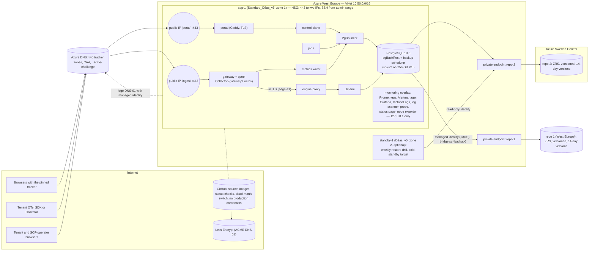
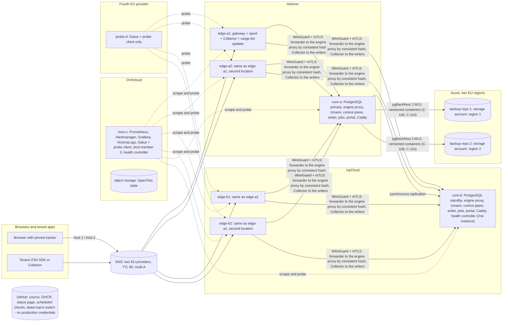

# Deployment topology

This page is a companion to [`sla.md`](sla.md), [`handover-plan.md`](handover-plan.md) and
[`cost-model.md`](cost-model.md).

UsageMap has three deployment profiles:

- **Small single VM (§0)** — the whole Docker Compose stack on one small VM. The reference deployment at
  <https://usagemap.dev> runs this profile.
- **Lean (§1, register C-123)** — the Docker Compose stack on one larger VM, optionally a second VM for the restore
  drill and as cold-standby target, one EU region, backups in two Azure storage accounts in two EU regions, Azure DNS.
- **Scale-out (§S1–S6)** — the multi-provider topology of ADR-0017/0018 (Hetzner/UpCloud/OVHcloud compute, two DNS
  providers, four edges, two cores), documented and tested on Compose. C-123 made the lean profile the default
  production profile; the scale-out profile is the path to the 99.99 % ingest objective.

Status of the full-size lean profile: **written, not applied.** The OpenTofu module (`infra/opentofu/modules/azure-lean`, root
`infra/opentofu/envs/azure-lean`) is validated and tested against a mock provider only (C-120); the Ansible playbook
(`infra/ansible/playbooks/lean.yml`) is tested in containers and is the one the small single-VM profile applies, with
its own settings.
The step-by-step deployment is [`guides/deploy-azure.md`](guides/deploy-azure.md) (full size) and
[`guides/deploy-v1.md`](guides/deploy-v1.md) (small single VM).

## 0. Small single-VM profile

IaC `infra/opentofu/envs/v1-small` (module `modules/single-vm`).

| Resource | Small single VM |
|---|---|
| Region | one EU region for everything; validation restricts it to EU/EEA regions |
| VM | one burstable VM with 2 vCPU and 8 GiB, Debian 13 pinned image, Trusted Launch, SSH keys only, no VM extensions; no zone pinning, no availability set; encryption at host off |
| Disk | **one Standard SSD** (size `os_disk_gb` in `v1.tfvars`) — OS and all data (Docker data root `/srv/scf/docker`) |
| Public IPs | two static Standard IPv4: `ingest` (`e1`, `e2`) and `portal` (apex landing, `app`, `status`) |
| Network | VNet `10.60.0.0/16`, subnet `10.60.1.0/24` with a Storage service endpoint; NSG in: 80/443 to the two front addresses, 22 from the operator's /32 only; out: 80/443, NTP, Storage |
| Backups | pgBackRest repository 1 on the VM's disk; repository 2 + weekly age-encrypted dump in one storage account: StorageV2, **LRS**, Cool, blob versioning, soft delete 14 days (blobs and containers), previous versions deleted after 14 days; network: VM subnet + operator only; the VM writes with a container SAS that cannot delete versions (works when the deploying identity has Contributor on one resource group only and cannot assign managed-identity roles) |
| DNS | any DNS provider, **DNS-only** (5 A records + CAA `issue letsencrypt.org`); never proxied — TLS ends on the VM and the gateway sees client addresses |
| TLS | Let's Encrypt via ACME DNS-01 (lego) |
| Monitoring | Prometheus, Alertmanager (local only — no outside channel), Grafana, VictoriaLogs, Gatus, host probe, status page — **all on the same VM**; outside view: a probe on the operator's workstation |
| Not created on purpose | standby VM, separate data disk, private endpoints, Bastion, second region, custom roles |

**Availability:** objective 99.5 % per month for ingest and dashboard, **not a guarantee**; the provider's
single-instance SLA for a VM with Standard SSD is itself 99.5 % ([`sla.md`](sla.md) §1.1–§1.2). No failover: a host
event, a reboot for a kernel update or a disk loss takes the service down until the VM is back or rebuilt from the
repository and the backups. Backups have **no geo-redundant copy** (both in one region, LRS).

## 1. Lean profile (C-123)

### 1.1 Resources

| Resource | What | Why |
|---|---|---|
| Region | Primary **West Europe** (`westeurope`, Netherlands); repository 2 in **Sweden Central** (`swedencentral`). Both variables are restricted to EU/EEA regions by validation (ADR-0017). | EU residency ([`privacy/data-residency.md`](privacy/data-residency.md)); repository 2 outside the primary region (C-110) |
| `app-1` (VM) | **Standard_D8as_v5** (8 vCPU, 32 GiB) in zone 1; Debian 13 gen2 image with a **pinned version** (validation rejects `latest`); Trusted Launch (secure boot, vTPM); encryption at host; SSH keys only; system-assigned managed identity. Small size: **Standard_D4as_v5** (4 vCPU, 16 GiB). | Sized from the measured load evidence (§1.4) |
| `app-1` disks | OS 64 GB Premium SSD (P6); data **256 GB Premium SSD (P15)** at LUN 0, mounted at `/srv/scf` and used as Docker's data root — every volume, PostgreSQL included | C-109: ≥ 250 GB where PostgreSQL runs. Premium SSD on every disk is also the condition for Azure's 99.9 % single-VM SLA; Standard SSD gives 99.5 % ([`sla.md`](sla.md) §1.1) |
| Public IPs | Two static Standard IPv4 addresses on `app-1`'s NIC (two IP configurations): **`ingest`** (gateway) and **`portal`** (portal, API and the optional status page) | The gateway terminates TLS itself and must see the client address (anti-inflation, ADR-0006); a shared TLS front would hide it. Two addresses let the gateway and the portal both own port 443 |
| `standby-1` (VM, optional) | **Standard_D2as_v5** in zone 2, 64 GB OS + **256 GB** data disk, a public IP used for outbound only (no inbound except SSH from the admin range) | Weekly restore drill from repository 2 with a read-only identity (C-56); cold-standby target: in a disaster the database is **restored** here (it is not a streaming replica) |
| Network | VNet `10.50.0.0/16`: subnet `app` `10.50.1.0/24` (both VMs), `endpoints` `10.50.250.0/24` (private endpoints), optional `AzureBastionSubnet` `10.50.254.0/26`; default outbound access off | — |
| NSG (`app`) | Inbound: **443/tcp from the internet to the two front-end addresses only**; **22/tcp only from `admin_source_cidrs`** (or only from the Bastion subnet when Bastion is enabled); everything else denied, including other VNet traffic. Outbound: 443 and 80/tcp to the internet, 443 to the endpoints subnet, nothing else | No database, metrics or admin port is reachable from outside |
| Backup repositories | Two storage accounts: repository 1 in the primary region, repository 2 in the second region; StorageV2, Standard **ZRS**, **Hot** tier; blob versioning, soft delete 14 days, lifecycle rule that deletes **previous versions after 14 days and never current blobs**; shared keys disabled; public network access disabled; reached through **private endpoints** and `privatelink.blob.core.windows.net` | C-108, C-110, C-112 (erased data leaves backups within 56 days). Hot, not Cool: Cool's 30-day early-deletion charge would apply to every version deleted at 14 days |
| Identities | `app-1`: custom role `<prefix>-backup-writer` on both containers (read, write, add, delete **current** blobs; no `deleteBlobVersion`, `permanentDelete` or `runAsSuperUser`; no `generateUserDelegationKey`). `standby-1`: Storage Blob Data Reader on repository 2 only. `app-1` also: Reader on each DNS zone and DNS Zone Contributor on each `_acme-challenge.<host>` TXT record set only | Backups by managed identity, no keys or SAS (replaces C-121's 7-day user-delegation SAS, which would have failed from week 2); ACME DNS-01 with least privilege |
| DNS | Azure DNS public zones for the two tracker domains (ADR-0004): A records for the ingest hostnames → `ingest` IP; the portal hostname (and the optional status hostname) → `portal` IP; CAA `0 issue "letsencrypt.org"` at each zone apex; `_acme-challenge` TXT placeholders | One DNS provider; no health controller (C-123) |
| State | OpenTofu state in an Azure blob (lease locking) with **enforced client-side state and plan encryption** (PBKDF2 + AES-GCM, passphrase in SOPS, ADR-0019); credentials only on the operator workstation (C-79) | — |

### 1.2 What runs where

The containers and their networks are exactly those of `infra/compose/compose.yaml` and
`compose.monitoring.yaml` ([`infra/compose/README.md`](../infra/compose/README.md)), never the development fixtures of
`compose.dev.yaml`; the Ansible role
`compose_stack` adds one production override (`compose.prod.yaml`) that changes only:

| Change | Detail |
|---|---|
| Images | By digest from the release (the release build signs and publishes; the workstation deploys, C-79) |
| Secrets | From SOPS (`group_vars/lean.sops.yaml`, created once by `infra/ansible/scripts/gen-stack-secrets.sh` on the workstation); `scripts/dev-secrets.sh` and `dev-pki.sh` are never used in production. Node mTLS certificates from the private CA of the `pki` role |
| Public TLS | **lego 5.6.0** (MIT, SHA-256-pinned), DNS-01 against Azure DNS with `app-1`'s managed identity; a systemd timer runs twice a day; a new certificate is deployed to the gateway (`SIGHUP`) and the portal (restart) |
| Gateway | Published on `<ingest IP>:443` → container 8443, real ingest hostnames; Docker runs with `userland-proxy: false`, so the gateway sees the client address |
| Portal | Published on `<portal IP>:443` → container 8443 with a production Caddyfile (HTTPS, HSTS); the control plane publishes no port and trusts `X-Forwarded-For` only from the portal's fixed address (`SCF_TRUST_PROXY`) |
| PostgreSQL | The `usagemap/postgres-ha` image (PostgreSQL 18.6 + pgBackRest 2.60.0) in **single mode — no Patroni, no etcd**: WAL archived to both repositories (`archive_timeout` 60 s); the backup scheduler takes a full backup weekly, a differential daily, runs `pgbackrest check` hourly and uploads the encrypted weekly logical dump with a managed-identity token. Only this container joins the `scf-backup0` bridge, the only container network that reaches IMDS and the blob endpoints |
| Monitoring | The overlay without the scale-out-only services (health controller, its etcd and DNS stand-ins, the `probe-d`/edge probe sources); a node exporter for the backup and restore-drill metrics; Prometheus, Alertmanager and Grafana on `127.0.0.1` (SSH tunnel or Bastion) |
| Host | nftables default deny (input: 443 to the two front addresses, SSH from the admin range; forward: only `scf-public0` to the internet on 80/443, only `scf-backup0` to IMDS and the blob endpoints), unattended security upgrades (Docker packages held), Docker CE 29.9.3 pinned, container logs rotated (`local` driver, 10 MB × 5), journald capped |
| Restore drill | Weekly systemd timer on `standby-1` (repository 2, read-only), or on `app-1` when there is no standby VM |

Ports reachable from the internet: **443 on the two front addresses**, and 22 from the admin range. Nothing else —
in particular no PostgreSQL, PgBouncer, metrics, Grafana or engine-proxy port.

### 1.3 Failure behaviour

| Failure | What happens | Recovery |
|---|---|---|
| A container crashes | Docker restarts it (`restart: unless-stopped`); the gateway spool keeps accepted events while a downstream service is away | Automatic |
| `app-1` reboots (host maintenance, kernel update) | Ingest and dashboards are down for the reboot (typically minutes). Trackers retry for up to 72 h; accepted events are on the fsync'd spool on the data disk | Automatic on boot (Docker `live-restore`, `unless-stopped`) |
| `app-1` lost, data disk intact (host failure) | Azure redeploys the VM to healthy hardware; the managed disks survive | Automatic (platform), minutes |
| Data disk or zone lost | Ingest and dashboards down; spooled events not yet forwarded are lost with the disk | Rebuild `app-1` from IaC and restore the database from repository 1 or 2 (RTO target 4 h, RPO ≤ 60 s — [`sla.md`](sla.md)), or restore on `standby-1` and move the two public IPs' DNS records |
| Region lost | As above, into another EU region; repository 2 is outside the primary region | Manual: `tofu apply` with another `location`, restore from repository 2 |
| Storage account of one repository lost or tampered with | The other repository still holds every backup; deleted or overwritten blobs survive 14 days as previous versions | `BackupCheckFailing`; restore from the other repository |

### 1.4 Sizing from the measured load (2026-11-13)

| Run ([`evidence/load/`](evidence/load/)) | Host | Result |
|---|---|---|
| Web ingest 116 events/s for 120 s (10× the design target of 1M page views/day) | One 8-vCPU host, whole single-node stack, load client on the same host | 13,920 accepted = 13,920 stored; `POST /v1/e` p95 63 ms, p99 96 ms (fsync before the answer) |
| API ingest 1,160 spans/s for 60 s (100M requests/day equivalent) | same | 69,600 spans = 69,600 requests in the API; p95 11.8 ms |
| API ingest 116 spans/s for 120 s | same | exact; p95 14.3 ms |

The default `app-1` size (8 vCPU, 32 GiB) is the shape of that host, so the measured 10× headroom carries over
without extrapolation, with memory for PostgreSQL's page cache (the S-11 read path, C-109) and the monitoring overlay.
`Standard_D4as_v5` (4 vCPU, 16 GiB) is the small size: at the 1× design target it keeps an estimated ≈ 5× CPU headroom
(linear estimate from the same runs — **not measured**). A resize is a VM restart. The runs were from a dirty tree and
short (60–120 s), so they are evidence of capacity, not of a multi-day soak.

### 1.5 What the lean profile gives up

| Property | Lean (production, C-123) | Scale-out (§S1) |
|---|---|---|
| Ingest survives the loss of a node, zone or provider | No — one VM in one zone | Yes (four edges, two providers) |
| Ingest availability objective | **99.5 %** per month ([`sla.md`](sla.md) §1) | 99.99 % (design objective, ADR-0031) |
| Database | One PostgreSQL; RPO ≤ 60 s from WAL archiving; restore-based recovery | Patroni with a synchronous standby (measured failover ≈ 24 s, 0 acknowledged commits lost, C-120) |
| Monitoring independent of what it watches | No — on the same VM; the design's outside view is the GitHub-hosted checks and the dead-man's switch (the small single-VM profile has the operator workstation's probe) | Yes (`mon-c`, `probe-d`) |
| DNS | One provider (Azure DNS), records static | Two providers, health controller (C-27, C-92) |
| Hosts to patch | 1–2 | 8 |
| Monthly list price | ≈ US$560 production, ≈ US$235 small size ([`cost-model.md`](cost-model.md)) | ≈ US$600–900 on Azure (9 VMs, estimate) |

**Moving to the scale-out profile** keeps the software: `infra/compose/compose.ha.yaml` (Patroni + etcd with TLS,
HAProxy, multi-node gateways and engine proxies) and `infra/opentofu/modules/azure-platform` are in the repository and
tested on Compose / against the mock provider; the move is a new `tofu apply` of that module, the Ansible roles
`postgres`, `pgbouncer`, `egress_proxy`, and a restore from the lean profile's repositories.

## Scale-out profiles (documented, tested on Compose, not deployed)

The rest of this page is the multi-provider analysis of ADR-0018 (prices of 2026-11-12, research cost model). It is
**not** the production plan since C-123. It remains the documented scale-out path: the four-edge / two-core layout
is what `compose.ha.yaml` and `modules/azure-platform` implement, and it is what the 99.99 % ingest objective was
engineered for. Provider names below are the research's candidates, not accounts we hold. The tracker still knows two
ingest hostnames on two domains in every profile. **Naming:** the "Lean" tier in §S1–S5 is the research's
multi-provider minimum (three providers), not the C-123 lean Azure profile of §1.

### S1. Side by side

| | **Lean (multi-provider)** | **Recommended** (ADR-0018; scale-out reference) | **Hardened** |
|---|---|---|---|
| Monthly cost | ≈ €124 (research cost model, prices 2026-11-12). It needs a second domain, so ≈ €125 (same source). | About €300/month, to be re-priced when ordering (re-priced range €225–320 from the November 2026 price list; the research's €288 priced a different layout) (C-25) | ≈ €622 (research cost model, prices 2026-11-12) |
| Providers | Hetzner, UpCloud, OVHcloud | Hetzner, UpCloud, OVHcloud, plus a fourth EU provider for `probe-d` | Hetzner, UpCloud, Scaleway, OVHcloud, netcup |
| Edge nodes (gateway, tracker files, spool, Collector) | 3: two at Hetzner, one at UpCloud | 4: `edge-a1`, `edge-a2` (Hetzner, two locations) and `edge-b1`, `edge-b2` (UpCloud, two locations) | 5 across three providers |
| Application tier (engine proxy and Umami, control plane, writer, jobs, portal behind Caddy) | 1 all-in-one core at Hetzner. The standby at UpCloud serves the portal read-only. | 2: `core-a` (Hetzner) and `core-b` (UpCloud), each with the full stack; portal and API resolve to both (C-07) | 3: two at Hetzner, one at UpCloud |
| PostgreSQL (Patroni, synchronous non-strict, ADR-0020) | Primary on the core, standby at UpCloud | Primary and standby on `core-a` and `core-b`, across providers | Primary and standby at Hetzner (dedicated vCPU), plus a replica at UpCloud |
| Third etcd member | On the OVHcloud prober VM (our adjustment) | `mon-c` (OVHcloud) | Monitoring node |
| Engine proxy (C-74) | On the core | On `core-a` and `core-b`, in front of Umami | On each application node |
| Health controller (two instances, etcd lease) | Prober VM and the core | `mon-c` and `core-b` (C-27) | Monitoring node and one core |
| Monitoring (Prometheus, Alertmanager, Grafana, VictoriaLogs) | **On the core node**, inside the failure domain it watches | `mon-c` (OVHcloud), outside production | A dedicated node, plus a second prober at another provider |
| Probe sources for the SLI (30 s, 2-of-3 quorum) | Prober VM plus one probe at each production provider | `mon-c`, `probe-d`, and the edge nodes' cross-provider probes (C-30); GitHub-hosted 5-minute checks feed the status page only | Two independent probers plus production providers, plus two third-party monitors (research shape) |
| Backups (pgBackRest 2.60.0 from PGDG, two repositories, versioned containers, C-108) | Hetzner and UpCloud object storage (research shape) | **Two Azure storage accounts in two EU regions** (C-110; Azure is the deployment target, C-96; Azurite locally); the second repository may move to another provider later without a design change | Three providers |
| Database disk (C-109) | ≥ 250 GB on the database host — the research shape's 160 GB all-in-one core is too small (S-11) | ≥ 250 GB on each core (attached volume if the instance type has less) | ≥ 250 GB on each database node |
| Spool copies in object storage | None (C-77) | None (C-77) | None (C-77) |
| Domains | 2 (required by the tracker, ADR-0004) | 2 | 2 |

### S2. What runs where: the recommended tier

Some components run only on certain nodes:

- **Edge nodes only:** the public ingest entry point, the tracker files (compiled into the gateway), the fsync'd
  spool (no copies elsewhere, C-77), the Collector (its own container; receiver only on the private `otlp` network shared with the gateway, C-130; it exports directly to the writers on both
  cores through one name, `writers.<mesh>`, that resolves to both, failing over at connection level; the relay hop
  through the gateway is only the fallback for an mTLS/SAN problem, C-77, C-107), and the range-list updater that fetches the
  cloud, Private Relay, Tor and VPN lists weekly into a local volume (C-38). The Collector's persistent queue limit,
  `SCF_QUEUE_BYTES` (bytes; the v0.165 queue has one sizer, so the request count is bounded through the bytes — C-115), is set **per node** by the IaC to 72 hours of that node's planned OTLP request volume; the
  built-in default of 1,000,000 requests (≈ 72 h at 3.9 requests/s) is only a fallback (C-113).
- **Core nodes only:** Caddy, which terminates TLS for the portal and API, and the **engine proxy** (C-74). Umami is
  never reachable from the internet (ADR-0003); the engine proxy in front of it authenticates callers by per-node
  mutual TLS — each node certificate has one OU naming its role (`edge`, `reader`, `provisioner`) and the node name as
  CN (C-113) — applies a path allow-list per role (C-60), serves as the entrance to the control plane's internal
  edge API (snapshot pull, counter upload), and keeps Umami's cache token and the time of the visitor's last event in
  memory, replaying the token only within 30 minutes (C-99). Edge forwarders pick a core by a consistent hash of the
  visitor pseudonym and use the other core only if that one fails. Umami runs as two images, `umami` and the one-shot
  `umami-migrate` (C-104); one container ingests ≈ 400 events/s, so plan ≤ 300 events/s per container (S-11, C-109).
- **Database nodes:** PostgreSQL containers run with `init: true` (pgBackRest's asynchronous archiver needs an init
  process as PID 1), a `CHECKPOINT` follows every start and promotion, and an old primary is fenced, restarted as a
  standby and `pg_rewind`-ed before it rejoins (C-108). The database host needs ≥ 250 GB of disk: Umami's tables grow
  ≈ 1.05 GB per day at 1M page views/day (C-109).
- **Health controller:** two instances, on `mon-c` and `core-b`, coordinated by an etcd lease; it can change only the
  ingest and portal A/AAAA records (C-27, C-61).
- **`mon-c`** accepts no inbound traffic except the mesh and the status endpoints; because it holds the DNS write
  credential, an etcd member and mesh access, its compromise is rated high impact in the threat model (C-79).
- **No node holds the OpenTofu state credentials**, and build automation holds no production credentials: deployments run from a
  service-operator workstation, or a pull-based agent on the nodes, with SOPS-decrypted secrets (C-79).
- **Each edge node terminates its own TLS** with its own certificate (ADR-0005). Its DNS credential can only write
  a delegated `_acme-challenge` zone; only the health controller can change service records (C-61).

The recommended tier keeps working through the following failures without a human:

- **Loss of any one node.** Edges are drained or removed through DNS, and the tracker rotates to the other host.
  If an edge node is lost for good before it has forwarded its spool, its undrained backlog (normally seconds of its
  traffic) is lost; there are no spool copies (C-77). If the lost node is a core node, the other core keeps serving,
  the edges send all visitors to its engine proxy (a visit may split once, C-74), the Collectors' connections move to
  its writer (C-107), and Patroni fails over if needed; the lost primary is fenced before it may rejoin (C-108).
- **Loss of the whole UpCloud provider.** `edge-a1` and `edge-a2` keep accepting, and `core-a` keeps serving;
  the health-controller instance on `mon-c` holds the lease.
- **Loss of the whole Hetzner provider.** `edge-b1` and `edge-b2` keep accepting, and `core-b` is promoted
  (etcd quorum `core-b` + `mon-c`).
- **Loss of `mon-c`.** Measurement degrades (metrics history, one probe source) and the dead-man's switch
  alerts, but production is unaffected; the health-controller instance on `core-b` takes the lease, and etcd keeps
  quorum with `core-a` and `core-b`.

The recommended tier gives up:

- **A replica beyond the standby.** While the standby is down, the primary runs asynchronously with no replica.
- **Dedicated database CPU and a second monitoring node.** `mon-c` is a single node.

### S3. Line items

#### 3.1 Lean (research cost model, prices 2026-11-12)

| Item | Provider and type | €/month |
|---|---|---|
| Edge 1, Edge 2 | Hetzner CPX12 HEL1, CPX12 NBG1 | 21.98 |
| Edge 3 | UpCloud Starter 2/4 | 12.00 |
| Core, all-in-one (applications, PostgreSQL primary, monitoring) | Hetzner CPX32 NBG1 | 35.99 |
| PostgreSQL standby and read-only portal | UpCloud Starter 4/8 | 20.00 |
| Object storage A and B | Hetzner €6.49, UpCloud €5.00 | 11.49 |
| Prober, status helpers, etcd witness | OVHcloud VPS-1 | 3.81 |
| DNS × 2 | Bunny ($1 minimum) + Gcore Free | 0.90 |
| Domains × 2 (the research priced 1; the tracker needs 2) | about €15/year each | 2.50 |
| Subtotal / 15 % contingency / **total** | | 108.67 / 16.30 / **124.97** |

#### 3.2 Recommended (C-25 layout)

About €300/month, to be re-priced when ordering (re-priced range €225–320 from the November 2026 price list; the
research's €288 priced a different layout). No line-item total is quoted for this layout; the range depends
mainly on core sizing, which is fixed at ordering.

| Item | Count | Notes |
|---|---|---|
| Edge nodes | 4 | two Hetzner locations, two UpCloud locations |
| Core nodes | 2 | `core-a` (Hetzner), `core-b` (UpCloud); full stack on each |
| Monitoring and witness | 1 | `mon-c` (OVHcloud) |
| Probe-only VPS | 1 | `probe-d` (fourth EU provider) |
| Object storage | 2 providers | backup repos 1 and 2 in two Azure storage accounts in two EU regions (C-110), versioned (C-108); OpenTofu state (OVHcloud); no spool copies (C-77) |
| DNS × 2, domains × 2, alert channel | — | providers chosen by the service operator |

#### 3.3 Hardened (research cost model, prices 2026-11-12)

| Item | €/month |
|---|---|
| 5 edges: Hetzner CPX22 NBG1 + HEL1, 2 × UpCloud Starter 2/4, Scaleway BASIC3 X2C-4G + IPv4 | 93.42 |
| 3 application nodes: Hetzner CPX32 NBG1 + HEL1, UpCloud Starter 4/8 | 86.48 |
| PostgreSQL primary and standby: 2 × Hetzner CCX23 (dedicated vCPU) | 159.98 |
| Cross-provider replica: UpCloud Premium 4/16 | 92.00 |
| Monitoring node: Hetzner CPX32 HEL1 | 30.49 |
| Object storage at three providers | 16.29 |
| 2 probers: OVHcloud VPS-1, netcup VPS 500 | 12.07 |
| 2 third-party monitors | 12.00 |
| DNS × 2, domains × 2, e-mail | 15.89 |
| Subtotal / 20 % contingency / **total** | 518.62 / 103.72 / **622.34** |

### S4. What each tier gives up

| Property | Lean | Recommended | Hardened |
|---|---|---|---|
| Ingest survives the loss of one provider | Yes (2 + 1 edges) | Yes (2 + 2 edges; two remain) | Yes (three providers) |
| Ingest keeps two-provider redundancy after losing one edge | Only if an UpCloud edge is lost | Yes | Yes |
| Dashboards survive the loss of the primary provider | Partly: Patroni promotes the UpCloud standby and the portal there serves read-only; full service (writer, Umami, control plane writes) needs a human to deploy the application stack at UpCloud | Yes. The full stack runs on `core-b`. | Yes |
| Monitoring independent of what it watches | **No.** It runs on the core. External probes and the dead-man's switch remain. | Yes (`mon-c` at a third provider, `probe-d` at a fourth) | Yes, with two probers |
| Database replicas | 1 | 1 | 2 |
| Dedicated vCPU for the database | No | No | Yes |
| Engineered for 99.99 % ingest and 99.9 % dashboard | Ingest design kept; dashboard and measurement weaker. Must be measured by the service operator. | Yes; this is the tier the objectives in [`sla.md`](sla.md) refer to (objectives, not guarantees, C-78) | Yes, with more margin |
| Operational load (hosts to patch) | 6 | 8 | 14 |

The research also mentions a **single-provider minimum** of about €80–90/month (research cost model, prices
2026-11-12): two Hetzner edges, one core and
one standby. It gives up the provider independence that the 99.99 % ingest design depends on. We do not
recommend it, and we do not document it as a tier.

### S5. Choosing a tier

- **Recommended** is the tier the 99.99 % / 99.9 % design objectives assume (C-78). Since C-123 it is the documented
  scale-out path, not the default production profile (§1).
- **Lean** suits a service operator who accepts read-only or degraded dashboards during a provider outage, and who
  accepts that monitoring runs inside the failure domain it watches. The ingest design (multiple edges across two
  providers, spool, tracker retry) is kept. The service operator should publish its own SLO figures, measured the same way.
- **Hardened** suits a service operator who wants more margin and dedicated database CPU, and who has the people to patch
  14 hosts.
- **Moving between tiers** means changing the inventory, running `tofu apply`, and for each added or removed node
  running the same drain or Patroni-switchover procedure as a routine deploy. No data migration is needed.

### S6. Notes for the service operator

- Hetzner raised cloud prices on 2026-06-15, and at the time of writing it has a capacity notice open. Size nodes
  at creation, because a rescale is a new order at the new price. Re-price the recommended tier when ordering. If an order fails, swap the provider module:
  Scaleway is the documented alternative (ADR-0018).
- Keep the OpenTofu state bucket on a provider that supports conditional writes for state locking. Our research
  found that Hetzner Object Storage does not support them on versioned buckets, so the state bucket lives at
  OVHcloud (ADR-0019). Spike S-08 as run tested backups against the Azure Blob interface (Azurite), not state
  locking (C-96, C-108).
- Backup buckets need **blob versioning**, a credential for the database nodes that can delete current blobs but not
  previous versions, a lifecycle rule that deletes previous versions after **14 days** and never touches current blobs (so erased data
  leaves all backups within 56 days: 35-day retention + up to 7 days until the next full + 14 days as a previous version, data-model §14, C-112),
  and a read-and-list-only credential for the restore-drill host (C-108). The versioning protection cannot be tested
  locally (Azurite emulates none of it) and must be verified on the real provider.
- Size each database host for ≥ 250 GB of disk (C-109); the research shape's Lean core (160 GB) is too small.
- The `umami` database and its role `umami_app` are created by the Ansible PostgreSQL role in production (in the Compose
  stack by the PostgreSQL container's initdb script), before the one-shot `umami-migrate` step (C-113).
- Size each edge disk for the Collector queue: set `SCF_QUEUE_BYTES` per node to 72 h of its planned OTLP request volume (C-115)
  (C-113).
- Keep both tracker domains, whatever tier you run. Every tracker version that tenants have pinned uses both.
