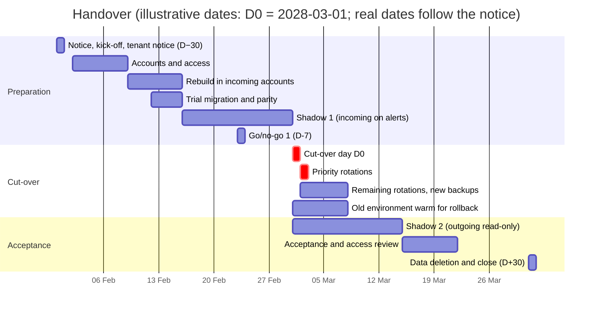

# Handover plan

| | |
|---|---|
| Status | First written 2026-11-12. The data migration has been rehearsed on the v1 host; the full procedure is rehearsed by an outsider before it is relied on (§9). |
| Goal | Hand stewardship of the hosted instance to a community-appointed service operator whenever the appointing party decides. The plan can be executed on **30 days' notice**. |
| Definition of done | Handover is complete only when a community-appointed operator is independently running a fully working system. Mandatory elements: transfer of repository ownership, full data migration, and either transfer of domain ownership or a permanent redirect from the old domain. Infrastructure is rebuilt from the open-source monorepo. |
| Binding decisions | ADR-0003, 0004, 0005, 0007, 0014, 0016, 0017–0023, 0031, 0032 and the design decisions C-01 … C-112 of [`docs/adr/README.md`](adr/README.md); most relevant here: C-05, C-15, C-18, C-21, C-29, C-30, C-31, C-40, C-47, C-50, C-56, C-59, C-60, C-63, C-74, C-77, C-78, C-79, C-81, C-85 |
| Capabilities | handover.window, handover.independent-operator, handover.repo-transfer, handover.data-migration, handover.domain-transfer, ops.rebuild-from-repo, handover.ready ([`capabilities.md`](capabilities.md)) |
| Companions | [`sla.md`](sla.md), [`deployment-topology.md`](deployment-topology.md). Runbooks: [`ops/runbooks/handover-migration.md`](../ops/runbooks/handover-migration.md) (data migration, rehearsed in [`evidence/handover-drill-2026-11-18.md`](evidence/handover-drill-2026-11-18.md)) and [`ops/runbooks/end-of-window-no-successor.md`](../ops/runbooks/end-of-window-no-successor.md) (§10.1). |
| Placeholders | `<domain-a>`, `<domain-b>`, `ORG/REPO`, `@SCOPE/tracker`, `<service-operator>` |

**Roles used in this document**

- **Outgoing team**: us.
- **Incoming service operator** (the **incoming team**): the community-appointed entity that will host the
  service (C-59).
- **Appointing party**: the organisation that names the incoming service operator and signs acceptance (for the
  public instance, the ecosystem body that sponsors its hosting).
- **SCF operators**: portal users with the `operator` or `operator_admin` role (C-59). They are not the service
  operator and are unaffected by the handover except for the notice.
- **D0**: the cut-over day. **D−30** is the day the appointing party gives notice.
- **End of hosting**: the date after which the outgoing team no longer hosts the instance, announced at least 60 days
  ahead.

## 1. Principles: ready for handover from day one

1. **Nothing is tied to a person or to our company.**
   - The service uses dedicated domains (`<domain-a>`, `<domain-b>`).
   - It uses a dedicated GitHub organisation (`ORG`) and a dedicated npm organisation scope (`@SCOPE`).
   - Provider accounts are dedicated projects with role e-mail addresses.
   - Nothing lives under a personal account or a company account that hosts other work.
2. **No secret that only we hold.**
   - Every runtime secret is in SOPS-encrypted files in the repository (ADR-0019), encrypted to one age key per
     person on the operating team and a sealed break-glass key.
   - Build automation builds, tests, signs and publishes only and **never holds production credentials** (C-79). Deployments run
     from a service-operator workstation (or a pull-based agent on the nodes) with SOPS-decrypted secrets. The
     OpenTofu state credentials are not stored on any server.
   - Nothing lives only on a laptop or only in someone's head: every secret a workstation uses is in SOPS.
3. **Everything can be rebuilt from the repository.**
   - OpenTofu, Ansible and Compose definitions are in the repo.
   - So are dashboards, alert rules, SLO specs, probe configuration and the status-page configuration.
   - Internal plumbing is rebuilt, not transferred: the private CA and per-node certificates (C-60), the engine
     proxy on each core node with its path allow-lists (C-74), the health controller, the egress proxy and its
     allow-lists (C-10) and the range-list updater on edge nodes (C-38) all come from the IaC and the repository.
   - Data is restored from backups or a logical dump (ADR-0021).
   - The rehearsal (§9) proves this before a handover relies on it.
4. **Keyless release signing; the other long-lived keys are listed.** Release signatures use Sigstore keyless
   identities (ADR-0023), so there is no long-lived release-signing key. Other long-lived keys do exist and are on
   the inventory: the three key peppers and the snapshot-signing key (I-15, I-16; carried over, C-50, C-81), the key
   that encrypts the per-tenant Umami credentials (I-17, C-40, C-85), the Ed25519
   traction-snapshot key (I-26, C-47), the SEP-10 server signing key (I-27, C-15) and the audit-anchoring account key
   (I-28, C-63).
5. **Tenants do nothing at handover.**
   - Pinned tracker URLs, SRI hashes, npm package names, ingest hostnames and ingest tokens keep working: the domains
     are transferred and the peppers are carried over (C-50).
   - Any change a tenant might choose to make afterwards is optional and announced (§5.4).
6. **The handover is a drill we have already run.**
   - Rebuild-from-zero and restore drills run while we operate the service (ADR-0021).
   - A handover is the same procedure carried out by the incoming service operator.

## 2. Inventory: everything that changes hands

**What runs today (v1 host,** [`deployment-topology.md`](deployment-topology.md) **§0):** one
resource group holding the v1 VM (one EU region), its one disk, its public addresses, the network and one
backup storage account; DNS for `usagemap.dev` at **Cloudflare** (DNS-only; API token limited to that zone);
lego's ACME account on the VM (DNS-01 through that zone-limited token); the monitoring overlay and status page on the VM;
the OpenTofu state, secrets and private CA in the operator's deployment directory outside the repository
([`guides/deploy-v1.md`](guides/deploy-v1.md)). The handover data migration was rehearsed on it.

**Lean Azure profile (C-123) — full-size design.** Production at full size is planned on Azure ([`deployment-topology.md`](deployment-topology.md) §1), so
in the rows below the hosting accounts (I-10), the object-storage buckets (I-11), DNS (I-8), TLS (I-9) and the
monitoring stack (I-19) are, for that profile: **one Azure subscription** holding `app-1`, `standby-1`, their
disks and public IPs, the two backup storage accounts (two EU regions), the OpenTofu state account,
Azure DNS (one provider, static records, no health-controller tokens), lego's ACME account on `app-1` (DNS-01 with the
VM's managed identity), and the monitoring overlay on `app-1`. Path B for the subscription is §5.6; path A is a
rebuild from `infra/opentofu/envs/azure-lean` and `infra/ansible/playbooks/lean.yml`
([`guides/deploy-azure.md`](guides/deploy-azure.md)) plus a restore. The multi-provider wording of the rows is the
scale-out profile. Running cost: [`cost-model.md`](cost-model.md).

Column meanings:

- **Path A**: rebuild in the incoming service operator's accounts (§4).
- **Path B**: transfer of accounts (§5).
- **Verify**: the check recorded in the acceptance checklist (§8).

| # | Item | Held during the window | Path A | Path B | Verify |
|---|---|---|---|---|---|
| I-1 | GitHub organisation `ORG`: repo `ORG/REPO`, `ORG/status` (Upptime data, DV-06), rulesets, CODEOWNERS, tag rulesets, branch protections | Outgoing team owners (≥ 2) | Same in both paths: add incoming owners; remove ours at acceptance (§5.1) | Same | Incoming team members are the only owners; our accounts are gone from the members list |
| I-2 | Deploy credentials (SSH deploy keys, hosting-provider API tokens, OpenTofu state credentials): held by the service operator in SOPS and used from a service-operator workstation or a pull-based agent on the nodes — **never in build automation** (C-79). Release environments `npm-release` and `release` (required approvers), when set up, hold no production credentials | Outgoing team | Incoming team creates new deploy credentials for its own accounts; environment approvers changed | Values rotated; approvers changed | Environment approvers are incoming team members only; no repository environment or secret grants production access; every deploy credential was created or rotated after D0 |
| I-3 | Release approvers: two-person rule (GitHub environment approval plus npm stage approval) | Outgoing team | Incoming team named in the environment approvers and the npm org | Same | One release done end to end by the incoming team |
| I-4 | npm organisation `@SCOPE`: owners, `@SCOPE/tracker`, trusted publisher (stage-only), staged-publishing approvers | Outgoing team (≥ 2 owners, WebAuthn) | Add incoming owners; re-point the trusted publisher if the repo moved; remove ours after the first staged release by the incoming team (§5.2) | Same | `npm owner ls` shows only incoming accounts; a staged release has been approved by an incoming maintainer |
| I-5 | Signing and provenance identity: Sigstore workflow identity `https://github.com/ORG/REPO/.github/workflows/<release>.yml@…`, SLSA provenance, cosign image signatures, signed tracker hash manifest | Keyless, bound to `ORG/REPO` | Unchanged if the organisation changes owners. Changes if the repo moves to another organisation (§5.2). | Same | The verify job passes against all served versions after D0 |
| I-6 | Container registry: GHCR images under `ORG` | GitHub organisation | Moves with the organisation. A repo transfer does not obviously carry the packages (unverified; check in the rehearsal) | Same | The deploy playbook's `cosign verify` passes with the expected identity |
| I-7 | Domains `<domain-a>`, `<domain-b>`: registrar account, registry lock, auto-renew prepaid past the end of hosting | Outgoing team role account | Registrant/account transfer (§5.3) | Same | WHOIS/RDAP registrant, registrar account and lock state all with the incoming team |
| I-8 | DNS at both providers: zone as code, health-controller tokens, delegated `_acme-challenge` zone | Outgoing team accounts | Incoming team opens accounts at both providers; the zone is pushed from the repo; NS records changed at the registrar | Accounts transferred, or the same as path A | Both providers serve the same zone; NS points to the incoming team's accounts; old tokens revoked |
| I-9 | TLS: per-node ACME accounts and certificates; CAA with `accounturi` | Per node | New nodes issue their own certificates **after** CAA lists the new ACME accounts | Re-issue under new ACME accounts | CT monitoring shows issuance only from expected accounts |
| I-10 | Hosting accounts at Hetzner, UpCloud and OVHcloud (or the incoming service operator's chosen providers) | Outgoing team | Incoming team's own accounts; full rebuild | Project/account transfer, if the provider supports it (unverified per provider) | Billing and IAM show only the incoming team |
| I-11 | Object-storage buckets: OpenTofu state (versioned), pgBackRest repository 1 (UpCloud) and 2 (OVHcloud) (C-29), raw probe files. There are no spool-copy buckets: spool contents exist only on edge disks (C-77) | Outgoing team | New buckets. **The probe-data archive is copied across** to keep SLO history; old backups are deleted at D+30 (§6.4) | Transferred with the accounts; keys rotated | A new full backup exists in the incoming team's repositories and a restore drill has passed |
| I-12 | Backup encryption keys (pgBackRest `repo-cipher-pass` per repo; age key for the weekly `pg_dump`) | SOPS | New keys for new repos. Old keys are kept in the break-glass envelope until old backups are deleted | New repo path with new keys; old repo kept until its retention lapses | — |
| I-13 | SOPS/age recipients (`.sops.yaml`), break-glass key | Outgoing team keys, break-glass (no build-automation recipient for production secrets, C-79) | Incoming team recipients added; **every value rotated** (§6) except the items carried over under C-50 (I-15, I-16), which are rotated after acceptance; our recipients removed; new break-glass key | Same | `sops` metadata lists only incoming recipients; the break-glass envelope has been re-issued |
| I-14 | SCF operator accounts and the SCF operator allow-list (ADR-0014). The `operator_admin` identity is seeded at bootstrap. Outgoing team members who hold these roles are removed. | Outgoing team members plus SCF operators | The allow-list migrates with the `scf` database. Incoming people are added; outgoing people are removed at acceptance. | Same | The allow-list has no outgoing team member; the audit-log hash chain verifies across D0 |
| I-15 | Key peppers (ADR-0016, C-05, C-81), each with its pepper version: `ing` (tenant ingest tokens; held by edges and core), `op` (SCF operator keys; core only) and `pub` (tenant share keys; core only) | SOPS | **Handed over securely and not rotated at cut-over** (C-50); rotated after acceptance with overlap, which works because every stored hash records the pepper version that produced it (§6.3, C-81) | Same | Existing SCF operator keys, tenant ingest tokens and share keys still authenticate after D0; the post-acceptance rotation has a date |
| I-16 | Snapshot-signing key: the control plane signs the snapshot that gateways pull (ADR-0005); separate from all three peppers (C-05, C-81) | SOPS | **Handed over securely and not rotated at cut-over** (C-50); rotated after acceptance with an overlap during which gateways trust both keys | Same | Gateways load snapshots signed by the carried-over key at D0; after the rotation, by the new key only |
| I-17 | Umami: admin/provisioning identity, `APP_SECRET`, per-tenant view-only users with their passwords and API keys (ADR-0003, C-85); the key, held outside the database, that encrypts those per-tenant passwords and API keys in `scf` (C-40, C-85) | SOPS and the `umami` and `scf` databases | The encrypted per-tenant passwords and keys are **part of the data migration** (§4.3); the encryption key is handed over securely with them, because without it the provisioning worker cannot rotate any tenant's key. The admin credential, `APP_SECRET` and the encryption key are rotated after cut-over (§6). | Same | The adapter contract test passes; one tenant's Umami key is rotated by the provisioning worker on the new environment; the old admin credential is rejected |
| I-18 | Daily visitor key `K_day` (ADR-0007) | Gateway memory only | **Nothing to transfer.** It is never stored, and a new key exists by design. | — | — |
| I-19 | Monitoring stack on `mon-c` (with the health controller, also on `core-b`); the probe-only VPS `probe-d` at a fourth EU provider and its account; edge cross-provider probes; the dead-man's switch (a scheduled GitHub workflow, C-30); alert receivers, including the push to the two patch responders (C-67) | Outgoing team | Rebuilt from the repo; new `probe-d` account; new receivers and responders | Accounts transferred or recreated; receivers changed | A test alert reaches incoming people only; the dead-man's-switch workflow is green |
| I-20 | Status page `ORG/status` (Upptime) and its personal access token | Outgoing team | Moves with the organisation. **The token belongs to a person and must be re-issued by an incoming owner.** | Same | Upptime workflow runs green with the new token |
| I-21 | Optional GCP project for BigQuery on-chain correlation (ADR-0028; off by default) | `<owner TBD>` | Transfer the project or create a new one; switch billing | Same | The job runs under the incoming team's service account, or stays disabled |
| I-22 | Documentation and runbooks (`docs/`, `ops/runbooks/`) | Repo | Moves with the repo; corrected by the rehearsal | Same | Rehearsal log with zero undocumented steps (§9) |
| I-23 | Open issues and the support queue; the private operations tracker; privacy mailbox | Outgoing team | Tickets opened before D0 stay ours until resolved or D+30, then pass over with notes. The mailbox is transferred. | Same | Queue report at acceptance |
| I-24 | Service-operator position: DPA with tenants, sub-processor list, records of processing; the service operator's own controller role for portal account data and audit logs (C-59) | Outgoing team as service operator: processor for tenant analytics, controller for its own records (ADR-0027) | The incoming team becomes processor under its own DPA and controller for portal account data and audit logs; tenants notified at D−30 (§7). Counsel question. | Same | Updated sub-processor list and service-operator privacy notice published; tenant notice sent |
| I-25 | Evidence archives: `docs/evidence/` (SLO reports, drills, post-mortems, daily audit-chain head hashes) | Repo | Moves with the repo; never rewritten | Same | — |
| I-26 | Traction-snapshot signing key: Ed25519 platform key whose public half is published in the repository and under `/.well-known/` (ADR-0032, C-47) | SOPS | Handed over securely so snapshots already issued stay verifiable; if the incoming team rotates it, the new public key is published and old ones stay listed | Same | A snapshot signed before D0 and one signed after D0 both verify offline and online |
| I-27 | SEP-10 server signing key and the `stellar.toml` on the service domain that publishes it (C-15) | SOPS; `stellar.toml` in the repo | On the rotation list (§6.1): new key generated by the incoming team, published in `stellar.toml` | Same | `stellar.toml` lists only the incoming team's key; a SEP-10 sign-in succeeds |
| I-28 | Audit-anchoring Stellar account and its key, when anchoring is enabled (C-63) | SOPS | On the rotation list (§6.1): the incoming team's key is added as signer and ours is removed | Same | The account's signers are incoming keys only; the daily anchor and the head hash in the evidence repository continue across D0 |

## 3. Choosing a path

**Path A (rebuild and migrate) is the default.** It is what the definition of done describes (infrastructure is
rebuilt from the open-source monorepo). It proves that the incoming service operator can run the system without us, and it leaves no
account history behind. Path B is for an incoming service operator who wants the existing accounts and providers as they are. It
needs less work, but it proves less, and provider support for transferring accounts has not been verified.

| | Path A: rebuild + migrate | Path B: account transfer |
|---|---|---|
| Proves independent operation | Yes. The incoming team builds it. | Only partly: the infrastructure was built by us |
| Data migration | A full migration with verification (§4.3) | The data stays where it is. We still run a verified restore into the incoming team's control (§5.5) so that "full data migration" is shown, not assumed. |
| Dependence on providers | None | Hetzner, UpCloud and OVHcloud project/account transfer **unverified** |
| Ingest downtime at cut-over | Target: none (overlapping edges, DNS switch) | None |
| Dashboard downtime | Read-only during the freeze; target ≤ 2 h, to be measured in the rehearsal | None |
| Secret rotation | Most secrets are new by construction; peppers and snapshot-signing key are carried over (C-50) | Every value must be rotated (§6), except the items carried over under C-50 |
| Domain handling | Domain transfer (§5.3) | Domain transfer (§5.3) |

## 4. Path A: rebuild in the incoming service operator's infrastructure

### 4.1 Before cut-over (D−30 … D−1)

1. **Accounts.**
   - The incoming team opens accounts at its chosen EU providers. The IaC provider modules are swappable
     (ADR-0018), so any tier from [`deployment-topology.md`](deployment-topology.md) can be chosen.
   - It also opens: object storage at two providers, two DNS providers, a probe-only VPS (`probe-d`) at a fourth EU
     provider, and alert receivers.
2. **Access.**
   - Incoming people are added to `ORG` as members, then as owners from D−14. Both teams are owners until
     acceptance.
   - They submit age public keys by PR. They are added as recipients of new SOPS files for their environment
     (`ENV=<service-operator>`), which are never readable by us.
3. **Build.**
   - The incoming team runs, in order, from its own workstation with its own SOPS-decrypted secrets (deploys never
     run from build automation, C-79):
     1. `tofu apply` in its own accounts, with an OpenTofu state bucket in its own account.
     2. `make bootstrap`
     3. `make db`
     4. `make deploy`
     5. `make monitoring`
   - Hostnames during the build are staging names (for example `edge-x1.stg.<domain-a>`). ACME runs against the
     staging CA until §4.2.
   - We review and answer questions. **We do not type commands in their accounts.**
4. **CAA.** Add the incoming team's ACME account URIs to the CAA records, keeping ours. Then the new edges issue
   production certificates for their own node names and the shared ingest names.
5. **Trial migration.**
   - Restore the latest weekly `pg_dump` (age-encrypted, ADR-0021) into the new cluster. Restores run only on EU
     infrastructure, never on GitHub-hosted runners, and backup keys never leave it (C-56).
   - Run the verification in §4.3.
   - Time every step. This sets the freeze length.
6. **Shadow 1 (D−14 … D0).** The incoming team receives our alerts (read-only) and carries out one deploy, one
   restore drill and one rollback in its own environment.
7. **Tenant notice at D−30** (§7). A reminder goes out at D−3. A status-page notice is posted at D−3.
8. **Go/no-go 1 at D−7.** Readiness review against §8 items A1–A6. A failure moves D0; it does not shorten the
   steps.

### 4.2 Cut-over day (D0)

**Timing.** Start shortly after 00:00 UTC. Daily visitor keys rotate at 00:00 UTC (ADR-0007), and Umami's salt
rotation is daily. Starting just after the boundary limits the double-counting of unique visitors to the overlap
on the cut-over day. That day is annotated in dashboards.

| Step | Action | Who | Check |
|---|---|---|---|
| 0 | Status page: "Maintenance — dashboards read-only; ingest unaffected" | Outgoing | Status page updated |
| 1 | **Freeze writes in the old core.** Control plane and portal go to read-only mode (ADR-0020); writer and jobs paused. Old edges keep accepting and **spooling**. | Outgoing | Spool depth rises; ingest probes stay green |
| 2 | Final logical dump of `scf` and `umami` (`pg_dump -Fc`), with a SHA-256 of each file. Transfer to the incoming team's EU bucket, host to host (C-56); checksums compared on arrival. | Outgoing → Incoming | Checksums match |
| 3 | Restore into the new cluster | Incoming | Restore exits cleanly; `pg_amcheck` clean |
| 4 | **Verify** (§4.3) | Both | Parity report signed by both teams |
| 5 | **Go/no-go 2.** The last point at which rollback is trivial: unfreeze the old core. | Both + appointing party informed | Decision recorded |
| 6 | **Drain old edges into the new core.** Point the old edges' forwarders and the Collector exporter at the new core over a temporary WireGuard peer. Unforwarded spool and queue contents flow into the new environment. | Both | Old spools drain to zero |
| 7 | **DNS switch.** The zone in the repo now lists the new edge addresses, pushed to both DNS providers at TTL 60. Old edge records are removed. | Incoming (PR approved by both) | Both providers serve the new records; probes see new nodes |
| 8 | Old edges keep running and forwarding to the new core until their request rate reaches zero, then stop by closing the listener | Outgoing | Old edges: no requests for 24 h |
| 9 | Unfreeze: the new control plane goes read-write; writer and jobs start | Incoming | Synthetic journeys green; freshness canaries visible |
| 10 | Status page: "Resolved"; incident notes | Incoming | — |

**Tracker URL continuity.**

- Every pinned script URL (`https://<domain>/lib/<semver>/<profile>.js`) and every ingest hostname compiled into
  every tracker version stays the same, because the **domains themselves move** (§5.3) and only DNS records change.
- The new gateways serve byte-identical files. The tracker is compiled into the gateway binary from the same
  reproducible build, so SRI hashes still match.
- The verify job checks every served version against the signed manifest at D0+1 h.

### 4.3 Verifying the data migration

| Check | How | Pass condition |
|---|---|---|
| File integrity | SHA-256 of each dump file at source and destination | Equal |
| Row counts | Per table and per partition in `scf` and `umami`, computed on the frozen source and on the target (the table list comes from `docs/data-model.md`) | Equal |
| Content checksums | Per-day row counts and value sums for closed partitions: the same integrity checks the weekly restore drill uses (ADR-0021) | Equal |
| Audit log | Hash chain verified end to end on the target (ADR-0014) | Valid; last hash equals the source's |
| Dashboard parity | For a fixed sample (all canary tenants plus 10 % of active tenants, at least 5 if there are that many), call the tenant metrics API and the SCF operator metrics API (`docs/api/`) on old and new environments over the same closed ranges (last 24 h, 30 d, 12 months) | Identical responses, apart from fields documented as generated at request time |
| Keys and tokens | Authenticate a probe `op` key, a probe ingest token and a probe `pub` share key against the new environment (all three peppers carried over with their versions, C-50, C-81) | 200 / accepted |
| Umami credentials | The encrypted per-tenant Umami passwords and API keys arrived with `scf` and decrypt with the handed-over key (C-85); the provisioning worker rotates one canary tenant's key | Decrypts; rotation succeeds |
| Umami adapter | Contract tests run against the new engine | Pass |

### 4.4 Rollback

| Stage | Rollback |
|---|---|
| Before go/no-go 2 | Unfreeze the old core. Nothing has changed for tenants. |
| After the DNS switch | **Roll forward by default.** If the new environment cannot serve, switch DNS back to the old edges, which are kept warm until D+7. Then move events accepted by the new environment since D0 back with the same dump tooling, restricted to that time range. This delta migration is rehearsed in §9. Its duration is a target to be measured. |
| After D+7 | Old edges and core are decommissioned. Recovery is from the incoming team's own backups. |

The old environment's data is deleted at D+30, or 7 days after acceptance, whichever is later (§6.4).

### 4.5 Alternative migration method: replica promotion over the mesh

If the trial migration shows that the freeze would be too long:

- The new database nodes join our WireGuard mesh temporarily and are built as Patroni replicas using
  `create_replica_methods: pgbackrest` (ADR-0020/0021).
- When they have caught up, a planned switchover makes a new node primary. Our nodes are then removed from the
  cluster, and the mesh peer and replication credentials are deleted.
- Dashboard downtime shrinks to the switchover.
- The cost is that both teams' nodes share one cluster and one set of replication credentials for a few days.
  Those credentials are rotated afterwards.
- The verification in §4.3 still applies, using the frozen-moment counts taken at the switchover.

## 5. Path B and the shared procedures

### 5.1 GitHub repository ownership

Two options. We recommend B1.

- **B1: change the owners of `ORG`** (recommended).
  - Add incoming owners, then remove ours at acceptance.
  - Repository ID, organisation ID, GHCR packages, Pages, `ORG/status`, tag rulesets and the Sigstore workflow
    identity **do not change**. Tenants and verifiers notice nothing.
  - The appointing party must confirm that this counts as "transfer of repository ownership" (OQ-2).
- **B2: transfer `ORG/REPO` into the incoming service operator's organisation.** GitHub keeps redirects from the old URL.
  The signing identity changes (§5.2). `ORG/status` and the GHCR packages need their own moves, and the rehearsal
  must check how GHCR packages behave.

### 5.2 Signing identity, npm and what tenants verify

**Before handover**, tenants and verifiers check:

- the SRI hash in the snippet;
- the signed hash manifest, whose Sigstore identity is the `ORG/REPO` release workflow;
- npm provenance for `@SCOPE/tracker`;
- cosign signatures on images.

**With B1** nothing changes.

**With B2**, the following steps apply:

1. **Final release by the outgoing team.** Before the transfer, we publish a release signed under the old identity.
   It includes a signed `IDENTITY-TRANSITION.json` naming the future organisation, repository and repository ID.
2. **Transfer.**
   - New signatures carry the new workflow URI.
   - Old signatures stay valid under the old identity, and Rekor keeps them.
   - Fulcio certificates also carry the source repository ID and the owner ID. A transfer is expected to keep the
     repository ID and change the owner ID. **This is unverified; it is checked in the rehearsal with a
     throwaway repository.**
3. **Verifiers.** `tools/verify-tracker` and the deploy playbook's `cosign verify` accept the old identity for
   versions up to X and the new identity for later versions, and pin the repository ID.
4. **npm.**
   - Delete the old trusted-publisher entry and create a new one for the new repository, workflow and
     `npm-release` environment, with stage-only permission.
   - Add incoming accounts as owners of `@SCOPE`.
   - The incoming team then makes its first staged release: its next real tracker release, or, if none is due, a
     prerelease under a non-`latest` dist-tag. It is approved with 2FA by an incoming maintainer.
   - **Only after that** are our accounts removed.
   - Package names do not change, so tenant lockfiles keep working.
   - Staged publishing became generally available in npm 11.15.0 (GitHub changelog, 2026-05-22).

**What tenants verify after handover**:

- The same SRI hashes for every existing version.
- New versions are signed under the identity recorded in `IDENTITY-TRANSITION.json`, if B2 was used.
- pnpm users with `trustPolicy: no-downgrade` are protected as before, because every release still goes through
  trusted publishing.

### 5.3 Domains: transfer, not redirect

**Why a redirect alone is not enough.**

- Every pinned tracker version, whether a script tag or an npm bundle, contains the two ingest hostnames on two
  domains (ADR-0004). Tenants are never forced to upgrade.
- A redirect works for the script file: browsers follow redirects and still enforce SRI, provided the target sends
  CORS headers.
- For the ingest POSTs a redirect is **documented as insufficient** (C-50): cross-origin redirects of beacons and
  POSTs (`fetch(keepalive)`, `sendBeacon`, CORS preflights) are not reliable, and we do not rely on them.
- A redirect also leaves the old domain with a party that has no obligations after the end of hosting.
- **Conclusion: both service domains are transferred** to the incoming service operator (C-50). A redirect is
  offered only as a temporary measure for the portal, if the incoming team wants a different portal name; it is
  never used for tracker or ingest hostnames.

**How SRI protects tenants across the change.**

- The bytes a pinned tag will execute are fixed by its hash.
- Whoever controls the domain after handover, carelessly or with hostile intent, can at worst make the script fail
  to load. Analytics stops; the site keeps working. They cannot run different code.
- This is the lesson of the polyfill.io incident (June 2024), where a new domain owner served malware to sites
  that embedded the script without SRI.
- Tenants who bundle the npm package have no runtime dependency on the domain for code at all.

**Procedure.**

1. **Prepaid renewal.** Both domains are renewed beyond the end of hosting well before a handover starts.
2. **Preferred move.** An account-to-account move at the same registrar. A change of registrant can start a
   60-day lock on inter-registrar transfers for some TLDs (ICANN transfer policy, prior knowledge, unverified for
   the chosen TLD). An inter-registrar transfer is therefore the fallback.
3. **Registry lock.** It is lifted only for the move, and re-applied by the incoming team at once.
4. **DNS.** The NS records at the registrar change to the incoming team's two DNS providers. Both the old and the
   new provider accounts serve the identical zone until the parent-zone TTL has expired twice.
5. **Record-level security** follows the zone as code: CAA with `accounturi`, and CT monitoring re-subscribed to
   incoming contacts. DNSSEC is not enabled on the ingest zones at launch (C-31); whether to enable it after the
   first six months of operation is the incoming team's decision.
6. **Verification.** RDAP shows the new registrant. Probes stay green throughout. The verify job confirms
   byte-identical tracker files.

### 5.4 Ingest tokens and API keys

- Tenant ingest tokens, `pub` share keys and SCF operator `op` keys stay valid, because all three peppers are carried
  over (§6.3, C-50, C-81).
- SCF operator keys expire after 90 days by default (ADR-0016), so they renew naturally under the incoming
  service operator.
- Tenants may rotate ingest tokens at any time; up to five are active per tenant, so rotation with overlap needs
  no downtime (C-21). After acceptance the incoming team rotates the peppers this way (§6.3); the tenant notice
  announces it.

### 5.5 Path B steps (account transfer)

1. Freeze nothing.
2. Transfer the hosting accounts — for the lean Azure profile, the **Azure subscription (§5.6)**; for the scale-out
   profile, the provider projects or accounts (Hetzner, UpCloud, OVHcloud), the DNS provider accounts and the `probe-d`
   provider account. **For each provider, confirm before D−21 that transfer is
   possible** (unverified today, §9.1). If it is not, that provider falls back to path A.
3. Carry out §5.1–§5.3.
4. Rotate every secret in the order of §6, except the items carried over under C-50.
5. Prove the data is under the incoming team's control: restore the latest backup from the incoming team's
   repository into a scratch instance it owns, and run the §4.3 checks against production.
6. Shadow, then acceptance (§8).

### 5.6 Azure subscription transfer (lean profile, path B)

Two ways to hand over the Azure resources:

- **Billing-ownership transfer inside the same Microsoft Entra tenant** (the incoming operator takes over billing; the
  directory does not change): role assignments and managed identities stay. This is only possible if the incoming
  operator accepts to work in the directory we created; it is the simpler option.
- **Transfer of the subscription to the incoming operator's Microsoft Entra directory** (the normal case). Microsoft
  documents what this breaks (Microsoft Learn, "Transfer an Azure subscription to a different Microsoft Entra
  directory", `articles/role-based-access-control/transfer-subscription.md`, ms.date 2026-06-16, read 2026-11-13):
  "all role assignments and custom roles in Azure role-based access control (Azure RBAC) are **permanently** deleted
  from the source directory"; system-assigned managed identities "must [be] disable[d] and re-enable[d]" and their
  role assignments re-created; user-assigned identities must be deleted, re-created and re-attached; storage ACLs
  re-created. Managed disks, VMs, storage accounts and DNS zones transfer.

What breaks in our deployment, and how it comes back:

| Item | After a cross-directory transfer | Re-created by |
|---|---|---|
| Custom role `<prefix>-backup-writer` (no version delete) | Deleted | `tofu apply` (`envs/azure-lean`) |
| Its assignments to `app-1`'s identity on both backup containers | Deleted | `tofu apply` |
| Storage Blob Data Reader for `standby-1` on repository 2 | Deleted | `tofu apply` |
| Reader on each DNS zone and DNS Zone Contributor on each `_acme-challenge` TXT record set (ACME) | Deleted | `tofu apply` |
| System-assigned identities of `app-1` and `standby-1` | Broken (old tenant) | Disable and re-enable (`az vm identity remove` / `assign`), then `tofu apply` — the principal IDs change, so the assignments must be re-created **after** the identities |
| Every human or automation role assignment (Owners, Readers, the state-account access of the workstation identity) | Deleted | The incoming team assigns its own people; nothing of ours is re-created |
| OpenTofu state | The state account transfers; its data-plane access does not (role assignments) | Incoming team grants itself access, then `tofu init` with its own `backend.hcl` |

Steps:

1. **D−21:** export what exists, for the record and the diff: `az role assignment list --all --include-inherited -o json`,
   `az role definition list --custom-role-only true -o json`, `az ad sp list --filter "servicePrincipalType eq 'ManagedIdentity'"`.
   Confirm with the incoming team which directory receives the subscription and that it can register
   `Microsoft.Compute/EncryptionAtHost`.
2. **D−1:** note that from the transfer until step 5 **backups fail** (the identity has no role) and **certificate
   renewal fails**; neither is urgent (WAL that cannot be archived stays in `pg_wal` on the 256 GB data disk until archiving works again;
   certificates are renewed ≥ 30 days before expiry), but schedule steps 3–6 within hours. Take one manual full
   backup to both repositories just before the transfer.
3. **D0:** the subscription owner transfers the subscription (`az account subscription ... / portal: Change
   directory`).
4. The incoming team assigns its own Owner/User Access Administrator, re-enables the system-assigned identities of
   `app-1` and `standby-1`, and runs `tofu apply` from its workstation with the repository's IaC: the custom role and
   every assignment of the table above come back; nothing else should change in the plan (check that it does not).
5. Run `ansible-playbook playbooks/lean.yml` (no change expected), then on `app-1`: `scf-backup check` must pass for
   both repositories; `systemctl start scf-acme.service` must succeed (lego only renews when due, so this proves
   the DNS identity works without issuing); start `scf-restore-drill` on `standby-1` once.
6. Verify the protections Azure alone can show again (deploy guide §8): the VM identity cannot delete a previous blob
   version; the identity cannot write an `A` record.
7. Remove every principal of the outgoing team (access review, §6.2). Standing practice for both teams: no
   permanent Owner for day-to-day work — Reader by default and time-boxed elevation (Privileged Identity Management
   where the directory's licence includes it, otherwise assignments with an end date) for applies and incidents
   ([`threat-model.md`](threat-model.md) TM-AZ-01).

**Alternative (path A):** the incoming team deploys the same IaC into its own subscription, restores from a copy of
repository 2 (or from the weekly logical dump) and moves DNS — no transfer, no broken identities, at the cost of a
cut-over window. Choose it when the incoming team's directory policies forbid foreign subscriptions or when the
region should change.

## 6. Secrets and key rotation after cut-over

**The rule.** Re-encrypting SOPS files is not enough. Git history keeps the old ciphertexts, which our keys can
still decrypt. So every **value** is rotated, not only the recipients (ADR-0019). The exceptions are the three key
peppers and the snapshot-signing key: they are handed over securely and **not** rotated at cut-over, because rotation
would invalidate every token; they are rotated after acceptance with overlap (C-50, §6.3).

### 6.1 Order

The order goes from highest impact first, and respects dependencies.

| When | What | Why first |
|---|---|---|
| Before D0 | Add the incoming team's ACME account URIs to CAA; add incoming SOPS recipients | Prerequisites for issuing certificates and for decryption |
| D0 → D+1 day | (1) Registrar account credentials and registry-lock contacts; (2) DNS-provider credentials, health-controller tokens and ACME DNS-01 tokens; (3) GitHub organisation owners and environment approvers; (4) npm owners and the trusted publisher; (5) hosting-provider console users and API tokens (path B) | Control of the domain, release path and package decides **which bytes tenants receive**. These items are where a compromised outgoing account would do the most damage. |
| D+1 → D+7 | Database role passwords and the PgBouncer auth file; the private CA for Patroni/etcd and the per-node mutual-TLS certificates used by the engine proxy and the Collector → writer hop (C-60, C-74); WireGuard keys; Umami admin credential, `APP_SECRET` and the Umami-API-key encryption key (C-40); the SEP-10 server signing key and `stellar.toml` (C-15); the audit-anchoring account signer (C-63); alert webhooks, the patch-responder push and the Upptime token; the `probe-d` account; OpenTofu state passphrase (rotated through the encryption block's fallback) and state-bucket credentials; the service operator's deploy credentials — SSH deploy keys and, for a pull-based agent, its credentials (C-79) | Internal credentials. Rotating them needs rolling restarts and is done with the same zero-downtime procedure as a deploy. |
| D+1 → D+7 | Backups: new pgBackRest stanza or repo path with a new cipher pass and a full backup; new age key for the weekly dump | A cipher pass cannot change for existing backups |
| At acceptance | Remove the outgoing SOPS recipients and run `sops updatekeys`; remove outgoing SSH public keys (inventory PR); re-issue the break-glass key to a holder chosen by the incoming team and the appointing party; remove us from the SCF operator allow-list | Closes access |
| After acceptance, with overlap | The three peppers `ing`, `op` and `pub` (new tokens and keys issued under a new pepper version while the old ones still work, C-81); the snapshot-signing key (gateways trust old and new during the overlap, then old is removed) (C-50, §6.3) | Not at cut-over: rotating them then would invalidate every token |
| Optional, by the incoming team | Traction-snapshot signing key (I-26): old public keys stay listed so issued snapshots still verify | — |
| Not rotated | `K_day` (rotates daily anyway); tenant site keys (public by design) | — |

### 6.2 Access review

At acceptance, the incoming team lists every place where access could remain and records that each one is empty
of our accounts:

- GitHub organisation, environments and personal access tokens;
- npm;
- registrar;
- both DNS providers;
- every hosting account;
- object-storage keys;
- the `probe-d` provider and the alert receivers;
- the audit-anchoring Stellar account's signers and the SEP-10 key in `stellar.toml`;
- the GCP project;
- the privacy mailbox;
- SSH;
- SOPS;
- the SCF operator allow-list.

The review goes in `docs/evidence/handover/`.

### 6.3 Why the peppers and the snapshot-signing key are carried over, and how they are rotated later

- Keys and tokens are stored as HMAC-SHA-256 of a 160-bit secret, keyed with a server-side pepper (ADR-0016).
  There are three peppers (C-81): `ing` for tenant ingest tokens (held by the edges and the core), `op` for SCF
  operator keys and `pub` for tenant share keys (both never leave the core). The snapshot-signing key is separate
  from all three (C-05).
- Changing a pepper at cut-over would make every stored hash of that kind useless at once: every tenant's OTLP export
  or every downstream SCF operator key or share key would break. We never held the plaintext secrets, so nothing can be
  "re-hashed". The peppers and the snapshot-signing key are therefore **handed over securely and not rotated at
  cut-over** (C-50).
- **Afterwards they are rotated with overlap** (C-50): the incoming team introduces a new pepper and issues new
  tokens and keys under it while the old ones keep working, then retires the old pepper once the old tokens and keys
  are revoked or expired. Tenants can hold up to five active ingest tokens (C-21), so they switch without downtime;
  SCF operator keys expire after 90 days by default; tenants re-create share keys. This works because every stored
  hash records the pepper version that produced it (C-81; columns in `docs/data-model.md`), so old and new hashes
  are verified side by side during the overlap. The snapshot-signing key is rotated the same way: gateways
  trust the old and new key during the overlap, then the old key is removed.
- Until that rotation, the outgoing team still knows the peppers and the snapshot-signing key. That is a low risk:
  it no longer holds a database copy after §6.4, the secrets themselves have 160 bits of entropy and cannot be
  brute-forced from hashes, and the snapshot key is useless without access to the private mesh.

### 6.4 Data held by the outgoing team after handover

- Under a processor arrangement, data is deleted or returned when the service ends (GDPR Art. 28(3)(g); counsel to
  confirm).
- The following are deleted at D+30, or 7 days after acceptance if that is later:
  - our backup repositories and their buckets;
  - dump files;
  - old environment volumes;
  - any other working copy. None should exist outside EU infrastructure: restores, dumps and backup keys stay on it
    (C-56).
- A signed deletion statement goes in `docs/evidence/handover/`.
- The break-glass envelope holding the old backup keys is destroyed at the same time.

## 7. Notice to tenants and the privacy position

- **D−30 notice to all tenant owners** (portal banner, notice through registered contacts where present, a
  Discussions post, and the status page). It covers:
  - who the new service operator is;
  - when D0 is;
  - that nothing needs to change on their side;
  - that dashboards will be read-only for a stated window;
  - the new processor and sub-processor list and DPA;
  - optional token rotation.
- **Processor change.** The incoming service operator becomes processor for tenant analytics, and controller for
  portal account data and audit logs (C-59). How tenants accept the new DPA, and whether the appointing party or the service operator
  becomes a controller for the SCF operator view, are counsel questions. The sub-processor list is updated
  before D0.
- **Data residency.** The incoming team's providers must keep the ADR-0017 statement true. The IaC region
  constraints check this. If the incoming service operator chooses providers outside the EU, the residency statement must be
  rewritten and tenants told **before** D0.

## 8. Handover completion checklist (signed by the incoming service operator)

Handover is complete only when every item below is checked and signed by the incoming service operator and the appointing party, with the
outgoing team countersigning. The signed checklist and its evidence go in `docs/evidence/handover/YYYY-MM-DD/`.

| # | Criterion |
|---|---|
| A1 | The incoming team are the only owners of `ORG` (or of the receiving organisation) and of `@SCOPE`. The outgoing team has no owner, admin or maintainer role. |
| A2 | Both domains are in the incoming team's registrar account with registry lock on. NS points at two DNS provider accounts the incoming team holds. CAA lists only the incoming team's ACME accounts. |
| A3 | Production runs in accounts billed to and controlled by the incoming service operator. Every host was provisioned from the monorepo by the incoming team (path A), or was transferred and has had all credentials rotated (path B). |
| A4 | The data migration is verified. The §4.3 parity report is signed, with all checks passing. |
| A5 | Every secret in §6.1 due by acceptance has been rotated; the post-acceptance rotation of the three peppers (with a new pepper version, C-81) and the snapshot-signing key (C-50) is scheduled with a date; no repository environment holds production credentials (C-79); the §6.2 access review is complete. |
| A6 | The incoming team has, without our hands on the keyboard: (a) deployed a release, (b) run a restore drill, (c) rolled back a deploy, (d) made a staged npm release (or prerelease) and approved it, (e) rotated a tenant ingest token, (f) answered a support ticket. |
| A7 | Measurement and reporting run under the incoming team's control: the three probe sources (`mon-c`, `probe-d`, edge cross-provider probes; C-30), the dead-man's-switch workflow, the status page and its token, and the monthly report job. |
| A8 | **Independent operation: 14 consecutive days** after D0 in which nothing in production required action from the outgoing team. Questions answered by us are allowed; actions taken by us are not. |
| A9 | In the same 14 days: the durability reconciliation shows no lost accepted event (as defined in C-18 and measured per C-76), and the incoming team has handled any alerts itself, including the daily watch (C-49). |
| A10 | Tenants have been notified, and the processor/DPA position is resolved as far as counsel requires. |
| A11 | The verify job has confirmed that every served tracker version matches the signed manifest. |
| A12 | Open support tickets have been handed over with notes. Nothing is in breach without a note. |
| A13 | The outgoing team's data deletion is scheduled with a date (§6.4); its signed statement follows. |

## 9. Rehearsal before a handover

Handover readiness has to be demonstrated, not asserted. The rehearsal is that demonstration.

**Who.** A person outside the core team, who has not worked on the infrastructure code. Ideally this is someone
from the likely service-operator community; otherwise an independent engineer.

**Where.**

- New provider projects with no prior resources, at EU providers. Restores of production backups and dumps run only
  on EU infrastructure, never on GitHub-hosted runners, and backup keys never leave it (C-56).
- A throwaway GitHub organisation and npm scope.
- A test domain pair.
- The Let's Encrypt staging CA.
- A clean clone of the repository on a clean machine. Tool versions come from `mise.toml`.

**Steps.**

1. Follow `docs/` and `ops/runbooks/` verbatim. Record the terminal (a cast) and time every step.
2. Rebuild everything (§4.1 step 3) in the empty accounts.
3. Restore data from the latest weekly encrypted `pg_dump` and from pgBackRest repository 2. Run the §4.3
   checks against the production figures that are exported read-only for the purpose.
4. Pass the smoke suite (`make smoke`):
   - a synthetic tracker hit through a real browser;
   - an OTLP export from a test SDK;
   - tenant and SCF operator dashboard queries;
   - an SCF operator API-key query;
   - an isolation spot check;
   - a spool drain.
5. Rehearse the identity steps with the throwaway organisation:
   - an organisation owner change (B1);
   - a repository transfer (B2), checking that the repository ID is kept and how GHCR packages behave;
   - an npm trusted-publisher re-point plus a staged release in the test scope.
6. Rehearse the domain step with the test domains: an account-to-account move plus an NS change, with probes
   running.
7. Rehearse the delta rollback (§4.4) once.
8. Record every place where the rehearser needed to ask us something. **Each one is a documentation defect**,
   fixed by PR before the rehearsal is signed off.

**Evidence.** `docs/evidence/handover-rehearsal/YYYY-MM-DD/` contains (for restores, only pass/fail, timings and
checksums, C-56):

- the cast and logs;
- the times per step (these replace the targets in [`sla.md`](sla.md) §16);
- the parity report;
- smoke-test JUnit output;
- the list of questions and the PRs that fixed them;
- the rehearser's signed statement.

**Pass condition.**

- The smoke suite and parity checks pass.
- Wall-clock rebuild time is recorded. The target is about 4 h (ADR-0021).
- Every question raised has been closed by a documentation change.

### 9.1 Behaviours unverified until the rehearsal (C-50)

These are listed as unverified, not assumed. Each is checked in the rehearsal (steps 5 and 6) or, for providers,
before D−21, and the result replaces the entry here.

| Behaviour | Where it matters | Fallback if it does not work |
|---|---|---|
| Whether Hetzner, UpCloud, OVHcloud, the `probe-d` provider and the DNS providers can transfer a project or account | Path B (§5.5), I-8, I-10 | That provider follows path A |
| What happens to GHCR packages (the container registry) on a repository transfer | B2 (§5.1), I-6 | B1 (owner change), or re-publish images under the receiving organisation |
| Whether the repository ID is kept and the owner ID changes in Fulcio certificates (the signing identity) on a repository transfer | B2 (§5.2), I-5 | B1; otherwise verifiers pin the identity recorded in `IDENTITY-TRANSITION.json` |
| Whether a registrant change starts a 60-day inter-registrar lock for the chosen TLD | §5.3 | Account-to-account move at the same registrar |

Redirects of ingest POSTs and beacons are not on this list: they are documented as insufficient (C-50, §5.3) and
are not relied on.

## 10. Timeline

| Day | Activity | Lead |
|---|---|---|
| D−30 | The appointing party gives notice and names the incoming service operator. Kick-off. Path chosen (A or B, B1 or B2). Tenant notice sent. | Appointing party, outgoing |
| D−28 → D−21 | Incoming team opens accounts and joins `ORG` as members. Age keys added. Path B: provider transfer feasibility confirmed. | Incoming |
| D−21 → D−14 | Incoming team rebuilds in its own accounts (path A). Trial migration and parity checks. Freeze length measured. | Incoming (outgoing advises) |
| D−14 → D0 | Shadow 1: incoming team on alert channels and owner of `ORG`; one deploy, restore drill and rollback each. Domain move prepared. CAA updated. | Incoming |
| D−7 | Go/no-go 1 against A1–A6 readiness | Both, appointing party informed |
| D−3 | Tenant reminder; status-page notice | Outgoing |
| D0 | Cut-over (§4.2): freeze, dump, restore, verify, go/no-go 2, drain, DNS switch, unfreeze. Domain move. | Both |
| D0 → D+1 | Priority rotations (§6.1): registrar, DNS, GitHub, npm, providers | Incoming |
| D+1 → D+7 | Remaining rotations; new backups; old edges idle. Old environment kept warm for rollback. | Incoming |
| D+7 | Old environment decommissioned (data kept until D+30) | Outgoing |
| D0 → D+14 | Shadow 2: outgoing team watches read-only and answers questions; the incoming team acts | Incoming |
| D+14 → D+21 | Acceptance review; access review; outgoing team removed | Incoming, appointing party |
| D+30 | Outgoing team's data deleted and deletion statement signed. Handover closed. | Outgoing |

**Latest notice date.**

- The full plan spans 60 days from notice to close.
- To finish before the end of hosting, notice must arrive at least 60 days before it.
- If notice comes later, we still complete cut-over and acceptance before the end of hosting by compressing the
  shadow periods, and we record that compression in the acceptance record.
- If no service operator has been appointed 60 days before the end of hosting, we tell the appointing party in
  writing that the default below will apply and ask it to agree the dates.

**Default if no successor is appointed by the end of hosting (ops.end-of-window-read-only).** Our hosting ends on that date.
Unless a community service operator has been appointed by then, the default is:

1. **Final aggregate export**: a final logical dump of the aggregate data (daily per-site web aggregates, API metrics,
   audit log) and the measurement archive, handed to the appointing party on EU infrastructure, with checksums.
2. **Read-only freeze**: ingest stops, dashboards stay readable for tenants, tenants are notified and can export
   their own figures. Pinned trackers then fail to deliver; tenants' pages are unaffected.
3. **Shutdown on an agreed date**: the service is shut down and the outgoing team's data deleted (§6.4) on a date
   agreed with the appointing party.

What exactly is exported and the dates are agreed with the appointing party (OQ-8).

### 10.1 The end-of-hosting default (ops.end-of-window-read-only): what exists and what does not

The default above becomes binding only when the appointing party agrees it in writing (OQ-8). What the
repository provides for each step today:

| Step | Tooling that exists | Gap (honest) |
|---|---|---|
| 1. Final aggregate export | **Aggregate-only export** (C-142(9)): `pnpm --filter @usagemap/control-plane run export:aggregates --out <dir>` writes the bundle `usagemap-aggregate-export` 1.0.0 — one JSON Lines file per allow-listed aggregate table plus a manifest with SHA-256 hashes and column schemas; never event-level data; removed, purged and canary tenants excluded ([`guides/aggregate-export.md`](guides/aggregate-export.md); run on migrated data in the handover drill, 15 files, every hash matched). Also the weekly logical dump `infra/compose/ha/bin/scf-backup dump` (`pg_dump` of every database plus globals, a row-count/checksum manifest, age-encrypted) and its verified restore `scf-backup dump-restore NAME` (runbook `ops/runbooks/restore-logical-dump.md`). SCF operators can also pull the cross-tenant figures through the SCF-operator metrics API (`docs/api/operator-metrics.openapi.yaml`), and the signed traction snapshots (`createTractionSnapshot`) stay verifiable offline against the published JWKS. | The bundle's table list is a default; the appointing party agrees the scope (OQ-8) before it is final. The full dump holds everything, including event-level data inside the 90-day retention, and is not what the appointing party receives. |
| 2. Read-only freeze | **Read-only switch** (C-142(8)): an `operator_admin` sets `PATCH /v1/operator/settings/read_only_mode` `{"value":{"enabled":true,"ingest":"pause"}}` — every write answers `403` except sign-in, data-subject rights, removals, revocations and the switch itself; `ingest: pause` publishes every tenant as suspended to the edges; the portal shows a banner ([`guides/aggregate-export.md`](guides/aggregate-export.md) §4). Tenants can export their own figures before and during the freeze: CSV of daily web aggregates (`exportWebDaily`, `GET /v1/tenants/{tenantId}/sites/{siteId}/web/export`) and signed traction snapshots. Ingest can be stopped by stopping the `gateway` and `collector` services (`docker compose stop gateway collector` in `infra/compose`, or the same through the Ansible role `compose_stack`); pinned trackers then retry for 72 h and give up, without affecting tenants' pages. | The switch is tested in the control-plane suites but was not exercised in the 2026-11-18 handover drill (its images predate it). While paused, counters say `tenant_suspended`, not "paused". |
| 3. Shutdown and deletion | Deletion of our copies follows §6.4; backups age out under the retention described in [`privacy/erasure.md`](privacy/erasure.md) §3 step 9 (erased data leaves all backups within 56 days, C-112). Azure resources are removed with `tofu destroy` on `infra/opentofu/envs/azure-lean`; it stops at the backup accounts and containers (`prevent_destroy`), whose removal is a deliberate manual step ([`guides/deploy-azure.md`](guides/deploy-azure.md), decommissioning). | The shutdown date and the notice period to tenants are agreed per handover (OQ-8); immutability of previous blob versions means the last backups disappear only after their 14-day version retention. |

Status: the default is documented (this section); the appointing party's agreement and the dates are set per handover.

## 11. Risks and mitigations

| Risk | Mitigation |
|---|---|
| The incoming service operator cannot run the system alone | Rehearsal by an outsider (§9); A6 and A8 require independent actions and 14 days of independent operation |
| The domain move fails or locks (registrar or registry policy) | Prepaid renewal; account-to-account move preferred; started at D−14; NS overlap; probes watch throughout |
| Pinned tracker sites break | Domains move rather than redirect; identical bytes; SRI; the verify job at D0+1 h |
| Data diverges during migration | Freeze plus spooling; checksums, row counts, integrity sums and API parity; go/no-go 2 before any DNS change |
| Unique visitors double-counted on the cut-over day | Start just after 00:00 UTC; the day is annotated in dashboards |
| Supply-chain break during the identity change | B1 avoids the identity change; for B2, identity-transition file, dual-identity verifier and repository-ID pinning; our npm accounts removed only after the incoming team's first staged release |
| Outgoing access lingers | Rotation order (§6.1); access review (§6.2); acceptance A1, A2 and A5 |
| A provider cannot transfer accounts (path B) | Checked by D−21; that provider falls back to path A |
| Hetzner capacity blocks the rebuild | The IaC modules can be swapped; Scaleway is the documented alternative (ADR-0018) |
| Scheduled workflows stop after handover (60-day inactivity rule) | The monthly report PR keeps the repo active; the dead-man's switch checks the drill metric |
| pgBackRest maintenance stalls (archived in April 2026, revived in May 2026) | Weekly logical dump as the migration format; documented WAL-G fallback (ADR-0021) |
| Personal tokens leave with people (Upptime PAT) | Listed in the inventory (I-20); re-issued by the incoming team; checked in A7 |
| The outgoing team still knows the carried-over peppers and snapshot-signing key | Rotation with overlap after acceptance (§6.3, C-50); the outgoing team holds no data after §6.4 |
| The incoming service operator is outside the EU | Residency statement re-checked before D0 (§7); restores still run on EU infrastructure only (C-56); counsel |

## 12. What the outgoing team does, and does not do

**Until acceptance**:

- We run production, measure and publish against the [`sla.md`](sla.md) objectives of the profile that runs (99.5 %
  for one VM — the v1 host or the lean profile; 99.99 % ingest and 99.9 % dashboard only once the scale-out design
  runs; objectives, not guarantees, C-78), and keep its commitments (measurement,
  publication, support response times, patch process).
- We support the incoming team during the rebuild and rehearse with them.
- We carry out our side of the cut-over.

**From acceptance to the end of hosting**:

- We answer the incoming team's questions within 5 business days.
- We fix defects in our code at the same speed as support tickets ([`sla.md`](sla.md) §9).
- We review their PRs on request.
- We take part in post-mortems on request.
- We complete the data deletion (§6.4).

**We do not**:

- hold any production access after acceptance;
- operate, deploy or approve releases;
- keep copies of data after D+30;
- act in production during shadow 2 unless the incoming team asks in writing;
- take on any obligation after the end of hosting.

## 13. Responsibility matrix (RACI)

R = responsible, A = accountable, C = consulted, I = informed.

| Activity | Outgoing team | Incoming service operator | Appointing party |
|---|---|---|---|
| Notice and choice of the incoming service operator | I | C | **A/R** |
| Choice of path and providers | C | **A/R** | C |
| Tenant notice and DPA position | R | R | A (with counsel) |
| Rebuild in the incoming team's accounts (path A) | C | **A/R** | I |
| Data dump, transfer and source-side checks | **R** | A | I |
| Restore and target-side checks; parity report | C | **A/R** | I |
| Go/no-go decisions | R | R | **A** |
| DNS switch and domain move | R | **A/R** | I |
| GitHub organisation, npm, signing identity | R | **A/R** | I |
| Secret rotation and access review | C | **A/R** | I |
| Shadow 1 | **A/R** | R | I |
| Shadow 2 | C | **A/R** | I |
| Acceptance sign-off | R (countersigns) | R (signs) | **A** (signs) |
| Data deletion by the outgoing team | **A/R** | I | I |
| Rehearsal before a handover | **A/R** | C (ideally the rehearser) | I |

## 14. Questions for the appointing party

| # | Question |
|---|---|
| OQ-1 | Who is the community-appointed service operator, when will they be named, and do they have people able to operate Linux VMs, PostgreSQL and GitHub releases? |
| OQ-2 | Does a change of owners of the dedicated GitHub organisation (B1) satisfy "transfer of repository ownership", or must the repository move into the appointing party's or the service operator's organisation (B2)? |
| OQ-3 | Path A or path B? Which providers and accounts does the incoming service operator prefer? They must be EU-based to keep the residency statement (ADR-0017, C-26); is anything stricter wanted? |
| OQ-4 | Which tier will the incoming service operator run (lean, recommended, hardened; [`deployment-topology.md`](deployment-topology.md)), and who pays its hosting after handover? |
| OQ-5 | Who holds the break-glass envelope after handover? |
| OQ-6 | Who is the service operator (processor) after handover, who signs DPAs with tenants, and does the appointing party become a controller for the SCF operator view? |
| OQ-7 | Should the GCP project for on-chain correlation be transferred, recreated or left disabled? |
| OQ-8 | If no service operator has been appointed by the end of hosting, does the appointing party agree to the default in §10 (final aggregate export, read-only freeze, shutdown on an agreed date), and on which dates? |

## 15. Open points

Settled: domain transfer and the temporary portal redirect, the carried-over peppers and snapshot-signing
key, and the list of unverified behaviours are settled by C-50; pepper versions by C-81; Umami credentials by C-85;
deploy credentials by C-79; the 72-hour cap by C-18. Still open:

- **Open:** the no-successor default (§10) — closes with the appointing party's agreement (OQ-8).
- **Open:** the provider, GHCR, Fulcio and registrar behaviours of §9.1 — close with the rehearsal.
- **Open:** the processor/DPA position after handover — closes with counsel.
- The questions in §14 remain for the appointing party.
