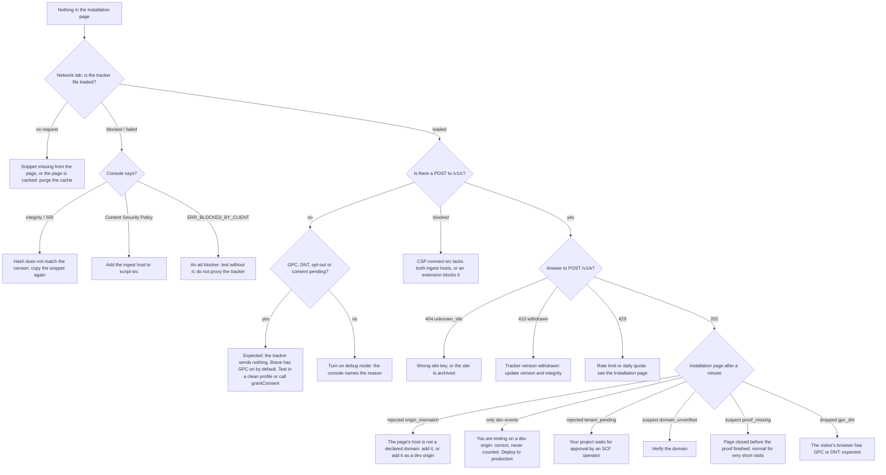

# Troubleshooting: nothing arrives

Start at the top and follow the first branch that matches. The two tools you need: the browser's developer tools
(**Network** and **Console** tabs) and the portal's **Installation** page (site → Installation), which shows what the
platform received, kept and dropped, with reason codes, about a minute after it happened.

## Website

The same tree as a list:

1. **The tracker file is not loaded.**
   - No request at all: the snippet is not in the served page (check the page source; purge your CDN cache).
   - Blocked with an integrity error: the `integrity` hash does not belong to that version. Copy the snippet from the
     portal again; never edit the version without the hash.
   - Blocked by the Content Security Policy: add `script-src https://ingest-a.example-analytics.org`.
   - `ERR_BLOCKED_BY_CLIENT`: an ad blocker. The tracker's host names are checked against the common filter lists, but
     an aggressive custom list can still block them. **Do not proxy the tracker through your own server**: the
     platform then sees your server instead of a browser, and every event becomes `suspect`.
2. **Loaded, but no `POST /v1/c`.**
   - Global Privacy Control or Do Not Track is on, the visitor opted out, or consent mode waits for
     `grantConsent()`. The tracker then sends nothing, not even the challenge, by design. **Brave enables GPC by
     default.** Turn on [debug mode](dev-origins-and-debug.md#tracker-debug-mode-why-nothing-was-sent): it names the
     reason in the console.
3. **`POST /v1/c` blocked.** The CSP needs `connect-src` with **both** ingest hosts
   (`https://ingest-a.example-analytics.org https://ingest-b.example-analytics.net`), or an extension blocks it.
4. **`POST /v1/e` answered with an error.**
   - `404 unknown_site`: the site key is wrong, or the site was archived or removed.
   - `410 withdrawn`: that tracker version was withdrawn; update the version and the `integrity` hash.
   - `429 rate_limited` or `quota_exceeded`: too many events for the site's limit or the project's daily quota; the
     tracker retries after the delay the server gives. The Installation page shows `drop/rate_limited` and
     `drop/quota_exceeded` counts.
5. **`202`, but the Installation page shows nothing counted.** A `202` means "well-formed", never "counted": the
   platform never tells a script why something was not counted. The Installation page does:
   - `rejected` / `origin_mismatch`: the page runs on a host that is not a declared domain. Add the domain, or add the
     host as a [dev origin](dev-origins-and-debug.md) if it is a development host.
   - only `dev` events in the first-event panel: you are testing on a dev origin. That is correct; they are never
     counted. Deploy to production to see counted events.
   - `rejected` / `tenant_pending`: the platform requires an SCF operator's approval for new projects.
   - `rejected` / `challenge_invalid`: a token obtained on a dev origin was used on production (or a stale token).
   - nothing at all after two minutes: turn on the site's debug mode for an hour; the tracker's console then prints
     the server's verdict for each request.
6. **Counted, but as `suspect`.**
   - `domain_unverified`: finish domain verification.
   - `proof_missing`: the page was hidden before the proof of work finished. Normal for very short visits.
   - `automation_flag`, `net_datacenter`, `multiplicity_high`, …: the anti-inflation checks. See the
     [metric definitions](../metrics/definitions.md) for each reason.
7. **Wallet events missing.** Check that the adapter is attached once, after `init()`, and that you use tracker 1.1.0
   or later ([wallet adapters](wallets.md)). Signing and submit events appear only as daily counts in the wallet
   funnel, never on a visit ([counted-only events](wallets.md#counted-only-events)).

## API (OpenTelemetry)

| What you see | Likely cause | Fix |
|---|---|---|
| exporter logs `401` | missing, wrong or revoked ingest token; or the header is not `Authorization=Bearer%20scfa_ing_…` | create a token in the portal; check the `%20` |
| `403` | the project is pending approval or suspended | wait for an SCF operator, or contact them |
| `404` on `/v1/logs` | logs are not accepted | set `OTEL_LOGS_EXPORTER=none` |
| `429` / `503` | over the request limit, or the platform is draining a node | none: the SDK retries with `Retry-After` |
| exporter is quiet, portal shows nothing | the export interval (60 s by default) has not passed, or the process exited before flushing | wait a minute; add the flush on shutdown from your stack's page |
| requests counted under `{unknown}` | your framework sends no `http.route` | see your stack's page (axum needs its feature flag; Express needs its instrumentation) |
| data-quality table shows drops | metrics other than the HTTP server duration, or attributes that are never kept | expected: only `http.server.request.duration` (or root SERVER spans) is used |
| counted twice as two sources | the same service sends both the metric and its spans | send one: metrics (`OTEL_TRACES_EXPORTER=none`) or spans, not both |

The portal's API wizard shows, per service, what was received and what was dropped with the reason, about a minute
after the export.
