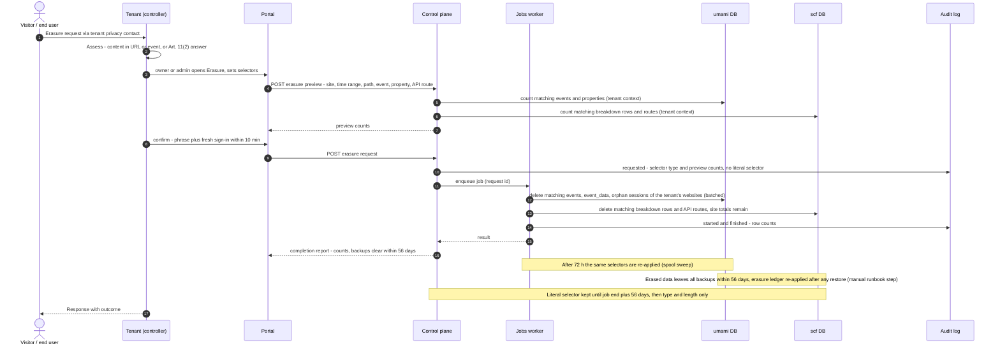

# Right to erasure — design and tenant-triggered workflow

> **Not legal advice.** Prepared by engineers; not reviewed by counsel (a review is for `<OPERATOR-ENTITY>` to
> commission). Binding decision: ADR-0030, as refined by the
> design decisions C-01…C-112 in [`docs/adr/README.md`](../adr/README.md) — for erasure in particular C-08, C-12, C-29,
> C-46, C-52, C-57, C-64, C-73, C-77, C-86, C-87, C-88 and C-89. Details still marked *(proposed)* go beyond the
> register and are not yet decided.
>
> **Implementation status (2026-11-13).** The workflow of §3 is built: preview, confirmation with a fresh sign-in,
> batched execution under the tenant's context, audit without the literal selector, the 72-hour spool sweep and the
> 56-day selector redaction — control-plane routes and worker in `services/control-plane/src/erasure/`, run by the
> jobs service (C-125), portal page `apps/portal/src/pages/Erasure.tsx`; tests in
> `services/control-plane/test/integration/erasure.test.ts` (real PostgreSQL) and `apps/portal/e2e/mock/api.spec.ts`.
> Not automated: re-applying kept selectors after a restore (§3 step 9, a runbook step).

Design goals: minimise the set of people who can exercise the right to erasure, and where personal data subject to
erasure is stored, provide a practical tenant-triggered erasure workflow. This document states both explicitly.

## 1. Why the set of people who can exercise the right is minimal

**The design stores nothing that lets anyone — including us — find a given visitor's rows:**

- no IP address, no raw User-Agent, no cookie or device identifier, no account key, no `distinct_id` (strategy §2);
- the only per-visitor key is a surrogate built from `HMAC-SHA-256(K_day, site_id ‖ ip ‖ user_agent)`, where `K_day` is
  random, held only in locked gateway memory and **destroyed at the 00:00 UTC switch** (ADR-0007; C-04); Umami then
  hashes the surrogate with its own daily salt;
- where a site's `visitor_id` setting is `off` (the default for the `strict` profile), there is no per-visitor key at
  all: each event gets a fresh random surrogate and is stored under the site's twin Umami website (C-02, C-53, C-73);
- after rotation, a visitor who supplies their IP address and browser cannot be matched to any row, because the key
  needed to recompute the surrogate no longer exists anywhere.

**GDPR Art. 11.** Art. 11(1): a controller is not obliged to keep additional information solely to identify a data
subject. Art. 11(2): where the controller can demonstrate that it is not in a position to identify the data subject, it
informs the data subject if possible, and Arts. 15–20 do not apply unless the data subject provides additional
information enabling identification. (Paraphrase of the official text — not re-read against EUR-Lex; counsel to confirm.) Since no information a
visitor can supply lets us find their rows, Arts. 15–17 are practically inapplicable to visitor rows.

**Limits of this posture — stated, not hidden:**

1. **The current UTC day.** While `K_day` exists, someone holding it and a visitor's exact IP + User-Agent could in
   principle recompute that day's surrogate. We hold `K_day` only in locked gateway memory with core dumps disabled,
   provide no lookup, and do not use it for identification. Whether that suffices for "not in a position to identify"
   is for counsel.
2. **Content-based identification.** Art. 11 does not help when the *content* of a stored field identifies someone: an
   e-mail address, name, account key or token that ended up in a page path, a custom-event name or a property value.
   The gateway now replaces identifier-shaped values and secrets before anything is stored (C-52), but a name or
   other free text cannot be recognised by its shape. That residual is what the workflow below exists for.
3. **Art. 21 is not disapplied.** The right to object remains; it is honoured by the opt-out link and GPC/DNT
   (strategy §5), not by erasure.
4. **Pseudonymous rows remain personal data** for the tenant and the service operator (as processor) while retained;
   Art. 11 relieves the duty to *find* them, it does not make them anonymous.
5. **Account data** (tenant users, SCF operators) is fully identifiable; requests about it go to the service operator
   as controller (§6; C-59).

## 2. What personal data can still end up stored

| Where | How personal data can get in | Prevention in place | Erasure needed? |
|---|---|---|---|
| Web page paths (`umami.website_event.url_path`, main and twin websites; top-N path breakdowns in `scf`) | Tenant URLs that embed names or other free text the scrubber cannot recognise | Query string and fragment never sent and discarded at the gateway (C-65); `pathnorm` at the gateway replaces StrKeys, hashes, UUIDs, long numbers with typed placeholders and seeds, tokens, JWTs, e-mail addresses with `{redacted}` before the spool — redaction cannot be switched off; the folding setting is `full` or `relaxed` (numbers, dates, slugs kept) and StrKeys, hashes, tokens and e-mail addresses are always folded or redacted (C-52, C-89) | Rarely — residual cases |
| Custom-event names (`event_name`; event-name breakdowns in `scf`) | Tenant names an event after a user or value | Same server-side guard (C-52); tenant guidance | Rarely |
| Custom-event properties (`umami.event_data`) | Tenant sends a free-text value that identifies someone | Client-side guard (ADR-0004) **and** server-side guard (C-52) refuse or redact values shaped like e-mails, StrKeys, JWTs; tenant guidance | Possible |
| Daily per-site aggregates in `scf` (breakdowns by path, event name) | Copies of the above | as above | Yes — breakdown rows are covered by the erasure selectors (C-46) |
| Page titles | — | Not collected at all (C-89) | No |
| Referrer | — | Host only (`standard`), none (`strict`) | Rarely (a host naming a person) |
| API routes (`scf` route dictionary and metric rows) | Identifier patterns the normaliser does not recognise | `pathnorm`: StrKeys, hashes, UUIDs, numbers → placeholders; seeds, JWTs, API keys, e-mails → `{redacted}` before any disk (ADR-0012) | Rare; covered by the same selectors (C-46) |
| Wallet events | — | Allow-list serialiser with closed-set fields only: no addresses, XDR, signatures, memos, error text (ADR-0029; C-45) | No |
| Local edge spool (fsync'd on each edge node; deleted on acknowledgement, never older than 72 h; no copies elsewhere) | Same as web events, in flight (no IP, no raw User-Agent) | as above (C-18, C-77) | Covered by the spool sweep (§3 step 8) |
| Erasure requests themselves (`erasure_requests` in `scf`) | The literal selector — a path, event name or property key — may itself name the person | Kept only until the job has finished plus 56 days, then replaced by its type and length; never written to the audit log (C-88 as corrected by C-111, C-112) | Self-limiting (§3 step 10) |
| Backups | Copies of all of the above | Encrypted | Leave all backups within 56 days (§3 step 9; C-29 as corrected by C-112) |

## 3. The tenant-triggered workflow, step by step

**Who can trigger:** a tenant user with role `owner` or `admin` for that tenant (ADR-0030). `member` and `viewer`
cannot. SCF operators cannot run erasure on tenant content; service-operator-initiated runs are covered in §5.

**Tenant scope is enforced, not assumed** (C-87). Every identifier the request carries — in the path or the body,
such as a site or service ID — is resolved under the requesting tenant's context; tenant-owned tables reference each
other with composite keys that include `tenant_id`, so a request can never name another tenant's site; and the
erasure job runs **under the requesting tenant's context only**, looking sites up by (tenant, site). A foreign or
unknown ID is answered like a missing one. This matters because the `umami` database has no row-level security of its
own.

1. **Open** Portal → *Privacy* → *Erasure* (ADR-0024), or call the control-plane API (OpenAPI 3.1).
2. **Select** the scope with one or more selectors (combined with AND):
   - site (one, several, or all of the requesting tenant's sites — each resolved under the tenant's context, C-87) — or
     API service and route for API data (C-46);
   - time range (`start` inclusive, `end` exclusive, RFC 3339 in UTC; C-86);
   - path pattern (exact or prefix/glob on the stored, already-scrubbed path);
   - custom-event name;
   - custom-event property key.

   As built, a request carries the time range plus **at most one** of path pattern, event name or property key
   (`services/control-plane/src/erasure/criteria.ts`); restricting a property key to a value pattern is not built.
3. **Preview.** The control plane runs a count-only query and shows: number of events, sessions touched, custom-event
   properties, daily breakdown rows and API route rows that match, per site and per month. Nothing is deleted. The
   preview never displays more data than the tenant's dashboard already shows.
4. **Confirm.** The user types the confirmation phrase and must have a **fresh sign-in, at most 10 minutes old, by
   their own method** — a passkey assertion if they have registered one (C-87). A request ID is issued and an audit
   entry written (actor, selector **types**, preview counts, time — never the literal selector, C-88).
5. **Execute.** A `jobs` worker runs the deletion as an audited job **under the requesting tenant's context only**
   (C-87):
   - against the `umami` database through the role `scf_umami_maint`, which has DELETE on the event, session and their
     data tables only (ADR-0003; C-12), restricted to the Umami websites — main and twin (C-73) — that belong to the
     requesting tenant's sites: matching `website_event` rows and their `event_data`, then sessions left without
     events;
   - against `scf` (C-46): breakdown rows of the daily aggregates matching the path, event name or property are
     deleted; **site totals remain** (they contain no path or event content); matching API route rows are deleted;
   - in batches with progress reporting, so large scopes do not hit long-transaction limits (Umami's own reset runs in a
     single 30 s transaction).
6. **Audit.** Every phase (requested, previewed, confirmed, started, finished, failed) is written to the hash-chained audit
   log with the selector **type** and the counts — **never the literal selector and never the deleted values** (C-88).
   Audit action names come from the one enumerated list shared by the database and the API (C-89).
7. **Completion report** in the portal and by API: request ID, selectors (the literal values while they are still
   kept — step 10 — and afterwards their type and length), rows deleted per table, start and finish time, and the
   statement that **erased data leaves all backups within 56 days**, with that date (C-29, C-112); also a statement that
   spool data in flight is covered by step 8. Exportable as PDF/JSON for the tenant's records.
8. **Spool sweep** (built): the same selectors are re-applied automatically 72 hours later (the spool's maximum
   life, C-18), so events that were still on an edge node's local spool during step 5 are also removed; the report is
   updated. The spool is the only at-rest transient copy; there are no spool copies in object storage (C-77).
   Implementation: the erasure worker (`services/control-plane/src/erasure/worker.ts`, run by the jobs service per
   C-125) records `spool_sweep.due_at` = completion + `SCF_ERASURE_SWEEP_DELAY_MS` (default 259 200 000 ms = 72 h,
   `services/control-plane/src/workers/config.ts`) in the request's result; the due sweep is found from the queue
   after a restart (migration `0056`, C-119), re-applies the selectors and records `done_at` and its own counts
   without changing the run's report. Tests: `services/control-plane/test/integration/erasure.test.ts` ("re-applies
   the selectors as the spool sweep 72 h later and records it", against real PostgreSQL and Umami's schema),
   `services/control-plane/test/unit/erasure.test.ts`, and the queue selection in `db/tests/followups_test.go`.
9. **Backups** (ADR-0021; C-29, C-108, C-110, C-112): pgBackRest keeps a 35-day point-in-time window (weekly full,
   daily differential) in two encrypted repositories — on the v1 host one on the VM's disk and one storage account, both in the same
   EU region; two storage accounts in two regions in the full-size design — and weekly logical
   dumps are kept 5 weeks. The containers are versioned: a blob that pgBackRest's own `expire` deletes stays as a
   previous version for 14 days, which only a lifecycle rule removes, so a compromised database node cannot destroy
   history. Erased data therefore leaves all backups within **56 days** (35-day retention + up to 7 days until the next full + 14 days as a previous version, data-model §14; C-112
   corrects C-29's 35 days). Backups are not used for any processing; restore drills run only on our EU infrastructure and the drill
   instance is destroyed afterwards (C-56, C-79). If a backup is ever restored for service, every completed erasure
   request whose selector is still kept is **re-applied** from the erasure ledger before the restored database serves
   traffic (decided, C-112; a manual step of [`ops/runbooks/restore-pitr.md`](../../ops/runbooks/restore-pitr.md) —
   no automated re-apply command exists yet). Selectors are kept for the job plus 56 days (step 10) and no backup — current or a previous
   blob version — holds data for longer than 56 days, so every erasure that any restored backup could still contain can
   be re-applied (C-111, C-112).
10. **Selector retention** (C-88 as corrected by C-111, C-112): the literal selector of the request (a path, an event
    name or a property key) is stored only until the job has finished plus 56 days; it is then replaced by its type
    and length by the `retention` job, and a redacted request skips any later sweep (test "renders a redacted request
    … and skips a later sweep" in `services/control-plane/test/integration/erasure.test.ts`). The audit log never
    contains it (same file: "writes erasure.requested / confirmed / completed with the selector type and counts —
    never the literal").

## 4. End-user requests routed through the tenant

- A visitor or API end user who wants data erased contacts the **tenant** (controller). The tenant's privacy notice says
  so ([`tenant-privacy-notice.md`](tenant-privacy-notice.md)).
- If such a request reaches the service operator or an SCF operator, we forward it to the tenant within 5 business days *(proposed;
  placeholder in DPA clause 7.3)* and tell the requester we have done so; we do not act on the request ourselves except
  on the tenant's instruction (DPA clause 7).
- The tenant answers. Two typical answers:
  - *Visitor rows:* "We use privacy-preserving analytics that does not store IP addresses or identifiers that would let
    us find your visits; we are therefore not in a position to identify your data (GDPR Art. 11(2)). You can object to
    future measurement with the opt-out link on our privacy page." (Template text; counsel to approve.)
  - *Content in a URL or event:* the tenant runs the workflow in §3 with a path or property selector and keeps the
    completion report.
- The platform provides the tenant with the notice and response templates (ADR-0030).

## 5. Removal initiated by an SCF operator or the service operator

- **Tenant or site removal** (ADR-0015; C-08, C-09). Removal by an SCF operator requires a fresh passkey assertion;
  it stops ingest within 60 s, hides the data and sets `purge_after` = +30 days. Until the purge runs, an
  `operator_admin` can restore the tenant; after the purge it is irreversible. The purge uses the same machinery as §3
  with "all data of this tenant/site" as the selector (ADR-0030); the tenant receives the completion report, including
  the 56-day backup statement (C-112). Removal leaves re-enrollment tombstones for the tenant's domains, GitHub identity and
  Stellar accounts until an `operator_admin` lifts them (C-64) — personal data of the tenant's representatives that is
  kept for abuse prevention and disclosed in the RoPA.
- **Tenant leaves voluntarily.** The owner deletes the tenant after a fresh sign-in (≤ 10 minutes, C-87); same purge,
  same report. The purge, like every job that acts for a tenant, runs under that tenant's context (C-87).
- **Security or legal emergency** *(proposed)*: if the service operator finds that a tenant's data contains secrets or
  clearly sensitive personal data that the scrubber did not catch, it notifies the tenant and asks it to run the
  workflow (API `{redacted}` counters store no value and need no erasure); it runs the job itself only on the tenant's
  instruction or a legal obligation, audited and reported to the tenant.
- **Retention** deletion (event-level web data after 90 days by default, settable 30–395 days, 395 days being the hard
  maximum — ADR-0011; C-54) is a scheduled job, not an erasure request, and is logged in the operational record.

## 6. Requests about account data

Tenant users and SCF operators exercise their rights against the service operator as controller for portal account
data and audit logs (`<PRIVACY-CONTACT>`; C-59). Accounts can be deleted from the portal after a fresh sign-in
(≤ 10 minutes, C-87); the account is removed within 30 days of deletion (C-71). Audit rows reference user
IDs; when an account is deleted its profile fields are removed and a **tombstone keeps the ID**, so the hash chain
stays valid and the log no longer names the person (C-57). The daily published audit-chain head hash (C-63) is a
single hash value and contains no personal data. Re-enrollment tombstones of a removed tenant (C-64) are separate
and are lifted only by an `operator_admin`.

## 7. Time limits

| Step | Commitment |
|---|---|
| Preview | Immediate (seconds) — a count-only query |
| Execution of a confirmed request | Started immediately; completed within 72 hours for scopes up to the full retention of one site *(proposed, to be confirmed in the SLA and DPA)* |
| Spool sweep | 72 hours after execution (built and tested, step 8) |
| Completion report | When execution finishes; updated after the spool sweep |
| Literal selector | Kept until the job has finished plus 56 days, then replaced by type and length (C-88, C-111, C-112) |
| Backups | Erased data leaves all backups within **56 days**; the report states the date (C-29, C-112) |
| Forwarding a misdirected request | Within 5 business days *(proposed)* |
| Tenant's answer to the data subject | The tenant's statutory deadline in its jurisdiction (counsel to confirm per jurisdiction) |

## 8. Sequence

