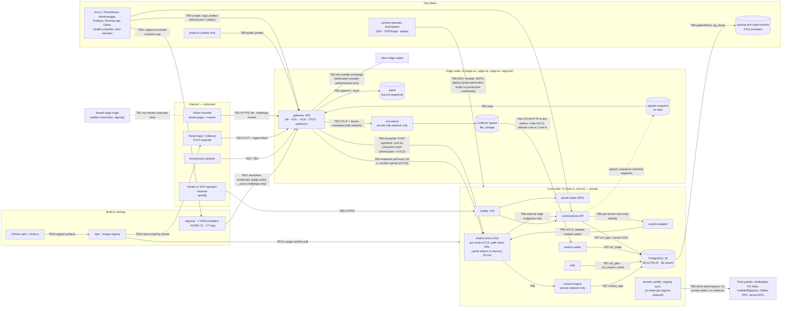

# Threat model

## At a glance

One screen for anyone checking the design: the main threats, the control that answers each, and the test that shows the control
works. §14 lists every built control with its code; §9 the residual risks; §10 what is deliberately not defended.

| Threat (IDs) | Control | Test |
|---|---|---|
| A project inflates its own web numbers with scripts (TM-INF-01…05) | Signed challenge and proof of work before an event can be verified; per-token caps; Umami's bot list on the raw User-Agent; header, transport and multiplicity checks; a reason code on every non-verified event | `services/gateway/internal/challenge/challenge_test.go`, `uabot`, `multiplicity`, `transport` tests; bot simulations `tests/bot/20-bot.e2e.test.ts` against the real gateway |
| Replayed or back-dated events (TM-INF-06…08) | Token MAC under an hourly key held in memory, 30-minute lifetime, per-event ID de-duplication, received-at bound | `challenge/challenge_test.go`, `ingest/ingest_test.go` |
| One project reads another's data (TM-ISO-01…13) | Row-level security on every tenant table and partition, tenant context per transaction, no role bypasses RLS; the API answers a foreign and an unknown ID with the same `404` | `db/tests/matrix_test.go`, `gates_test.go`; HTTP isolation matrix generated from the OpenAPI document |
| Fabricated or hostile OpenTelemetry data, personal data in attributes (TM-OTL-01…11) | Ingest-token door at the gateway; the Collector's `scfsanitize` rebuilds every point from an allow-list and bounds histograms | `collector/processor/scfsanitizeprocessor/leak_test.go`, `protoallow_test.go` |
| Secret seeds, keys or personal data in URL paths (TM-PRV-03, TM-OTL-11) | Stellar-aware path normalisation: keys folded, seeds and secrets redacted before storage | `packages/pathnorm/vectors_test.go`, `strkey_test.go`, `fuzz_test.go` |
| Accepted events lost in a crash (TM-DOS-10) | fsync'd spool; `202` only after the record is on disk; forwarder failover | `spool/spool_test.go`, `forwarder/forwarder_test.go`; kill-and-restart chaos run `tests/chaos/run.ts` |
| Floods and oversized payloads (TM-DOS-06, TM-DOS-09, TM-OTL-05…08) | Body and decompression limits, timeouts, per-subnet and per-site rate limits, per-tenant quotas | `limits/limits_test.go`, `otlp/door_test.go` |
| A vulnerability in the base engine (TM-UMA-01…08) | Umami reachable only through the engine proxy: mutual TLS per caller, per-caller path allow-lists | `services/engine-proxy/internal/policy/policy_test.go`, `proxy/tls_test.go` |
| A compromised control plane signs snapshots or provisions (TM-ISO-06) | The control plane holds no signing key and no provisioning credential; the jobs service signs | `services/control-plane/test/integration/security-split.test.ts` |
| An operator rewrites history (TM-OPR-03) | Hash-chained audit log with a daily anchored head, re-verified independently | `db/tests/audit_test.go`, `services/jobs/test/integration/audit.test.ts` |
| IP addresses, User-Agents or secrets reach the logs (TM-PRV-06) | Log scanner that counts personal-data and secret shapes without exporting them, with an alert | `ops/internal/logscan/logscan_test.go` |
| A tampered tracker or dependency (TM-TRK-01…09, ACT-4) | Versioned tracker files pinned by SRI; SHA-pinned workflow actions; licence allow-list on review; signed releases once a release pipeline exists | `tracker/test/build.test.ts` |

Status: **threat model of the built system, revised 2026-11-13** (first written 2026-11-12 in the design phase). Most
controls in this document are now implemented and tested; §14 lists each built control with the code and the test that
evidences it, and says which tests need the real stack. Controls without a §14 entry are designed
but not built, or are operational (people, process, Azure settings applied at first deployment). Every control is
cited to the decision register ([`docs/adr/README.md`](adr/README.md)), which is binding, including its Clarifications
C-01 … C-127 (cited as `C-xx`; a clarification wins over the register entry it refines, and a later clarification wins
over an earlier one). The 2026-11-12 revision applied C-68 … C-90 (independent architecture and contract reviews);
this revision applies the spike results (C-99 … C-112), the build-time decisions C-113 … C-127, in particular C-123
(lean Azure profile), C-124 (transport fingerprint `transport_mismatch`, a `suspect` signal) and C-125 (signing keys
and background work moved out of the internet-facing control plane into the jobs service). Controls that this model
considers necessary but that neither the register nor a clarification contains are listed in §12 "Open points" and
are **not** presented as decided. The spike list is S-01 … S-12 (`spikes/README.md`). Terminology follows C-59: "SCF
operator" is a portal user with the `operator` or `operator_admin` role; "service operator" is the entity that hosts
the service.

**Deployment profile (C-123, 2026-11-13).** Production on Azure is the **lean profile**: the whole Docker Compose
stack on one VM (`app-1`), an optional second VM (`standby-1`) for the restore drill and as cold-standby target, one
EU region, backups in two storage accounts in two EU regions, Azure DNS ([`deployment-topology.md`](deployment-topology.md)).
§8.9 covers what that profile adds or changes: the Azure control plane, managed identities and IMDS, the monitoring
stack on the same host, and the database co-located with internet-facing services. Rows about four edges, two cores,
`mon-c`, `probe-d`, the WireGuard mesh, etcd and the health controller describe the **scale-out profile** (documented,
tested on Compose, not deployed); where a row's control depends on that layout, §8.9 says what replaces it in the
lean profile.

Companion documents: [`monitoring-plan.md`](monitoring-plan.md) (every monitor is keyed to a threat ID here),
[`security/supply-chain.md`](security/supply-chain.md), [`security/vulnerability-response.md`](security/vulnerability-response.md),
[`security/hardening.md`](security/hardening.md). Schemas and endpoints are defined in `docs/data-model.md`,
`docs/contracts/wire-formats.md` and `docs/api/`; this document refers to them and does not redefine them.

## 0. Method

The model uses STRIDE as its threat taxonomy, in the spirit of SDF's Threat Modeling Readiness How-To Guide, and keys
the monitoring plan to the threat IDs in the style of SDF's on-chain monitoring-plan template. We follow the guide's
ideas, not its worksheet field by field. How we adapt it to a system that is almost entirely off-chain:

| Element | How this document adapts it |
|---|---|
| STRIDE as the threat taxonomy | Every threat row carries one or more STRIDE letters (S, T, R, I, D, E). |
| Threats carry IDs that the monitoring plan references (`<ThreatID>.M.<n>`) | Threat IDs are `TM-<AREA>-<nn>`. `monitoring-plan.md` names monitors `TM-<AREA>-<nn>.M.<n>`. |
| Severity per threat | Residual risk H/M/L with a one-line reason, plus a ranked top-10 (§9). |
| On-chain asset inventory (`C…`/`G…` addresses) | Our assets are data integrity, isolation, a script embedded in wallet-connected dApps, privacy, availability, keys and audit (§1). Our only on-chain touch points are listed in §1.3. |
| "Did we do a good job?" | §11 review cadence and the evidence column of every row. |

The structure follows the common four-question frame (what are we working on — §1–3; what can go wrong — §4–8; what
are we doing about it — the control and evidence columns; did we do a good job — §9–11).

**Rating scale.** **H** — will happen or cannot be prevented, and materially affects a top-ranked asset. **M** —
plausible and only partly mitigated, *or* unlikely but with high impact. **L** — needs several independent failures,
or the impact is small and contained.

---

## 1. Scope and assets

### 1.1 In scope

Everything in the register's "System at a glance": tracker, gateway, collector, pathnorm, metrics-writer, engine
(Umami v3.5.0, ADR-0002/0003) and the **engine proxy** in front of it (`/services/engine-proxy`, Go, one per core
node: per-node mutual TLS, per-caller path allow-lists, Umami cache-token memory — C-60, C-74), control plane
(including its internal edge endpoints for snapshot pull and counter upload, C-39), jobs and `onchain-reader` (C-42),
portal, infra; the health controller (`mon-c` and `core-b`, C-27), the egress proxy (C-10) and the range-list
updater on edge nodes (C-38); the PostgreSQL 18 cluster with databases `scf` and `umami`; edge nodes `edge-a1`,
`edge-a2`, `edge-b1`, `edge-b2`, core nodes `core-a`, `core-b`, monitoring node `mon-c`, probe node `probe-d`
(ADR-0018, C-25); the WireGuard mesh and the private CA for per-node mutual TLS (C-60); the backup and OpenTofu state
buckets (there are no spool-copy buckets, C-77); the service operator's deploy workstation (C-79); the GitHub
repository, Actions, npm package and image registry; the domains `<domain-a>`, `<domain-b>` and their DNS
(ADR-0017/0023, C-27).

Out of scope: tenants' own sites, servers and APM vendors (we model only what reaches us from them); visitors'
devices and browser extensions; the hosting providers' hypervisors and staff (see §10).

### 1.2 Assets, ranked

| Rank | Asset | Why it ranks here | Primary register controls |
|---|---|---|---|
| A1 | **Integrity of usage numbers that feed ecosystem decisions** (web verified/raw counts, API metrics, trust score, assurance level, signed traction snapshots) | The platform exists to give numbers the ecosystem can trust (trust.verified-vs-raw). The main adversary profits directly from corrupting them. | ADR-0005, 0008, 0009, 0010, 0028, 0032 |
| A2 | **Tenant isolation** | A cross-tenant leak breaks a core guarantee (isolation.tenant-rls) and exposes competitors' data to each other. | ADR-0003, 0013, 0014, 0016 |
| A3 | **The tracker embedded in wallet-connected dApps** | Our script runs inside pages where users sign transactions. A malicious byte is a wallet drainer (precedents in `security/supply-chain.md` §9). | ADR-0004, 0023, 0029 |
| A4 | **Visitor privacy** | Legal basis of consent-free operation (ADR-0027); IPs, UAs, identifiers and PII in paths or events. | ADR-0006, 0007, 0011, 0027, 0030 |
| A5 | **Availability of ingest** (99.99 % objective) | Lost events cannot be recovered; the objective is published and measured, with an error-budget policy (ADR-0031, C-78). | ADR-0005, 0020, 0022 |
| A6 | **Credentials and keys** (SCF-operator sessions and passkeys, `op` API keys, ingest tokens, `pub` share keys, the three per-kind peppers `ing`, `op`, `pub` with their versions (C-81), snapshot-signing key, the edge key bundle — visitor key `K_day`, multiplicity key, challenge key `K_chal` (C-68), node mTLS certificates and the private CA, Umami admin identity and the key encrypting per-tenant Umami passwords and API keys (C-40, C-85), traction-snapshot and audit-anchor keys, SOPS keys, deploy and OpenTofu state credentials (C-79), the health controller's DNS write credential (C-27), DNS/registrar/hoster/npm/GitHub accounts) | Each one unlocks A1–A5 at scale. | ADR-0014, 0016, 0019, 0023; C-05, C-40, C-47, C-60, C-63, C-79, C-81, C-85 |
| A7 | **Audit integrity** (hash-chained audit log and its daily anchor, deploy logs, probe data, SLO reports) | Without it, SCF-operator abuse and our own SLO claims are unverifiable. | ADR-0013, 0014, 0022, 0031; C-63 |

Three components concentrate several of these assets and are treated as assets in their own right:

- **The engine proxy** on each core node (C-74). It is the only way into Umami and into the control plane's internal
  edge endpoints, so its path allow-lists carry A2 and A4 for the engine; it holds Umami's cache tokens per (site,
  surrogate) in memory for 30 minutes, which keep visits together and so carry the integrity of the visit metrics
  (A1). Edge forwarders pick a core by a consistent hash of the surrogate and fail over to the other core.
- **`mon-c`** (and `core-b`, which runs the second health-controller instance). It holds the DNS write credential
  for the ingest and portal A/AAAA record sets, one of the three etcd members and mesh access to every node (C-27,
  C-79). Its compromise is rated **high impact** (TM-OPS-07).
- **The service operator's deploy workstation** (or the pull-based deploy agent on the nodes). It holds the
  SOPS-decrypted deploy secrets; build automation never does, and the OpenTofu state credentials are stored on no server (C-79).

### 1.3 On-chain touch points (for completeness against the SDF template)

We hold no funds and deploy no contracts. The on-chain surface is: (a) the SEP-10 server `SIGNING_KEY` account used
only to sign authentication challenges (ADR-0014); (b) read-only queries for enrollment proofs (`home_domain`,
signers and thresholds; ADR-0015); (c) optional read-only on-chain correlation for tenants' declared contracts
(Hubble / public ledger files read by `/services/onchain-reader`; ADR-0028, C-42); (d) when enabled, the platform
account that writes the daily audit-chain head hash to the ledger (C-63). Only (d) holds a balance, enough for
transaction fees; none of them can move tenants' or visitors' value. The account keys of (a) and (d) are handover
items (C-15, C-63).

---

## 2. Actors and their capabilities

| ID | Actor | Capabilities assumed | Goal | Primary threats |
|---|---|---|---|---|
| ACT-1 | **Tenant inflating its own numbers (primary adversary)** | Controls its site, its page, its copy of the tracker (CDN or npm build), its API servers and its OTLP exports. Can run real and headless browsers, residential proxies, paid humans, load generators and cheap on-chain activity. Has read every line of our open-source code and every published threshold. Has money proportional to the funding at stake. | Look bigger in SCF-operator views, trust score and snapshots | TM-INF-*, TM-OTL-01…03, TM-ENR-* |
| ACT-2 | Tenant attacking another tenant | Authenticated tenant user with any tenant role; can craft API requests, register sites and services, probe uniqueness and timing. | Read a competitor's data; deflate, pollute or frame it; get it removed | TM-ISO-*, TM-INF-15, TM-ENR-01/02, TM-OTL-05 |
| ACT-3 | Anonymous internet attacker | Reaches the gateway on edge nodes and Caddy on core nodes; can send arbitrary traffic and volume, including events for any public site key; can phish. | Data theft, defacement, DoS, using our tracker as a vector | TM-DOS-*, TM-AUT-*, TM-UMA-01, TM-INF-15 |
| ACT-4 | Compromised dependency or build automation | Code execution inside our build, a dependency, a workflow action or a scanner; may hold OIDC tokens for signing and staging while a workflow runs. Build automation holds **no production credentials** (C-79). | Ship malicious tracker or images; steal what the build holds | TM-TRK-01/02/07, TM-OPS-04, TM-OPS-08 |
| ACT-5 | Compromised or malicious SCF operator or service-operator staff | (a) SCF operator (`operator`/`operator_admin`) in the application; (b) service-operator maintainer with SSH, SOPS, deploy credentials (C-79) and database superuser. | Read event-level data, favour or punish tenants, hide it | TM-OPR-*, TM-OPS-02 |
| ACT-6 | Compromised edge node | Root on one edge node: memory, disk, TLS key, WireGuard key, node mTLS certificate, the `_acme-challenge`-only DNS credential, ingest-token pepper, snapshot. | Harvest visitor data in flight, forge data, pivot | TM-EDG-* |
| ACT-7 | Successor service operator | Full control after handover: repository, transferred domains, handed-over keys, infrastructure. | Legitimate operation; may lower controls, mis-handle the domain or stop patching | TM-OPR-07, TM-TRK-04 |
| ACT-8 | Upstream Umami | Ships the engine we run; slow, partly silent security fixes (22–84 days for own bugs, per the published advisories); could merge a hostile change. | Not malicious by assumption; its bugs are expected events | TM-UMA-* |
| ACT-9 | Compromised monitoring or health-controller host | Root on `mon-c` (or on `core-b`, which runs the second health-controller instance): the DNS write credential for ingest and portal A/AAAA records, an etcd member, mesh access to every node, Prometheus scrape access (C-27, C-79). | Redirect ingest or the portal; disturb Patroni; falsify monitoring | TM-OPS-06, TM-OPS-07 |
| ACT-10 | Holder of Azure control-plane access (lean profile, C-123) | An Entra ID account, service principal or workload with a role on the subscription, resource group or VM: can use Run Command / VM extensions (root on the VM), the serial console, disk snapshots and exports, change NSGs, role assignments, storage-account settings and DNS zones; or code on the VM that steals a managed-identity token from IMDS. | Everything on the VM; delete or read backups; redirect DNS | TM-AZ-01…08 |

---

## 3. Data-flow diagram and trust boundaries

| Boundary | Between | What crosses it | Who is on the untrusted side |
|---|---|---|---|
| **TB1** | Tenant page ↔ our tracker code | Our code executes in a page the tenant controls, next to wallet connections; the tenant controls the page, the embed tag and (npm mode) the tracker build itself | ACT-1 (tenant), ACT-3 (if the tenant page is compromised) |
| **TB2** | Internet → gateway on edge nodes | Tracker file fetches, challenge requests, events; OTLP/HTTP and OTLP/gRPC with ingest tokens | ACT-1, ACT-2, ACT-3 |
| **TB3** | Gateway → local disk and the Collector on the private `otlp` network (C-130) | Rebuilt web records into the spool; OTLP plus gateway-supplied tenant metadata into `scf-otelcol`; snapshot read | ACT-6 |
| **TB4** | Edge → core and edge ↔ edge over WireGuard, each hop with per-node mutual TLS (C-60) | Forwarder to the engine proxy of the core chosen by a consistent hash of the surrogate, failing over to the other core (C-74), and on to Umami `POST /api/send`; snapshot pull and counter upload through the engine proxy to the control plane's internal edge endpoints (C-39, C-60); Collector → writers directly with the node certificate and failover between `core-a` and `core-b`, the relay hop through the gateway (over the `otlp` network, C-130) being the fallback if S-04 does not confirm it (C-77); exchange of the edge key bundle (`K_day`, multiplicity key, `K_chal`) on a dedicated port (C-04, C-68). Nothing is copied off the edge node (C-77) | ACT-6 |
| **TB5** | Internet → Caddy on core nodes | Portal SPA, control-plane REST API (sessions per C-20, `op` keys), SEP-10 endpoints, `metrics_endpoint`/`health_endpoint` (ADR-0032, C-14) | ACT-2, ACT-3, ACT-5a |
| **TB6** | Every caller → **engine proxy** → Umami or the internal edge endpoints | The engine proxy terminates per-node mutual TLS and applies one path allow-list per caller (C-60, C-74): edge forwarders `POST /api/send` and the internal edge endpoints only; the control plane and jobs only the Umami endpoints and parameters of the adapter contract, with a per-tenant view-only Umami identity; the provisioning identity the admin endpoints. It adds the cache token it holds for (site, surrogate) to that visitor's next event | ACT-6 via an edge certificate; ACT-2 via our bugs; ACT-8 |
| **TB7** | Services → PostgreSQL | `scf` under RLS with roles `scf_app`, `scf_writer`, `scf_jobs`, `scf_metrics_ro`, `scf_migrator`, cross-tenant reads only via `op_*` functions (C-17); `umami` via `umami_app`, `scf_umami_maint` (C-12) and the read-only `scf_umami_ro` on the `scf_ro` views (C-109, TM-ISO-14) | compromised service (ACT-4/6), ACT-5b |
| **TB8** | Nodes → outbound internet | Only the named destinations of C-10, enforced by each node's firewall and the egress proxy: the control plane to GitHub OAuth and the configured Stellar RPC/Horizon hosts; the domain verifier (private ranges blocked); registry sync; the API liveness probe, the contract-verification job, the audit-anchoring job (Stellar network and the public evidence repository) and the optional on-chain job; ACME from the gateway and Caddy; DNS-provider APIs from the health controller; backup uploads; the range-list updater on edge nodes (C-38); probes to our own public endpoints; alert notifications from `mon-c`; OS and image updates. Umami, the writer, the Collector and all other jobs have no internet egress | the third parties (registry poisoning, SSRF targets, poisoned range lists) |
| **TB9** | Operations plane | Metrics and logs to `mon-c`, probes from `mon-c`, `probe-d` and the edges (C-30), backups to versioned containers whose previous versions the database nodes cannot delete (C-108, C-110), SSH/Ansible/SOPS and deploys from the service operator's workstation or a pull-based agent on the nodes; OpenTofu state credentials stored on no server (C-79); `mon-c` accepts no inbound traffic except the mesh and the status endpoints (C-79) | ACT-5b, ACT-9, compromise of a workstation |
| **TB10** | Build and release | Source → build automation → npm / image registry; it builds, tests, signs and publishes only and never reaches production nodes (C-79); deploys pull signed digests | ACT-4 |
| **TB11** | Naming and PKI | Registrar, two DNS providers (static records as code; health controller on `mon-c` and `core-b` owns only ingest and portal A/AAAA; C-27), ACME CA, CT logs; no DNSSEC at launch (C-31) | ACT-3 (registrar/DNS takeover), ACT-6 (limited to `_acme-challenge`, C-61), ACT-7 |

---

## 4. TB1 + TB2 — web ingest: tenant self-inflation (A1)

The register is explicit that a real headless browser on residential proxies passes L0–L5 and is only *detectable*
by L6–L7 (ADR-0008). The rows below make that concrete. Layer names (L0–L7) are ADR-0008's.

| ID | STRIDE | Threat | Asset | Existing control (ADR) | Residual | Detection signal | Test that evidences the control |
|---|---|---|---|---|---|---|---|
| TM-INF-01 | S, T | **Scripted POSTs** (curl, server-side code) to the event route without running JS | A1 | Strict `v1` schema, unknown fields rejected (ADR-0005); no valid challenge ⇒ `rejected`, not spooled, only counted (ADR-0008 L2); header combinations a browser cannot produce ⇒ `rejected`; `202` for every well-formed event whatever the verdict, so the response is no oracle (C-39) | **L** — blind POSTs fail; the realistic variant is TM-INF-02 | Rejected counters by reason (counter records, C-39); rejected/accepted ratio per site | Bot simulation "scripted POST" asserts `rejected` and a `202` response (ADR-0026) |
| TM-INF-02 | S | **Protocol-aware script**: fetches the challenge, solves the PoW with our open-source solver, forges headers and TLS (curl-impersonate class) | A1 | L3 PoW as metering with adaptive difficulty; L4 `Sec-Fetch-*` and client hints vs UA, plus the **transport fingerprint** (C-124, reverses C-77(2) for a `suspect` signal): the gateway terminates TLS, classifies the ClientHello (JA4, in memory only) and the HTTP/2 preface into `chromium`/`apple`/`gecko`/`library` and marks `transport_mismatch` (suspect, never rejected alone) when it contradicts the UA — imitable by curl-impersonate/uTLS or a driven real browser, and off behind a TLS terminator; L5 `isbot` at the gateway on the raw User-Agent, parity-tested against Umami's function, with Umami's own check as backstop (C-36); L6 multiplicity (ADR-0008) | **M** — forging headers is off-the-shelf; since C-124 a header-perfect script on a library TLS/HTTP-2 stack is `suspect`, but one on an imitated or real browser stack is still `verified` at the request layer; PoW costs an attacker roughly $0.01–4 per million sessions (bot-detection research §3.2.3). Lazy scripts become `suspect`; careful ones reach `verified` | `suspect` reasons for header inconsistency; server-measured issue→redeem latency distribution; trust-score components (ADR-0028) | Simulation "challenge-solving script, default headers" asserts `suspect`; unit vectors per reason code; `isbot` parity corpus (C-36) |
| TM-INF-03 | S | **Headless browser farm on datacenter IPs** | A1 | L4 client booleans (`webdriver`, visibility, user activation) in the `standard` profile only — their absence on `strict` is never a reason for `suspect` (C-33); L5; datacenter ASN class ⇒ `suspect`; `tor` and `vpn` classes lower the multiplicity thresholds but only `datacenter` alone yields `suspect` (ADR-0006/0008, C-38) | **M** — stealth-patched browsers pass L4, but datacenter egress keeps them in `suspect`, visible as verified-vs-raw; Tor/VPN egress is not `suspect` by itself | Datacenter share per site; `act=0` share; verified/raw ratio | Simulation "headless browser" (ADR-0026) from a datacenter range asserts `suspect` |
| TM-INF-04 | S | **Real or headless browsers through residential proxies with synthetic input**, one fresh challenge per fake session | A1 | L6 only fires when IPs repeat; L7 daily anomaly detection and advisory trust score (ADR-0008/0028); verified and raw shown side by side | **H** — passes L0–L5 by design (stated in ADR-0008). Cost is network realism (≈ $300–16,000 per million sessions, research §3.2.3), affordable against a funding decision | L7: mix divergence vs own and ecosystem baseline, hour-of-day vs claimed country, step change before SCF deadlines, PoW latency spread, cross-signal (no wallet events, no API or on-chain movement) | Synthetic-series tests that the L7 detectors emit their reason codes; **no test can assert rejection, and we say so** |
| TM-INF-05 | S | **Click farms / paid humans** on real devices (MRC "incentivized human invalid activity") | A1 | L7 only; cross-signal component of the trust score (ADR-0028) | **H** — undetectable by design; these are real people | Step changes, referrer concentration, geography shifts, cross-signal; SCF-operator review with tenant annotations | L7 step-change detector unit test; documented limit in the SCF-operator UI |
| TM-INF-06 | T | **Replayed challenge tokens**: one solved challenge reused for many events or sessions | A1 | Stateless HMAC token bound to site, coarse time window, truncated subnet and UA digest (ADR-0008 L2); proof reused only up to a per-token event cap; the gateway keeps no pending-proof state, so any node verifies any event (C-35); retries dropped by per-event ID within a 10-minute in-memory window (C-37) | **M** — the cap and the retry window are per node, so a token can be spent up to the cap on each of the four edge nodes inside its window from the same subnet/UA; C-35 accepts this in exchange for stateless verification | Events-per-token counters per node; per-node share of a site's traffic | Replay test: events beyond the cap on one token ⇒ not `verified` on that node; cross-node replay test documents the bound |
| TM-INF-07 | S | **Token farming**: real browsers mint tokens that scripts elsewhere spend | A1 | Subnet + UA-digest binding; coarse window (ADR-0008) | **M** — a farm and its scripts sharing a proxy exit defeat the binding | Context-mismatch `suspect` reason; issue→redeem latency anomalies | Test: token minted on subnet A spent from subnet B ⇒ not `verified` |
| TM-INF-08 | T | **Back-dating** events into past days (e.g. before a reporting deadline) | A1 | `timestamp` = time of receipt; client `timestamp` never passes the gateway (ADR-0005) | **L** — impossible through the API; only someone with database write access can back-date (TM-OPR-02) | Spool age (an old spool is forwarded with receipt time, never a client time) | Test: event with a past client timestamp is stored at receipt time |
| TM-INF-09 | S | **Forged Origin/Referer/hostname** by a non-browser client | A1 | L1 origin/domain binding to verified domains; `hostname` never taken from the client (ADR-0005/0008/0015) | **M** — a script sets `Origin` at will; L1 only stops real browsers on foreign sites, so the verdict rests on L2–L7 | Origin-mismatch and origin-missing counters; `Sec-Fetch-Site` inconsistency | Test: wrong Origin ⇒ `rejected`; spoofed correct Origin without a valid proof ⇒ never `verified` |
| TM-INF-10 | T | **Abusing the npm-bundled tracker**: the tenant edits the tracker in its own build to report perfect client booleans, loop pageviews or skip the proof | A1 | Client booleans are signals, never proof (and read only by `standard`, C-33); challenge issued and verified server-side per page load, proof required before the first event or the event is `suspect` (`proof_missing`, C-35); profile enforced at the gateway (C-37); server-observable layers L1–L3, L5–L7 (ADR-0004/0008) | **H** — in every delivery mode the tenant controls the page, so client-side signals are tenant-controlled by construction; npm mode just makes it easier | Implausible signal distributions (e.g. 100 % user activation, zero hidden tabs) vs ecosystem percentiles (shown only with ≥ 20 active tenants, C-44); PoW latency | Simulation with a modified tracker sending ideal booleans from datacenter IPs still lands in `suspect` via L5 |
| TM-INF-11 | S, T | **Inflating via many "sites"**: many properties, or a high-traffic domain the tenant owns that is not the Stellar project | A1 | L1 verified domains per site; L0 tenants quota-limited and excluded from rankings; L3 registry match; SCF-operator removal (ADR-0015) | **M** — the traffic can be real; whether a domain *is* the project is a judgement the platform cannot automate | New site with a traffic step; registry URL vs site domains mismatch; per-site contribution in SCF-operator views | e2e: SCF-operator dashboard shows per-site contributions and verification level per site |
| TM-INF-12 | T | **Hidden-iframe stuffing, popunders, prerender** of the tenant's own page on third-party traffic | A1 | L4 visibility/prerender/framed booleans (`standard` only, C-33); L7 engagement realism (ADR-0008) | **M** — the booleans are client-reported (see TM-INF-10) and absent on `strict`; detection is statistical | Framed/hidden share per site; referrer pattern | Test fixture with a framed page ⇒ `suspect` |
| TM-INF-13 | T | **Deleted, suspended, pending or removed site keeps writing** through a cached engine token | A1 | Client-supplied fields and tokens never pass (ADR-0005); suspension and removal stop ingest, `pending` tenants are refused (`tenant_pending`), propagated in the signed snapshot within 60 s (ADR-0015/0016, C-06, C-08); edges never accept an older snapshot sequence (C-62) | **L** — except on an edge node cut off from fresh snapshots, which keeps serving the last good one (alert after 15 min, C-62) | Events for suspended sites after 60 s; snapshot age per node | e2e: suspend tenant ⇒ events rejected within 60 s on every edge |
| TM-INF-14 | R | **Tenant repudiates a verdict** ("you suppressed real users") | A1, A7 | Raw and verified side by side; published thresholds; reason codes; tenant annotations (ADR-0008/0028) | **L** | — | e2e: tenant dashboard shows raw, verified and reason counters |
| TM-INF-15 | S, D, R | **Framing or flooding a competitor**: anyone (another tenant, ACT-2, or ACT-3) sends events for a competitor's public site key with a forged `Origin`, without a proof or from datacenter ranges, to lower its verified/raw ratio and trust score, to trigger "step change before SCF deadlines" flags against it, to use up its quota, or to exhaust its per-site and per-subnet rate limits so its real visitors receive `429` | A1, A5 | Origin binding, the challenge and per-subnet rate limits bound the volume (ADR-0008, C-80); quotas count **verified events only**, so unproven floods cannot exhaust them (C-80, C-90); each edge node enforces its share of the site's per-minute limit and daily quota, and the control plane marks a site `over_quota` in the next snapshot (C-90); `429` answers caused by a site's quota are reported per site (C-80); the flood is visible as reason codes and a sudden `suspect` share, and tenants and SCF operators can annotate it (C-80, ADR-0028) | **M** (C-80) — the site key is public by design, so the attack cannot be prevented, only bounded and made visible; a flood that reaches the per-minute rate limit can still turn real visitors away while it lasts | Sudden `suspect` share per site; reason-code mix; per-site `429` counts; per-subnet concentration | Simulation: unproven flood for site B from one tenant's infrastructure ⇒ `suspect`, B's quota unchanged, per-site `429` count reported |
| TM-INF-16 | S | **Multiplicity without identifiers**: on sites with `visitor_id = off` (the default for `strict`, C-53) every event gets a fresh random surrogate, so "distinct surrogates per subnet" means nothing; a tenant could switch to `strict` to weaken L6 | A1 | For such sites L6 counts **events per truncated subnet** per window instead of distinct surrogates (C-80); counting algorithm and the multiplicity key are specified in `docs/contracts/wire-formats.md` (C-68, C-89) | **M** — weaker than surrogate counting, and stated as such (C-80): many page views from one subnet look the same whether one person or many produced them | Per-subnet event concentration per site; share of a site's traffic without identifier | Simulation: page-view inflation from one subnet on a `strict` site ⇒ `multiplicity_high` reason |
| TM-INF-17 | T | **Visit metrics moved by traffic that is not verified**: visits, bounce rate and session duration have one figure each, computed by Umami over all identified, non-rejected events, with no verified-only variant (C-73); `suspect` traffic (the tenant's own or a competitor's, TM-INF-15) therefore shifts them. Separately, a visit containing any custom event is not a bounce, so a tenant's own code can fire events on page load to lower its bounce rate | A1 | The three figures are shown next to the share of page views that are `suspect` (C-73); no automatic event fires on page load from our tracker — `wallet_kit_detected` is not an event and Tier 0 sends events only for user actions (C-75); the metric definitions state that a visit with any custom or wallet event is not a bounce (C-75) | **M** — the bias is disclosed, not removed; a tenant controls its own page (TM-INF-10) | Suspect share per site; custom-event-per-visit ratio vs ecosystem percentiles (C-44) | e2e: dashboard shows the suspect share next to visit metrics; tracker test: no event without user action in Tier 0 |

---

## 5. TB2 + TB3 — OTLP front door, Collector and writer (A1, A4, A5)

API telemetry is self-attested by construction (ADR-0028). The writer can enforce structure and time bounds; it cannot
know whether the demand behind the numbers is real.

| ID | STRIDE | Threat | Asset | Existing control (ADR) | Residual | Detection signal | Test that evidences the control |
|---|---|---|---|---|---|---|---|
| TM-OTL-01 | S, T | **Fabricated API telemetry**: synthetic metrics, multiplied counters, or genuine telemetry of self-generated load | A1 | Ingest token gives attribution only; label "self-attested telemetry"; assurance A0–A3 with plausibility checks, liveness probe and optional on-chain consistency (ADR-0028) | **H** — cannot be prevented; nothing in OTLP distinguishes real end-user demand from a load generator; on-chain activity is cheap ($0.44–44/month per 10k tx/day) | Plausibility reason codes, step change, on-chain divergence, A2 latency floor | Unit tests for each plausibility check on synthetic series; e2e that the label and level render verbatim |
| TM-OTL-02 | T | **Replay** of an earlier export, or duplicate batches | A1 | Writer de-duplicates batches with a ledger keyed by (batch, tenant), kept 7 days (ADR-0010, C-18, C-23); reset-aware cumulative→delta | **M** — exact duplicates are removed; a replay with fresh timestamps is indistinguishable from TM-OTL-01 | Writer de-duplication rate; stream-reset counter | Test: same batch twice ⇒ counted once; reset test |
| TM-OTL-03 | T | **Back-dating** points before a deadline or before enrollment | A1 | Points > 5 min in the future rejected; ≤ 48 h late accepted; no backfill before the service was registered (ADR-0009) | **L** — at most a 48 h shift | Late-point and future-point rejection counters | Tests at now − 47 h (accepted), now − 49 h and pre-registration (rejected) |
| TM-OTL-04 | S | **Impersonating another tenant** via `tenant.id`/`scf.tenant.id` in the payload | A1, A2 | `scfsanitize` sets `scf.tenant.id` from gateway metadata, overwriting the payload (ADR-0009); token bound to tenant (ADR-0016) | **L** | — | Test: spoofed `tenant.id` is overwritten |
| TM-OTL-05 | S, D | **Ingest-token theft** (tenant config, build logs, public repo) | A1, A5 | Write-only token, optionally restricted to named services; up to 5 active per tenant for rotation; last use shown (C-21); revocation reaches every edge within 60 s through the snapshot (ADR-0016, C-06); prefixed format with CRC for secret scanning | **M** — a thief can add data to the victim's numbers or exhaust its rate limit until rotation; it cannot read. A node without fresh snapshots does not see the revocation until it reconnects (C-62) | Volume step on one token; `last_used` from a new network class | e2e: revoked token rejected on all edges within 60 s |
| TM-OTL-06 | D, T | **Cardinality bombs**: unique paths, attribute values, many streams | A5, A1 | Attribute allow-list (ADR-0009); normalisation; write-time guard 1,000 routes per service per day and 5,000 per tenant per day, 200 siblings per prefix ⇒ `{overflow}`, counted (C-24); services auto-registered only up to the tenant's quota (default 20, C-21); per-tenant rate limit (ADR-0009) | **M** — the guard is at write time; before it, `memory_limiter` is global, so one tenant can cause refusals for all | Overflow counter per tenant; Collector memory-limiter refusals | Test: 100k distinct paths ⇒ ≤ 1,000 routes for the service plus `{overflow}` |
| TM-OTL-07 | D | **Oversized and compressed payloads** (gzip bombs, deeply nested protobuf) | A5 | Gateway size caps fixed in `docs/contracts/wire-formats.md`: OTLP 4 MiB compressed and 16 MiB decompressed (`413` / `RESOURCE_EXHAUSTED`); web event bodies 8 KiB with no decompression on that path (ADR-0005/0009) | **L** | 413/size-rejection counters | Fuzz test with a 1 KB→1 GB gzip body |
| TM-OTL-08 | D | **Slow-loris / slow-read / idle HTTP/2 streams** | A5 | Gateway is the only listener (ADR-0005); no CDN in front (ADR-0017) | **M** — timeouts are implementation details not yet fixed (`security/hardening.md` §11) | Open connections and streams per node; handshake duration | Load/chaos suite with slow clients (ADR-0026) |
| TM-OTL-09 | I | **A tenant's APM vendor key arrives in headers** (JS, Python and Rust SDKs merge env headers into a second exporter; Rust can even replace our `Authorization`) | A4, A6 (tenant's) | Logs never contain request headers or tokens (ADR-0022); only the ingest token is validated; only tenant metadata goes to the Collector (ADR-0009) | **M** — we receive third-party secrets we cannot refuse; a debug log or crash dump would capture them | Count (name only) of requests carrying known vendor header names (§12 OP-08) | Test: request with `DD-API-KEY` ⇒ absent from logs, queue and database (grep) |
| TM-OTL-10 | I | **PII in attributes** (`user_agent.original`, `client.address`, `url.query`, `http.request.header.*`, user ids) | A4 | Allow-list of resource and data-point attributes; exemplars, span events and links stripped; spans discarded after derivation; all before the persistent queue (ADR-0009) | **L** | — | Test: payload with PII attributes ⇒ only allow-listed dimensions stored |
| TM-OTL-11 | I | **Secret seeds, JWTs, API keys, e-mails in paths** (API routes and, since C-52, web page paths) | A4, tenant secrets | Typed placeholders from the closed set of 23 (C-16); `{redacted}` before disk with a per-tenant counter that stores neither value nor hash (ADR-0012); the gateway runs the same `pathnorm` rules over web page paths before the spool, and redaction cannot be switched off (C-52) | **L/M** — the 451-vector corpus and fuzzing found no seed leaks, but that ran on a **Python reference model** of the rules during research, not on the Go `pathnorm`, which is not written yet; and a secret of an unknown shape that looks like a word segment can pass as a literal | `{redacted}` counter per tenant | 451-vector corpus and a fuzz run with zero seed leaks, both against the Go `pathnorm` in the test suite (ADR-0012/0026); web-path vectors through the gateway |
| TM-OTL-12 | S | **Forged tenant metadata** sent straight to the Collector | A1, A2 | Collector listens only on its address on the private `otlp` network, which only the gateway joins (ADR-0009, C-130; checked by `infra/compose/scripts/smoke.sh`) | **L** — requires an edge compromise (TM-EDG-04) | Collector receiving from any source but the gateway (should be impossible) | Smoke test: Collector only on `otlp` + `core`, `otlp` holds only gateway and Collector, receivers unreachable from `core`, `data`, `public` (`infra/compose/scripts/smoke.sh`) |
| TM-OTL-13 | T | **Double counting** by sending both SDK metrics and spans, or the same metric from several instrumentation scopes | A1 | Each (source kind, metric name, instrumentation scope) is a stream group stored separately; reads use one preferred group per service per day by a fixed priority, and the tenant is warned when more than one exists (C-22) | **L** | Services with more than one stream group | Test: SDK metrics and spans for the same service ⇒ counted once; scope tie-break test |
| TM-OTL-14 | D, I | **Logs pipeline abuse** (deep logs with payloads) | A4, A5 | `/v1/logs` answers 404 / `UNIMPLEMENTED` (ADR-0009) | **L** | Count of log export attempts | Test: logs export rejected, nothing stored |

---

## 6. TB5–TB7 — tenant isolation (A2)

RLS protects against application bugs, not against a compromised application (ADR-0013, research test T21). The
table is ordered from most-tested to least-preventable.

| ID | STRIDE | Threat | Asset | Existing control (ADR) | Residual | Detection signal | Test that evidences the control |
|---|---|---|---|---|---|---|---|
| TM-ISO-01 | I, E | **IDOR/BOLA**: foreign site, service, key or snapshot IDs in control-plane requests (in the path or the body); role escalation via extra body fields | A2 | RLS enabled and forced on every table, RESTRICTIVE backstop, tenant context per transaction (ADR-0013); every identifier a request carries, in the path or the body, is resolved under the caller's tenant context, and tenant-owned tables reference each other with composite keys that include `tenant_id` (C-87); roles in a machine-readable field per operation (ADR-0014, C-89) | **L** | Canary tenants; authorization-failure counts per principal | HTTP isolation matrix: every endpoint × role × own/foreign/missing/malformed ID, in path **and** body (ADR-0013/0026) |
| TM-ISO-02 | I | **RLS gap on a partition** (partitions do not inherit RLS; a detached partition is a plain table; one stray grant on a partition leaks everything) | A2 | RLS + FORCE on every partition; no grants on partitions; database gate test (ADR-0013) | **L** — partitions are also created at runtime by jobs, so the gate test alone is not sufficient; the production re-check is in the monitoring plan | Scheduled production coverage query (monitor TM-ISO-02.M.1) | Database gate test: every table and partition has RLS + FORCE; no partition grants. *S-03 must re-run on real PostgreSQL 18* |
| TM-ISO-03 | I | **Views and functions**: a view without `security_invoker`, an unreviewed `SECURITY DEFINER` function, a materialized view | A2 | Tenant-facing views `security_invoker`; cross-tenant reads only through allow-listed `SECURITY DEFINER` `op_*` functions with fixed `search_path`, owned by a dedicated non-login role (ADR-0013, C-17) | **L** — the `op_*` functions are by design a cross-tenant capability; their correctness is reviewed and gated, not structurally impossible to get wrong | Same coverage query | Database gate tests (ADR-0013); `op_*` allow-list gate |
| TM-ISO-04 | I | **Tenant context leaking across pooled connections** (session-level `SET`) | A2 | `set_config('app.tenant_id', …, true)` per transaction; PgBouncer in transaction mode; `NULLIF` read fails closed (ADR-0013) | **L** | — | Unit test reproducing research T5/T20; lint against session-level `SET` |
| TM-ISO-05 | I, E | **Umami adapter as confused deputy**: our code maps tenant A's request to tenant B's Umami website | A2 | The adapter authenticates as the **requesting tenant's** view-only Umami user, so Umami itself refuses foreign websites (ADR-0003); the engine proxy lets the control plane and jobs call only the endpoints and parameters listed in the adapter contract — export, raw-session, user, team and admin routes are not reachable (C-60, C-74) | **L** — holds as long as the credential is chosen from the authenticated session, never from a request parameter (isolation matrix) | Adapter receiving 403/404 from Umami (should be zero); proxy denials; canary tenants | Contract tests against the real pinned Umami container (ADR-0003); proxy route test; isolation matrix includes adapter-backed endpoints |
| TM-ISO-06 | E, I | **Compromised control-plane process** (RCE in Node code or a dependency): it can set any tenant GUC, can decrypt every tenant's Umami credentials (API key, and the password kept for key rotation, C-85), and — before C-125 — held the provisioning admin identity and the signing keys | A2, A6 | **C-125:** the control plane no longer runs background jobs and holds neither the edge-snapshot nor the traction-snapshot signing key, the provisioning credentials nor the `scf_jobs`/`scf_umami_maint` connections — these live in the jobs service, which is not internet-facing (`services/control-plane/test/integration/security-split.test.ts`, `test/unit/security-split.test.ts`);  No runtime role has `BYPASSRLS`; `scf_app`/`scf_metrics_ro` have no cross-tenant SELECT on base tables, only EXECUTE on `op_*` (C-17); per-tenant Umami passwords and keys encrypted with a key held outside the database (C-40, C-85); engine-proxy path allow-list per caller (C-60, C-74); signed images (ADR-0019/0023) | **M** (impact high) — **cannot be prevented by RLS, the `op_*` design or the per-tenant Umami identity**: the compromised process can still set each tenant's context in turn and must be able to use the Umami keys it holds. The controls narrow the paths, not the capability | Unusual cross-tenant query volume (`pg_stat_statements`), adapter calls for many tenants from one session, canary-B rows read under another context | No test can prove absence; dependency controls (`security/supply-chain.md` §5) and penetration testing reduce likelihood |
| TM-ISO-07 | I | **Thresholded outputs revealing small counts** (re-identification of rare visitors; differencing across overlapping ranges or filters) | A4, A2 | `op_*` functions apply minimum count 10 and rounding to 10 and insert the audit row in the same transaction; they cannot be bypassed because the roles have no cross-tenant SELECT (ADR-0013/0027, C-17); `metrics_endpoint` responses apply the same threshold (C-47); tenant dashboards default to `anonymous_reports` (C-51) | **M** — thresholds and rounding are defeated in part by differencing two overlapping queries (§12 OP-09) | Audit-log query-shape review (many near-identical SCF-operator queries) | Unit tests of `op_*` threshold and rounding |
| TM-ISO-08 | I | **Timing and uniqueness side channels**: global uniqueness of hostnames or service names reveals another tenant's registration; foreign vs missing IDs answer differently or at different speed | A2 | Isolation matrix covers foreign vs missing IDs (ADR-0013) | **L/M** — hostnames are usually public anyway; timing parity is not specified (§12 OP-10) | — | Isolation matrix asserts identical status for foreign and missing IDs |
| TM-ISO-09 | I | **Snapshot contents**: every edge node holds the full site registry, verified domains, ingest-token hashes and limits of all tenants | A2, A6 | Snapshot is signed with a key separate from all three peppers; edge nodes hold only the `ing` pepper, never the `op` or `pub` pepper (ADR-0005/0016, C-05, C-81) | **L/M** — an edge compromise reveals the tenant list and domain list (not analytics); ingest-token hashes plus the pepper do not reveal 160-bit secrets | Snapshot read outside the gateway process (host auditing) | Test: snapshot contains no plaintext secrets and nothing derived from `op` keys |
| TM-ISO-10 | I, E | **SCF-operator API key misuse**: a key restricted to one tenant used for others; scope escalation | A2 | Scopes `web:read`, `api:read`, `registry:read`; optional tenant restriction; default 600 requests/minute (C-21); checked against the database on every request, so revocation is effectively immediate (C-06); `scf_metrics_ro` executes `op_*` functions only (C-17); creation and revocation need a fresh passkey (C-09) | **L** | Rate-limited and out-of-scope attempts per key | Isolation matrix with every key scope |
| TM-ISO-11 | I | **Umami-internal cross-team bug** (e.g. the missing `await` in `canCreateTeamWebsite` at v3.5.0; the fixed #4584) | A2 | One Umami team + one view-only user per tenant; never global view-only plus team membership (ADR-0003) | **L** | Adapter anomalies | Contract tests nightly against Umami's newest tag (ADR-0003) |
| TM-ISO-12 | I, S | **Signed traction snapshots** (ADR-0032) leaking other tenants' data or being forged by a tenant | A1, A2 | Generated per tenant under RLS; signed with an Ed25519 platform key published under `/.well-known/` and also verifiable by fetching the snapshot from the platform (C-47); thresholded, never including the trust score (C-47) | **L** | Verification failures reported by snapshot holders | e2e: snapshot verifies; tampered snapshot fails |
| TM-ISO-13 | T, E | **Cross-tenant erasure through body IDs** (found in contract review): tenant A's `admin` submits an erasure request whose body carries tenant B's `site_id` or `service_id`; the erasure job deletes B's Umami rows, which is irreversible and outside RLS because the `umami` database has none | A2, A1 | Body IDs are resolved under the caller's tenant context like path IDs, so a foreign ID answers `404`; tenant-owned tables use composite keys including `tenant_id`, so a request row cannot point at another tenant's site; jobs that act for a tenant (erasure, purge) run under that tenant's context (C-87); confirming an erasure needs a fresh sign-in at most 10 minutes old by the member's own method, a passkey assertion if one is registered (C-87); count preview before confirmation (ADR-0030) | **L** — holds as long as the job resolves the Umami website from the tenant-scoped row, which the isolation matrix and the erasure e2e test check | Erasure requests whose preview count is zero for the caller's own data; `404` on erasure creation per principal | Isolation matrix with foreign body IDs; erasure e2e: foreign `site_id` ⇒ `404`, nothing deleted in either tenant |
| TM-ISO-14 | I | **Read of pseudonymous event data through the rollup view**: the `scf_umami_ro` role reads Umami's event and session tables (all tenants) through the `scf_ro` views for job `web_rollup` (C-109); a compromised jobs process or a leaked credential reads every tenant's session ids, paths and referrer hosts | A2, ACT-6 | Views expose only the nine event and six session columns the rollups need (no `url_query`, `page_title`, `hostname`, `distinct_id`, region, city); the role has `SELECT` on those views only, no `USAGE` on `public`, `default_transaction_read_only = on`, `statement_timeout = 300s`; `pg_hba` admits it from core nodes only; the rollups write each tenant's rows under that tenant's context (F1, C-103); contract-tested view definitions (C-109, C-112(12)) | **M** — the jobs service must read all tenants' event rows to build rollups; the data is pseudonymous (surrogate-derived session ids, normalised paths), never IPs or User-Agents | Connections and query volume of `scf_umami_ro` | Catalogue test: `scf_umami_ro` can select only the two views and cannot write; view columns match the contract |

---

## 7. TB1, TB10, TB11 — the tracker in wallet-connected dApps (A3)

Full strategy in [`security/supply-chain.md`](security/supply-chain.md). Here: the threats and residuals.

| ID | STRIDE | Threat | Asset | Existing control (ADR) | Residual | Detection signal | Test that evidences the control |
|---|---|---|---|---|---|---|---|
| TM-TRK-01 | T | **Compromised repository or build produces a malicious tracker release** | A3 | Reproducible build verified by an independent job; Sigstore-signed manifest; SLSA Build L3 provenance; two-person release; npm staged publishing with human 2FA approval; zero runtime deps; size budget (ADR-0004/0023) | **M** — two phished or colluding maintainers can still approve; 2026 incidents shipped malicious releases with valid provenance | Independent rebuild mismatch; bundle diff on every release; hash-drift monitor | Reproducible-build check; least-power lint and bundle-content test; size gate |
| TM-TRK-02 | T, S | **npm account or token takeover** publishes a version | A3 | No write token exists; trusted publishing is stage-only; "disallow tokens" (ADR-0023) | **L** | npm version list vs our release list | Release checklist evidence; `npm audit signatures` in the tenant fixture |
| TM-TRK-03 | T | **An edge node serves modified bytes** | A3 | Tracker files compiled into the signed gateway binary; immutable URLs; SRI hash in every snippet we generate (ADR-0004/0005/0024) | **L** for SRI embeds; **M** overall because of non-SRI embeds (TM-TRK-08) | External hash-drift check of each node against the signed manifest | Monitor TM-TRK-03.M.1 exercised in staging with a tampered file |
| TM-TRK-04 | T | **Domain or DNS takeover** (registrar compromise, lapse) or a **successor service operator** serving different bytes | A3 | Registry lock, CAA, certificate-transparency monitoring from day one; DNSSEC deliberately not enabled at launch (C-31); edge nodes cannot change service records (C-61); static records as code (C-27); only the health controller on `mon-c` and `core-b` can change the ingest and portal A/AAAA records, and `mon-c` is hardened accordingly (C-79, TM-OPS-07); SRI turns it into "analytics stops" for SRI embeds; npm and self-host modes (ADR-0004); domains transferred at handover (C-50) | **M** — non-SRI embeds would execute attacker code in wallet-connected pages; without DNSSEC a resolver-level spoof is not detectable by the browser; a compromised health-controller host can point ingest records elsewhere (TM-OPS-07); after handover the domain is ACT-7's | CT watch, DNS record drift, hash drift | Configuration check of CAA and registry lock; CT monitor test |
| TM-TRK-05 | T | **CDN-less delivery**: four edge origins instead of one CDN | A3 | Same binary on every node, cosign-verified at deploy (ADR-0019/0023) | **L** | Hash drift per node | Deploy-log evidence of signature verification |
| TM-TRK-06 | E | **Tracker bug abuses page privileges** (DOM-XSS sink, wallet objects, dynamic code) | A3, A4 | No `eval`, no dynamic import, no remote config, no wallet objects, no storage except opt-out (ADR-0004) | **L** | — | Lint/bundle test; e2e under a Trusted-Types-enforcing page |
| TM-TRK-07 | T, E | **Wallets Kit adapter** wraps sign methods (Tier 1); a malicious version could alter what the user signs | A3 | Allow-list serializer, test on the outgoing request; never addresses, XDR or signatures (ADR-0029); same release controls (ADR-0023) | **M** — the most dangerous code we ship; any release compromise here is a drainer | Bundle diff; release review of the adapter specifically | Transparency tests (same arguments, return values and rejections); outbound-request regex test |
| TM-TRK-08 | T | **SRI bypass via non-SRI embeds** (snippet copied without `integrity`, a self-written tag, a module script) | A3 | Onboarding generates SRI snippets only (ADR-0024) | **M** — we cannot force tenants to keep the attribute | Count of `no-cors` tracker fetches per referring origin (§12 OP-06) | — |
| TM-TRK-09 | T, I | **A released version turns out harmful** (e.g. leaks PII) and stays served | A3, A4 | A version is withdrawn for a security defect: its URL returns `410 Gone`, the gateway answers `410` to its events, an advisory is published (C-37, C-39) | **L/M** — browsers that cached the immutable file, and npm-bundled or self-hosted copies, keep running it until the tenant upgrades; withdrawal stops what reaches us, not what runs in the page | Advisory on the tracker; traffic share per tracker version | Withdrawal drill: `410` on file and events for a test version |

---

## 8. Other components

### 8.1 TB4, TB6 — Umami vulnerabilities (ACT-8)

Every 2024–2026 advisory affecting Umami itself, from Umami's published advisories and release notes, and why our
deployment (Umami v3.5.0, never internet-reachable, listening only behind the engine proxy with per-node mTLS and
per-caller path allow-lists, only `POST /api/send` callable by edge forwarders, read side only through the adapter's
contract endpoints; ADR-0002/0003, C-60, C-74) is or is not exposed.

| Advisory | Class, severity | Fixed in | Exposure in our design | Why |
|---|---|---|---|---|
| CVE-2026-4317 / GHSA-r66v-9cpq-347q / INCIBE-2026-246 | Authenticated SQL injection via `timezone` in report bodies; CVSS v4 9.3 | v3.1.0 (INCIBE's "3.0.3" is contradicted by the code) | **Not exposed** | Fixed in our pin; needs an authenticated Umami session plus the report API, which only the adapter holds. Residual pattern risk: `getDateSQL` still interpolates the timezone; the proxy allows only the adapter contract's parameters and the adapter validates their values (C-60). |
| GHSA-3xx8-742v-m4mq (no CVE) | Cache token from `/api/send` replayable as share token ⇒ unauthenticated read and export; High | v3.2.0 (advisory still says "patched: none") | **Not exposed** | Fixed in our pin; shares are never created; the gateway answers `202` itself, so Umami's response never reaches a browser. The engine proxy on the core keeps Umami's cache token in memory per (site, surrogate) for 30 minutes and adds it as `x-umami-cache` to the visitor's next event (C-74, which replaces the edge-side LRU of C-01); the token never leaves the core node, is never sent to a browser or an edge node, is never written to disk, and the share routes are blocked at the engine proxy (C-60). |
| CVE-2026-121582 / GHSA-8rw7-67fx-hqj4 | `/api/record` cross-website write, unbounded storage; CVSS v4 5.5 | v3.5.0 | **Not exposed** | Fixed in our pin; the forwarder calls only `POST /api/send`; replay is not offered. |
| CVE-2026-121531 / GHSA-hx7r-4xfj-79cc | Required 2FA not enforced at login; CVSS v4 2.1 | v3.5.0 | **Not exposed** | Fixed in our pin; no human logs in to Umami; login is not reachable from the internet. |
| Silent fix: 2FA partial token accepted as session | Full 2FA bypass | v3.4.0 | Not exposed | Not reachable; fixed. |
| Silent fix: API key reached blocked routes through `/teams/:id/…` rewrites | Privilege escalation with an API key | v3.5.0 | **Would have been exposed internally** before v3.5.0 | We hold per-tenant Umami API keys; a pre-3.5.0 key could have reached `/api/users`. Fixed in our pin; the proxy's adapter-contract allow-list (C-60) adds depth. |
| Silent fix: non-admin sets own password without the current one | Persistence after key theft | v3.5.0 | Not exposed | Fixed; adapter never calls user routes. |
| Silent fix: team access code visible to view-only members | Join a team with write rights | v3.5.0 | Not exposed | Fixed; `/api/teams/join` never used. |
| Open at v3.5.0: missing `await` in `canCreateTeamWebsite` | Low | — | Not exposed | We never combine global view-only with team membership (ADR-0003). |
| Open at v3.5.0: default `admin`/`umami` works via the API until changed; no login brute-force protection; stateless sessions never expire | — | — | **Mitigated** | Default password replaced at bootstrap (ADR-0003); not internet-reachable. |
| Framework: React2Shell CVE-2025-55182 and the 2026 Next.js RCE batches | Unauthenticated RCE (CVSS 10.0) | Umami v3.0.2+ for React2Shell; v3.4.1+ pins Next 16.4.2 / React 19.3.1 with no known issues on 2026-11-12 | **Not exposed at our pin; class remains** | The forwarder rebuilds the body, so a crafted RSC payload from the internet never reaches Umami raw; an attacker needs a foothold on the private network and a node certificate first, and then reaches only the routes the engine proxy allows that node (TM-UMA-01, C-60). |

| ID | STRIDE | Threat | Asset | Existing control (ADR) | Residual | Detection signal | Test that evidences the control |
|---|---|---|---|---|---|---|---|
| TM-UMA-01 | E | **Unauthenticated framework RCE** reachable by anything that can reach Umami's port (a compromised edge over WireGuard, a compromised core service) | A2, A4 | Private network only; no egress (ADR-0003); rebuilt payloads (ADR-0005); Umami listens only behind the engine proxy, which authenticates callers by per-node mTLS and lets edge forwarders call `POST /api/send` only (C-60) | **L/M** — a compromised edge reaches only `/api/send`; a compromised core service holding an adapter certificate still reaches the adapter-contract routes, and a flaw on an allowed route stays reachable | Engine egress attempts; proxy denials; unexpected internal routes in Umami request metrics | Network-policy and proxy test from an edge container: only `POST /api/send` succeeds |
| TM-UMA-02 | I, E | **Authorization bug in Umami's read API** exploited through the adapter | A2 | Per-tenant view-only identity (ADR-0003); the engine proxy limits callers to the adapter-contract endpoints (C-60, C-74) | **L** | Adapter anomalies; proxy denials | Contract and isolation tests against the real container |
| TM-UMA-03 | T, I | **Injection through stats parameters** we pass on (timezone, filters, date ranges) | A2 | Adapter is the only caller (ADR-0003); the engine proxy allows only the parameters listed in the adapter contract (C-60); values are validated by the adapter before they leave the control plane | **L** — CVE-2026-4317 shows the class; it is fixed in our pin and parameters are allow-listed | — | Adapter unit tests with injection vectors; proxy parameter test |
| TM-UMA-04 | — | **Upstream is slow**: Umami's own bugs took 22–84 days to a fixed release | A1–A4 | Empty patch queue `vendor/umami/patches/` for a fix within 24 h; we build the image ourselves (ADR-0003/0023); engine-proxy path blocks as compensating control (C-60, C-74); the pipeline opens the patch change and pushes two named responders, and a daily watch checks the advisory feed (C-49, C-67) | **M** — our patch is only as good as our understanding of an unpublished bug, and the 24-hour clock depends on one of two people acting; see `security/vulnerability-response.md` §8 | Advisory watch (monitor TM-UMA-04.M.1) | Patch-queue drill (vulnerability-response §13) |
| TM-UMA-05 | T | **Upgrades add surface** (new public routes, replay, heatmaps, MCP, outbound features) | A2, A4 | Unmodified engine behind allow-lists; `PRIVATE_MODE`, `DISABLE_TELEMETRY`, `DISABLE_UPDATES`, MCP off, shares never created (ADR-0003); contract tests nightly vs newest tag | **L** | Contract-test diff of the route list | Nightly contract job |
| TM-UMA-06 | T | **Hostile or broken upstream change** (malicious commit, dependency hijack in Umami's tree) | A2, A4 | Pinned commit fetched by SHA and checksum-verified; our own Dockerfile; SBOM; signature (ADR-0003/0023) | **L/M** — we do not audit all of Next.js and Prisma; review on bump only | Diff review on every bump | Image build from pinned commit |
| TM-UMA-07 | D, T | **Abuse of the visit-token purge endpoint** `DELETE /internal/v1/visit-tokens/websites/{id}` (C-112(9)): purging a website's tokens splits its visits in progress | ACT-6 | Allowed only for the provisioning identity by the engine proxy's per-caller mTLS allow-list (C-60); called on every core before P9; the effect is limited to visit splits (no data is read or deleted, counts are unaffected); purges are counted and logged | **L** | Purge count per core; purges not followed by a P9 | Allow-list test: an edge or control-plane certificate gets `403` |
| TM-UMA-08 | S, E | **The Umami bootstrap window**: until bootstrap step B5, Umami's seed admin (`admin` / `umami`) works over the API (S-01) | ACT-6, ACT-3 | Umami sits on an internal network with no egress, reachable only through the engine proxy (C-60, C-104); the proxy refuses every non-provisioning caller until the provisioning worker has confirmed B5 (seed admin refused), and re-checks it at every proxy start; B1–B5 are restartable, with both the seed-admin and the provisioning passwords from SOPS, and the worker resumes from the first incomplete step (C-112(7)) | **L** | Bootstrap state per core; any login attempt with `admin` | Restart the stack mid-bootstrap: no non-provisioning call succeeds before B5; `admin`/`umami` answers `401` afterwards |

### 8.2 TB3, TB4 — edge-node compromise (ACT-6)

**What an attacker with root on one edge node can obtain**: full IPs, raw User-Agents and request headers of requests
in flight (ADR-0006 keeps them in memory only, which does not help against root); **today's `K_day`** (ADR-0007, shared
between gateway nodes; locked memory and disabled core dumps keep it off disk, not away from root — C-04, C-66), and
with it the rest of the edge key bundle: the daily multiplicity key and the hourly challenge key `K_chal` used to sign
L2 tokens (C-68; shared so tokens verify on any node); OTLP ingest tokens in plaintext as they arrive, the **`ing`
pepper** (C-05, C-81), and any APM vendor headers tenants leak (TM-OTL-09); the spool (rebuilt records: site,
surrogate, reduced UA, scrubbed path, referrer host, country, verdict tag, counter records — no IP, no page title;
ADR-0005/0020, C-39, C-52, C-89) and the Collector queue (sanitised metrics); the signed snapshot (site registry,
verified domains, ingest-token **hashes**, per-site rate limits, quotas and `over_quota` flags; ADR-0005/0016, C-90);
the node's TLS private key; its **node mTLS certificate** (C-60), which lets it call, through the engine proxy, Umami
`POST /api/send` and the control plane's internal edge endpoints (snapshot pull, counter upload), and the writers'
OTLP intake — and nothing else (C-60, C-74, C-77); its DNS credential, which can write only the delegated
`_acme-challenge` zone (C-61); its WireGuard key. Umami's cache tokens are **not** on the edge: they live in the
engine proxy on the core (C-74).

**What it cannot obtain**: any earlier day's `K_day` (replaced at rotation) and therefore any earlier day's
identifiers; any IP from the past (never stored); the snapshot-signing keys (held by the jobs service, not by the internet-facing control plane, C-125; separate from
all three peppers) and the `op` and `pub` peppers (never leave the core; C-05, C-81); database contents; `op` keys or
SCF-operator sessions; any route on Umami other than `POST /api/send` (C-60); the ability to change DNS service records
(C-61); production deploy credentials (C-79); the SOPS master keys (one age recipient per host, so only this host's
secrets). A compromised node is attributable by its certificate and is cut off by revoking it.

| ID | STRIDE | Threat | Asset | Existing control (ADR) | Residual | Detection signal | Test that evidences the control |
|---|---|---|---|---|---|---|---|
| TM-EDG-01 | I | Harvest IPs, UAs and headers of live traffic | A4 | Nothing written to disk or logs (ADR-0006/0022); core dumps disabled and no unencrypted swap on edge nodes (C-66); signed images (ADR-0019) | **M** (likelihood low) — root sees memory | Host integrity: unexpected processes, binaries not matching signed digests | Deploy verification; host baseline checks |
| TM-EDG-02 | I | Steal `K_day` and run **confirmation attacks** ("did IP x with UA y visit site s today?") against that day's surrogates | A4 | `K_day` in locked memory only, core dumps disabled, replaced daily (ADR-0007, C-04, C-66); exchanged only over the dedicated mutually authenticated port (C-04) | **L** — limited to the current UTC day and to someone who also obtains Umami rows | `K_day` divergence and regeneration events | Test: key never on disk (locked memory, crash-dump and swap settings) |
| TM-EDG-03 | T | **Forge `verified` web events for any site**: mint valid challenges with the shared key and post them through the node's own forwarder; or upload false counter records, which feed the installation-check page and the daily quota (C-39, C-90) | A1 (all tenants) | The engine proxy restricts the node to `POST /api/send` and the internal edge endpoints and identifies it by its own certificate (C-60, C-74), so forged traffic is attributable to one node and the node can be cut off by revoking its certificate | **M** (impact high) — the node holds a legitimate certificate and the shared challenge key, so Umami still cannot tell a forged event from a real one; detection rests on per-node comparison | Per-node verdict mix and volume vs other nodes; per-node share of a site's traffic | Security test: a rogue node's events are flagged by `NodeVerdictDivergence`; certificate revocation drill |
| TM-EDG-04 | T | **Forge API metrics for any tenant** via the writer (it trusts the `scf.tenant.id` that arrives from a node) | A1 (all tenants) | Collector intake only on the private `otlp` network shared with the gateway (ADR-0009, C-130); the Collector → writer hop uses the node certificate, directly or through the gateway's relay hop (over the `otlp` network, C-130) as fallback (C-60, C-77), so every batch is attributable to a node | **M** (impact high) — a node with a valid certificate can still claim any tenant; detection rests on per-node comparison | Per-node share of each tenant's points | Security test with a rogue node certificate revoked ⇒ writer refuses |
| TM-EDG-05 | S | Capture ingest tokens in flight | A6, A1 | Revocation within 60 s (ADR-0016) | **M** — tokens of every tenant sending through that node | — | Rotation runbook drill |
| TM-EDG-06 | T | Use the DNS credential to **rewrite the zone** (redirect ingest, issue certificates) | A3, A5 | Edge nodes hold only a credential that can write a delegated `_acme-challenge` zone; only the health controller (on `mon-c` and `core-b`) can change service records (C-61); CAA, CT monitoring (ADR-0023); two DNS providers (ADR-0017) | **L** — the node cannot redirect traffic; it could still obtain certificates for names whose challenge is delegated, which CT monitoring reports | DNS record drift; unexpected certificates in CT | Configuration test: the edge credential is refused on service records |
| TM-EDG-07 | T | Serve modified tracker bytes | A3 | See TM-TRK-03 | **L/M** | Hash drift | — |
| TM-EDG-08 | E | **Lateral movement** over WireGuard to core services | A2, A4 | Static mesh; network policy (ADR-0003/0018); per-node mTLS on every edge → core hop and the engine proxy's per-caller path allow-list (C-60, C-74) | **L/M** — an edge reaches only the engine proxy (`POST /api/send`, snapshot pull, counter upload) and the writers' OTLP intake, each authenticated; a flaw in one of those stays reachable | Connection attempts to non-allowed core ports; proxy denials | Network-policy test matrix |
| TM-EDG-09 | T, D | **Tamper with or delete the spool** (drop events, inject records) | A1, A5 | Spool entries deleted on acknowledgement, discarded and counted after 72 h (ADR-0011, C-18); each record has a node ID, segment and offset, and durability is computed from per-node spool accounting, reconciled daily and cross-checked end to end by canary events of a known hourly count (C-76) | **M** — records are not signed; the spool accounting is the node's own claim, so root can falsify it; the canary cross-check shows loss of canaries, not injection | Durability reconciliation; per-node offset gaps; canary count in Umami | Chaos test: kill node, spool drains; reconciliation test with a deleted record |
| TM-EDG-10 | S, T | **Replay an old signed snapshot** to un-revoke tokens or un-suspend a tenant; or **starve a node of fresh snapshots** | A1, A6 | Snapshots carry a sequence number and issue time and an edge never accepts an older sequence; no fresh snapshot for 15 minutes raises an alert (C-62) | **L/M** — replay is refused (**L**); a starved node keeps serving from its last good snapshot by design (availability first), so revocations do not reach it until it reconnects — the stated residual of C-62 | Snapshot age and sequence per node | Test: older sequence refused; staleness alert at 15 min |

### 8.3 TB5, TB7, TB9 — SCF-operator and service-operator abuse and audit-log tampering (ACT-5, ACT-7)

| ID | STRIDE | Threat | Asset | Existing control (ADR) | Residual | Detection signal | Test that evidences the control |
|---|---|---|---|---|---|---|---|
| TM-OPR-01 | I | SCF operator reads beyond aggregates through the application | A2, A4 | Cross-tenant reads only through allow-listed `op_*` functions that threshold, round and write the audit row in the same transaction; no cross-tenant SELECT on base tables (ADR-0013/0014, C-17); SCF operators receive only anonymous per-tenant aggregates (ADR-0027) | **L** | Audit volume per SCF operator | Test: base-table SELECT across tenants fails for `scf_app` and `scf_metrics_ro`; audit row present for every `op_*` call |
| TM-OPR-02 | T, I | **Service-operator maintainer with database superuser** reads event-level data or edits numbers (favours or punishes a tenant, back-dates) | A1, A2, A4 | No runtime `BYPASSRLS` (ADR-0013); but a superuser is outside RLS by definition | **M** — cannot be prevented technically; only made detectable (integrity manifest, external probe canaries, restore-drill comparisons, daily audit anchor for audited actions, C-63) | Restore-drill integrity mismatch; probe-canary counts vs stored counts | Restore drill with integrity checks (ADR-0021, C-56) |
| TM-OPR-03 | T, R | **Audit-log tampering**: the hash chain detects edits of single rows, but a superuser can recompute the whole chain | A7 | Hash-chained audit log (ADR-0014), retained for the life of the service (ADR-0011); head hash published daily in the public evidence repository and, when enabled, on the Stellar ledger (C-63); departed users become tombstones so the chain stays valid (C-57) | **L/M** — a rewrite of anything already anchored is detectable by anyone; rows written since the last daily anchor can still be rewritten before the next one | Scheduled chain verification; daily comparison of the recomputed head with the published anchor | Chain-verification job test with a modified row; anchor-mismatch test |
| TM-OPR-04 | R, D | SCF operator **removes or suspends a tenant unfairly** (e.g. a competitor's project) | A1 | Every step audited; `removed` hides data and an `operator_admin` can restore it until the purge after 30 days (ADR-0015, C-08); removing or restoring needs a passkey assertion ≤ 10 min old (C-09); appeals decided by an `operator_admin` (C-19) | **L** | Notifications of every removal to all `operator_admin`s | e2e removal and restore flow with audit assertions |
| TM-OPR-05 | I | `operator_admin` mints broad `op` keys and exfiltrates via the machine API | A2 | Scopes, default expiry 90 days, default 600 requests/minute, full audit (ADR-0016, C-21); creation needs a fresh passkey (C-09) | **L/M** — data is aggregate-only, but at volume | Key creation notifications; per-key volume | Isolation matrix with key scopes |
| TM-OPR-06 | S | **SCF-operator account takeover** (GitHub OAuth phishing) | A6 | Passkey asserted at every SCF-operator sign-in, at least two registered, step-up ≤ 10 min for privileged actions (C-09, C-20); idle 30 min / absolute 12 h (C-20); recovery by another `operator_admin`, audited | **L** | Passkey failures; new device registration | e2e: allow-listed user without passkey cannot reach SCF-operator routes |
| TM-OPR-07 | T | **Successor service operator** lowers thresholds, changes the trust score silently, disables controls or stops patching | A1, A3 | Thresholds published; trust-score inputs and weights versioned in the repository (C-44); everything in the public monorepo (ADR-0001/0008); audit anchor public (C-63) | **M** — after handover nothing we built can compel them; transparency is the only lever | Public diffs; public SLO and patch-latency reports | — |
| TM-OPR-08 | R | SCF operator denies having run a query | A7 | Actor identity on every audit row; passkey (ADR-0014) | **L** | — | Audit e2e |

### 8.4 TB2, TB4, TB11 — denial of service against ingest (A5)

| ID | STRIDE | Threat | Asset | Existing control (ADR) | Residual | Detection signal | Test that evidences the control |
|---|---|---|---|---|---|---|---|
| TM-DOS-01 | D | **Volumetric DDoS** against edge IPs | A5 | Four edge nodes on two providers, two per provider (C-25); two ingest hosts on two domains in the tracker; multi-A DNS with health removal (ADR-0004/0018/0020); **no CDN in front by design** (ADR-0017) | **M** — a sustained volumetric attack beyond providers' basic protection would miss the 99.99 % objective (C-78); we accept this trade for residency | Probe quorum failures; per-node bandwidth | Load test at 10× design target (ADR-0026, C-48) |
| TM-DOS-02 | D | **Application-level flood** of challenge or event routes | A5 | Per-site per-minute rate limit and daily quota from the snapshot, each edge node enforcing its share (limit ÷ live edge nodes) and the control plane marking a site `over_quota` in the next snapshot (C-90); per-subnet rate limits (C-80); adaptive PoW (ADR-0005/0008); rejected events not spooled | **M** — no per-source rate limit is specified in the register for the challenge route (`security/hardening.md`); see TM-INF-15 for floods aimed at one site | Challenge issuance rate per subnet class | Load test |
| TM-DOS-03 | D | **Fill the spool disk** | A5 | Spool cap; undeliverable records discarded and counted after 72 h (ADR-0011, C-18); spool-age alerts at 1 h, 6 h and 24 h and a daily human check (C-49) | **L** | Spool depth and oldest-record age | Chaos: database down ⇒ ingest still 2xx, spool drains (ADR-0026) |
| TM-DOS-04 | D | Core or database outage stops ingest | A5 | Snapshot on disk; ingest continues with core down (ADR-0005) | **L** | Freshness SLO, spool growth | Chaos test (ADR-0026) |
| TM-DOS-05 | D | DNS provider outage or attack | A5 | DNS at two EU providers (ADR-0017/0020) | **L** | Per-NS probes | — |
| TM-DOS-06 | D | One tenant exhausts shared Collector memory | A5 | Per-tenant rate limit at the gateway; `memory_limiter` (ADR-0009) | **M** — memory limiter is global | Memory-limiter refusals with tenant attribution at the gateway; Collector queue depth and age (monitor TM-DOS-06.M.1); Collector export failures — `otelcol_exporter_send_failed_metric_points` / `otelcol_exporter_enqueue_failed_metric_points` increasing (monitor TM-DOS-06.M.2); a writer that closed its OTLP listener because it cannot reach PostgreSQL, or both writers unreachable from an edge Collector (monitor TM-DOS-06.M.3, C-107); writer-rejected data — `tenant_write_error` or `count_overflow` increasing (monitor TM-DOS-06.M.4, C-112(1)) | Load test with one noisy tenant; writer-failover chaos test (kill a writer, cut a writer's database) |
| TM-DOS-07 | D | **Certificate issuance lockout** (ACME duplicate-certificate limit after rebuilds) | A5 | One certificate per node including its own hostname (ADR-0005) | **L** | Certificate expiry and renewal failure | Rebuild drill against the ACME staging CA |
| TM-DOS-08 | T | `K_day` (or another key of the edge bundle) regenerated or **diverging after a partition** ⇒ that day's uniques over-counted | A1 | Key exchange protocol for all three keys of the bundle (C-68): nodes ask peers on start and generate only if none is alive; next-day key pushed at 23:50 and pulled at 23:55; after a partition the smaller SHA-256 fingerprint wins (ADR-0007, C-04); a challenge token from an unknown `K_chal` epoch makes the event `suspect`, not `rejected` (C-68) | **L** — over-counting is bounded to one day, counted and alerted | `K_day` regeneration and divergence events | Test: partition and heal ⇒ one key survives, divergence counted |
| TM-DOS-09 | D | Slow-loris and slow-read | A5 | See TM-OTL-08 | **M** | Open connections per node | Chaos/load suite |
| TM-DOS-10 | D | **An edge node is permanently lost before it forwards** (disk destroyed, provider failure) | A5, A1 | Four edge nodes; the spool normally drains within seconds; there are **no spool copies in object storage** in the first release (C-77) | **L/M** — the node's undrained backlog is lost: normally seconds of that node's traffic, but during a core outage everything it accepted since the outage began; stated in the SLA (C-77) and counted by the durability accounting (C-76) | Spool depth and oldest-record age per node; durability reconciliation | Chaos test: kill node during a core outage, measure the loss the accounting reports |
| TM-DOS-11 | D, T | **Engine-proxy restart or core failover** loses the cache tokens it holds, or the consistent hash moves visitors to the other core | A1 | Forwarders pick a core by a consistent hash of the surrogate and fall back to the other core on failure (C-74); cache tokens are memory-only by design | **L** — a visit may split once at a failover or restart, raising visits and bounces slightly; the effect of spool delay on Umami's visit logic is measured in S-01 (C-74) | Engine-proxy restarts; forwarder failovers per core | S-01 four-node split-rate measurement |

### 8.5 TB5, TB8 — enrollment abuse (A1)

| ID | STRIDE | Threat | Asset | Existing control (ADR) | Residual | Detection signal | Test that evidences the control |
|---|---|---|---|---|---|---|---|
| TM-ENR-01 | S | **Squatting a project's name** ("Blend", "Reflector") | A1 | Names prove nothing; ladder L0–L4 shown to SCF operators; L0 excluded from rankings (ADR-0015) | **M** — a human operator can still be misled by a name on a screenshot or snapshot | Name similarity to registry entries without L3 match | e2e: L0 tenant absent from rankings |
| TM-ENR-02 | S | **Squatting a domain** before the real project enrolls | A1 | Domain control via DNS TXT, `/.well-known/` or meta tag; periodic re-checks (ADR-0015) | **L** for domains not controlled; shared hosting under a public suffix is its own domain | Duplicate claims | Verifier tests including public-suffix hosts |
| TM-ENR-03 | S | **Expired-domain resale**: buy a project's lapsed domain and verify it | A1 | Periodic re-check (ADR-0015); a removed tenant's domains are tombstoned against re-enrollment until an `operator_admin` lifts them (C-64); appeals decided by an `operator_admin` (C-19) | **M** — re-verification succeeds for the new owner of a lapsed domain whose tenant was never removed; the appeal path depends on someone noticing | Verification lapse followed by a new claimant | — |
| TM-ENR-04 | S | **Fake Stellar linkage**: fund a new account (≈ 1 XLM), set `home_domain`, publish a `stellar.toml` | A1 | L2 needs an **account** signature meeting the medium threshold, `home_domain` equal to a verified domain of the tenant, and that domain's `stellar.toml` listing the account; declared contracts are "verified" only when a verified account is deployer or admin (C-19); L3 and L4 above it (ADR-0015) | **M** — L2 now implies domain control, but both are cheap; it proves control, not legitimacy | Account age and funding source of the linked account | SEP-53/SEP-10 negative tests (wrong network, reused nonce, insufficient threshold, mismatched `home_domain`) |
| TM-ENR-05 | T | **Registry poisoning**: get a fake project listed in Stellarlight or PG Atlas to earn L3 | A1 | Two sources with provenance; L4 SCF-operator approval (ADR-0015) | **M** — third-party registries have lag and no data licence; we inherit their mistakes | New L3 matches on very new registry entries | Registry-sync tests with provenance records |
| TM-ENR-06 | D, T | **Mass fake tenants** consume quotas or pollute views | A1, A5 | L0 quota-limited (2 sites, 1 API service, 50,000 web events/day, 100 routes; C-19) and excluded from rankings; switch to `approval_required` for new enrollments (ADR-0015); sign-up and site/service creation rate-limited per identity and per source subnet (C-64) | **L** | Signups per hour | e2e in both enrollment modes; rate-limit test |
| TM-ENR-07 | E, I | **SSRF via the domain verifier** | infra | Separate egress-restricted worker; no private addresses; no redirects (ADR-0015) | **L** | Verifier egress denials | SSRF test vectors (private ranges, rebinding, redirects) |
| TM-ENR-08 | S | **Removal evasion**: a removed project re-enrolls under a new account | A1 | Removal audited (ADR-0015); tombstones for the removed tenant's domains, GitHub identity and Stellar accounts block re-enrollment until an `operator_admin` lifts them (C-64) | **L/M** — a new GitHub account with new domains and accounts is not blocked, but it no longer carries the removed project's verified identity | Re-claim attempts against tombstones | Test: tombstoned domain, GitHub identity and account each refused |
| TM-ENR-09 | S | **Replay of a wallet signature** for linkage or sign-in | A6 | SEP-53 / SEP-10 challenges (ADR-0014/0015) | **L** — single-use nonces assumed (see `docs/api/`) | Reused-nonce rejections | SEP-10/53 negative tests |

### 8.6 Privacy attacks (A4)

| ID | STRIDE | Threat | Asset | Existing control (ADR) | Residual | Detection signal | Test that evidences the control |
|---|---|---|---|---|---|---|---|
| TM-PRV-01 | I | **Re-identification from small counts** in SCF-operator outputs and tenant dashboards | A4 | Minimum count 10, rounding to 10 (configurable) in `op_*` functions and `metrics_endpoint` (ADR-0013/0027, C-17, C-47); `anonymous_reports` on by default in tenant dashboards (C-51) | **M** — see TM-ISO-07 (differencing); a tenant may switch `anonymous_reports` off | Audit query-shape review | `op_*` unit tests |
| TM-PRV-02 | I | **Confirmation attack on the visitor hash** | A4 | HMAC over the full IP and raw User-Agent (C-34) with a random daily key held only in locked gateway memory (C-04); Umami re-hashes with its own salt; no cross-site or cross-day identity (ADR-0007); sites with `visitor_id` off get a random value per event (C-02) | **L** — only with edge root on the same day (TM-EDG-02) | — | Test: identifiers differ across sites and days |
| TM-PRV-03 | I | **PII via custom events, paths or query strings** (names, phone numbers, tokens in URLs) | A4 | The tracker sends the path only and the gateway discards any query string or fragment (C-65); the gateway runs `pathnorm` over web page paths before the spool — identifier-shaped segments become placeholders, secrets and e-mail addresses `{redacted}`, not switchable off — and custom-event names and property values pass the same server-side guard (C-52); client-side guard as a first filter (ADR-0004); page titles are not collected at all (C-89); tenant erasure workflow, including our daily aggregates (ADR-0030, C-46) | **L/M** — server-side and not bypassable by the tenant, but shape-based: a name or phone number in a path segment or property value that looks like ordinary text passes | `{redacted}` counters per site; erasure requests per tenant | Gateway web-path and event-property vectors; erasure e2e (ADR-0030) |
| TM-PRV-04 | I | **Wallet addresses, XDR or signatures** captured by the Wallets Kit adapter | A4 | Allow-list serializer with closed-set fields only — event type, wallet id, sign kind, network, modal outcome, duration bucket, error class; never free text (C-45); Tier 0 only in `standard` (C-13) and only for user actions — kit presence is a counter, not an event (C-75); test on the outgoing request; Tier 2 not shipped (ADR-0029) | **L** | — | Outbound-beacon regex test (ADR-0029) |
| TM-PRV-05 | I | **Cross-tenant visitor linkage** | A4 | No cross-tenant de-duplication or reach (ADR-0027); per-site keyed identifiers (ADR-0007) | **L** | — | Test: same visitor on two sites ⇒ unrelated identifiers |
| TM-PRV-06 | I | **IPs or UAs in logs** | A4 | Logs never contain IPs, UAs, request headers or tokens (ADR-0022) | **L** | Log scanner for IP/UA patterns | Grep test on e2e log output |
| TM-PRV-07 | I | **Backups outlive erasure** | A4 | 35-day point-in-time window (a weekly full can stay current up to 7 more days) plus 14 days as a previous blob version, so erased or expired data leaves all backups within **56 days**; erasure selectors are kept for the job plus 56 days, so a restore from any backup or version can re-apply every erasure; the erasure report states it (C-29, C-110, C-111, C-112) | **L** — by design, bounded and stated | — | Restore-drill check that erased rows are absent after expiry |
| TM-PRV-08 | I | **SCF-operator or service-operator access from outside the EU** | A4 | Transfer question logged for counsel (ADR-0017); restore drills and backup keys stay on EU infrastructure (C-56) | **M** (legal, not technical) | SCF-operator session country (aggregate) | — |
| TM-PRV-09 | I | **Anti-inflation signals become fingerprinting** | A4 | Only booleans/buckets leave the browser, and only in `standard`; `strict` reads nothing beyond the page path for analytics (C-33); detection per tenant on its own traffic, in memory (ADR-0004/0008); counsel question logged | **L/M** (legal) | — | Tracker payload tests per profile |
| TM-PRV-10 | I | **Erasure requests keep the personal data they target** (found in contract review): a request for `/users/jane-doe/*` would store "jane-doe" in the request row and the append-only audit log | A4 | The literal selector (path, event name, property key) is kept only until the job has finished plus 56 days (C-111, C-112: longer than any backup or blob version holds the data), then replaced by its type and length; the audit log records the selector type and the counts, never the literal value (C-88) | **L** — the literal exists for a bounded period, matching the backup window (C-29) | — | Test: after job completion + 56 days the selector is type and length only; audit rows contain no literal |

### 8.7 TB5 — portal authentication and sessions (A6)

| ID | STRIDE | Threat | Asset | Existing control (ADR) | Residual | Detection signal | Test that evidences the control |
|---|---|---|---|---|---|---|---|
| TM-AUT-01 | S, I | **Session theft via XSS** in the portal | A6, A2 | Static SPA, strict CSP, no third-party scripts (ADR-0024); `__Host-` cookie, `Secure`, `HttpOnly` (C-20) | **L** | CSP violation reports | CSP and header tests (`security/hardening.md` §10) |
| TM-AUT-02 | S | **CSRF** | A6 | `SameSite=Lax` (required for the OAuth return) plus a matching `Origin` **and** a custom header on every state-changing request; OAuth state in a separate 10-minute cookie (C-20) | **L** — Lax alone would allow top-level cross-site GETs; no GET changes state | Origin-check rejections | e2e cross-origin POST without the custom header rejected |
| TM-AUT-03 | S | **Tenant owner's GitHub account taken over** | A2, A1 | Passkeys available as an added factor; mandatory only for SCF operators (ADR-0014, C-09); sensitive tenant actions — confirming an erasure, transferring ownership, removing the tenant, deleting an account — need a fresh sign-in at most 10 minutes old by the member's own method, a passkey assertion if one is registered (C-87); GitHub sign-in uses `read:user` only (C-20) | **M** — a tenant owner without a passkey is one phish away; the fresh sign-in limits stale sessions, not a phished account (§12 OP-17) | New sign-in context for owner/admin | e2e: erasure confirmation refused with a sign-in older than 10 minutes |
| TM-AUT-04 | S | **Theft of the SEP-10 `SIGNING_KEY`** | A6 | Held as a secret (ADR-0014/0019); on the handover rotation list with its `stellar.toml` (C-15) | **L** — it signs challenges only; the client's own signature is still required | — | Key-rotation runbook drill |
| TM-AUT-05 | S | **OAuth flow flaws** (missing state/PKCE, open redirect) | A6 | Small, reviewed libraries (`arctic`) (ADR-0014) | **L** | OAuth error rates | OAuth negative tests |

### 8.8 TB9, TB10 — operations, secrets, backups and deploy

| ID | STRIDE | Threat | Asset | Existing control (ADR) | Residual | Detection signal | Test that evidences the control |
|---|---|---|---|---|---|---|---|
| TM-OPS-01 | D, T | **Backup deletion or encryption by an attacker** with the backup credentials | A5, A7 | Two encrypted pgBackRest repositories in two Azure storage accounts in two regions (C-110); **blob versioning** on the containers: database nodes may delete or overwrite current blobs (pgBackRest needs that, S-08) but **cannot delete previous versions** (no `deleteBlobVersion` / `permanentDelete`), and a lifecycle rule deletes previous versions after 14 days and never touches current blobs (C-108, C-110, replacing C-66's no-delete credential); restore-drill host with a read-and-list-only credential; weekly logical dump; weekly restore drill on our EU infrastructure (ADR-0021, C-56) | **L/M** — a host compromise can delete current backups, but every deleted or overwritten blob survives 14 days as a previous version; a takeover of a storage account (which can change lifecycle rules or versioning) still could, one account at a time; the protection is untestable on Azurite (R-23) | Backup age; repository object counts; versioning and lifecycle configuration drift; `pgbackrest verify` output parsed for missing files (its exit code is not trusted, S-08) | Weekly restore drill; on real Azure, a test that a database node's credential cannot delete a previous version, and a restore from previous versions after a simulated wipe (R-23) |
| TM-OPS-02 | I, E | **Compromise of the service operator's deploy workstation** or theft of a maintainer's age key (decrypts all SOPS secrets; holds the deploy credentials and the OpenTofu state credentials, which no server and no build job holds, C-79) | A6, all | SOPS + age (ADR-0019); deploy credentials kept off build automation and off servers (C-79); hardware-key 2FA on accounts (assumption 2, §11) | **M** (impact high) — a workstation compromise is a full compromise; C-79 concentrates the deploy risk here instead of in build automation | Deploys not matching a release record; hoster and DNS audit events | Rotation drill |
| TM-OPS-03 | T | **OpenTofu state tampering** | infra | State encryption and native locking (ADR-0019); state credentials stored on no server (C-79) | **L** | State-bucket change events | S-08 spike |
| TM-OPS-04 | T | **Tampered image at deploy** | all | Images by digest, cosign-verified in the deploy playbook (ADR-0019/0023) | **L** | Verification failures | Deploy log evidence |
| TM-OPS-05 | E | **Hoster account takeover** (console, snapshots, rescue mode) | all | 2FA (assumed); long-lived hoster API tokens (no OIDC federation known) | **M** — root on every VM of that provider | Hoster audit events (if exposed) | — |
| TM-OPS-06 | T | **Monitoring node compromise** falsifies SLO data | A7 | The availability SLI uses three probe sources with a 2-of-3 quorum — `mon-c`, `probe-d` at a fourth provider, and the edge nodes' cross-provider probes — plus GitHub-hosted scheduled checks for the public status page; raw probe data published (ADR-0022/0031, C-30) | **L** — `mon-c` alone cannot make a bad round good under the 2-of-3 quorum (C-78) | Divergence between probe sources and between server-side and probe-based SLIs | Monthly report reconciliation |
| TM-OPS-07 | S, T, E, D | **Compromise of `mon-c` or the health-controller host** (`core-b` runs the second instance): root uses the DNS write credential to point ingest or portal records at an attacker (a malicious tracker for non-SRI embeds, harvested visitor IPs, phished portal sessions), uses its etcd membership to disturb Patroni, or uses mesh access and Prometheus scrape reach against every node | A3, A4, A5, A6 | Rated **high impact** (C-79). `mon-c` accepts no inbound traffic except the mesh and the status endpoints and is hardened and monitored accordingly (C-79, `security/hardening.md`); the DNS credential can change only the ingest and portal A/AAAA record sets, all other records are code (C-27); OpenTofu state credentials are not on it (C-79); SRI turns a redirected tracker into "analytics stops" for SRI embeds (TM-TRK-04, TM-TRK-08); CAA and CT monitoring catch certificates issued for redirected names; mesh hops still need per-node mTLS (C-60); Patroni needs an etcd quorum, so one member cannot elect a primary alone | **M** (impact high) — DNS redirection works for the minutes it takes to notice, and non-SRI embeds would run attacker code in wallet-connected pages during that time | DNS record drift against the expected set from `probe-d` and the GitHub-hosted checks; unexpected certificates in CT; etcd membership or leader changes; `mon-c` host integrity | Configuration test: `mon-c` refuses inbound outside the mesh and status ports; DNS drift alert exercised in staging |
| TM-OPS-08 | T, E | **A compromised build workflow** (malicious action, dependency or approved change) | A3, all | Build automation builds, tests, signs and publishes only and **never holds production credentials**; deployments run from the service operator's workstation or a pull-based agent with SOPS-decrypted secrets (C-79); release needs two-person approval; images are deployed by digest after `cosign` verification (ADR-0023) | **L/M** — build automation can no longer reach a node; it can still publish a signed but malicious artefact, which is TM-TRK-01 for the tracker and needs the deployer to pick that digest for images | Unexpected releases or registry pushes; provenance of every deployed digest | Configuration check: no production secret in any GitHub environment; deploy-log evidence |

---

### 8.9 Lean Azure profile (C-123) — cloud control plane, single host, monitoring stack

What the lean profile adds: one public VM runs the gateway, Collector, engine proxy, Umami, control plane, writer,
jobs, portal, PostgreSQL and the monitoring overlay; Azure holds the VM, its disks, the backup accounts and DNS.
Controls are those of `infra/opentofu/modules/azure-lean` and `infra/ansible/playbooks/lean.yml`. **Nothing here has
been applied to Azure yet**: the OpenTofu module is validated against a mock provider only, so every "Test" cell that
names Azure is a first-deployment check ([`guides/deploy-azure.md`](guides/deploy-azure.md) §8).

| ID | STRIDE | Threat | Asset | Existing control (ADR) | Residual | Detection signal | Test that evidences the control |
|---|---|---|---|---|---|---|---|
| TM-AZ-01 | S, E | **Takeover of an Entra ID account or service principal with rights on the subscription** (Owner, Contributor, Virtual Machine Contributor): gives Run Command and VM extensions, which execute scripts **as an elevated user (root) on the VM** (Microsoft Learn, "Run scripts in your Linux VM by using action Run Command"), the serial console, password/SSH-key reset through the VM access extension, and the ability to snapshot or export the data disk | all | Few named accounts with phishing-resistant MFA (assumption 2, §11); no standing Owner: the first apply needs Owner/User Access Administrator, day-to-day work Reader plus just-in-time elevation (handover plan §5.6); build automation has no Azure credential at all (C-79); OpenTofu runs from the operator workstation | **M** (impact high) — the Azure control plane is a second root path to the VM that host hardening cannot close; this replaces TM-OPS-05 for the lean profile | Azure Activity Log: `runCommand`, `extensions/write`, `snapshots/write`, `beginGetAccess` (disk export SAS), role-assignment writes, serial-console connections — exported to the operator and reviewed in the monthly access review | Access review (runbook `access-review.md`) lists every role assignment against the inventory of named people; first deployment: an Activity Log alert rule fires on a test Run Command |
| TM-AZ-02 | I | **Disk snapshot or export** reads the data disk offline: PostgreSQL files (event-level data, 90 days), the gateway spool (≤ 72 h), node private keys, the rendered secrets in `/etc/scf/stack/secrets` | A4, A6 | Requires TM-AZ-01 rights; encryption at host and platform encryption protect against Microsoft-side media loss only, not against a principal who may read the disk; backups themselves are client-side encrypted (pgBackRest AES-256, age for dumps) with keys outside Azure (SOPS, C-79) | **M** — a principal with disk rights can read everything on the VM; this is the same exposure as root on the VM | Activity Log `snapshots/write`, `disks/beginGetAccess` | Monthly review of snapshots and disk-access events (none expected) |
| TM-AZ-03 | E, I | **Managed-identity token theft through IMDS** (`169.254.169.254`) by code running in any container: the VM's identity can write and delete *current* backup blobs and write `_acme-challenge` TXT records | A5, A7 | Only the PostgreSQL container's bridge (`scf-backup0`) may reach IMDS and the blob private endpoints; every other bridge is dropped by the host nftables forward chain (only `scf-public0` reaches the internet on 80/443) and every other network is `internal`; IMDS also requires the `Metadata: true` header, which blocks naïve SSRF through the gateway or control plane | **L** — needs code execution in the PostgreSQL container or root on the host; then TM-AZ-04/05 bound the damage | nftables drop counter for IMDS from other bridges; storage-account logs of unexpected callers | First deployment: from every container, `curl -H Metadata:true http://169.254.169.254/...` fails except from `postgres` (deploy-azure §8) |
| TM-AZ-04 | T, D | **Backup destruction with the VM's identity** (after TM-AZ-03 or root on the VM) | A5, A7 | Custom role `<prefix>-backup-writer`: read, write, add and delete **current** blobs only — no `deleteBlobVersion`, no `permanentDelete`, no `immutableStorage/runAsSuperUser`, and (since C-123) no `generateUserDelegationKey` (no SAS path; the weekly dump is uploaded with a managed-identity bearer token); blob versioning + soft delete; lifecycle rule deletes previous versions after 14 days and never current blobs (C-108, C-110, C-112); shared keys disabled, public network access disabled; repository 2 in a second region; standby VM's identity is Storage Blob Data Reader on repository 2 only (C-56) | **L/M** — the attacker can turn every backup into a previous version, which survives 14 days; a principal with rights on the storage account itself (TM-AZ-01) could change versioning or the lifecycle rule | `BackupCheckFailing`, backup age, repository object counts; Activity Log writes to storage-account properties and management policies | Asserted on the plan (`tofu test`: forbidden data actions absent); first deployment: the VM identity's attempt to delete a previous version is refused (R-23) |
| TM-AZ-05 | S, T | **Certificate mis-issuance through the ACME DNS identity**: the VM identity can create TXT records for DNS-01 | A3 | The identity holds **Reader on each zone** and **DNS Zone Contributor only on the `_acme-challenge.<host>` TXT record sets** (lego's documented least-privilege setup), so it cannot change A, CNAME, NS or CAA records; CAA on each zone apex allows Let's Encrypt only; CT monitoring for our names | **L** — an attacker with the identity can obtain a certificate for our hostnames, but already holds their private keys on the same VM; it cannot redirect traffic | CT alert (`ct-alert.md`); Activity Log writes outside `_acme-challenge` | Plan assertion: role assignments scoped to TXT record sets only; first deployment: an `A` record write with the identity is refused |
| TM-AZ-06 | E, I | **PostgreSQL co-located with internet-facing services on one VM**: a compromise of the gateway, portal or control plane is one container away from the database files and the backup identity | A2, A4, A5 | Compensating controls: **no published database port** (PostgreSQL and PgBouncer publish nothing; the NSG and nftables admit only 443 to the two front IPs and SSH from the admin range); **one internal Docker network per trust zone** (`engine`, `db`, `data`, `core`, `cpi` are `internal: true`; only `public` and `scf-backup0` have a route out); every application container runs read-only, without capabilities, with `no-new-privileges`, as non-root; runtime roles reach the database only through PgBouncer with their own SCRAM credentials and RLS (ADR-0013, C-103); Umami reachable only through the engine proxy (C-74); secrets mounted per service; backups in other accounts with version protection (TM-AZ-04) | **M** — a container escape (kernel or runtime bug) gives root on the host and therefore the database; the scale-out profile's separation of edges, cores and database nodes is not available on one VM | Container-escape indicators are out of reach of our monitoring; host integrity relies on unattended security upgrades and the 24-hour patch commitment (K2) | `infra/compose/scripts/smoke.sh` checks networks, published ports, read-only roots and capabilities on the stack the role deploys; ansible role test renders the production override |
| TM-AZ-07 | D | **Loss of the single VM, its zone or the region** | A5, all | Accepted availability trade-off of C-123 (objectives restated in [`sla.md`](sla.md)); accepted events are durable on the Premium SSD data disk (fsync'd spool) and the tracker retries for 72 h; database restorable from either repository on the standby VM or a new VM built from IaC (RTO target 4 h) | **M** — availability, not integrity; a region loss means a restore into another region | Probe SLI; GitHub-hosted checks and the dead-man's switch (they fail closed when the VM is down) | Restore drill (weekly); timed rebuild drill on Azure (T2, not yet run) |
| TM-AZ-08 | I, T | **Monitoring stack on the production host** (Prometheus, Alertmanager, Grafana, VictoriaLogs, log scanner, status page, probe) — a compromised service reads metrics or logs, or a compromised monitoring container reaches application networks | A4, A7 | Prometheus, Alertmanager and Grafana publish on `127.0.0.1` only (operators use an SSH tunnel or Bastion); Grafana admin password from SOPS, anonymous access and sign-up off, cookies `Secure`; VictoriaLogs' syslog receiver listens on loopback UDP only (the Docker daemon is the only sender) and logs carry no IPs, User-Agents, headers or tokens (`LogPIIDetected` scans for them); the heartbeat receiver needs a bearer token (SOPS); monitoring containers sit on the internal `monitoring` network and only read scrape endpoints | **L/M** — monitoring inside the failure domain it watches (accepted in C-123): a host compromise can falsify local probe data, so the external GitHub-hosted checks and the dead-man's switch are the independent view (this weakens TM-OPS-06's 2-of-3 quorum, which needs the scale-out probe sources) | Dead-man's switch; divergence between the local probe and GitHub-hosted checks | ops `e2e/run.sh` on the overlay; first deployment: Grafana not reachable on the public IPs |
| TM-AZ-09 | S, I | **Edge key-exchange listener and health-controller peer API** (scale-out components) | A3, A6 | **Not enabled in the lean profile:** one gateway, so `GW_KEYX_ADDR` is unset and no key-exchange listener exists; the health controller, its etcd and the DNS provider tokens are not deployed (C-123). In the scale-out profile the key exchange is mutual TLS between edge certificates (OU `edge`) on the mesh and the health controller's DNS token is limited to the ingest and portal record sets (TM-OPS-07) | **L** (lean) | Configuration: no listener on 9443, no `dns_token` secret on the host | Ansible role test asserts the rendered override has no key-exchange address and no health-controller service |
| TM-AZ-10 | T | **etcd and Patroni REST API without TLS** (scale-out/HA path only) | A2, A5 | etcd client and peer traffic over TLS with client-certificate authentication, Patroni REST API over TLS, HAProxy health checks over TLS (`infra/compose/ha`, Ansible role `postgres`); not deployed in the lean profile (no Patroni) | **L** | etcd/Patroni TLS handshake errors | `infra/compose/ha/tests/run.sh` |

### 8.10 Dev origins, wallet events, seal and footprint additions (C-136, C-137) — dev origins, debug mode, wallet events, seal, snapshot list, footprint

Added with the contracts for these features and amended after the architecture review of 2026-11-16 (register C-137). Contracts:
`docs/contracts/wire-formats.md` §a.3.1, §a.8, §b.1, §d.3, §e.3, §i.3, §m.2, §p; `docs/data-model.md` §12.1.

| ID | STRIDE | Threat | Asset | Existing control (ADR) | Residual | Detection signal | Test that evidences the control |
|---|---|---|---|---|---|---|---|
| TM-D1-01 | S, I | **A forged dev `Origin` as a verdict oracle**: a bot author sends `Origin: http://localhost:3000` to a site that lists `localhost` and reads, per request, the class and reasons its traffic would get, then tunes UA, transport and proof before switching to the production origin | A1 | Outside debug mode a dev request's `X-Scf-Debug` is only `class=dev; reasons=dev_origin[,dev_rate_limited]`; the would-be verdict is shown only in the authenticated first-event panel; dev requests pay the per-subnet request limit and the adaptive proof cost like production (wire-formats §a.8, C-137) | **L** — the oracle exists only during the tenant's own audited debug window (TM-D1-03) | `site.debug_mode_set` audit rows; per-subnet `429`s on dev requests | Gateway e2e: dev batch outside debug mode carries exactly `class=dev`; with debug mode on, the full header |
| TM-D1-02 | S, T | **Cheap tokens from a dev origin spent on counted events**, or dev traffic counted as production | A1 | The challenge token's `prof` byte carries a MAC'd dev bit; such a token is `rejected/challenge_invalid` on any non-dev batch (§b.1, §b.3); dev events reach no counter, rollup, quota, spool or Umami; a host that is both declared and dev is production (§a.8) | **L** | `challenge_invalid` counts per site | Gateway e2e (review §5.1): valid dev batches with proof change no counter, property row, spool, Umami, quota or rate-limit state; a dev token on a production batch is rejected |
| TM-D1-03 | I | **Debug mode window used to tune bots** against the site's reason codes | A1 | Off by default, at most 24 hours, set by a tenant admin, audited `site.debug_mode_set`, reaches every edge within 60 s (§a.8) | **M** during the window, by design — the tenant chooses it for itself | Audit rows; debug windows per tenant in the operator view | Control-plane test: window > 24 h refused, audit row written |
| TM-D1-04 | T, R | **Compromised single host signs and seals new snapshots** (lean profile, C-123): the seal key, the snapshot-signing key and the database share one VM | A7 | The seal shows only that what was sealed on a day has not changed since; the per-tenant snapshot series makes a removed or withheld snapshot visible to every holder of a later one (§i.3.2); the public chain of daily roots cannot be rewritten without breaking published transactions (§m.2) | **M** (lean) — host compromise defeats any signature made on that host; the scale-out profile separates the jobs node; the seal is never described as proof that numbers are genuine | Series gaps; a root on the ledger that differs from the published day; audit-chain verification | Seal known-answer vectors (`docs/contracts/vectors/seal-v1.json`); series and guard db tests (`db/tests/differentiation_test.go`) |
| TM-D1-05 | T, R | **An interrupted seal build serves proofs that do not lead to the day's root**, which a verifier reads as tampering | A7 | Leaves are provisional until the day row exists; the job deletes a day's provisional leaves before rebuilding it and may never delete a final one (trigger `seal_leaves_guard`); proofs serve final leaves only; leaf index unique per day (§m.2, C-137) | **L** | Proof-verification failures on `/verify` | DB test (provisional delete allowed, final refused, provisional never served); jobs failure-injection test (kill between tenant transactions and after the day row; every served proof verifies) |
| TM-D1-06 | T | **The platform rewrites an earlier day** by serving a different `prev_root` or audit hash | A7 | `head_path` is published, so anyone recomputes each root from `prev_root` and the audit-anchor hash; the database refuses a day that does not continue the previous root, a skipped day or a segment jump (trigger `seal_days_chain`) | **L** | Verifier mismatch | DB chain tests; vectors (chain of three days with a segment change) |
| TM-D1-07 | R | **Testnet reset erases seal transactions** | A7 | Testnet seals are labelled a demonstration (C-135); after a reset the same key is re-funded, the next day starts a new segment whose chain leaf re-anchors every earlier day, and the break is shown publicly; archived testnet ledger files may still hold the old transactions (§m.2) | **M** on testnet (by design), **L** on mainnet | Hourly reset check; `network_reset` days | Jobs test with a mocked reset |
| TM-D1-08 | R | **Cherry-picked or deleted snapshots** shown to a grant programme | A1, A7 | Every snapshot signed from C-136 on carries `series {seq, previous_sha256}` in the signed document and is in the public list; a signed row cannot be changed and is deleted only by `tenant_purge` (trigger, binds the superuser); pre-C-136 snapshots are not listed (C-137) | **L** — a superuser who disables the trigger can delete a row, which shows as a gap to every holder of a later snapshot | Gaps or broken hash links in the list | DB tests (guard, series, delete refused); verifier test: a middle row deleted ⇒ gap reported |
| TM-D1-09 | S, I | **Footprint abuse**: a tenant claims a busy third-party account or deploys one instance of a popular WASM to inflate counts; or pastes a user's address, which is then kept and shown to operators | A1, A4 | The first release counts contracts only; accounts need the on-ledger `home_domain` match or the L2 signer rule; a WASM hash is a filter, instances count only when a verified deployer created them (later release); an item verified for two tenants is flagged for both and counted for neither until an operator_admin resolves it; rejected, removed and never-verified items are deleted after 30 days; machine keys see an account subject only once verified (data-model §12.1, C-137) | **L/M** — a deployer and an admin in different tenants is a real ambiguity that needs a human decision | Conflict flags; footprint rejection reasons | DB tests (retention, machine-key view, conflict resolution); verification job negatives (TOML listing with a foreign `home_domain`; WASM deployed but not authored; same item in two tenants) |
| TM-D1-10 | I | **Linking a browser session to a public ledger transaction** through the time of a wallet event (a `smart_wallet_created` at 12:03:07 next to one contract creation) | A4 | Signing, submit, smart-wallet and passkey events are counted only — never forwarded, never spooled, never in a visit (§a.3.1, C-137, decision D5); only events with no ledger counterpart (modal, select, connect, disconnect) reach a visit | **L** | — | Gateway test: counted-only events never produce a spool record; tracker outbound StrKey test per adapter |
| TM-D1-11 | I | **Small counts in wallet-event rollups or cohorts** reveal one user's or one project's activity | A4 | Tenant view exact; every output leaving the tenant omits per-day per-value counts below `op_min_count`; cohort figures below `op_min_count` withheld, cohorts below 5 projects suppressed, on-chain cohort figures need 5 projects with on-chain data (C-137) | **L/M** — differencing across ranges remains (TM-ISO-07); the cohort floor is not a privacy boundary (operators read exact per-tenant totals) | Audit query-shape review | DB test of the cohort floor (`TestCohortFloor0064`) |
| TM-D1-12 | D, T | **An upgrade or rollback order discards counter records** (verdict counters, quota input, spool accounting) because the core rejects an unknown part | A1, A5 | Gateways send `props`/`dev` only when the snapshot's `counter_features` advertises them and omit empty parts; a `400`/`422` record carrying them is re-sent once without them (§d.3, C-137) | **L** — the stripped parts of that record are lost and logged | Forwarder discard counter; `unaccounted` durability rows | Upgrade test: new gateway against the previous control-plane image, no record discarded |

## 9. Top-10 residual risks

Lean profile (C-123): TM-AZ-01 (Azure control-plane access, **M**, impact high) and TM-AZ-06 (database co-located with public services, **M**) belong in this list for the profile we deploy; TM-OPS-07 (health-controller DNS credential) does not apply to it, because no health controller is deployed.

| Rank | Threat IDs | Residual risk | Rating | Why it remains | What we do about it |
|---|---|---|---|---|---|
| 1 | TM-INF-04, TM-INF-05, TM-INF-10 | **A patient tenant with real browsers, residential proxies, synthetic input or paid humans inflates its web numbers** | **H** | Passes L0–L5 by design (ADR-0008); client signals are tenant-controlled; real humans are real | Make it cost money and make it visible: L6–L7, trust score with reason codes, verified vs raw, cross-signal, step-change review before ecosystem reporting deadlines. State the limit in the documentation and UI. |
| 2 | TM-OTL-01, TM-OTL-02 | **Fabricated or self-generated API telemetry** | **H** | OTLP is self-attested; a load generator produces genuine telemetry | Label "self-attested telemetry"; A0–A3; plausibility, liveness, optional on-chain consistency, never called verified (ADR-0028). |
| 3 | TM-TRK-01, TM-TRK-04, TM-TRK-07, TM-TRK-08 | **Malicious tracker bytes reach wallet-connected pages**: two maintainers approve a poisoned release, or a non-SRI embed meets a domain or DNS takeover or a careless successor service operator | **M**, impact critical | Human approval can be phished; SRI is optional for tenants; no DNSSEC at launch (C-31); the domains change hands at handover (C-50) | Reproducible build, two-person + 2FA staged release, SRI-only snippets, npm/self-host modes, CT and DNS monitoring, hash-drift monitor; withdrawal with `410` for a harmful version (C-37). |
| 4 | TM-OPS-07 | **Compromise of `mon-c` or the health-controller host** redirects ingest or the portal through the DNS write credential, or disturbs Patroni | **M**, impact high (C-79) | The health controller must be able to change ingest and portal records to do its job | No inbound except mesh and status endpoints, DNS credential limited to two record sets, OpenTofu state credentials elsewhere, SRI, CT and DNS-drift monitoring from other vantage points (C-27, C-79). |
| 5 | TM-ISO-06 | **A compromised control-plane process reads across tenants** (sets any GUC; can use every per-tenant Umami credential) | **M**, impact high | RLS, the `op_*` functions and the per-tenant Umami identity protect against bugs, not a compromised application (ADR-0013, C-17, C-40, C-85) | Dependency intake rules, signed images, separate SCF-operator role, engine-proxy path allow-lists (C-60, C-74); detection by query-volume anomalies and canaries. Stated plainly. |
| 6 | TM-EDG-03, TM-EDG-04 | **A compromised edge node forges data for every tenant** with the shared challenge key and its own valid node certificate | **M**, impact high | Shared keys by design (C-68); the node's certificate is legitimate until revoked | Per-node mTLS and engine-proxy allow-lists make forged traffic attributable and the node revocable (C-60, C-74); per-node divergence monitoring. |
| 7 | TM-INF-15, TM-INF-17 | **Framing or flooding a competitor through its public site key, and visit metrics shifted by unverified traffic** | **M** (C-80) | The site key is public; visits, bounce rate and duration have no verified-only variant (C-73) | Origin binding, challenge, per-subnet limits; quotas count verified events only (C-80, C-90); per-site `429` reporting; suspect share shown next to visit metrics; annotations. |
| 8 | TM-UMA-04, TM-UMA-01 | **An Umami or Next.js vulnerability with no upstream fix**, on a route the engine proxy allows | **M** | Upstream own-bug latency 22–84 days; the 24-hour commitment depends on one of two named responders acting (C-67) | Patch queue, own image builds, engine-proxy path blocks as compensating control (C-60), daily watch duty (C-49), `security/vulnerability-response.md`. |
| 9 | TM-OPR-02, TM-OPR-03, TM-OPS-02 | **A maintainer with database superuser edits numbers or rewrites the audit chain since the last anchor, or the deploy workstation is compromised** | **M** | Superuser is outside RLS; the daily anchor (C-63) leaves up to a day open; deploy credentials now live on the workstation rather than in build automation (C-79) | Detection only for the insider (integrity manifest, probe canaries, restore drills on EU infrastructure, daily public anchor); hardware-key 2FA and rotation drills for the workstation. |
| 10 | TM-ISO-07, TM-PRV-01, TM-PRV-03 | **Re-identification from small counts, or PII in custom events and paths** | **M** | Differencing defeats thresholds partly; server-side scrubbing (C-52, C-65) is shape-based | Thresholds and rounding in `op_*` and `metrics_endpoint`, `anonymous_reports` (C-51), gateway `pathnorm` on web paths, no query strings, no page titles (C-89), erasure workflow with selectors not kept (C-88); OP-09 open. |

Changes in this revision (C-68 … C-90): two groups entered the top 10 — the `mon-c`/health-controller compromise
(TM-OPS-07, new, high impact per C-79) at rank 4 and competitor framing with the visit-metric bias (TM-INF-15/17, new
per C-80 and C-73) at rank 7 — and the deploy workstation joined the insider group at rank 9 because C-79 moves deploy
credentials out of build automation. Two groups left it and remain **M** just below the line: enrollment abuse misleading SCF operators
(TM-ENR-01/03/04/05) and ingest DoS without a CDN (TM-DOS-01/02, TM-OTL-08). The tracker risk moved from rank 4 to 3
and the compromised control plane from 3 to 5. New rows outside the top 10: TM-INF-16 (multiplicity without
identifiers, **M**), TM-ISO-13 (cross-tenant erasure through body IDs, **L** after C-87), TM-PRV-10 (erasure
selectors, **L** after C-88), TM-DOS-10 (edge node lost before forwarding, **L/M**, C-77), TM-DOS-11 (visit split at an
engine-proxy restart or failover, **L**) and TM-OPS-08 (compromised build workflow, **L/M** after C-79). TM-OTL-07
dropped to **L** because the size limits are now fixed. Earlier revisions lowered TM-EDG-06 (C-61), TM-EDG-10 (C-62),
TM-OPS-01 (C-66, since replaced by blob versioning, C-108/C-110), TM-TRK-09 (C-37) and TM-OPR-03 (C-63) to **L** or **L/M**, and TM-ISO-05, TM-UMA-02/03 (C-60) and
TM-ENR-06 (C-64) to **L**.

---

## 10. What we explicitly do not defend against

1. **Paid humans and patient farms** (TM-INF-04/05). We detect some and price the rest; we do not prevent it.
2. **Fabricated API telemetry** (TM-OTL-01). We label it and check plausibility; we do not verify demand.
3. **A compromised application role reading across tenants** (TM-ISO-06). RLS is a guard against bugs.
4. **The hosting providers themselves** (hypervisor, staff, legal compulsion in their jurisdictions), and attacks on
   physical hardware or side channels between co-tenant VMs.
5. **A tenant's own site being compromised.** Whoever controls the tenant page can send events in its name and read
   anything on that page, with or without our tracker.
6. **Tenants who remove SRI, modify the npm tracker, or self-host a modified copy.** Our integrity controls end at
   the tenant's build.
7. **Visitors' browser extensions and malware**, which see everything on the page.
8. **Volumetric DDoS beyond the providers' capacity** (TM-DOS-01).
9. **Targeted social engineering that installs a RAT on a maintainer's machine** and acts within a live, 2FA-approved
   session; two-person release reduces, but does not remove, this (2026 Axios precedent in `security/supply-chain.md`).
10. **What the successor service operator does after handover** (TM-OPR-07), beyond what is public and documented.
11. **Google seeing which public contract IDs we query** in the optional on-chain correlation (ADR-0017).
12. **Loss of an edge node's undrained backlog** when the node is permanently lost before it forwards (TM-DOS-10).
    There are no off-node spool copies in the first release (C-77); the loss is counted, not prevented.
13. **Someone sending events for a public site key they do not own** (TM-INF-15). The site key is public by design;
    we bound the volume and make it visible.

## 11. Assumptions and review cadence

**Assumptions.** (1) Go and TypeScript runtimes, TLS libraries and the Linux kernel are patched within the
vulnerability-response policy. (2) Every human account (GitHub, npm, registrar, DNS, hosters) uses hardware-key 2FA.
(3) At least two maintainers are available for releases and security response. (4) The spikes confirm
their assumptions: S-01 (Umami honours the surrogate IP, `cf-ipcountry`, `tag` and the cache token replayed by the
engine proxy; if it does not, the fallbacks of C-82 apply), S-02 (Umami runs read-only), S-03 (RLS behaviour on real
PostgreSQL 18), S-04 (Collector persistent queue with fsync, and its failover between the two writers — C-77), S-07
(PoW cost on low-end phones). If one fails, the dependent rows are re-rated. (5) The WireGuard mesh keys and the mTLS node certificates are
per host and never shared. (6) Clocks are NTP-synchronised; time bounds in TM-OTL-03 and the 00:00 UTC key switch
(C-04) depend on it. (7) A tenant's `metrics_endpoint` is readable with an `op` key, a tenant-created `pub` share key,
or publicly only if the tenant switches public stats on; it is thresholded and never includes the trust score (C-14,
C-47). (8) Umami's `/api/send` treats `tag` as data and does not alter its semantics across our pin. (9) The service operator
accepts the daily watch duty and names two responders (C-49, C-67); TM-DOS-03 and TM-UMA-04 depend on it.

**Review cadence.**

| Trigger | Action | Owner |
|---|---|---|
| Each minor release | Full review; re-rate every row; update top-10 | maintainers |
| Quarterly during the service year | Full review with the monitoring plan's "did we do a good job" metrics | security responders |
| Any ADR added or changed | Review affected rows in the same change | author of the ADR change |
| Any Umami, Next.js or Collector version bump | Re-check §8.1 and TM-UMA-* | whoever opens the bump |
| Any security incident or near miss | Add or re-rate rows within 5 business days, with the post-mortem | incident lead |
| Handover | Review with the successor service operator; transfer ownership of this document | maintainers + successor service operator |

---

## 12. Open points

The first draft listed twenty open points (OP-01 … OP-20), and a later draft added OP-21. The clarifications decided
sixteen of them and the rows above now cite the decision: OP-01/OP-02/OP-03 → C-60, C-74 (engine proxy, path
allow-lists, per-node mTLS); OP-04 → C-61; OP-05 → C-35 (stateless verification accepted, per-node cap); OP-07 → the
limits fixed in `docs/contracts/wire-formats.md` (OTLP 4 MiB compressed / 16 MiB decompressed, web bodies 8 KiB);
OP-11 → C-37 (withdrawal with `410`); OP-12 → C-62; OP-13 → C-63; OP-14/OP-15 → C-64 (tombstones, rate limits;
appeals per C-19); OP-16 → C-52, C-65; OP-18 → C-66; OP-19 → C-40, C-85; OP-20 → C-05, C-81; OP-21 (egress of the
control plane, the A2 probe and the jobs) → the revised C-10. The IDs of the remaining points are kept so that other
documents can refer to them.

| ID | Open point | Threats | What would close it |
|---|---|---|---|
| OP-06 | Open: count `no-cors` tracker fetches per referring origin and warn tenants whose embed lacks SRI. | TM-TRK-08 | A decision in the register; no spike covers it. |
| OP-08 | Open: count requests carrying known APM-vendor header names (name only, never value) and notify the tenant. | TM-OTL-09 | A decision in the register. |
| OP-09 | Open: constrain SCF-operator query shapes (fixed time granularities, no arbitrary overlapping ranges on breakdowns) to blunt differencing. | TM-ISO-07, TM-PRV-01 | A decision on the accepted thresholds and query shapes. |
| OP-10 | Open: add timing parity (foreign vs missing IDs) to the isolation matrix. | TM-ISO-08 | A decision in the register; testable once S-03 has run. |
| OP-17 | Open: make passkeys mandatory for tenant `owner`/`admin` once a tenant is beyond L0. C-87 now requires a fresh sign-in by the member's own method for sensitive tenant actions, which limits stale sessions but not a phished first factor. | TM-AUT-03 | A decision in the register. |
| OP-22 | Open: make the trust score and the L7 step detectors ignore surges that consist only of `suspect` events, so that a competitor's flood cannot lower a site's score or trigger deadline flags against it. C-80 makes such floods visible and annotatable but does not say how the score treats them. | TM-INF-15 | A decision recorded with the versioned trust-score inputs (C-44). |

## 13. Coverage cross-reference (required topics → threat IDs)

| Required topic | Rows |
|---|---|
| Scripted POSTs, headless browsers, residential proxies, click farms | TM-INF-01, 02, 03, 04, 05 |
| Framing or flooding a competitor; multiplicity without identifiers; bias in visit metrics | TM-INF-15, 16, 17 |
| Cross-tenant erasure through body IDs; erasure selectors | TM-ISO-13; TM-PRV-10 |
| Monitoring and health-controller host; deploy workstation; build automation without production credentials | TM-OPS-02, 06, 07, 08 |
| Lean Azure profile: Entra/RBAC, Run Command, serial console, disk snapshots, IMDS and managed identity, ACME DNS identity, database co-located with public services, monitoring on the same host, key exchange and health controller not deployed, etcd/Patroni TLS | §8.9, TM-AZ-01…10 |
| Engine proxy (allow-lists, cache tokens, failover) | TB6; TM-ISO-05, TM-UMA-01…03, TM-EDG-03/08, TM-DOS-11 |
| Replayed challenge tokens, token farming, back-dating | TM-INF-06, 07, 08; TM-OTL-03 |
| Forged hostnames/origins; npm-bundled tracker abuse; many "sites" | TM-INF-09, 10, 11 |
| Fabricated or replayed OTLP | TM-OTL-01, 02, 03, 04 |
| IDOR (path and body IDs), RLS gaps on partitions, views, snapshot contents | TM-ISO-01, 02, 03, 09, 12, 13 |
| Umami adapter as confused deputy; small counts; timing/uniqueness | TM-ISO-05, 07, 08 |
| Tracker supply chain (repo, build, npm, domain/DNS, post-handover owner, CDN-less, non-SRI) | TM-TRK-01…09 |
| Cardinality bombs, oversized payloads, slow-loris, token theft, APM keys in headers, PII in attributes, seeds in paths | TM-OTL-05…11 |
| Umami advisories 2025–2026 and exposure | §8.1, TM-UMA-01…06 |
| Edge-node compromise | §8.2, TM-EDG-01…10 |
| SCF-operator and service-operator abuse, audit tampering | TM-OPR-01…08 |
| Denial of service, edge loss, visit splits | TM-DOS-01…11 |
| Enrollment abuse | TM-ENR-01…09 |
| Privacy attacks | TM-PRV-01…10 |

## 14. Built controls and their evidence (2026-11-13)

What is implemented, per threat area, with the code and the test that evidences it. Tests without a mark run with
`make test`, `make test-db` or their package's test command; tests marked *local* run against the real stack. Nothing in this table has been
applied to Azure (C-123: the lean profile is validated on Compose and against a mock provider only).

| Area (threat IDs) | Built control | Code | Test (where it runs) |
|---|---|---|---|
| Self-inflation by scripts (TM-INF-01…05) | Challenge with PoW and per-token caps, `Sec-Fetch-*`/client-hint consistency, `isbot` on the raw UA, multiplicity per network class (`enforce`/`shadow`, C-124, C-127), reason codes per event | `services/gateway/internal/{challenge,guard,uabot,multiplicity,netclass}` | `services/gateway/internal/challenge/challenge_test.go`, `guard/guard_test.go`, `uabot/isbot_test.go`, `multiplicity/multiplicity_test.go`; scripted-client simulations against the real gateway `tests/bot/20-bot.e2e.test.ts` (stack e2e) |
| Transport fingerprint (TM-INF-02, C-124) | TLS terminated by the gateway; ClientHello (JA4) and HTTP/2 preface classified in memory, never logged or stored; `transport_mismatch` = `suspect` | `services/gateway/internal/transport` | `transport/ja4_test.go`, `h2_test.go`, `classify_test.go`, `clients_test.go` (real Go/curl/Python/Node/Playwright clients, where they exist on the machine) — evidence `docs/evidence/bot/transport-fingerprints-*` |
| Replay, back-dating, retries (TM-INF-06…08) | Token MAC under the hourly `K_chal`, per-event ID de-duplication, received-at bound | `services/gateway/internal/{challenge,ingest}` | `challenge/challenge_test.go`, `ingest/ingest_test.go`; restart behaviour `tests/chaos/run.ts` (*local*) |
| Payload limits, slow clients, one tenant exhausting shared capacity (TM-DOS-06, TM-DOS-09, TM-OTL-05…08) | Body and decompression limits, server timeouts, per-subnet/site rate limits | `services/gateway/internal/limits`, `internal/otlp` | `limits/limits_test.go`, `otlp/door_test.go` |
| Accepted events lost (TM-DOS-10, A5) | fsync'd local spool, acknowledge after fsync, 72-hour cap, forwarder failover | `services/gateway/internal/{spool,forwarder}` | `spool/spool_test.go`, `forwarder/forwarder_test.go`; kill-and-restart sequence `tests/chaos/run.ts` (*local*) |
| Keys in memory only, key divergence after a restart (TM-EDG-01/02, TM-DOS-08, A6) | `K_day`, multiplicity and challenge keys in locked memory, no core dumps; key exchange between gateways over mutual TLS | `services/gateway/internal/{secmem,keys}` | `secmem/secmem_test.go`, `keys/keys_test.go` |
| Fabricated or hostile OTLP, PII in attributes (TM-OTL-01…11) | Ingest-token door at the gateway; Collector `scfsanitize` rebuilds every point from an allow-list, classifies free text, bounds histograms and merges (C-114, C-115) | `collector/processor/scfsanitizeprocessor`, `services/gateway/internal/otlp` | `scfsanitizeprocessor/leak_test.go`, `g1review_test.go`, `protoallow_test.go`; `collector/tests/hostile_test.go`; `otlp/door_test.go` |
| Seeds, keys and PII in paths (TM-PRV-03, TM-OTL-11) | StrKey-aware path normalisation, sensitive-value classifier | `packages/pathnorm` | `packages/pathnorm/vectors_test.go`, `strkey_test.go`, `fuzz_test.go` |
| Tenant isolation (TM-ISO-01…13) | RLS on every tenant table and partition, `scf.set_tenant_ctx()` per transaction, no `BYPASSRLS`, `op_*` definer functions for SCF operators, body IDs resolved under the caller's context | `db/migrations`, `services/control-plane/src/db/database.ts` | `db/tests/gates_test.go`, `matrix_test.go`, `context_test.go`; HTTP matrix from the OpenAPI document `services/control-plane/test/integration/isolation.test.ts`; full matrix `tests/isolation/run.ts --run-db` (*local*) |
| Umami exposure (TM-UMA-01…08) | Umami reachable only through the engine proxy: mutual TLS per node role, per-caller path allow-lists, visit-token memory, B5 seed-credential probe (C-113) | `services/engine-proxy`, `vendor/umami` | `services/engine-proxy/internal/policy/policy_test.go`, `proxy/tls_test.go`, `visit/store_test.go`; `services/engine-proxy/integration/run.sh` against real Umami (*local*, `make test-engine`) |
| Compromised control plane (TM-ISO-06, C-125) | Control plane holds no signing key, no provisioning credential and no `scf_jobs`/`scf_umami_maint` connection; the jobs service signs edge and traction snapshots | `services/control-plane`, `services/jobs` | `services/control-plane/test/integration/security-split.test.ts`, `test/unit/security-split.test.ts` |
| Audit tampering (TM-OPR-03) | Hash-chained audit log, daily anchored head, independent re-verification | `db/migrations` (audit), `services/jobs` (`audit_anchor`, `audit_verify`) | `db/tests/audit_test.go`, `services/jobs/test/integration/audit.test.ts` |
| Portal sessions and authentication (TM-AUT-01…06) | Passkeys, step-up and recent authentication for sensitive actions (C-87), shared rate limits (F21), strict CSP and security headers | `services/control-plane/src/auth`, `apps/portal` | `services/control-plane/test/integration/passkeys.test.ts`, `auth.test.ts`, `security-split.test.ts` (rate limits); `apps/portal/test/unit/headers.test.ts`, `apps/portal/e2e/mock/auth.spec.ts` |
| Cross-tenant or careless erasure (TM-ISO-13, TM-PRV-10) | Tenant-scoped erasure with preview, fresh sign-in, audit without the literal selector, 72-hour spool sweep, 56-day selector redaction | `services/control-plane/src/erasure` (run by the jobs service) | `services/control-plane/test/integration/erasure.test.ts`; see [`privacy/erasure.md`](privacy/erasure.md) |
| Tracker in wallet dApps (TM-TRK-01…09) | Zero runtime dependencies, no cookies, opt-out/GPC/DNT honoured, no wallet address or query string sent, SRI per versioned file | `tracker/` | `tracker/test/privacy.test.ts`, `guard.test.ts`, `payload.test.ts`, `tracker/e2e/privacy.spec.ts` |
| IPs, UAs or secrets in logs (TM-PRV-06) | Log scanner counts PII/secret shapes, never exports the text; `LogPIIDetected` | `ops/internal/logscan` | `ops/internal/logscan/logscan_test.go`; alert rule test `ops/alerts/tests/security-platform.test.yaml` (*local*, `ops/alerts/test.sh`) |
| Supply chain (TM-TRK-01…09, ACT-4) | SHA-pinned workflow actions; deploy-time signature verification for when signed releases exist | `.github/workflows/deadman.yml`, `infra/ansible/roles/compose_stack/tasks/verify.yml` | none built today |
| Database host hardening (TM-AZ-06) | Roles without superuser at runtime, no published database port, clean PostgreSQL image | `db/`, `infra/compose` | `db/tests/hardening_test.go`; `infra/compose/scripts/smoke.sh` (stack smoke) |
| Lean Azure profile (TM-AZ-01…10) | NSG/nftables, managed-identity scoping, backup role without version delete, IMDS reachable only from the backup bridge | `infra/opentofu/modules/azure-lean`, `infra/ansible/playbooks/lean.yml` | `infra/opentofu/scripts/check.sh` (mock provider), `infra/ansible/tests/lean/run.sh` (VM container) — both *local*; nothing applied to Azure |
| Database failover, backups and restore (TM-OPS-01, TM-AZ-07, A5) | Patroni + etcd with synchronous standby (scale-out/HA overlay), restore drill with `pg_amcheck` and RLS gates | `infra/compose/ha` | `infra/compose/ha/tests/run.sh` (*local*, `make ha-test`, `restore-drill`) |

Not built (designed only): copies of raw probe files off-host, automated re-apply of erasure selectors after a
restore, the open points of §12, and every control that names `mon-c`, `probe-d`, four edges, the WireGuard mesh or
the health controller in production — those belong to the scale-out profile (built and tested on Compose:
`services/health-controller/integration/integration_test.go`, `ops/internal/quorum/quorum_test.go`; not deployed).
