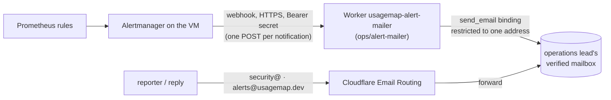

# Runbook: alert e-mail and the security mailbox

Status: built and tested offline; not yet deployed (the Cloudflare token with the permissions below does not exist yet)
Owner: operations lead
Last reviewed: 2026-11-19
Alerts: every alert routed to `maintainers-critical`, `maintainers-warning` or `security-responders`;
NotificationsFailing (`integration="webhook"`) when this path fails

**Design:** alerts go by e-mail to the **operations lead**. The `usagemap.dev` mailboxes
`security@usagemap.dev` and `alerts@usagemap.dev` forward to the operations lead's personal mailbox through
Cloudflare Email Routing. That personal address is **never** in a committed file. It is kept in
`$CONFIG_DIR/alert-destination` on the operator's workstation (`CONFIG_DIR` defaults to
`$XDG_CONFIG_HOME/usagemap`), outside the repository, and in Cloudflare's
configuration. It is not stored on the platform host either.

## How it works

Email Routing only receives and forwards mail; it cannot send. To send, Alertmanager posts each notification to a
small Cloudflare Worker, and the Worker sends it through its `send_email` binding:



- **No SMTP relay and no third-party mail account.** Cloudflare lets a `send_email` binding send to *verified* Email
  Routing destination addresses without onboarding a sending domain, and those sends do not count toward its
  sending quota (`references/cloudflare-send-email-worker-2026-11-19.md`).
- **One notification produces exactly one e-mail.** The message is plain text (UTF-8, base64), from
  `UsageMap alerts <alerts@usagemap.dev>`, with `Message-ID`, `Date` and `Auto-Submitted: auto-generated` headers.
  The subject looks like `[UsageMap FIRING:2] critical IngestBurnRate (maintainers-critical)`. The body lists up to 50
  alerts, each with its summary, description, runbook, start time and labels.
- **Nothing personal or secret goes into the e-mail** (C-26, defence in depth):
  - Labels whose name indicates personal data or a secret (`*_ip`, `user_agent`, `token`, `email`, `wallet`, `seed`,
    `session`, `title`, `query`, …) are shown as `[redacted]`.
  - In every value, the Worker replaces IP addresses, e-mail addresses, Stellar keys (G/S/M), `scfa_` keys, bearer
    tokens, JWTs, `cookie=`/`token=`-style pairs and long opaque strings with placeholders.
  - URL query strings and fragments are removed.
  - `generatorURL` (which carries PromQL in a query string) and `externalURL` are never copied.
- **Logging.** The Worker logs only an event name, the receiver and counts: no address, label value or secret.
- **Sending rules.** The binding sends only to the bound destination, and only from an address of the routing zone.

| Where | What | Secret? |
|---|---|---|
| `ops/alert-mailer/src/{worker,mailer}.js` | the Worker (deployed byte for byte) | no |
| `ops/alert-mailer/wrangler.jsonc` | name, compatibility date, `MAIL_FROM`, an unrestricted `send_email` binding | no |
| Worker binding `MAIL.destination_address` and secret `MAIL_TO` | the operations lead's address | **personal**: Cloudflare only |
| Worker secret `ALERT_TOKEN` | bearer secret Alertmanager presents | **secret** |
| `$CONFIG_DIR/alert-destination` | the operations lead's address, one line | **personal**: workstation only |
| `$CONFIG_DIR/cloudflare-email-token` | API token for the set-up script (below) | **secret** |
| `$CONFIG_DIR/secrets/alert-email-worker-token` | the same bearer secret, created by the script | **secret** |
| `scf_stack_secrets.alert_email_worker_token` (deploy secrets) → `/run/secrets/am_email_worker_token` (0400, uid 65534) | the bearer secret on the VM | **secret** |
| `scf_alert_email_worker_url` (group vars) | `https://usagemap-alert-mailer.<subdomain>.workers.dev/v1/alertmanager` | no |

## API token

A DNS-only token is refused with HTTP 403 for Email Routing.
Create a separate token: dashboard → My Profile → API Tokens → Create Custom Token. Store it as
`$CONFIG_DIR/cloudflare-email-token` (mode 0600). Give it exactly these permissions:

| Scope | Permission (dashboard label · API reference name) | Used for |
|---|---|---|
| Account (only the UsageMap account) | **Email Routing Addresses: Edit** · `Email Routing Addresses Write` | list and create the destination address |
| Account | **Workers Scripts: Edit** · `Workers Scripts Write` | upload the Worker, read the account's workers.dev subdomain, enable the Worker's workers.dev URL |
| Zone `usagemap.dev` (Include → Specific zone) | **Zone: Read** · `Zone Read` | find the zone and account IDs (`GET /zones?name=`) |
| Zone `usagemap.dev` | **Zone Settings: Edit** · `Zone Settings Write` | read and enable Email Routing (`POST /zones/{id}/email/routing/dns`; Cloudflare then adds and locks the MX and SPF records) |
| Zone `usagemap.dev` | **Email Routing Rules: Edit** · `Email Routing Rules Write` | list, create and update the two forwarding rules |

Cloudflare's dashboard calls these groups "Edit" and its API reference calls them "Write"; both names refer to the
same permission. DNS: Edit is **not** needed according to the API reference; add it only if the Email Routing step
answers 403 although the five permissions above are set. Give the token a short lifetime (for example 1 day) and,
optionally, restrict it to the operator's IP address. Revoke it after the set-up. The script needs it again only to
redeploy the Worker or to change the rules.

## Set-up (once; idempotent)

1. Put the operations lead's address into `$CONFIG_DIR/alert-destination` (one line, mode 0600). It must be a
   mailbox outside `usagemap.dev`.
2. Choose the account's workers.dev subdomain once in the dashboard (Workers & Pages), if the account has none.
3. Dry run, which only reads: `ops/scripts/cloudflare-email-setup.sh --check`
4. Apply: `ops/scripts/cloudflare-email-setup.sh`
   - The first run enables Email Routing and registers the destination address. Cloudflare then e-mails a
     verification link to that mailbox, and the script **stops with exit 3**.
   - The operations lead opens the link.
   - Run the script again. It creates the forwarding rules `security@usagemap.dev` and `alerts@usagemap.dev` → the
     destination; an existing rule for either address is corrected and other rules are left alone. Then it uploads
     the Worker with its bindings and secrets and enables its workers.dev URL (no preview URLs).
5. Send one real test e-mail: `ops/scripts/cloudflare-email-setup.sh --test-send`. One message
   `[UsageMap FIRING:1] warning AlertMailerTest (maintainers-critical)` arrives.
6. Test the forwarding: send an e-mail from any outside mailbox to `security@usagemap.dev` and one to
   `alerts@usagemap.dev`. Both arrive in the operations lead's mailbox.

A run with nothing left to do prints `Done (0 change(s))` and sends no write request. Exit codes:

| Code | Meaning |
|---|---|
| 0 | done |
| 1 | `--check` found changes |
| 2 | configuration error (missing file, not one address, destination inside the zone) |
| 3 | waiting for the verification link |
| 4 | Cloudflare API error; the HTTP status and Cloudflare's error codes are printed, never a token or the address |

## Deploy (Alertmanager on the VM)

1. In `$DEPLOY_DIR/ansible/v1.yml`, set `scf_alert_email_worker_url` to the URL the script printed, and set
   `scf_alert_local_only: false` (`infra/ansible/group_vars/v1.yml.example`).
2. `DEPLOY_DIR=$CONFIG_DIR infra/ansible/scripts/v1-secrets.sh --merge-only` adds
   `alert_email_worker_token` to `deploy-secrets.yml`.
3. Run the playbook as usual (`docs/guides/deploy-v1.md`). The role `compose_stack` renders a webhook for
   `maintainers-critical`, `maintainers-warning` and `security-responders` (`scf_alert_email_worker_receivers`) with:
   - `credentials_file: /run/secrets/am_email_worker_token`;
   - `max_alerts: 50` and `timeout: 15s`;
   - `send_resolved` as the route tree sets it (critical and security: yes; warning: no).

   It **refuses** a URL that is not plain `https://host/path`, a secret shorter than 32 characters, or a production
   stack whose required receivers have no channel.
4. Test from the VM. Post a synthetic alert; it arrives after the route's `group_wait` (30 s):

   ```sh
   curl -s -XPOST http://127.0.0.1:9093/api/v2/alerts -H 'content-type: application/json' \
     -d '[{"labels":{"alertname":"DeliveryTest","severity":"critical"},"annotations":{"summary":"alert e-mail test","runbook_url":"ops/runbooks/alert-email.md"}}]'
   ```

**Fallback (local only).** If the Worker is not deployed yet, or Cloudflare is unusable for longer:
- Set `scf_alert_local_only: true` with a `scf_alert_local_only_reason` of at least 20 characters. Every notification
  is then also recorded in VictoriaLogs on the VM, for 30 days.
- Together with the Worker URL, both paths receive.
- Without the Worker URL, **nobody is notified**. The deploy log then says so, and the person on daily watch (C-49)
  has to look at Grafana or Alertmanager through the SSH tunnel.

## Failures

`NotificationsFailing{integration="webhook"}` (runbook `alert-delivery.md`) fires when Alertmanager cannot deliver
to the Worker for 15 minutes. Alertmanager retries every failed notification. Look at
`$DC logs --since 1h alertmanager | grep -i notify` on the VM; the Worker's logs are in the Cloudflare dashboard
(Workers → usagemap-alert-mailer → Logs).

| Worker answer | Cause | Fix |
|---|---|---|
| `401 unauthorised` | bearer secret on the VM ≠ Worker secret `ALERT_TOKEN` | re-run the set-up script (it keeps the file), `v1-secrets.sh --merge-only`, re-run the playbook |
| `500 misconfigured` + log `reason` | a binding or secret is missing or invalid (`ALERT_TOKEN`, `MAIL_FROM`, `MAIL_TO`, `MAIL`) | `cloudflare-email-setup.sh --redeploy` |
| `502 send_failed`, `code: E_RECIPIENT_NOT_ALLOWED` | `MAIL_TO` ≠ the binding's destination address | `--redeploy` (both come from the same file) |
| `502`, `E_SENDER_NOT_VERIFIED` | Email Routing disabled on the zone, or `MAIL_FROM` is not on the zone | `--check`, then apply |
| `502`, `E_RATE_LIMIT_EXCEEDED` | Cloudflare's sending rate (no published number) | wait; Alertmanager retries; reduce noisy alerts |
| `502`, other code | see the Workers API error table (`references/cloudflare-send-email-worker-2026-11-19.md`) | — |
| `400 invalid_notification` | not an Alertmanager v4 payload | check the Alertmanager version and the configuration |
| no answer / DNS / TLS | Cloudflare or the VM's egress | the dead man's switch (`dead-mans-switch.md`) is the independent path |

**Destination address not verified any more** (for example after the mailbox was recreated): rules and sends stop.
Run the script, open the new verification link, and run it again.

## Rotation and changes

- **Bearer secret**:
  1. Delete `$CONFIG_DIR/secrets/alert-email-worker-token`.
  2. Run `cloudflare-email-setup.sh` (new secret, redeploy), then `v1-secrets.sh --merge-only`, then the playbook.
  3. Mail fails with 401 between the redeploy and the playbook run, so run them back to back.
- **New operations lead or new address**:
  1. Change `alert-destination` and re-run the script. A new destination needs verification (exit 3), then run the
     script again: the rules and the Worker follow.
  2. Delete the old destination address in the dashboard (Email Routing → Destination addresses).
- **Worker code change**: merge, then `cloudflare-email-setup.sh`. The script uploads only when the fingerprint of the
  modules and settings changed; `--redeploy` forces an upload.

## Limits and honest caveats

- **One provider, one mailbox.** This path depends on Cloudflare Workers and Email Routing, and on one person's
  mailbox. If Cloudflare is down, alerts do not arrive. The outside dead man's switch (`dead-mans-switch.md`) is
  still needed to notice a silent Alertmanager.
- **Daily watch still needed.** E-mail is not paging. The 24-hour patch commitment still needs the daily watch and a
  second responder (`docs/sla.md` §6.3).
- **Public URL.** The Worker URL is public; only the bearer secret protects it. A caller without the secret gets 401
  and causes no e-mail. Request bodies are capped at 256 KiB.
- **Cloudflare is a sub-processor for alert content.** Alert content is operational data with no visitor data, and is
  scrubbed as above.

## Tests

- `pnpm --filter @usagemap/alert-mailer test` runs three suites offline, with no Docker and no Cloudflare:
  - the unit tests of the Worker logic;
  - the Worker in **workerd** with a `send_email` stand-in that enforces the bound destination, the sender domain and
    `From`/`Message-ID`;
  - the set-up script against a fake Cloudflare API: first run, verified run, idempotent re-run, `--check` drift,
    HTTP 403 and bad input.
- `pnpm --filter @usagemap/alert-mailer test:e2e` needs Docker. Ansible renders the role's Alertmanager template;
  the pinned Alertmanager v0.35.0 runs it; a firing alert posted to Alertmanager becomes **exactly one** well-formed
  e-mail with no personal data or secret.
