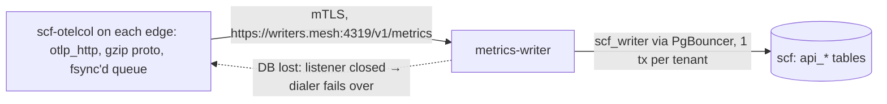

# metrics-writer

Receives the sanitised OTLP metrics of the edge Collectors over **mutual TLS** and writes them into PostgreSQL as
role `scf_writer` **through PgBouncer**, one transaction per tenant under `scf.set_tenant_ctx()`. Decisions: ADR-0009,
ADR-0010, ADR-0011, ADR-0013; register C-22, C-23, C-24, C-103, C-105, C-107, C-112(1)(8), C-113, C-114, C-115, C-116, C-122.
Contracts: `docs/contracts/wire-formats.md` §g (and §f.5 for what arrives), `docs/data-model.md` §8.11, §9, §10.



## Behaviour

| Step | Rule |
|---|---|
| Transport | `POST /v1/metrics`, `application/x-protobuf`, optional `gzip`; compressed and decompressed body ≤ `SCF_WRITER_MAX_BODY_BYTES`. TLS 1.3 only; client certificate from the private CA with exactly one OU in `SCF_WRITER_ALLOWED_CLIENT_OUS` (default `edge`); optional CRL, checked also on resumed sessions; `SIGHUP` reloads. |
| Responses (§g.3) | `200` (empty `ExportMetricsServiceResponse`) when every tenant part committed, was a duplicate, belonged to a removed/unknown tenant, or was rolled back because of its data (`tenant_write_error`); `400` undecodable/oversized; `415` non-protobuf; `503` + `Retry-After: 5` when the database cannot take writes (**unavailable**: connection lost, SQLSTATE classes 08/25/53/57/58, `XX001`/`XX002`, `42501`) or is **busy** (no pooled connection or no turn within the budget; transaction deadline, statement/lock timeout, deadlock/serialisation after 3 retries). Never `429`. |
| Failure classes | *Unavailable* closes the listener; *busy* does not. A part that keeps timing out (≥ 5 timed-out attempts over ≥ 10 min on this writer) is poison: rolled back, `tenant_write_error`, `200`. Data errors (22, 23, `XX000`, other 42) → `tenant_write_error`, `200`. A retry of a request still in flight on this writer (same tenant and batch key) waits for it instead of opening a second transaction. |
| Budgets | `SCF_WRITER_TX_TIMEOUT` (10 s) per tenant transaction inside `SCF_WRITER_WORK_TIMEOUT` (12 s, ≤ 14 s) per request — below the Collector exporter's 15 s timeout, so the Collector never retries a request that is still being applied. |
| Tenant status | Each tenant transaction first asks `scf.writer_tenant_gone()` (definer function, the context's tenant only); a `removed` (purged or waiting for the purge) or unknown tenant gets nothing written — no ledger row, service, route, state, metric or counter — counted only in `scf_writer_points_total{outcome="tenant_gone"}`. Suspended/pending tenants keep already accepted data. |
| Listener (C-107) | Opened only while the probe succeeds (every `SCF_WRITER_PROBE_INTERVAL`): the database answers through the pool, is not in recovery, the session is not read-only, and `scf_writer` may execute `scf.writer_tenant_gone()`; closed when a request or the probe finds the database unavailable, reopened when the probe succeeds. |
| Idempotency (C-23) | Batch key = SHA-256 of the decompressed body; `api_ingest_ledger (tenant, key)` inserted first in each tenant transaction; a conflict commits only `duplicate_batch` (+ points of that part). Two writers receiving one batch serialise on the ledger row. |
| Receipt age (C-112(8)) | Resource `scf.received_at_unix_nano` more than 72 h before the writer's clock → `undeliverable_72h`. |
| Partitions (§10) | Ranges of `api_metrics_1m/_1h/_1d` read from `pg_inherits` (hourly, and on a miss at most once a minute, inside the tenant transaction); a point without a partition in all three → `too_old` / `future`. |
| Services (C-21, C-115) | Lookup by `service.name`; unknown names of **histogram** points auto-registered up to `max_services_per_tenant` (`l0_max_services` when `scf.tenant.level = 0`) with audit row `service.auto_registered`; beyond → `service_quota_exceeded`; names that fail the `api_services` check → `malformed_point`. Counters never register; `{not_allowed}` and unknown names → all-zero service. |
| Backfill | point time < `registered_at − 10 min` → `before_registration`. |
| Stream groups (C-22) | (kind, metric, scope); connector scope stored as `scf/signal_to_metrics`; `rank_key` = kind rank, §g.5 priority, scope; presence per service/UTC day in `api_service_day_groups`. |
| Stream-state bound | A new cumulative stream gets an `api_stream_state` row only if its route is known (in `api_routes` or a placeholder) or fits today's remaining tenant route capacity (`route_cap_per_tenant_day`, `l0_routes_per_day`), and the tenant stays below `stream_state_cap_per_tenant` (250 000; `l0_stream_state_cap` 10 000 at L0) rows; known routes first, then by key. Refused streams keep no state; their points → `route_overflow`. |
| Cumulative → delta (§9.4, C-105, C-122) | State locked `FOR UPDATE` (sorted keys; placeholder rows so concurrent first points serialise). First point (C-122) counted in full when the stream's **source** (tenant, service, instance, scope, metric, rules version) already had a source row before the transaction (a new route / first 404 on a running process) or the source is unseen and `time − start ≤ 10 min` (fresh process), else seeds (`cumulative_first_point`); source rows (`last_layout {"kind":"source"}`) share the sorted locked insert with the stream placeholders and age out with them; stale replay (same start, time ≤ last) dropped silently; reset (new start, decrease, incompatible layout) → whole point if start ≥ last time else dropped (`cumulative_reset`); an exponential scale **decrease** is down-scaled exactly and subtracted (not a reset). Points of one key in one request are processed in time order. Deltas carry no min/max. Zero deltas write nothing. |
| Histograms (§9, C-103) | Explicit: same bounds exact; nested buckets exact; straddling split by width (`hist_layout_approx`, quality 1); open ends use min/max when known; an open last bucket without max is spread over `(lo, 2m − lo]`, `m` its mean estimated from the sum. The OpenTelemetry **millisecond default bounds under unit `s`** (`hist_unit_suspect`, quality 2): most requests above 5 → milliseconds labelled `s`, rescaled ÷ 1000 (exact nesting); otherwise seconds at a useless resolution → the ≤ 5 s mass spread over `(0, min(2m, 5)]` from the sum; without a sum the width split. Exponential scale ≥ 3 → `exp3` exactly (`i3 = i >> (s−3)`), < 3 → explicit15 log-split across **every** bound (`exp_scale_coarse`, quality 2); zero/negative → underflow (`negative_value`). Unit `ms` (should not arrive; the Collector converts) is converted to s. |
| Routes (C-24, C-16, C-89) | Cardinality guard per UTC day, first come first served, under a per-tenant advisory transaction lock: `route_cap_per_service_day`, `route_cap_per_tenant_day` (`l0_routes_per_day` at L0), `route_sibling_cap` literal children per `parent_prefix` → `{overflow}` / `<prefix>/{overflow}` (`route_overflow`). `otel.metric.overflow = true` → `{overflow}`. Overflowed routes never enter the dictionary. `rpc.method` stored only for services with `rpc_method_dimension`, closed set of 13 Stellar RPC methods, else `_OTHER`. Method absent → 0 (`_OTHER`), status absent/invalid → 0. |
| Upserts (§8.11, S-05) | One multi-row `INSERT … SELECT FROM unnest … ORDER BY pk ON CONFLICT DO UPDATE` per (kind × resolution), `_1d` → `_1h` → `_1m`; rows pre-aggregated per primary key in Go. |
| Never retried for ever (C-112(1)) | A converted bucket > 2³¹−1 → `count_overflow` before SQL; a merge refused by `hist_merge_fits` at `_1d` → `count_overflow`, point left out of `_1h`/`_1m`. Deadlock/serialisation failures retried 3× in place. A data error, or a poison part (see failure classes): rollback, `tenant_write_error` in a separate transaction, `200`. |
| Stellar client metrics (C-153, §g.7, migration 0080) | The five metrics of `@usagemap/stellar-otel` (`rpc.client.call.duration`, `http.client.request.duration`, `stellar.tx.submissions`/`polls`/`simulations`; already reduced to closed sets by the Collector's step 4a) go to `scf.stellar_client_{1d,1h,1m}` — **never** to `api_*`: no stream group, route or API state. Dimensions `network`, `operation`, `variant`, `outcome` (table header of 0080) checked again against a character class (a URL, address or message never passes → `malformed_point`). Services resolved and registered like histogram points (quota, audit row). Bounds: older than 34 days → `too_old`, more than 1 h ahead → `future`, before registration − 10 min → `before_registration`. Cumulative → delta with `cumul.Step` against `scf.stellar_client_stream_state` (source = service + explicit instance + scope, C-122); counters as one-bucket layouts. Explicit buckets → explicit15 (the package's bounds nest exactly), exponential → explicit15 log-split (`exp_scale_coarse`). Caps: `stellar_client_stream_cap_per_tenant` (20 000) new streams, `stellar_client_series_cap_per_tenant_day` (5 000) new 1d rows per UTC day, first come first served in key order → `stellar_series_overflow`. Runs after the services step under the tenant's advisory lock (before any API state row is locked); `_1d` first, overflow refused by `hist_merge_fits` / bigint guard → `count_overflow`. |
| Integration client metrics (§g.8, migration 0085) | The ten metrics of `@usagemap/partner-otel` (`stellar.partner.call.duration`), `payments-otel` (`payment.server.events`), `anchor-otel` (`stellar.anchor.request.duration`, `stellar.anchor.events`) and `tools/ap-listener` (`stellar.anchor.transfer.{created,transitions,status.duration,duration}`, `stellar.anchor.customer.updates`, `stellar.anchor.quotes.created`), already reduced by the Collector's steps 4b–4d, go to `scf.integration_metrics_{1d,1h}` — **never** to `api_*` or `stellar_client_*`. Seven ordered dimension columns `d1`…`d7` per metric (table header of 0085; payments: protocol, stage, scheme or method, intent, asset, amount bucket or reason class, `error.type`), `network` from `stellar.network` or `payment.network`; each checked again against a character class and length, no key-like run (→ `malformed_point`). No minute table (payments' worst case ≈ 1.34 M attribute sets per service). Partner and anchor request durations → explicit15; the two anchor transfer durations (minutes to days) keep count and sum only. Same bounds, services step, cumulative → delta (`scf.integration_stream_state`) and upsert rules as the Stellar client stream. Caps: `integration_series_cap_per_service_day` (2 000) and `integration_series_cap_per_tenant_day` (5 000) new 1d rows per UTC day, `integration_stream_cap_per_tenant` (20 000) streams → `stellar_series_overflow`. |
| Privacy | Logs (JSON) carry no addresses, headers, tokens, service names, routes or SQL messages (only SQLSTATE and constraint name); net/http's TLS-handshake lines (which contain the peer address) are counted and replaced. |

## Configuration

| Variable | Default | |
|---|---|---|
| `SCF_WRITER_LISTEN_ADDR` | `:4319` | OTLP/HTTPS listener (mTLS) |
| `SCF_WRITER_ADMIN_ADDR` | `:9464` | plain HTTP: `/metrics`, `/healthz`, `/readyz` (listener open) — internal network only |
| `SCF_WRITER_TLS_CERT_FILE`, `SCF_WRITER_TLS_KEY_FILE` | required | SAN: node name **and** `writers.<mesh>` (C-107) |
| `SCF_WRITER_TLS_CLIENT_CA_FILE` | required | private CA (C-60) |
| `SCF_WRITER_TLS_CRL_FILE` | — | optional |
| `SCF_WRITER_ALLOWED_CLIENT_OUS` | `edge` | comma list of accepted client roles |
| `SCF_WRITER_DATABASE_URL` / `_FILE` | required | PgBouncer, user must be `scf_writer` (refused otherwise) |
| `SCF_WRITER_DB_PASSWORD_FILE` | — | overrides the URL's password |
| `SCF_WRITER_DB_MAX_CONNS` | `8` | S-05: 8–16 |
| `SCF_WRITER_MAX_BODY_BYTES` | 64 MiB | |
| `SCF_WRITER_PROBE_INTERVAL` | `2s` | |
| `SCF_WRITER_TX_TIMEOUT` | `10s` | per tenant transaction; ≤ `SCF_WRITER_WORK_TIMEOUT` |
| `SCF_WRITER_WORK_TIMEOUT` | `12s` | per request, at most 14 s (the Collector's exporter timeout is 15 s) |
| `SCF_WRITER_LOG_LEVEL` | `info` | |

Metrics: `scf_writer_requests_total{code}`, `scf_writer_request_duration_seconds`, `scf_writer_tenant_transactions_total{outcome}`
(`committed`, `duplicate`, `tenant_gone`, `write_error`, `poison`, `unavailable`, `busy`, `timeout`, `retried`),
`scf_writer_tenant_transaction_duration_seconds{result}`, `scf_writer_points_total{outcome}`, `scf_ingest_dropped{reason}`,
`scf_writer_listener_open`, `scf_writer_database_up`, `scf_writer_listener_transitions_total{transition}`,
`scf_writer_tls_handshake_errors_total`.

## Tests

```sh
eval "$(mise env -s bash)"
cd services/metrics-writer
go test -count=1 -race ./internal/...          # unit: histograms, cumulative rules, decoding, rules, server/TLS/listener,
                                               # store (failure classes, in-flight/poison tracking, stream-state bound), config
go test -count=1 ./integration/...             # PostgreSQL 18.6 + PgBouncer 1.26.1 (Compose project scf-wsd, ports 56180–56190),
                                               # db/ migrations via the image, Collector e2e, 60 s 10× load, DB loss
SCF_WSD_LOAD_SECONDS=0 go test -count=1 ./integration/...   # without the load test
integration/stellar-chain/run.sh               # package → Collector → writer → PostgreSQL → control-plane API (C-153)
```

The integration suite fails without Docker unless `SCF_SKIP_DOCKER_TESTS=1`; the Collector e2e needs
`collector/_build/scf-otelcol` (`collector/scripts/build.sh`, or `SCF_OTELCOL_BIN`) unless `SCF_SKIP_COLLECTOR_E2E=1`.
`KEEP=1` leaves the stack up (`docker compose -p scf-wsd -f integration/compose.yaml down -v` removes it).

## Decisions taken here (to be recorded in the contracts)

1. **Stream key layout suffix (§g.4/§g.6):** the key ends with `lp("{layout}=" ‖ "x:" ‖ bounds)` for explicit and
   `lp("{layout}=e")` for exponential points, so two points of one key with different explicit bounds keep separate
   state. Attribute values are rendered as strings (ints decimal, bools `true`/`false`).
2. **Exponential scale decrease** with the same start time is a continuation (exact down-scaling), not a reset.
3. **Writer-side counters** are dated by the writer's UTC day; Collector counters by their point time.
4. `duplicate_batch`, `tenant_write_error` and every other writer reason count **points** (`{point}`).
5. Guard: placeholder routes (`{unknown}`, `{overflow}`, `<prefix>/{overflow}`) are outside the caps and not in
   `api_route_day`; typed-placeholder last segments are not "literal siblings"; `last_seen_at` is refreshed on the
   first use of a route each day.
